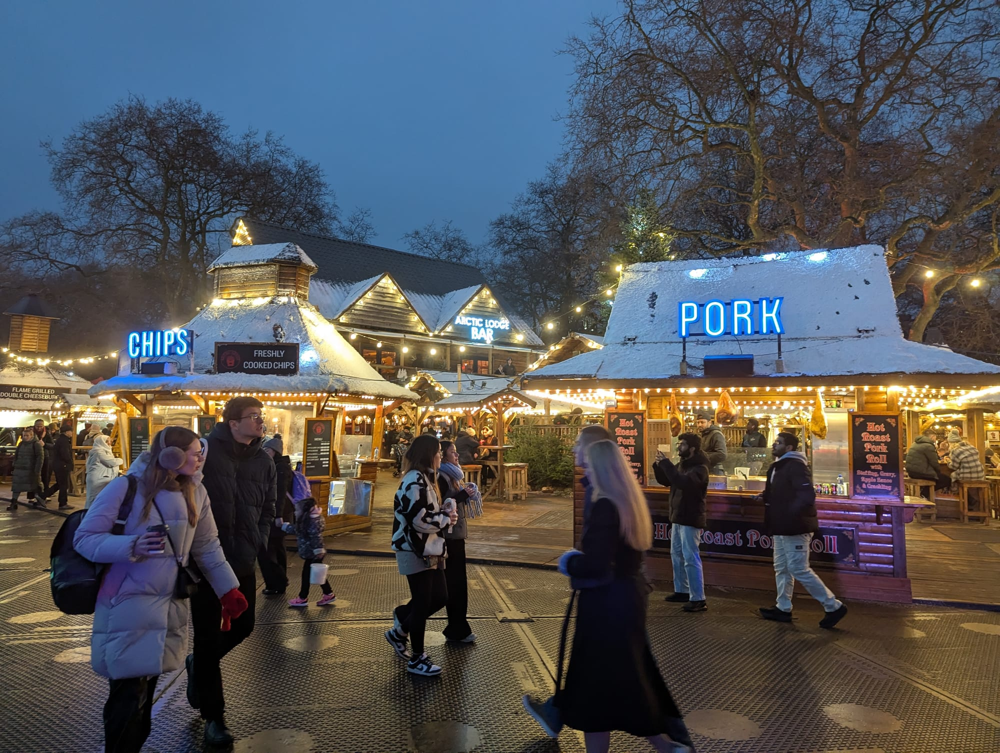
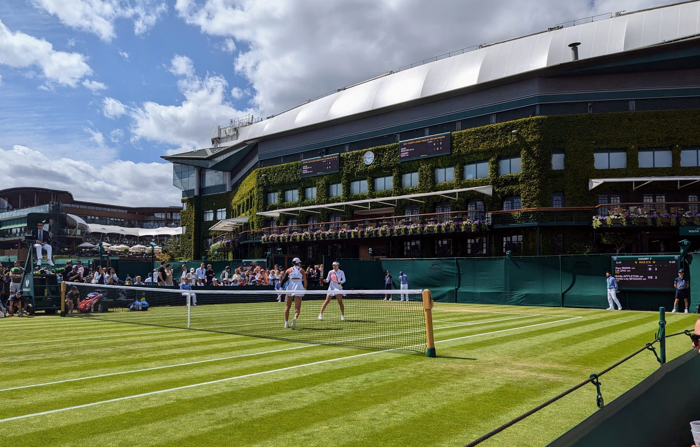
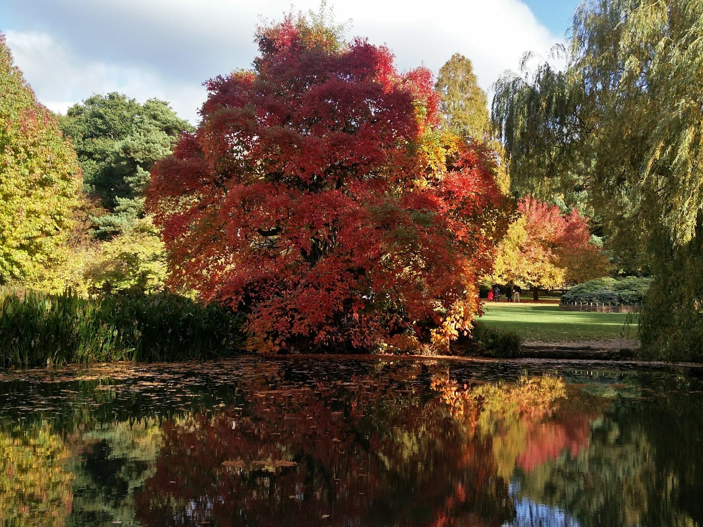

There's no single best month to visit London, only trade-offs. The sunniest month gets nearly four times the sunshine of the dullest, and budget hotels cost far more on a Saturday night.

> 💡 **The Short Version:** May, June and September are the best all-rounder months: mild (18-22°C average highs), 150-197 hours of sunshine a month, and outside the school summer holidays. July and August are warmest (23-24°C) and sunniest (192-206 hours) but also busiest: school summer holidays run for most of both months, and Wimbledon, Pride and Notting Hill Carnival all land in the same ten weeks. November to February is quieter, but October to January is the wettest run of the year (57-67mm a month, against 39mm in March) and December has under 8 hours of daylight. Whatever the month, a Saturday hotel night costs the most. If a fixed date decides your trip, work back from the confirmed events below rather than the month.

## Weather, month by month

Averages are the Met Office's 1991-2020 normals for **Heathrow**. Sunrise and sunset are for central London on the 15th of each month.

| Month | High / low | Rainfall | Sunshine | Sunrise–sunset (daylight) |
| --- | --- | --- | --- | --- |
| January | 8° / 3°C | 59mm | 59 hrs | 07:57–16:22 (8h25m) |
| February | 9° / 3°C | 45mm | 76 hrs | 07:12–17:16 (10h04m) |
| March | 12° / 4°C | 39mm | 120 hrs | 06:13–18:05 (11h53m) |
| April | 15° / 6°C | 42mm | 169 hrs | 06:03–19:58 (13h55m) |
| May | 18° / 9°C | 46mm | 197 hrs | 05:06–20:47 (15h40m) |
| June | 22° / 12°C | 47mm | 197 hrs | 04:40–21:21 (16h41m) |
| July | 24° / 14°C | 46mm | 206 hrs | 04:58–21:14 (16h15m) |
| August | 23° / 14°C | 54mm | 192 hrs | 05:44–20:25 (14h42m) |
| September | 20° / 12°C | 50mm | 150 hrs | 06:33–19:17 (12h43m) |
| October | 16° / 9°C | 65mm | 111 hrs | 07:22–18:09 (10h47m) |
| November | 12° / 5°C | 67mm | 68 hrs | 07:16–16:13 (8h57m) |
| December | 9° / 3°C | 57mm | 53 hrs | 07:57–15:53 (7h56m) |

**July is warmest and sunniest; November is wettest; March is driest; December has the least sunshine and the shortest days.** London gets more than double the daylight in June that it gets in December.

## How busy, and what it costs

**School holidays set London's crowds.** Boroughs set their own calendars; Camden's 2026-27 dates are one example: the Christmas break runs **21 December 2026 to 1 January 2027**, February half term is **15-19 February 2027**, the Easter holidays run **26 March to 9 April 2027**, and the May half term is **31 May to 4 June 2027**. The 2027 summer holidays start **23 July 2027**. Layer UK bank holidays on top — Good Friday and Easter Monday (**26 and 29 March 2027**), the early May and spring bank holidays (**3 and 31 May 2027**), the summer bank holiday (**30 August 2027**), and Christmas Day and Boxing Day (**25 and 28 December 2026**, the 28th a substitute day because the 26th falls on a Saturday).

**Overseas visitors follow the same shape.** The last monthly breakdown the Office for National Statistics has published, for January to June 2024, showed overseas visits to Great Britain ranging from **2.46 million in February**, the quietest month of that run, to **3.91 million in May**, with January at 3.36 million.

**Saturday is the expensive hotel night.** Across the budget London hotels we priced (one room, two adults, including tax) on 14-15 September 2026, the median was **£135** for Wednesday **17 February 2027**, against **£169** for Saturday **17 April 2027** and **£201.50** for Saturday **12 December 2026**. If price decides your dates, book a Sunday-to-Thursday night outside school holidays.

Powered by <a target="_blank" rel="sponsored" href="https://www.getyourguide.com/london-l57/">GetYourGuide</a>

## Month by month: what to expect

### Winter: December to February

**December** has 53 hours of sunshine and under 8 hours of daylight, and packs in the most events: **Hyde Park Winter Wonderland** runs from 19 November 2026 to 3 January 2027, Christmas Day falls on **Friday 25 December**, and school holidays start **21 December**. The Thames fireworks on **31 December** are ticketed rather than free to watch from the riverside enclosures, and have sold out in past years. Our [December guide](/articles/things-to-do-in-london-in-december/) has the dates, closures and transport plan.

*Hyde Park Winter Wonderland at dusk.*

**January:** schools are back by **4 January 2027**, there's no half term, and the only bank holiday is New Year's Day (**Friday 1 January 2027**). The average high is 8°C.

**February** averages 9°C and 76 hours of sunshine, against January's 59. Half term, **15-19 February 2027**, briefly refills the big family attractions. **Lunar New Year's Day falls on Saturday 6 February 2027**, the start of the Year of the Goat; Chinatown usually marks it with a street celebration around that date.

### Spring: March to May

**March** is the driest month (39mm) and still cold (12°C average high). Good Friday and Easter Monday fall on **26 and 29 March 2027**, with the Easter school holidays starting the same Friday and running to **9 April**. British Summer Time begins on **28 March 2027** — clocks go forward at 1am — which is Easter Sunday that year.

**April** averages 15°C (March: 12°C) and has just over two more hours of daylight than March by mid-month. **The Boat Race** is on **Sunday 11 April 2027**, and the **TCS London Marathon** runs across **two days, Saturday 24 and Sunday 25 April 2027**.

*The Marathon's elite women's field.*

**May** averages 18°C and 197 hours of sunshine. The bank holidays are on **3 and 31 May 2027**, the second running straight into the May half term (**31 May-4 June**). The **RHS Chelsea Flower Show** runs **18-22 May 2027**.

### Summer: June to August

**June** has the longest days (16 hours 41 minutes of daylight by mid-month) and a 22°C average high. **Trooping the Colour**, the King's Birthday Parade, is on a Saturday in mid-June. **The Championships, Wimbledon** begin on **Monday 28 June 2027**, the tournament's 150th anniversary year, and run to **11 July**.

**July is the warmest and sunniest month of the year** — 24°C average high, 206 hours of sunshine. **Pride in London** returns on **Saturday 3 July 2027**, and Wimbledon finishes on **11 July**. The BBC Proms run at the Royal Albert Hall from mid-July to mid-September. School summer holidays start on **23 July 2027** in Camden, so most of July is still term time.

*Wimbledon, an outside court.*

**August** is peak family-holiday season: the school summer holidays cover essentially the whole month, and the summer bank holiday is **Monday 30 August 2027**. **Notting Hill Carnival** runs that bank holiday weekend: **Saturday 28 August** (the steel band competition), **Sunday 29 August** (J'ouvert and the children's parade) and **Monday 30 August** (the main parade). The average high is 23°C, with slightly more rain than July.

### Autumn: September to November

**September** starts with schools going back in the first days, and fills its middle weeks with events: **Totally Thames** runs along the river all month, the **Great River Race** is rowed on a Saturday, **Open House** opens hundreds of buildings in mid-month, and the Proms' **Last Night** closes the season. Our [guide to September in London](/articles/things-to-do-in-london-in-september/) covers the exhibitions, openings and theatre.

**October** averages 16°C and ends darker: the clocks go back on the last Sunday of the month (**31 October** in 2027), after which sunset is before 5pm. The **BFI London Film Festival** and **Frieze London and Frieze Masters** take over the middle of the month, then half term refills family attractions for the final week. Our [October guide](/articles/things-to-do-in-london-in-october/) and [where to see autumn leaves](/articles/best-places-autumn-leaves-london/) cover the detail.

*Isabella Plantation, Richmond Park.*

**November is the wettest month (67mm) and one of the darkest**, with daylight down to under 9 hours by mid-month. **Bonfire Night is on 5 November**, and **Hyde Park Winter Wonderland opens on 19 November 2026**, running to 3 January. In between, the [EFG London Jazz Festival](/articles/london-jazz-festival/) takes over 82 venues from **13 to 22 November**, with 19 of its concerts free. Beyond the fireworks displays it's one of the quieter months for crowds, with no half term and no bank holiday. Our [November guide](/articles/things-to-do-in-london-in-november/) has the dates, exhibitions and openings.

Powered by <a target="_blank" rel="sponsored" href="https://www.getyourguide.com/london-l57/">GetYourGuide</a>

## Continue planning your London trip

- ✈️ **[The UK ETA Guide](/articles/uk-eta-guide/)** — the £20 permit to sort before you fly, whichever month you land
- 💷 **[London on a Budget](/articles/london-on-a-budget/)** — where the money really goes once you're here, and what's free
- 🎄 **[Christmas in London](/articles/christmas-in-london/)**, **[Hyde Park Winter Wonderland](/articles/hyde-park-winter-wonderland/)** and **[New Year's Eve in London](/articles/new-years-eve-london/)** — the December run in full
- 🎆 **[Bonfire Night in London](/articles/bonfire-night-london/)** and **[Halloween in London](/articles/halloween-london/)** — the autumn fireworks season
- 🍂 **[Where to See Autumn Leaves in London](/articles/best-places-autumn-leaves-london/)** — the named trees and the peak weeks
- 🏃 **[The London Marathon Guide](/articles/london-marathon-guide/)** and **[How to Get Wimbledon Tickets](/articles/wimbledon-tickets-guide/)** — entry routes for the two biggest sporting dates
- 🎬 **[The BFI London Film Festival](/articles/london-film-festival/)** — booking dates and a practical plan
- 🎪 **[London Music Festivals 2027](/articles/london-music-festivals-2027/)** — the summer park festivals, the 2027 dates already set and the ones a train ride away
- 🗓️ **[Things to Do in London in September](/articles/things-to-do-in-london-in-september/)**, **[in October](/articles/things-to-do-in-london-in-october/)**, **[in November](/articles/things-to-do-in-london-in-november/)** and **[in December](/articles/things-to-do-in-london-in-december/)** — the month-by-month detail this guide points to

*Weather: Met Office 1991-2020 averages for Heathrow. Sunrise and sunset for central London, in local time. School holidays: Camden's 2026-27 calendar; other boroughs and academies vary. Bank holidays: GOV.UK. Event dates from each organiser. Visitor figures: the ONS's monthly figures for January to June 2024. Hotel rates: medians across 51 budget London hotels priced on 14-15 September 2026.*
