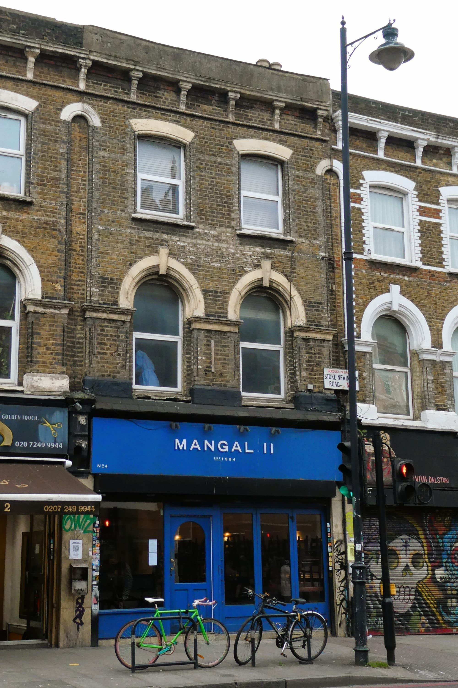
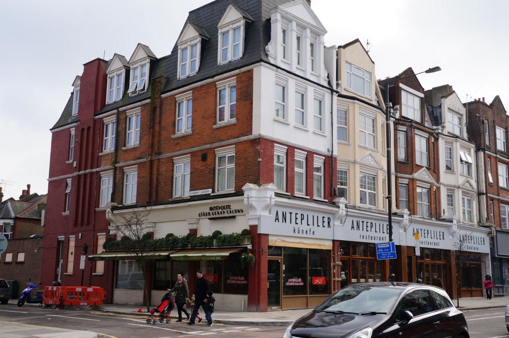
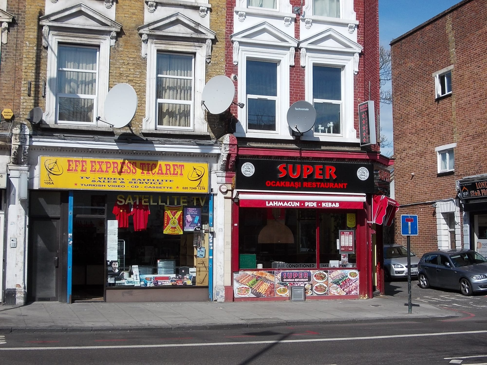
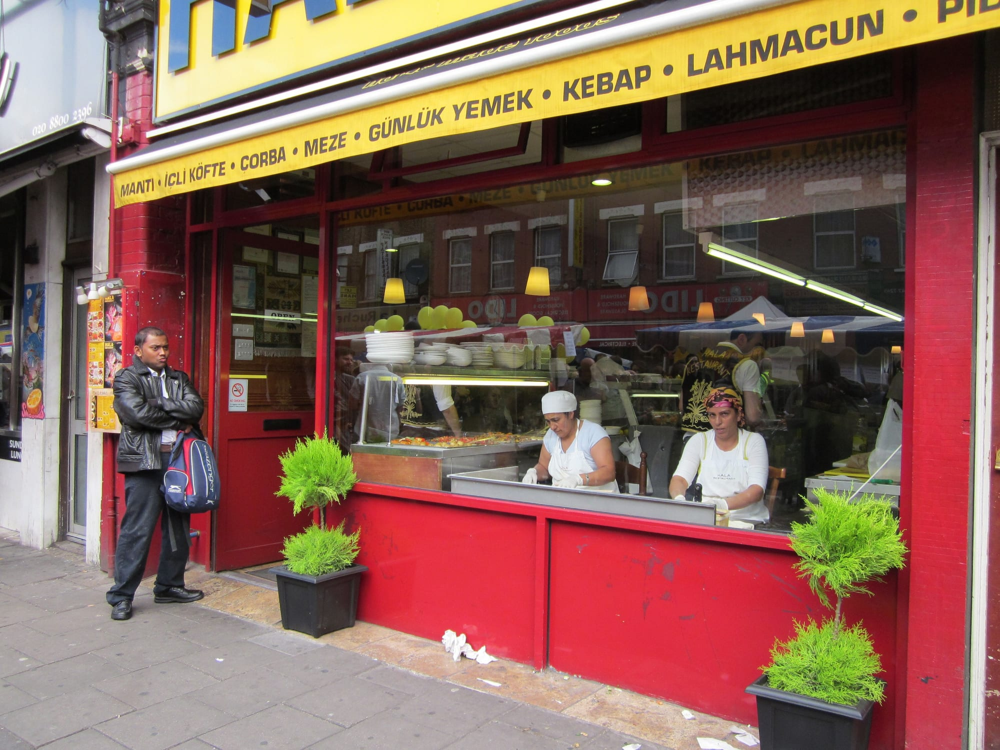

**The best Turkish restaurants in London are on Green Lanes and in Dalston: Antepliler on Green Lanes and Mangal II in Dalston are the most-cited.** Nine of the twenty-seven restaurants that two or more guides agree on sit on **one road** — Green Lanes, running north through Newington Green, Stoke Newington and Harringay — and a second cluster sits a mile west in Dalston.

This guide is arranged by area.

> 💡 **The Short Version:** **Mangal II** in Dalston and **Antepliler** on Green Lanes are the most-cited. **Gökyüzü** is the large Green Lanes grill, open since 1999. **Zahter** and **Yeni** are the two Soho rooms in the Michelin Guide. **Durak Tantuni** is the pick for a cheap tantuni wrap. And if you only make one trip, make it to Green Lanes rather than the West End.

> 📊 **The evidence behind this guide.**
> **7 sources carrying 97 citations** across **53 named restaurants**. **27 restaurants are named by two or more independent sources.**
> **Built on:** Harden's; The Infatuation, Time Out, Suitcase and Secret London.
> *Evidence rebuilt 30 August 2026 · [How we rank →](/how-we-rank/)*

## Where they are

| If you are near… | Where to eat |
| --- | --- |
| **Green Lanes & Harringay** | Antepliler, Gökyüzü, Hala, Köfteci Metin, Durak Tantuni, Diyarbakır Kitchen, Enfes Ocakbaşı, Haringey Corbacisi |
| **Newington Green & Stoke Newington** | 19 Numara Bos Cirrik 2, Üstün Lahmacun & Pide Salonu, 01 Adana |
| **Dalston & Kingsland Road** | Mangal II, Mangal 1, Umut 2000 |
| **Soho** | Zahter, Yeni |
| **Marylebone** | Ishtar, Yamabahçe |
| **Borough & Fitzrovia** | Kismet, Kibele |
| **Notting Hill & west** | The Counter, Lokkanta, Fez Mangal |
| **The City** | Haz, Leydi, Baraka |
| **Elsewhere** | FM Mangal (Camberwell), Dükkan (Hoxton), The Mantl (Knightsbridge), Kibele (Fitzrovia), Mezze Grill (Wembley Park) |

**Price guide:** **£** under £15 a head · **££** £15–£35 · **£££** £40–£70 · **££££** £90+.

---

## The most-cited

### Mangal II, Dalston

*££ · Dalston · Cited by 5 sources*

Joint most-cited in this guide. The Infatuation calls it a classic Turkish restaurant doing things a bit differently; Time Out describes it as refined but endlessly satisfying. Run by the sons of the family behind Mangal 1 down the road.

The ocakbaşı is still the engine — **lamb chops, adana and quail** off the charcoal — but the kitchen plates it as a restaurant, with a **mezze** list and seasonal vegetable dishes. The **lahmacun** is also on the menu.

**It takes bookings, which most of this list does not**, and it has a wine licence rather than a BYOB policy. **It is not Mangal 1**, which is a hundred yards away.

*Mangal II, Stoke Newington Road. Photo: [Ewan-M](https://commons.wikimedia.org/wiki/File:Mangal_II,_Dalston,_N16.jpg), [CC BY-SA 4.0](https://creativecommons.org/licenses/by-sa/4.0/).*

### Antepliler, Green Lanes

*££ · Harringay · Cited by 5 sources*

Joint most-cited; Time Out calls it synonymous with Turkish cuisine in the capital. The kitchen is from Gaziantep in the south-east, so order the kebabs and the pistachio dishes.

There is a separate **Antepliler Künefe & Patisserie** further along Green Lanes doing the sweet half of the same tradition — künefe, the shredded-pastry-and-cheese dessert served hot.

*Antepliler, Green Lanes. Photo: [Ian S](https://commons.wikimedia.org/wiki/File:Antepliler_Restaurant,_Green_Lanes,_Harringay_-_geograph.org.uk_-_3873218.jpg), [CC BY-SA 2.0](https://creativecommons.org/licenses/by-sa/2.0/).*

### Gökyüzü, Green Lanes

*££ · Harringay · Cited by 4 sources*

Open since 1999. A large, brightly lit, loud room with the grill running its length, and a queue outside most evenings.

Order the **mixed grill**. It arrives on a platter built for four and feeds six, with free bread and salad. Adana, shish, lamb chops and liver all come off the same charcoal.

**Walk-in only, open all day and late.** Harringay Green Lanes overground is five minutes; go early evening on a weekday for a quieter room.

### The Counter, Notting Hill

*£££ · Notting Hill · Cited by 4 sources*

A chestnut-toned room with exposed brick and an **open ocakbaşı grill as the centrepiece**.

The grill does **adana kebab**, lamb chops and **lamb liver skewers**. Around them are a **white chocolate babaganoush**, pistachio muhammara and a **spinach and feta pide**.

The Infatuation calls it fun food in a moody dining room. Book at weekends; it fills.

### Yeni, Soho

*£££ · Soho · Cited by 4 sources*

The London offshoot of **Yeni Lokanta in Istanbul**, with a lapis-blue frontage on Beak Street, exposed brick, pastel green tiled tabletops and open shelves of spice jars.

Modern Turkish sharing plates, not grills, from Anatolian technique, and the menu moves with the season. Listed in the Michelin Guide, as is Zahter.

**Book.** The room is small.

---

Powered by <a target="_blank" rel="sponsored" href="https://www.getyourguide.com/london-l57/">GetYourGuide</a>

## Green Lanes

Nine of the twenty-seven restaurants here are on or just off this road, which runs for about a mile. Take the Piccadilly line to Manor House or Turnpike Lane.

*An ocakbasi on Stoke Newington High Street. Photo: [Lucy Fisher](https://commons.wikimedia.org/wiki/File:Super_Ocakbasi_Restaurant,_Efe_Express_Ticaret_(8678907184).jpg), [CC BY 2.0](https://creativecommons.org/licenses/by/2.0/).*

### Hala, Green Lanes

*Gözleme at Hala.*

*££ · Harringay · Cited by 2 sources*

**Family-run since 2002.** Time Out calls it an undeniable leader among London's Turkish restaurants. It is smaller than Gökyüzü up the road.

The **chicken wings** are what it is known for, alongside soups. The **gözleme** is a crisp turnover stuffed with cheese and spinach, rolled and griddled to order.

Walk-in, all day, and calmer at lunch. Harringay Green Lanes is a few minutes away.

### Köfteci Metin, Green Lanes

*£ · Harringay · Cited by 2 sources*

The name translates as "meatball-maker Metin", and that is the menu. **Köfte and very little else** — a specialist rather than a full ocakbaşı.

The köfte are hand-rolled and grilled to order, served with bread and salad. It is a counter, not a dining room.

**Walk-in and cash-friendly**, about fifteen minutes' walk from Turnpike Lane.

### Durak Tantuni, Harringay

*£ · Harringay · Cited by 2 sources*

An all-day and late-night **tantuni house**, serving finely chopped beef cooked on a flat iron plate with cottonseed oil, seasoned hard, and rolled into thin flatbread with tomato, onion and parsley. It comes from Mersin on the southern coast.

That is essentially the whole menu. A counter with a handful of seats, with the tantuni assembled in front of you in about ninety seconds.

**Walk-in, cheap, and open late.** Twelve minutes from Turnpike Lane.

### Diyarbakır Kitchen, Harringay

*££ · Harringay · Cited by 3 sources*

An ocakbaşı on Grand Parade, named for the Kurdish city in the south-east, and **entirely teetotal**.

The **lamb ribs** and the carefully spiced **adana köfte** are the two to order. The **lahmacun** is charred and blistered outside with a smoky mince mixture in the middle, and eaten by hand. Drink **ayran**, the salted yoghurt drink.

Walk-in; the menu is broad enough for a mixed group.

### Enfes Ocakbaşı, Harringay

*££ · Harringay · Cited by 2 sources*

A brightly lit Green Lanes canteen. The Infatuation calls it a grill master, and both sources naming it lead on the meat.

Expect **adana, shish, liver and chops**, each cooked to suit the cut. **Grilled quail** and **lamb liver** are the house specialities. Free bread and salad arrive unasked.

Loud and walk-in, good for families and groups, and five minutes from Harringay Green Lanes.

### Haringey Corbacisi, Green Lanes

*£ · Harringay · Cited by 2 sources*

**A no-menu restaurant specialising in soups and stews**: you look at what is in the pots behind the counter and point.

A *çorbacı* is a soup house. Expect lentil soup, tripe soup and slow-cooked stews served over rice, changing with whatever has been made that morning. Nothing is grilled.

**Cheap, quick and walk-in.** Come at lunch when the pots are full — by late afternoon the choice has thinned to whatever is left.

---

## Newington Green and Stoke Newington

### 19 Numara Bos Cirrik 2, Stoke Newington

*££ · Stoke Newington · Cited by 3 sources*

An old-school ocakbaşı. Sources write the name as Cirrik, Cirrik 19 Numara Bos and 19 Numara Bos Cirrik; the numeral refers to the branch, and there are several along the same corridor.

It is quieter than the Kingsland Road rooms. Reviewers single out the **kebabs** and, unusually for an ocakbaşı, the falafel.

Walk-in. Pick this over Mangal 1 for a quieter meal.

### Üstün Lahmacun & Pide Salonu, Newington Green

*£ · Newington Green · Cited by 2 sources*

A tiny dedicated **lahmacun and pide shop** at the Newington Green end of Green Lanes, and a *salonu*, not a restaurant: you eat quickly, often standing.

The dough is kneaded fresh and rolled **to a Rizla-like transparency** before it goes into the wood-burning oven. Minced lamb, tomato, pepper and parsley on top; you squeeze lemon over it, roll it, and eat it with your hands.

**Made to order, so there is a short wait.** Walk-in.

### 01 Adana, Newington Green

*££ · Newington Green · Cited by 2 sources*

Named after the **number plate code for Adana**, the southern city that gave the kebab its name. The mixed grill is what the room is for. It is roomy, and you can bring eight people without booking a fortnight ahead.

The **adana** is the dish to judge it on: hand-minced lamb, seasoned with red pepper, pressed onto a flat skewer and grilled over charcoal. Chops, shish and liver alongside, with the standard bread and salad.

Walk-in, all day.

---

## Dalston

### Mangal 1, Dalston

*££ · Dalston · Cited by 2 sources*

The original, and a **BYOB ocakbaşı** just off the Dalston strip. The Infatuation calls it a boisterous institution.

The dining room is usually packed with groups cracking open bottles they brought, and the **flatbread and salad arrive within seconds** of sitting down. Off the grill: **köfte**, pink **lamb chops**, and the **sweetbreads** that regulars order specifically.

**Bring your own; there is no licence.** Walk-in and loud.

### Umut 2000, Dalston

*££ · Kingsland Road · Cited by 2 sources*

An ocakbaşı just off Kingsland Road.

The **lamb ribs** are the dish to order: fat rendering over the charcoal, meat pink and coming off the bone.

**Sit where you can see the grill.** Walk-in.

---

Powered by <a target="_blank" rel="sponsored" href="https://www.getyourguide.com/london-l57/">GetYourGuide</a>

## The modern rooms

### Zahter, Soho

*£££ · Soho · Cited by 3 sources*

Just off Carnaby Street, with an **open kitchen you can watch the chefs work in**, listed in the Michelin Guide, as is Yeni. Modern Anatolian, not grill-house Turkish.

The **charcoal-grilled octopus** is the signature. Starters run to aubergine with yoghurt, stuffed peppers in tomato sauce and a **muhammara** — the walnut and red pepper paste — and the mains to chicken thighs and whole sea bass off the same coals.

**Book**, particularly at weekends.

### Ishtar, Marylebone

*£££ · Marylebone · Cited by 2 sources*

A long-running Marylebone room, named after the Sumero-Babylonian goddess.

Modern Anatolian and Mediterranean, not pure grill house: **hummus**, **kısır** (cracked wheat with finely chopped peppers and spring onion), **patlıcan ezmesi** — the smoky aubergine dip — and **patlıcan soslu**, aubergine sautéed in tomato sauce. Chargrilled meats and fresh fish behind the mezze.

**Book a few days ahead** for a weekend table. Five minutes from Baker Street.

### Yamabahçe, Marylebone

*££ · Marylebone · Cited by 2 sources*

Between Marylebone and Mayfair, and **priced below its postcode**.

**Pide and lahmacun, not a full grill menu** — the boat-shaped flatbreads baked to order and topped with cheese, egg or minced lamb, and the thin crisp lahmacun you roll up with lemon and parsley. A short mezze list alongside.

Counter-style and quick, suited to lunch or an early dinner. Walk-in.

### Dükkan, Hoxton

*££ · Hoxton · Cited by 2 sources*

Not a traditional Turkish restaurant, and **open only on certain days**.

The cooking works from Turkish and Anatolian technique rather than the ocakbaşı menu: mezze rebuilt with British produce, on a short changing list.

### The Mantl, Knightsbridge

*££££ · Knightsbridge · Cited by 2 sources*

Turkish cooking at Knightsbridge prices, themed around a family gathering at a hearth. Time Out has had it at number one.

The menu runs the regions: carefully spiced **mezze**, **adana kebab**, open-flame grilled meats and sharing platters, with **mantı** — the small lamb dumplings under garlic yoghurt and burnt butter — and **sarma beyti**, minced lamb wrapped in flatbread and sliced.

**££££. Book.**

---

## The three with judged backing

Harden's lists three Turkish restaurants in London, all in the City.

### Haz, City of London

*££ · City of London · Cited by 2 sources · Harden's*

A small City group that Time Out calls **chic and contemporary**, with branches including Mincing Lane, Plantation Place and Premier Place.

Broad modern Turkish: mezze to start, then **chargrilled kebabs, lamb chops and whole fish** off the grill. Service is pitched at the lunch hour.

Book for weekday lunch; evenings are quieter.

### Leydi, City of London

*£££ · City of London · Cited by 2 sources · Harden's*

Modern Turkish inside the **Hyde London City hotel**, in a dusty pink, soft-lit room.

All-day mezze is the format and the thing to order: the spreads, the pickles, the warm bread.

Listed by Harden's and by the Turkish-British press. Book for a long lunch.

### Baraka, City of London

*££ · City of London · Cited by 1 source · Harden's*

The third of Harden's three City Turkish rooms; no other source in this guide names it.

Modern Turkish: **mezze, grilled meats and fish**, aimed at the City lunch trade.

---

## Recently opened

### Kismet, Borough

*£££ · Borough · books weeks ahead · Named by 4 new-opening guides, not yet by the Turkish lists*

**A meyhane in the style of Istanbul and northern Cyprus**, upstairs at The Globe on Bedale Street, the building used as Bridget Jones's flat.

A meyhane is a drinking house that feeds you, and the format is **long tables, rakı, and food that keeps arriving** — cold mezze first, then hot, then things off the grill, paced to the drinking rather than to a service. Order the rakı and let the kitchen run it.

**£££ and it books weeks ahead.** Come as a group. It is a minute from Borough Market.

Four independent guides name it, all as a *new restaurant* rather than as a Turkish one.

---

Powered by <a target="_blank" rel="sponsored" href="https://www.getyourguide.com/london-l57/">GetYourGuide</a>

## Also named, with less behind them

| Venue | Where | Price | Sources | What it is |
| --- | --- | --- | --- | --- |
| **FM Mangal** | Camberwell | ££ | 3 | A longstanding south London favourite, famous for kofte and the bread that comes with it |
| **Kibele** | Fitzrovia | ££ | 2 | Named after the goddess of fertility and spring |
| **Firin** | Central | ££ | 2 | A bakery-restaurant, carried by The Infatuation and the Turkish-British press |
| **E. Mono** | Green Lanes | £ | 2 | Carried by two independent write-ups and no masthead |
| **Fez Mangal** | Ladbroke Grove | £ | 1 · Time Out | Cafe-style, with a Mayfair branch |
| **Lokkanta** | Bayswater | ££ | 1 · Time Out | Known for its tiled room |
| **Mezze Grill** | Wembley Park | ££ | 1 · Time Out | By the station, and built for a pre-gig meal at the stadium or the arena |

---

## What to know

* **Ocakbasi means the charcoal grill is the restaurant.** Sit where you can see it. The bread arrives straight off it.
* **Most of Green Lanes is walk-in.** Mangal II and the central rooms take bookings; the Harringay grills largely do not, and the queue moves.
* **Many are BYOB or lightly licensed**, Mangal 1 included. Ask rather than assume.
* **Green Lanes runs late.** Gökyüzü and Durak Tantuni are both all-day and late-night.
* **No award covers Turkish restaurants.** Harden's lists three here; the counts measure how many sources agree.

---

## Continue planning your London trip

- 🥙 **[The Best Middle Eastern Restaurants in London](/articles/best-middle-eastern-restaurants-london/)**
- 🇬🇷 **[The Best Greek Restaurants in London](/articles/best-greek-restaurants-london/)** — Greek-Cypriot Palmers Green, further up Green Lanes
- 🍽️ **[Eat in London: Restaurants, Food Markets & Quick Food Hub](/articles/eat-in-london-guide/)**
- 💷 **[Cheap Eats in London](/articles/cheap-eats-london/)**
- 🥩 **[The Best Steak in London](/articles/best-steak-restaurants-london/)**
- 🍛 **[The Best Indian Restaurants in London](/articles/best-indian-restaurants-london/)**
