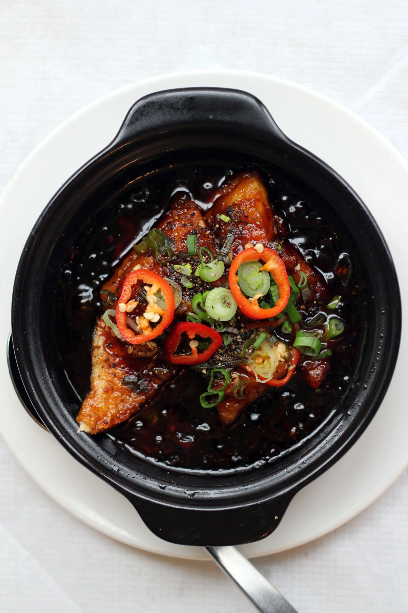
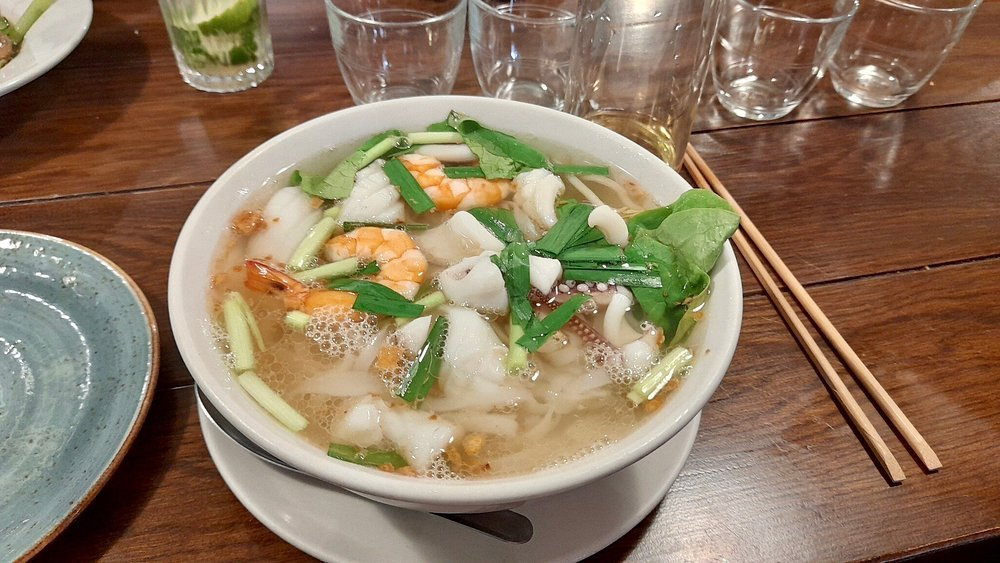
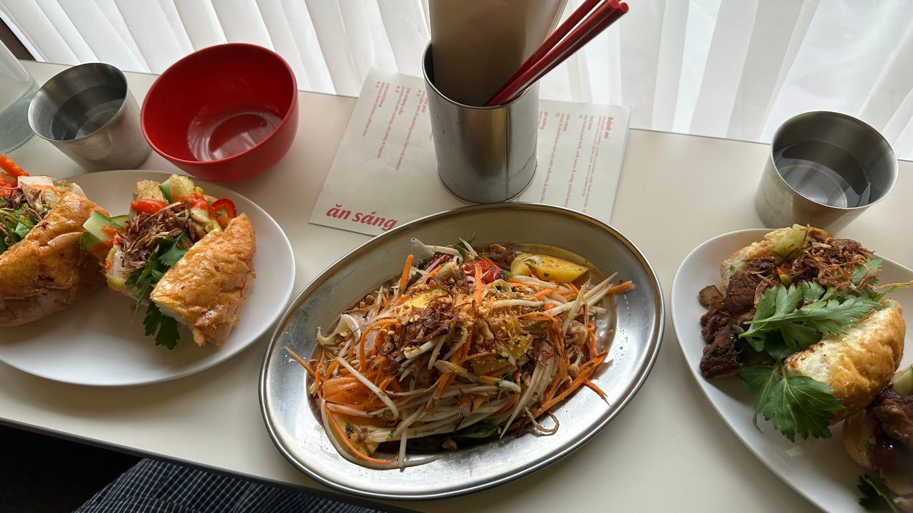
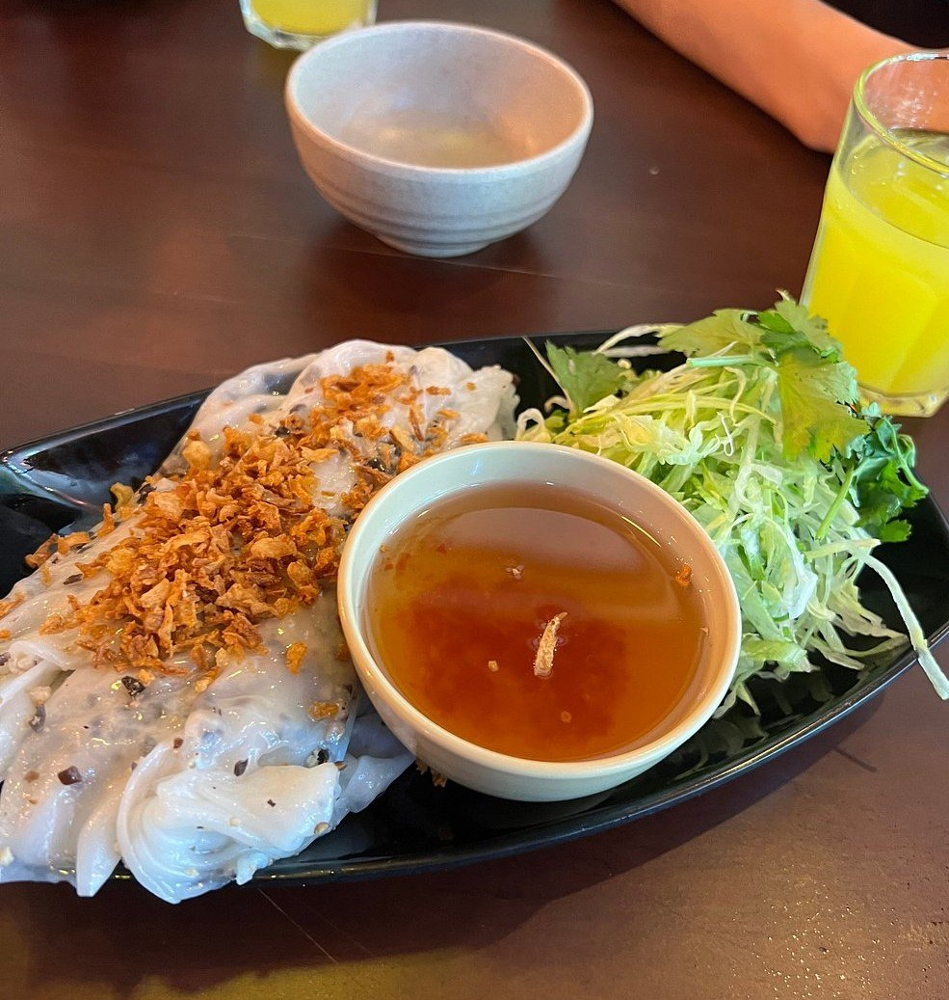

A stretch of Kingsland Road in Shoreditch is known as the Pho Mile.

The two most-named restaurants are on it. **The one judged award went to Peckham, and the bánh mì people argue about comes from a bakery on the Mile, not from one of its restaurants.**

> 💡 **The Short Version:** **Sông Quê Café** on Kingsland Road is named by eight sources, more than anything else. **Lai Rai** in Peckham has the only Michelin Bib Gourmand. **Phở Thúy Tây** near Surrey Quays is the specialist's phở. **Kêu** for bánh mì choice, **Bánh** for the one critics pick. Northern and southern cooking are different — ask which a kitchen does.

> 📊 **The evidence behind this guide.**
> **13 independent sources carrying 88 citations** across **48 named venues**. **19 are named by two or more sources; one carries a dated award.**
> **Built on:** the Michelin Bib Gourmand; The Infatuation, Time Out, Luxury London and SquareMeal; independent writers; YouTube.
> *Evidence built 8 September 2026 · [How we rank →](/how-we-rank/)*

## Where they are

| If you are near… | Where to eat |
| --- | --- |
| **Kingsland Road & Hoxton** | Sông Quê Café, Việt Grill, Mien Tay, Bánh, Sen Viet Vegan |
| **Soho & Covent Garden** | Cây Tre, Hoa Sen (Drury Lane) |
| **Holborn & central** | Viet Eat, Kêu |
| **London Fields & Hackney** | Green Papaya |
| **Peckham** | Lai Rai |
| **Deptford** | Eat Vietnam |
| **Rotherhithe & Surrey Quays** | Phở Thúy Tây |
| **Battersea** | Mien Tay, Lavender Hill |

**Price guide:** **£** under £15 a head · **££** £15–£30 · **£££** £35+.

---

## Kingsland Road, settled

**The two most-cited Vietnamese restaurants in London are both on Kingsland Road:** **Sông Quê Café** and **Việt Grill**. **Bánh**, a bakery a few doors along, is the newcomer critics point at for bánh mì. **Eat Vietnam** in Deptford, **Phở Thúy Tây** in Rotherhithe and **Hoa Sen** on Drury Lane are off the Mile.

The [Shoreditch area guide](/articles/shoreditch-area-guide/) covers the Mile's end of town; Lai Rai sits among the market counters and grocers of the [Peckham area guide](/articles/peckham-area-guide/) on Rye Lane.

### Sông Quê Café — the most-cited Vietnamese restaurant in London

*£ · Kingsland Road, Shoreditch · Cited by 8 sources*

*Sông Quê's clay pot fish.*

A bright green corner site that has drawn **queues since 2002**, family-run, with recipes from the owner Mrs Ánh Phạm. The cooking is **southern** — sweeter and herbier than the northern style.

Eight sources name it, including both YouTube channels in this pass and Thuy Hoang, whose own family have been regulars for years. **No bookings in practice: the queue is the system**, and it moves.

### Việt Grill — Hanoi rice rolls in a designed room

*££ · Kingsland Road, Hoxton · Cited by 6 sources*

*A seafood noodle soup at Việt Grill.*

From **Hiếu Nguyễn**, who is also behind Cây Tre in Soho and the Kêu bánh mì shops.

The order is the **Hanoi-style steamed rice rolls (bánh cuốn)**: soft, with a warm dipping sauce made from meat broth and fish sauce rather than the cold nước chấm most places serve.

### Mien Tay — south-western cooking, and it grew

*£ · Kingsland Road and Lavender Hill, Battersea · Cited by 4 sources*

Specialises in **south-western Vietnamese** food, not the general menu the strip mostly serves, and became popular enough that it **expanded into the building next door** — the Kingsland Road room now runs across 106 and 108 — before opening the Battersea site.

The family are from the Mekong Delta and the menu follows the river: the **Mekong catfish clay pot, £12**, is braised in caramelised palm sugar with shallots and black pepper, and the **chargrilled goat bún chả at £15**. Lemongrass quail is £9. Chef Su Tran cooks, Mrs My Le runs the room, and each site is managed by a different member of the family. **Bookings are by phone**: 020 7739 3841.

---

Powered by <a target="_blank" rel="sponsored" href="https://www.getyourguide.com/london-l57/">GetYourGuide</a>

## The ones off the strip

### Lai Rai — the only judged award

*££ · Rye Lane, Peckham · Michelin Bib Gourmand 2026 · Cited by 2 sources*

**The only Vietnamese restaurant in the UK or Ireland with a Michelin Bib Gourmand**, awarded in February 2026 — the guide's mark for good cooking at a fair price rather than a star.

*Bánh mì at Lai Rai.*

The name means "little by little", and the menu is built to be ordered plate by plate: **prawn lollies on sugarcane with fragrant young rice, £4 each**, a grilled pork neck skewer with lemongrass and toasted coriander for the same, **beef tartare with lemongrass and salted egg yolk at £14**, mussels in a coconut and lemongrass broth at £18. By day it is a **bánh mì** counter instead — soy-braised pork belly with yolk sauce and pickled mustard greens, £12, with Vietnamese coffee at £5 — but only from noon to 3pm on Friday, Saturday and Sunday.

It is a **split-level room of forty seats** on Rye Lane. **Evening service starts at 6pm on weekdays** and runs all day at the weekend with a break from 4pm to 5pm; groups of seven or more eat a £45-a-head set menu on a two-and-a-half-hour table. [Book a table](https://www.sevenrooms.com/explore/lairai/reservations/create/search/).

### Phở Thúy Tây — northern phở, and a position on it

*£ · 1B Rotherhithe Old Road, SE16 2PP · Steps from Surrey Quays Overground · Cited by 4 sources*

*Rice rolls at Phở Thúy Tây.*

Chef patron **Thúy Nguyễn's parents ran a phở stand in Hanoi**, and she opened here in 2014. The room is café-style; most of the customers are Vietnamese.

**The beef phở takes around twenty hours**, and she makes her own chilli sauce for it — declining the southern practice of adding hoisin and Thai basil to the bowl. The menu runs past the familiar into eel, frog's legs and a crab and shrimp-paste vermicelli soup with a snail patty (*bún riêu cua chả ốc*).

**Thursday to Sunday she cooks specials** from whatever she has sourced that week.

### Eat Vietnam — where the community eats

*£ · 234 Evelyn Street, Deptford, SE8 5BZ*

Family-run by Bình Lê and Shelly, cooking from the **Vietnamese Midlands and South** with recipes from Shelly's mother and mother-in-law. **Sixty per cent of the customers are Vietnamese and the chefs live locally.**

Order the **quails marinated in lemongrass** off the charcoal, and the *bánh khọt* — mini coconut pancakes with prawns, eaten wrapped in lettuce with herbs and pickled carrot, then dipped. Time Out names it their pick for Vietnamese barbecue.

**A second site opened a few yards along Evelyn Street and runs Thursdays to Sundays only.**

### Hoa Sen — Vietnamese and Chinese, on Drury Lane

*££ · 22 Drury Lane, WC2B 5RH · Cited by 3 sources*

Chef patron **Bình Nguyễn left Hanoi at fourteen** to work in Hong Kong kitchens, and his kitchen fuses the two cuisines deliberately.

The **Lạng Sơn roast duck** is spiced with *hạt*, and there is a fresh papaya salad with beef jerky (*gỏi đu đủ bò khô*). It would sit just as comfortably in our [Chinese and East Asian guide](/articles/best-chinese-east-asian-restaurants-london/).

### Green Papaya — stir-fries and Xi'an noodles in London Fields

*£–££ · London Fields · Cited by 4 sources*

Family-run, and it **leads on stir-fries and other Vietnamese mainstays rather than on phở**.

It trades as Green Papaya Xi'Viet, and the second half of the name is the part to read: a **Xi'an noodle list** runs down the menu beside the Vietnamese one. **Mount Qi pork noodles, £13.95** — chunks of pork belly in house chilli oil and Sichuan peppercorns, with soya tofu over wheat noodles — and **dan dan noodles at £13.45** sit on the same page as phở and the cold bún bowls.

One room on Mare Street, which the family will close off entirely for a private booking; tables of four or more are held to two hours. **It is closed on Mondays and does not open until 5pm Tuesday to Friday**; weekends it opens at 1pm.

---

## By dish, because the word covers several different meals

**Phở.** Phở Thúy Tây for the northern, twenty-hour version. Kingsland Road for the general one.

**Bánh mì.** **Kêu** has the range: crispy pork belly, kimchi roast chicken, roast duck, and an "original" built on mortadella, across central and east London. **Bánh** on Kingsland Road is the critics' pick and Time Out's outright choice for the sandwich.

**Barbecue and grills.** Eat Vietnam in Deptford, for the lemongrass quails off the charcoal.

**Regional and modern rooms.** Hoa Sen on Drury Lane for the Vietnamese-Chinese crossover; Việt Grill for Hanoi rice rolls in a designed room; Lai Rai in Peckham for the version a Michelin jury liked.

**Vegan.** Sen Viet Vegan in Hoxton, which Time Out picks for exactly that.

---

Powered by <a target="_blank" rel="sponsored" href="https://www.getyourguide.com/london-l57/">GetYourGuide</a>

## What to know

**Ask whether the kitchen cooks northern or southern.** Northern is cleaner and more restrained; southern is sweeter and herbier, and it is what most of Kingsland Road serves. One chef here refuses to put hoisin in her phở.

**Check days, not times.** Eat Vietnam's second Evelyn Street site opens Thursdays to Sundays only, and Phở Thúy Tây's specials run Thursday to Sunday. Both are easy to miss on a Monday.

**Three of these names share one owner.** Việt Grill, Cây Tre and the Kêu shops are all Hiếu Nguyễn's. They are not three independent opinions about where to eat.
