**The best Wetherspoons in London are the ones in buildings that were something else: The Crosse Keys, a 1913 banking hall in the City; Hamilton Hall, the old ballroom at Liverpool Street station; and The Ledger Building, a Grade I-listed dock office at Canary Wharf.** Wetherspoon has bought banking halls, ballrooms, cinemas and dock offices, kept the marble and the plasterwork, and put an £8.68 fried breakfast and a £1.89 bottomless coffee underneath.

> 💡 **The Short Version:** Six branches earn a special trip: **The Crosse Keys** (a marble 1913 banking hall), **Hamilton Hall** (the Great Eastern Hotel's old ballroom, and the chain's first pub in central London), **The Liberty Bounds** (Tower Hill), **The Ledger Building** (Grade I-listed, Canary Wharf), **The Rochester Castle** (Stoke Newington, trading since 1991) and **The Mossy Well** (Muswell Hill). Four more sit inside or beside King's Cross/St Pancras, Euston, Paddington and Waterloo, and three of those opened in 2024 or 2025. A pint here runs roughly half what a standard Zone 1 pub charges. Tea and coffee refills are free all day at £1.89.

## The practical case

### What it actually costs

Every branch sets its own prices, and the printed table menus (Hamilton Hall's, for example) list food and coffee in full but leave beer, wine and spirits blank, pointing to the app instead. A pint of lager or cask ale in an ordinary Zone 1 pub runs **£6 to £8**; at a Wetherspoons, or at most pubs in outer London, it tends to be roughly half that, **around £3 to £4**. A City pint and a Muswell Hill pint are not the same number.

For scale, Wetherspoon's chairman, Sir Tim Martin, put the average price of a pint at **approximately £5** in a September 2025 statement reprinted in the company's 2025 annual report. That is a UK-wide figure, not a Wetherspoon one.

### The food

The menu is the same at every branch: burgers, curries, jacket potatoes, pub classics. At Hamilton Hall's table menu, small plates are **three for £14.99** (three for £12 on Mondays), a burger deal with chips and a drink is **£7.99 to £9.49**, a curry with a drink is **£10.43 to £14.20** depending on the dish and whether the drink is alcoholic, jacket potatoes start at **£6.99**, and an all-day brunch of two eggs, bacon, two sausages, beans and chips is **£12.17** with a soft drink.

### The breakfast

Wetherspoon's own site says the breakfast menu runs from 8am until noon, seven days a week. At Hamilton Hall's prices, a Small breakfast (egg, bacon, sausage, beans, hash brown) is **£6.13**, the Traditional adds a second hash brown and a slice of toast for **£7.01**, and the Large (two eggs, bacon, two sausages, beans, three hash browns, mushroom, two toast) is **£8.68**. Vegetarian and vegan versions sit in the same band. Eggs Benedict is £7.36, and a breakfast muffin with tea, coffee, hot chocolate or a soft drink is £6.01.

### The coffee refill

Tea and coffee are **£1.89 each**, with free refills all day, every day; decaffeinated is the one exclusion. The coffee is 100% Arabica Lavazza. Users of the ordering app report that a refill ordered to the table still has to be collected from the counter.

### Everything else

**The app orders to your table**, food, a round of drinks or both, and pays by card, Apple Pay, Payit or PayPal, with a reorder function for buying rounds. It also books Wetherspoon's more than 50 hotels across England, Ireland, Scotland and Wales. **There is no loyalty scheme.**

**The real ale is a real selling point.** Wetherspoon ran its first beer festival in 1990 and has run one twice a year since, with up to 50 beers at past festivals. **280 Wetherspoon pubs** are in CAMRA's Good Beer Guide 2026, and the group holds Cask Marque accreditation.

Powered by <a target="_blank" rel="sponsored" href="https://www.getyourguide.com/london-l57/">GetYourGuide</a>

## Six branches built into something else

| Branch | Area | Wetherspoon since | Building's earlier life |
| --- | --- | --- | --- |
| **The Crosse Keys** | City, EC3V 0DR | 1999 | HQ of the Hongkong and Shanghai Banking Corporation, opened 1913 |
| **Hamilton Hall** | Liverpool Street station, EC2M 7PY | 1991 — the chain's first pub in central London and at a station | Ballroom of the Great Eastern Hotel; Grade II listed |
| **The Liberty Bounds** | Tower Hill, EC3N 4AA | 1999 | Just outside the City's old "liberty" boundary, by the Tower Hill scaffold site |
| **The Ledger Building** | West India Quay, Canary Wharf, E14 4AL | 2001 | c.1800 dock office that held the West India Docks' ledgers; Grade I listed |
| **The Rochester Castle** | Stoke Newington, N16 0NY | 1991 | Rebuilt 1801 on a site trading as The Green Dragon since at least 1702 |
| **The Mossy Well** | Muswell Hill, N10 3SH | 2015 | An Express Dairy tea room from 1900, later licensed premises |

### The Crosse Keys, City of London

*9 Gracechurch Street, EC3V 0DR · opens 8am Mon–Fri, 8.30am Sat, 9.30am Sun · closes 11pm (midnight Fri) · under-18s 8am–9pm only*

The former headquarters of the Hongkong and Shanghai Banking Corporation, opened on 22 October 1913, with marble columns, a glass-domed ceiling and a banking hall running the length of the room. Wetherspoon has traded here since 1999.

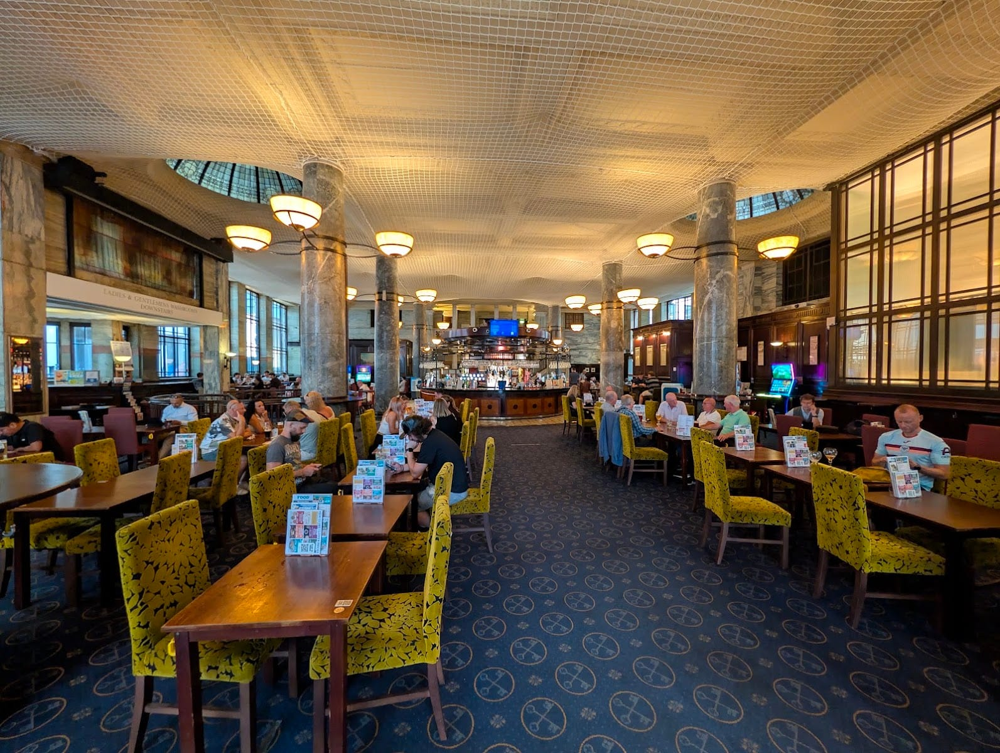

*The Crosse Keys' banking hall.*

### Hamilton Hall, Liverpool Street

*Street-level concourse, Liverpool Street station, EC2M 7PY · opens 7am Mon–Sat, 9am Sun, closes 11.30pm (10.30pm Sun) · under-18s 8am–6pm only*

The former ballroom of the Great Eastern Hotel, with gilded plasterwork, chandeliers and cornicing kept intact under a Grade II listing. It opened as a Wetherspoons on 6 December 1991, **the company's first pub in central London and its first inside a train station**. CAMRA records around ten handpumps on the bar.

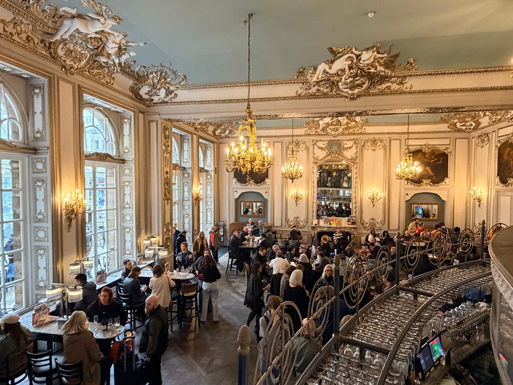

*Hamilton Hall's old ballroom.*

### The Liberty Bounds, Tower Hill

*15 Trinity Square, EC3N 4AA · opens 8am · closes midnight*

Named for its position just outside the old boundary, or "liberty", of the City of London, close to the Tower Hill scaffold site where prisoners from the Tower were executed. Wetherspoon has run it since 1999. Breakfast runs until noon, with free refills on tea and Lavazza coffee all day.

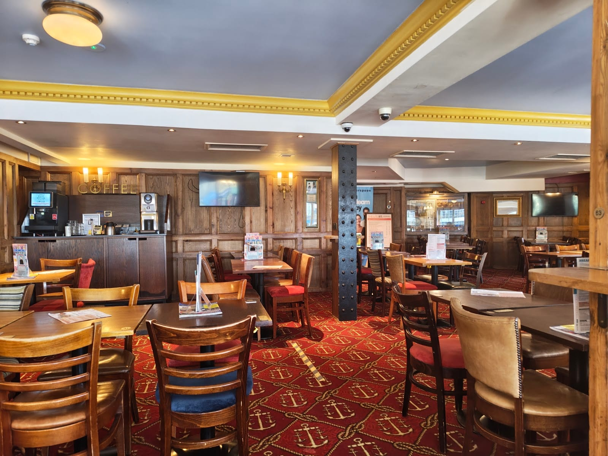

*Free refills at The Liberty Bounds.*

### The Ledger Building, Canary Wharf

*4 Hertsmere Road, West India Quay, E14 4AL · opens 9am · closes midnight (11pm Sun) · under-18s 9am–9pm only*

An early-1800s dock building at the northwest corner of the old Import Dock, named for storing the ledgers of the West India Docks. CAMRA lists the building Grade I, a step above the Grade II of Hamilton Hall. It is a colonnaded quayside room that predates every tower around it by close to two centuries. Wetherspoon has traded here since 2001.

The Crosse Keys, Hamilton Hall and this one get a fuller architectural write-up in our [historic pubs and dining rooms guide](/articles/historic-pubs-dining-rooms-london/), alongside the free Museum of London Docklands next door.

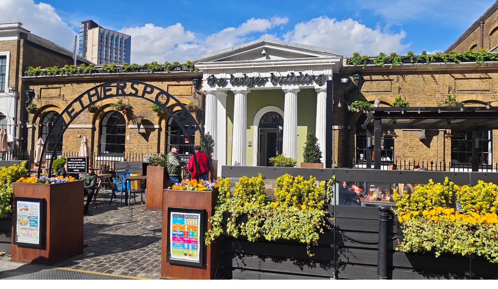

*The Ledger Building, West India Quay.*

Powered by <a target="_blank" rel="sponsored" href="https://www.getyourguide.com/london-l57/">GetYourGuide</a>

## Near the mainline stations

Besides Hamilton Hall, above, four more London termini have a Wetherspoons, and three of the four opened in 2024 or 2025.

### The Barrel Vault, King's Cross / St Pancras

*St Pancras International station, N1C 4QP · opened 2018 · opens 6.30am (7.30am Sun) · closes midnight (1am Fri–Sat)*

The pub is inside St Pancras International, on the King's Cross/St Pancras interchange. It is named for the undercroft beneath the train shed, supported by hundreds of cast-iron columns and used historically to store barrels of Burton beer.

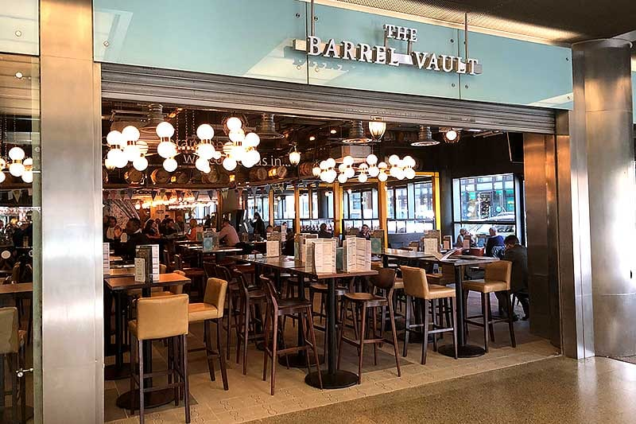

*The Barrel Vault's lights.*

### The Captain Flinders, Euston

*34–38 Eversholt Street, NW1 1DA · opened February 2024 · closes 11.30pm (12.30am Fri–Sat, 10.30pm Sun)*

Named for Captain Matthew Flinders, the Royal Navy explorer who led the first circumnavigation of Australia (1801–03). His remains were discovered by archaeologists during the HS2 dig at Euston, and a statue of Flinders leaning over a map, with his cat Trim, now stands on the station's main concourse.

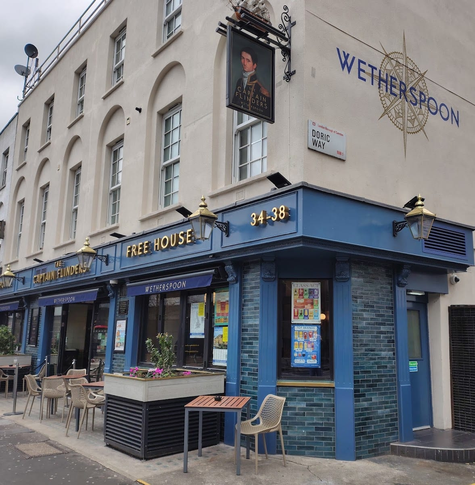

*The Captain Flinders' sign.*

### The Sir Alexander Fleming, Paddington

*5 Merchant Square, Paddington Basin, W2 1AS · opened October 2025 · closes 11pm (11.30pm Fri–Sat, 10.30pm Sun)*

Opened in October 2025 in the Merchant Square development by Paddington station. Alexander Fleming discovered penicillin at St Mary's Hospital, Paddington, in 1928.

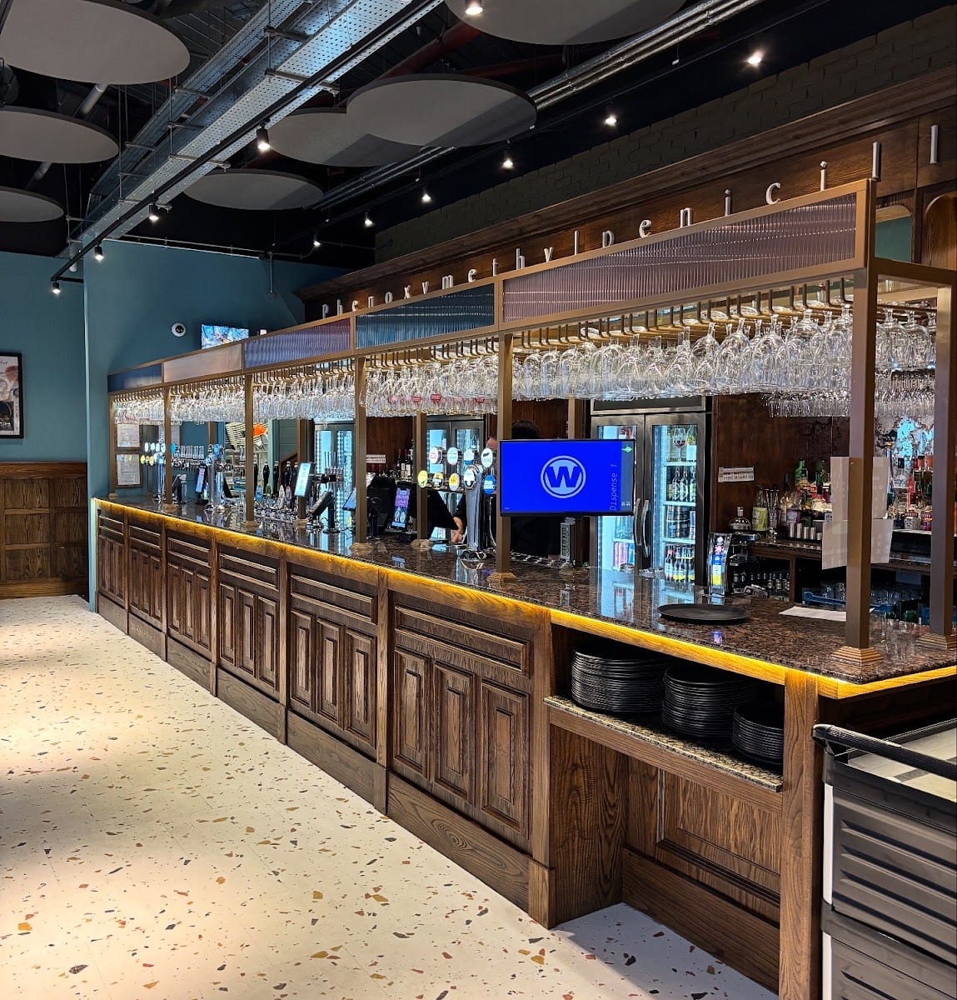

*Phenoxymethylpenicillin above the bar.*

### The Lion, The Unicorn, Waterloo

*Upper-Ground Floor, The Sidings (under platforms 20–24), Waterloo station, SE1 7BH · opened September 2024 · opens 7.30am Mon–Fri · closes midnight (1am Fri–Sat)*

Named after the Lion and Unicorn Pavilion, one of the structures built for the 1951 Festival of Britain on the South Bank.

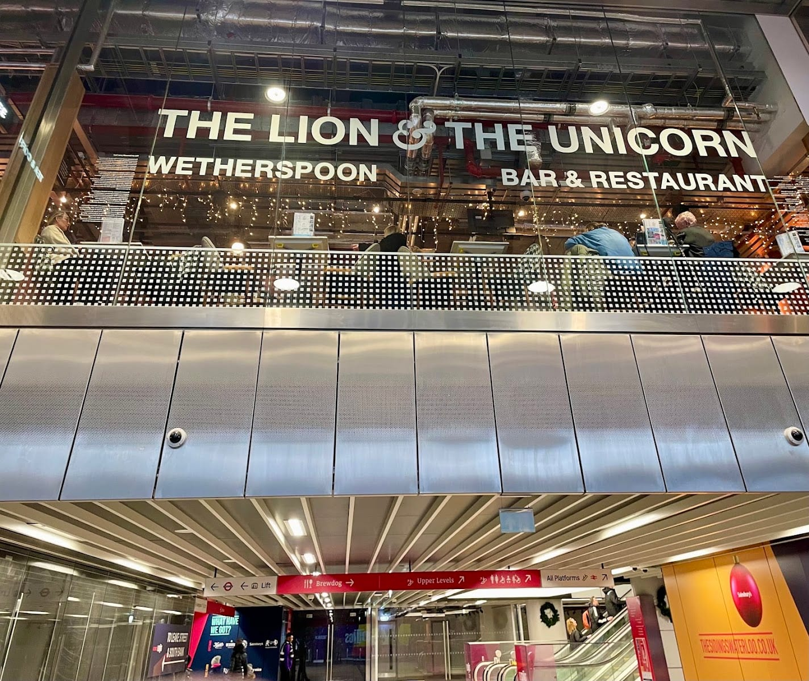

*The Lion, The Unicorn, Waterloo.*

Victoria has two branches: **Willow Walk** on Wilton Road, and one inside the station that has traded as **Wetherspoons** since March 1993.

## Further out, and one more worth the detour

### The Rochester Castle, Stoke Newington

*143–145 Stoke Newington High Street, N16 0NY · closes midnight (1am Fri–Sat)*

The earliest recorded pub on this site was The Green Dragon, trading by at least 1702. The current building replaced it in 1801 and is named after its builder, Richard Payne, who came from Rochester. Wetherspoon has run it since 5 May 1991.

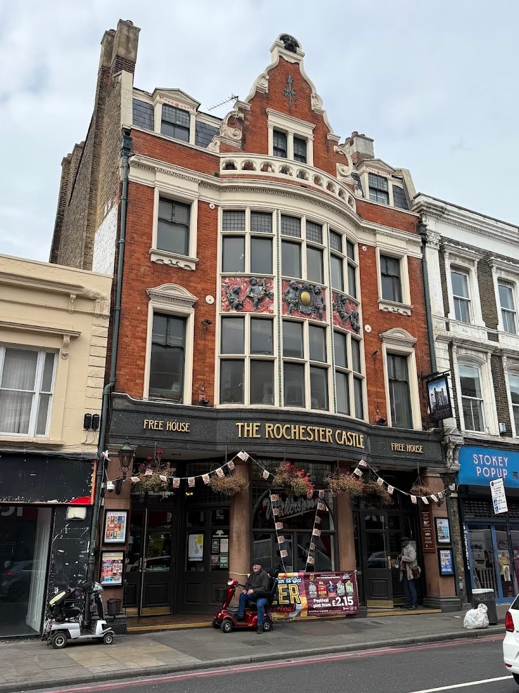

*The Rochester Castle, Stoke Newington.*

### The Mossy Well, Muswell Hill

*258 Muswell Hill Broadway, N10 3SH · closes midnight (1am Fri–Sat)*

This building was Belle Vue Lodge by the early 1800s, an Express Dairy tea room from 1900, and licensed premises from the early 1980s before Wetherspoon took it over in October 2015. The very first Wetherspoons pub opened less than a mile away, on Colney Hatch Lane, on 9 December 1979, in a former bookmaker's shop.

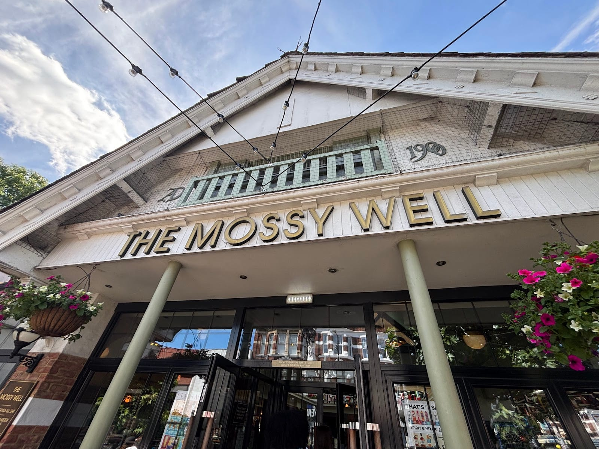

*The Mossy Well's datestone.*

### The Montagu Pyke, Soho

*105–107 Charing Cross Road, WC2H 0BP · closes 11pm (11.30pm Fri–Sat, 10.30pm Sun)*

Built in 1911 as Pyke's Cambridge Circus Cinematograph Theatre, the last of the cinemas opened by the exhibitor Montagu Pyke. It later traded as the Tatler, Filmcenta and a three-screen Cannon, and from 1988 to 1996 was a home of the Marquee Club music venue. Wetherspoon moved in afterwards.

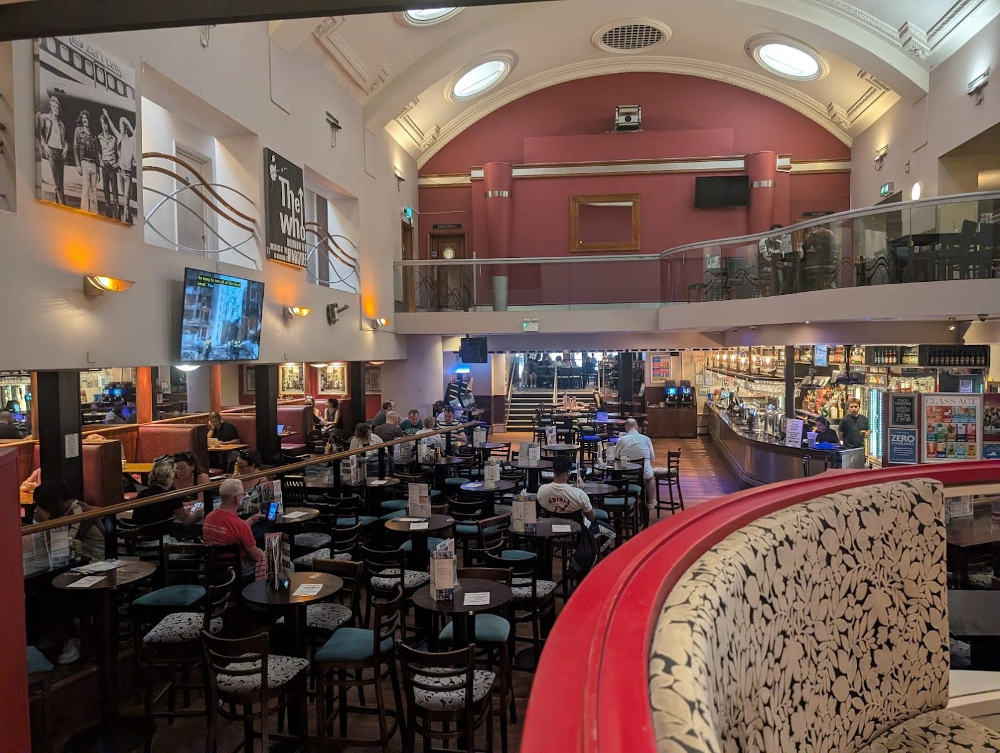

*The Montagu Pyke's old cinema auditorium.*

For a sit-down Sunday lunch, our [best Sunday roast guide](/articles/best-sunday-roast-london/) covers the pubs worth booking. For more of London's cheapest good meals, see our [cheap eats guide](/articles/cheap-eats-london/) and [best breakfast and brunch guide](/articles/best-breakfast-brunch-london/).

Powered by <a target="_blank" rel="sponsored" href="https://www.getyourguide.com/london-l57/">GetYourGuide</a>

## Continue planning your London trip

- 🇬🇧 **[Classic British Food in London](/articles/classic-british-food-london/)** — Scotch eggs, pie and mash, sausage rolls and proper puddings, dish by dish.
- 🍺 **[London's Historic Pubs and Dining Rooms](/articles/historic-pubs-dining-rooms-london/)**
- 🍻 **[The Best Craft Beer Pubs in London](/articles/best-craft-beer-pubs-london/)**
- 🥩 **[The Best Sunday Roast in London](/articles/best-sunday-roast-london/)**
- 🍳 **[The Best Breakfast and Brunch in London](/articles/best-breakfast-brunch-london/)**
- 💷 **[Cheap Eats in London](/articles/cheap-eats-london/)**
