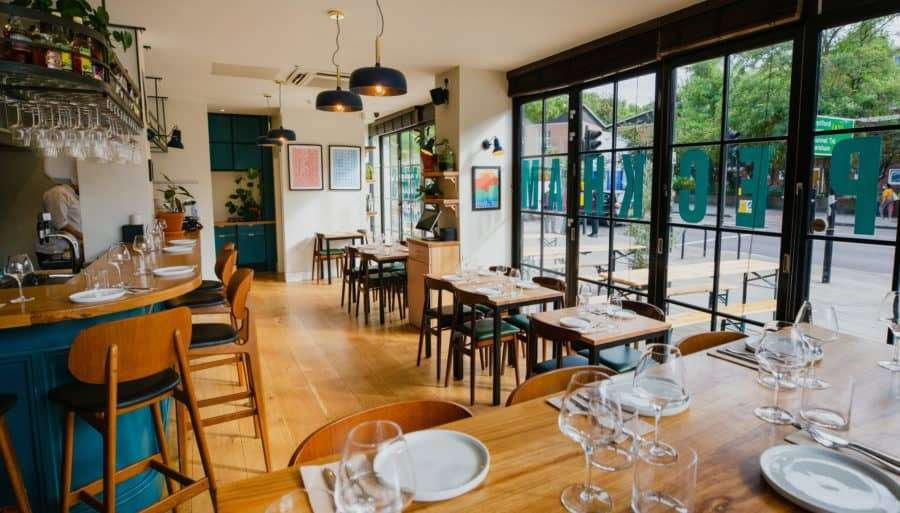
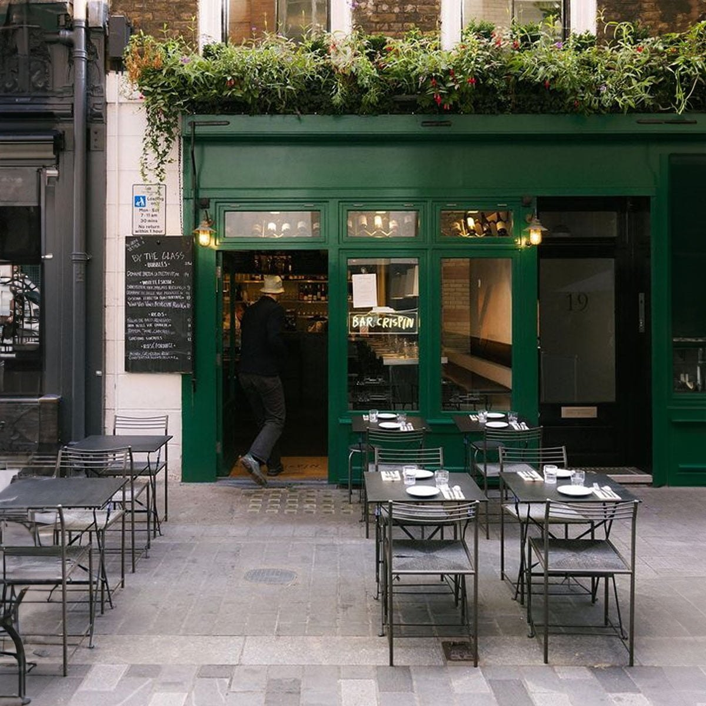
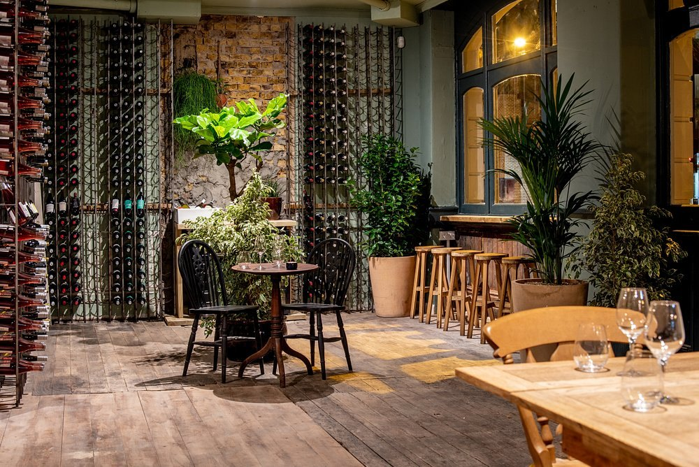
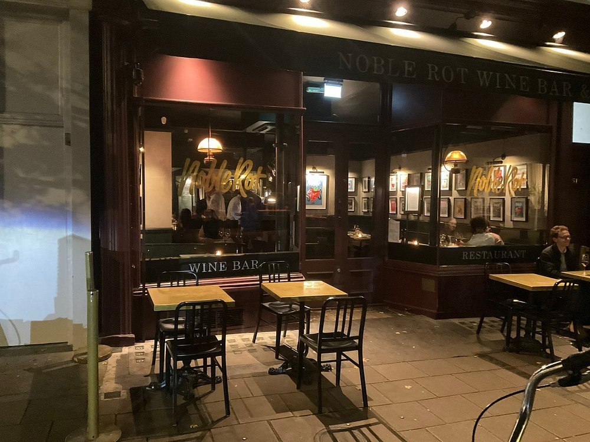
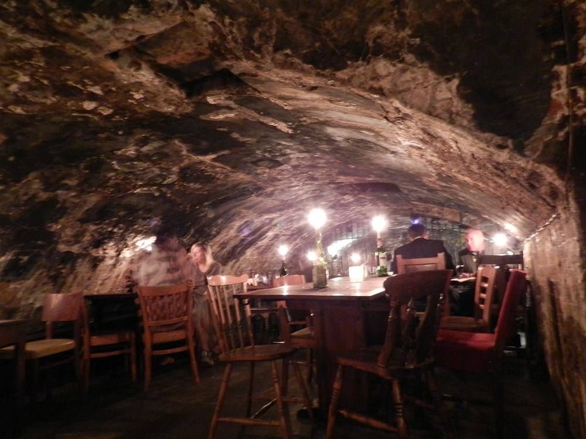
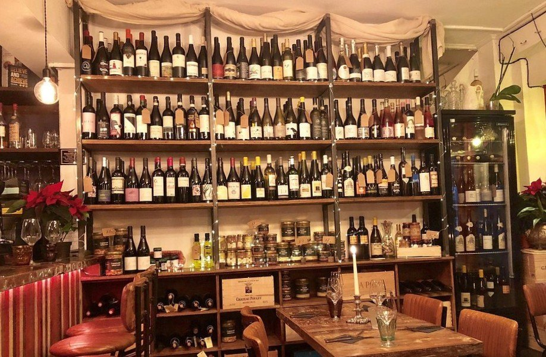

**The country's judged wine award almost never goes to a wine bar.**

Star Wine List of the Year UK has a named jury and a dated ceremony. It awards *wine lists*, and most winners are restaurants: of its 2026 UK Gold Stars, eight went to restaurants and hotel dining rooms, one went to a villa in Ventnor on the Isle of Wight, and exactly one went to a wine bar.

This guide instead ranks the rooms that independent sources keep naming.

> 💡 **The Short Version:** **Peckham Cellars**, **Bar Crispin** and **Diogenes the Dog** are named by eight sources each. **40 Maltby Street** has the hardest table. **Dan's** takes no bookings at all. **Farm Shop** shuts at 8pm. And at the shop-and-bar hybrids you can drink a bottle at shop price plus corkage — **£12 at The 10 Cases** — which is almost always cheaper than the list.

> 📊 **The evidence behind this guide.**
> **15 independent sources carrying 303 citations** across **158 named venues**. **58 are named by two or more sources; one carries a dated award.**
> **Built on:** Star Wine List of the Year UK 2026; Time Out, The Infatuation, Olive and Condé Nast Traveller; YouTube.
> *Evidence built 7 September 2026 · [How we rank →](/how-we-rank/)*

## Where they are

| If you are near… | Where to drink |
| --- | --- |
| **Soho & Covent Garden** | Bar Crispin, The 10 Cases, Lady of the Grapes |
| **Bloomsbury & Mayfair** | Noble Rot, Farm Shop |
| **Farringdon & the City** | Winemakers Club, Quality Wines |
| **Dalston & Hackney** | Dan's, Binch, Newcomer Wines |
| **Islington** | Stable Wines, Godet |
| **Bermondsey & Borough** | 40 Maltby Street, Camille |
| **Peckham** | Peckham Cellars, Bar Levan |
| **Elephant & Castle** | Diogenes the Dog |
| **King's Cross & Kentish Town** | Half Cut Market |
| **Belgravia & Waterloo** | Weezie's, Lower |

**Price guide:** **£** a glass under £8 · **££** £8–£14 · **£££** £15+.

---

## The three the sources agree on

### Peckham Cellars — the neighbourhood one that outgrew the neighbourhood

*££ · Queens Road, Peckham · Cited by 8 sources*

*Peckham Cellars, Queens Road.*

Wine is handled by **Ben McVeigh, formerly head sommelier at 28-50 Fetter Lane**, and the list he has built leans on variety and affordability, with some obscure bottles.

A shop as well as a bar, so the retail-plus-corkage route applies.

### Bar Crispin — 150 bottles, and not a cocktail bar

*££ · Soho · Cited by 8 sources*

*Bar Crispin, Kingly Street.*

The younger sibling of Crispin in Spitalfields, and the one where wine comes first. The list, curated by Daniel Ilsley, runs to **about 150 bottles weighted towards old-world and indigenous grape varieties**, independent producers and natural wines. Food is European, seasonal and snack-led — **Comté gougères with pickled walnut ketchup, monkfish crudo, crab rarebit, lamb skewers**.

**It takes bookings, for up to six**, with a separate process for groups of seven and over — and it is open **seven days, noon to 9.30pm Monday to Saturday and 1pm to 9pm on Sunday**. 19 Kingly Street, on the Carnaby side of Soho.

### Diogenes the Dog — the one with no Champagne

*££ · 96 Rodney Road, SE17 1BG · Walworth · Cited by 8 sources*

*Diogenes the Dog's wine racks.*

**It does not stock Champagne.** It stocks wine from Canada, Texas, Poland, the Czech Republic and Taiwan instead. There is a bottle shop online as well.

**Open Tuesday to Sunday** — Tue–Wed 5–11pm, Thu–Fri noon–11pm, Sat 11am–11pm, Sun 11am–10pm.

---

Powered by <a target="_blank" rel="sponsored" href="https://www.getyourguide.com/london-l57/">GetYourGuide</a>

## The rest of the top of the list

### 40 Maltby Street — the hardest table

*££ · Bermondsey · Cited by 7 sources*

The wine is run by **Gergovie Wines** and leans low-intervention.

**It does not take reservations at all** — you turn up and wait. **Dinner runs Wednesday to Saturday and lunch Thursday to Saturday only.** The wine shop keeps the same Wednesday-to-Saturday hours for off-sales.

Maltby Street is hard to move through during market hours; go outside them unless the market is the plan.

### The Winemakers Club — the table is yours all evening

*££ · Farringdon, beneath Holborn Viaduct · Cited by 7 sources*

Wine bar, shop and importer at once, in brick arches under the viaduct with stained glass and small tables. The list mixes little-known producers with classics.

**Book and the table is yours for the whole evening**, with no second sitting.

### Noble Rot — walk-in bars attached to restaurants

*££–£££ · Bloomsbury, Soho and Mayfair · Cited by 6 sources*

*Noble Rot.*

Three branches, and they are best understood as **wine-led restaurants, not wine bars**: the dining rooms run on bookings. **Bloomsbury and Mayfair both keep dedicated bar spaces that are walk-in only**, so you can drink there without a reservation.

### Half Cut Market — the shop that turned into a Friday night

*££ · 396 York Way, N7 9LW · Between Kentish Town and Caledonian Road · Cited by 6 sources*

**Martinis and meaty skewers** over a nineties playlist. It is restaurant, wine bar, bottle shop and deli in one, so the retail-plus-corkage route works here, and The Times has named it among the 45 best wine bars in the country.

**It takes bookings, and there is a set menu on Tuesdays and Wednesdays: two courses £24, three for £28.**

### The 10 Cases — 300 wines, and the corkage number

*££ · Covent Garden · Cited by 5 sources*

**Over 300 wines**, split across two halves: a *cave à vin* selling bottles, and a bistrot doing hearty French cooking. The cave side is also a bar.

**Corkage is published: £12 on top of the retail price to drink a bottle where you bought it.**

### Dan's — no bookings, and a chalkboard that explains itself

*£–££ · 2–4 Tottenham Road, Dalston, N1 4BZ · Cited by 5 sources*

**No reservations**, and it spills out onto Tottenham Road when the weather allows. The chalkboard describes wines in plain and slightly rude English, not tasting notes — a summery white, an easy red.

Mon–Wed 3–9.30pm, Thu–Fri 2–10.30pm, Sat 1–10.30pm, Sun 2–8.30pm.

### Bar Levan — natural wine, thirty seconds from the station

*££ · Peckham · Cited by 5 sources*

Natural wine and small plates, **about thirty seconds' walk from Peckham Rye station**. The list is organic and biodynamic wine from across Europe by the glass, plus a short aperitif list and a mezcal selection. Food is Parisian-style small plates: burrata with grilled peach and dukkah, mackerel crudo with tapenade, or bavette and frites to share. Seating mixes a dining room with a counter and kitchen-counter stools. It takes bookings but holds back space for walk-ins, running Tuesday to Thursday 5pm-midnight, Friday from 5pm and Saturday from midday.

### Gordon's Wine Bar — a candlelit cellar, and no reservations

*££ · 47 Villiers Street, WC2N 6NE · Between Charing Cross and Embankment · Cited by 6 sources*

*Gordon's Wine Bar's cellar.*

Gordon's, established 1890, is thought to be the oldest wine bar in London. The cellar is vaulted and candlelit, the walls are covered in old photographs and newspaper clippings, and **old oak barrels of sherry and port** sit behind the bar.

> ⚠️ **It takes no reservations at all.** Its own advice is to turn up early and speak to staff on arrival; the cellar fills from about six and there is often a queue on Villiers Street. **The outdoor seating runs under heated awnings all year.**

### Lady of the Grapes — every wine on the list made by a woman

*££ · Covent Garden and London Bridge · Cited by 5 sources*

*Lady of the Grapes.*

**Every wine on the list is made by a female winemaker**, and the selection is organic, biodynamic and minimal-intervention.

The cooking is modern French. Two sites — the **Covent Garden** room is a wine bar and restaurant together, and **London Bridge**, near Borough Market, is the restaurant, with a second bar called Forbidden Fruit alongside it. **Both take bookings.**

---

## Natural or classical, because the market has already split

**Eight of the sources in this pass run a separate natural wine guide alongside their general one.**

**Natural and low-intervention** clusters east and south. Dalston alone has Dan's, Binch — a twelve-seater on Greenwood Road — and Newcomer Wines on Dalston Lane, which took the 2026 Best Austrian Wine List and is the only wine bar in the country's Gold Stars. Peckham has Bar Levan and Peckham Cellars, both within a walk of Rye Lane — the [Peckham area guide](/articles/peckham-area-guide/) has the rest of that evening. Bermondsey has 40 Maltby Street, on the street the [Bermondsey area guide](/articles/bermondsey-area-guide/) is largely about, and a short walk from the Beer Mile if the table does not come free.

**Classical** is where the central rooms sit. Farm Shop on South Audley Street is beneath a Mayfair deli, heavy on Burgundy and Bordeaux, with a courtyard — and **it closes at 8pm**, so go for a long lunch. The 10 Cases and Noble Rot belong here too.

**The hybrids** are a London format: a bottle shop with a bar in it, or the reverse. Stable Wines on Essex Road is a cave beneath a bottle shop with **no written list at all** — the staff talk you through it and pour tastes. Winemakers Club sells and imports as well as pours.

---

Powered by <a target="_blank" rel="sponsored" href="https://www.getyourguide.com/london-l57/">GetYourGuide</a>

## What to know

**Ask the shop price before you order from the list.** At the hybrids the same bottle often has two prices, and the retail-plus-corkage route is usually cheaper. The 10 Cases publishes £12; most of the others will quote a figure if you ask.

**Check the booking policy.** Dan's takes none. Noble Rot keeps walk-in-only bar space beside a bookable dining room. Winemakers Club gives you the table all night. 40 Maltby Street takes no reservations.

**Check closing times.** Farm Shop stops at 8pm. Several of the smaller rooms shut at the start of the week — Bonne Route in Harringay opens Wednesday to Saturday, Lower in Waterloo Tuesday to Saturday. If the evening needs to run on past the room, [the best cocktail bars in London](/articles/best-cocktail-bars-london/) is the next drink and [late-night eating](/articles/late-night-eating-london/) is what is still cooking after midnight, by area.

**Star Wine List's UK Gold Stars are a guide to wine lists with dinner.** They include Claridge's, Trivet and a Tuscan restaurant on Dean Street; only one is a wine bar.

*Wine bars change hours often: check before a long journey.*
