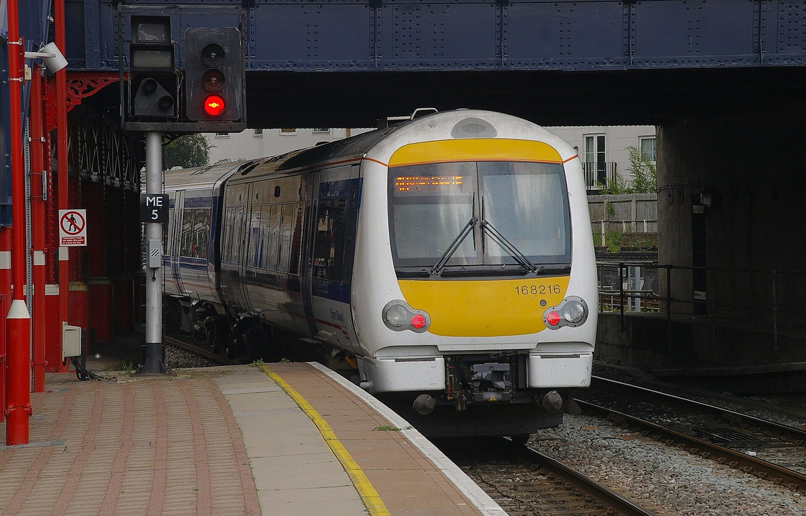
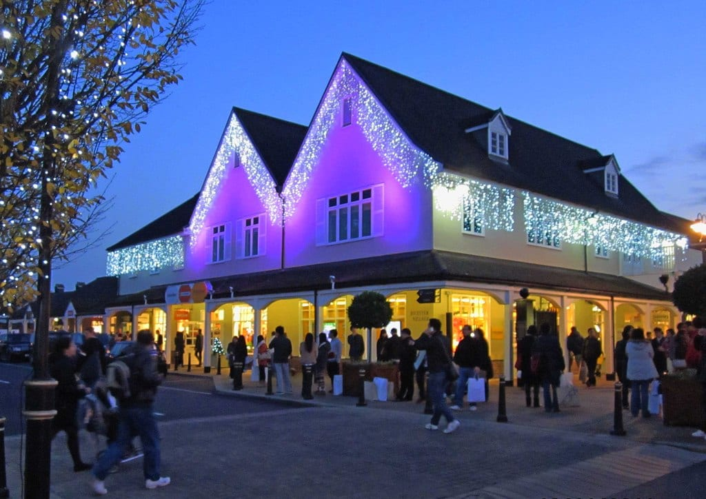

**Bicester Village is an outlet village in Oxfordshire with more than 150 boutiques, and the train from London Marylebone stops at a station on site.** You can go by train, by coach from central London, or on a tour that adds the transport and, on some, Oxford.

> 💡 **The Short Version:** By train, **Chiltern Railways from Marylebone takes about 56 minutes** to Bicester Village station, which is on site; **Oyster and contactless do not work on this line**. The **Shopping Express coach is £45 return** from four central London pick-ups, leaving at 9.30am and back in London about 7pm. You can **book a trip on GetYourGuide instead** and skip working out a train: a day trip from £45, or a private car for a group. The Village's own site shows **9am to 9pm** and says it is open every day.

> 📘 **Booking and prices.** We earn a commission if you book through our GetYourGuide links; the price is the same either way. Prices are the lowest adult price and move with the date.

**Book a trip instead of the train:**

*Shopping trip with VIP discount: £45 · 8 hours · 4.4 from 75 reviews · <a href="https://www.getyourguide.com/activity/-t867896?partner_id=WWP7I0R&amp;cmp=bicester-village-day-trip" target="_blank" rel="sponsored nofollow noopener" data-affiliate="gyg">Book on GetYourGuide</a>*

Powered by <a target="_blank" rel="sponsored" href="https://www.getyourguide.com/london-l57/">GetYourGuide</a>

## The four ways to go

| Way | Price | Time | The catch |
|---|---|---|---|
| Chiltern train from Marylebone | A ticket, not Oyster | About 56 minutes | You leave when you like, and the station is on site |
| Shopping Express coach | £45 return | About 2 hours each way | Fixed 9.30am start and 5pm return, four pick-ups |
| GetYourGuide shopping trip | From £45 | 8 hours | A day trip with a VIP discount in the listing |
| Private car with a driver | From £450 for the group | 7 to 12 hours | Door to door, priced per vehicle |

## By train from Marylebone

Chiltern Railways says Bicester Village is 56 minutes from London Marylebone, and the Village says its own station is on site, with a short, signposted walk into the Village. Contactless and Oyster cards are not valid on this route, so buy a ticket. If your ticket is for Bicester North, a shuttle bus runs to the Village and is free with a ticket marked Bicester North or Bicester Village. The Village says its hosts staff a kiosk in Marylebone station from 8.45am to 4.30pm every day, and Marylebone is on the Bakerloo line.

*A Chiltern Railways train at Marylebone. Photo: [mattbuck](https://commons.wikimedia.org/wiki/File:Marylebone_station_MMB_08_168216.jpg), [CC BY-SA 3.0](https://creativecommons.org/licenses/by-sa/3.0/).*

## The Shopping Express coach

Evan Evans Tours runs the Shopping Express with four pick-ups, each £45 return on its own site:

* **9.30am:** 258 Vauxhall Bridge Road, by Victoria.
* **9.40am:** St James's Court, a Taj Hotel, Buckingham Gate.
* **9.50am:** Thistle London Marble Arch, Bryanston Street.
* **10.10am:** Hilton London Kensington, Holland Park Avenue.

The coach reaches the Village at about 11.30am and leaves at 5pm, so you get five and a half hours. It is back at Kensington at about 6.20pm and at Victoria about 7pm, depending on traffic. There are no toilets on board and hot food and drink are not allowed. [Book direct with Evan Evans Tours](https://evanevanstours.com/tours/day-tours-from-london/bicester-village-shopping-express-coach/).

## VIP discounts

The Village says it never sells VIP cards, and that cards sold online are invalid. It gives them by invitation, for example from the concierge of a hotel near Bicester, or through free membership. Evan Evans says its coach ticket includes an e-VIP code worth a further 10 per cent at participating boutiques only. Check what a VIP discount in a trip listing covers before you pay for it.

## Private trips and Oxford

A private car costs by the vehicle, not by the person, and none of these has enough reviews to rate. **£450 for up to four people** buys a seven-hour trip or a 12-hour trip. **£1,920 for up to six** is the eight-hour VIP tour. To add Oxford, **£634 for up to four** covers a 10-hour return trip; **£750 for up to six** is a Mercedes V-Class day with Oxford and the Village; and **£1,050 for up to three** is a 12-hour day. Our [Oxford guide](/articles/oxford-day-trip/) has the colleges and what they charge.

Powered by <a target="_blank" rel="sponsored" href="https://www.getyourguide.com/london-l57/">GetYourGuide</a>

## At the Village

The Village is at 50 Pingle Drive, Bicester, OX26 6WD, with free parking for drivers, a left-luggage drop at the Train Station Information Hub and a playground. Its site shows 9am to 9pm and says it is open seven days a week. Its site says a Christmas programme of lights and snow starts on 5 November.

*Christmas lights at Bicester Village. Photo: [P L Chadwick](https://commons.wikimedia.org/wiki/File:Christmas_at_Bicester_Village_Outlet_Shopping_Centre_%281%29,_Pingle_Drive,_Bicester_-_geograph.org.uk_-_2707277.jpg), [CC BY-SA 2.0](https://creativecommons.org/licenses/by-sa/2.0/).*

## Tax-free shopping

The Village's services page says it will ship purchases tax-free if you live outside the UK. That is a shipping service, not a refund at the till. Our [tax-free shopping guide](/articles/tax-free-shopping-london/) lists which boutiques take part.

## Continue planning

- 🛍️ **[Shopping in London](/articles/shopping-in-london/)** — the streets and markets, for when you want the West End instead.
- 🎓 **[Oxford from London](/articles/oxford-day-trip/)** — the town the Chiltern line continues to.
- 💷 **[Tax-free shopping in London](/articles/tax-free-shopping-london/)** — what still works since the scheme ended.
- 🗺️ **[Day trips from London](/articles/day-trips-from-london/)** — the other options, with times and prices.
- 🏡 **[The Cotswolds from London](/articles/cotswolds-day-trip/)** — a village day out from the same corner of Oxfordshire.
