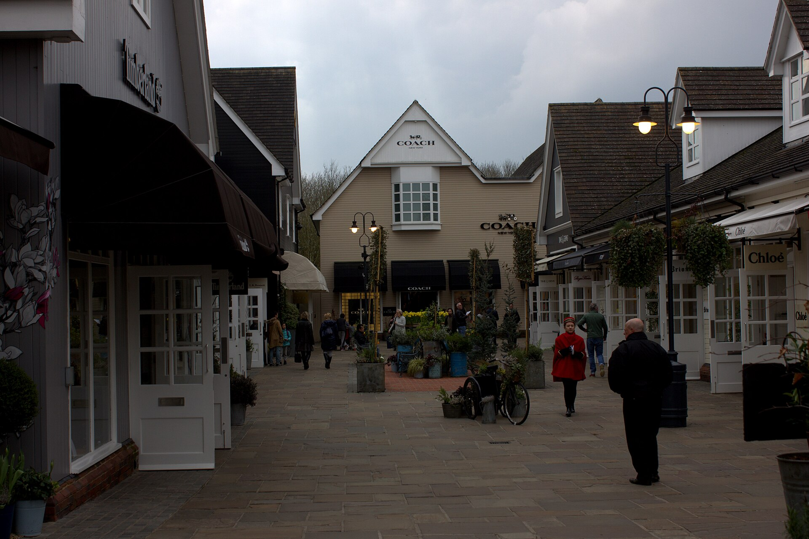
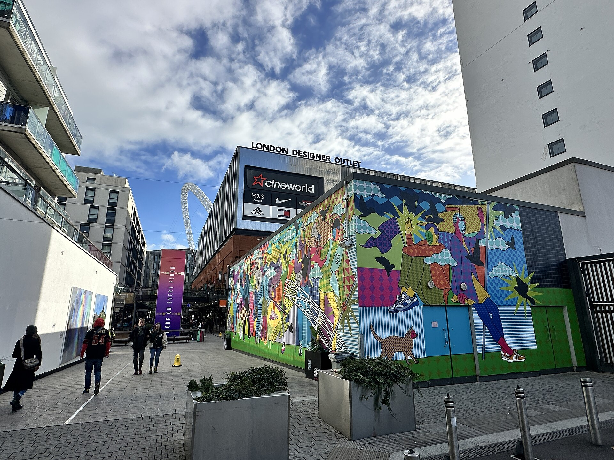

> 💡 **The Short Version:** **Black Friday is Friday 27 November 2026** and Cyber Monday is **30 November**, but most deals are already on. **[London Designer Outlet](#london-designer-outlet)** lists offers from adidas (up to 50% off on a spend-more tier), Calvin Klein, Clarks, Puma and Tommy Hilfiger, most to 30 November; **[Bicester Village](#bicester-village)** has up to 50% off the original retail price until 30 November. **Uber Boat by Thames Clippers** takes 25% off river tickets with code **BF25** until 29 November. **[Selfridges](https://www.selfridges.com/GB/en/features/info/stores/london/) stays open to 10pm**, and the Westfield centres and London Designer Outlet close at 9pm that Friday. **There is no VAT refund for visitors**, so the discount on the ticket is the only saving.

*Hours, dates and offers as listed on 19 November 2026.*

> ⚠️ **Tube drivers strike from noon on Thursday 26 November to noon on Friday 27 November.** The [RMT](https://www.rmt.org.uk/news/tube-drivers-to-take-eight-days-of-strike-action-over-attacks/) called the 24-hour strike, so expect disruption on Friday morning and check TfL Go before you leave. A second strike runs from noon on Thursday 17 December.

## When Black Friday starts and ends

**Many shops start their Black Friday sales earlier in November.** Oxford Street's [Black Friday guide](https://www.oxfordstreet.co.uk/whats-happening/how-to-shop-black-friday-like-a-pro/) says shoppers can find deals there for most of November, and that some retailers cut prices further for Black Friday and Cyber Monday. Its [itinerary for the day](https://www.oxfordstreet.co.uk/whats-happening/plan-your-black-friday-on-oxford-street/) describes it as a whole weekend that ends on Cyber Monday, which is **30 November**. It also notes that John Lewis and Currys price-match other retailers on the same item.

Covent Garden's shops run on a Thursday schedule: its [Festive Thursdays](https://www.coventgarden.london/experience/christmas-in-covent-garden/festive-thursdays) run every Thursday from 12 November to 24 December, and KIKO's Black Friday offer there, **buy three products and get three free**, is on **19 and 26 November**.

## Black Friday deals at the outlets and shopping centres

Each table lists the offers the centre publishes for its own shops, with the dates it gives. In the outlet tables, the "Same deal elsewhere?" column says where else the offer runs: a brand-wide sale is the same on the brand's own site and in its other shops, while an outlet offer is taken off outlet prices and exists only in its outlet stores.

### London Designer Outlet

**[London Designer Outlet's Black Friday page](https://www.londondesigneroutlet.com/black-friday/)** and its [offers list](https://www.londondesigneroutlet.com/offers/) carry these, at Wembley Park. Its Black Friday weekend hours are in the [hours table](#opening-hours-around-black-friday) below.

| Brand | Dates | Same deal elsewhere? | Offer |
| --- | --- | --- | --- |
| **adidas** | 16–30 Nov | Same tiers at adidas at The O2 | 30% off when you spend £70, 40% off at £120, 50% off at £220; clearance excluded |
| **Calvin Klein** | 15 Nov–3 Dec | Same spend-and-save at The O2 | 30% off when you spend £50, 40% off at £200; a separate sale of up to 70% off selected lines runs 16–29 Nov |
| **Clarks** | 17–30 Nov | Brand-wide: the same up to 50% is at Westfield and on clarks.com | Everything reduced, up to 50% off |
| **Columbia** | 16–30 Nov | Outlet only | 30% off the outlet price |
| **Converse** | 18–26 Nov | As listed by the outlet | Up to 50% off selected styles, plus an extra 30% off the last-sizes wall |
| **The Cosmetics Company Store** | 19–26 Nov | Outlet only (the Bicester shop has up to 25% off its Village prices) | 25% off store-wide, with exclusions |
| **Crocs** | 6–30 Nov | Outlet only; crocs.co.uk has up to 50% off instead | Two pairs for £55 |
| **Dune London** | 9–30 Nov | Same at The O2; Dune's own site and Westfield have up to 30% | Up to 50% off everything |
| **French Connection** | 16–30 Nov | Same at The O2 | 20% off everything |
| **Le Creuset** | 1–30 Nov | Outlet only; lecreuset.co.uk has its own, smaller discounts | 40% off selected cast iron, stoneware and kitchen essentials, including mills |
| **ProCook** | 9 Nov–1 Dec | Brand-wide: ProCook's Black Friday sale is also on procook.co.uk | Black Friday sale in store |
| **Puma** | 12–30 Nov | Outlet only; puma.com has up to 50% off its warm-up deals | 30% off everything, with exclusions |
| **Sunglass Hut** | 11–30 Nov | As listed by the outlet | 30% off AI Gen 2 glasses; 30% off the outlet price on a second and third pair; up to 70% off the high-street price on selected last-chance styles; children's second pair half price |
| **The Body Shop** | 13–30 Nov | Outlet only, also at The O2; members get 30% off on thebodyshop.com | 20% off everything |
| **Tommy Hilfiger** | 16–30 Nov | Same at The O2 and both Westfields | Up to 40% off, plus an extra 10% when you buy three |
| **Trespass** | 10–30 Nov | Brand-wide: trespass.com runs its own Black Friday deals | Up to 70% off original prices on selected styles |
| **Vans** | 19–30 Nov | As listed by the outlet | 30% off selected lines; not with any other offer |

### Outlet Shopping at The O2

**[The O2 outlet's offers page](https://www.outletshoppingattheo2.co.uk/offers)** lists these. Shops open **10am to 8pm** every day, except that on Sundays adidas, Calvin Klein, Guess, Nike, Tommy Hilfiger, Next and Søstrene Grene trade from **12pm to 6pm**.

| Brand | Ends | Same deal elsewhere? | Offer |
| --- | --- | --- | --- |
| **adidas** | 30 Nov | Same tiers at London Designer Outlet | 30% off when you spend £70, 40% off at £120, 50% off at £220 |
| **Calvin Klein** | 30 Nov | Same spend-and-save at London Designer Outlet | 30% off when you spend £50, more off on bigger spends |
| **Castore** | 30 Nov | As listed by the outlet | Up to 50% off |
| **Clarins** | 8 Dec | As listed by the outlet | 25% off the recommended price on the full-price collection |
| **Crew Clothing** | 30 Nov | Outlet only | 40% off outlet prices on everything in store |
| **Dune London** | 30 Nov | Same at London Designer Outlet | Up to 50% off everything |
| **French Connection** | 30 Nov | Same at London Designer Outlet | 20% off everything |
| **Guess** | 22 Nov | GUESSLIST members only | 30% off one piece, 40% off two |
| **Levi's** | 29 Nov | As listed by the outlet | Buy one, get the second half price |
| **Lovisa** | 30 Nov | As listed by the outlet | Buy one, get one half price |
| **Nike Factory Store** | 30 Nov | As listed by the outlet | Up to 40% off on a spend-more-save-more tier, with a minimum spend |
| **Skopes** | 30 Nov | The Westfield London shop has up to 50% off full price | Up to 60% off the recommended price |
| **Suit Direct** | 1 Dec | The Westfield shops have 30% off selected styles | An extra 20% off selected styles |
| **The Body Shop** | 30 Nov | Same 20% at London Designer Outlet | An extra 20% off the outlet price on everything |
| **T.M.Lewin** | 30 Nov | As listed by the outlet | Spend £150 and save 15% |
| **Tommy Hilfiger** | 30 Nov | Same at London Designer Outlet and both Westfields | Up to 40% off, plus an extra 10% when you buy three |
| **Under Armour** | 30 Nov | As listed by the outlet | Up to 50% off, plus an extra 15% on three or more items, with no exclusions |

### Westfield London and Stratford City offers

**Westfield publishes a Black Friday page for each centre**, [London](https://www.westfield.com/en/united-kingdom/london/news/black-friday-at-westfield-london/139471) and [Stratford City](https://www.westfield.com/en/united-kingdom/stratfordcity/news/black-friday-at-westfield-stratford-city/139470), and most offers run in both. These are high-street prices, not outlet prices.

| Shop | Dates | Centre | Offer |
| --- | --- | --- | --- |
| **BoConcept** | 19 Nov–1 Dec | London | 15% off the entire collection |
| **Clarks** | 17–30 Nov | Both | Everything reduced, up to 50% off |
| **Deichmann** | 9 Nov–6 Dec | Stratford City | Up to 50% off selected styles with the Black Friday tag, in store and online |
| **Dune London** | 11–30 Nov | Both | Up to 30% off |
| **KIKO Milano** | 20–30 Nov | Both | Buy three products, get three free |
| **L'Occitane** | 20–29 Nov | Both | A Black Friday selection across fragrance, skincare, body care, hair care and refills |
| **Miniso** | 27–30 Nov | Both | 50% off |
| **Pandora** | 20–30 Nov | Both | Up to 30% off |
| **Schuh** | 9–20 Nov | Both | Up to 30% off new-season styles in store |
| **Skopes** | 12–30 Nov | London | Up to 50% off full price |
| **Suit Direct** | 13 Nov–1 Dec | Both | 30% off selected styles in store |
| **Tommy Hilfiger** | 16–30 Nov | Both | Up to 40% off in store |

### Battersea Power Station

**[Battersea Power Station's offers page](https://batterseapowerstation.co.uk/offers/)** has a Black Friday filter. The shopping offers:

* **AllSaints**: **30% off or more across everything** in the Battersea store, **20 November to 6 December**.
* **Kiehl's**: **20% off two or more products, 30% off three or more**, plus 5% more for My Kiehl's Rewards members, **18 November to 1 December**, in the Battersea store; gift sets and advent calendars are excluded.
* **Scamp & Dude**: **up to 50% off**, **18 to 29 November**.
* **Rocket Padel**: **40% off everything in the pro shop**, rackets, padel trainers and EA7 clothing included, **27 to 29 November**, in person at the club only.

The [Uber Boat code](#attractions-passes-and-tours) below gets you there by river from Westminster or the London Eye.

### Bicester Village

**[Bicester Village's Black Friday](https://www.thebicestercollection.com/bicester-village/en/offers/black-friday/) runs from 12 to 30 November**, with **up to 50% off the original retail price** on selected lines in participating boutiques, against its everyday "up to 40%". Each boutique sets its own figure: **up to 70% at Brioni, Givenchy, JACQUEMUS and McQueen**, **up to 60% at Balenciaga, Michael Kors and Rituals**, and **up to 40% at AllSaints and CurrentBody Skin**. Two take money off the Village's already-reduced prices: **The Cosmetics Company Store (up to 25%)** and **The North Face (up to 20%)**. Members who scan their membership code as they shop are entered to win their shopping. The [travel details](#bicester-village-and-the-outlets) are below.

### Department stores

**[John Lewis's Black Friday sale](https://www.johnlewis.com/black-friday/c6000670128)** is on, with **20% off menswear** and **20% off Dior beauty** among the offers on 19 November, and the store price-matches other retailers on the same item. **[Liberty](https://www.libertylondon.com/uk/department/featured/promotion-event/)** lists **up to 30% off, plus up to 20% off beauty**, for Black Friday. Selfridges runs its own sale instead, covered [below](#selfridges).

## Where to shop

### Oxford Street

**Oxford Street's own advice is to arrive after 9.30am.** That misses the rush hour and puts you on the street as the shops, most of which open at 10am, start trading. Since Monday 26 October the stretch between Orchard Street, beside Selfridges, and Great Portland Street has been closed to cars, buses, taxis and bicycles, which leaves the whole width of the street to walk on. Our [Oxford Street guide](/articles/oxford-street-guide/) covers the closure, the bus changes and which Tube station to use for which end.

**John Lewis** is open **10am to 8pm Monday to Wednesday, Friday and Saturday, 10am to 9pm on Thursday, and 11.30am to 6pm on Sunday**, per its [store page](https://www.johnlewis.com/our-shops/oxford-street).

### Selfridges

**Selfridges does not run a sale called Black Friday.** It runs its own seasonal sale over the same weeks instead, which the [Evening Standard](https://www.standard.co.uk/shopping/esbest/fashion/black-friday-luxury-fashion-deals-b1301473.html) reports took up to 40% off in 2025. As of 17 November its [Designer Sale page](https://www.selfridges.com/GB/en/cat/on_sale/) was already listing offers brand by brand, so the discounts are on before the Friday, and each brand sets its own.

The store is on the north side of Oxford Street, about three minutes' walk west of Bond Street station (Central, Jubilee and Elizabeth lines). It is open **10am to 10pm Monday to Saturday** and **11.30am to 6pm on Sunday**, according to its [Oxford Street store page](https://www.selfridges.com/GB/en/features/info/stores/london/), which makes it the latest-opening big shop on this page. Visitors from abroad pay no VAT if Selfridges ships the purchase to an address outside the UK; [Tax-free shopping](#tax-free-shopping) below explains why that is the only route.

### Regent Street and Covent Garden

**Regent Street** is the curve of mid-range and premium shops between Piccadilly Circus and Oxford Circus. It publishes general hours of **10am to 8pm on weekdays, 9am to 8pm on Saturday and 12pm to 6pm on Sunday**, with each shop setting its own on its [directory page](https://www.regentstreetonline.com/plan-your-visit). Hamleys, the seven-floor toy shop, is on the street.

*One of the angels over Regent Street. Photo: Robert Lamb, [CC BY-SA 2.0](https://creativecommons.org/licenses/by-sa/2.0/), via [Wikimedia Commons](https://commons.wikimedia.org/wiki/File:Looking_up_at_one_of_the_angel_decorations_on_Regent_Street_-_geograph.org.uk_-_7679632.jpg).*

**Covent Garden's** shops usually trade **10am to 8pm Monday to Saturday and from about 11am to 6pm on Sunday**, the [Apple Market](https://www.coventgarden.london/about/faqs) is open daily 10am to 6pm, and the Piazza and Market Building are open at all hours. **Thursday 26 November** is the day to aim for: it is a Festive Thursday, KIKO has its Black Friday offer on, and AWAY stays open later, with free personalisation on leather tags.

### Westfield London and Westfield Stratford City

**[Westfield London](https://www.westfield.com/en/united-kingdom/london)**, at Shepherd's Bush, is the larger of the two and has The Village, the luxury wing with Louis Vuitton and Tiffany & Co. Its [Black Friday page](https://www.westfield.com/en/united-kingdom/london/news/black-friday-at-westfield-london/139471) names Zara, COS, AllSaints, Sephora, Charlotte Tilbury, Apple and Samsung among the shops to plan around, and Bill's, Wagamama and Rosa's Thai for a break. Shepherd's Bush (Central line and Overground) and Wood Lane (Hammersmith & City and Circle) are the stations.

*Westfield London, White City.*

**[Westfield Stratford City](https://www.westfield.com/en/united-kingdom/stratfordcity)** sits next to the Olympic Park, and Stratford station has the Central, Jubilee and Elizabeth lines, the DLR and the Overground. Our [Stratford guide](/articles/stratford-area-guide/) covers what else is nearby.

### Bicester Village and the outlets

**[Bicester Village](https://www.thebicestercollection.com/bicester-village/en/visit/)**, in Oxfordshire, has **more than 150 boutiques** and is **open seven days a week**. Its [offers page](https://www.thebicestercollection.com/bicester-village/en/offers/) says "up to 40% off your favourite brands every day" and lists each brand's own figure on selected lines: Burberry up to 40%, Canada Goose up to 50%, Birkenstock up to 60% and Bremont up to 70%. The Village has its Christmas decorations up from 5 November.

*A lane in Bicester Village. Photo: Robert Eva, [CC BY-SA 2.0](https://creativecommons.org/licenses/by-sa/2.0/), via [Wikimedia Commons](https://commons.wikimedia.org/wiki/File:Bicester_village_entrance_-_geograph.org.uk_-_5325474.jpg).*

**How to get there.** The Village says it is under an hour from London, and the direct route is Chiltern Railways from **London Marylebone**, a trip of about 56 minutes to Bicester Village station, which is a short walk from the Village. **Oyster and contactless are not valid on that line**, so buy a ticket. The Village runs a hosts' kiosk inside Marylebone station, **open 8.45am to 4.30pm seven days a week**, and its [getting here page](https://www.thebicestercollection.com/bicester-village/en/visit/getting-here/) lists the coach, bus and car options.

**[London Designer Outlet](https://www.londondesigneroutlet.com/)**, at Wembley Park, is the nearest outlet to the centre and publishes **Black Friday weekend hours**: **9am to 9pm on Friday 27 and Saturday 28 November, and 10am to 7pm on Sunday 29 November**. **Wembley Stadium station**, on the Chiltern line, is **9 minutes from Marylebone**, and Wembley Park (Jubilee and Metropolitan lines) also serves it, per its [getting here page](https://www.londondesigneroutlet.com/getting-here/). It shares its site with Wembley, so check what is on at the stadium before you go.

*London Designer Outlet, with the Wembley arch behind. Photo: Matt Brown, [CC BY 4.0](https://creativecommons.org/licenses/by/4.0/), via [Wikimedia Commons](https://commons.wikimedia.org/wiki/File:Wembley_Park,_London_Designer_Outlet_2026-10-18.jpg).*

**[Outlet Shopping at The O2](https://www.outletshoppingattheo2.co.uk/)** is inside The O2 at North Greenwich, **open seven days a week** and, in its own words, 15 minutes from central London by Tube. Our [shopping guide](/articles/shopping-in-london/) compares the two London outlets.

## Opening hours around Black Friday

Hours are each operator's usual hours, except London Designer Outlet, which publishes its Black Friday weekend hours. A shop inside a centre can still differ from the centre.

| Where | Fri 27 Nov | Sat 28 Nov | Sun 29 Nov | Source |
| --- | --- | --- | --- | --- |
| **Selfridges, Oxford Street** | 10am–10pm | 10am–10pm | 11.30am–6pm | [Selfridges](https://www.selfridges.com/GB/en/features/info/stores/london/) |
| **John Lewis, Oxford Street** | 10am–8pm | 10am–8pm | 11.30am–6pm | [John Lewis](https://www.johnlewis.com/our-shops/oxford-street) |
| **Regent Street** (general guide) | 10am–8pm | 9am–8pm | 12pm–6pm | [Regent Street](https://www.regentstreetonline.com/plan-your-visit) |
| **Westfield London** | 10am–9pm | 10am–9pm | 12pm–6pm | [Westfield](https://www.westfield.com/en/united-kingdom/london) |
| **Westfield Stratford City** | 10am–9pm | 9am–9pm | 12pm–6pm | [Westfield](https://www.westfield.com/en/united-kingdom/stratfordcity) |
| **London Designer Outlet** | 9am–9pm | 9am–9pm | 10am–7pm | [LDO](https://www.londondesigneroutlet.com/opening-times/) |
| **Outlet Shopping at The O2** | 10am–8pm | 10am–8pm | 10am–8pm (some shops 12pm–6pm) | [The O2 outlet](https://www.outletshoppingattheo2.co.uk/) |

**Shops open for fewer hours on Sundays.** Large shops in England and Wales can open for only six hours between 10am and 6pm, which is why the Sunday columns end at 6pm. Our [shopping guide](/articles/shopping-in-london/) explains the rule.

## When the crowds peak, and how to avoid them

Oxford Street describes Black Friday as one of the busiest shopping days of the year, and its own advice for the rest of the year is that **weekday mornings are quietest** and **weekends and the last days before Christmas are busiest**. The photograph at the top of this page is Oxford Circus after dark.

* **Go before the crowd, not after it.** On Black Friday itself, arrive after 9.30am and shop the shops that open at 10am first. For a head start, **Westfield Stratford City and Regent Street open at 9am on Saturday**, and **London Designer Outlet opens at 9am on Friday and Saturday**.
* **Use the late hours.** Selfridges to 10pm and the Westfield centres to 9pm give you an evening that the 8pm closers do not.
* **Skip Saturday afternoon on Oxford Street.** TfL closes the Oxford Circus station entrances when crowds build, and Bond Street and Tottenham Court Road on the Elizabeth line are the way round it.
* **Do Covent Garden on Thursday 26 November.** It is the day with late-night shopping, performances and KIKO's Black Friday offer.
* **Take a bag you can carry hands-free**, as Oxford Street's own guide suggests, and wear shoes for a street over a mile long.

## Make it a Christmas trip

**All the West End lights are on by Black Friday.** Oxford Street's switch-on is Monday 9 November and Covent Garden's is Thursday 12 November, and our [Christmas lights walk](/articles/christmas-lights-walk-london/) links the displays from Selfridges to Trafalgar Square in the dark. Evenings after 6.30pm Monday to Wednesday are the quiet window.

**[Hyde Park Winter Wonderland](https://hydeparkwinterwonderland.com/) opens on Thursday 19 November**, so it is running by the Friday. Our [Winter Wonderland guide](/articles/hyde-park-winter-wonderland/) has the prices and the quietest times, our [Christmas markets guide](/articles/christmas-markets-london/) lists the others by what each is for, and [Christmas in London](/articles/christmas-in-london/) puts them in one plan. The [November](/articles/things-to-do-in-london-in-november/) and [December](/articles/things-to-do-in-london-in-december/) guides cover the rest of the calendar, and our [gifts and souvenirs guide](/articles/london-gifts-souvenirs/) covers what to buy to take home.

## Restaurant and food deals

* **[Frankie & Benny's](https://www.frankieandbennys.com/food-discount)**: **40% off food**, festive specials included, **Sunday to Thursday until 26 November**, so it ends the day before Black Friday. Sign up on its website for a code, show it at the table, one code per table; drinks are excluded. There is a branch at London Designer Outlet.
* **Paris Baguette at Battersea Power Station**: its Dark Sugar Cold Foam Brew is **free for the first 100 drinks on Friday 27 November** and **£2 on 28 and 29 November**, per the [centre's offer page](https://batterseapowerstation.co.uk/offers/paris-baguette-black-friday-free-dark-sugar-cold-foam-brew/).
* **Sticks'n'Sushi**: a gift card bought online between **27 November and 4 December** gets **an extra 10% added to its value**, per [Battersea Power Station](https://batterseapowerstation.co.uk/offers/sticksnsushi-festive-gifting-10-extra/), where it has a restaurant.

Our [London food deals guide](/articles/food-deals-london/) has the offers that run all year: 2-for-1s, percentage-off deals, student discounts and deals by day of the week.

## Tax-free shopping

**Visitors cannot claim the 20% VAT back on shopping in London**, and the refund has not existed in Great Britain since 1 January 2021. A Black Friday discount is therefore the only saving, unless the shop ships your purchase abroad. Selfridges and Harrods do that at the till, as do fourteen Bicester Village boutiques, and the shop must arrange the shipping for the VAT to come off. Our [tax-free shopping guide](/articles/tax-free-shopping-london/) has the shipping costs, the delivery times and what your home country will charge on arrival.

## Travel and attraction deals

### Theatre tickets

**[London Box Office has a Black Friday 2026 page](https://www.londonboxoffice.co.uk/black-friday)** with the discounts below. The percentage and the "from" price are as the site lists them, and tickets are sold while stocks last.

| Show | Theatre | Listed as | From |
| --- | --- | --- | --- |
| **Million Dollar Quartet** (closes 6 December) | The Arts at Marble Arch | 75% off | £21 |
| **The Play That Goes Wrong** | Duchess Theatre | 64% off | £24 |
| **Beetlejuice The Musical** | Prince Edward Theatre | 64% off | £25 |
| **Tosca** (English National Opera, closes 11 December) | London Coliseum | 59% off | £14 |
| **Avenue Q** | Shaftesbury Theatre | 58% off | £25 |
| **The Hunger Games: On Stage** | Troubadour Canary Wharf | 57% off | £31 |
| **Oh, Mary!** | Trafalgar Theatre | 56% off | £23 |
| **Matilda The Musical** | Cambridge Theatre | 51% off | £24 |
| **Titanique** | Criterion Theatre | 49% off | £30 |
| **Sinatra the Musical** | Aldwych Theatre | 48% off | £25 |

**The cheapest ways in outside a sale are the same all year.** Our [theatre guide](/articles/london-theatre-guide/) explains TKTS, the official booth in Leicester Square, midweek against Saturday prices, and day seats and rush tickets. Our [Christmas shows guide](/articles/christmas-shows-london/) covers the pantomimes and seasonal shows, many of which are also sold by [London Box Office](https://www.londonboxoffice.co.uk/).

### Attractions, passes and tours

**A pass is only a deal if it beats the gate price.** On our [London Pass guide](/articles/london-pass-guide/)'s numbers, a 2-day adult pass at £149 loses by £5.00 to the five big names (Tower of London, Westminster Abbey, St Paul's, London Eye and Tower Bridge) at £144.00 booked direct. Any Black Friday discount on the pass needs to cover that gap and then some before it wins.

**[Uber Boat by Thames Clippers](https://www.thamesclippers.com/whats-on-and-offers/black-friday-on-the-thames) takes 25% off with code BF25**, booked online between **20 and 29 November** for travel on any date up to **31 March 2027**. It covers Hop-On Hop-Off (one or two days), Single, Return and Illuminated River tour tickets, and not tickets bought at the pier, in the apps or from other websites. The boats stop at piers including Westminster, London Eye, Battersea Power Station, Canary Wharf and Greenwich, and the café bars on board have up to 50% off selected merchandise over the same dates.

Powered by <a target="_blank" rel="sponsored" href="https://www.getyourguide.com/london-l57/">GetYourGuide</a>

### Hotels

**[The Hoxton's Black Friday sale](https://thehoxton.com/offer/winter-sale/) is 25% off stays of two nights or more**, booked direct by **1 December 2026** for stays between **7 December 2026 and 19 April 2027**, so it is for a later trip, not Black Friday weekend itself. The code applies automatically, cancellation is free until 2pm the day before arrival, and it covers its four London hotels in Holborn, Shepherd's Bush, Shoreditch and Southwark.

**To stay over for the weekend**, our area guides carry the Hotels.com links: [Soho and the West End](/articles/where-to-stay-soho-west-end/) for Oxford Street, Regent Street and Covent Garden on foot, [Marylebone](/articles/where-to-stay-marylebone/) and [Mayfair](/articles/where-to-stay-mayfair/) for the quieter streets either side, and [budget hotels](/articles/best-budget-hotels-london/) for the cheaper end of the market.

### SIM cards and eSIMs

**The UK networks' Black Friday deals are mostly on contracts and phones.** EE, Vodafone, Three and Tesco Mobile put their Black Friday prices on phones and pay-monthly plans, not on the pay-as-you-go plans a visitor buys, and giffgaff's Black Friday extra (150GB more data, 200GB for £12 a month) is on an 18-month contract.

**The pay-as-you-go offers a visitor can use:**

* **[Lyca Mobile](https://www.lycamobile.co.uk/en/bundles/pay-as-you-go-sim-deals/)** runs its 30-day plans under a Black Friday banner: **5GB for £3.50, 30GB for £5, 75GB for £7.50, 120GB for £10 and unlimited for £12.50**, each with 100 international minutes and EU roaming (5GB to 35GB by plan), on the EE network. Its Travel eSIM has to be installed once you are in the UK.
* **[giffgaff's £10 monthly rolling plan](https://www.giffgaff.com/sim-only/deals/monthly-rolling/10pound-golden-goodybag)** has **60GB instead of 20GB for six months** if you sign up before 22 January 2027. It renews on a card until you cancel, its SIMs post only to UK addresses, and the eSIM is the way round that.

Our [UK SIM and eSIM guide](/articles/travel-sim-esim-guide/) has every network's usual prices, which are the baseline for any of these, and the card and phone checks to do first. [Nomad](partner:nomad-uk) and [Saily](partner:saily-uk) are the two travel eSIMs we compare.

---

## Continue planning your London trip

- 🛍️ **[Shopping in London](/articles/shopping-in-london/)**: every street, market and store, by what you want to buy
- 🏬 **[Oxford Street](/articles/oxford-street-guide/)**: the traffic-free stretch, the department stores and the streets off it
- 💷 **[Tax-free shopping in London](/articles/tax-free-shopping-london/)**: why there is no VAT refund, and what still works
- 🎄 **[Christmas in London](/articles/christmas-in-london/)**: markets, lights and Winter Wonderland
- 🎭 **[London theatre guide](/articles/london-theatre-guide/)**: how to pick a show and pay less for it
