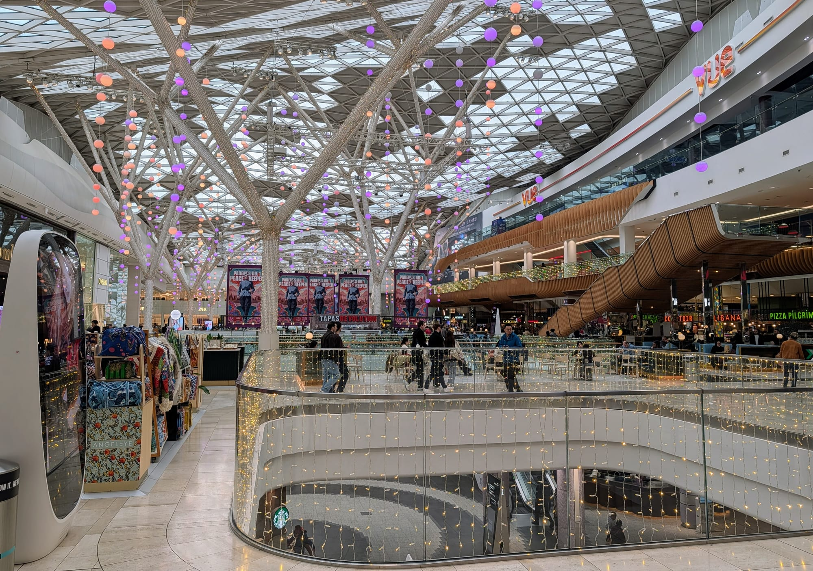

> 💡 **The Short Version:** **Black Friday is Friday 27 November 2026** and Cyber Monday is **30 November**. **[Selfridges](https://www.selfridges.com/GB/en/features/info/stores/london/) on Oxford Street stays open to 10pm Monday to Saturday**, and **Westfield London, Westfield Stratford City and London Designer Outlet all close at 9pm** that Friday. **Arrive after 9.30am on a weekday** and avoid Saturday afternoon. **There is no VAT refund for visitors**, so the discount on the ticket is the only saving. **London Box Office already has a Black Friday theatre page**, with SIX at 49% off and Oh, Mary! at 75% off.

*Hours, offers and dates as of 8 November 2026.*

## When Black Friday starts and ends

**The sales do not wait for the Friday.** Oxford Street's [Black Friday guide](https://www.oxfordstreet.co.uk/whats-happening/how-to-shop-black-friday-like-a-pro/) says shoppers can find deals there for most of November, and that some retailers cut prices further for Black Friday and Cyber Monday. Its [itinerary for the day](https://www.oxfordstreet.co.uk/whats-happening/plan-your-black-friday-on-oxford-street/) describes it as a whole weekend that ends on Cyber Monday, which is **30 November**. It also notes that John Lewis and Currys price-match other retailers on the same item.

Covent Garden's shops run on a Thursday schedule: its [Festive Thursdays](https://www.coventgarden.london/experience/christmas-in-covent-garden/festive-thursdays) run every Thursday from 12 November to 24 December, and KIKO's Black Friday offer there, **buy three products and get three free**, is on **19 and 26 November**.

## Where to shop

### Oxford Street

**Oxford Street's own advice is to arrive after 9.30am.** That misses the rush hour and puts you on the street as the shops, most of which open at 10am, start trading. Since Monday 26 October the stretch between Orchard Street, beside Selfridges, and Great Portland Street has been closed to cars, buses, taxis and bicycles, which leaves the whole width of the street to walk on. Our [Oxford Street guide](/articles/oxford-street-guide/) covers the closure, the bus changes and which Tube station to use for which end.

**Selfridges** is open **10am to 10pm Monday to Saturday** and **11.30am to 6pm on Sunday**, according to its [Oxford Street store page](https://www.selfridges.com/GB/en/features/info/stores/london/). **John Lewis** is open **10am to 8pm Monday to Wednesday, Friday and Saturday, 10am to 9pm on Thursday, and 11.30am to 6pm on Sunday**, per its [store page](https://www.johnlewis.com/our-shops/oxford-street).

### Regent Street and Covent Garden

**Regent Street** is the curve of mid-range and premium shops between Piccadilly Circus and Oxford Circus. It publishes general hours of **10am to 8pm on weekdays, 9am to 8pm on Saturday and 12pm to 6pm on Sunday**, with each shop setting its own on its [directory page](https://www.regentstreetonline.com/plan-your-visit). Hamleys, the seven-floor toy shop, is on the street.

*One of the angels over Regent Street. Photo: Robert Lamb, [CC BY-SA 2.0](https://creativecommons.org/licenses/by-sa/2.0/), via [Wikimedia Commons](https://commons.wikimedia.org/wiki/File:Looking_up_at_one_of_the_angel_decorations_on_Regent_Street_-_geograph.org.uk_-_7679632.jpg).*

**Covent Garden's** shops usually trade **10am to 8pm Monday to Saturday and from about 11am to 6pm on Sunday**, the [Apple Market](https://www.coventgarden.london/about/faqs) is open daily 10am to 6pm, and the Piazza and Market Building are open at all hours. **Thursday 26 November** is the day to aim for: it is a Festive Thursday, KIKO has its Black Friday offer on, and AWAY stays open later, with free personalisation on leather tags.

### Westfield London and Westfield Stratford City

**[Westfield London](https://www.westfield.com/en/united-kingdom/london)**, at Shepherd's Bush, is the larger of the two and has The Village, the luxury wing with Louis Vuitton and Tiffany & Co. Its [Black Friday page](https://www.westfield.com/en/united-kingdom/london/news/black-friday-at-westfield-london/139471) names Zara, COS, AllSaints, Sephora, Charlotte Tilbury, Apple and Samsung among the shops to plan around, and Bill's, Wagamama and Rosa's Thai for a break. Shepherd's Bush (Central line and Overground) and Wood Lane (Hammersmith & City and Circle) are the stations.

*Westfield London, White City.*

**[Westfield Stratford City](https://www.westfield.com/en/united-kingdom/stratfordcity)** sits next to the Olympic Park, and Stratford station has the Central, Jubilee and Elizabeth lines, the DLR and the Overground. Our [Stratford guide](/articles/stratford-area-guide/) covers what else is nearby.

### Bicester Village and the outlets

**[Bicester Village](https://www.thebicestercollection.com/bicester-village/en/visit/)**, in Oxfordshire, has **more than 150 boutiques** and is **open seven days a week**. Its [offers page](https://www.thebicestercollection.com/bicester-village/en/offers/) says "up to 40% off your favourite brands every day" and lists each brand's own figure on selected lines: Burberry up to 40%, Canada Goose up to 50%, Birkenstock up to 60% and Bremont up to 70%. The Village has its Christmas decorations up from 5 November.

*A lane in Bicester Village. Photo: Robert Eva, [CC BY-SA 2.0](https://creativecommons.org/licenses/by-sa/2.0/), via [Wikimedia Commons](https://commons.wikimedia.org/wiki/File:Bicester_village_entrance_-_geograph.org.uk_-_5325474.jpg).*

**How to get there.** The Village says it is under an hour from London, and the direct route is Chiltern Railways from **London Marylebone**, a trip of about 56 minutes to Bicester Village station, which is a short walk from the Village. **Oyster and contactless are not valid on that line**, so buy a ticket. The Village runs a hosts' kiosk inside Marylebone station, **open 8.45am to 4.30pm seven days a week**, and its [getting here page](https://www.thebicestercollection.com/bicester-village/en/visit/getting-here/) lists the coach, bus and car options.

**[London Designer Outlet](https://www.londondesigneroutlet.com/)**, at Wembley Park, is the nearest outlet to the centre and publishes **Black Friday weekend hours**: **9am to 9pm on Friday 27 and Saturday 28 November, and 10am to 7pm on Sunday 29 November**. **Wembley Stadium station**, on the Chiltern line, is **9 minutes from Marylebone**, and Wembley Park (Jubilee and Metropolitan lines) also serves it, per its [getting here page](https://www.londondesigneroutlet.com/getting-here/). It shares its site with Wembley, so check what is on at the stadium before you go.

*London Designer Outlet, with the Wembley arch behind. Photo: Matt Brown, [CC BY 4.0](https://creativecommons.org/licenses/by/4.0/), via [Wikimedia Commons](https://commons.wikimedia.org/wiki/File:Wembley_Park,_London_Designer_Outlet_2026-10-18.jpg).*

**[Outlet Shopping at The O2](https://www.outletshoppingattheo2.co.uk/)** is inside The O2 at North Greenwich, **open seven days a week** and, in its own words, 15 minutes from central London by Tube. Our [shopping guide](/articles/shopping-in-london/) compares the two London outlets.

## Opening hours around Black Friday

Hours are each operator's usual hours, except London Designer Outlet, which publishes its Black Friday weekend hours. A shop inside a centre can still differ from the centre.

| Where | Fri 27 Nov | Sat 28 Nov | Sun 29 Nov | Source |
| --- | --- | --- | --- | --- |
| **Selfridges, Oxford Street** | 10am–10pm | 10am–10pm | 11.30am–6pm | [Selfridges](https://www.selfridges.com/GB/en/features/info/stores/london/) |
| **John Lewis, Oxford Street** | 10am–8pm | 10am–8pm | 11.30am–6pm | [John Lewis](https://www.johnlewis.com/our-shops/oxford-street) |
| **Regent Street** (general guide) | 10am–8pm | 9am–8pm | 12pm–6pm | [Regent Street](https://www.regentstreetonline.com/plan-your-visit) |
| **Westfield London** | 10am–9pm | 10am–9pm | 12pm–6pm | [Westfield](https://www.westfield.com/en/united-kingdom/london) |
| **Westfield Stratford City** | 10am–9pm | 9am–9pm | 12pm–6pm | [Westfield](https://www.westfield.com/en/united-kingdom/stratfordcity) |
| **London Designer Outlet** | 9am–9pm | 9am–9pm | 10am–7pm | [LDO](https://www.londondesigneroutlet.com/opening-times/) |

**Sunday is shorter everywhere.** Large shops in England and Wales can open for only six hours between 10am and 6pm, which is why the Sunday columns end at 6pm. Our [shopping guide](/articles/shopping-in-london/) explains the rule.

## When the crowds peak, and how to avoid them

Oxford Street describes Black Friday as one of the busiest shopping days of the year, and its own advice for the rest of the year is that **weekday mornings are quietest** and **weekends and the last days before Christmas are busiest**. The photograph at the top of this page is Oxford Circus after dark.

* **Go before the crowd, not after it.** On Black Friday itself, arrive after 9.30am and shop the shops that open at 10am first. For a head start, **Westfield Stratford City and Regent Street open at 9am on Saturday**, and **London Designer Outlet opens at 9am on Friday and Saturday**.
* **Use the late hours.** Selfridges to 10pm and the Westfield centres to 9pm give you an evening that the 8pm closers do not.
* **Skip Saturday afternoon on Oxford Street.** TfL closes the Oxford Circus station entrances when crowds build, and Bond Street and Tottenham Court Road on the Elizabeth line are the way round it.
* **Do Covent Garden on Thursday 26 November.** It is the day with late-night shopping, performances and KIKO's Black Friday offer.
* **Take a bag you can carry hands-free**, as Oxford Street's own guide suggests, and wear shoes for a street over a mile long.

## Make it a Christmas trip

**All the West End lights are on by Black Friday.** Oxford Street's switch-on is Monday 9 November and Covent Garden's is Thursday 12 November, and our [Christmas lights walk](/articles/christmas-lights-walk-london/) links the displays from Selfridges to Trafalgar Square in the dark. Evenings after 6.30pm Monday to Wednesday are the quiet window.

**[Hyde Park Winter Wonderland](https://hydeparkwinterwonderland.com/) opens on Thursday 19 November**, so it is running by the Friday. Our [Winter Wonderland guide](/articles/hyde-park-winter-wonderland/) has the prices and the quietest times, our [Christmas markets guide](/articles/christmas-markets-london/) lists the others by what each is for, and [Christmas in London](/articles/christmas-in-london/) puts them in one plan. The [November](/articles/things-to-do-in-london-in-november/) and [December](/articles/things-to-do-in-london-in-december/) guides cover the rest of the calendar, and our [gifts and souvenirs guide](/articles/london-gifts-souvenirs/) covers what to buy to take home.

## Tax-free shopping

**Visitors cannot claim the 20% VAT back on shopping in London**, and the refund has not existed in Great Britain since 1 January 2021. A Black Friday discount is therefore the only saving, unless the shop ships your purchase abroad. Selfridges and Harrods do that at the till, as do fourteen Bicester Village boutiques, and the shop must arrange the shipping for the VAT to come off. Our [tax-free shopping guide](/articles/tax-free-shopping-london/) has the shipping costs, the delivery times and what your home country will charge on arrival.

## Travel and attraction deals

### Theatre tickets

**[London Box Office has a Black Friday 2026 page](https://www.londonboxoffice.co.uk/black-friday)** with the discounts below. The percentage and the "from" price are as the site lists them, and tickets are sold while stocks last.

| Show | Theatre | Listed as | From |
| --- | --- | --- | --- |
| **Oh, Mary!** | Trafalgar Theatre | 75% off | £25 |
| **ABBA Voyage** | Abba Arena | 64% off | £48 |
| **Harry Potter and the Cursed Child** (one part) | Palace Theatre | 59% off | £30 |
| **Dirty Dancing** | Prince Edward Theatre | 57% off | £30 |
| **SIX** | Vaudeville Theatre | 49% off | £34.50 |
| **The Devil Wears Prada** | Dominion Theatre | 48% off | £30 |
| **Choir of Man** | The Arts at Marble Arch | 46% off | £31 |
| **The Play That Goes Wrong** | Duchess Theatre | 42% off | £24 |
| **Hamilton** | Victoria Palace | No booking fee | £24 |
| **Witness for the Prosecution** | London County Hall | No booking fee | £20 |

**The cheapest ways in outside a sale are the same all year.** Our [theatre guide](/articles/london-theatre-guide/) explains TKTS, the official booth in Leicester Square, midweek against Saturday prices, and day seats and rush tickets. Our [Christmas shows guide](/articles/christmas-shows-london/) covers the pantomimes and seasonal shows, many of which are also sold by [London Box Office](https://www.londonboxoffice.co.uk/).

### Attractions, passes and tours

**A pass is only a deal if it beats the gate price.** On our [London Pass guide](/articles/london-pass-guide/)'s numbers, a 2-day adult pass at £149 loses by £5.00 to the five big names (Tower of London, Westminster Abbey, St Paul's, London Eye and Tower Bridge) at £144.00 booked direct. Any Black Friday discount on the pass needs to cover that gap and then some before it wins.

Powered by <a target="_blank" rel="sponsored" href="https://www.getyourguide.com/london-l57/">GetYourGuide</a>

<!-- BLACK FRIDAY WEEK: add each confirmed Hotels.com, GetYourGuide, London Pass and eSIM offer here, with its end date and a link to the operator's own page. -->

### Hotels and eSIMs

**To stay over for the weekend**, our area guides carry the Hotels.com links: [Soho and the West End](/articles/where-to-stay-soho-west-end/) for Oxford Street, Regent Street and Covent Garden on foot, [Marylebone](/articles/where-to-stay-marylebone/) and [Mayfair](/articles/where-to-stay-mayfair/) for the quieter streets either side, and [budget hotels](/articles/best-budget-hotels-london/) for the cheaper end of the market.

**If you need data for the trip**, our [eSIM guide](/articles/travel-sim-esim-guide/) lists what each plan costs, and prices there are the baseline for any Black Friday offer. [Nomad](partner:nomad-uk) and [Saily](partner:saily-uk) are the two we compare.

---

## Continue planning your London trip

- 🛍️ **[Shopping in London](/articles/shopping-in-london/)**: every street, market and store, by what you want to buy
- 🏬 **[Oxford Street](/articles/oxford-street-guide/)**: the traffic-free stretch, the department stores and the streets off it
- 💷 **[Tax-free shopping in London](/articles/tax-free-shopping-london/)**: why there is no VAT refund, and what still works
- 🎄 **[Christmas in London](/articles/christmas-in-london/)**: markets, lights and Winter Wonderland
- 🎭 **[London theatre guide](/articles/london-theatre-guide/)**: how to pick a show and pay less for it
