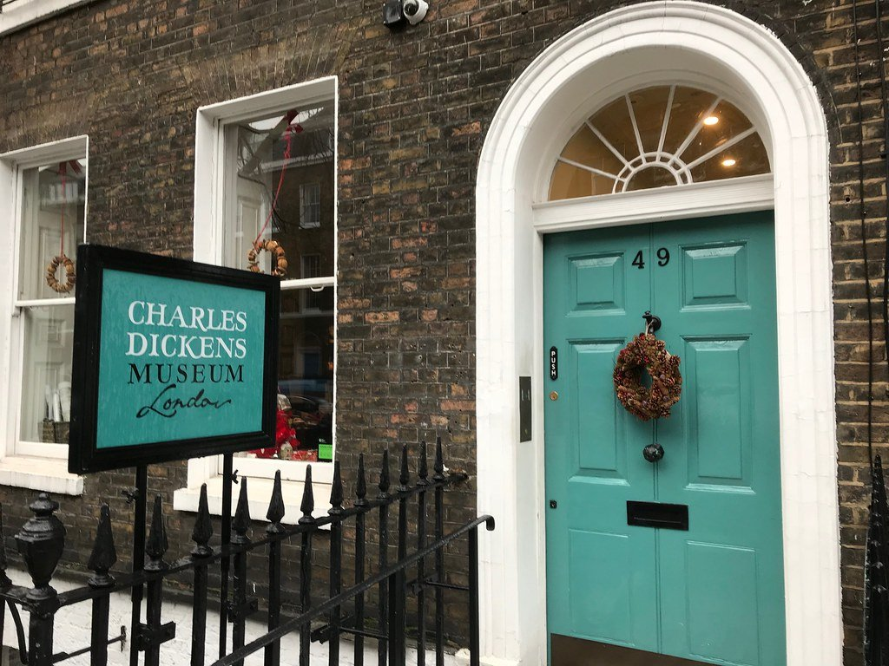

Bloomsbury is Georgian garden squares around the British Museum and the University of London, with libraries, bookshops and blue plaques on almost every street. The squares three minutes north of the museum are mostly empty.

Bloomsbury has its own share of the commemorative plaques marking where notable people lived or worked - see them on our [interactive map](/plaques/?area=bloomsbury).

## Why visit — and who should skip it

**Come here if** you want the British Museum, or somewhere calm to walk in Zone 1.

**Skip it if** you want evening life. Bloomsbury largely closes after office and university hours. Come during the day and eat in Soho or Covent Garden afterwards.

## Top sights and activities

1. **[The British Museum](/articles/british-museum-guide/)** — Around eight million objects, including the Rosetta Stone, the Parthenon sculptures, the Sutton Hoo helmet and the Egyptian galleries. Free. Use the Montague Place entrance.
2. **The Great Court** — Norman Foster's glazed roof over the old reading room courtyard. Free to walk into even without visiting the galleries.
3. **The garden squares** — Russell, Bedford, Gordon, Tavistock and Bloomsbury Squares. Most are open to the public.
4. **The Charles Dickens Museum** — The Doughty Street house where he wrote *Oliver Twist* and *Nicholas Nickleby*, open Wednesday to Sunday, 10am to 5pm.
5. **Lamb's Conduit Street** — A half-pedestrianised street of independent shops and restaurants, with The Lamb, a Victorian pub with original snob screens.
6. **The Foundling Museum** — The story of Britain's first children's charity and its Hogarth collection. Adult tickets are £14.50 (£13.50 online); closed Mondays.
7. **The Wellcome Collection** — A free museum on the Euston Road, with medical curiosities. Closed Mondays. The Cartoon Museum (£12) is at 63 Wells Street in Fitzrovia.

*The Great Court roof. Photo: [rbrwr](https://www.flickr.com/photos/38411862@N00/467099756), [CC BY-SA 2.0](https://creativecommons.org/licenses/by-sa/2.0/).*

## Key streets and micro-districts

### Great Russell Street and the museum precinct

The **British Museum** frontage and the souvenir shops opposite. The colonnade is the photograph; the Great Court is behind it.

**The museum is free, and a free timed ticket from its website is recommended.** The queue forms on Great Russell Street; the **Montague Place door at the back** is the second entrance. Friday is the late night, until 20:30.

For lunch on this street, **Dalloway Terrace at 16–22 Great Russell Street** has a terrace under flowers and takes bookings.

### The garden squares

**Russell Square** is the biggest and has a café and a fountain children run through in summer. **Gordon and Tavistock Squares**, north-west and two minutes further, carry most of the Bloomsbury Group plaques; Virginia Woolf lived on both.

Tavistock Square also holds the **Gandhi statue** and a conscientious objectors' stone, and people leave flowers there on 7 July.

**All are free and open in daylight hours**, and the gates are locked overnight. Bedford Square, the only complete Georgian square left in Bloomsbury, is **private and railed off**: you can look, not enter.

### Lamb's Conduit Street

Running north from Theobald's Road towards Coram's Fields, half-pedestrianised and independent almost end to end.

**Eat and drink:** **Noble Rot at 51** is a wine bar with a restaurant attached and needs booking; **Honey & Co at 54** does Middle Eastern cooking; **Redemption Roasters at 84b** is the first shop of a coffee chain that trains prison leavers as baristas. **The Lamb** is a Victorian pub with the original etched snob screens still in place.

**It is a weekday street.** Most of the shops are closed on Sundays, so come Tuesday to Saturday. Russell Square and Holborn are both about seven minutes.

### Store Street and Marchmont Street

Two small shopping streets, north-west and north of the museum, with cafés and fewer people than Great Russell Street.

**Café Deco at 43 Store Street** runs from morning coffee through to dinner. **Fortitude Bakehouse at 35 Colonnade**, in a mews off Marchmont Street, does the pastries.

**Gay's the Word at 66 Marchmont Street** has been open since 1979, calls itself the UK's oldest LGBT+ bookshop and is the shop the film *Pride* is about. It is closed on Mondays.

**Both streets are five minutes from Russell Square or Goodge Street** and quieter at weekends.

### Museum Street

A short run of antiquarian bookshops, print dealers and map sellers between the museum and Holborn.

These are specialist dealers, not second-hand shops: prices run from a few pounds for a loose print to four figures for a first edition.

**Most keep short hours — roughly 11am to 6pm, and several close on Sundays and Mondays.** Walk down it on the way out of the museum.

*48 Doughty Street. Photo: [Matt From London](https://www.flickr.com/photos/57868312@N00/38375015794), [CC BY 2.0](https://creativecommons.org/licenses/by/2.0/).*

## Go deeper

- **[The best museums in London](/articles/best-museums-london/)** — how to do the British Museum without the crush, and the smaller collections nearby.
- **[London's blue plaques](/articles/london-blue-plaques/)** — Bloomsbury has a dense run of them, and a walkable route through them.

## Where to eat and drink

| Spot | Style | Price | Why go |
| --- | --- | --- | --- |
| **The Lamb** | Victorian pub | ££ | Lamb's Conduit Street; original etched snob screens at the bar |
| **Ciao Bella** | Italian | ££ | Trattoria on Lamb's Conduit Street since 1983 |
| **Store Street Espresso** | Coffee | £ | Coffee five minutes from the museum |
| **The Espresso Room** | Coffee | £ | Tiny counter on Great Ormond Street |
| **Bloomsbury Coffee House** | Cafe | £ | Basement cafe under a student hall |
| **Seven Dials Market** | Food hall | £ | Fifteen minutes south when Bloomsbury's options run out |

## Getting there

**By Tube.** **Russell Square** (Piccadilly) is closest to the squares. **Holborn** (Central, Piccadilly) and **Tottenham Court Road** (Elizabeth line, Central, Northern) are both about seven minutes from the British Museum and better connected.

**Best exit.** For the British Museum, come from **Tottenham Court Road** and approach along Great Russell Street, or walk round to the **Montague Place** entrance on the north side.

**On foot.** Twelve minutes to Covent Garden, twelve to Soho, fifteen to King's Cross St Pancras.

## How long to spend, and when to go

| If you have | Do this |
| --- | --- |
| **Two hours** | British Museum highlights via Montague Place |
| **Half a day** | Add the garden squares and Lamb's Conduit Street |
| **A full day** | Add the Dickens Museum, the Foundling Museum and the Wellcome Collection |

**Best time:** Weekday mornings at opening, or Friday evening, when the British Museum is open until 20:30.

**Avoid:** Weekend middays at the museum.

Comparing neighbourhoods? [Best areas to visit in London](/articles/best-areas-to-visit-london/) sets them side by side by what each is best for, how long it takes and the best day to go.

Powered by <a target="_blank" rel="sponsored" href="https://www.getyourguide.com/london-l57/">GetYourGuide</a>

## Suggested two-hour walking route

1. **Start:** Tottenham Court Road station. East along Great Russell Street.
2. **British Museum:** Go round to the **Montague Place** entrance. The Great Court and two galleries.
3. **The squares:** North to **Russell Square**, then **Gordon** and **Tavistock** Squares for the blue plaques.
4. **Lamb's Conduit Street:** East for the independent shops and **The Lamb**.
5. **Finish:** South to Holborn, or on to Covent Garden.

Powered by <a target="_blank" rel="sponsored" href="https://www.getyourguide.com/london-l57/">GetYourGuide</a>

## Common mistakes to avoid

1. **Using the main museum entrance at peak times.** Montague Place on the north side is the second entrance.
2. **Trying to see the whole British Museum.** Pick two or three galleries. It cannot be done in a day.
3. **Eating on Great Russell Street.** Store Street and Marchmont Street are three minutes away.
4. **Coming in the evening.** Bloomsbury empties after work. It is a daytime area.
5. **Missing the squares entirely.** Most visitors never walk the three minutes north.
6. **Assuming the small museums are free.** The Wellcome is; the Foundling and the Cartoon Museum charge.

## Where to stay

Quiet, walkable and close to the Eurostar.

- **Russell Square and Bedford Place** — Georgian townhouse hotels around the squares.
- **Gower Street** — A long run of small hotels at lower prices, walkable to the West End.
- **[King's Cross](/articles/where-to-stay-kings-cross/)** — Fifteen minutes north, better transport, more open in the evening.

Our [Bloomsbury hotel guide](/articles/where-to-stay-bloomsbury/) compares the hotels across every price band.
