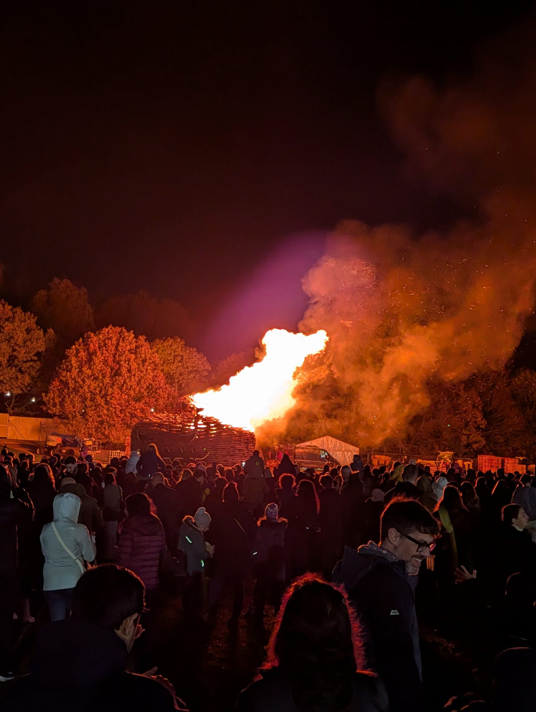
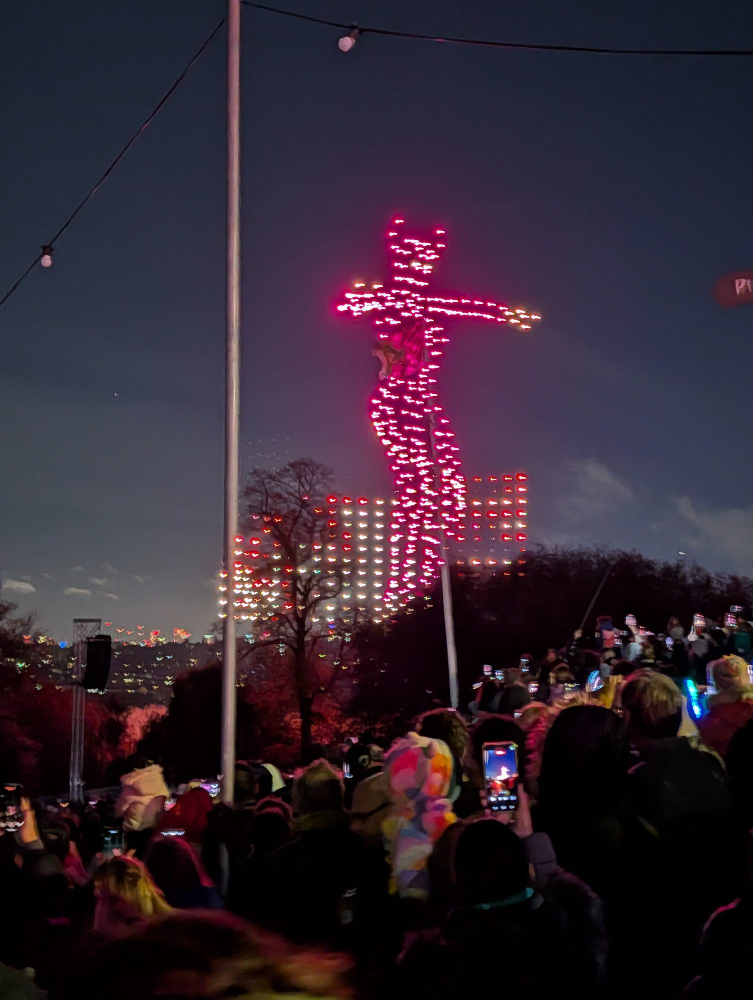
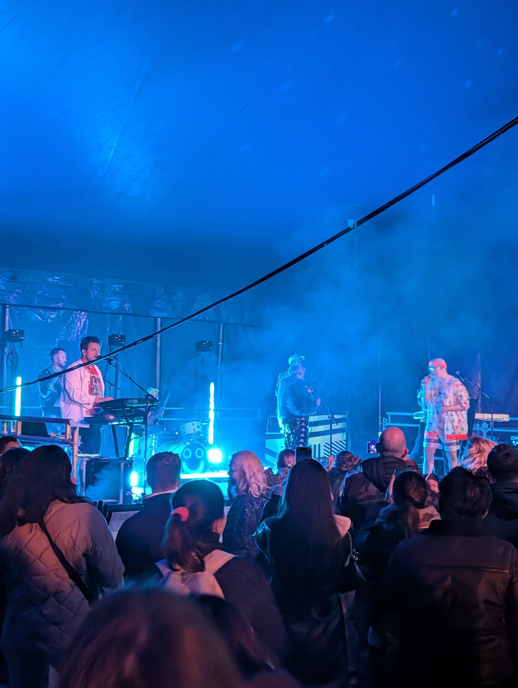
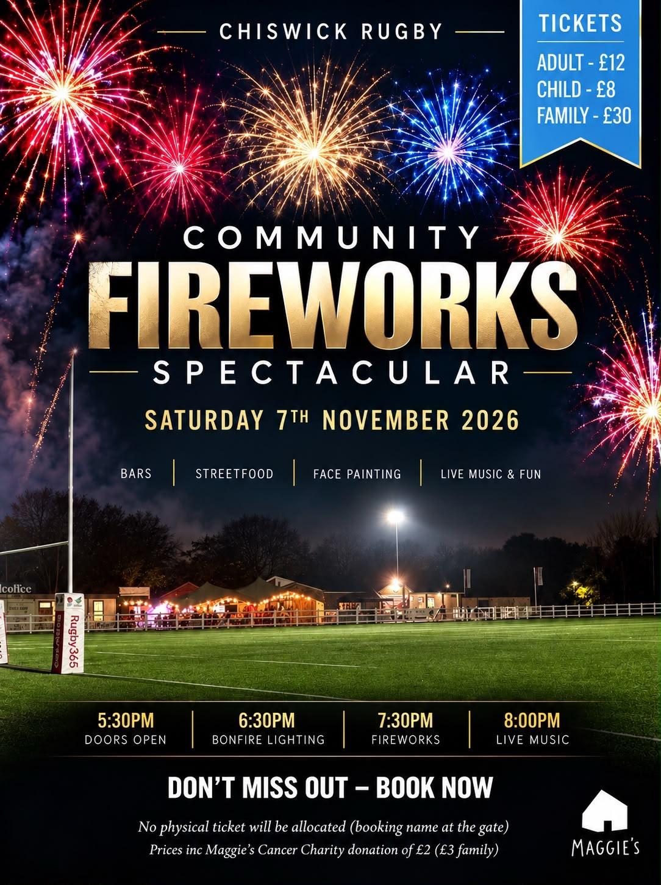

**Bonfire Night is 5 November, and London's big displays are ticketed, sell out and cluster on the nearest weekend.** In 2026 the 5th was a Thursday and the large shows ran on Saturday 7th and Sunday 8th; only Coram's Fields, Wimbledon Park and Stow ran on the 5th itself. In 2027 the 5th is a Friday.

> 💡 **The Short Version:** The big displays are **Alexandra Palace**, **Battersea Park** and **Blackheath**, all ticketed and all sold out or close to it in recent years. The only free display is **Coram's Fields**, where adults must bring a child. For a free view, **Parliament Hill** has no gates and never closes, while **Greenwich Park shuts at 6pm**, before anything starts. Everything below shows what the 2026 displays ran and charged, which is the best guide to 2027.

---

> 🎃 **Halloween 2026 has passed.** Our [Halloween in London guide](/articles/halloween-london/) is the record of the 2026 events, plus the ghost walks, creepy places and costume hire that stay open all year.

> 🧭 **Plan the rest of it:** [Christmas lights walk](/articles/christmas-lights-walk-london/) · [Christmas markets](/articles/christmas-markets-london/) · [Getting around on the night](/articles/getting-around-london-transport-guide/) · [Late-night eating](/articles/late-night-eating-london/) · [New Year's Eve fireworks](/articles/new-years-eve-london/) · [Things to do in London in October](/articles/things-to-do-in-london-in-october/) · [Things to do in London in November](/articles/things-to-do-in-london-in-november/)

## How the 2026 weekend ran

| Date | What was on |
| --- | --- |
| **Thu 5 Nov** | **Coram's Fields (free)** · Wimbledon Park · Stow |
| **Fri 6 Nov** | Stow · Totteridge · Orpington Golf Centre · Farringtons School, Chislehurst · Esher Rugby |
| **Sat 7 Nov** | **The big night** — Alexandra Palace · **Battersea Park** · **Blackheath** · Danson Park · Morden Park · Harrow · Southgate · Ealing Cricket Club · Brentham Club · Dulwich · Beckenham · West Wickham · Chislehurst Rotary · Bromley High · Kempton Park · Chiswick Rugby Club · Lift Richmond Park · Stow |
| **Sun 8 Nov** | Alexandra Palace family day · **Battersea Park** · St Francis Monks Hill, Selsdon |

---

## Alexandra Palace: the best-known one

**In 2026 it ran two nights, two kinds of event.**

| | Saturday 7 November 2026 | Sunday 8 November 2026 |
| --- | --- | --- |
| **Gates** | 16:00 | 16:00 |
| **Last entry** | 20:05 | 18:05 |
| **Display** | **8pm** | **6pm** |
| **The night** | Party night — headline DJ set from Eats Everything, and a German Bier Festival (18+, extra ticket) with a Queen tribute | **Family day, new for 2026** — smaller capacity, Barrioke with Shaun Williamson, a Junior Jungle kids' rave |

Also on site across the weekend: a bonfire, funfair, **ice skating** on the permanent indoor rink, street food and bars.

The event is called the Fireworks and Drone Festival. In 2026 hundreds of choreographed drones, flown by Celestial, runners-up on Britain's Got Talent 2026, flew formations over the park before the fireworks took over.

> ⚠️ **It sells out.** In 2026 both nights were sold through [DICE](https://link.dice.fm/lb38fc167352), the ticket link on the festival's own site, and through Universe and Fever; the festival named those three as its only official partners.

**Alexandra Palace's own page said tickets started from £11.50, and the under-10 ticket was £6.50 including fees.** Universe listed tickets from £6.05 to £18.70 a night, fees included.

- Adult tickets are 16+. Children aged 11–15 and 0–10 each need their own ticket, and must be with an adult aged 21 or over.
- The site is cashless.
- No food or drink may be brought in, except for young children.
- The German Bier Festival (Saturday, 18+), ice skating, the Summit rooftop and the Sunday premium viewing area were add-on tickets, and none could be bought on its own.

The event **moved off Halloween** in 2026 (2025 ran on 31 October and 1 November with ghost tours and fancy dress), and Sunday was a family day, not a second party night.

**Getting there:** Alexandra Palace station, on Great Northern trains from Moorgate or King's Cross, is at the Wood Green entrance to the park. Wood Green on the Piccadilly line is a 20-minute walk. The W3 bus was diverted and did not stop at the Palace, and there is no public parking.

---

## Battersea Park: the other large paid display

**Battersea Park is the other large paid display in London**, and it sells out in much the same way. [Time Out](https://www.timeout.com/london/things-to-do/bonfire-night-fireworks-displays-in-london) puts it at 50,000 ticketed spectators a night.

It is run by Wandsworth Council. In 2026 it ran on **Saturday 7 and Sunday 8 November**. On the Saturday gates opened at 6pm, a Rudimental DJ set started at 7.30pm, last entry was 8pm, the fireworks started at about 8.30pm and the show ended at 11pm, with a Disco Ceilidh party after the display. On the Sunday gates opened at 4.30pm, the Lords of Lightning electrical show was at 5.45pm, last entry was 6.30pm, the fireworks started at about 7pm and the show ended at 9.30pm.

**General admission (16+) was £16.70, rising to £18.10 for the final release; youth tickets (5–15) were £11.50, and under-5s went free but still needed a ticket.** Tickets were advance only, sold through Kaboodle from the [Battersea Park Fireworks site](https://www.batterseaparkfireworks.com/), with no gate sales, no resale and no waiting list for sold-out dates. Bars and food stalls took cards only.

### Watching Battersea from the river instead

[London Party Boats](https://www.londonpartyboats.co.uk/) ran a three-hour cruise in 2026 that sailed up to Battersea and held position for the display, which is a way in if the park sells out.

| | |
| --- | --- |
| **Date** | Saturday 7 November 2026 |
| **Boarding** | 19:00 at Festival Pier, Belvedere Road, SE1 8XZ |
| **Departs / returns** | 19:15, back 22:00–22:15 |
| **Price** | **£50** adult, **£45** child 2–17, under-2s free but still need a ticket |
| **Included** | Hot buffet, welcome drink, live DJ, heated boat with an open upper deck, bar |

Under-18s had to be with an adult, and adults needed photo ID for the wristband if they wanted to be served at the bar. The route passes the Houses of Parliament.

---

Powered by <a target="_blank" rel="sponsored" href="https://www.getyourguide.com/london-l57/">GetYourGuide</a>

## What each display cost in 2026

| Display | 2026 date | 2026 prices | Notes |
| --- | --- | --- | --- |
| **[Stow Firework Spectacular](https://www.stowfireworkspectacular.co.uk/)**, Walthamstow | **5, 6 and 7 Nov**, gates 16:00 | Adult **£11** · Child 6–15 **£5** · Age 0–5 **£1** · Family **£27**, no booking fees | Two displays, 6pm and 8pm, one ticket covered both; last entry 8pm. **Online only, no gate sales**, and babies needed a ticket too. All three nights sold out, and it has sold out four years running. Wood Street station is three minutes' walk |
| **[Harrow Fireworks + Diwali](https://harrowfireworks.co.uk/buy-tickets/)**, Byron Park | **Sat 7 Nov**, fireworks ~19:45 | Adult **£13.95** · Child 3–15 **£8.95** · Under-3 free · VIP **£39.95** · plus £1.50 a ticket (£2 for VIP) | Free entry noon–3pm for the Diwali show; paid from 3pm. The Diwali stage show and Bollywood acts ran through the night. Online sales stopped at noon on the day, then tickets were sold only at the gate. **Printed tickets only** — phones were not accepted. The VIP pack added a queue jump, a ride token, a meal token, front-row viewing and a glow toy |
| **Southgate**, The Walker Ground | **Sat 7 Nov**, fireworks and drones 19:30 | Adult **£14** · Child up to 16 **£9.50** · Family (2 adults + 2 children) **£43** · Under-5 free, plus Eventbrite fees | Gates 17:00. The drone show was included in the ticket |
| **Dulwich Sports Club** | **Sat 7 Nov**, fireworks ~19:00 | Adult **£13** · Junior **£8** · **Under-12s £1**, plus Eventbrite fees | "Kids for a Quid". Doors 17:00, live music from 17:30. **Advance tickets only, none on the night**, and no parking. Herne Hill, North Dulwich and West Dulwich stations are each ten minutes' walk |
| **[Beckenham Charity Fireworks](https://www.beckenhamfireworks.com/)**, Croydon Road Recreation Ground | **Sat 7 Nov**, gates 16:30 | Adult 14+ **£18** · Child 5–13 **£6** · Under-5 free · Concession **£12.50**, plus fees (£19.08 an adult) | Two displays, 6pm for smaller children and 7.30pm. Run by the 5th Beckenham South Scout Group. **No gate sales.** Some food stalls and rides took cash only, and there is no cash machine in the park. Clock House station is 11 minutes' walk |
| **[West Wickham Fireworks](http://westwickhamfireworks.com/where-to-buy-tickets/)**, Club Langley, Eden Park | **Sat 7 Nov**, gates 16:00, display 18:30 | Adult **£12** · Child under 18 **£6** · Family (2 adults + 2 children) **£30** · Under-5 free | A Rotary West Wickham charity display. **No gate sales.** Online sales were capped at 1,500 and closed at 4pm on the day; the rest went through local schools and shops. E-tickets had to be printed. No parking on site |
| **[Chislehurst Rotary](https://www.chislehurstfireworks.com/)**, Chislehurst Recreation Ground | **Sat 7 Nov**, gates 17:00, fireworks 19:30 | Adult **£18** · child **£10** · family (2 adults + 2 children) **£40** | **Advance tickets only, none at the gate**; booking closed at 10am on 7 Nov. The organisers asked everyone to be inside by 7pm. Under-12s funfair, street food and a beer tent run by The Cockpit micropub. Elmstead Woods station is 15 to 20 minutes' walk |
| **Bromley High School**, Blackbrook Lane | **Sat 7 Nov**, doors 17:45, fireworks 19:30 | Admission **£13**, or **£25** and **£33** with unlimited rides | Run by the school's Parents' Association, with a funfair, food stalls and a bar. Funfair and food ran to 22:00. No refunds |
| **Danson Park**, Bexleyheath | **Sat 7 Nov**, gates 16:00, fireworks 20:00 | Adult 16+ **£15** · Child 5–15 **£9** · Concession (65+ or disabled) **£12** · Under-5 free · Family from **£22** (1 adult, 1 child), plus Skiddle fees | Back in 2026 after the 2025 cancellation. A 20-minute display fired to music over Danson Lake, with entertainment from 17:15, a funfair and a street food village. Two adults and two children was **£42**. Capacity 21,000 |
| **Ealing Cricket Club**, Corfton Road, W5 | **Sat 7 Nov**, gates 18:00, fireworks 19:45 | Adult **£14.50** · child 5–14 **£8** · family (2 adults + 3 children) **£36**. On the gate: **£17** and **£11**, no family tickets | The "Festival of Fire and Light", a Diwali-themed night. Kids' light quest and lantern parade from 18:00, live music and a DJ after the display. Ealing Broadway and North Ealing stations are a short walk |
| **Brentham Club**, Meadvale Road, W5 | **Sat 7 Nov**, 17:00–21:00 | Adult 16+ **£13.50** · Child 3–15 **£7.50** · Family (2 adults + up to 3 children) **£33**, no booking fees | Online sales closed at 15:20 on the day |
| **[Kempton Park](https://www.thejockeyclub.co.uk/kempton/events-tickets/fireworks/)**, Sunbury | **Sat 7 Nov**, fireworks 19:30 | **£10** in advance | Gates 5pm, last entry 7pm. Funfair to 10pm. Kempton Park station from Waterloo |
| **[Chiswick Rugby Club](https://www.chiswickrugby.co.uk/news/chiswick-rugby-community-fireworks-3000088.html)**, Dan Mason Drive, W4 | **Sat 7 Nov**, fireworks 19:30 | Adult **£12** · Child **£8** · Family **£30** | A charity display: £2 of each ticket, and £3 of a family ticket, went to Maggie's. Doors 17:30, bonfire 18:30, live music from 20:00 |
| **Totteridge Fireworks Night**, Totteridge Millhillians Cricket Club, N20 | **Fri 6 Nov**, 17:00–23:30 | Tickets through the club's box office | The club's own night, in aid of the club and Rays of Sunshine |
| **[Bonfire Night on the Thames](https://www.londonpartyboats.co.uk/)** | **Sat 7 Nov**, boarded 19:00 | Adult **£50** · Child **£45** | Boat from Festival Pier with buffet and DJ, viewing the Battersea display |

### Smaller local displays

| Display | 2026 date | Notes |
| --- | --- | --- |
| **Orpington Golf Centre**, Sandy Lane | **Fri 6 Nov**, gates 17:00, fireworks 19:30 | Run by Mytime Active. Hot dogs and burgers, a licensed bar and free parking |
| **Farringtons School**, Old Perry Street, Chislehurst | **Fri 6 Nov**, 18:00–21:00 | Run by the school's Parents' Association. Tickets on Eventbrite |
| **Lift Richmond Park**, Park Avenue, SW14 | **Sat 7 Nov**, 17:30–21:30 | Formerly the Richmond Park Association's night. A bar, a BBQ, face painting and a DJ until 21:30. No sparklers; glow toys on sale. Tickets on Eventbrite, no refunds |
| **St Francis Monks Hill**, Broadcoombe, Selsdon | **Sun 8 Nov**, 17:30–19:00 | A church display at £5 a ticket, hot dog included |

> ⚠️ **Campfire Club at Cody Dock** appears in fireworks listings but is **live music and a bonfire, not a fireworks display**. Do not turn up expecting rockets.

---

## The big displays and how they sold

| Display | 2026 date | How tickets were sold |
| --- | --- | --- |
| **[Alexandra Palace](https://www.alexandrapalace.com/whats-on/fireworks-drone-festival/)** | Sat 7 and Sun 8 Nov | DICE, Universe and Fever, the festival's three official partners. Prices are in the section above |
| **[Battersea Park](https://www.batterseaparkfireworks.com/)** | **Sat 7 and Sun 8 Nov** | Kaboodle, advance only. £16.70 to £18.10 for 16+, £11.50 for 5 to 15 |
| **[Blackheath](https://www.blackheathfireworks.com/)** | **Sat 7 Nov, 5pm–10pm** | The organiser's own site and See Tickets: £16 adult, £10 youth, £5 child |
| **[Merton](https://www.merton.gov.uk/fireworks)**: Wimbledon Park and Morden Park | **Wimbledon Park Thu 5 Nov · Morden Park Sat 7 Nov** | See Tickets. The council said both shows sell out. Gates 5.15pm, a first show for young children at 6.45pm and the main one at 8.30pm. New in 2026: an observation wheel and big-name DJs |

> ⚠️ **Listings often swap Merton's two parks.** In 2026 the council's own page said **Wimbledon Park on Thursday 5 November** and **Morden Park on Saturday 7 November**, the reverse of 2025.

---

## The one free display

**[Coram's Fields](https://coramsfields.org/)**, Guilford Street, Bloomsbury WC1N 1DN. In 2026 it ran on **Thursday 5 November**: gates 15:30, performances from 16:15, **display at 18:00**, closing 19:00. Free, no ticket, first come first served until the park was full.

> ⚠️ **Adults may only attend accompanied by a child.** Coram's Fields is a children's park, and that rule applies all year round. A paid Fast-Track ticket, booked in advance on Eventbrite, guaranteed entry and skipped the queue, but gave no better view and covered one adult and one child. Accessible-viewing tickets were free but had to be booked in advance on Eventbrite.

**No London borough council still funds a free public display.** The BBC asked all 32 under freedom of information and found **17 council events cancelled over cost in five years**, ten of them in Tower Hamlets alone. The displays that survive have migrated to cricket clubs, rugby clubs, schools, Scout groups and Rotary — and they charge.

## Chiswick Rugby Club: a club display for charity

**[Chiswick Rugby Club's Community Fireworks](https://www.chiswickrugby.co.uk/news/chiswick-rugby-community-fireworks-3000088.html)** is a club-run night at its ground on Dan Mason Drive, W4. In 2026 it ran on **Saturday 7 November**: doors at 5.30pm, the bonfire lit at 6.30pm, the fireworks at 7.30pm and live music from 8pm, with bars, street food and face painting.

**It raises money for Maggie's, the cancer support charity:** £2 of every ticket, and £3 of a family ticket, goes to it. Adults were **£12**, children **£8**, and a family ticket was **£30**.

Tickets were sold through the [club's online shop](https://www.chiswickrugby.co.uk/payments/chiswick-rugbys-community-fireworks-spectacular-159271.html), which asked you to register before you could buy. There was no physical ticket; you gave the booking name at the gate.

---

Powered by <a target="_blank" rel="sponsored" href="https://www.getyourguide.com/london-l57/">GetYourGuide</a>

## Watching for free, without a ticket

Some of the best-known viewpoints are **locked before the fireworks start**. Displays are at 7pm or 8pm, and several of the famous hills shut their gates at 4.30pm or 5pm.

| Viewpoint | November gates | Any good? |
| --- | --- | --- |
| **Parliament Hill**, Hampstead Heath | **No perimeter gates to close** | ✅ **The pick** |
| **Alexandra Park** | **Open 24 hours, all year** | ✅ |
| **Primrose Hill** | Closes **10pm**, not dusk | ✅ |
| **Blackheath** | Unenclosed common, but **fenced on the night of the ticketed event** | ❌ On the night |
| **Hyde Park** and **St James's Park** | 05:00–**midnight**, all year | ✅ |
| Richmond Park | Pedestrian gates lock **20:00** during the deer cull | ⚠️ Tight |
| Greenwich Park | **18:00** | ❌ |
| The Regent's Park | **16:30** | ❌ |
| Crystal Palace Park | About **17:00** | ❌ |
| Telegraph Hill | **16:30** | ❌ |
| Nunhead Cemetery | **16:00** | ❌ |
| Horniman Gardens | Sunset | ❌ |
| Severndroog Castle | Viewing platform **Sundays, daytime only** | ❌ |

**Parliament Hill is the pick.** At 98 metres it has legally protected sightlines to both St Paul's and the Palace of Westminster, and the Heath has no perimeter gates to lock. Nearest stations are Gospel Oak and Hampstead Heath. Two drawbacks: the Heath is unlit, so bring a torch for the walk up, and the Westminster view is partly obscured by intervening construction.

**Alexandra Park** is open around the clock while the display happens inside it. Some of the park is fenced off for the ticketed arena, so you will not get the paying guests' view, but the fireworks go up over the whole hill.

**Primrose Hill** was locked from **10pm to 6am every night from 30 October to 9 November** in 2026, well after any display, and the Royal Parks ban fireworks and lanterns there. It is separately gated from The Regent's Park, so approach from the Chalk Farm side — the main park shuts at 16:30.

**Greenwich Park** shuts its gates at **6pm** in November, so the General Wolfe viewpoint is out.

**Richmond Park:** during the deer cull from 1 November, pedestrian gates lock at **20:00** — except on Friday and Saturday nights, when the park stays open. Car parks close at 16:30 regardless. And King Henry's Mound, the famous viewpoint, sits inside Pembroke Lodge Gardens, which are separately enclosed with no published closing time. It is not a fireworks viewpoint.

**Rooftops mostly close too early.** [Sky Garden](/articles/sky-garden-guide/) shuts its terrace at 18:00 on weekdays, Horizon 22 at 18:00, and The Garden at 120 at 18:30. The exception is **Tate Modern's Level 10 viewing floor**, free and open until 21:00 on Friday and Saturday, which makes it a real option on a Friday or Saturday night, though not on a Thursday.

---

## The famous ones that no longer run

People still search for all of these.

| Display | What happened |
| --- | --- |
| **Victoria Park** | Cancelled every year since 2020. Tower Hamlets cut ten events over costs |
| **Crystal Palace Park** | Pulled in 2023 on budget grounds. The park is mid-way through a £52m restoration |
| **Southwark Park** | Cut in 2023. Nothing scheduled for 2026 |
| **Ravenscourt Park and Bishop's Park** | Scrapped in 2022 on air-quality grounds, replaced by a laser show — which was itself dropped in 2024 |
| **Clissold Park** | Cancelled 2020–22 on budget grounds, never revived |
| **Bounds Green** | Did not run in 2026. The Wild Wolf Explorer Scout Unit says it lacks the volunteer leaders, and will decide in 2027 whether it can run the event the following year |
| **Chiswick Business Park** | Discontinued — the organisers said it no longer fitted their role in the community. [Chiswick Rugby Club](#chiswick-rugby-club-a-club-display-for-charity) runs a display in W4 |
| **Carshalton and Sutton** | Cancelled permanently. No ticketed display anywhere in Sutton |
| **Lord Mayor's Show Thames fireworks** | Abolished by the City of London Corporation |

> 💡 **Blackheath is ticketed and sells out.** The 2026 display ran on Saturday 7 November, 5pm to 10pm, and it sold out in 2025.
>
> **2026 prices: £16 an adult, £10 for 11 to 15s, £5 for under-10s.** A family of four was £40 with under-10s or £48 with teenagers, and there were single-parent family tickets at £26 and £34. Fairground rides cost extra on top of admission.
>
> **Last entry was 8pm and the display started at 8pm**; arrive by seven to see anything else. Three gates: Red (south, SE3 0TY), Pink (west, SE3 0UA) and Green (north, SE3 7BN).
>
> **You cannot bring your own food or drink in**; there are bars and caterers on site. Tickets were sold on the organiser's own site and through See Tickets. Free personal assistant tickets were available for disabled visitors: book the ticket on the organiser's own site, not See Tickets, then email proof of disability to the organiser.
>
> The 2026 Big Top had UK garage from DJ Luck & MC Neat and a set from Brandon Block, with Massaoke, the Lords of Lightning electrical show and comedy from the Big Belly Comedy Club.
>
> It is no longer free.

---

Powered by <a target="_blank" rel="sponsored" href="https://www.getyourguide.com/london-l57/">GetYourGuide</a>

## Practicalities

**Dress for standing still in the cold.** London's November average is about **11°C by day and 5°C overnight**, and November is one of the wetter months. No café is open on Parliament Hill at 8pm: bring a hat, gloves and a flask.

**Fireworks are banned in the Royal Parks and on Hampstead Heath**, and the rules are enforced by the police. Setting off your own is legal elsewhere until **midnight on Bonfire Night**, and 11pm on other nights.

---

## Continue planning your London trip

- 🎄 **[The Christmas Lights Walk](/articles/christmas-lights-walk-london/)** and **[Christmas Markets in London](/articles/christmas-markets-london/)** — what comes next
- 🌳 **[Best Parks and Gardens in London](/articles/best-parks-gardens-london/)**
- 🏙️ **[The Best Views in London](/articles/best-views-london/)**
- 💷 **[London on a Budget](/articles/london-on-a-budget/)**
- 🚇 **[How to Use the London Underground](/articles/how-to-use-the-london-underground/)**
- 📅 **[Best Time to Visit London](/articles/best-time-to-visit-london/)** — where November sits against the rest of the year

---

*Dates and prices are those of the 2026 displays.*
