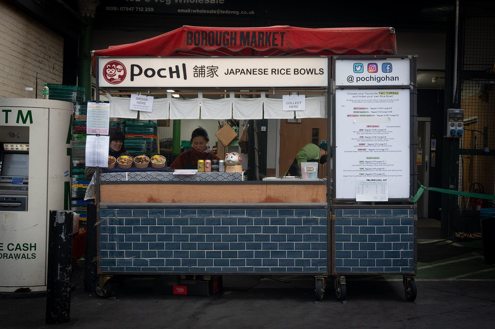
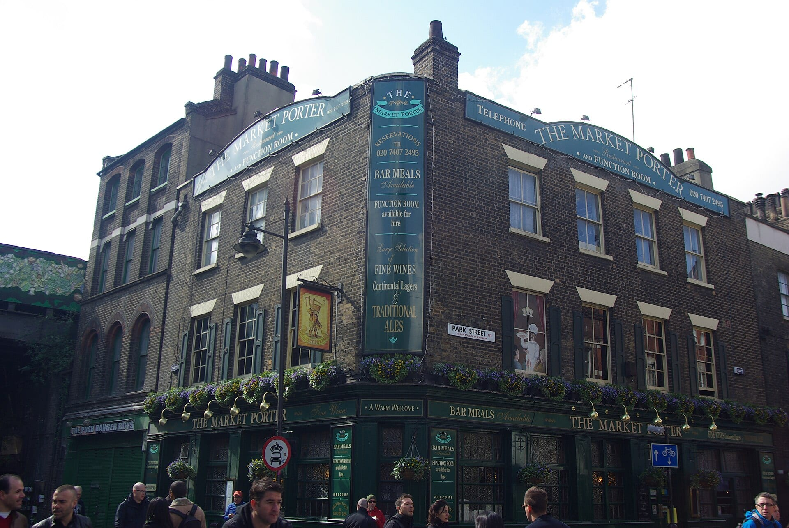
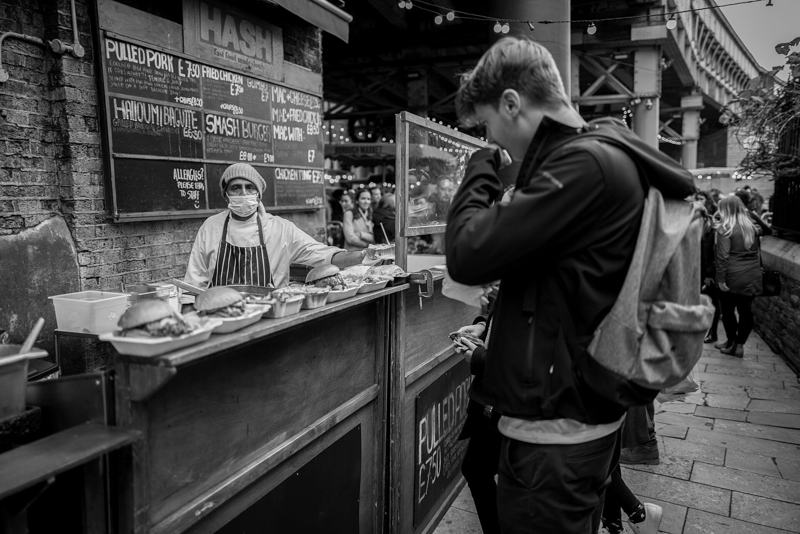

**Borough Market is free to walk round and closed on Mondays.** A food tour pays for a guide to the stalls, the history and a meal's worth of tastings in about three hours, and every tour below is bookable on GetYourGuide.

> 💡 **The Short Version:** For a first visit with a guide, take the **Secret Food Tours walk** (**£92**, three hours, 4.8 from 625 reviews). For the cheapest full tour, **Borough Market Food Tour with Local Guide** is **£78** (3½ hours, 4.8 from 28 reviews) and also takes in Leadenhall Market. For sweets only, the **doughnuts and tea tour** is **£67** (two hours, 4.7 from 14 reviews). To go on your own, **come Tuesday to Sunday**, eat in Borough Market Kitchen and read the tips at the end of this page. Monday is the one day the market is shut.

> 📘 **Booking and prices.** We earn a commission if you book through our links; the price is the same either way. No operator paid to be included. GetYourGuide prices are the lowest adult price for the standard option and move with the date. Operator prices come from the operator's own site.

## The market itself

Borough Market is at **8 Southwark Street, SE1 1TL**, next to London Bridge station. **Entry is free.**

| Day | Opening hours |
|---|---|
| Monday | **Closed** |
| Tuesday to Friday | 10am to 5pm |
| Saturday | 9am to 5pm |
| Sunday | 10am to 4pm |

The market says not every trader is there every day, so what a stall sells on a Tuesday may not be there on a Saturday. Saturday afternoon is the busiest time.

**December 2026.** The market opens seven days a week from Monday 30 November and through December, at the same hours as above. It opens on Wednesday 23 December until 6pm, on Christmas Eve from 8am to 3pm, and on Thursday 31 December from 10am to 3pm. It is **closed on Christmas Day, Boxing Day, Sunday 27 December and New Year's Day**, and normal hours return on Saturday 2 January 2027. The market says its hours may change.

**The three areas.** Borough Market describes itself as three parts:

- **Three Crown Square** holds the larger producers and merchants.
- **The Green Market** is for small specialist produce traders.
- **Borough Market Kitchen** is the street-food area, and the part to head for if you want a hot meal on the spot.

Restaurants, bars and shops surround the market.

*Pochi's rice-bowl stall in Borough Market Kitchen. Photo: [Tom Page](https://commons.wikimedia.org/wiki/File:Pochi_Borough_Market_2024-01-11.jpg), [CC BY-SA 2.0](https://creativecommons.org/licenses/by-sa/2.0/).*

## The tours side by side

| Tour | Price | Length | Rating on GetYourGuide | What it is |
|---|---|---|---|---|
| Secret Food Tours, Borough Market and London Bridge | £92 | 3 hours | 4.8 from 625 | Six British dishes, a drink, a dessert and a secret dish |
| Eating London, Borough Market | £86 | 3 hours | 5.0 from 19 | Group of up to 12, meets at the Market Porter pub |
| Borough Market with a local guide | £78 | 3½ hours | 4.8 from 28 | Borough and Leadenhall Markets, wine and cheese to finish |
| Borough Market Food Tour, small group | £95 | 3 hours | 5.0 from 7 | Street-food vendors and stories |
| Borough Market and London Bridge, 10+ tastings | £100 | 3 hours | no reviews yet | Small group, wheelchair accessible |
| Doughnuts and tea | £67 | 2 hours | 4.7 from 14 | Sweet tastings in and around the market |
| Choose your own sweet treats and tea | £36 | 2 hours | no reviews yet | Four stops with a tea tasting |
| South Bank, three markets and Brick Lane | £129 | 4 hours | 4.6 from 17 | A longer walk along the Thames |
| Private tours | £117 to £390 | 3 to 3½ hours | no reviews yet | For your own group |

## Group tours of the market

### Secret Food Tours: Borough Market and London Bridge

*£92 · 3 hours · 4.8 from 625 reviews · <a href="https://www.getyourguide.com/activity/-t67794?partner_id=WWP7I0R&amp;cmp=borough-market-tours" target="_blank" rel="sponsored nofollow noopener" data-affiliate="gyg">Book on GetYourGuide</a>*

Six classic British dishes, a drink, a dessert and a "secret" dish the guide doesn't name in advance. Secret Food Tours' own page says the route starts with a bacon and egg bap in Borough Market, then fish and chips, a sausage roll, British cheeses and cider in a historic pub, and sticky toffee pudding. Groups are capped at 12. It has 625 reviews on GetYourGuide; the next most reviewed Borough tour has 28.

Secret Food Tours charges £84.99 on its own site, against £92 on GetYourGuide, and meets outside 6 Tooley Street by London Bridge station.

Powered by <a target="_blank" rel="sponsored" href="https://www.getyourguide.com/london-l57/">GetYourGuide</a>

### Eating London: Borough Market food tour

*£86 · 3 hours · groups of up to 12 · 5.0 from 19 reviews · <a href="https://www.getyourguide.com/activity/-t431336?partner_id=WWP7I0R&amp;cmp=borough-market-tours" target="_blank" rel="sponsored nofollow noopener" data-affiliate="gyg">Book on GetYourGuide</a>*

Eating London's own page lists a sausage roll, a baked good, haddock and chips, cheddar and stilton, sticky toffee pudding with clotted cream and a cider, plus a choice of wine, a soft drink, coffee or tea. The guide covers the market's history, the story of a notorious old prison and Winchester Palace on the way. The group meets at **9 Stoney Street**, outside the Market Porter pub.

*The Market Porter on Stoney Street. Photo: [Adam Bruderer](https://commons.wikimedia.org/wiki/File:Market_Porter,_Borough,_London.jpg), [CC BY 2.0](https://creativecommons.org/licenses/by/2.0/).*

**Dietary limits.** Eating London says the tour is vegetarian-friendly, but vegan, gluten-free and kosher options may be limited, and it advises against booking if you have severe allergies to nuts, fish, shellfish or gluten. Its own site charges **£76 for an adult, £68 for ages 13 to 17 and £61 for ages 4 to 12**, against £86 on GetYourGuide, and gives a full refund up to 24 hours before.

### Borough Market Food Tour with Local Guide

*£78 · 3½ hours · 4.8 from 28 reviews · <a href="https://www.getyourguide.com/activity/-t451939?partner_id=WWP7I0R&amp;cmp=borough-market-tours" target="_blank" rel="sponsored nofollow noopener" data-affiliate="gyg">Book on GetYourGuide</a>*

Six tastings, from fish and chips to sausage rolls, across **Borough Market and Leadenhall Market**, finishing with a wine and cheese pairing. It is the cheapest group tour here, and the only one that adds a second market. A private option is available.

### Borough Market Food Tour, small group

*£95 · 3 hours · small group · 5.0 from 7 reviews · <a href="https://www.getyourguide.com/activity/-t645540?partner_id=WWP7I0R&amp;cmp=borough-market-tours" target="_blank" rel="sponsored nofollow noopener" data-affiliate="gyg">Book on GetYourGuide</a>*

A small group visits the street-food vendors, trying bites and hearing stories about the market.

### Borough Market and London Bridge Food Tour with 10+ Tastings

*£100 · 3 hours · small group · no reviews yet · <a href="https://www.getyourguide.com/activity/-t835845?partner_id=WWP7I0R&amp;cmp=borough-market-tours" target="_blank" rel="sponsored nofollow noopener" data-affiliate="gyg">Book on GetYourGuide</a>*

Ten or more tastings from local vendors in and around the market, led by a small-group guide. It is listed as wheelchair accessible.

## Sweet tours

### Borough Market Doughnuts and Tea

*£67 · 2 hours · 4.7 from 14 reviews · <a href="https://www.getyourguide.com/activity/-t420888?partner_id=WWP7I0R&amp;cmp=borough-market-tours" target="_blank" rel="sponsored nofollow noopener" data-affiliate="gyg">Book on GetYourGuide</a>*

**St JOHN custard doughnuts**, Bread Ahead favourites, a Bird & Blend tea tasting and a pastel de nata, in and around the market. It lasts two hours.

*A street-food stall at Borough Market. Photo: [Sanshiro Kubota](https://commons.wikimedia.org/wiki/File:Londoners%27_Kitchen_(50943613853).jpg), [CC BY 2.0](https://creativecommons.org/licenses/by/2.0/).*

### Choose Your Own Sweet Treats and Tea

*£36 · 2 hours · no reviews yet · <a href="https://www.getyourguide.com/activity/-t1404141?partner_id=WWP7I0R&amp;cmp=borough-market-tours" target="_blank" rel="sponsored nofollow noopener" data-affiliate="gyg">Book on GetYourGuide</a>*

A guide takes you to four hand-picked stops where you choose your own treats, then a Bird & Blend tea tasting. It is the cheapest tour on this page and is listed as wheelchair accessible.

## Longer and private tours

### Great London Food Tour: South Bank, Three Markets and Brick Lane

*£129 · 4 hours · 4.6 from 17 reviews · <a href="https://www.getyourguide.com/activity/-t267742?partner_id=WWP7I0R&amp;cmp=borough-market-tours" target="_blank" rel="sponsored nofollow noopener" data-affiliate="gyg">Book on GetYourGuide</a>*

A walking food tour along the Thames that takes in the South Bank and Borough Market, with food from London and the world. It is listed as wheelchair accessible.

### Private tours

- **Festive Flavours at Borough Market** · *£117 · 3 hours · private group · no reviews yet · <a href="https://www.getyourguide.com/activity/-t864714?partner_id=WWP7I0R&amp;cmp=borough-market-tours" target="_blank" rel="sponsored nofollow noopener" data-affiliate="gyg">Book on GetYourGuide</a>*. Seasonal tastings and British street food; wheelchair accessible.
- **Private Food Tour of Borough and Leadenhall Markets** · *£329 · 3½ hours · no reviews yet · <a href="https://www.getyourguide.com/activity/-t1511419?partner_id=WWP7I0R&amp;cmp=borough-market-tours" target="_blank" rel="sponsored nofollow noopener" data-affiliate="gyg">Book on GetYourGuide</a>*. Six food tastings, then three wine tastings paired with cheese.
- **Guided Borough Market Foodie Tour** · *£390 · 3 hours · no reviews yet · <a href="https://www.getyourguide.com/activity/-t631309?partner_id=WWP7I0R&amp;cmp=borough-market-tours" target="_blank" rel="sponsored nofollow noopener" data-affiliate="gyg">Book on GetYourGuide</a>*. Ten tastings, sweet and savoury.

Cruise passengers can book the Borough Market tour with the journey to London included, from <a href="https://www.getyourguide.com/activity/-t1267036?partner_id=WWP7I0R&amp;cmp=borough-market-tours" target="_blank" rel="sponsored nofollow noopener" data-affiliate="gyg">Southampton</a> (6½ hours) or <a href="https://www.getyourguide.com/activity/-t1266899?partner_id=WWP7I0R&amp;cmp=borough-market-tours" target="_blank" rel="sponsored nofollow noopener" data-affiliate="gyg">Dover</a> (7 hours), both £212 and without reviews yet.

## The market's own tours

Borough Market's website lists two official, licensed tours. **Celia Brooks** runs public tours on selected Friday mornings from 10am to 1pm with generous food and wine tastings, and needs pre-booking. **Totally Tailored** runs a private behind-the-scenes tour of about 2½ hours, with tastings of tea, cheese, charcuterie and oysters and a glass of English sparkling wine in a wine warehouse. On [Totally Tailored's own page](https://totallytailored.com/tour/borough-food-tasting-tour-london/) the private tour starts at **£379 for the group, for two to ten guests, plus £65 a person for food and drink**, and runs 10am to 12:30pm or 2:30pm to 5pm.

## Doing it yourself

- **Pick the day first.** The market is closed on Mondays and busiest on Saturday afternoons. Tuesday to Friday it runs 10am to 5pm.
- **Eat in Borough Market Kitchen.** It is the street-food area and has the seating. Our [London markets guide](/articles/best-london-markets/#borough-market-southwark) says which stalls to queue for and which trade only on certain days.
- **Share dishes.** Street food runs roughly £8 to £14 a dish, so two people who split what they buy get through more of the market.
- **Get there by rail.** The market is next to London Bridge station on the Jubilee and Northern lines and National Rail. Buses 17, 21, 35, 47, 133, 343 and 381 stop within a five-minute walk. There is no parking, and the market sits inside the Congestion Charge zone.
- **Toilets and access.** Public toilets, including accessible ones, are in Three Crown Square, Borough Market Kitchen and the Market Hall during trading hours. The public spaces are on one level, with cobbles in places and passages from 1.5 to 4 metres wide.
- **Dogs** are welcome on a lead or carried. Smoking is banned across the market.
- **Make it a walk.** Our [Bankside and Borough walk](/articles/bankside-borough-walk/) puts the market between Cross Bones and Southwark Cathedral, and Thursday is the day every stop on it is open.

For the other tastings and classes on the site, see our [food tours in London](/articles/london-food-tours/) guide, which includes Camden, Soho and the East End.

Powered by <a target="_blank" rel="sponsored" href="https://www.getyourguide.com/london-l57/">GetYourGuide</a>

