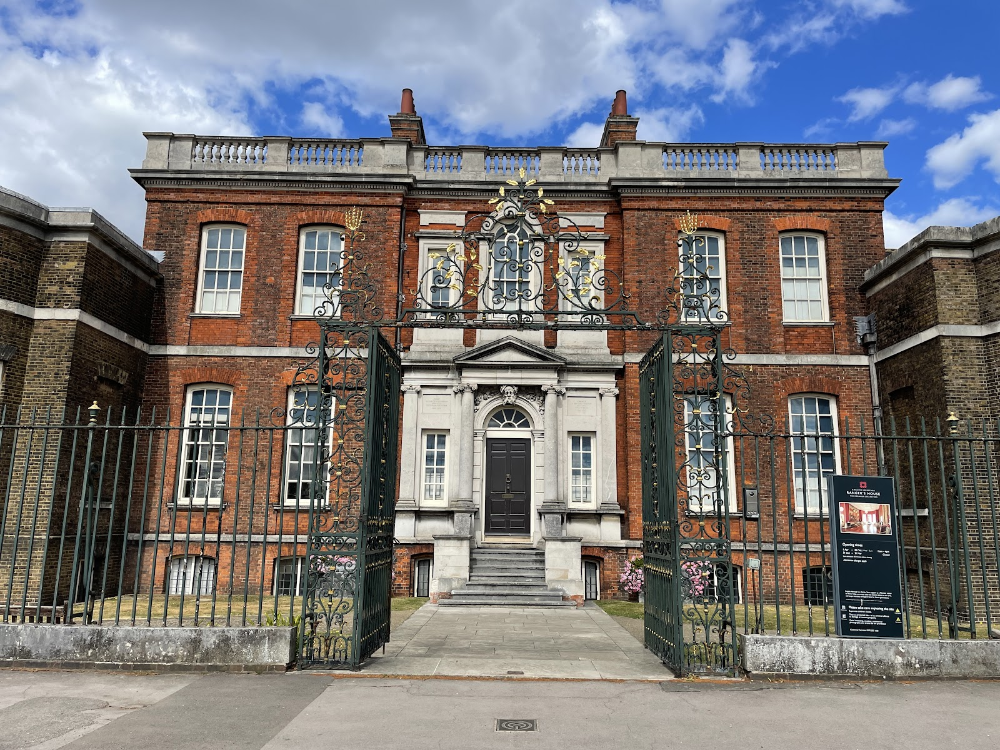
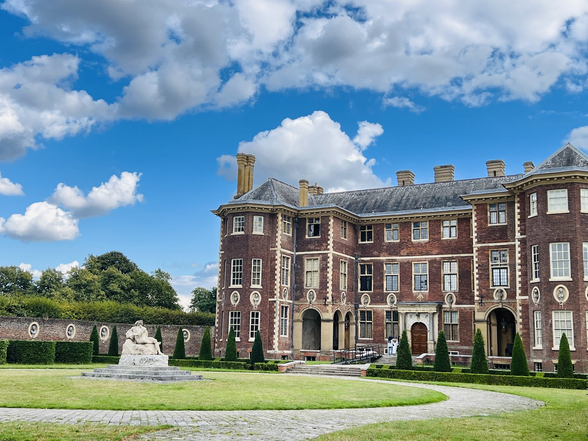
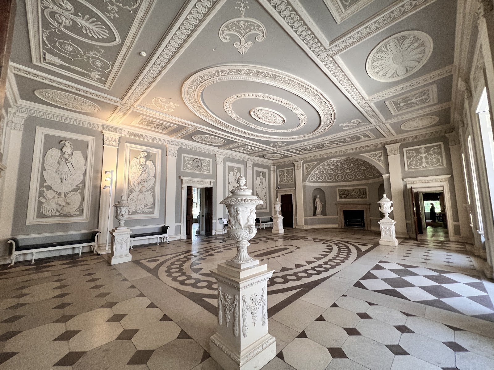
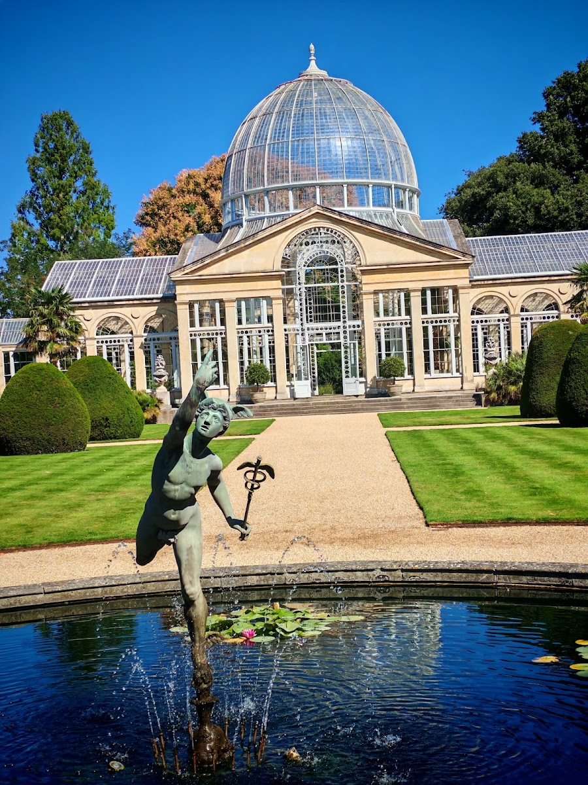
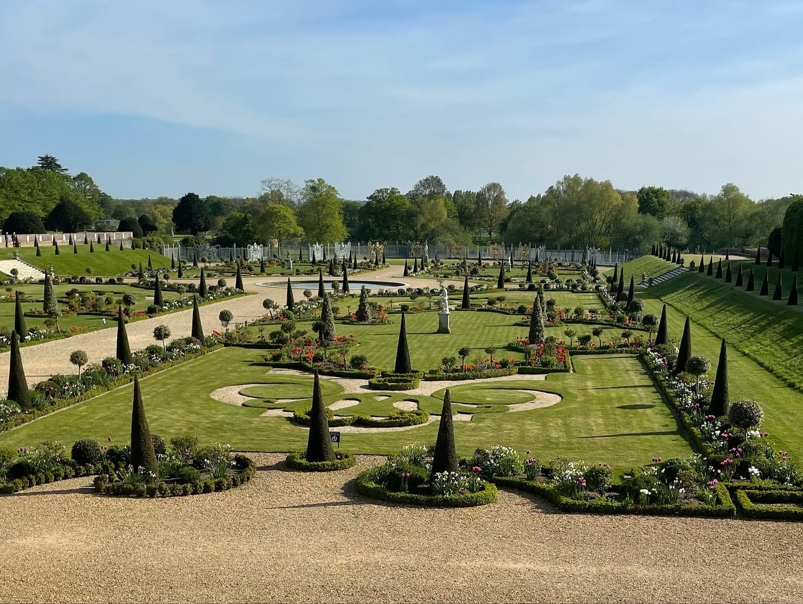
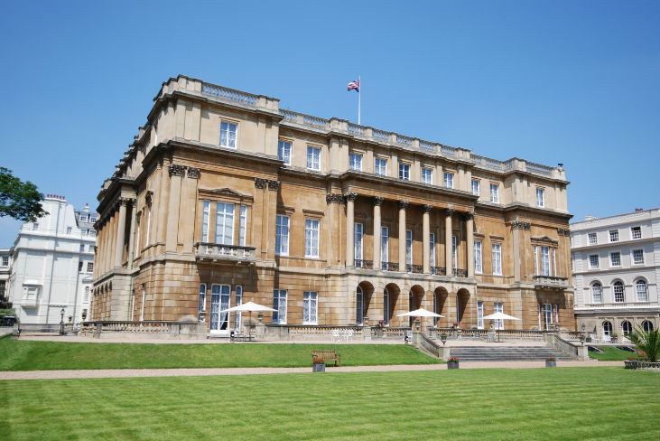
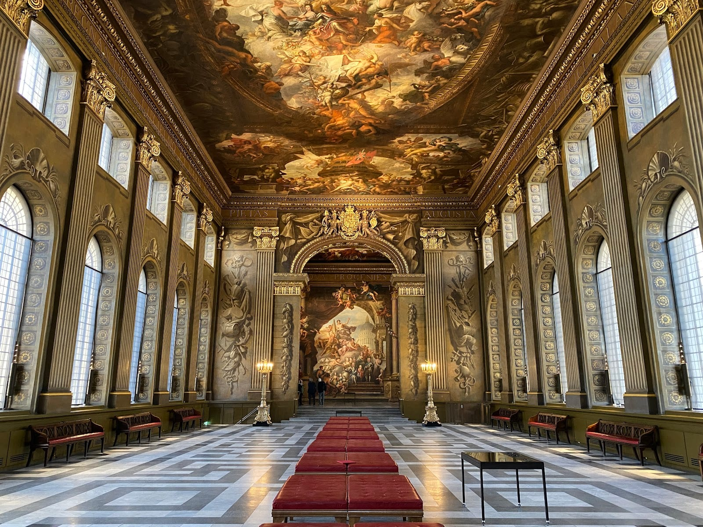
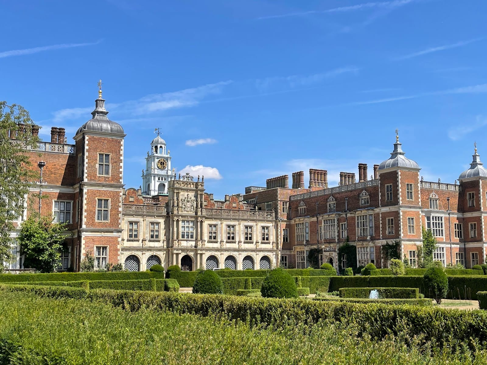
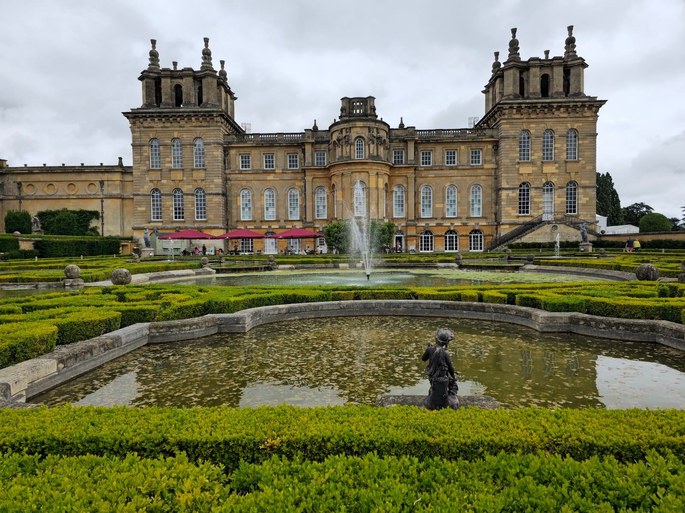

**Ranger's House in Greenwich, the Bridgertons' front door, costs nothing to look at; its rooms open on select dates in 2027.** Most Bridgerton locations are real stately homes with their own tickets and opening days, and most are outside London. The London ones come first, then the day trips.

> 💡 **The Short Version:** **Ranger's House in Greenwich Park is the Bridgerton House exterior** — free to view, with the interior open on **select dates in 2027**. **Ham House in Richmond** doubles as Bridgerton House, Penwood House and Benedict's cottage in series four; **£18 for house and garden**, no booking needed. **Castle Howard in Yorkshire** played Clyvedon Castle. **Hampton Court Palace**'s Privy Garden is the exterior of Queen Charlotte's palace, included in the **£30** off-peak ticket. **Lancaster House has no public entry at all.** **Bath's Assembly Rooms are closed until 2027.** **Or book a tour:** a 2½-hour Bridgerton walk around Greenwich costs **£27**, and a half-day coach trip to Hampton Court with palace tickets **£80**, which saves the train from Waterloo.

> ⚠️ **Ranger's House opens its rooms on select dates only, in 2027.** The exterior and the rose garden are free any day, but going inside needs a ticket for one of English Heritage's open days.

## What it all costs

| What | Cost per adult | Status |
| --- | --- | --- |
| Ranger's House exterior, from Greenwich Park | £0 | Free to view |
| Old Royal Naval College grounds, Greenwich | £0 | Free |
| Lancaster House, from Stable Yard | £0 | No public entry |
| Holburne Museum, Bath, permanent collection | £0 | Free |
| Syon Park gardens only | £7.00 | Private estate |
| Claydon House, house and garden | £12.00 | National Trust |
| Waddesdon Manor, grounds only | £14.00 | Rothschild Foundation |
| Syon House and gardens, guided tour | £16.50 | Private estate |
| Bath Bridgerton walking tour | From £20.00 | GetYourGuide |
| Osterley Park, house and garden | £18.00 | National Trust |
| Ham House, house and garden | £18.00 | National Trust |
| Bridgerton walking tour, Greenwich | £27.00 | GetYourGuide |
| Hampton Court Palace, off-peak | £30.00 | Historic Royal Palaces |
| Blenheim Palace, Park and Gardens | £34.00 | Blenheim Palace |
| Hampton Court half-day trip from London, with tickets | £80.00 | GetYourGuide |

## Tours

Most Bridgerton locations are stately homes with their own tickets, so a tour buys the transport and the story rather than special access.

**<a href="https://www.getyourguide.com/activity/-t1219258?partner_id=WWP7I0R&amp;cmp=bridgerton-london" target="_blank" rel="sponsored nofollow noopener" data-affiliate="gyg">London: Bridgerton Walking Tour in Greenwich</a>** is **£27** for **2½ hours**, rated **4.9 from 8 reviews**. The listing takes in filming locations including the Queen's House and the Royal Observatory. The Observatory is closed from 2 November 2026 for refurbishment.

Powered by <a target="_blank" rel="sponsored" href="https://www.getyourguide.com/london-l57/">GetYourGuide</a>

**<a href="https://www.getyourguide.com/activity/-t70032?partner_id=WWP7I0R&amp;cmp=bridgerton-london" target="_blank" rel="sponsored nofollow noopener" data-affiliate="gyg">Hampton Court Palace Half-Day Trip from London with Tickets</a>** is **£80** for **5½ hours**, **4.3 from 48 reviews**: a coach from London and entry to the palace whose Privy Garden plays Queen Charlotte's. The ticket alone is £30 off-peak, so the rest of the price is the transport.

**In Bath**, which stands in for Regency London's Grosvenor Square, two Bridgerton walks have far more reviews than anything in London. **<a href="https://www.getyourguide.com/activity/-t561078?partner_id=WWP7I0R&amp;cmp=bridgerton-london" target="_blank" rel="sponsored nofollow noopener" data-affiliate="gyg">Bath: Guided Tour of Iconic Bridgerton Filming Locations</a>** is **£20** for 2 hours, **4.6 from 408 reviews**, with photographs of the scenes at each stop. **<a href="https://www.getyourguide.com/activity/-t396938?partner_id=WWP7I0R&amp;cmp=bridgerton-london" target="_blank" rel="sponsored nofollow noopener" data-affiliate="gyg">Bath: Bridgerton Filming Locations Walking Tour with Music</a>** is **£22** for 1½ hours, **4.7 from 519 reviews**, with the show's music on headphones. Our [Bath day trip guide](/articles/bath-day-trip/) covers the train.

**<a href="https://www.getyourguide.com/activity/-t1116311?partner_id=WWP7I0R&amp;cmp=bridgerton-london" target="_blank" rel="sponsored nofollow noopener" data-affiliate="gyg">From London: Blenheim Palace Day Trip with Admission</a>** is **£69**, **4.2 from 17 reviews**, for the palace that played Buckingham House in series three.

## Filming locations in London

The locations in London:

| Location | What it played | Status |
| --- | --- | --- |
| Ranger's House, Greenwich, SE10 8QX | Bridgerton House exterior | Grounds free; house open select dates in 2027 |
| Ham House, Richmond, TW10 7RS | Bridgerton House terrace and kitchen, Penwood House, Benedict's cottage (S4) | £18 house and garden, no booking |
| Osterley Park and House, Isleworth, TW7 4RB | The Full Moon Ball (S3) | £18 house and garden, house closed Mon–Tue |
| Hampton Court Palace, East Molesey, KT8 9AU | Queen Charlotte's palace: Base Court, Fountain Court, Privy Garden | £30 off-peak adult, included in standard ticket |
| Syon House and Park, Isleworth, TW7 6AZ | Hastings House (S1) | House £16.50, gardens £7; open Sun–Tue, mid-March to 27 October |
| Lancaster House, Stable Yard, SW1A 1BB | St James's Palace, with Hampton Court | Exterior only — no public entry |
| Old Royal Naval College, Greenwich | Appeared in series two | Grounds free; see our Greenwich guide |
| Reform Club, 104 Pall Mall, SW1Y 5EW | Where Anthony and Simon meet (S1) | Exterior only — private members' club |
| Hackney Empire, 291 Mare Street, E8 1EJ | Theatre scenes (S1) | Working theatre — book a show |
| Wilton's Music Hall, Graces Alley, E1 8JB | A feminist meeting place (S2) | Working music hall — book a show |

Series five was filming in Greenwich in September 2026. Crews give the public no schedule; see [can you watch filming in London](/articles/london-filming-locations/#can-you-watch-filming-in-london).

### Ranger's House, Greenwich

English Heritage describes Ranger's House as a Georgian villa now best known as the exterior of the Bridgerton home. Its own history is as the home of the Wernher Collection of art.

*Ranger's House, Greenwich Park.*

**Chesterfield Walk, Blackheath, London, SE10 8QX**, inside Greenwich Park. The exterior and the grounds cost nothing — the **rose garden behind the house**, part of Greenwich Park itself, is free and at its best in June. The house interior is different: English Heritage opens it on **select dates in 2027**, with the dates to be released. Members go free. Visitors with limited mobility have access to the ground floor only, as the interior chairlift is out of service.

### Ham House, Richmond

Ham House stood in for **Bridgerton House, Penwood House and Benedict Bridgerton's country cottage, My Cottage**, in series four. Sophie Baek and Benedict's scene during the opening ball was filmed under a pergola on Ham's South Terrace, and the "below stairs" scenes in the house's 17th-century kitchen.

*Ham House, Richmond.*

**Ham Street, Ham, Richmond, Surrey, TW10 7RS.** **House 11:30am–3:30pm, garden 10am–5pm.** No pre-booking — go to Visitor Reception on arrival. **Adult £18.00 (£19.80 with Gift Aid), child (5–17) £9.00, family (2 adults + up to 3 children) £45.00.** National Trust members go free.

### Osterley Park and House, Isleworth

Robert Adam's house played the **Full Moon Ball** in series three's second episode, filmed in the courtyard with its grand columns. Osterley's Entrance Hall appears in several more scenes.

*The Entrance Hall at Osterley Park.*

**Jersey Road, Isleworth, Middlesex, TW7 4RB**, a short walk from Osterley Underground (Piccadilly line). **House open Wednesday to Sunday, 11am–3:30pm** (closed Monday and Tuesday except bank holidays). **House and garden: adult £18.00 (£19.80 Gift Aid), child £9.00, family £45.00.** A garden-only ticket runs on the Monday/Tuesday closure days: **adult £10.00, child £5.00.** Car parking £7.

### Syon House, Isleworth

**Syon House and Badminton House together played Hastings House**, Simon Basset's London home, in series one. Syon is the one open to visitors: the Duke of Northumberland's London house, with Robert Adam interiors and the Great Conservatory in its gardens.

*Syon House's Great Conservatory.*

**Syon Park, Isleworth, TW7 6AZ.** The season runs from mid-March to 27 October, so the house and gardens are closed until mid-March 2027. In season, the house opens for guided tours (up to 90 minutes, first tour 10:30am, last tour 2pm) on **Mondays and Tuesdays**, plus **self-guided entry Sundays and bank holidays, 10:30am–3:30pm** (last entry 2:30pm). **Adult £16.50, concession £15.00, child (5–16) £9.50, family (2 adults + 3 children) £48.00**, online. The gardens and Great Conservatory alone run the same three days, **10:30am–3:30pm: adult £7.00, concession £5.50, child £3.50.**

### Hampton Court Palace

**Base Court** is where debutantes arrive to be presented to Queen Charlotte, **Fountain Court** carries several more of Charlotte's scenes, and **the Privy Garden is the exterior of Queen Charlotte's palace.** All of it — plus the Great Fountain Garden — is included in a standard palace ticket, and the same locations reappear in the prequel, *Queen Charlotte: A Bridgerton Story*.

*The Privy Garden, Hampton Court Palace.*

Pricing until 27 November 2026: **adult £30.00 off-peak (weekdays) / £33.00 peak (weekends and bank holidays)**, child (5–17) £15.00/£16.50, under-5s free, senior and student £24.30/£26.30. **East Molesey, Surrey, KT8 9AU.**

### Lancaster House and the Reform Club: real, but not open

**Lancaster House**, together with Hampton Court, stands in for **St James's Palace**. It is run by the Foreign, Commonwealth & Development Office as a government hospitality and events venue and has no regular public opening. **Stable Yard, St James's, London SW1A 1BB**, five minutes' walk from Green Park station; you can see the portico from the street and nothing more.

*Lancaster House, St James's.*

**The Reform Club**, 104 Pall Mall, SW1Y 5EW, is where Anthony Bridgerton and Simon Basset meet in series one — a private members' club founded in 1836. Look at the facade on Pall Mall; membership, or a member's invitation, is the only way in. Our [members' clubs guide](/articles/private-members-clubs-london/) covers the Reform's dress code and the other St James's clubs.

### The rest, briefly

**Old Royal Naval College**, Greenwich, appears in series two. Its grounds are free and its Painted Hall ticketed — both already covered in our [Greenwich area guide](/articles/greenwich-area-guide/).

*The Painted Hall, Greenwich.*

**Hackney Empire** (291 Mare Street, E8 1EJ) supplied theatre scenes in series one, and **Wilton's Music Hall** (Graces Alley, E1 8JB) a meeting place in series two. Both are working venues, so the way in is a ticket to a show.

Powered by <a target="_blank" rel="sponsored" href="https://www.getyourguide.com/london-l57/">GetYourGuide</a>

## Further out: day trips

Most of the grand interiors were filmed outside London. Each needs a full day.

| Location | What it played | Status |
| --- | --- | --- |
| Bath (Assembly Rooms, Holburne Museum, No.1 Royal Crescent) | Multiple, including Daphne and the Duke's first meeting | See below — Assembly Rooms closed until 2027 |
| Wilton House, near Salisbury, Wiltshire | Hyde Park, Hastings House interior, St James's throne room (S1) | Open summer months only; still a private family home |
| Hatfield House, Hertfordshire | Featheringtons' interior (S1); Queen Charlotte | House and gardens closed for the season; park open weekends |
| Painshill, Cobham, Surrey | Garden scenes (S1) | Open daily, 10am–4pm |
| Castle Howard, North Yorkshire | Clyvedon Castle, the Duke of Hastings's estate (S1) | House and Gardens ticket to 31 Oct; Christmas event from 12 Nov |
| Blenheim Palace, Oxfordshire | Buckingham House (S3) | Park and Gardens from £34 adult |
| Basildon Park, Berkshire | Featherington garden (S2); Lady Tilley Arnold's home (S3) | £20 house and garden |
| Claydon House, Buckinghamshire | The wedding breakfast (S3) | £12 house and garden; closed Tue–Thu |
| Waddesdon Manor, Buckinghamshire | Queen Charlotte | Grounds £14, house and grounds £27 |
| Belton House, Lincolnshire | King George's residence, Queen Charlotte | National Trust — see below |

### Bath

Bath stands in for Regency London's Grosvenor Square. Our [Bath day trip guide](/articles/bath-day-trip/) covers the Roman Baths, the trains and the rest of the city.

> ⚠️ **The Assembly Rooms are closed.** The rooms are **closed for renovations, with visitors expected back in 2027.** This is the Tea Room where Daphne Bridgerton and the Duke of Hastings meet for the first time in series one, and where Lady Danbury's first ball of the season plays out in *Queen Charlotte*. **Bennett Street, Bath, BA1 2QH.**

The **Holburne Museum**, at the top of Great Pulteney Street, played **Lady Danbury's estate** and is open: its permanent collection is free, daily, 10am–5pm (Sunday and bank holidays 11am–5pm, last admission 4.30pm), with special exhibitions from £16.50 (£8 reduced). **No.1 Royal Crescent**, Bath's period-furnished show house, stood in for **Grosvenor Square** — already priced in our Bath guide at £16 for adults, closed Mondays. The **Guildhall** hosted a further ball scene in series one.

### Wilton House, near Salisbury

The grounds of Wilton House played **Hyde Park**; inside, it doubled as **Simon's Hastings House, the Clyvedon estate interior and the St James's Palace throne room**. Inside is Inigo Jones's Double Cube Room, and in the grounds the 1736 Palladian Bridge over the River Nadder.

It is still a family home and **opens to the public during the summer months only**. Salisbury is under 90 minutes from London Waterloo by train; Wilton is a short bus or taxi ride beyond the station.

### Hatfield House, Hertfordshire

Hatfield's interior played the **Featheringtons' house** in series one and reappears in *Queen Charlotte*. **The house and gardens are closed for the season**; the **park and woodland walks stay open on Saturdays, Sundays and bank holidays, 10:30am–4pm** (last entry 3pm). When the house is open, a combined House, Garden and Park ticket is **£27 adult, £13.50 child**; garden and park alone are **£17 adult, £8.50 child**. **Hatfield Park, Hatfield, Hertfordshire, AL9 5NB**, about 25 minutes from London King's Cross.

*Hatfield House, Hertfordshire.*

### Painshill, Cobham

A landscape garden of follies, a Gothic Temple and a Crystal Grotto, used for **garden scenes** in series one. **Open daily, all year, 10am–4pm, last entry 3pm**; the Crystal Grotto closes on Mondays (except bank holidays). Painshill is an independent charity, so **National Trust and English Heritage membership cards are explicitly not valid here**; admission is booked online through Painshill's own site, at a discount over the on-the-door rate. **Cobham, Surrey, KT11 1JE**, reachable from London Waterloo.

### Castle Howard, North Yorkshire

Castle Howard's own website states that the house **"doubled as Clyvedon Castle, the Duke of Hastings' home that he shares with his new wife Daphne."** Its holiday cottages sit in the real village of **Coneysthorpe**, used on screen as Clyvedon village.

**House and Gardens tickets run to 31 October**, and the house reopens on 12 November for its Christmas event, which runs to 3 January 2027. Grounds 10am–5pm (last entry 4pm), house 10am–4pm (last entry 3pm), a self-guided visit of 40 to 60 minutes. Budget at least two hours each way on the train to York, plus a bus or taxi on to the house, which makes it a very long single day and better as an overnight. Worth it only if you want to see Castle Howard itself.

### Blenheim Palace, Oxfordshire

Blenheim, Churchill's birthplace, stood in for **Buckingham House** in series three. A **Park & Gardens ticket is £34 adult / £18 child online**, and the full **Palace, Park & Gardens Pass is £44 adult / £27 child**, open daily, **10am to 4.30pm** in winter. Oxford is under an hour from London Paddington; Blenheim is a short bus ride on from there.

*Blenheim Palace, Oxfordshire.*

### Basildon Park, Berkshire

Basildon's Georgian rooms and rose garden did double duty: the **Featherington family's evening party** in series two, and **Colin and Penelope's first kiss** in series three, with the 18th-century interior standing in as widow Lady Tilley Arnold's home. **Adult £20.00 (£22.00 Gift Aid), child £10.00, family £50.00.** Near Pangbourne, reachable from London Paddington via Reading.

### Claydon House, Buckinghamshire

The **wedding breakfast** in series three's episode seven was filmed here, in a room dressed as the Featheringtons' dining room. **Adult £13.20 (£12.00 without Gift Aid), child £6.00, family £30.00.** The house opens **Friday to Monday only**, so plan around that rather than around London train times.

### Waddesdon Manor, Buckinghamshire

A *Queen Charlotte: A Bridgerton Story* location, run jointly by the Rothschild Foundation and the National Trust. **Grounds only: adult £14, child £7. House and grounds: adult £27, child £13.50.** National Trust members enter free. **Grounds 10am–4pm** (last entry 3pm), **house 12pm–4pm** (last entry 3pm; from 11am at weekends), Wednesday to Sunday. Near Aylesbury, about an hour from London Marylebone.

### Belton House, Lincolnshire

Belton played young King George's residence in *Queen Charlotte*, with the Marble Hall transformed into the King's bedroom. It is near Grantham, the best part of two and a half hours each way from London, so this is one for Bridgerton completists, not a casual day out.

Powered by <a target="_blank" rel="sponsored" href="https://www.getyourguide.com/london-l57/">GetYourGuide</a>

## Two costed days

### One day: Greenwich

Ranger's House and the Old Royal Naval College are either side of Greenwich Park; the rest of the day is in our [Greenwich area guide](/articles/greenwich-area-guide/).

| Item | Cost |
| --- | --- |
| Contactless daily cap, Zones 1–2 | £8.90 |
| Ranger's House exterior and rose garden | £0.00 |
| Old Royal Naval College grounds | £0.00 |
| Greenwich Park and the hilltop view | £0.00 |
| Lunch at Greenwich Market | £12.00 |
| Total per adult | £20.90 |

Add the £27 Bridgerton walking tour and it's £47.90.

### One day: the West London houses

Ham House and Osterley Park are National Trust houses in west London, with Syon House between them. **Sunday is the only day Osterley and Syon both open their houses**, and Syon is closed until mid-March 2027.

| Item | Cost |
| --- | --- |
| Contactless daily cap, Zones 1–6 | £16.30 |
| Ham House, house and garden | £18.00 |
| Osterley Park, house and garden | £18.00 |
| Lunch | £12.00 |
| Total per adult | £64.30 |

Swap either house for Hampton Court Palace (£30 off-peak on weekdays, £33 at weekends) to add Queen Charlotte's palace.

## What is not worth it

**Chasing Somerley, Wrotham Park or Halton House.** All three are confirmed Bridgerton locations — Somerley (Hampshire) stood in for Hampstead Heath, Wrotham Park (Hertfordshire) for Aubrey Hall's exterior, Halton House at RAF Halton (Buckinghamshire) for the Bridgertons' and Featheringtons' interiors — and all three are a private estate, a private estate and an active RAF station respectively. None takes public visitors.

**A special trip to Coneysthorpe on its own.** It is the village used as Clyvedon village, and it is also just houses; visit it as part of a Castle Howard trip, five minutes' drive away.

**Badminton House.** Listed alongside Syon House for Hastings House interiors in series one, but Badminton is a private Gloucestershire estate that opens to the public for only a handful of days a year around its horse trials.

## Continue planning your London trip

- 🎬 **[Harry Potter in London](/articles/harry-potter-london/)**
- 🎞️ **[London Filming Locations](/articles/london-filming-locations/)**
- ⛵ **[Greenwich Area Guide](/articles/greenwich-area-guide/)**
- 🛁 **[Bath Day Trip from London](/articles/bath-day-trip/)**
- 🏛️ **[Historic Houses in London](/articles/historic-houses-london/)**
- 🚶 **[Best Walking Tours in London](/articles/best-walking-tours-london/)**
- 🎭 **[London Theatre Guide](/articles/london-theatre-guide/)**

*Prices and opening times as of October 2026.*
