> 💡 **The Short Version:**
> - **Entry is free, daily 10:00 to 17:00** (Fridays until 20:30; closed 24 to 26 December). A [free timed ticket](https://ticketing.britishmuseum.org/events?k=general%20admission) is recommended; without one, entry depends on capacity and queues are expected.
> - **The Bayeux Tapestry is separate and sold out until 2027.** Every ticket to 31 March 2027 has gone; April to July 2027 opens in early 2027. Adults are £33.
> - **A guided tour saves you the choosing.** A <a href="https://www.getyourguide.com/activity/-t765419?partner_id=WWP7I0R&amp;cmp=british-museum-guide" target="_blank" rel="sponsored nofollow noopener" data-affiliate="gyg">two-hour guided tour with priority entrance on GetYourGuide</a> takes you to the main objects in order and skips the entry queue; entry itself costs nothing, so the price is the guide.
> - **Leave big bags behind.** Wheeled suitcases and bags over 40 x 40 x 50 cm or 8 kg are not allowed. The entrances are Great Russell Street and Montague Place.
> - **In one hour,** see the Rosetta Stone (Room 4), the Parthenon sculptures (Room 18) and the Assyrian lion hunt reliefs (Room 10a). **In two,** go upstairs for the Egyptian mummies (Rooms 62 and 63), the Sutton Hoo helmet (Room 41) and the Lewis Chessmen (Room 40).
> - **Quietest:** 10:00 to 11:00 and after 16:00. **Closures:** Rooms 68 to 73 (Money, Greek and Roman life, the Roman Empire, Etruscans, Cyprus and the Greeks in Italy) are shut 2 to 13 November 2026, and Room 4 (the Rosetta Stone) is shut 11 to 22 January 2027.

> ⚠️ **Bayeux Tapestry tickets to 31 March 2027 are sold out, and a free museum ticket does not include them.** The free events around the exhibition are free to attend, but none of them gets you into Room 30.

---

## The Bayeux Tapestry

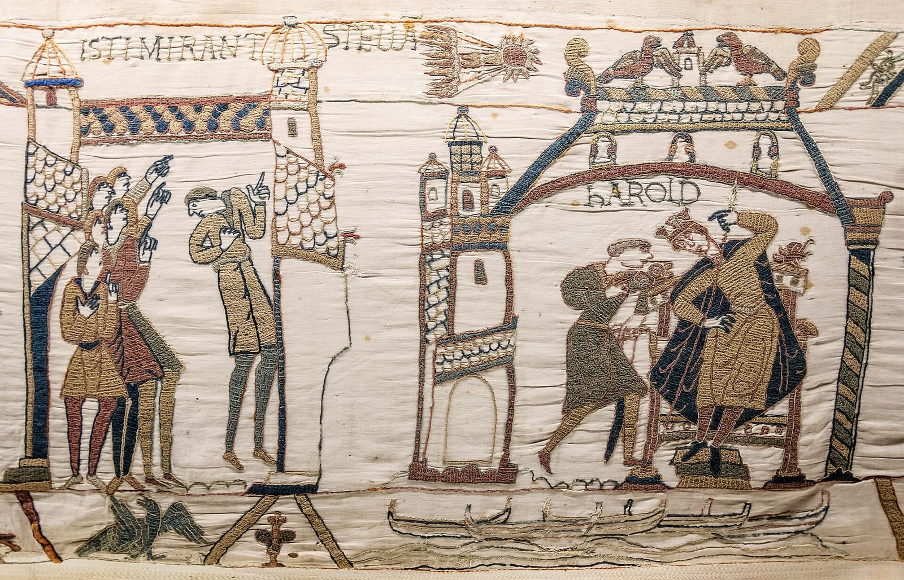

*Halley's Comet and King Harold, from the Bayeux Tapestry. Photo: [Myrabella](https://commons.wikimedia.org/wiki/File:Bayeux_Tapestry_32-33_comet_Halley_Harold.jpg) (public domain).*

The Bayeux Tapestry is an embroidered cloth nearly 70 metres long and 50 centimetres tall, telling the story of the Norman Conquest and the Battle of Hastings in 1066. It is in **Room 30, the Sainsbury Exhibitions Gallery**, from 10 September 2026 to **11 July 2027**, on loan from Bayeux. Entry is by timed ticket only, and the [museum's exhibition page](https://www.britishmuseum.org/exhibitions/bayeux-tapestry) is where they are sold.

### Where tickets stand

- **10 September 2026 to 31 March 2027:** sold out.
- **April to 11 July 2027:** the final members' priority window opens in January 2027, and general booking opens in early 2027.

Tickets are emailed four days before your visit. A booking takes up to ten tickets, only the booker can use them and ID may be checked; multiple bookings from the same email address are cancelled.

| Ticket | Standard slot | Off-peak slot | Cheapest slot |
| --- | ---: | ---: | ---: |
| Adult | £33 (£36.50 with the £3.50 donation) | £27 (£30.50 with donation) | £25 (£28.50 with donation) |
| National Art Pass | £16.50 | £13.50 | £12.50 |

Students, 16 to 18s and jobseekers pay £25. Disabled visitors pay £25 and an assistant goes free; booking is required. Under-16s are free with an adult, up to four per adult.

### Inside Room 30

Allow about 40 minutes inside, and one to two hours for the whole visit. Entry is timed and the route is one-way. Photography, drawing and sketching are not allowed. Large bags are not allowed in; the paid cloakroom is subject to capacity. There are no toilets inside Room 30, only one accessible toilet in the foyer, and if you leave to use the Great Court toilets you cannot re-enter. The Tapestry lies flat at a height of 80 cm in low light, with seating along the route and lifts for anyone who cannot use stairs.

The exhibition is open Sunday to Wednesday 10:00 to 18:00 and Thursday to Saturday 10:00 to 21:00, and staff start clearing the room ten minutes before closing.

From the Main entrance, go straight into the Great Court, along its left-hand side to the far end, and through Room 29b into Room 30. From Montague Place, take the North lift or stairs to Level 0, go through Room 24 into the Great Court, turn right and then right again into Room 29b.

The audio guide is free in the British Museum Audio app: download it before you come, and bring your own headphones.

### The free Bayeux events

**[Bayeux Late: reimagining the Bayeux Tapestry](https://www.britishmuseum.org/events/bayeux-late-reimagining-bayeux-tapestry), Friday 4 December, 17:30 to 20:30,** is free to drop into, for ages 18 and over, in the Great Court and galleries. It sits alongside the exhibition without including it.

---

## Getting in

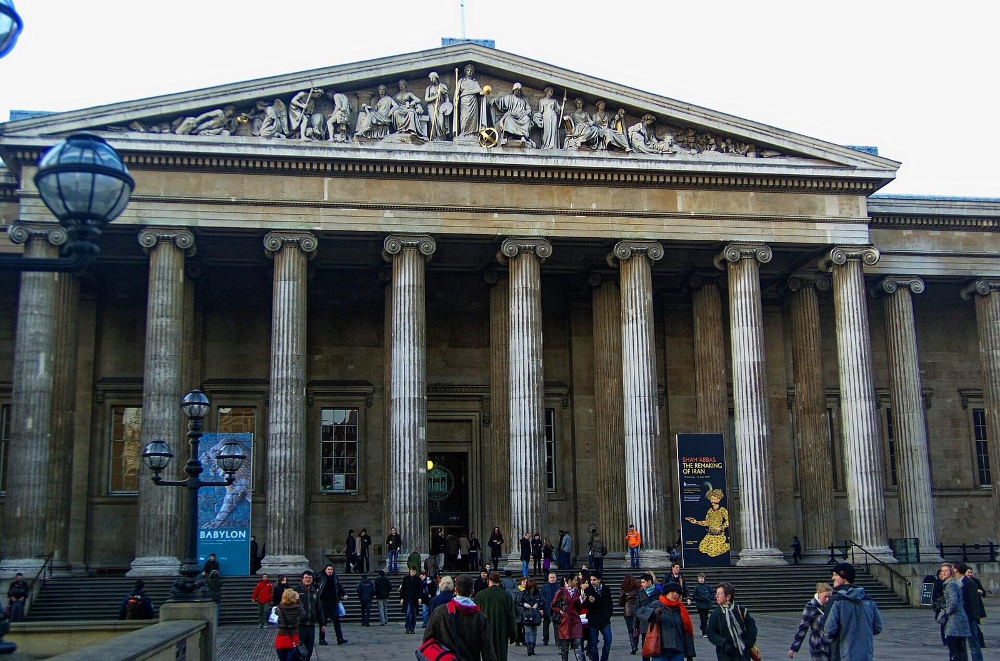

*The Great Russell Street front. Photo: [Txllxt TxllxT](https://commons.wikimedia.org/wiki/File:London_-_Great_Russell_Street_-_British_Museum_II.jpg), [CC BY-SA 4.0](https://creativecommons.org/licenses/by-sa/4.0/).*

[Book a free timed ticket](https://ticketing.britishmuseum.org/events?k=general%20admission) for up to nine people. Arrive at your entry time, not before it. Ticket holders get priority entry in busy periods, and walk-up visits are taken every day, with a longer wait if the museum is full. Every visitor goes through a security and bag check.

- **Hours:** the galleries open daily 10:00 to 17:00, with last entry at 16:45, and on Fridays until 20:30, with last entry at 20:15. They start clearing ten minutes before closing. The Great Court stays open until 17:30, and until 20:30 on Fridays. There is no Friday late opening on Good Friday, 26 March 2027. The museum is closed on 24, 25 and 26 December.
- **Great Russell Street (WC1B 3DG)** is the main entrance, under the portico. It has 12 steps with a handrail and a lift either side. Members, disabled visitors and anyone with a buggy or a child under five can use an easy-access route and skip the queue.
- **Montague Place (WC1E 7JW)** is the second entrance, on the north side. It is step-free: walk through the hall to the North lift, or take the 12 steps beside it.

> ⚠️ **No wheeled suitcases, and nothing bigger than 40 x 40 x 50 cm or heavier than 8 kg.** Folding bicycles, adult scooters, skateboards and musical instruments are also barred. Our [London luggage storage guide](/articles/luggage-storage-london/) covers left-luggage near Euston, King's Cross and Charing Cross.

The cloakroom is to the left just inside the main entrance, open 10:00 to 17:00 (20:30 on Fridays), with the last deposit an hour before closing and collection at least 30 minutes before. Bags up to 4 kg cost £4, bags of 4 to 8 kg £6, coats £3 and umbrellas £2; fold-up prams and buggies are free. Space is limited, and you must collect everything before you leave the site. Box office: +44 (0)20 7323 8181.

Photography with hand-held flash is allowed in most galleries, but not tripods, monopods or selfie sticks, and phones cannot be charged on site. There is free wifi.

### Getting there

- **Tube:** Tottenham Court Road (Elizabeth line, Central, Northern), five minutes' walk. Holborn (Central, Piccadilly) and Russell Square (Piccadilly), seven. Goodge Street (Northern), eight.
- **For Montague Place,** come in from Russell Square, or walk round from Tottenham Court Road.
- **Bus:** routes 1, 8, 19, 25, 38, 55, 98 and 242 stop on New Oxford Street.
- **By bike or car:** the museum has no parking, and its bicycle racks are closed as of November 2026. The nearest Santander Cycles docking station is on the corner of Great Russell Street and Montague Street, two minutes from the main entrance.

---

## Tours

Entry is free, so a tour pays for the guide and the route. The GetYourGuide tour below also comes with priority entrance, and the widget shows availability by date.

Powered by <a target="_blank" rel="sponsored" href="https://www.getyourguide.com/london-l57/">GetYourGuide</a>

Powered by <a target="_blank" rel="sponsored" href="https://www.getyourguide.com/london-l57/">GetYourGuide</a>

The museum's own [tours and talks](https://www.britishmuseum.org/visit/tours-and-talks), led by volunteers:

- **Around the world in 90 minutes:** £15, Fridays to Sundays at 11:30 and 14:00, 20 people a tour, ages 16 and over (12 and over with an adult). It covers several floors and a lot of walking.
- **Eye-opener tours:** free, 40 minutes, about 15 places, at varying times through the day. Arrive early at the meeting point.
- **Friday night spotlight tours:** free, 20 minutes, between 17:00 and 19:00 on late Fridays. The Reading Room spotlight tour is free on Tuesdays at 11:00 and 12:00.
- **[Out-of-hours tours](https://www.britishmuseum.org/visit/out-hours-tours):** daily, starting at 09:00 before the galleries open and lasting an hour, for up to 20 people. £35 for adults, £32 for concessions, £17.50 for ages 5 to 15, free under 5. Choose from an introduction to the museum, to ancient Egypt, to life and death in ancient Egypt, to China or to the ancient Greek world. There is no cloakroom on these tours, and the ticket lets you stay on in the permanent collection afterwards.
- **Hands on desks:** free object handling daily from 11:00 to 16:00 in Rooms 1, 24, 33, 42 and 43, 49 and 68.

The [Audio app](https://www.britishmuseum.org/visit/audio-app) is free to download, with 65 free gallery introductions. The full bundle of 250 objects is £6 per language, in English, Chinese, Spanish, Italian, French, Korean, Japanese, German and British Sign Language. Headphones are sold at the Guide Desk but not lent.

---

## When to go

The museum's own guidance, from its [accessibility page](https://www.britishmuseum.org/visit/accessibility-museum):

- **Quietest:** mornings from 10:00 to 11:00 and late afternoon from 16:00. November and early December tend to be less crowded.
- **Busiest:** the middle of the day, weekends, UK school holidays, bank holidays, Christmas and New Year, and the first and last weekends of a special exhibition.
- **Quieter rooms:** 1, 2, 2a, 15, 21, 42 and 43, 46 to 48, 90 and 90a, and 92 to 94.
- **Crowded rooms:** the Great Court and Rooms 4, 6, 17, 18, 23, 24, 30, 33, 35, 53 to 59 and 61 to 66. The Rosetta Stone and the Parthenon sculptures are worth reaching first thing or after 16:00.

**Fridays** run to 20:30. The [late-opening page](https://www.britishmuseum.org/visit/late-opening-on-fridays) lists most galleries as open, but Rooms 25, 68 to 73, 90 and 90a and 92 to 94 stay shut. The free timed ticket's last slot is 19:00, the Court Cafés serve until 20:00 and the shops stay open until 20:15. Some Friday lates have activities that are busy and noisy.

---

## What to see in one or two hours

Pick a few objects and walk straight to them. Rooms 4, 6, 10 and 18 are on the ground floor and make a one-hour loop; Rooms 40, 41 and 62 to 64 are upstairs. The museum's own [one-hour trail](https://www.britishmuseum.org/visit/object-trails/one-hour-museum) lists 14 objects across the building.

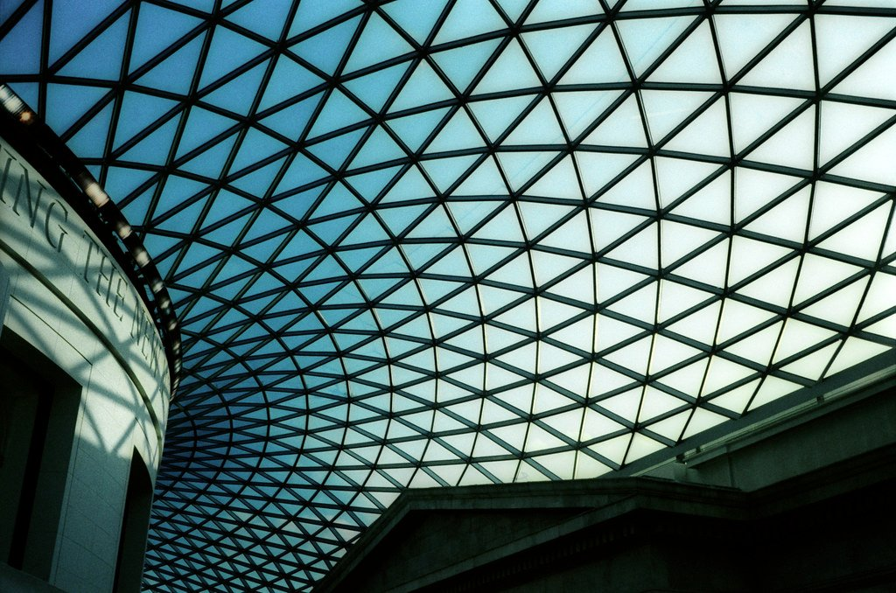

*The Great Court roof. Photo: [rbrwr](https://www.flickr.com/photos/38411862@N00/467099756), [CC BY-SA 2.0](https://creativecommons.org/licenses/by-sa/2.0/).*

### The Great Court

A glass roof by Foster + Partners over the circular Reading Room, in what the museum calls the largest covered public square in Europe. There is seating here without buying anything, and the Great Court is open until 17:30 (20:30 on Fridays).

### The Rosetta Stone, Room 4

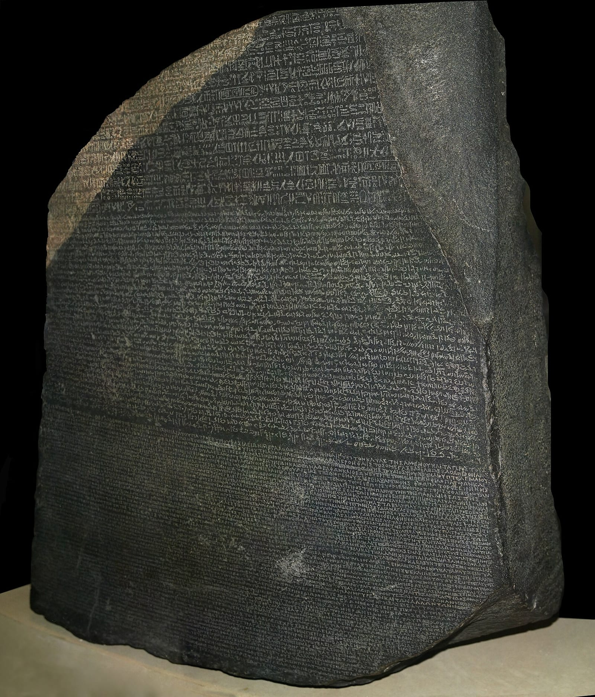

*The Rosetta Stone. Photo: [Hans Hillewaert](https://commons.wikimedia.org/wiki/File:Rosetta_Stone.JPG), [CC BY-SA 4.0](https://creativecommons.org/licenses/by-sa/4.0/).*

A decree of 196 BC carved in three scripts; the Greek text let scholars read the hieroglyphs, a breakthrough announced in 1822. The museum calls it its most popular exhibit. It sits in a case in the middle of the Egyptian sculpture gallery, near the 7.5-tonne bust of Ramesses II. **Room 4 is closed from 11 to 22 January 2027;** a replica you can touch stands in the Enlightenment Gallery (Room 1), the museum's oldest room.

### The Parthenon sculptures, Room 18

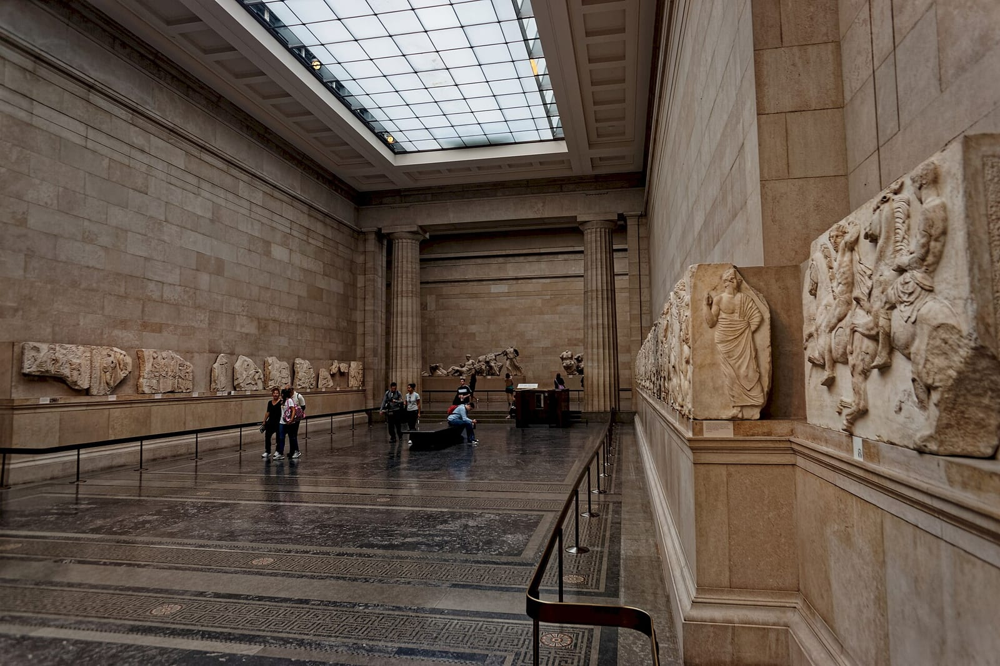

*The Parthenon sculptures in Room 18. Photo: [Txllxt TxllxT](https://commons.wikimedia.org/wiki/File:London_-_Great_Russell_Street_-_British_Museum_-_Greece-_Parthenon_-_Elgin_Marbles_-_View_NW_II.jpg), [CC BY-SA 4.0](https://creativecommons.org/licenses/by-sa/4.0/).*

Frieze panels, metopes and pediment figures made for the Parthenon in Athens in the fifth century BC, hung round a single skylit hall. The frieze is a procession of riders and sacrificial animals at eye level on the long walls; the reclining figures from the east pediment are at the far end.

### The Assyrian galleries, Rooms 6 and 10

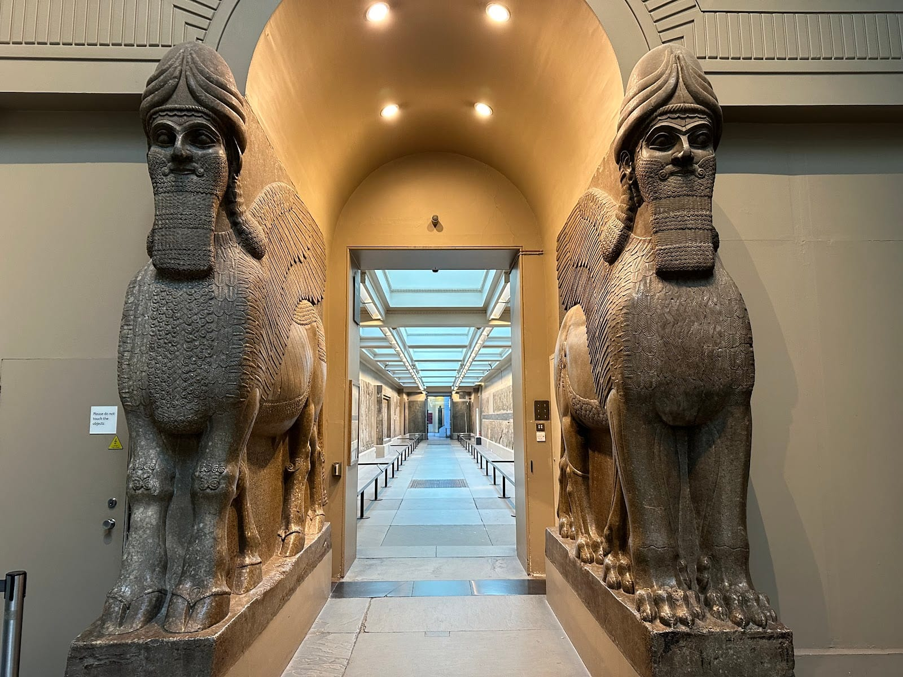

*The lamassu at the entrance to the Assyrian galleries.*

Room 6 has the winged human-headed lions from the palace of Ashurnasirpal II at Nimrud. In Room 10, a pair of colossal human-headed winged bulls from Sargon II's palace at Khorsabad greets you at the entrance. The lion hunt reliefs from Ashurbanipal's North Palace at Nineveh, carved around 645 to 635 BC, fill Room 10a: the king on his chariot, lions shot with arrows, and a dying lioness with a spear through her.

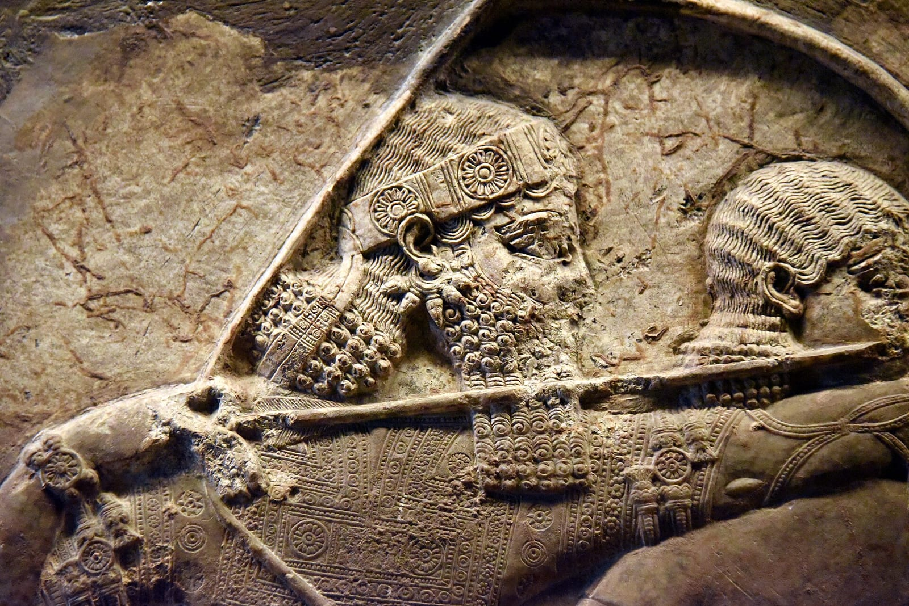

*Ashurbanipal, in the lion hunt reliefs. Photo: [Osama Shukir Muhammed Amin](https://commons.wikimedia.org/wiki/File:Assyrian_king_Ashurbanipal,_detail_of_a_lion-hunt_scene_from_Ninevah,_Iraq._British_Museum,_London.jpg), [CC BY-SA 4.0](https://creativecommons.org/licenses/by-sa/4.0/).*

### The Egyptian mummies, Rooms 62 and 63

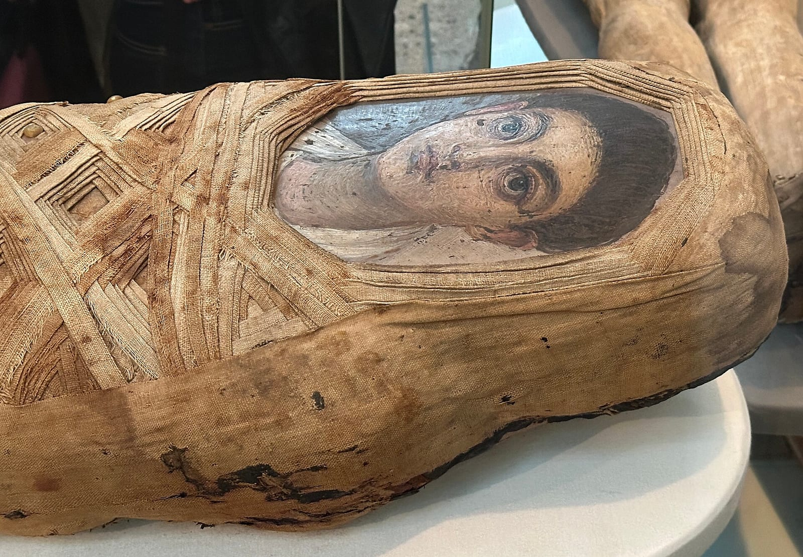

*A mummy with a painted portrait panel. Photo: [APK](https://commons.wikimedia.org/wiki/File:Mummy_of_an_adolescent_boy,_British_Museum.jpg), [CC BY 4.0](https://creativecommons.org/licenses/by/4.0/).*

Upstairs, the mummies and coffins fill Rooms 62 and 63, including Katebet, a chantress of Amun who died about 3,300 years ago. In Room 64 is Ginger, a man of about 18 to 23 who was buried in the sand around 3400 BC and preserved naturally, hair and skin included.

### The Sutton Hoo helmet, Room 41

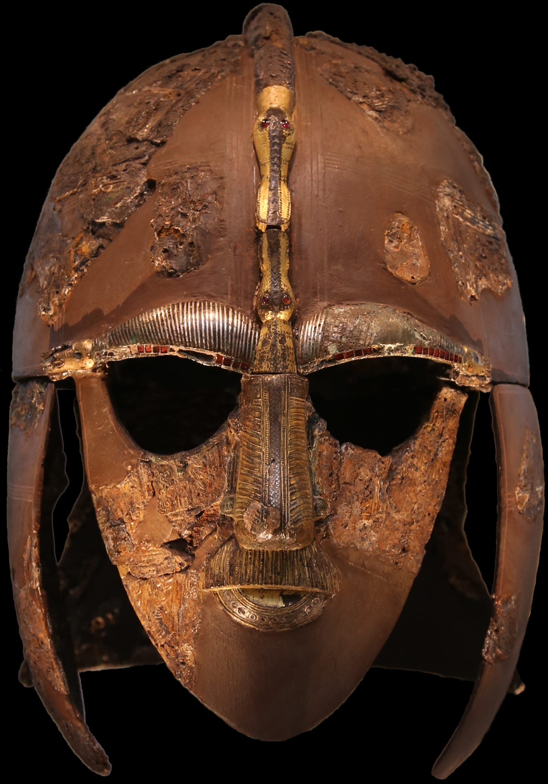

*The Sutton Hoo helmet. Photo: [Geni](https://commons.wikimedia.org/wiki/File:Sutton_Hoo_helmet_2016.png) (public domain).*

The helmet came out of an Anglo-Saxon ship burial in Suffolk, excavated in 1939. The original is reconstructed from fragments and shown beside a replica of how it looked whole.

### The Lewis Chessmen, Room 40

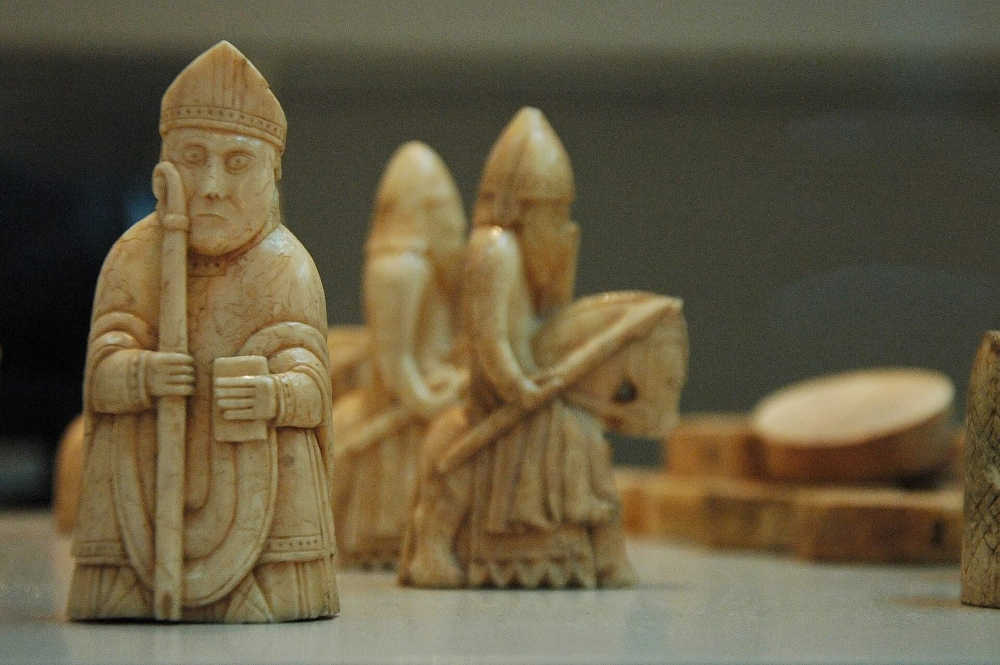

*The Lewis Chessmen. Photo: [Helen Simonsson](https://commons.wikimedia.org/wiki/File:Lewis_chessmen,_British_museum,_London.jpg), [CC BY-SA 2.0](https://creativecommons.org/licenses/by-sa/2.0/).*

Walrus-ivory chess pieces found on the Isle of Lewis in 1831, probably made in Norway around AD 1150 to 1200. The museum holds 82 of them and the National Museum of Scotland holds 11. The berserkers bite their shields, and the queens rest a hand on their cheek.

### With more time

Also on the museum's one-hour trail: Hoa Hakananai'a, the basalt statue from Rapa Nui (Room 24); the Ife head, a brass head from West Africa (Room 25); the Tang dynasty tomb figures (Room 33); the double-headed Aztec turquoise serpent (Room 27); the Royal Game of Ur, a board game from about 2600 BC (Room 56); the Oxus Treasure (Room 52); and the samurai armour (Room 93).

### Planned closures

The museum publishes [planned gallery closures](https://www.britishmuseum.org/visit#gallery-information). The dated ones:

- **Rooms 68 to 73 (Money, Greek and Roman life, the Roman Empire, Etruscans, Cyprus and the Greeks in Italy):** 2 to 13 November 2026.
- **Reading Room:** 6 November 2026 (15:00 to 20:30), 13 and 20 November (all day) and 29 November (12:00 to 17:00).
- **Rooms 33, 33a and 33b (China and South Asia, Amaravati, Chinese jade):** 30 November to 11 December 2026.
- **Room 4 (Rosetta Stone), Rooms 6a and 9:** 11 to 22 January 2027.
- **Rooms 2 and 2a (Collecting the world, Waddesdon Bequest):** 25 January to 5 February 2027. **Room 1 (Enlightenment):** 25 January to 12 February.
- **Rooms 6b, 7 and 8:** 8 to 19 February 2027.
- **Rooms 26 and 27 (North America, Mexico):** 22 February to 5 March 2027, with Room 24 partly closed.
- **Room 25 (Africa):** 8 to 19 March 2027, with Room 24 partly closed.
- **Rooms 38 and 39 (clocks and watches):** 22 to 26 March 2027. **Rooms 92 to 94 (Japan):** 29 March to 9 April.

---

## Paid exhibitions and free extras

- **Korea** runs from 1 October 2026 to 31 January 2027 in **Room 35**, off the Great Court on Level 1, and takes about an hour. It draws on works from the National Museum of Korea and includes 23 National Treasures and Treasures. Adults pay £20, or £18 off-peak; students, 16 to 18s, jobseekers and disabled visitors pay £16 to £18; seniors pay £9 after 12:00 on Mondays; under-16s are free with an adult. [Book Korea](https://ticketing.britishmuseum.org/events/korea/?view=%5Bcalendar%5D) on the museum's ticketing site. The exhibition is closed 1 and 2 December while some light-sensitive works are swapped for others, so what you see after 3 December differs from before. The museum recommends midweek visits in the middle of the run for quieter rooms. The Audio app carries a £4 exhibition guide.
- **[Korea Late with JUNG Festival](https://www.britishmuseum.org/events/korea-late-jung-festival)** is on Friday 6 November, 17:15 to 20:15, free to drop into, for ages 16 and over, in the Great Court, the Clore Centre for Education and Room 67.
- **Declaring Independence: USA 250** is free, in Room 3, and runs to 29 November 2026.
- **Multiplied Wonders: Italian Renaissance Woodcuts** is free, in Rooms 90 and 90a, from 8 October 2026 to 21 March 2027. Rooms 90 and 90a are shut on Friday evenings.

An exhibition ticket also covers the permanent collection that day.

---

## Practical information

### Food and drink

- **Court Cafés,** Great Court ground floor, 10:00 to 17:00. Sandwiches, salads, cakes and hot drinks.
- **Great Court Restaurant,** 11:30 to 17:00, last sitting 16:00. Booking is essential, though walk-ins are sometimes taken.
- **Pizzeria,** south-west corner of the ground floor, left after the main entrance, 11:00 to 16:00. Gluten-free bases, vegetarian and vegan pizzas, and gelato.
- **Coffee Lounge,** first floor overlooking the Reading Room, 10:30 to 16:30.
- **Food trucks** selling snacks and drinks, with seating outside, 10:00 to 17:00, shorter in poor weather.

Families can eat packed lunches in the Ford Centre for Young Visitors beneath the Great Court at weekends and Camden school holidays, or on the front lawns in fine weather.

For a sit-down meal outside, Charlotte Street in Fitzrovia is about eight minutes' walk west across Tottenham Court Road; our [Fitzrovia guide](/articles/fitzrovia-area-guide/) covers it.

### Shops and toilets

The Bookshop, the family shop, and the Collections shop with the Grenville Room are open daily 10:00 to 17:00, and until 20:15 on Fridays. Toilets are off the Great Court, with accessible toilets and baby changing beside the Bookshop and the Collections shop. Baby changing is also on Levels 0 and 3 of the North stairs.

### Step-free access

Montague Place is step-free, and the Great Russell Street entrance has lifts either side of its 12 steps. Rooms 16, 67, 69 and 95 have no lift or level access. There is no Changing Places toilet on site; the museum points visitors to Great Ormond Street Hospital, 15 minutes' walk from Montague Place. Free wheelchair loans need two working days' notice, booked by email or phone on weekdays, and are collected at the Great Russell Street entrance; staff cannot push wheelchairs. Concession exhibition tickets come with a free companion ticket. Blue Badge bays are on Montague Place, Montague Street and Coptic Street. Our [step-free London guide](/articles/step-free-london/) covers the rest.

### Families

The Families Desk in the Great Court lends activity backpacks and gives out trails at weekends and Camden school holidays, 10:00 to 12:30 and 13:15 to 16:30; it is closed on bank holidays. Trails are also at the Information Desk. Under-16s go free into the exhibition programme when accompanied by a paying adult.

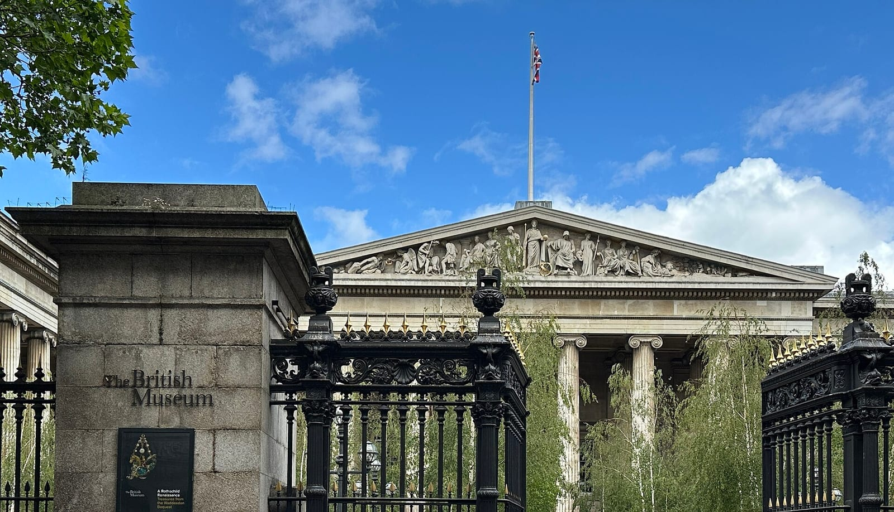

*The Great Russell Street gates. Photo: [APK](https://commons.wikimedia.org/wiki/File:British_Museum_from_Great_Russell_Street_with_sign.jpg), [CC BY 4.0](https://creativecommons.org/licenses/by/4.0/).*

---

## Nearby

The garden squares, Lamb's Conduit Street and the small free museums of Bloomsbury are all within ten minutes, and Covent Garden and Soho are about twelve minutes' walk. Our [Bloomsbury guide](/articles/bloomsbury-area-guide/) covers the Charles Dickens Museum, the Foundling Museum, the Cartoon Museum and the Wellcome Collection. Sir John Soane's Museum, a house kept as its owner left it in 1837, is covered in [the best museums in London](/articles/best-museums-london/). The museum's shops and James Smith & Sons, the umbrella shop on New Oxford Street, are in our [gifts and souvenirs guide](/articles/london-gifts-souvenirs/).

---

## Continue planning your London trip

- 🏛️ **[Bloomsbury Area Guide](/articles/bloomsbury-area-guide/)** — the garden squares, bookshops and small museums around the British Museum.
- 🛏️ **[Where to Stay in Bloomsbury](/articles/where-to-stay-bloomsbury/)** — hotels a few minutes' walk from the colonnade.
- 🖼️ **[Best Museums in London](/articles/best-museums-london/)** — the other free national museums and the small ones nearby.
- 💷 **[London on a Budget](/articles/london-on-a-budget/)** — free sights and booking hacks across Zone 1.
- 👨‍👩‍👧 **[London with Children](/articles/london-with-children/)** — the museum as part of a day with children.
- ♿ **[Step-Free London](/articles/step-free-london/)** — the British Museum's lifts and entrances alongside the other big sights.
- 🌧️ **[London in the Rain](/articles/london-in-the-rain/)** — the museum as an all-day indoor plan.
- 🍂 **[Things to Do in London in November](/articles/things-to-do-in-london-in-november/)** — the Bayeux Tapestry and the rest of the city's November events.
- 🗓️ **[Things to Do in London in December](/articles/things-to-do-in-london-in-december/)** — Bayeux Late on 4 December and the Christmas closures.
- 🗓️ **[Things to Do in London in January](/articles/things-to-do-in-london-in-january/)** — the Korea exhibition's last weeks and the sold-out Bayeux Tapestry.
- 🗺️ **[Three Days in London Itinerary](/articles/three-days-in-london-itinerary/)** — where the museum fits into a Zone 1 plan.
- 🏰 **[Tower of London Guide](/articles/tower-of-london-guide/)** and **[Westminster Abbey Guide](/articles/westminster-abbey-guide/)** — the two historic sights most visitors pair with it.
