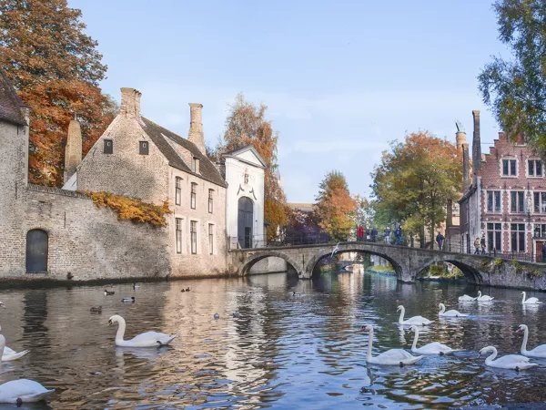
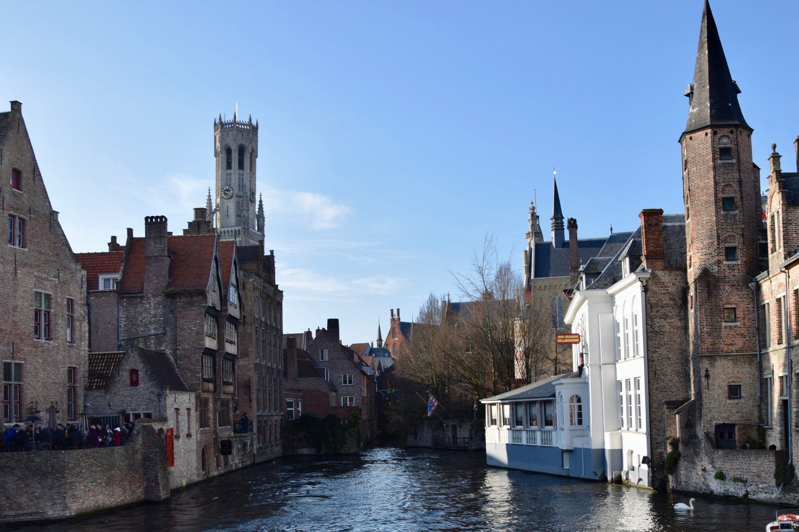
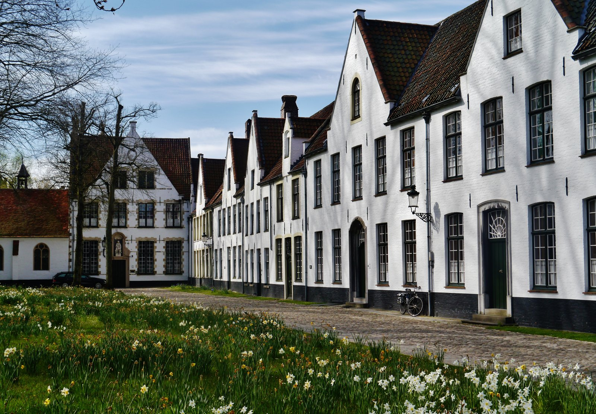
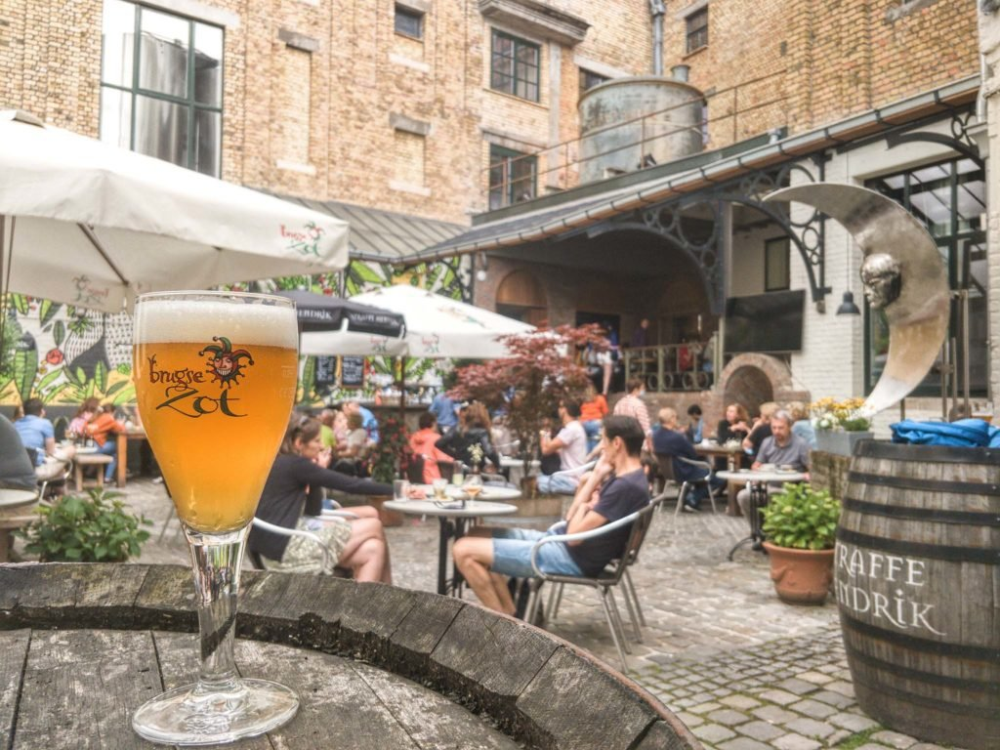

**St Pancras to Bruges takes about 3 hours 20 minutes with one change: Eurostar Standard to Brussels-Midi from £39 one-way, then a Belgian train for the last hour, from €17.60.** Eurostar's site sells both tickets in one booking. No coach tour does the trip from London, so this is a train day.

The old centre is small enough to cover on foot, ringed by a canal. The Belfry, the canals, the Begijnhof and a chocolate shop or two fill the day.

> 💡 **The Short Version:** **St Pancras to Brussels-Midi on Eurostar, then change for Bruges**, about 3h20 in all. Eurostar Standard from **£39** one-way; the Belgian train is **€17.60** each way in 2nd class on weekdays, **€12.30** at weekends, valid on any train that day. **Arrive 75 minutes before departure** at St Pancras (Standard/Plus): UK exit, EU entry and EES biometric registration all happen before you board. You need **a passport, not an ID card**, issued within **10 years** and valid **3 months** after you leave; **ETIAS is not yet in operation**. The **07:04 Eurostar** gets you into Bruges by **11:26** local time, and the last train that gets you home the same day leaves Bruges at **18:58**: **seven and a half hours** in the city. **There's no London coach tour to Bruges.** Individual canal boat tickets can't be pre-booked, but the <a href="https://www.getyourguide.com/activity/-t399508?partner_id=WWP7I0R&amp;cmp=bruges-day-trip" target="_blank" rel="sponsored nofollow noopener" data-affiliate="gyg">£38 boat, chocolate and walking tour</a> guarantees a seat. **To stay the night**, [Where to stay](#where-to-stay) has four hotels, one a level walk from Brugge station.

**Book a tour direct:**

- **£38** — <a href="https://www.getyourguide.com/activity/-t399508?partner_id=WWP7I0R&amp;cmp=bruges-day-trip" target="_blank" rel="sponsored nofollow noopener" data-affiliate="gyg">Bruges: Boat, Chocolate and Guided Walking Tour, small group</a> — 4.8 from 4,999 reviews, 2.5 hours, and the boat seat is guaranteed rather than queued for
- **£51** — <a href="https://www.getyourguide.com/activity/-t851218?partner_id=WWP7I0R&amp;cmp=bruges-day-trip" target="_blank" rel="sponsored nofollow noopener" data-affiliate="gyg">Belgian Chocolate-Making Workshop with Beer Tasting</a> — make your own pralines, then taste your way through Belgian beer, 2 hours
- **£34** — <a href="https://www.getyourguide.com/activity/-t1184030?partner_id=WWP7I0R&amp;cmp=bruges-day-trip" target="_blank" rel="sponsored nofollow noopener" data-affiliate="gyg">Walking Tour with Chocolate Tasting and Boat Ride</a> — the same three elements on a different schedule, 4.8 from 229 reviews

Powered by <a target="_blank" rel="sponsored" href="https://www.getyourguide.com/london-l57/">GetYourGuide</a>

## Getting there: Eurostar to Brussels, then a Belgian train

| | London St Pancras → Brussels-Midi |
| --- | --- |
| **Operator** | Eurostar, direct |
| **Journey time** | **Typically 2h01**, calling at Lille; around 10 departures a day |
| Eurostar Standard | **From £39** one-way, lead-in fare |
| Recommended arrival, St Pancras | **75 min** before (Standard/Plus), 45 min (Premier) |
| Booking window | Released **10–11 months** ahead |

£39 is the lead-in price for the cheapest seat on the cheapest date, and it climbs the closer you book to travel. Plus and Premier cost more for a wider seat, a meal and lounge access; the [Paris day trip](/articles/paris-day-trip/) breaks down what each adds.

Brussels-Midi is not the end of the journey. Change there onto a Belgian InterCity train — three an hour, heading for Ostend, Knokke or Blankenberge, all of which call at Bruges — for the last leg.

### Brussels to Bruges: a separate ticket

**The connecting train from Brussels-Midi to Bruges takes about an hour**, calling at Ghent St Pieters roughly halfway. It is a fixed-price Belgian domestic ticket, issued separately from your Eurostar ticket:

| Belgian ticket, Brussels-Midi → Bruges | 2nd class | 1st class |
| --- | --- | --- |
| **Standard fare, weekday** | **€17.60** | €28.00 |
| **Weekend / public holiday fare** | **€12.30** | €19.70 |
| Youth (under 26) | €10.60 | €16.90 |
| Senior (65+) | €10.60 | €16.90 |

These are fixed prices with unlimited availability, good for any train that day, with no reservation needed. Up to four children under 12 travel free with a fare-paying passenger over 12. Add the leg to your Eurostar booking on Eurostar's site or app, or buy it at a machine or the ticket office at Brussels-Midi once you're through the Eurostar gates.

> ⚠️ **The old one-ticket fare has gone.** Eurostar's "Any Belgian Station" fare, which covered onward travel to Bruges, Ghent or Antwerp on one ticket, is no longer sold. Eurostar's site now books a Eurostar ticket and an SNCB ticket together, as separate contracts of transport: if one leg is delayed, you claim from the operator that ran it. SNCB tickets can be exchanged or refunded free of charge up to and including the day before departure.

## Check-in and the border

The whole border process happens at St Pancras, not at Brussels-Midi on the way in. Eurostar's recommended arrival times:

| Station | Class | Recommended arrival | Gate closes |
| --- | --- | --- | --- |
| **St Pancras** (outbound) | Standard / Plus | **75 min before** | 30 min before |
| St Pancras (outbound) | Premier | 45 min before | 15 min before |
| **Brussels-Midi** (return) | Standard / Plus | **45–60 min before** | 30 min before |
| Brussels-Midi (return) | Premier | 30–45 min before | 15 min before |

**You need a passport, not an ID card.** It must have been **issued less than 10 years before** the date you enter Belgium and stay **valid for at least 3 months after** the day you leave; a passport that fails either rule is turned away at the gate.

**EU Entry/Exit System (EES) registration** happens at St Pancras before you board: a passport scan, a facial photo and, on your first crossing, fingerprints, at a self-service kiosk ahead of the ticket gates. It's free and needs no advance application.

**ETIAS, the EU's separate pre-travel authorisation for visa-exempt visitors, is not yet in operation.** The EU says it will announce the start date several months before launch. No ETA or visa is needed for a UK citizen going to Belgium; the UK's own Electronic Travel Authorisation only applies to foreign nationals entering Britain.

**Luggage:** one handbag or daypack plus two further items up to 85cm at their widest point for Standard and Plus, three bags plus the daypack for Premier. No weight limit, but you carry and store it yourself.

## Is Bruges actually doable as a day trip?

Yes, with an early start. On a weekday, the earliest sensible Eurostar is **07:04 from St Pancras**, arriving Brussels-Midi at **10:05**. The connecting InterCity leaves Brussels-Midi at **10:29** — a 24-minute change — and reaches Bruges at **11:26**. An earlier 06:16 Eurostar reaches Bruges by 10:26 but means checking in at St Pancras by around 05:00.

Coming back, the **last connection that gets you home the same night** leaves Bruges at 18:58, reaches Brussels-Midi at 19:53, and the Eurostar departs at 20:56, landing at St Pancras at 21:57.

That gives **seven to seven and a half hours** in Bruges once you allow time to get to the station. Nothing covered in this guide is more than a 15-minute walk from anything else.

## Getting into the centre from the station

**Bruges' station is called "Brugge"**, on the edge of the historic centre. It is a **20-minute walk** to the Markt, flat and well signed, past the Begijnhof and Minnewater ("the Lake of Love"); De Lijn buses cover the same ground if you'd rather not walk with luggage.

*Minnewater, the "Lake of Love".*

## The Markt and the Belfry

*The Belfry seen from the Rozenhoedkaai. Photo: [Ank Kumar](https://commons.wikimedia.org/wiki/File:Rozenhoedkaai_(canal)_and_Belfry_of_Bruges,_Bruges,_Belgium_(Ank_Kumar,_Infosys_Limited)_01.jpg), [CC BY-SA 4.0](https://creativecommons.org/licenses/by-sa/4.0/).*

**The Markt is framed by guild houses on one side and the 83-metre Belfry on the other.** Climbing the Belfry means **366 steps**, with a view over the whole city and, on a clear day, out to the coast. On the way up you pass the old treasury and the room holding the keyboard used to play the 47-bell carillon; the city's own carillonneur plays it live on **Wednesdays, Saturdays and Sundays, 11:00 to 12:00**.

| Belfry ticket | Summer (1 Apr–2 Nov) / weekend / Christmas | Winter weekday (3 Nov–31 Mar) |
| --- | --- | --- |
| **Adult** | **€16** | **€15** |
| Under 18 | €14 | €13 |
| Under 7 | Free | Free |

**Book online ahead if you can: it's busy and last entry is one hour before closing.** Opening hours run **9:00–20:00 daily** through summer; in winter it's **10:00–18:00 Monday to Friday and Sunday**, but Saturdays keep the longer 9:00–20:00 hours year-round. The Belfry has been UNESCO-listed since 1999, one of 56 surviving medieval belfries across Belgium and France.

## The canals and the boat trips

A boat shows the backs of buildings the streets don't. **Five boat companies run the same 30-minute route between Jan van Eyck Square and the Begijnhof**, at identical prices, from five separate jetties: Huidenvettersplein, Rozenhoedkaai, Wollestraat, Nieuwstraat and Katelijnestraat.

| Boat trip | Price |
| --- | --- |
| **Adult** | **€15.00** |
| Child (4–11) | €9.00 |
| Under 4 | Free |

**You can't book an individual ticket in advance: buy one at the jetty and wait your turn.** On a sunny afternoon the queue can run long. Boats run daily from 10:00 to 18:00, March through October; from November to February one jetty is guaranteed open on a rotation, with the other four opening at their own discretion. None of the boats are wheelchair accessible, since every jetty is reached by steps down to water level.

Powered by <a target="_blank" rel="sponsored" href="https://www.getyourguide.com/london-l57/">GetYourGuide</a>

## The Begijnhof

Through a gate off Wijngaardplein, the **Begijnhof — the "Princely Beguinage Ten Wijngaerde," founded in 1245** — is a walled cluster of whitewashed houses around a quiet, tree-lined garden. It was built for the beguines: lay women who lived a religious, celibate life without joining a full convent order. It is still lived in, by single women from Bruges and a small number with a religious vocation.

*The Begijnhof.*

**Entry is free**, and it's UNESCO World Heritage-listed. Visitors are asked to keep to a genuine hush: this is somebody's home.

## Chocolate and beer

**De Halve Maan on Walplein**, Bruges' own brewery, has been making beer on the same spot since 1856, now in its sixth generation of the same family. Its **Classic tour (45 minutes, €16, including one beer)** takes you through the brewing hall and up 220 steps to a rooftop with a 360-degree view of the city, ending with an unfiltered Brugse Zot or Straffe Hendrik. The **XL tour (90 minutes, €26, including three beers)** adds a tasting session in the original cellars, but runs weekends only. Under-6s go free on either tour; 7 to 15s pay €8.50.

For chocolate, **The Chocolate Line on Simon Stevinplein**, founded by Dominique Persoone, was voted Belgium's best chocolate shop by Gault & Millau in 2023, and is known for flavours well outside the usual praline range. It's open **9:30–18:30 Tuesday to Saturday, 10:30–18:30 on Sundays and Mondays**. If you'd rather see how chocolate is made than just buy it, **Choco-Story, the chocolate museum on Wijnzakstraat**, is open daily, 10:00–18:00, with last tickets at 17:00.

*De Halve Maan's courtyard.*

## Where to stay

Stay near Brugge station for an early train out; stay in the old centre to be a short walk from the Markt once the day-trippers have gone.

- **[Guesthouse Keizershof](hotelscom:h13168703)** — on Oostmeers, a level walk to Brugge station and on the same route into town as the Begijnhof and Minnewater; the Markt is a further ten minutes on. A small family-run guesthouse, price band £, with breakfast at the neighbouring restaurant.
- **[Hotel Dukes' Palace Bruges](hotelscom:h1853344)** — on Prinsenhof, a few minutes from the Burg and the Markt and about twenty from the station; a 5-star hotel built through a former ducal palace, price band £££, with a sauna and jacuzzi.
- **[Hotel Heritage](hotelscom:h66083)** — on Niklaas Desparsstraat, just off the Markt and about twenty minutes from the station; a Relais & Chateaux townhouse hotel in a 19th-century mansion, price band £££, on a quiet side street.
- **[Hotel Botaniek](hotelscom:h4320447)** — on Waalsestraat, close to the Burg and about twenty minutes from the station; a nine-room townhouse hotel, price band ££, with breakfast included and served until 10:30am.

## What people get wrong

- **Treating the two tickets as one contract.** Eurostar's site books both together, but delay compensation is paid leg by leg, by the operator whose train was late.
- **Looking for a London coach tour to Bruges.** It doesn't exist as a same-day product; the drive alone is close to nine hours round trip.
- **Turning up at a boat jetty expecting a short wait.** Individual tickets can't be booked ahead, and the queue on a busy afternoon can eat half an hour.
- **Planning the day around the very last Eurostar back.** Work backwards from the last Belgian train that still makes your Eurostar connection, not from Eurostar's own last departure of the night.
- **Expecting the beguines' courtyard to be a normal tourist stop.** The Begijnhof is still lived in and asks for real quiet.

## Continue planning your trip

- 🇫🇷 **[Paris day trip](/articles/paris-day-trip/)** — the other Eurostar day trip from London, and how the border process and the hours compare.
- 🎢 **[Disneyland Paris from London](/articles/disneyland-paris-from-london/)** — the Eurostar to a theme park, by way of Paris or Lille.
- 🇧🇪 **[Brussels day trip](/articles/brussels-day-trip/)** — if the extra Belgian train is one leg too many, Brussels itself is two hours from St Pancras.
- 🇳🇱 **[Amsterdam from London](/articles/amsterdam-from-london/)** — the direct Eurostar via Brussels and Rotterdam, better as a night away than a day.
- 🚂 **[St Pancras hotels: where to stay in King's Cross](/articles/where-to-stay-kings-cross/)** — for the earliest trains, when checking in the night before beats a 5am alarm.
- 🗺️ **[King's Cross area guide](/articles/kings-cross-area-guide/)** — what's around St Pancras if you arrive back with the evening still ahead of you.
- 🚇 **[London transport costs and fares](/articles/london-public-transport-costs-and-fares/)** — getting to St Pancras itself before the Eurostar leg begins.
- 🗺️ **[Day trips from London](/articles/day-trips-from-london/)** — how Bruges compares with Paris, Bath, Stonehenge and the rest.
