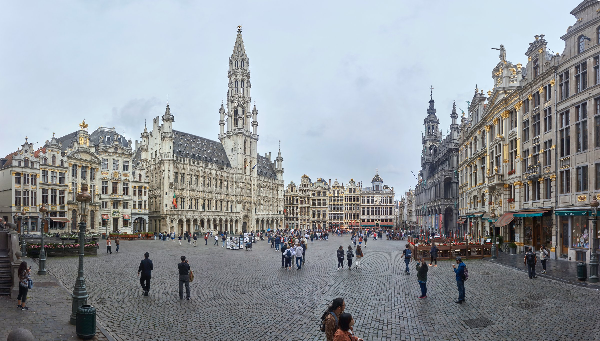
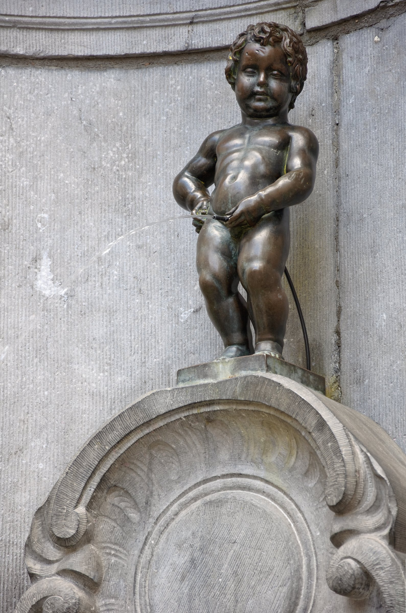
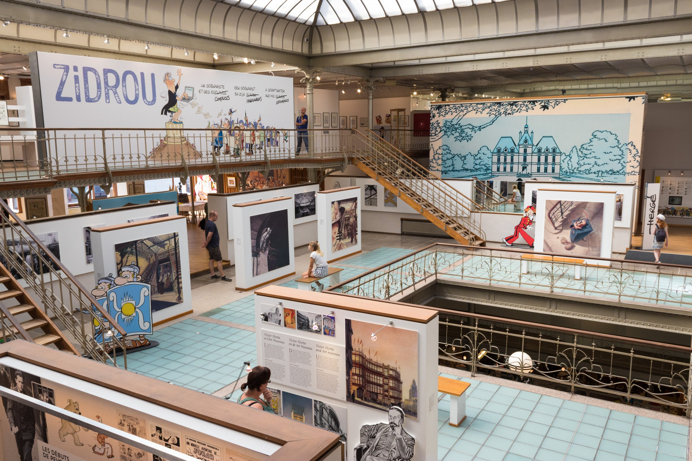
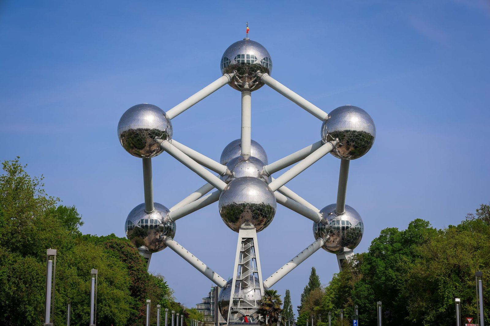
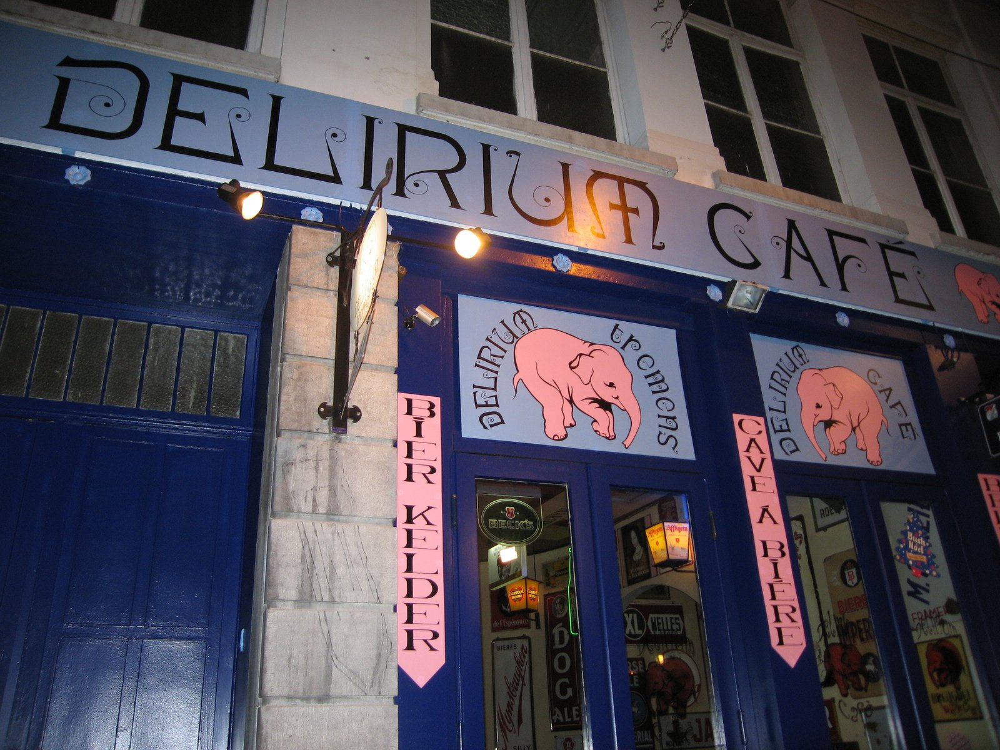

> 💡 **The Short Version:** **St Pancras to Brussels-Midi, from 1h51 direct** (1h57–2h06 depending on the train). Eurostar Standard **from £51** one-way booked ahead (£39 on some promotional dates); **Eurostar Plus** from **£98**; **Eurostar Premier** a flat **£325 one-way / £490 return**. **Arrive 75 minutes before departure** for Standard or Plus (45 for Premier): UK exit, Belgian entry and EU Entry/Exit System registration all happen at St Pancras before you board, and the same process runs at Brussels-Midi for the way home. You need **a passport, not an ID card**, issued within **10 years** and valid **3 months** after you leave the Schengen area; **ETIAS isn't live yet**, so there's nothing else to apply for. Take the early train and the last realistic one back leaves Brussels **around 19:56–20:56**, giving **eight to eleven hours** in the city. **Or skip the route-planning**: a <a href="https://www.getyourguide.com/activity/-t204439?partner_id=WWP7I0R&amp;cmp=brussels-day-trip-short-version" target="_blank" rel="sponsored nofollow noopener" data-affiliate="gyg">2.5-hour guided walking tour</a> (4.6★, 4,262 reviews) covers the Grand-Place, the guildhalls and Manneken Pis in one loop. **If you'd rather stay the night**, see [where to stay](#where-to-stay) below.

## Getting there: the Eurostar

| | London St Pancras → Brussels-Midi |
| --- | --- |
| **Operator** | Eurostar, direct |
| **Journey time** | **From 1h51** (1h57–2h06 depending on the train) |
| Eurostar Standard, from | **£51** one-way, £78 return (from £39 on some promotional dates) |
| Eurostar Plus, from | £98 one-way, £140 return |
| Eurostar Premier | **£325 one-way, £490 return**, barely moves with the date |
| Recommended arrival, St Pancras | **75 min** before (Standard/Plus), 45 min (Premier) |
| Trains per day | Around 10, roughly hourly to two-hourly |

Eurostar quotes fares to Brussels from £39 for a promotional-fare seat; £51 one-way in Standard is the steadier advance fare. Treat the range as what to expect, not a guarantee for your date.

### Eurostar Standard, Plus or Premier

The classes are **Eurostar Standard, Plus and Premier**, replacing the old Standard, Standard Premier and Business Premier.

| | Eurostar Standard | Eurostar Plus | Eurostar Premier |
| --- | --- | --- | --- |
| **Exchange** | Free up to 1hr before | Free up to 1hr before | Free up to **48hrs after** departure |
| **Refund** | Up to 7 days before, £25 fee | Up to 7 days before, £25 fee | Free, up to 48hrs after departure |
| **Luggage** | 2 bags + 1 daypack | 2 bags + 1 daypack | **3 bags** + 1 daypack |
| **Seat** | Standard | Extra spacious, meal included | Extra spacious, hot meal, lounge |
| **Lounge** | — | — | St Pancras, Paris, Brussels |

For one day in Brussels, Standard does the job: it is refundable up to a week out for a £25 fee and free to change up to an hour before your train. Plus adds a meal; Premier adds the lounges and a flexible ticket.

Bookings open **10 to 11 months ahead**, and the price climbs as the train fills, so book early.

## See Brussels with a guide

If you'd rather not plan the route yourself with a fixed number of hours on the clock, a local guide covers the ground faster than working it out from a map on the day.

- **2.5 hours, 4.6★ (4,262 reviews)** — <a href="https://www.getyourguide.com/activity/-t204439?partner_id=WWP7I0R&amp;cmp=brussels-day-trip-walking-tour" target="_blank" rel="sponsored nofollow noopener" data-affiliate="gyg">Guided walking tour of the Lower and Upper City</a>, taking in the Grand-Place, the guildhalls and the city's major landmarks
- **4.9★ (449 reviews)** — <a href="https://www.getyourguide.com/activity/-t509947?partner_id=WWP7I0R&amp;cmp=brussels-day-trip-food-tour" target="_blank" rel="sponsored nofollow noopener" data-affiliate="gyg">City-centre food tour with tastings</a>, if the point of the day is as much what you eat as what you see
- **4.7★ (967 reviews)** — <a href="https://www.getyourguide.com/activity/-t46955?partner_id=WWP7I0R&amp;cmp=brussels-day-trip-beer-tasting" target="_blank" rel="sponsored nofollow noopener" data-affiliate="gyg">Belgian beer tasting in Brussels</a>, a seated introduction, not a bar crawl

Powered by <a target="_blank" rel="sponsored" href="https://www.getyourguide.com/london-l57/">GetYourGuide</a>

## Check-in and the border

UK exit, Belgian entry and EU biometric registration all happen at St Pancras before you leave, not on arrival in Brussels.

| Station | Class | Recommended arrival |
| --- | --- | --- |
| **St Pancras** (outbound) | Standard / Plus | **75 min before** |
| St Pancras (outbound) | Premier | 45 min before |
| **Brussels-Midi** (return) | Standard / Plus | **75 min before** |
| Brussels-Midi (return) | Premier | 45 min before |

> ⚠️ **Allow 75 minutes, not the 20 Eurostar recommends between Paris, Brussels, Amsterdam and Cologne.** Any route that starts or ends at St Pancras carries the longer figure.

**You need a passport, not an ID card.** Your passport must have been **issued less than 10 years before** the date you enter Belgium and stay **valid for at least 3 months after** the day you leave the Schengen area; a passport that fails either rule is turned away at the gate.

**The EU's Entry/Exit System (EES)** has applied to this route since **12 October 2025** and replaced the manual passport stamp in full on 10 April 2026. It means a passport scan, a photo and, on your first crossing, fingerprints, done at self-service kiosks in three zones of St Pancras before the ticket gates. It's free, needs no advance booking, and your digital record lasts three years.

**ETIAS isn't live yet.** The UK government's guidance says the EU expects to start it from autumn 2026, with the date still to be announced, so there is nothing to apply for today and any site charging for one is not official.

**Luggage:** one handbag or daypack plus two further items, none over 85cm at their widest point, for Standard and Plus — three bags plus the daypack for Premier.

## Is Brussels actually doable as a day trip?

Yes, and more comfortably than Paris, because the train is shorter.

The first Brussels train leaves St Pancras at **06:16** and reaches Brussels-Midi at **08:13**, but that means checking in by around 5am. The more realistic early option is the **08:16**, arriving **10:13**. The last service back leaves Brussels around **19:56–20:56**, arriving at St Pancras roughly two hours later.

The 08:16 out and the last train back give you from **10:13 to around 18:40–19:40** in Brussels before the 75-minute check-in at Brussels-Midi: **eight and a half to nine and a half hours**. The 06:16 stretches the day past **eleven hours**. Paris gives roughly seven on the equivalent pattern.

*The Grand-Place, where most routes start.*

## Getting into Brussels: from Midi to the centre

Brussels-Midi's Metro and premetro (underground tram) station sits directly beneath the platforms, on lines 2, 4, 6 and 10. A **premetro ride of about 10 minutes** takes you to De Brouckère, by the Bourse and a short walk from the Grand-Place. Walking the whole way takes about 20 minutes.

Powered by <a target="_blank" rel="sponsored" href="https://www.getyourguide.com/london-l57/">GetYourGuide</a>

## What to do with the day

### The Grand-Place and Manneken Pis

The Grand-Place is where nearly every route starts: a market square ringed by guildhalls, with the Town Hall's 96-metre spire, topped with a gilded statue of St Michael, rising over it. Most of what you see was rebuilt within four years of a French bombardment in 1695, and UNESCO listed the square as a World Heritage Site in 1998.

**Manneken Pis** is a five-minute walk south-west of the square: a bronze fountain figure of a small boy, **55.5cm tall**. The statue on the street is a 1965 replica of the 1619 original, which is in the Brussels City Museum on the Grand-Place. The figure is dressed several times a week from a wardrobe of roughly a thousand costumes, on a schedule posted at the railings; retired costumes are in the GardeRobe MannekenPis museum close by.

*Manneken Pis, a short walk from the Grand-Place.*

### The comic-strip walls

Brussels has painted comic-book murals on blank gable walls since 1991, a joint project between the city and the Belgian Comic Strip Center. There are now more than 50, most inside the Pentagon (the ring road that marks the old city walls), so a walk between two or three sights will usually cross one. Look for Tintin's rocket, Gaston Lagaffe on the Rue de l'Écuyer, and the Smurfs.

The indoor **Comic Art Museum** (also known as the Belgian Comic Strip Center) is worth the admission if you want the history behind the murals. It is in a former textile warehouse designed by Victor Horta in 1906. Adult admission is €14.

> ⚠️ **The Comic Art Museum is closed on Mondays, except in July and August.** The murals are outdoors and always viewable.

*Inside the Comic Art Museum, in Victor Horta's Art Nouveau warehouse.*

### The Atomium question

The **Atomium**, nine steel spheres 102 metres tall built for the 1958 World's Fair, is a detour, not a stop on the way to anything. It sits at Heysel, north of the centre, a **direct 15-minute Metro line 6 ride from Brussels-Midi**, no change. Five spheres are open to visitors; the top-sphere panorama is temporarily closed. Adult admission is **€17**, which also covers the Design Museum Brussels 150 metres away. It is open every day, 10am to 6pm (last entry 5:30pm), and closed from 18 January to 5 February 2027. Tickets are sold at the ticket office only, with waits of 45 minutes to two hours.

*The Atomium, at Heysel.*

If you are on one of the early trains and can give it 90 minutes to two hours there and back, plus the queue, it is an easy add-on. On the later 08:16, with the centre still to see, drop it: the Grand-Place, Manneken Pis and the comic walls sit close together, and the Atomium doesn't.

### Waffles, frites and beer

**Waffles** come in two shapes: a Brussels waffle is light, crisp and rectangular, made from a yeasted batter and usually dusted with icing sugar or piled with toppings; a Liège waffle is smaller, denser and oval, made from a brioche-like dough studded with pearl sugar that caramelises as it cooks. Both are sold from stands across the centre.

**Frites** come in a paper cone with mayonnaise rather than ketchup as the default, fried twice, from a **frietkot** (a fries stand, sometimes just a hatch in a wall) rather than a restaurant.

**Beer:** the Delirium Café, in the Impasse de la Fidélité alley just off the Bourse, held the Guinness World Record for the longest beer list, **2,004 different beers**, when it opened in December 2003.

*The Delirium Café, just off the Bourse.*

Powered by <a target="_blank" rel="sponsored" href="https://www.getyourguide.com/london-l57/">GetYourGuide</a>

### Chocolate shops

**Neuhaus**, in the Galeries Royales Saint-Hubert a few minutes from the Grand-Place, is where the filled praline began: Jean Neuhaus II created it in 1912, and his wife Louise Agostini invented the ballotin, the small box that stops pralines crushing each other. Other names worth the walk: **Mary**, official supplier to the Belgian royal court since the 1930s, and **Pierre Marcolini**, the more experimental end of the trade.

## Onward to Bruges and Ghent

Bruges is about an hour from Brussels-Midi by Belgian train and Ghent around 35 minutes, but added to the London leg the maths stops working for a single day. To see both, a guided day trip run from Brussels covers transport and a local guide in one booking; the cheaper option is a Belgian Rail ticket bought on the day, with no advance booking on domestic routes. Each fits better as its own day trip from London on the same Eurostar route: see the **[Bruges day trip guide](/articles/bruges-day-trip/)** for the fares and the hours that leaves you.

Powered by <a target="_blank" rel="sponsored" href="https://www.getyourguide.com/london-l57/">GetYourGuide</a>

## Where to stay

Stay near Brussels-Midi only if you need the five-minute walk to a morning train; the streets around the station are known for pickpocketing and feel rough after dark. Otherwise stay in the old centre, a short premetro ride from Midi.

- **[Jill Hotel Brussels](hotelscom:h6715906)** — Avenue Fonsny, a two-minute walk from Gare du Midi's platforms and premetro; a 4-star boutique fit-out behind a plain façade, with a garden terrace. **££**, worth booking for the early train, not an evening in the area.
- **[Hotel Amigo](hotelscom:h808295)** — Rue de l'Amigo, between the Grand-Place and Manneken Pis; a five-star with its own Italian restaurant and live jazz at Bar Magritte. **£££**.
- **[Hotel Le Plaza Brussels](hotelscom:h54732)** — Boulevard Adolphe Max, a ten-minute walk from the Grand-Place past the Rue Neuve shops; a traditional, formal hotel. **££**, quieter than staying on the square.
- **[ibis Brussels off Grand Place](hotelscom:h16260)** — Rue du Marché aux Herbes, two minutes from the Grand-Place; a modern budget-chain room with a breakfast buffet that includes Belgian waffles. **£**, the cheapest of the four.

## What people get wrong

- **Treating check-in like a UK domestic train.** Eurostar wants 75 minutes at St Pancras for Standard and Plus.
- **Bringing an ID card instead of a passport.** UK nationals need a passport.
- **Fitting in the Atomium on a short afternoon.** The Metro alone is a 30-minute round trip, before the queue.
- **Turning up at the Comic Art Museum on a Monday.** The outdoor murals are always there; the museum isn't.
- **Bolting Bruges or Ghent onto the same day.** Each needs its own hour or so of travel from Brussels-Midi.

## Continue planning your trip

- 🗺️ **[Day trips from London](/articles/day-trips-from-london/)** — what the others cost, how long they take, and which days they are shut.
- 🇫🇷 **[Paris day trip](/articles/paris-day-trip/)** — the other Eurostar day trip here, and how the fares and the hours compare.
- 🎢 **[Disneyland Paris from London](/articles/disneyland-paris-from-london/)** — a Eurostar day trip with a theme park at the end, and the two routes there.
- 🇧🇪 **[Bruges day trip](/articles/bruges-day-trip/)** — the onward Belgian train from Brussels-Midi, as its own day out from London.
- 🇳🇱 **[Amsterdam from London](/articles/amsterdam-from-london/)** — the same train carries on to Rotterdam and Amsterdam, better as a night away than a day.
- 🛏️ **[Where to stay near King's Cross](/articles/where-to-stay-kings-cross/)** — for a hotel within walking distance of St Pancras before an early train.
- 🚇 **[King's Cross area guide](/articles/kings-cross-area-guide/)** — what's around the station if you arrive back with time to spare.
