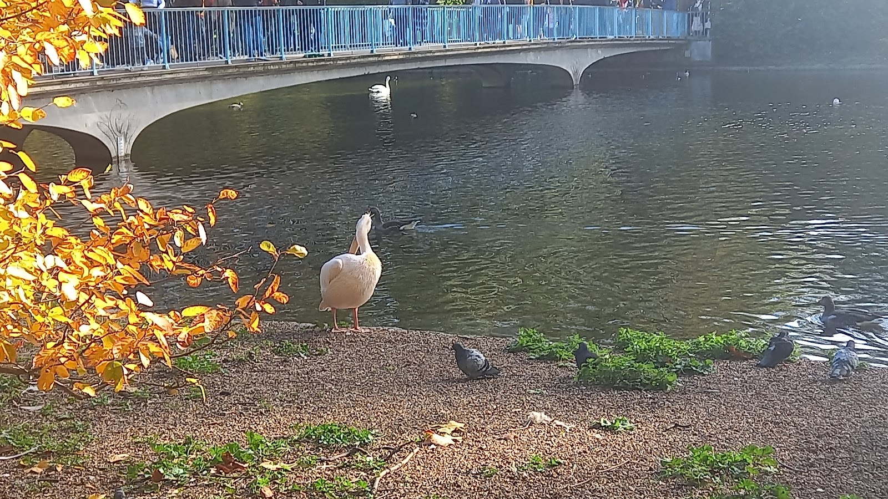

> 💡 **The Short Version:**
> - **The guard only changes on Monday, Wednesday and Friday.** Soldiers gather at **St James's Palace** and **Wellington Barracks** from **10:00**, the ceremony is under way on the Buckingham Palace forecourt from **10:45** (handover at **11:00**, lasting about 45 minutes). On **Sunday** there is a **10:00 Sunday Parade**; on **Tuesday, Thursday and Saturday** a shorter **Captain's Inspection at 15:00**.
> - **Don't stand at the palace railings.** You will see only one part of the handover through iron bars. Watch the detachments form up at St James's Palace or Wellington Barracks from 10:00 and march along **The Mall**, or go to **Horse Guards Parade** on Whitehall for the **11:00** mounted ceremony (Monday, Wednesday and Friday) with no railings at all — or walk with a guide on Urban Saunters' <a href="https://www.getyourguide.com/activity/-t413142?partner_id=WWP7I0R&amp;cmp=buckingham-palace-changing-of-the-guard-guide" target="_blank" rel="sponsored nofollow noopener" data-affiliate="gyg">Changing of the Guard walking tour on GetYourGuide</a> (from **£15**).
> - **The State Rooms open in summer only** (9 July to 27 September in 2026; summer 2027 tickets go on sale in November; **£33** adult in advance, **£37** on the day). From **6 November 2026 to 31 January 2027**, the Royal Collection Trust runs **East Wing Guided Tours (£100)**.
> - **The King's Gallery and the Royal Mews sit beside the palace:** **The King's Gallery** stays open through autumn, winter and spring (**£22** adult in 2026, £24 in 2027; showing *Queen Elizabeth II: Her Life in Style* from 10 April 2026 to 18 April 2027), while **The Royal Mews** (**£18** adult) runs **5 March to 1 November 2026** (Thursday to Monday) and then closes for winter until **March 2027**.
> - **£1 tickets and free 1-Year Passes.** Anyone on Universal Credit or other named UK benefits can pre-book **£1 tickets** for up to six people per household at the State Rooms, King's Gallery and Royal Mews. Standard tickets bought direct from the Royal Collection Trust convert free to a **1-Year Pass** before you leave.
> - **St James's Park is free (05:00–midnight).** Stand on the **Blue Bridge** for the view of the palace one way and Horse Guards and Whitehall the other, and be by **Duck Island Cottage at 14:30** when the park's pelicans are fed.

Buckingham Palace, the Changing of the Guard and St James's Park sit along a single one-kilometre stretch between Victoria and Whitehall, but each runs on its own calendar. Outside is free every day of the year; going inside depends on the month, the day of the week and which entrance on Buckingham Gate you book.

> ⚠️ **Rain cancels the Changing of the Guard, sometimes as late as 10:45 on the morning itself.** Check the [Household Division's official schedule](https://www.householddivision.org.uk/changing-the-guard-calendar) before setting out.

*Admission prices and schedules as of October 2026.*

---

## Changing of the Guard: days, timings and where to stand

Changing the King's Guard is a three-site ceremony across **St James's Palace**, **Wellington Barracks** and **Buckingham Palace**, not a static display behind the palace railings. Watching from the railings traps you behind several rows of people while the detachments and bands move along The Mall and Birdcage Walk.

*The Household Cavalry riding past the palace gates.*

### Which ceremony runs on which day

| Day | Time | Ceremony | Where to watch |
| --- | --- | --- | --- |
| **Monday, Wednesday, Friday** | **10:45** (~45 mins) | **Changing of the King's Guard** at Buckingham Palace & St James's Palace | Soldiers gather at St James's Palace and Wellington Barracks from **10:00**; handover on the palace forecourt at **11:00** |
| **Monday, Wednesday, Friday** | **11:00** | **Changing of the King's Life Guard** (mounted Household Cavalry) | Horse Guards Parade on Whitehall, with no railings or crowd barriers |
| **Tuesday, Thursday, Saturday** | **15:00** | **Captain's Inspection** of the King's Guard | Buckingham Palace forecourt; shorter and much quieter than the morning change |
| **Sunday** | **10:00** | **Sunday Parade** at Buckingham Palace | Colour trooped through the Guard to the national anthem, then marched back to St James's Palace |
| **Every day** | **16:00** | **Dismounted Inspection** of the King's Life Guard | Front courtyard of Horse Guards on Whitehall; lasts about 10 minutes with almost no crowd |

### How the ceremony works and where to watch

1. **From 10:00 — St James's Palace and Wellington Barracks:** Before the handover at Buckingham Palace, the soldiers and regimental bands gather at **Wellington Barracks** on Birdcage Walk (300 metres east of the palace) and at **St James's Palace** off The Mall. At Wellington Barracks you can stand against the perimeter railings right beside the parade square as the New Guard and band form up and rehearse.
2. **From 10:45 — The Mall and Buckingham Palace Forecourt:** The St James's Palace detachment marches west down **The Mall** and the New Guard marches from Wellington Barracks onto the Buckingham Palace forecourt for the formal handover at **11:00**, with the ceremony lasting around **45 minutes** in total before the Old Guard marches back out.
3. **11:00 (Monday, Wednesday and Friday) — Horse Guards Parade:** One kilometre east at the Whitehall end of St James's Park, the Household Cavalry Mounted Regiment changes the **King's Life Guard** on the open gravel of Horse Guards Parade. Because there are no iron railings, you can stand a few metres from the horses.
4. **16:00 daily — Horse Guards Whitehall Courtyard:** Every afternoon of the week, the officer on duty inspects the dismounted King's Life Guard in the front courtyard on Whitehall before the horses are led off duty.

### How to avoid getting boxed in

- **Follow the guards instead of waiting at the palace railings:** Start at **Wellington Barracks** or **St James's Palace** from **10:00** to see the inspection and music up close, then watch the march along **The Mall** or **Birdcage Walk** rather than standing five deep at the Buckingham Palace gates from 09:30.
- **If you want height at the palace:** The raised white marble steps of the **Queen Victoria Memorial** look over the heads of the crowd pressed against the black iron railings, though you need to claim a step early on dry mornings.
- **If you arrive after 10:30:** Walk ten minutes east along The Mall to **Horse Guards Parade** for the **11:00** mounted ceremony on Monday, Wednesday and Friday.

*The mounted ceremony at Horse Guards Parade, with a single rope instead of railings.*

### Guided Changing of the Guard tours

A guide moves you between St James's Palace, The Mall, Wellington Barracks and Buckingham Palace as each detachment steps off:

- **The Changing of the Guard, With an Expert (Urban Saunters)** — from **£15**, 2 hours, rated **4.8 from 2,718 reviews**; walks alongside the guards from St James's Palace and Wellington Barracks rather than standing at one gate. <a href="https://www.getyourguide.com/activity/-t413142?partner_id=WWP7I0R&amp;cmp=buckingham-palace-changing-of-the-guard-guide" target="_blank" rel="sponsored nofollow noopener" data-affiliate="gyg">Book on GetYourGuide</a>.
- **Buckingham Palace Entry & Changing of the Guard Tour (City Wonders)** — from **£72**, 2½ hours from the Duke of York Column, rated **4.4 from 2,979 reviews**; pairs a guided watch of the ceremony with timed entry to the State Rooms and the official audio guide during the summer State Rooms opening. <a href="https://www.getyourguide.com/activity/-t49917?partner_id=WWP7I0R&amp;cmp=buckingham-palace-changing-of-the-guard-guide" target="_blank" rel="sponsored nofollow noopener" data-affiliate="gyg">Book on GetYourGuide</a>.

Powered by <a target="_blank" rel="sponsored" href="https://www.getyourguide.com/london-l57/">GetYourGuide</a>

---

## Going inside Buckingham Palace: tickets, seasons and prices

Three separate Royal Collection Trust venues sit at Buckingham Palace: the **State Rooms** (inside the palace itself), **The King's Gallery** (the art gallery at the south-west corner on Buckingham Gate) and **The Royal Mews** (the working royal stables further down Buckingham Palace Road). Each has its own entrance, season and ticket.

| Venue | When it opens | Adult | Young Person (18–24) | Child (5–17) / Disabled | Notes |
| --- | --- | ---: | ---: | ---: | --- |
| **State Rooms** (summer) | Mid-July to late September (9 Jul–27 Sep in 2026; 2027 tickets go on sale in Nov) | **£33.00** adv / £37.00 day | **£21.50** adv / £24.00 day | **£16.50** adv / £18.50 day | Timed entry in 15-min slots; includes multimedia guide and garden exit walk. Under-5s free. |
| **East Wing Guided Tour** (winter) | **6 Nov 2026 – 31 Jan 2027** | **£100.00** | **£100.00** | **£100.00** | Pre-booked guided tour of the East Wing while the State Rooms are closed for winter. |
| **The King's Gallery** | Daily **10:00–17:30** (last entry 16:15) during exhibitions | **£22.00** (2026) / £24.00 (2027) | **£14.00** (2026) / £15.50 (2027) | **£11.00** (2026) / £12.00 (2027) | Advance timed booking required. |
| **The Royal Mews** | **5 Mar – 1 Nov 2026**, Thu–Mon **10:00–17:00** (last entry 16:00); reopens Mar 2027 | **£18.00** | **£12.00** | **£9.00** | Includes multimedia guide and free 45-min warder tour. Included on [The London Pass](/articles/london-pass-guide/). |

### Two ways to cut the cost

- **£1 Universal Credit tickets:** Anyone receiving Universal Credit, Pension Credit, Working Tax Credit, Child Tax Credit, Income Support, income-based Employment and Support Allowance or income-based Jobseeker's Allowance can pre-book **£1.00 tickets for up to six people per household** at the State Rooms, The King's Gallery and The Royal Mews (not valid on £100 Exclusive Guided Tours). Only one person needs to bring proof of eligibility on the day along with photo ID.
- **Free 1-Year Pass conversion:** Standard tickets bought directly from the Royal Collection Trust (excluding third-party resellers and £1 tickets) can be converted into a **1-Year Pass free of charge** before you exit the building. Sign and get your ticket stamped at the desk before leaving, and you can return free for 12 months.

---

## Inside the Palace, the Gallery and the Mews

### 1. The nineteen State Rooms (summer) and the East Wing (winter)

Buckingham Palace's public summer route covers the **19 State Rooms** used by the King for investitures, audiences and state banquets while the court is away in summer.

- **What you see on the summer route:** You climb John Nash's **Grand Staircase**, pass through the **Green Drawing Room** into the **Throne Room** (holding the chairs of estate made for the 2023 Coronation), walk the **Picture Gallery** hung with works by Rembrandt, Rubens, Van Dyck and Vermeer, and finish in the **Ballroom** before walking down the **West Terrace** and along a half-kilometre gravel path through the **Palace Garden** towards the exit on Grosvenor Place.
- **The winter East Wing tour (6 November 2026 to 31 January 2027):** Outside the summer opening, the Royal Collection Trust runs guided tours of the **East Wing** — the front wing facing The Mall built in the 1840s — at **£100 per person**, booked in advance through [rct.uk](https://www.rct.uk/visit/buckingham-palace).
- **Allow two to two and a half hours** for the summer State Rooms including airport-style security and the garden exit walk.

### 2. The King's Gallery

Built onto the south-west corner of Buckingham Palace on the site of the former private chapel damaged in the Blitz, The King's Gallery displays rotating exhibitions from the Royal Collection and stays open through autumn, winter and spring when the State Rooms are shut.

- **2026–2027 exhibition:** ***Queen Elizabeth II: Her Life in Style*** runs from **10 April 2026 to 18 April 2027** to mark the centenary of Queen Elizabeth II's birth. It brings together around **200 items** — roughly half never exhibited before — including Norman Hartnell's **1947 wedding dress** and **1953 Coronation dress**, childhood outfits, headscarf and riding coats, evening gowns and design sketches.
- **Summer 2027 onwards:** ***Royal Jewellery: From Coronations to Keepsakes*** runs from **25 June 2027 to 19 March 2028**.
- **Practical:** Open daily **10:00–17:30** (last admission **16:15**) during exhibitions; advance timed tickets are required on [The King's Gallery booking page](https://www.rct.uk/visit/the-kings-gallery-buckingham-palace). Allow 60 to 90 minutes.

### 3. The Royal Mews

Two minutes south down Buckingham Palace Road (entrance opposite [The Rubens at the Palace](hotel:the-rubens-at-the-palace)), John Nash's 1825 quadrangle is a working royal stable housing the horses and carriages used in state processions.

- **The Gold State Coach:** Commissioned in 1760 and used at every coronation since **George IV in 1821**, pulled at walking pace by eight Windsor Grey horses.
- **Other carriages and horses:** The **Diamond Jubilee State Coach**, the **Irish State Coach**, state motor cars, and the working stables of **Windsor Greys** and **Cleveland Bays**. Children can dress in livery and sit inside a replica Semi-State Landau.
- **Free guided tour:** A **45-minute warder-led tour** of the quadrangle runs regularly throughout the day and is included in the **£18** ticket at no extra cost — ask the warders for the next start time after security.
- **Season:** Open **5 March to 1 November 2026** (Thursday to Monday, 10:00–17:00, last entry 16:00), then closed for winter until **March 2027**.

---

## Security, bags, pushchairs and step-free access

All three Buckingham Palace venues operate **airport-style security screening** at the entrance on Buckingham Gate / Buckingham Palace Road.

- **Photography rules:** No photography or video is allowed inside the State Rooms or on the East Wing tour. Photography is allowed once you step out onto the garden exit path, and personal non-flash photography is permitted inside **The Royal Mews** and **The King's Gallery**.
- **Bags and luggage:** Large rucksacks, suitcases and wheeled bags are not admitted, and there is no luggage storage for suitcases at the palace — use the left-luggage desks at **Victoria station** (8 minutes' walk), covered in our [London luggage storage guide](/articles/luggage-storage-london/).
- **Toilets and baby care:** On the State Rooms route, visitor toilets (including accessible toilets) and baby-care facilities are located at the end of the tour in the garden area, so go before joining the entrance queue.
- **Pushchairs and buggies:** Not permitted inside the State Rooms. They must be checked in at the entrance cloakroom, where baby carriers and hip-seats are loaned free of charge for the indoor rooms, and reclaimed for the garden walk. Pushchairs are allowed inside The King's Gallery and The Royal Mews.
- **Step-free access must be pre-booked for the State Rooms:** Because the standard visitor route uses staircases, step-free entry via lift **must be booked in advance** through the Royal Collection Trust's Specialist Sales team on **+44 (0)303 123 7324**. Both **The King's Gallery** and **The Royal Mews** are fully step-free without advance notice, and a **Changing Space** facility (with height-adjustable adult changing bench and hoist) is available at the Royal Mews. Disabled visitors pay the concessionary rate and can book a **free Access Companion ticket**. See our [step-free London guide](/articles/step-free-london/) for nearby step-free Tube routes.

---

## St James's Park and The Mall

Covering **57 acres (23 hectares)** from the Victoria Memorial to Horse Guards Parade, **St James's Park** is the oldest of London's eight Royal Parks — enclosed as a deer park by Henry VIII in 1532, laid out with a canal for Charles II in the 1660s, and reshaped into its curving lake and islands by **John Nash in 1827**. Pedestrian gates are open **05:00 to midnight daily**, and entry is free.

*One of the resident Great White Pelicans by the lake, with the Blue Bridge behind.*

### What to see in the park

- **The Blue Bridge:** Crosses the middle of the lake on the north-south path between The Mall and Birdcage Walk. Looking west, the trees frame **Buckingham Palace** across the water; looking east, the rooftops and towers of **Horse Guards**, **Whitehall** and the **London Eye** rise behind the willow trees and the **Tiffany Fountain**. Early morning before 09:00 gives the clearest light on the palace facade from the east.
- **The 14:30 Pelican Feeding and Duck Island Cottage:** Pelicans have lived on the lake continuously since **1664**, when the Russian Ambassador presented a pair to Charles II. They gather on the lakeside beside **Duck Island Cottage** — the 1841 Swiss-chalet birdkeeper's lodge on Duck Island at the eastern end of the lake, near Horse Guards Road — for their daily fish feed at around **14:30**.
- **Queen Victoria Memorial and Canada Gate:** Sir Thomas Brock's white marble monument (1911) in front of the palace, topped by a gilded Winged Victory and flanked by wrought-iron gates gifted by Canada, Australia, and South and West Africa.
- **The Mall, St James's Palace and Clarence House:** Bordering the north side of the park, **The Mall** is surfaced in red pigment to read as a processional carpet running from the Victoria Memorial to **Admiralty Arch**. Halfway along on the north side stand **Clarence House** and Henry VIII's red-brick **St James's Palace** (1536), whose Tudor gatehouse faces up St James's Street.
- **Guards Museum (Wellington Barracks):** On the south side of the park on Birdcage Walk, inside Wellington Barracks, the [Guards Museum](https://theguardsmuseum.com/) tells the history of the five regiments of Foot Guards (Grenadier, Coldstream, Scots, Irish and Welsh) with uniforms, weapons and a bearskin cap you can try on. Open daily **10:00–16:00** (last entry 15:30; **£11** adult, **£3** child aged 6–15, concessions from **£5**), right beside the parade ground where the New Guard forms up from 10:00.

*Spring flowerbeds in St James's Park, with St James's Café in the background.*

### Food, coffee and toilets in the park

- **St James's Café and kiosks:** **St James's Café** sits at the eastern end of the lake near Horse Guards Parade with outdoor tables overlooking the water, and refreshment kiosks sit by Marlborough Gate, Horseshoe Bend and the Playground.
- **Public toilets:** Public toilets (including accessible radar-key cubicles) sit beside Marlborough Gate on the north side of the park and beside the playground on the south-west side near Birdcage Walk. See our [London public toilets guide](/articles/public-toilets-london/) for nearby free facilities.

---

## Getting there: best Tube stations by entrance

Because the palace grounds and park stretch from Victoria to Whitehall, the right station depends on where you are starting:

| Destination | Nearest station | Lines | Walk | Step-free? |
| --- | --- | --- | --- | --- |
| **Buckingham Palace Forecourt & Changing of the Guard** | **Green Park** (walk south through Green Park via Canada Gate) | Jubilee, Piccadilly, Victoria | **7 mins** | **Yes** — step-free from platform to street |
| **State Rooms, The King's Gallery & Royal Mews** | **Victoria** (walk north up Buckingham Palace Road) | Victoria, District, Circle, National Rail | **7–10 mins** | **Yes** — step-free on Victoria line & mainline |
| **St James's Palace** | **Green Park** (walk south-east down Queen's Walk) | Jubilee, Piccadilly, Victoria | **6 mins** | **Yes** |
| **St James's Park (Blue Bridge) & Wellington Barracks** | **St James's Park** (Broadway exit) | District, Circle | **4 mins** | No (stairs only) |
| **Pelicans, Duck Island & Horse Guards Parade** | **Westminster** (Exit 4 or 6) or **Charing Cross** | Jubilee, District, Circle, Northern, Bakerloo | **7 mins** | **Westminster is step-free** |

---

## How to combine them in one morning

On a **Monday, Wednesday or Friday**:

1. **09:45 — Green Park to the Victoria Memorial:** Exit **Green Park** station and walk through Green Park to photograph **Buckingham Palace** and the **Victoria Memorial** before the forecourt crowd builds.
2. **10:00–11:30 — Watch the Guard Change:** Move to **St James's Palace** or **Wellington Barracks** on Birdcage Walk from **10:00** to see the soldiers and band form up, then watch the detachments march to the palace forecourt for **10:45** — or walk east along **The Mall** to **Horse Guards Parade** for the **11:00** mounted ceremony with no barriers.
3. **11:30 — Blue Bridge in St James's Park:** Cross the **Blue Bridge** over the park lake for the view of Buckingham Palace one way and Whitehall the other.
4. **12:00 onwards — Afternoon options:** Walk to **Buckingham Gate** for a timed ticket at **The King's Gallery**, **The Royal Mews** (March–November) or the summer **State Rooms** — or stay in the park for lunch by the lake and the **14:30 pelican feeding** by Duck Island Cottage before visiting the [Churchill War Rooms](/articles/churchill-war-rooms-guide/) or [Westminster Abbey](/articles/westminster-abbey-guide/).

For a complete 11-stop self-guided route connecting Buckingham Palace and St James's Park with Big Ben, the Supreme Court, Westminster Abbey and Trafalgar Square, follow our [Westminster walking route](/articles/westminster-walk/).

Powered by <a target="_blank" rel="sponsored" href="https://www.getyourguide.com/london-l57/">GetYourGuide</a>

---

## Common mistakes to avoid

1. **Turning up on a Tuesday, Thursday, Saturday or Sunday expecting the 11:00 Changing of the Guard:** The full ceremony only runs on **Monday, Wednesday and Friday**; Sunday has a 10:00 parade and the other days a 15:00 inspection.
2. **Expecting to tour Buckingham Palace's State Rooms outside summer:** They open for about ten weeks from mid-July to late September. Outside summer, book **The King's Gallery**, **The Royal Mews** (5 March to 1 November 2026; reopening March 2027) or the **£100 winter East Wing guided tour** (6 November 2026 to 31 January 2027).
3. **Standing against the Buckingham Palace railings from 09:30:** You lose an hour and a half and still miss the soldiers and bands forming up at Wellington Barracks and St James's Palace from 10:00.
4. **Arriving with a suitcase or large rucksack:** None of the palace venues will store suitcases. Drop bags at **Victoria station** first.
5. **Forgetting to stamp your ticket for the free 1-Year Pass:** You must ask at the desk and sign your ticket *before* leaving the building; it cannot be converted once you have exited.

---

## Continue planning your London trip

- 🚶 **[A Walk Through Westminster: 11 Stops from Big Ben to Trafalgar Square](/articles/westminster-walk/)** — our step-by-step self-guided route through St James's Park, Buckingham Palace, The Mall and Horse Guards.
- 🏛️ **[Westminster Area Guide](/articles/westminster-area-guide/)** — Whitehall, Westminster Cathedral's lift-served bell tower, Tate Britain and where to eat nearby.
- ⛪ **[Westminster Abbey Guide](/articles/westminster-abbey-guide/)** — £31 tickets, the £10 verger tour to Edward the Confessor's shrine, and free daily Evensong.
- 🎖️ **[Churchill War Rooms Guide](/articles/churchill-war-rooms-guide/)** — the underground wartime bunker at the Clive Steps, directly on the edge of St James's Park.
- 🏰 **[London's Historic Houses and Palaces](/articles/historic-houses-london/)** — Kensington Palace, Hampton Court, Eltham Palace and the £1 Universal Credit ticket scheme across London.
- 🌳 **[The Best Parks and Gardens in London](/articles/best-parks-gardens-london/)** — how St James's Park compares with Hyde Park, Kensington Gardens, Regent's Park and Greenwich Park.
- 🧭 **[The Best Walking Tours in London](/articles/best-walking-tours-london/)** — Changing of the Guard walks, Blue Badge Westminster tours and historic pub routes compared.
- 🛏️ **[Best Areas to Stay in London](/articles/best-areas-to-stay-in-london/)** — how Westminster and Victoria compare with South Bank, Covent Garden and Kensington for hotel value and transport links.
