Camden is markets, music and the Regent's Canal. A craft market opened by the canal lock in 1974; it is now five separate markets drawing around 250,000 people a week.

Beyond the stalls there is the canal, Primrose Hill fifteen minutes north-west, and the surviving music venues.

Camden has its own share of the commemorative plaques marking where notable people lived or worked - see them on our [interactive map](/plaques/?area=camden).

## Why visit — and who should skip it

**Come here if** you want street food, vintage, or live music, or you want to walk the Regent's Canal. Camden Lock has dozens of food traders, most under £10.

**Skip it if** crowds bother you. Sunday afternoon is the most crowded time; come on a weekday morning for the market without the crush.

## Top sights and activities

1. **Camden Lock Market** — Beside the lock itself: craft stalls and street food, with terraced seating above the water.
2. **Stables Market** — Running back into the tunnels and vaults of a Victorian horse hospital. Vintage clothing, antiques and furniture, plus the bronze horse statues.
3. **Camden Lock and the Regent's Canal** — The lock still operates. The towpath runs east to King's Cross in 30 minutes and west to Little Venice in about 50.
4. **Primrose Hill** — Fifteen minutes north-west. A free view of the central skyline, with a naming plaque at the summit. The village below it has the pastel terraces of **Chalcot Crescent**, used as the Browns' house in the *Paddington* films.
5. **The Roundhouse** — A former railway engine shed turned venue, where Pink Floyd, Hendrix and The Doors all played. Still a working music and theatre space.
6. **The Electric Ballroom and the Dublin Castle** — Two surviving live venues. Madness and Blur played early sets at the small Dublin Castle.
7. **Regent's Park and London Zoo** — Fifteen minutes south-west along the canal, with the zoo's landmark Snowdon Aviary structure visible from the towpath. It no longer holds birds - it was reimagined as **Monkey Valley** and now houses the zoo's monkeys.

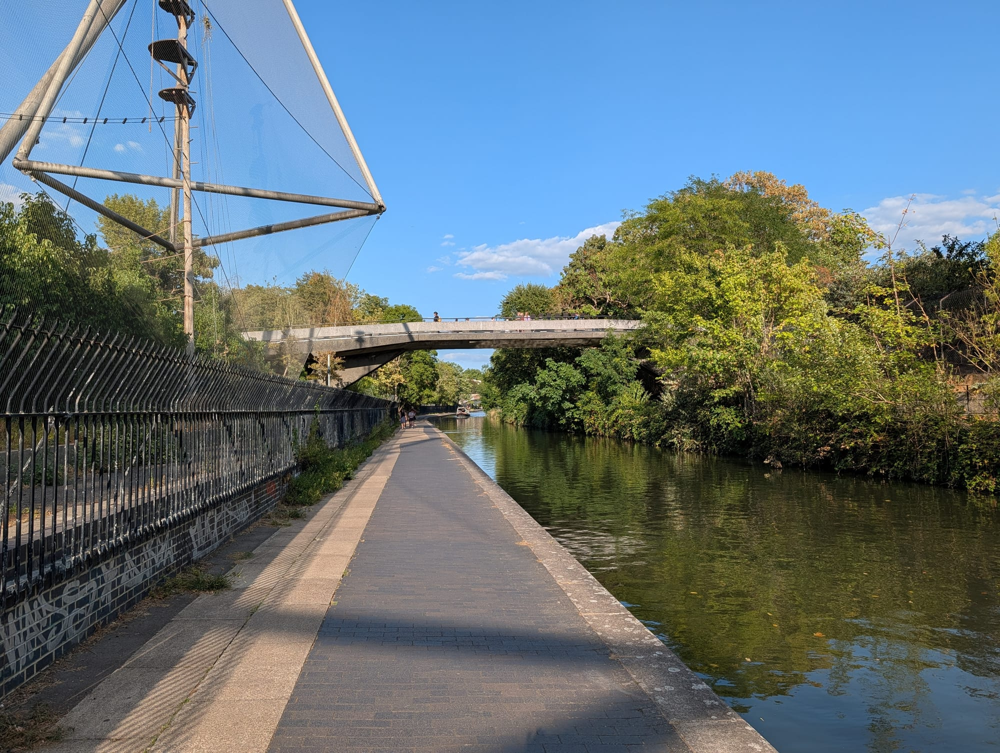

*The towpath toward the zoo.*

## Key streets and micro-districts

### Camden Lock and the canal
**Camden Market opens 10am to 7pm daily.** The cobbled lanes between the lock and the railway arches are close to impassable by early afternoon at a weekend; before eleven on a weekday you can see what the stalls are selling.

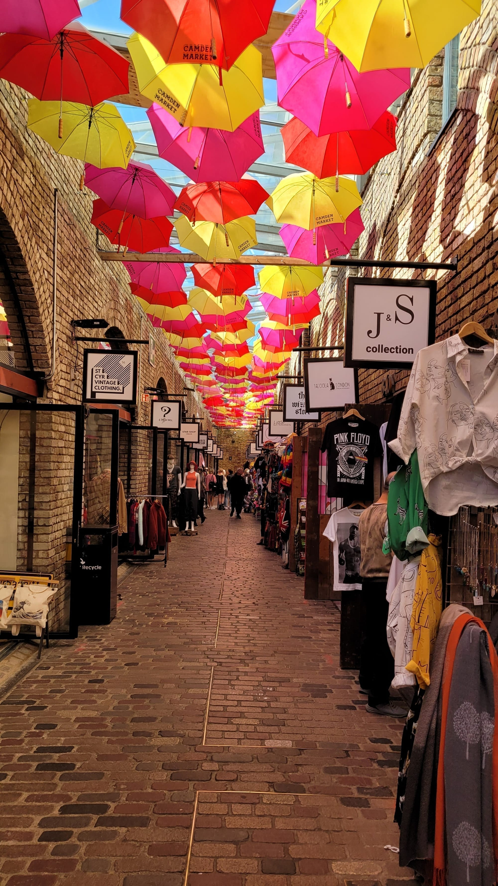

*Camden Market's umbrella alley.*

**Food is the main draw**: around a hundred street food counters across the lock and Hawley Wharf, from Cuban to Korean to Argentinian, most plates £8 to £12. **Hawley Wharf's food halls run 11.30am to 11pm**, later than the market's 7pm close.

**The canal is the way out of the crowds.** The **London Waterbus** runs from beside the lock to **Little Venice in 45 minutes** — **£17 adult, £14 child, under-4s free** — through Regent's Park, the grounds of London Zoo and the 248-metre Maida Hill tunnel. Boarding closes five minutes before departure. Walking the towpath the same way is free and takes about an hour.

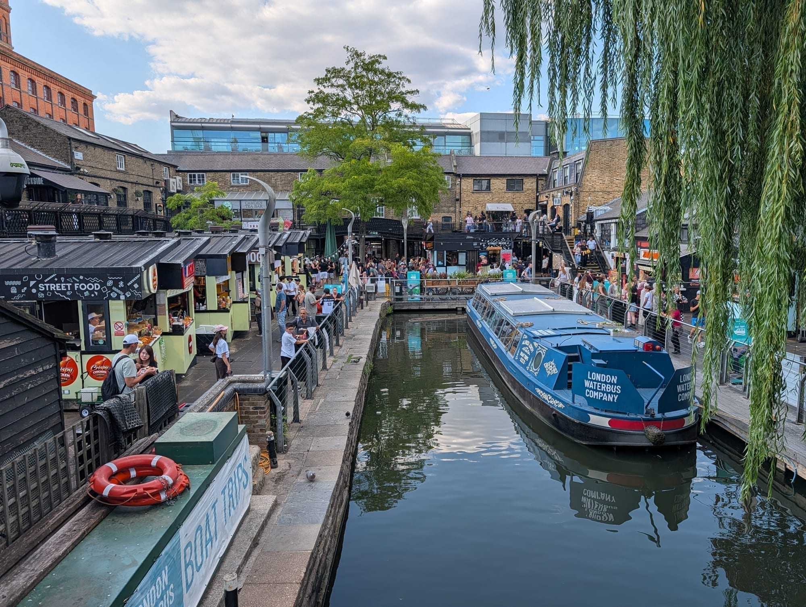

*Camden Lock, with a London Waterbus boat.*

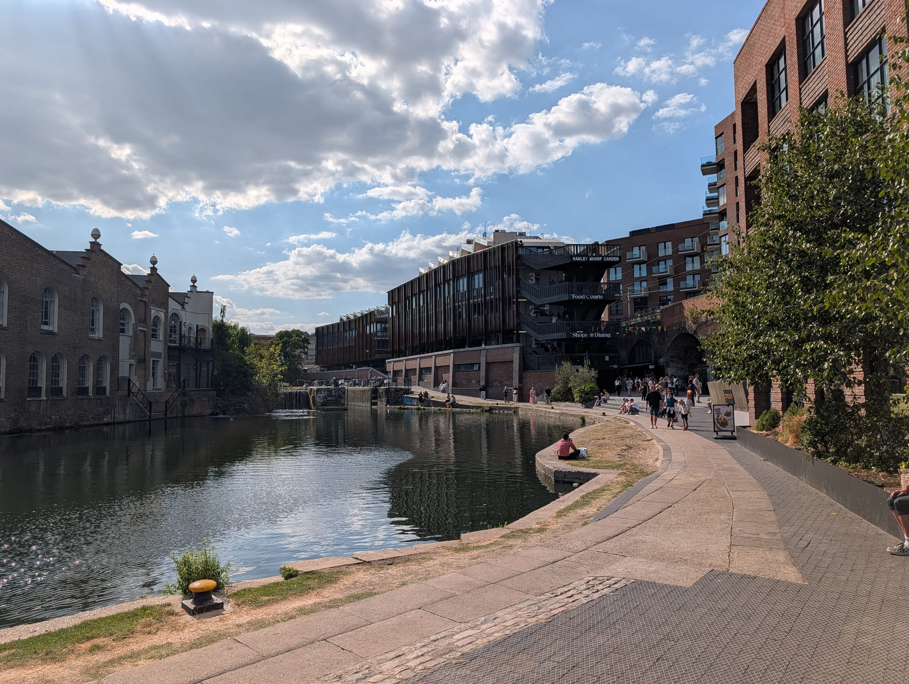

*Hawley Wharf.*

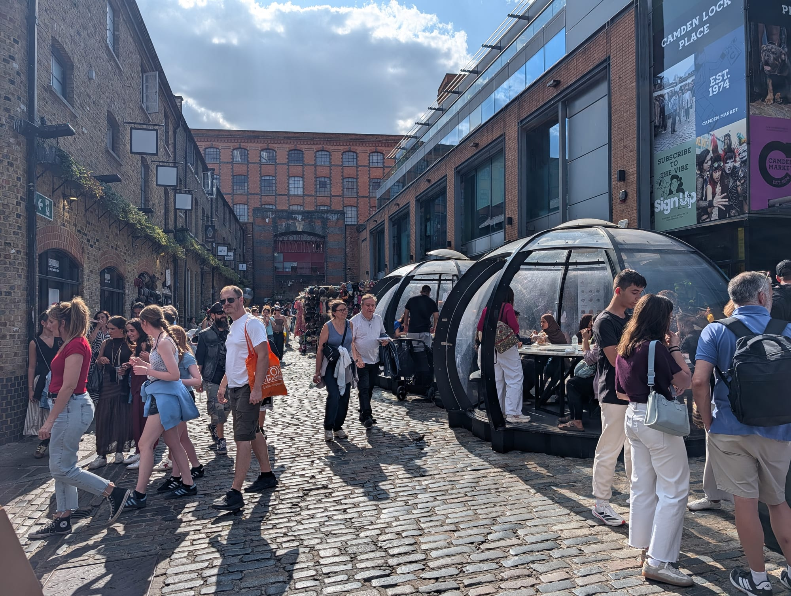

*Camden Lock Place.*

### Stables Market and Chalk Farm Road
North past the railway bridge. The Stables are the Victorian horse hospital and tunnels, now railway arches full of dealers: vintage clothing, furniture, militaria, records. Expect **£15 to £60** for a decent vintage piece, more for branded denim or leather.

**Go on a weekday to look at anything closely.** The arches are narrow and on a Saturday you shuffle.

Opposite stands the **Roundhouse**, built in 1847 as an engine shed and now a music venue; the cast-iron columns inside are the originals. Check what is on before you come. It is covered in full in our [live music guide](/articles/best-live-music-venues-london/).

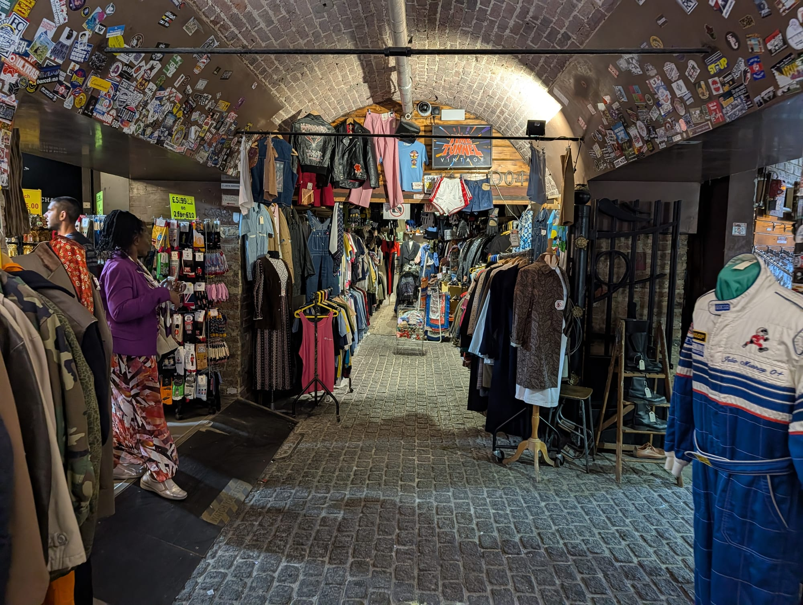

*Stables Market's vintage dealers.*

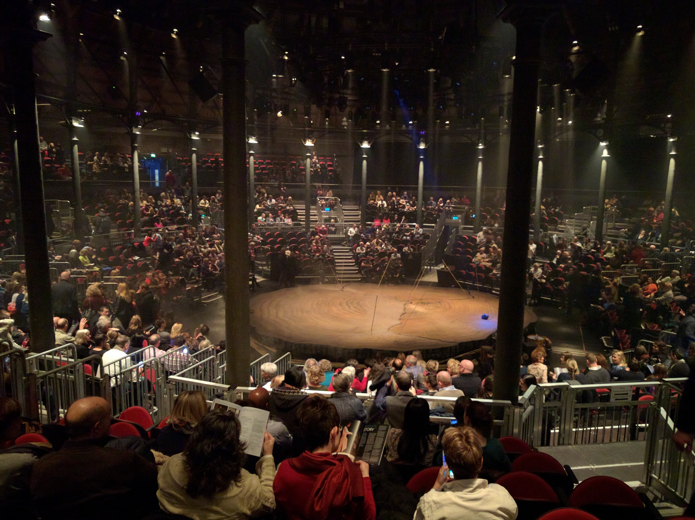

*Inside the Roundhouse.*

### Camden High Street
From the Tube station north: chain shops, tattoo studios and the oversized shop-front sculptures.

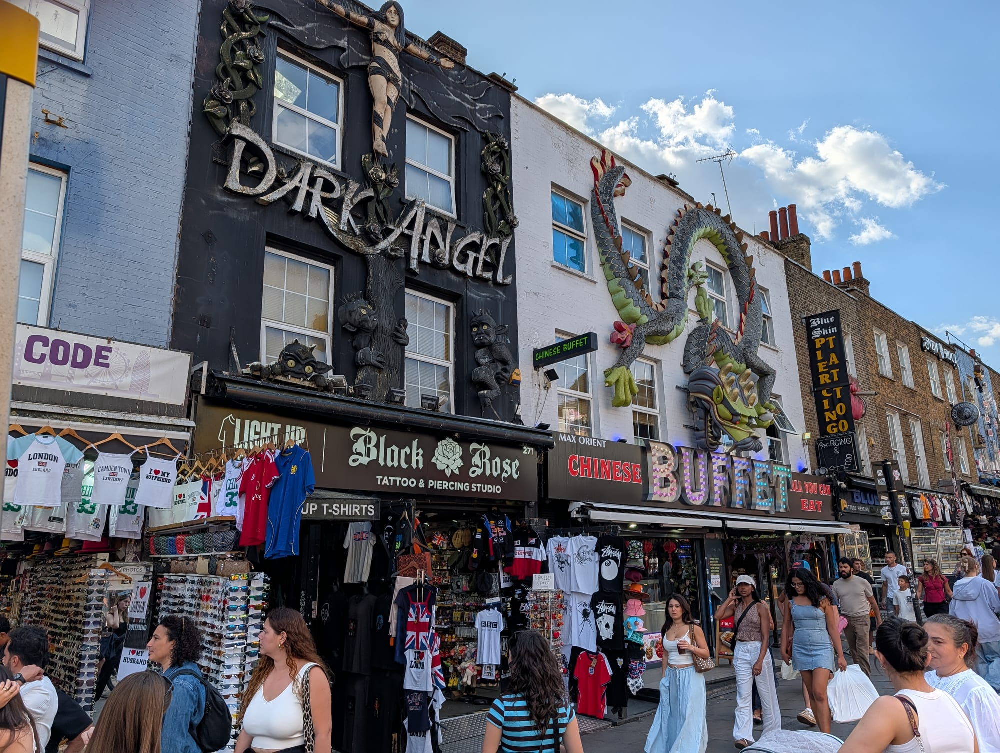

*The High Street sculptures.*

**[Cyberdog](https://www.cyberdog.net/)**, under the Stables, is a cybergoth and rave clothing shop built like a nightclub — neon, a DJ booth and staff dancing on podiums. It has been there since 1994 and is free to walk into.

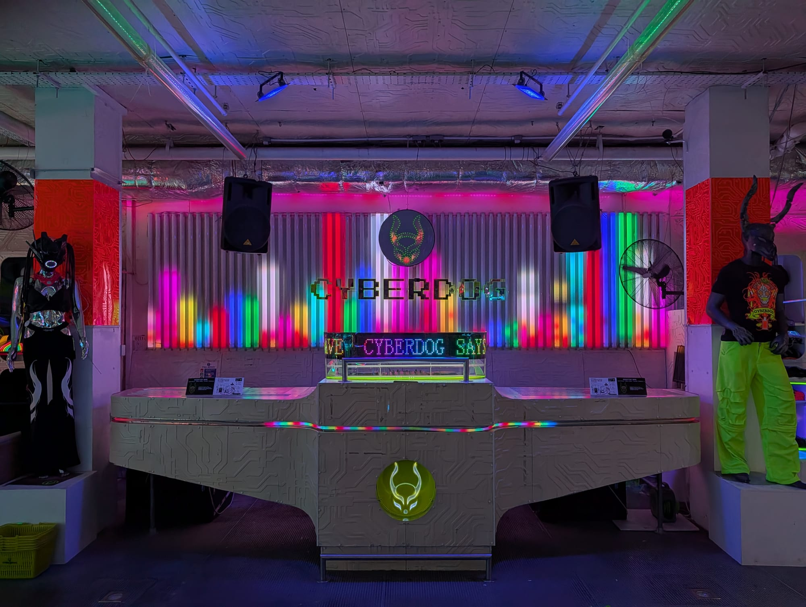

*Cyberdog.*

**BOXPARK Camden** on the High Street is a container development with street food counters, bars and a roof terrace.

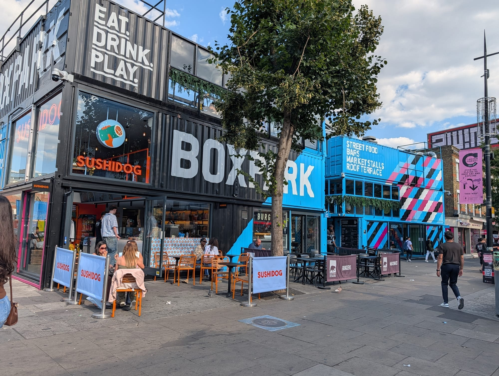

*BOXPARK Camden.*

### Inverness Street and Parkway
West of the High Street. **Inverness Street** was a fruit and veg market for a century and is now a handful of stalls, but it is lined with pubs and small restaurants that serve locals rather than the market crowd.

**Parkway** runs from the Tube down toward Regent's Park, with neighbourhood Greek, Italian and Indian restaurants, plus **The Dublin Castle**, the pub where Madness got their start and still a small live venue most nights.

Camden's Greek-Cypriot tavernas are a short walk from the High Street: **Andy's Taverna** on Pratt Street, open since 1967, **Daphne** on Bayham Street and **Alexander the Great** on Plender Street, with **Lemonia** up in Primrose Hill. All four are in our [Greek restaurants guide](/articles/best-greek-restaurants-london/).

**This is where to eat if the market has worn you out**, five minutes from the crowds.

### Primrose Hill village
North-west across the railway, ten minutes' walk away: pastel stucco terraces, independent shops along Regent's Park Road and local pubs.

**Come for the hill itself.** It rises to about **63 metres** and the summit is a **protected London viewpoint**, with the sightline to St Paul's and the City kept clear. It is free and busiest at sunset. The Royal Parks closes the hill from 10pm to 6am on Fridays, Saturdays and Sundays from 3 April to 8 November 2026, and every night from 30 October to 9 November 2026; on other weekdays it stays open 24 hours.

**Chalcot Crescent** stood in for the Brown family's house in the *Paddington* films. These are private homes, so photograph from the pavement and keep the noise down.

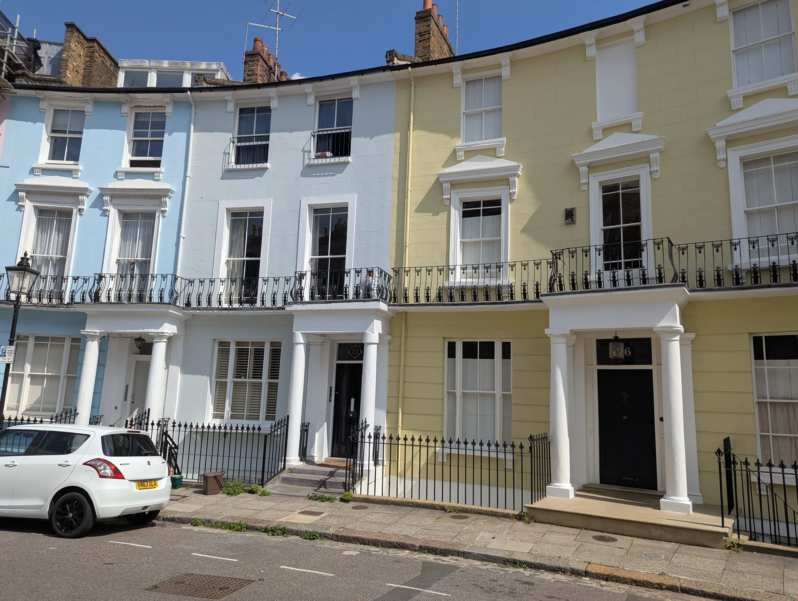

*Chalcot Crescent, Primrose Hill.*

## Where to eat and drink

| Spot | Style | Price | Why go |
| --- | --- | --- | --- |
| **Camden Lock food stalls** | Global street food | £ | Dozens of traders, most under £10; eat on the canal terraces |
| **Poppies** | Fish and chips | ££ | A 1950s-styled chippy on Hawley Crescent |
| **Hook Camden Town** | Fish and chips | ££ | Sustainable, freshly battered, on Parkway |
| **BOXPARK Camden** | Street food hall | £ | Containers on the High Street — counters, bars and a roof terrace |
| **The Dublin Castle** | Music pub | £ | Small back room where Madness and Blur played early sets |
| **Namaaste Kitchen** | Indian grill | ££ | On Parkway |
| **The Lansdowne** | Gastropub | ££ | Primrose Hill; a gastropub away from the market |
| **Chin Chin Labs** | Ice cream | £ | Liquid-nitrogen ice cream made in front of you |

Powered by <a target="_blank" rel="sponsored" href="https://www.getyourguide.com/london-l57/">GetYourGuide</a>

On Kentish Town Road, Belly cooks French bistro dishes through a Filipino lens, and Bintang has served Filipino-Asian food on the same street since 1987. Both are in our [fusion restaurants guide](/articles/best-fusion-restaurants-london/).

## Canal boat trips from Camden

Five operators run from Camden Lock. All use the same stretch of the Regent's Canal, through Regent's Park and **the grounds of London Zoo**, where the painted wolves and the colobus monkeys are visible from the water, and in most cases through the **Maida Hill tunnel**, a little over 240 metres long, which has no towpath.

| Trip | Route | How long | From | What makes it different |
| --- | --- | --- | --- | --- |
| **[London Waterbus](https://www.londonwaterbus.com/)** | Camden ↔ Little Venice | ~45 min each way | £17 adult, £14 child | Pick the historic narrowboat, which is guided and has forward-facing seats, or the Comfort Cruiser barge, which has booth seating, tables and a licensed bar |
| **[Jason's Trip](https://www.jasons.co.uk/)** | Little Venice ↔ Camden | ~45 min | £19 single, £25 return | Running since **1951**, on a canal boat built in **1906** |
| **[Jenny Wren](https://walkersquay.com/)** | Camden → Little Venice → back | **~90 min round trip** | Phone to book | Guided the whole way, and the only one that **works a lock while you are aboard**. Ends where it started, so no walk back |
| **[My Fair Lady](https://walkersquay.com/my-fair-lady/)** | Regent's Canal | An evening, a Sunday lunch or afternoon tea | Phone to book | A **restaurant boat** — fully enclosed and heated, three courses cooked in a galley on board |
| **[The Music Boat](https://www.getyourguide.com/activity/-t1298125?partner_id=WWP7I0R&cmp=camden-area-guide)** | Camden loop | ~45 min | £16.25 | A **punt with live musicians** aboard, from Camden Lock from 11am. Passes the Pirate Castle and St Mark's Church |

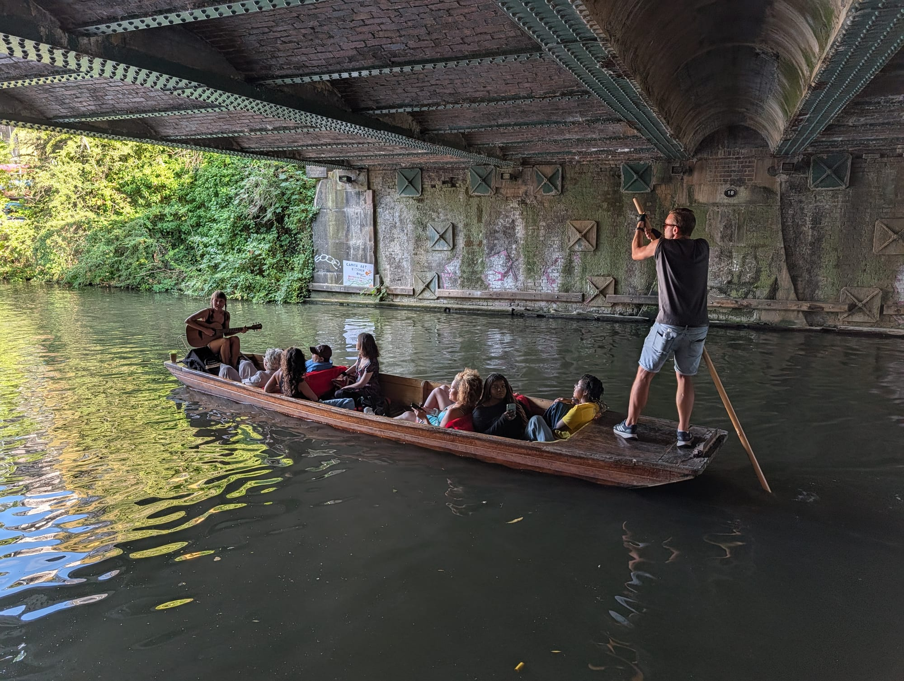

*The Music Boat.*

**Which to pick.** To get somewhere, the Waterbus or Jason's Trip, both one-way. For a round trip with no walk back, Jenny Wren, which also works a lock. For an evening out, My Fair Lady. The Music Boat is the one to avoid in bad weather.

> ⚠️ **None of them stop at London Zoo.** The route runs through the zoo's grounds and you can see the painted wolves and colobus monkeys from the water, but there is no zoo landing. The nearest stop is Camden Market, about fifteen minutes' walk from the entrance.

> ⚠️ Timetables are seasonal and several of these run a reduced winter service or stop entirely, so check before travelling. One-way tickets mean walking or taking the Tube back.

## Getting there

**By Tube.** **Camden Town** (Northern) is the obvious choice but is severely congested at weekends, and queues to enter build badly on Sunday afternoons. **Chalk Farm**, one stop north, is the better approach and puts you at the Stables Market end.

**By Overground.** **Camden Road** is a five-minute walk east and far less crowded.

**By canal.** The towpath from King's Cross takes 30 minutes on foot. The narrowboat waterbus from Little Venice takes about 45 minutes — see [canal boat trips](#canal-boat-trips-from-camden) above for which service is which.

**Best approach.** Arrive at Chalk Farm and walk south through Stables Market to the Lock, finishing near the station.

## How long to spend, and when to go

| If you have | Do this |
| --- | --- |
| **Two hours** | Camden Lock, Stables Market and lunch on the canal |
| **Half a day** | Add Primrose Hill and the walk back along the towpath |
| **A full day** | Walk the canal to King's Cross, or take the waterbus to Little Venice |

**Best time:** Weekday mornings. Same markets, a fraction of the people.

**Avoid:** Sunday afternoon, the single busiest period, when queues build just to get into Camden Town station.

Comparing neighbourhoods? [Best areas to visit in London](/articles/best-areas-to-visit-london/) sets them side by side by what each is best for, how long it takes and the best day to go.

Powered by <a target="_blank" rel="sponsored" href="https://www.getyourguide.com/london-l57/">GetYourGuide</a>

## Walking routes

**[The Regent's Canal from King's Cross to Camden →](/articles/kings-cross-camden-canal-walk/)**

Our full route into the area, walked the good way round: **ten numbered stops** over about 1.5 miles and an hour, with a map, a Google Maps walking link, and the hours that actually decide the day. It takes in **Camley Street Natural Park**, **St Pancras Lock** and the gasholder frames, then comes into Camden past **Kentish Town Road, Hawley and Hampstead Road locks**.

### The short version, if you only have three hours

1. **Start:** **Chalk Farm** station, not Camden Town.
2. **Stables Market:** South into the horse hospital tunnels and the vintage dealers.
3. **Camden Lock:** Down to the water for street food on the terraces.
4. **The towpath:** West along the **Regent's Canal** past the zoo's old aviary structure.
5. **Primrose Hill:** Up for the skyline panorama.
6. **Finish:** A pub in **Primrose Hill village**, or back down for the Northern line.

Powered by <a target="_blank" rel="sponsored" href="https://www.getyourguide.com/london-l57/">GetYourGuide</a>

## Common mistakes to avoid

1. **Walking north up the High Street and stopping there.** The good part is past the bridge at the Lock and Stables.
2. **Missing Primrose Hill.** Fifteen minutes away, free, with a view across the central skyline.
3. **Taking the Tube to King's Cross.** The canal walk is 30 minutes and far more pleasant — [here it is stop by stop](/articles/kings-cross-camden-canal-walk/).

## Where to stay

Well connected on the Northern line, and noisy near the market.

- **Camden Town** — Hostels and budget hotels. Convenient, lively and loud at night.
- **Primrose Hill** — Fifteen minutes north-west, considerably quieter and more expensive.
- **King's Cross** — Thirty minutes along the canal, with far better transport connections.
