Canary Wharf is built on the West India Docks, which handled the sugar and rum trade from the 1800s until the docks closed in 1980. The towers that went up from the late 1980s are arranged around the dock water that is still there.

Nearly every walkway here runs alongside a stretch of Victorian dock, with the surviving warehouses and the glass towers above.

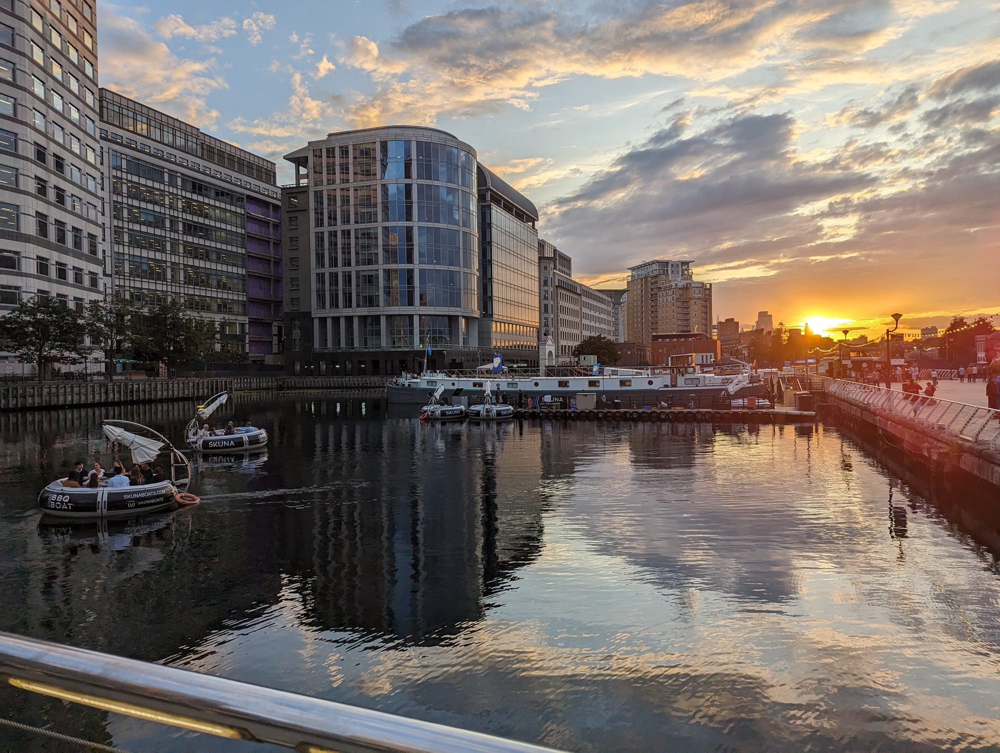

*The docks at sunset.*

Canary Wharf has its own share of the commemorative plaques marking where notable people lived or worked - see them on our [interactive map](/plaques/?area=canary-wharf).

## Why visit — and who should skip it

**Come here if** you like modern architecture, or want to swim in a dock between skyscrapers, or want a free museum and a roof garden, or it is raining: much of Canary Wharf is connected by covered walkway and underground mall.

**Skip it if** you came to London for old streets and traditional pubs. This is a purpose-built estate; nothing here is historic except the docks and a handful of Georgian warehouses.

> **What changed.** Canary Wharf is no longer an office district that empties at weekends. **Eden Dock** opened in October 2024, **Mercato Metropolitano** arrived at Wood Wharf, **Fairgame** trades until 1am on Fridays and Saturdays, and a **50-metre floating swimming pool opened in June 2026**. Around 3,500 people live here, projected to roughly double by 2027 as Wood Wharf completes.

## Top sights and activities

1. **Crossrail Place Roof Garden** — Free, open daily, and built on top of the Elizabeth line station under a timber lattice roof. Planted by hemisphere along the meridian line.
2. **London Museum Docklands** — Free, open daily 10am to 5pm, in a Georgian sugar warehouse on West India Quay. The story of the docks, the river, and London's part in the transatlantic slave trade.
3. **Eden Dock** — Floating planted islands and wetland walkways in Middle Dock. Free, and best seen from the boardwalk on the north side; the timber terracing doubles as seating.
4. **The dockside walks** — Middle Dock, West India Quay and the Wood Wharf boardwalks: flat, with water on both sides.
5. **Sea Lanes** — A **50-metre heated floating swimming pool** at the western end of Eden Dock, open since **19 June 2026**. **£10** to swim, **£18** with the sauna. Weekdays 6am–9pm, weekends 7am–7pm.
6. **Open water swimming in Middle Dock** — Separate from the pool: a marked, lifeguarded open-water venue in the dock between the towers, running seasonally from roughly June to October since 2022. Booked in advance, around £9.50 a session plus annual membership.
7. **Fairgame** — Electronic fairground games and street food on Fisherman's Walk, **open until 1am on Fridays and Saturdays and midnight on Sundays**, closed Mondays. From £15 a head for 75 minutes off-peak.
8. **Skuna hot tub and barbecue boats** — Self-drive boats on the dock with a hot tub or a barbecue on board, no licence needed, and heated igloo boats in winter.
9. **The public art** — Around seventy works scattered across the estate, all free to see and mostly unmarked. There is a printed trail if you want one.
10. **Wood Wharf** — The newest quarter, east of the towers: a floating Hawksmoor, a waterside promenade and Mercato Metropolitano's food hall on George Street.
11. **One Canada Square** — The pyramid-topped tower that was Britain's tallest building from 1991 to 2012. No public viewing floor.
12. **Winter Lights** — A **free** light-art festival across the estate every January, no booking needed. The 2027 edition, the eleventh, runs Tuesday 19 to Saturday 30 January 2027.

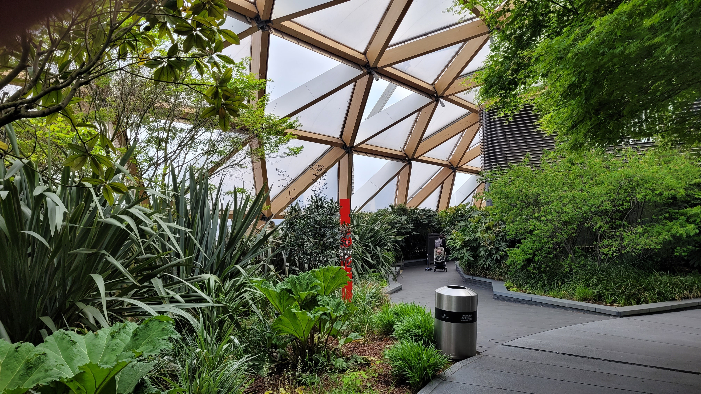

*Inside the Crossrail Place Roof Garden.*

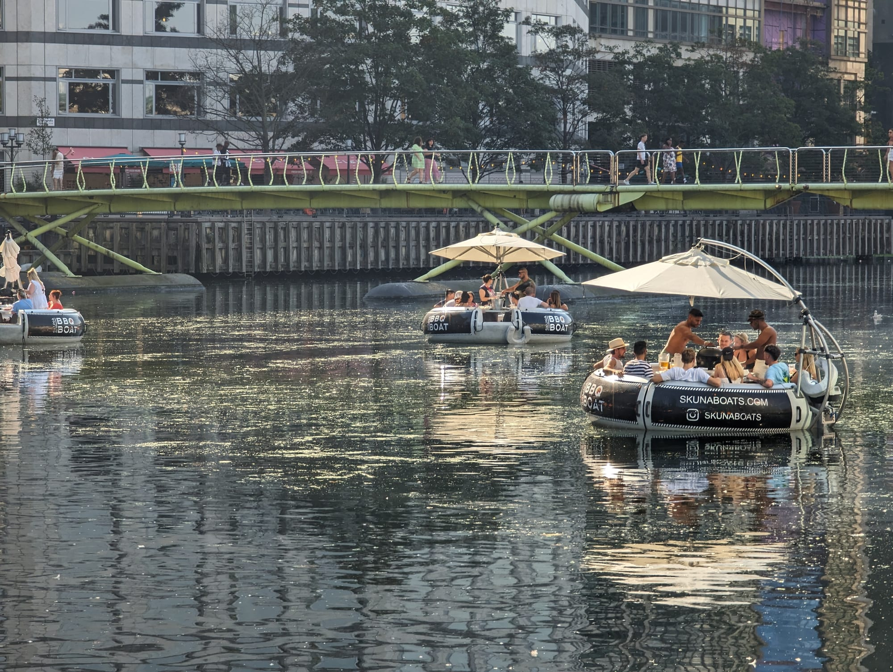

*Skuna's barbecue boats on Middle Dock.*

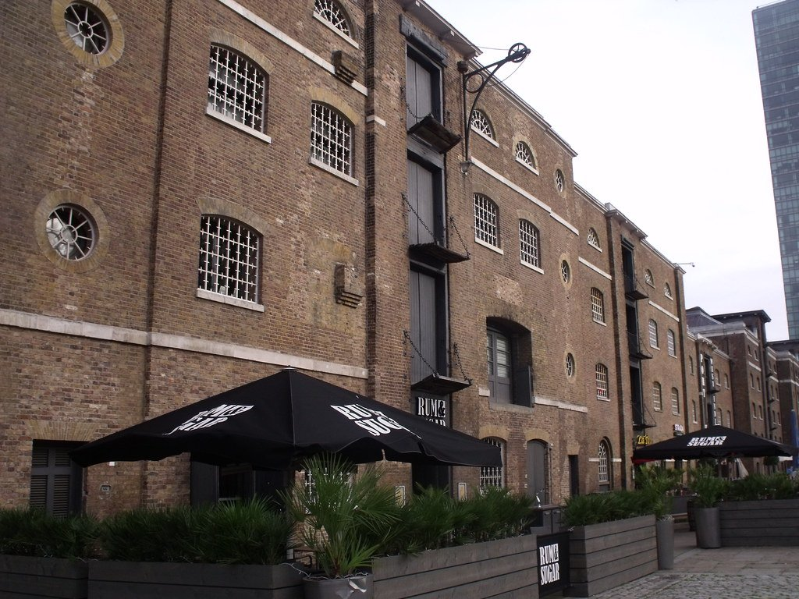

*The London Museum Docklands, West India Quay. Photo: [ell brown](https://www.flickr.com/photos/39415781@N06/6455266221), [CC BY 2.0](https://creativecommons.org/licenses/by/2.0/).*

## Key streets and micro-districts

### Canada Square and the malls
The centre of the estate. **One Canada Square** is the pyramid-topped tower, Britain's tallest building from 1991 to 2012, with no public viewing floor.

What is public is the **underground shopping levels**, which connect most of the estate without going outside at all, and the square and park above them.

**The malls keep ordinary retail hours and this older, corporate part of the estate is quiet at weekends.** Weekday lunchtimes are busiest. For a Saturday, walk east to Wood Wharf.

### West India Quay
North across the footbridge: **the only part of Canary Wharf that predates the 1980s**, a surviving terrace of Georgian sugar warehouses of 1802.

The **London Museum Docklands** occupies one of them, with galleries on the river and the docks across three floors. It is **free** and open daily 10am to 5pm.

**The restaurants under the arches face the water.** Two minutes from Canary Wharf by footbridge.

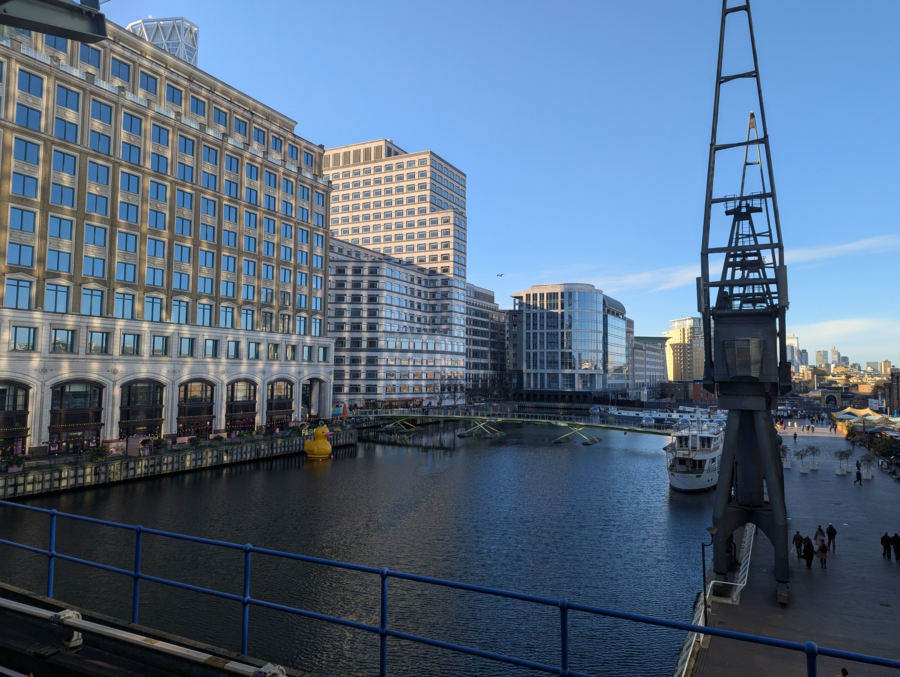

*West India Quay's Georgian warehouses.*

### Crossrail Place
The Elizabeth line station: a timber lattice roof over four levels, built into the old North Dock so the structure floats in water, with the garden enclosed under the roof, not open to the sky.

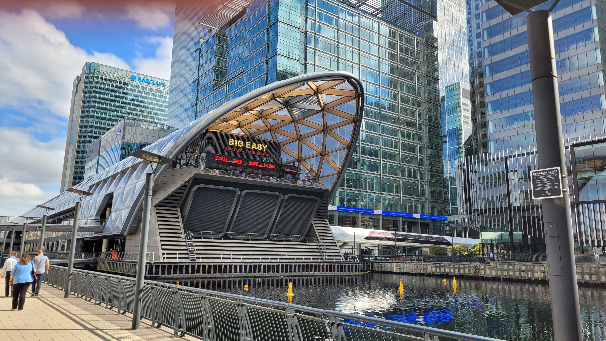

*Crossrail Place's timber lattice roof.*

The **roof garden on top is free and open to the public**, planted with species from the trade routes the docks once served.

**Open daily, no ticket**, and reached directly from the station without going outside.

### Wood Wharf
East, the newest part of the estate: residential, not corporate, so it keeps going at weekends while the office end winds down.

The **boardwalk** runs along the dock edge with the waterside restaurants on it, and there is a floating lido and a padel club on the water.

**This is where to come on a Saturday.** Ten minutes east of Canada Square on foot.

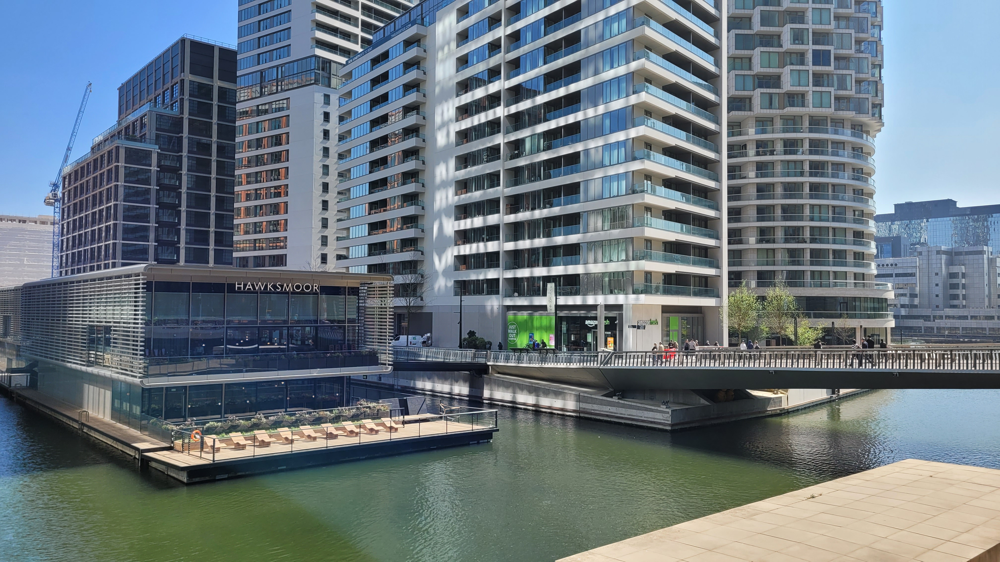

*Wood Wharf's restaurant strip.*

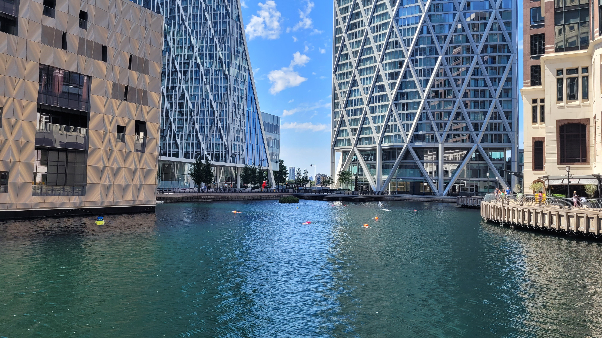

*Open water swimming in Middle Dock.*

### Heron Quays and South Dock
South, facing across the water towards Greenwich: dock edges and footbridges, with very few people once the offices empty.

The DLR runs overhead on its viaduct.

**Free and always open.** It is also the start of the walk south to the foot tunnel and Greenwich, which we have [stop by stop](/articles/canary-wharf-greenwich-walk/).

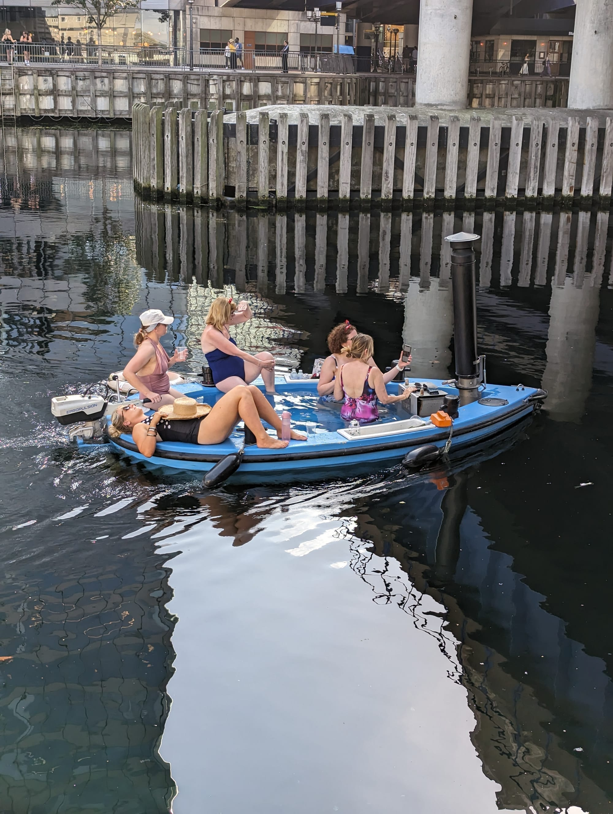

*The hot tub boats on Middle Dock.*

## Go deeper

- **[The best views in London](/articles/best-views-london/)** — where to go up, since One Canada Square has no public viewing floor.
- **[ExCeL London travel guide](/articles/excel-london-guide/)** — one Elizabeth line stop away, for a trade show or exhibition.
- **[Where to stay near ExCeL](/articles/where-to-stay-near-excel/)** — hotels by the entrance they suit, with Canary Wharf three minutes away on the Elizabeth line.
- **[Exhibitions and conventions in London](/articles/exhibitions-conventions-london/)** — the year-round calendar of what's actually on at ExCeL, from MCM Comic Con to New Scientist Live.

## Where to eat and drink

| Spot | Style | Price | Why go |
| --- | --- | --- | --- |
| **Hawksmoor Wood Wharf** | Steakhouse | £££ | On the water at Wood Wharf; book ahead |
| **The Ivy in the Park** | Modern British | £££ | Canada Square Park, with terrace seating |
| **Crossrail Place food court** | Mixed | ££ | Under the roof garden; quick and covered |
| **West India Quay arches** | Chain restaurants | ££ | Waterside, open at weekends |
| **The Gun** | Historic riverside pub | ££ | Fifteen minutes east on the Thames; old, with a garden over the river |
| **Mercato Metropolitano** | Food hall | £ | 10 George Street, Wood Wharf; the budget option, open since 2022 |
| **Fairgame** | Games and street food | ££ | Fisherman's Walk; open to 1am Fridays and Saturdays |
| **Big Easy / Roka** | Various | ££ | Crossrail Place; busy at weekends |

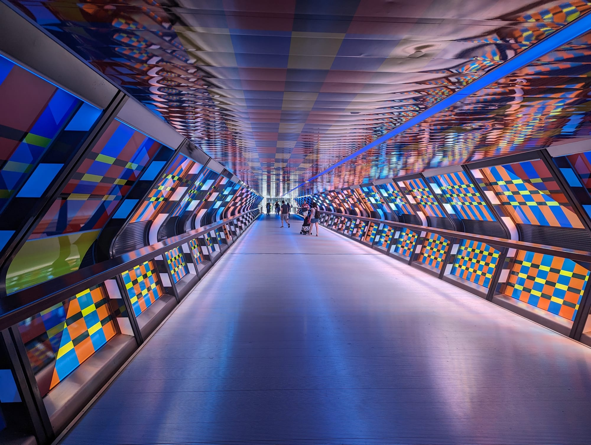

*Adams Plaza Bridge.*

## Getting there

**By Elizabeth line.** **Six minutes** from Liverpool Street, about thirteen from Bond Street. Air-conditioned and step-free.

**By Jubilee line.** Fifteen minutes from Waterloo, and one stop from North Greenwich for the O2.

**By DLR.** Slower; it runs on a viaduct through the docks. Sit at the front; there is no driver.

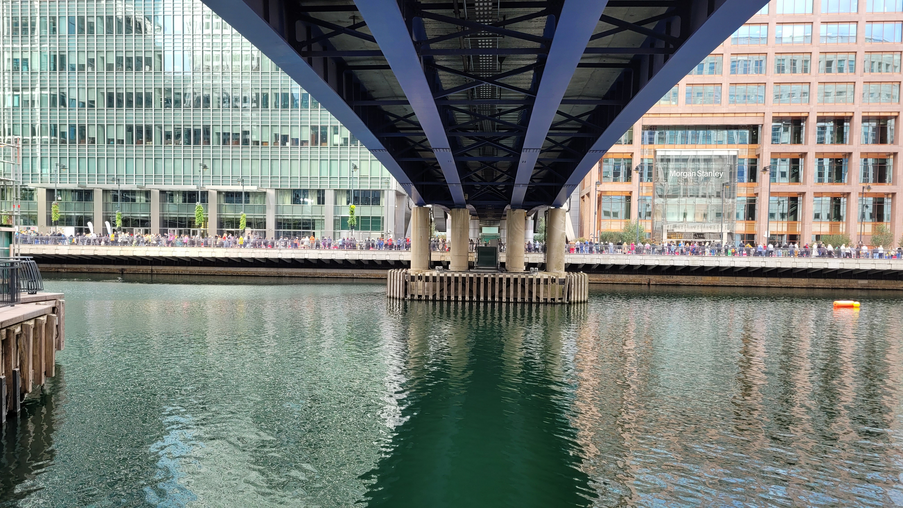

*The DLR viaduct.*

**On foot to Greenwich.** Walk the length of the Isle of Dogs, or take the DLR two stops to **Island Gardens**, then the **Greenwich Foot Tunnel** under the river. Free, open at all hours, and the lifts at both ends run 24 hours — see the [full walking route](/articles/canary-wharf-greenwich-walk/).

*Winter Lights, Canary Wharf.*

Powered by <a target="_blank" rel="sponsored" href="https://www.getyourguide.com/london-l57/">GetYourGuide</a>

## How long to spend, and when to go

| If you have | Do this |
| --- | --- |
| **One hour** | Crossrail Place Roof Garden and the Middle Dock walk |
| **Two to three hours** | Add the London Museum Docklands, Eden Dock and Wood Wharf |
| **Half a day** | Add a swim at Sea Lanes and lunch at Wood Wharf |
| **A full day** | All of the above, then Greenwich via the Foot Tunnel |

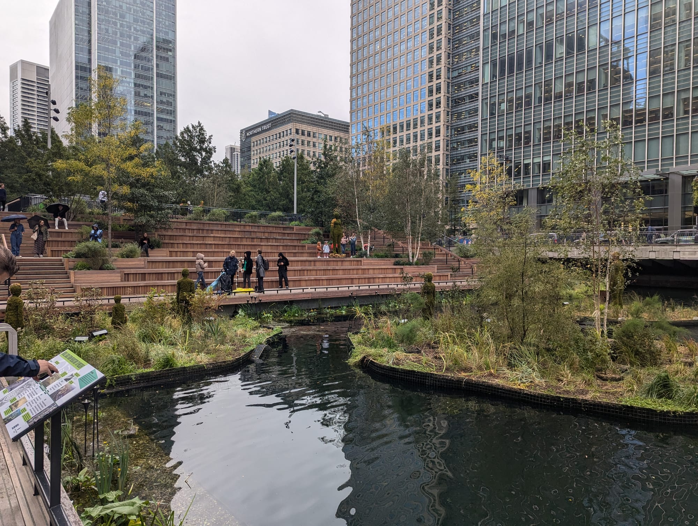

*Eden Dock.*

**Best time:** Early evening, with the towers lit and reflected in the docks. Weekday lunchtimes are busiest; weekends are quieter on the walkways, but the water and the restaurants run as normal.

**Sundays.** The malls keep short Sunday hours and some older chain units shorten further, so do not plan a shopping trip. Eden Dock, the pool, the museum, the roof garden and Wood Wharf run as normal.

Comparing neighbourhoods? [Best areas to visit in London](/articles/best-areas-to-visit-london/) sets them side by side by what each is best for, how long it takes and the best day to go.

## Walking routes

**[A Walk from Canary Wharf to Greenwich: Under the River in Eleven Stops →](/articles/canary-wharf-greenwich-walk/)**

Our full route out of this area: **eleven numbered stops** over about 6.5km and three to four hours, with a map, a Google Maps walking link for your phone and what is open on which day. It opens with the **Crossrail Place Roof Garden** and the free **London Museum Docklands**, walks the docks south past **Mudchute Farm** to Island Gardens, then goes under the Thames through the **Greenwich Foot Tunnel** and finishes on Greenwich hill beside the Royal Observatory, which is closed from 2 November 2026. It also carries the **live foot-tunnel lift status**.

**[A Riverside Pub Walk from Wapping to Canary Wharf: Four Historic Pubs in Eleven Stops →](/articles/wapping-canary-wharf-walk/)**

The route in from the west, finishing at the roof garden where the Greenwich walk starts: **eleven stops**, just over 6km, from **St Katharine Docks** past four historic riverside pubs — the **Town of Ramsgate**, the **Captain Kidd**, the **Prospect of Whitby** and **The Grapes** on Narrow Street — with the Ornamental Canal, Tideway's riverside park at Shadwell and **Limehouse Basin** in between. Walk it on a Saturday for the market on Shadwell Basin.

### The short version, if you only have two hours here

1. **Start:** Canary Wharf Elizabeth line station. Up to the **Crossrail Place Roof Garden**.
2. **West India Quay:** North over the footbridge to the **London Museum Docklands**. Free.
3. **Canada Square:** South through the park past **One Canada Square**.
4. **Wood Wharf:** East to the boardwalk and the water.
5. **Finish:** DLR to **Island Gardens** and the **Greenwich Foot Tunnel**, or back on the Elizabeth line.

Powered by <a target="_blank" rel="sponsored" href="https://www.getyourguide.com/london-l57/">GetYourGuide</a>

## Common mistakes to avoid

1. **Planning a Sunday shopping trip.** The malls keep short Sunday hours. Everything else is open.
2. **Missing the roof garden.** It is on top of the station and free.
3. **Taking the Jubilee line from the City.** The Elizabeth line from Liverpool Street takes six minutes.
4. **Walking here from the Tower along the main roads.** It is about 6km. If you want to walk it, take the riverside pubs and the Ornamental Canal on our [Wapping to Canary Wharf pub walk](/articles/wapping-canary-wharf-walk/); if you just want to arrive, take the DLR.
5. **Looking for a viewing platform.** There is not one anywhere in Canary Wharf. One has been proposed for 8 Canada Square, but building cannot start until HSBC leaves in 2027. The free views are Horizon 22 and the [Sky Garden](/articles/sky-garden-guide/) in the City.
6. **Expecting the ice rink.** The Canada Square Park rink is **paused for winter 2026**. Winter Lights in January is unaffected, and the rinks that are open are in our [London ice skating guide](/articles/ice-skating-london/).

## Where to stay

Modern and well connected, with quiet evenings.

- **Canary Wharf** — Large business hotels, and **often much cheaper at weekends** when corporate demand drops.
- **Wood Wharf** — Newer, on the water, and next to the restaurants.
- **North Greenwich** — One stop on the Jubilee line, handy for the O2.

Our [Canary Wharf hotel guide](/articles/where-to-stay-canary-wharf/) compares the hotels and aparthotels, and which night is cheapest.
