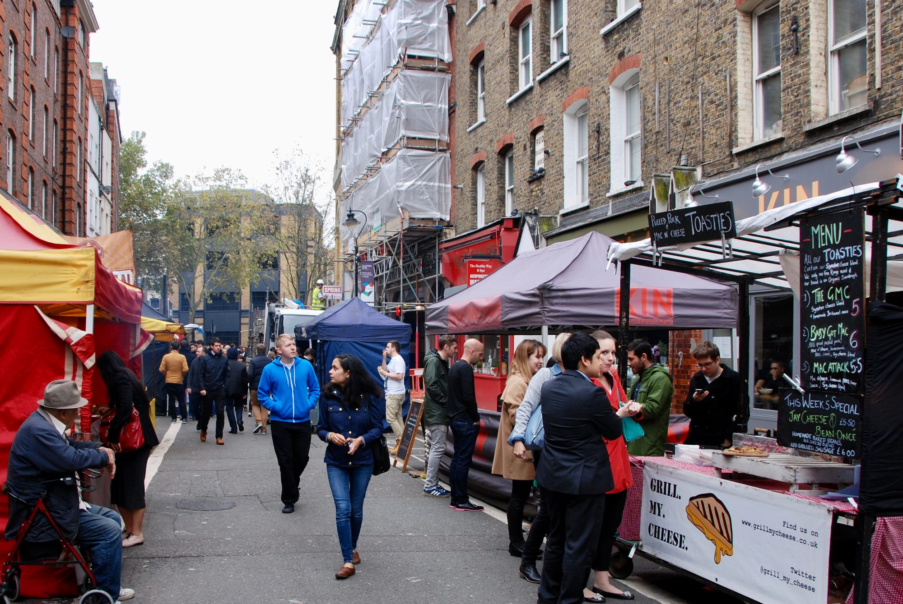
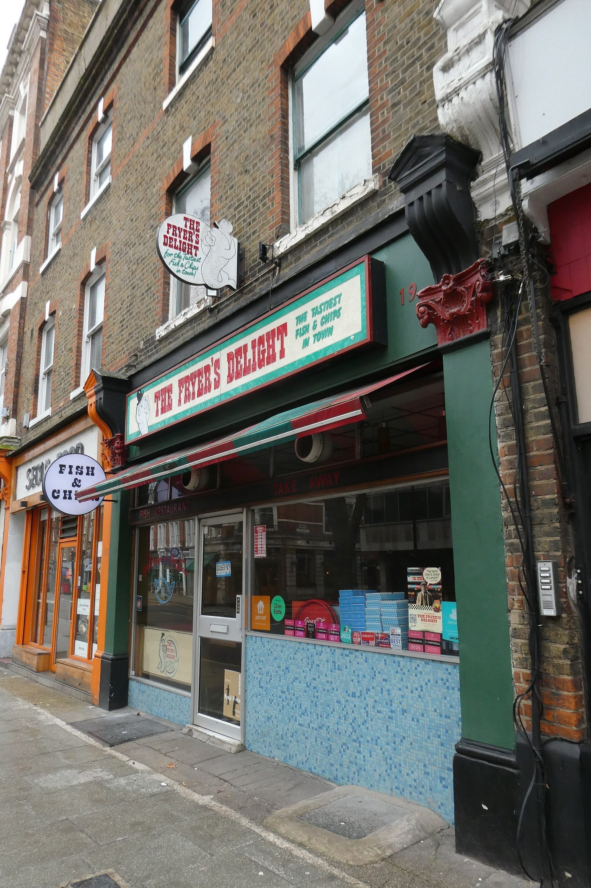
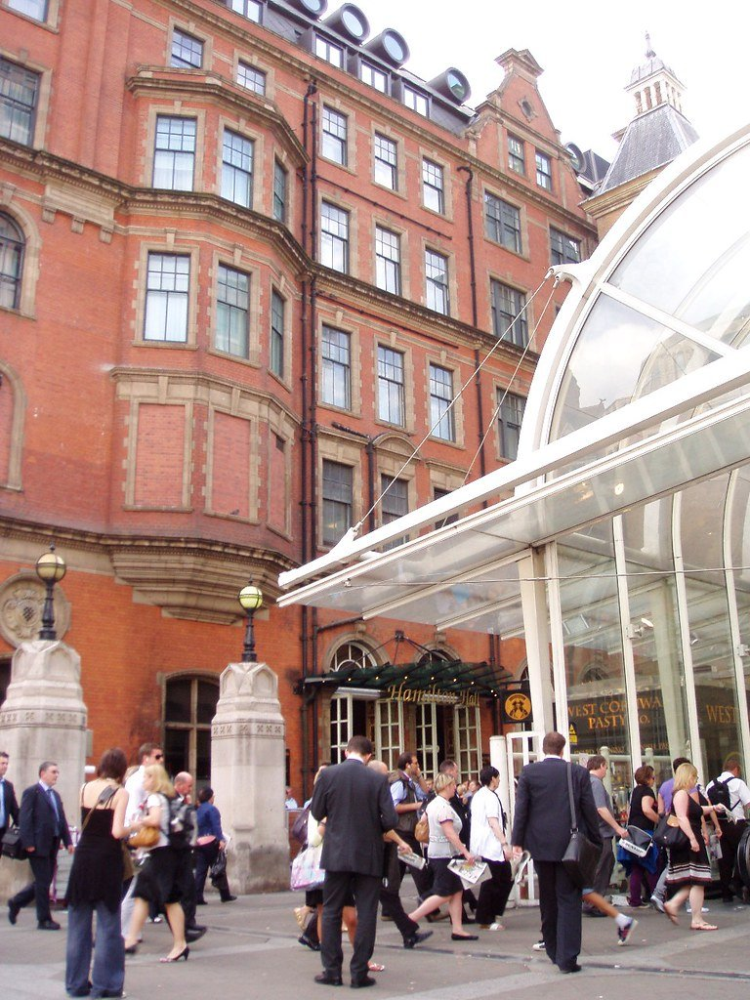

Eating cheaply in London does not mean eating badly, and the places that prove it are market stalls, pizza slice counters and takeaway windows, where you pay for food, not for table service and a rent-heavy dining room. Everything here is here because **the price itself is why you go**: a full meal for less than the cost of two coffees in Soho.

> 💡 **The Short Version:** **ICCO** does a twelve-inch pizza for £3.95. **Kolkati** at Seven Dials does kati rolls for around a fiver. **Michael's Fish Bar** in Leytonstone, voted east London's favourite chippy by local readers, is cash only. **Horn OK Please** at Borough Market is an all-vegetarian stall. And **Kung Fu Noodle** is a proper cooked meal minutes from Leicester Square.

> 📊 **The evidence behind this guide.**
> **10 sources carrying 169 citations** across **127 named places**. **10 places are named by two or more independent sources.**
> **Built on:** BudgetTraveller, Devour Tours, The Infatuation, Time Out and local food blogs.
> Entries that borrow another guide's count say so, as in *Cited by 7 fish and chips sources*; a bare number means the cheap-eats sources.
> *Evidence rebuilt 14 September 2026 · [How we rank →](/how-we-rank/)*

## Where they are

  

    Map of the cheap eats in London
  

  

    
Loading the interactive map…

  

  

    <i class="restaurant-map-key restaurant-map-key--editorial" aria-hidden="true"></i> Recommended in this guide
    <i class="restaurant-map-key restaurant-map-key--streetfood" aria-hidden="true"></i> Market stall, counter & food hall
  

  <noscript>
    
The interactive map requires JavaScript. Every entry below lists its area.

  </noscript>

| If you are near… | Where to eat |
| --- | --- |
| **Fitzrovia & Tottenham Court Road** | ICCO, PaStation, Shree Krishna Vada Pav, The Attendant |
| **Soho & Piccadilly** | Breadstall, Govinda's |
| **Covent Garden & Leicester Square** | Kolkati, Bad Boy Pizza Society, Saravanaa Bhavan, Sagar |
| **Chinatown** | Kung Fu Noodle |
| **Waterloo & Lower Marsh** | Marie's Café |
| **Euston** | Murger Han |
| **King's Cross** | Paolina Thai Cuisine |
| **Borough & London Bridge** | Horn OK Please, Gujarati Rasoi |
| **Holborn & Bloomsbury** | Hiba Express, The Fryer's Delight, Tongue & Brisket (Leather Lane) |
| **City & Liverpool Street** | The Crosse Keys, Hamilton Hall |
| **Canary Wharf** | The Ledger Building |
| **Spitalfields & Shoreditch** | Sud Italia |
| **North & East London** | Voodoo Ray's (Dalston), Mickey's Chippy (Stoke Newington), Michael's Fish Bar (Leytonstone), Comalera (Walthamstow), Indian Veg (Islington) |
| **South London** | Ken's Fish Bar (Herne Hill), Fish Lounge (Clapham), Silk Road (Camberwell) |
| **Greenwich & West** | Hullabaloo, Sarv's Slice (Ealing) |

---

## Under a fiver

### ICCO, Fitzrovia

*£3.95 · 46 Goodge Street · 2 min from Goodge Street* · Cited by 2 italian sources

**A twelve-inch pizza from £3.95**, made to order and eaten in. It has traded since 1999 and calls itself "the People's Pizzeria".

**The £3.95 is the marinara**, which has no cheese: tomato, garlic and oregano. Toppings push the price up but nothing on the board reaches double figures.

**Under £10, walk-in, counter-style and busy in the evenings.** There is a second site in Camden.

### Kolkati, Covent Garden

*£ · Seven Dials Market · 3 min from Covent Garden · walk-in*

**Kati rolls the Kolkata way**, on a **paratha cooked with egg through it**.

The paratha is wrapped round spiced chicken or paneer with **pickled onion and lime**, and eaten standing.

**£, walk-in, counter only.** Under a fiver for the vegetarian roll and not much more for the chicken.

### Shree Krishna Vada Pav, Fitzrovia

*£ · 4 min from Oxford Circus · walk-in* · Cited by 1 source

**Vada pav — the Mumbai potato-fritter roll — done cheaply**, from a counter, not a dining room.

A **vada pav** is a spiced potato fritter in a soft bun with dry garlic chutney, Mumbai's street sandwich. **Pav bhaji** and misal pav alongside, all under a fiver.

**£, walk-in, counter only.** Several London sites.

---

## Market stalls

### Horn OK Please, Borough

*£ · Borough Market · 4 min from London Bridge · walk-in*

**Samosa chaat built to order**: the samosas **crushed under chickpea curry, yoghurt and tamarind while still hot**.

An all-vegetarian Borough Market stall, named for the slogan painted on the back of Indian lorries. **Pav bhaji and dosa** alongside the chaat, served in boxes.

**£, walk-in, closed Monday, market hours only**: this is lunch.

### Gujarati Rasoi, Borough

*£ · Borough Market · 4 min from London Bridge · walk-in*

**Mother-and-son Gujarati cooking from family recipes**: thalis, bhajia and dhal.

The **thali** is several small dishes, rice, bread and dal on one tray. Ask about **undhiyu** in season.

**£, walk-in, closed Monday, market hours.**

### Bad Boy Pizza Society, Covent Garden

*£ · Seven Dials Market · 2 min from Covent Garden · walk-in* · Cited by 8 pizza sources

**Twenty-two-inch New York pies sold by the slice** from a counter inside Seven Dials Market — and, unusually for a market stall, **a two-time National Pizza of the Year winner**.

New York style means a wide, foldable slice with a thin base and a crisp edge. A serious lunch costs a few pounds.

**£, walk-in, and it trades on Seven Dials Market hours rather than its own.** The brand also runs residencies at Vinegar Yard and The Railway in Tulse Hill, and opened its first permanent restaurant on Bethnal Green Road in August 2025.

### Sud Italia, Spitalfields

*£ · Old Spitalfields Market · 8 min from Aldgate East · walk-in* · Cited by 1 source

**Wood-fired pizza from a stall in Old Spitalfields Market**, baked in a mobile oven, not reheated.

A short Neapolitan list: **margherita and marinara** off a fermented dough, blistered in ninety seconds and handed over folded in paper.

**£, walk-in, and it trades on market hours only.**

### Comalera, Walthamstow

*£ · 2 min from St James Street · walk-in* · Cited by 3 mexican sources

**A Walthamstow stall pressing its own tortillas.**

A *comal* is the flat griddle a tortilla is cooked on: the masa is pressed and griddled to order, not bought in packs. A short list of fillings, salsas made on site.

**£, walk-in, and open Friday to Sunday only.**

### Hullabaloo, Greenwich

*£ · Greenwich Market · 4 min from Cutty Sark · walk-in*

**A permanent stall in Greenwich Market** doing vegetarian and vegan Indian street food.

**Dosa, chaat and curries** served in boxes, cooked to order. Everything is vegetarian and much of it vegan.

**£, walk-in, market hours.** Greenwich Market is covered, so it works in the rain.

---

Powered by <a target="_blank" rel="sponsored" href="https://www.getyourguide.com/london-l57/">GetYourGuide</a>

## Counters and pizza slice shops

### PaStation, Fitzrovia

*£ · 1 min from Tottenham Court Road · walk-in* · Cited by 1 source

**Fresh pasta under a tenner in generous portions**, near Tottenham Court Road.

Pasta is made on site and cooked to order at a counter: **cacio e pepe, ragù, carbonara**.

**Under £10, walk-in, counter service.** Busiest at lunch.

### Breadstall, Soho

*£ · Berwick Street · 5 min from Piccadilly Circus · walk-in* · Cited by 7 pizza sources

**A pizza slice counter on Berwick Street**: **slow-fermented dough with a crisp bottom and a puffed, almost naan-like crust.**

Slices are cut from trays and reheated to order. Toppings change through the day.

**£, walk-in, standing only.** A second site trades in Battersea.

### Voodoo Ray's, Dalston

*£ · walk-in · late* · Cited by 2 late-night sources

**Enormous New York slices sold until the small hours.**

**Slices, not whole pizzas**: a quarter of a twenty-two-inch pie, sold late.

**£, walk-in, and it serves well past midnight at weekends.** Dalston is the original; there are sites in Peckham and Shoreditch.

### Sarv's Slice, Ealing

*£ · Filmworks Walk · 7 min from Ealing Broadway · walk-in* · Cited by 3 sources

Detroit-style squares and Neapolitan rounds from a family-run counter in the Filmworks development beside Ealing Broadway station.

The dough is **cold-fermented for 72 hours**; the Detroit slice has a lacy fried-cheese edge where it meets the pan. Slices run about £6.75–£7.95 and whole pizzas £22.50–£28, with vegan, vegetarian and halal options across the menu.

### The Attendant, Fitzrovia

*£ · 7 min from Goodge Street · walk-in*

**Built inside a restored Victorian public lavatory**, with **the original porcelain urinals turned into the counter you sit at**.

Coffee is the main trade, with **sandwiches, salads and brunch plates** alongside.

**£, walk-in.** Foley Street, down a staircase from the pavement. Small, so it fills at lunch.

---

## Proper sit-down meals under £15

### Kung Fu Noodle, Chinatown

*£ · walk-in* · Cited by 2 chinese sources

**Noodles pulled to order in the window**, the dough stretched, folded and slapped against the counter in full view.

Hand-pulled noodles in beef broth are the order, with dan dan noodles and dumplings alongside. A bowl costs less than a sandwich in most of central London.

**£, walk-in.** The queue moves because the cooking takes minutes.

### Saravanaa Bhavan, Leicester Square

*£ · walk-in*

**The London outpost of the Chennai vegetarian chain**, which runs hundreds of restaurants worldwide.

**The masala dosa** is a fermented rice-and-lentil crepe, crisp and nearly a foot across, with spiced potato inside and sambar and chutneys to dip. Idli, vada and thalis alongside.

**£, walk-in.** Leicester Square, busiest at lunch.

### Hiba Express, Holborn

*£ · 2 min from Holborn · walk-in* · Cited by 2 Middle Eastern sources

**A Lebanese counter doing wraps and grills at a fraction of what the surrounding offices charge.**

**Chicken and lamb shawarma** carved off the spit into flatbread with garlic sauce and pickles, plus falafel wraps and mixed grills over rice. Everything is made to order at the counter.

**£, walk-in, counter service.** Queues out the door between noon and two; go either side.

### Silk Road, Camberwell

*£ · 47 Camberwell Church Street · walk-in* · Cited by 2 sources

Xinjiang cooking from China's far north-west — cumin, chilli and hand-cut noodles — and **only three items on the menu cost more than £8**.

The **big plate chicken** is the order: bone-in chicken in a green chilli broth, poured over ribbon noodles, easily enough for two. The cumin and chilli lamb skewers are the other thing to get.

Silk Road closed in August 2023 and reopened eighteen months later in new premises next door; listings giving number 49 are out of date.

### Marie's Café, Waterloo

*£ · 90 Lower Marsh · BYO, £1 corkage · cash preferred*

A Formica greasy spoon serving fry-ups at lunchtime that **becomes a Thai restaurant in the evening**: same room, same tables.

Pad thai, jungle curry and som tum are around £11 a plate, roughly £15 a head for two courses. It is unlicensed and **BYO with £1 corkage**; bring a bottle from the shop up the road.

### Murger Han, Euston

*£ · 62 Eversholt Street · also Mayfair, the City and Elephant & Castle* · Cited by 1 source

A **Xi'an** specialist built around the *murger*, a chopped pork bun, and **biang biang noodles**, hand-pulled ribbons wide enough to need folding.

Four branches; Euston is the one to use if you are passing through.

### Govinda's, Soho

*£ · Soho Street · canteen service · vegetarian* · Cited by 2 sources

Run by the Hare Krishna temple it shares a building with, and serving Soho since 1979. Canteen queue, tray, and a **rotating thali** of curries, breads, soup and a dessert.

Entirely vegetarian and largely vegan.

### Indian Veg, Islington

*£ · 92-93 Chapel Market · all-you-can-eat* · Cited by 2 sources

**An all-you-can-eat North Indian vegetarian buffet**, in a room **papered floor to ceiling with hand-made posters about vegetarianism**.

**The buffet is the whole offer**: a dozen or so curries, rice, dal and breads, refilled, for a single low price.

**£, walk-in, no bookings.** Chapel Market.

### Paolina Thai Cuisine, King's Cross

*£ · 181 King's Cross Road · BYO · closed Sundays* · Cited by 2 thai sources

**Dishes from £5.95, bring your own bottle, family-run**, serving the central Thai canteen repertoire.

**Pad thai, green and red curry, pad krapow** with a fried egg on rice, and tom yum, cooked to order in a plain room.

**Under £10, BYO with no corkage, closed Sundays, walk-in.**

### Sagar, Covent Garden

*£ · 31 Catherine Street · also Panton Street, Fitzrovia, Hammersmith, Harrow* · Cited by 1 source

South Indian **Udupi** cooking — the strict vegetarian tradition from coastal Karnataka — and the **masala dosa** is what to order: a crisp fermented rice crêpe with spiced potato inside and sambar and chutneys alongside.

Five branches, all sit-down; the Covent Garden one is a few minutes from the theatres. Entirely vegetarian.

---

Powered by <a target="_blank" rel="sponsored" href="https://www.getyourguide.com/london-l57/">GetYourGuide</a>

## Salt beef, and the sandwich that undercuts everything

### Tongue & Brisket, Leather Lane

*£ · 24-26 Leather Lane · also Goodge Street and Wardour Street* · Cited by 2 sources

Home-cured salt beef, carved to order, piled into a sandwich — and the **classic salt beef is £8**, or £10 for the large. The Reuben is £9.50, and ox tongue the same as the beef.

**Wardour Street runs to 8pm Monday to Friday and is the only one open Sundays**; Leather Lane closes by 6.30pm and is shut on Sundays.

*Leather Lane market. Photo: [Mastermelt Group](https://commons.wikimedia.org/wiki/File%3ALeather_Lane_street_market%2C_Hatton_Garden%2C_London_EC1.jpg), [CC BY 2.0](https://creativecommons.org/licenses/by/2.0).*

---

## Fish and chips under £12

### Michael's Fish Bar, Leytonstone

*£ · 4 The Pavement, Hainault Road · walk-in · cash only* · Cited by 2 fish and chips sources

**The chippy east London locals vote for**: 61% of Leytonstoner readers picked it.

**Cod and haddock in a flaky batter with thick chips**, fried to order. A takeaway counter with no seating.

**CASH ONLY, under £10, closed Sunday.**

> ⚠️ **Cash only.** There is no card machine and no dining room.

### The Fryer's Delight, Bloomsbury

*£ · 6 min from Holborn · walk-in* · Cited by 7 fish and chips sources

The most-cited chippy in London. It still fries in **beef dripping** rather than vegetable oil.

Formica tables, and a counter for takeaway. Under £12 for the lot.

*Photo: [Ewan-M](https://commons.wikimedia.org/wiki/File:Fryer%27s_Delight,_Holborn,_WC1.jpg), [CC BY-SA 4.0](https://creativecommons.org/licenses/by-sa/4.0/).*

### Ken's Fish Bar, Herne Hill

*£ · 6 min from North Dulwich · walk-in* · Cited by 4 fish and chips sources

**A south London chippy that three separate guides single out over better-known names.**

**Cod and haddock in a crisp batter, with chips**, and the standard sides. No grilled options.

**£, walk-in, closed Sunday.** Herne Hill, a few minutes from the station and the Sunday market; a full portion leaves change from a tenner.

### Fish Lounge, Clapham

*£ · 16 min from Brixton · walk-in* · Cited by 5 fish and chips sources

**A Clapham chip shop with three guides behind it**; Time Out has placed it second in London.

Fish bought fresh and **fried to order in a crisp, light batter with hand-cut chips**. The menu runs beyond cod and haddock into **sea bass, salmon and grilled options**.

**£, walk-in, closed Sunday and Monday.** Limited seating; most people take it away.

### Mickey's Chippy, Stoke Newington

*£ · walk-in* · Cited by 1 source

**The Stoke Newington chippy that turns up on every north London list.**

**Cod and haddock fried to order in a light batter with thick chips.** A counter operation with a handful of seats.

**£, under £12, walk-in, closed Sunday.**

---

## Wetherspoons, and why they earn a mention

Four London Wetherspoons are in buildings people would pay to look at, and each opens early enough for a cooked breakfast.

Order at the bar or through the app. No table service, no music, no booking.

### The Crosse Keys, City of London

*£ · 9 Gracechurch Street · from 8am*

**The former headquarters of the Hongkong and Shanghai Banking Corporation, opened 1913**: marble columns, a glass-domed ceiling and a banking hall the length of the room.

**The food is the standard Wetherspoon menu**: burgers, curries, a full cooked breakfast from 8am.

**£, walk-in.**

### Hamilton Hall, Liverpool Street

*£ · Liverpool Street Station concourse · from 7am Mon–Sat, 9am Sun*

**The former ballroom of the Great Eastern Hotel**, off the Liverpool Street concourse, with gilded plasterwork and chandeliers kept intact.

**Cooked breakfast from 7am Monday to Saturday, 9am Sunday**, burgers and pub standards after. Grade II listed.

**£, walk-in.** On the station concourse, so useful before a train.

*Photo: [Ewan-M](https://www.flickr.com/photos/55935853@N00/2804281208), [CC BY-SA 2.0](https://creativecommons.org/licenses/by-sa/2.0/).*

### The Ledger Building, Canary Wharf

*£ · 4 Hertsmere Road, West India Quay*

**An 1800 dock building on West India Quay that once held the West India Docks ledgers**, with a colonnaded front and a quayside terrace.

Cooked breakfast, burgers and pub standards inside a listed dock office.

**£, walk-in.** A footbridge from the Canary Wharf towers and next door to London Museum Docklands, which is free.

### The Montagu Pyke, Charing Cross Road

*£ · 105–107 Charing Cross Road*

**A former cinema on Charing Cross Road**, named after the silent-film entrepreneur who built a chain of them across London before the First World War.

Cooked breakfast from 8am, burgers and curries in a large multi-level room a minute from Leicester Square.

**£, walk-in.** The most useful of the four for the West End.

---

Powered by <a target="_blank" rel="sponsored" href="https://www.getyourguide.com/london-l57/">GetYourGuide</a>

## Eating cheaply in London: what actually helps

* **Markets beat restaurants.** Seven Dials, Borough, Old Spitalfields and Greenwich all sit inside the sightseeing core and all have stalls under £10.
* **Lunch is cheaper than dinner** at the same places — many central restaurants run set lunches at half their evening price.
* **Counters have no service charge.** The discretionary 12.5% on a London restaurant bill does not apply at a stall or takeaway window.
* **Tap water is free and must be provided** by any licensed premises. Ask for it rather than buying bottled.
* **Cash only** at Michael's Fish Bar. Everywhere else here takes cards.

---

## Continue planning your London trip

**Paying less to eat out in London:**

- 🇳🇬 **[The Best West African Restaurants in London](/articles/best-west-african-restaurants-london/)** — Bola Cuisine in New Cross, under a tenner
- 🥥 **[The Best Sri Lankan Restaurants in London](/articles/best-sri-lankan-restaurants-london/)**
- 🇵🇭 **[The Best Filipino Restaurants in London](/articles/best-filipino-restaurants-london/)** — a pandesal sando or a £15.99-a-head boodle fight, for four or more
- 🇵🇪 **[The Best Peruvian Restaurants in London](/articles/best-peruvian-restaurants-london/)** — market plates from £2.50 in Brixton
- 🇬🇷 **[The Best Greek Restaurants in London](/articles/best-greek-restaurants-london/)** — souvlaki wraps and £5 skewers in Borough Market
- 🍽️ **[Set Lunch and Pre-Theatre Menus](/articles/restaurant-deals-london/)** — the restaurant's own fixed price, no membership, biggest single saving
- 💳 **[Restaurant Discount Cards](/articles/restaurant-discount-cards-london/)** — Tastecard and the rest, and why one costs £29.99 and its twin £79.99
- 📱 **[Off-Peak Restaurant Apps](/articles/off-peak-restaurant-apps-london/)** — First Table and EatClub — cheaper if you will eat early or walk in
- 🥂 **[Bottomless Brunch](/articles/bottomless-brunch-london/)** — packages compared on price per minute, and what “bottomless” covers
- 👨‍👩‍👧 **[Kids Eat Free](/articles/kids-eat-free-london/)** — every free and £1 children's offer with a London branch
- 🍽️ **[Eat in London: Restaurants, Food Markets & Quick Food Hub](/articles/eat-in-london-guide/)**
- 🍺 **[The Best Wetherspoons in London](/articles/best-wetherspoons-pubs-london/)**
- 🐟 **[The Best Fish and Chips in London](/articles/best-fish-and-chips-london/)**
- 🍕 **[The Best Pizza in London](/articles/best-pizza-london/)**
- 🎪 **[Free Things to Do in London](/free/)**
- 🛍️ **[London Markets by Day](/markets/)**
- 🍛 **[The Best Indian Restaurants in London](/articles/best-indian-restaurants-london/)**
