Chelsea is a low-rise, well-kept stretch between the King's Road and the Thames, and it is better for walking than for shopping. The King's Road made its name in the 1960s and again with punk in the 1970s; most of that has been replaced by chains. The reasons to come now are the side streets, the river and two gardens.

Chelsea has its own share of the commemorative plaques marking where notable people lived or worked - see them on our [interactive map](/plaques/?area=chelsea).

## Why visit — and who should skip it

**Come here if** you like walking through good architecture, or you want a garden, a gallery and a riverside afternoon without queuing for anything. The stretch from Sloane Square down to Cheyne Walk takes about an hour.

**Skip it if** you came for the King's Road of the 1960s and 70s. Skip it too on a tight budget: everyday things cost more here.

## Top sights and activities

1. **Chelsea Physic Garden** — Walled botanic garden of four acres, founded in 1673 to grow medicinal plants. Open 11am to 5pm every day except Saturday; adults £15. Its ticketed Christmas Fair, 26 to 29 November 2026, is in our [London Christmas markets guide](/articles/christmas-markets-london/).
2. **Royal Hospital Chelsea** — Wren's veterans' home, begun in 1682, still housing around 300 Chelsea Pensioners. The grounds are open and host the Flower Show each May.
3. **Saatchi Gallery** — Contemporary art in a former barracks at Duke of York Square. Open daily 10am to 6pm.
4. **King's Road** — The two-mile spine. The independents are at the western end, past World's End.
5. **Cheyne Walk and the Chelsea Embankment** — Riverside Georgian houses with blue plaques on half of them: Turner, Whistler, Rossetti, Elizabeth Gaskell. The stretch between Albert Bridge and Battersea Bridge is the prettiest.
6. **Albert Bridge** — Cast-iron, painted pink and green, and lit by around 4,000 bulbs at night. A sign still asks troops to break step when crossing.
7. **Duke of York Square** — A pedestrian square off the King's Road with a Saturday food market and the Saatchi Gallery behind it.

*Chelsea Physic Garden.*

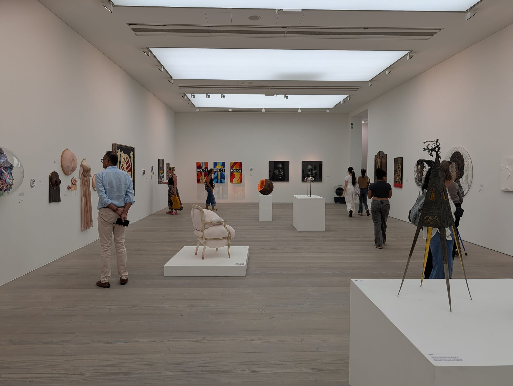

*The Saatchi Gallery.*

## Key streets and micro-districts

### The pastel streets off the King's Road

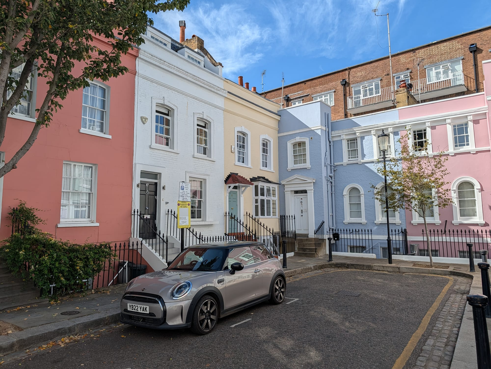

**Bywater Street** is the one people photograph: a cul-de-sac off the King's Road in blues, pinks and lilac, so there is no traffic passing through your picture.

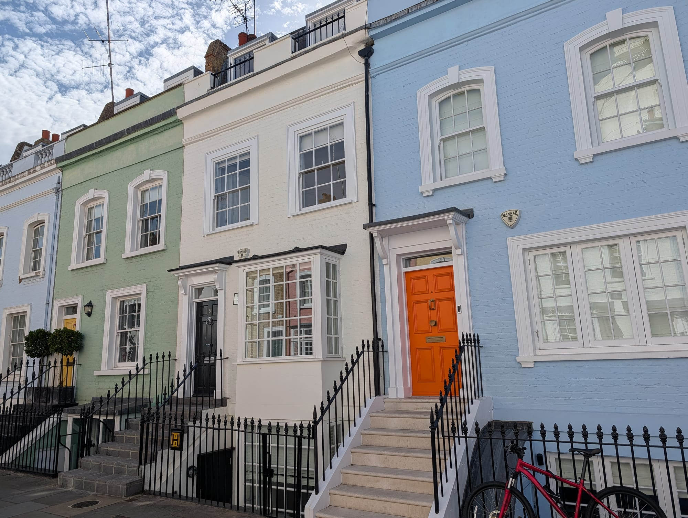

**Godfrey Street, Burnsall Street and Smith Terrace** are the same idea with fewer people on them, and **Markham Square** is thirty seconds away. All four sit inside one block, so it is a twenty-minute walk, not a route.

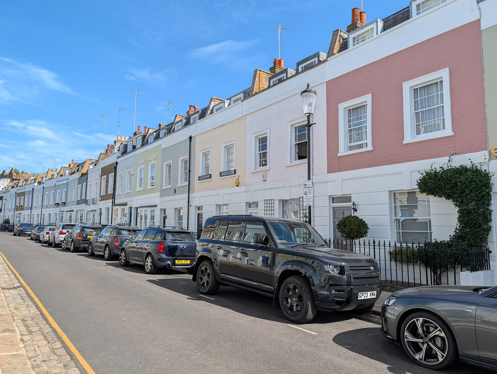

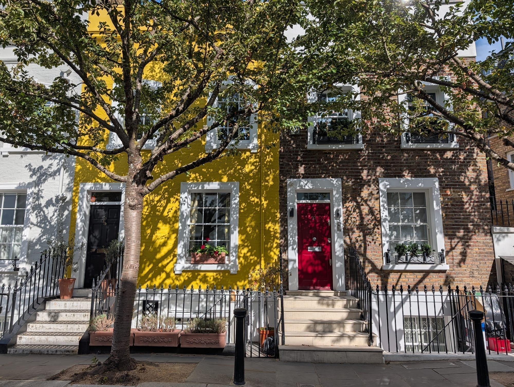

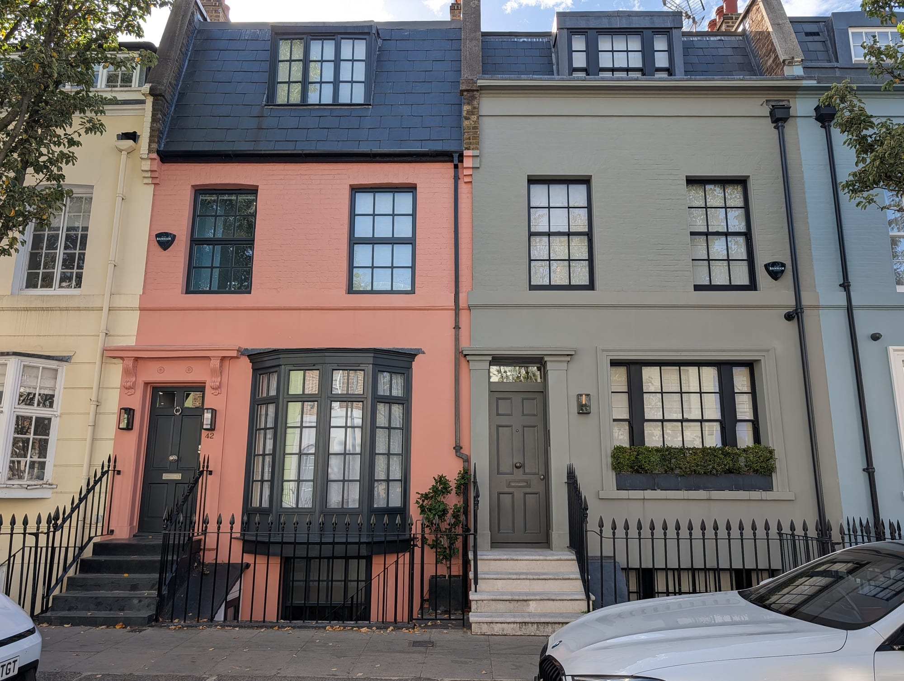

**These are people's homes**, and anyone photographing Bywater Street is visible from every window on it. Shoot from the pavement and keep off the steps.

### Sloane Square and the eastern King's Road

The **Royal Court Theatre** sits on the square. It premiered *Look Back in Anger* in 1956 and still runs new writing; check its cheap seats before the West End.

**Peter Jones**, the John Lewis department store, occupies the west side behind a curved 1930s glass curtain wall.

**The first few hundred metres of the King's Road are chain retail.** The independents start after Duke of York Square and get better the further west you go.

**Sloane Square station is on the District and Circle lines.** The King's Road runs a mile and a half west, so decide how far you are going before you start.

### Duke of York Square

Off the north side of the road, a hundred metres in: a pedestrianised square of paving, fountains and benches in front of the former **Duke of York's military headquarters**.

**The Saatchi Gallery occupies the building**, seventy thousand square feet over three floors, open daily 10am to 6pm with last entry to the ground-floor exhibitions at 5.20pm. Some shows are free and some are individually ticketed, so check which before you turn up.

**The food market runs on Saturdays**, roughly 10am to 4pm. **Partridges**, the grocer on the square, is open the rest of the week.

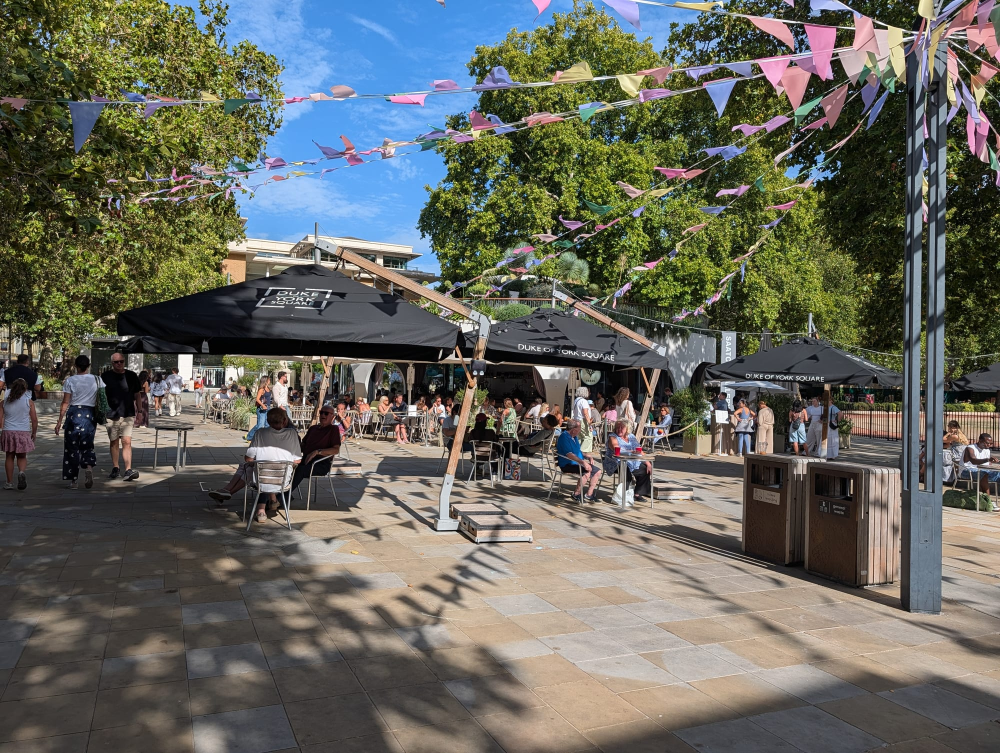

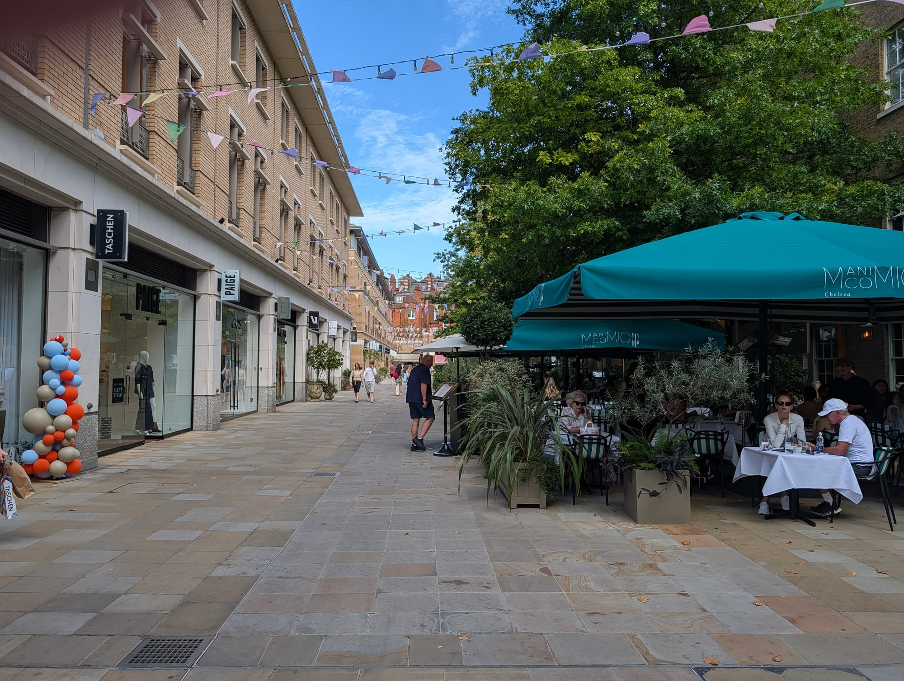

**Pavilion Road runs north from here**, a converted mews of independent food shops (butcher, baker, cheesemonger) with **The Sea, The Sea at 243** doing seafood at the top of it.

### Cheyne Walk and Chelsea Embankment

The riverfront: Georgian terraces facing the water, blue plaques for Turner, Whistler, Rossetti, Elizabeth Gaskell, Mick Jagger and Keith Richards, and houseboats moored west of Battersea Bridge.

**Albert Bridge is the set piece.** It is lit by around four thousand bulbs after dark, and it is **free and open to pedestrians at all hours**.

**Restaurant Gordon Ramsay is at 68 Royal Hospital Road**, one street back: three Michelin stars since 2001, booked months ahead.

**It is a walk, not a destination**: about fifteen minutes end to end, with very little to buy along it.

### World's End and the western King's Road

Past the bend, where the road narrows and the chains give out. This is where the independent shops still are, and where Chelsea's punk history happened.

**Vivienne Westwood's shop at 430 King's Road** has the **backwards-running clock** over the door. The address was SEX in 1974, where the Sex Pistols were put together.

**The World's End Distillery** on the corner is the Victorian pub the district takes its name from.

**Eat here rather than at the Sloane Square end.** **Mucci's at 442** does modern Italian a few doors from Westwood's, and **Made in Italy at 249** does Neapolitan pizza by the metre.

**It is a twenty-five-minute walk from Sloane Square**, and there is no station at this end. The 11, 19 and 22 buses run the length of the King's Road: ride one way and walk the other.

### The Chelsea backstreets

Between the King's Road and the river. **St Leonard's Terrace** faces the Royal Hospital's grounds and **Margaretta Terrace** is the pastel one. There is almost no traffic and nothing to buy, and people live in these streets, so do not linger on doorsteps.

**Three restaurants here need booking**: **Daphne's at 112 Draycott Avenue**, **Kutir at 10 Lincoln Street** for modern Indian, and **Dinings SW3** in a mews off Walton Street for Japanese small plates.

**The Royal Hospital Chelsea** is the anchor: Wren's home for army veterans, with Pensioners in residence since 1692. Its grounds are free and open on weekdays, and it hosts the Chelsea Flower Show every May (18 to 22 May 2027), when the area is congested and hotel prices rise.

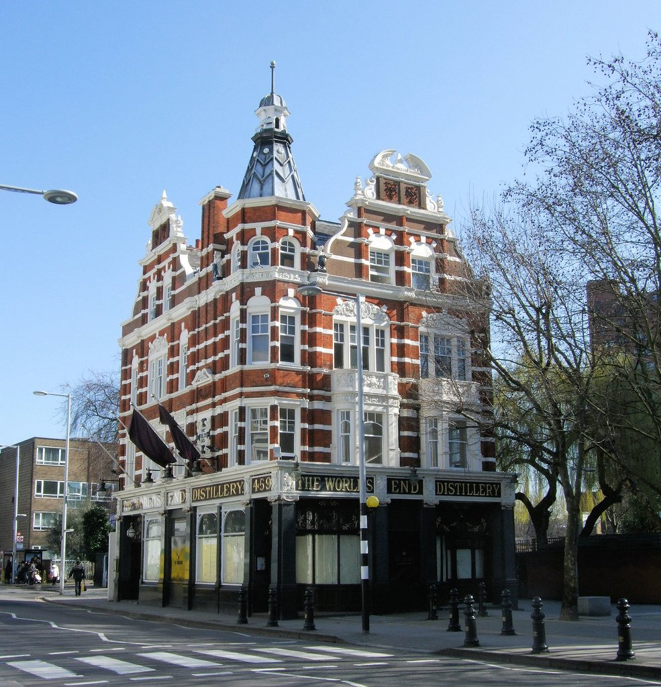

*The World's End Distillery, King's Road. Photo: [Jim Linwood](https://www.flickr.com/photos/54238124@N00/5506552067), [CC BY 2.0](https://creativecommons.org/licenses/by/2.0/).*

## Go deeper

- **[London's historic houses](/articles/historic-houses-london/)** — including the Royal Hospital Chelsea.

Powered by <a target="_blank" rel="sponsored" href="https://www.getyourguide.com/london-l57/">GetYourGuide</a>

## Where to eat and drink

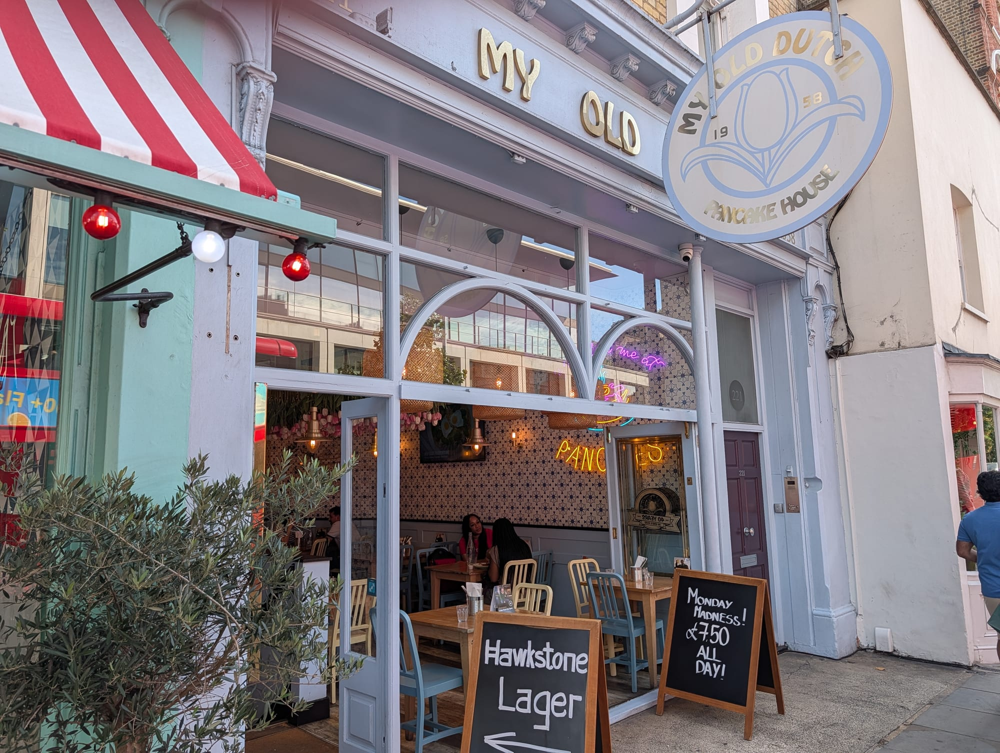

*My Old Dutch, King's Road.*

| Spot | Style | Price | Why go |
| --- | --- | --- | --- |
| **Duke of York Square Market** | Fine food market | ££ | Saturdays only |
| **Colbert** | French brasserie | ££ | Corner spot on Sloane Square |
| **The Cross Keys** | Pub | ££ | On Lawrence Street, dating from 1708 |
| **Bluebird** | Modern British | £££ | In a 1923 art deco garage on the King's Road |
| **The Pig's Ear** | Gastropub | ££ | Backstreet pub off the river end |
| **Chelsea Physic Garden Cafe** | Garden cafe | ££ | Requires garden admission |

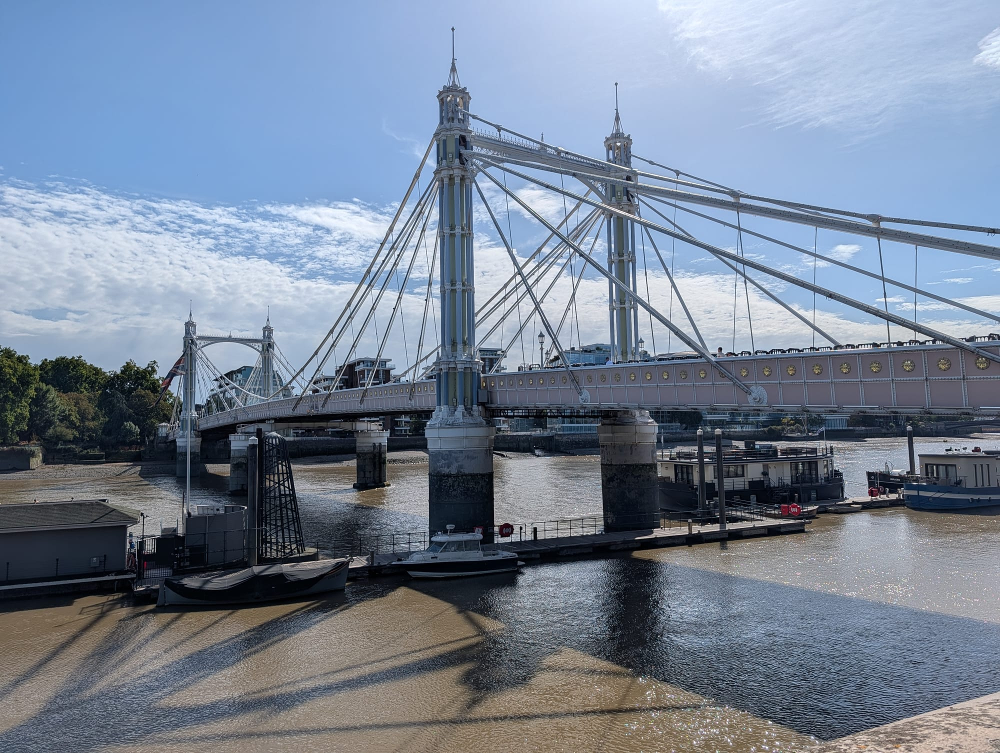

*Albert Bridge.*

The 606 Club on Lots Road serves dinner through two jazz sets every night; the music charge is £18 Sunday to Thursday and £23 on Friday and Saturday. [Dinner and a Show in London](/articles/dinner-and-a-show-london/) has it beside the other jazz suppers.

Barts, a 1920s speakeasy behind an unmarked black door at Chelsea Cloisters on Sloane Avenue, asks for a password at the door. [The Best Speakeasy Bars in London](/articles/best-speakeasy-bars-london/) covers it and the rest of London's hidden bars.

## Getting there

**By Tube.** **Sloane Square** (District, Circle) is the only Tube station in Chelsea, at the eastern edge. The western end has none.

**Getting to the western end.** Take the **11, 19, 22 or 49 bus** along the King's Road, or walk from Sloane Square (25 minutes). **Imperial Wharf** on the Overground serves the far south-west.

**Best exit.** Sloane Square has one exit; turn right for the King's Road, left for Sloane Street and Knightsbridge.

**On foot.** Fifteen minutes to South Kensington, fifteen across Albert Bridge to Battersea Park.

## How long to spend, and when to go

| If you have | Do this |
| --- | --- |
| **Two hours** | Sloane Square, Duke of York Square, Saatchi Gallery |
| **Half a day** | Add the Physic Garden and the Cheyne Walk river stretch |
| **A full day** | Add Royal Hospital, the backstreets and Battersea Park over the bridge |

**Best time:** Weekday afternoons. Saturday brings the food market but also the crowds.

**Avoid:** Chelsea Flower Show week in late May unless you have tickets. Sloane Square station is congested.

Comparing neighbourhoods? [Best areas to visit in London](/articles/best-areas-to-visit-london/) sets them side by side by what each is best for, how long it takes and the best day to go.

## Walking routes

**[Chelsea to Belgravia: a blue plaque walk →](/articles/chelsea-belgravia-plaques-walk/)**

Our full route for this area: **eleven numbered stops** over about 4km and two to three hours, with a map, a Google Maps walking link and a day-by-day breakdown of what is open. It runs through the densest concentration of blue plaques in London — **184 inside the square between Cheyne Walk and Belgrave Square** — taking in Oscar Wilde, Mark Twain, Bram Stoker and George Eliot, who all lived within ten minutes of one another. **Wednesday is the only day on which all three ticketed stops open.**

### The short version, if you only have two hours

1. **Start:** Sloane Square station. Cross to the **Royal Court Theatre**.
2. **Duke of York Square:** West off the King's Road for the **Saatchi Gallery**.
3. **Royal Hospital:** South down Franklin's Row to the **Royal Hospital Chelsea** grounds.
4. **Physic Garden:** West along Royal Hospital Road — the entrance is easy to miss.
5. **Cheyne Walk:** Continue to the river and turn west past the blue plaques.
6. **Finish:** **Albert Bridge**, and either cross to Battersea Park or head back up to the King's Road.

Powered by <a target="_blank" rel="sponsored" href="https://www.getyourguide.com/london-l57/">GetYourGuide</a>

## Common mistakes to avoid

1. **Expecting the 1960s King's Road.** It is mostly chains now.
2. **Walking the whole King's Road for the shops.** It is two miles. Take a bus west and walk back.
3. **Missing the Physic Garden's closed day.** It is shut on Saturdays, and the entrance on Royal Hospital Road is hard to spot.
4. **Assuming there is a Tube at the western end.** Sloane Square is the only station, at the far eastern edge.
5. **Eating on the King's Road itself.** You pay a premium for the address. Duke of York Square on a Saturday costs less.
6. **Visiting during Flower Show week without a plan.** Late May is the one time to avoid.

## Where to stay

Quiet and expensive, with limited Tube access — a good base if you value calm over convenience.

- **Sloane Square** — The only part with direct Tube access. Boutique hotels and townhouses.
- **South Kensington** — Fifteen minutes north-west, better connected, and next to the museums.
- **Earl's Court and Fulham** — West and cheaper, with District line access.

Our [Chelsea and Knightsbridge hotel guide](/articles/where-to-stay-chelsea/) compares the hotels from Sloane Square to Hyde Park Corner.
