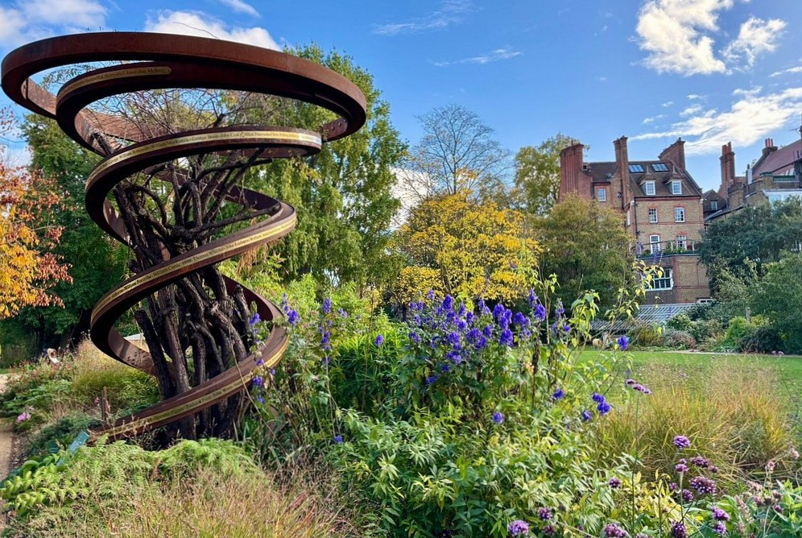
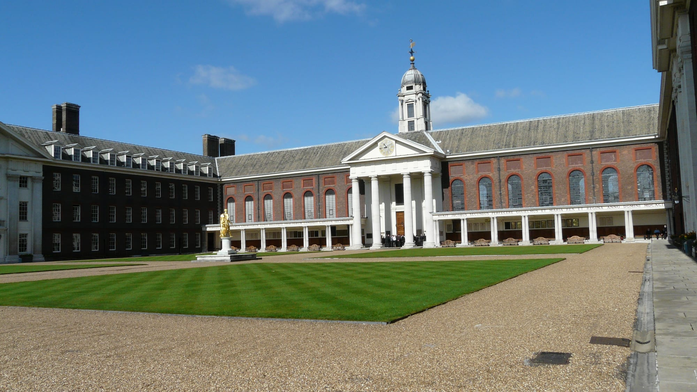

**Oscar Wilde, Mark Twain, Bram Stoker and George Eliot all lived within about ten minutes' walk of each other.** This route has **eleven numbered stops from Cheyne Walk to Belgrave Square**, about **4km and two to three hours**. The plaques are on the outside of buildings, so they are free.

There are **184 blue plaques** inside the square this walk covers, **163 of them marking where somebody lived, worked or died**. The route takes the ones worth stopping for, plus a few places worth going into.

For the wider areas — the shops, the pubs, where to stay — see the [Chelsea area guide](/articles/chelsea-area-guide/) and the [Belgravia area guide](/articles/belgravia-area-guide/).

> 💡 **The Short Version:** Go on a **Wednesday** — it is the only day all three ticketed stops are open. Start on **Cheyne Walk** and finish at **Belgrave Square**. On **Tite Street**, Oscar Wilde and Peter Warlock are thirty metres apart. Everything on the walk is free except the **Physic Garden** and **Carlyle's House**. These are people's homes, so photograph from the pavement.

## The route

  

    Map of the walk, numbered in walking order
  

  

    
Loading the map…

  

  

    <i class="route-map-marker" aria-hidden="true">1</i> On the route, in walking order
    <i class="route-map-marker route-map-marker--alt" aria-hidden="true">+</i> Optional detour
  

  <noscript>
    
The map needs JavaScript. Every stop below is numbered in walking order with its nearest station.

  </noscript>

**[Open the whole route in Google Maps →](https://www.google.com/maps/dir/?api=1&origin=51.48196,-0.17418&destination=51.498638,-0.154374&waypoints=51.48412,-0.169788%7C51.48457,-0.162262%7C51.48415,-0.16416%7C51.4858,-0.1609%7C51.4871,-0.16267%7C51.4886,-0.16118%7C51.487384,-0.157394%7C51.492226,-0.155877%7C51.4913,-0.1525&travelmode=walking)** — all eleven stops in walking order, set to walking directions, which is the version to put on your phone.

| # | Stop | Cost | Open |
| --- | --- | --- | --- |
| **1** | Cheyne Walk | Free | Always |
| **2** | Carlyle's House | £12 | **Wednesdays only, pre-booked** |
| **3** | Chelsea Physic Garden | £15 | **Closed Saturdays** |
| **4** | George Eliot, 4 Cheyne Walk | Free | Always |
| **5** | Tite Street | Free | Always |
| **6** | Mark Twain, Tedworth Square | Free | Always |
| **7** | Bram Stoker, St Leonard's Terrace | Free | Always |
| **8** | Royal Hospital Chelsea | **Free** | **Closed Mondays** |
| **9** | Sloane Square & Saatchi Gallery | **Free** | Daily |
| **10** | Ebury Street | Free | Always |
| **11** | Belgrave Square | Free | Always |
| **+** | Alexander Fleming, Danvers Street | Free | Always |

---

## 1. Cheyne Walk and Whistler

Cheyne Walk faces the river. **James Abbott McNeill Whistler** is at number 96. Along the same terrace: **J. M. W. Turner**, who died here under an assumed name; **Dante Gabriel Rossetti**, who kept a menagerie in the garden including a wombat; and, at number 4, **George Eliot** (stop four). The plaques are at first-floor level.

> ⚠️ **These are private homes.** Every house on this walk except Carlyle's is lived in. Photograph from the pavement, do not stand on anyone's steps, and do not ring the bell to ask.

## 2. Carlyle's House, Cheyne Row

**The one house on this walk you can go inside.**

Thomas Carlyle lived at 24 Cheyne Row from 1834 until his death in 1881, and the house is kept by the National Trust more or less as he and Jane Carlyle left it — her writing table in the drawing room, the sound-proofed attic study he built to escape the neighbours' chickens.

> ⚠️ **It opens on Wednesdays only**, 11am to 4.30pm, and **all visits are pre-booked timed entry**. £12 adult, £6 child, under-5s free.

## 3. Chelsea Physic Garden

*The Chelsea Physic Garden.*

Four acres of walled botanic garden behind the street, founded in 1673 by the Society of Apothecaries to grow medicinal plants. It calls itself **London's oldest botanic garden**.

It has glasshouses, a rock garden built partly from Icelandic lava, and beds arranged by what the plants are *for* rather than where they come from.

> ⚠️ **Open Sunday to Friday, 11am to 5pm, last entry 4.30pm — closed all day Saturday.** £15 adult, £6.50 for ages 5–25, under-5s free.

Powered by <a target="_blank" rel="sponsored" href="https://www.getyourguide.com/london-l57/">GetYourGuide</a>

## 4. George Eliot on Cheyne Walk

Number 4. The inscription reads **"George Eliot 1819–1880 novelist died here."**

She moved in with her new husband in December 1880 and was dead within three weeks.

## 5. Tite Street: Oscar Wilde and Peter Warlock

Two plaques about thirty metres apart.

**Oscar Wilde** lived at 34 Tite Street from 1884 until his arrest in 1895 — the house where he wrote *The Importance of Being Earnest*, and the house whose contents were auctioned on the pavement to pay his costs.

A few doors along, **Peter Warlock**, the composer born Philip Heseltine, died here in 1930 aged thirty-six of coal gas poisoning. **John Singer Sargent** lived and painted on the street too.

## 6. Mark Twain on Tedworth Square

**"Samuel L. Clemens, 'Mark Twain' 1835–1910 American writer lived here in 1896–7."**

Twain came to London after his daughter Susy died of meningitis while he was abroad, and he was bankrupt from a failed investment in a typesetting machine. He spent the year in this square writing *Following the Equator* to pay the creditors off, and did.

## 7. Bram Stoker on St Leonard's Terrace

**Stoker lived here when *Dracula* was published in 1897.** He was Henry Irving's business manager at the Lyceum and wrote around the day job.

## 8. The Royal Hospital Chelsea

Wren's home for army veterans, founded by Charles II in 1682. Around three hundred **Chelsea Pensioners** live here, and the scarlet coat is their everyday dress.

**The exhibition in the Soane Stable Yard is free and needs no ticket.**

> ⚠️ **Open Tuesday to Sunday, 9am to 5pm, last admission 4.30pm — closed Mondays.**

## 9. Sloane Square and the Saatchi Gallery

The halfway point. **Sloane Square** has the Royal Court Theatre on one side; **Duke of York Square** off it has the **Saatchi Gallery**, which is **free and open seven days, 10am to 6pm**.

The gallery closes for a few days between exhibitions, so check before you go.

## 10. Ebury Street and Mozart's first symphony

You are in Belgravia now.

**Wolfgang Amadeus Mozart composed his first symphony at 180 Ebury Street in 1764, aged eight.** The family was in London on a three-year European tour, Leopold fell ill, and the children were forbidden from touching the harpsichord while he recovered — so Wolfgang wrote a symphony instead.

It is a **brown plaque, not a blue one**: English Heritage runs the blue ones, but boroughs, societies and private owners have put up their own.

**Ian Fleming is at number 22, on the same street** — about eight minutes' walk from Mozart at 180. *"Creator of James Bond lived here."*

Between the two, **Mary Shelley** is at **24 Chester Square**, a two-minute detour north. She died in that house in 1851, decades after writing *Frankenstein* at eighteen — the square garden is private and railed, so you look at the house across it.

## 11. Belgrave Square and the Belgravia plaques

Most of the houses on the square are embassies, so the plaques thin out there and cluster on the streets around it.

Within a few minutes: **William Wilberforce**, who *died here* on Cadogan Place; **Alfred Lord Tennyson**, who lived on Upper Belgrave Street in 1880 and 1881; **Matthew Arnold**; and **Walter Bagehot**, the economist whose name is on the *Economist*'s main column to this day.

---

## The detour: Alexander Fleming

**Alexander Fleming**, Danvers Street — *"discoverer of penicillin lived here"*. Two minutes west of the route between stops 1 and 2.

**Ian Fleming**'s plaque is on the route, at stop ten.

## Where to eat

- **Duke of York Square** (££) at stop nine: the food market runs on **Saturdays**, and there are cafés around the square the rest of the week.
- **The Cross Keys**, Lawrence Street (££): a pub near stop 2 with its own heritage plaque listing the drinkers: **Dylan Thomas, Turner, Agatha Christie, Whistler and John Singer Sargent**.
- **The Chelsea Physic Garden café** (££) at stop three: for garden visitors only, and closed on Saturdays with the garden.

For the fuller picture, the [Chelsea](/articles/chelsea-area-guide/#where-to-eat-and-drink) and [Belgravia](/articles/belgravia-area-guide/#where-to-eat-and-drink) area guides cover it.

## The best day to go

**Wednesday.** Three stops close on three different days.

| Day | What you get |
| --- | --- |
| **Wednesday** | **Everything.** The only day Carlyle's House opens at all |
| **Tue, Thu, Fri** | Physic Garden and Royal Hospital open; Carlyle's House shut |
| **Sunday** | Physic Garden and Royal Hospital open; quietest streets |
| **Saturday** | **Physic Garden shut.** Duke of York Square food market on |
| **Monday** | **Royal Hospital shut**, Physic Garden open, Carlyle's shut |

**What never closes:** every plaque on the walk. They are on the outside of buildings on public streets, so the core of the route works on any day for nothing.

Powered by <a target="_blank" rel="sponsored" href="https://www.getyourguide.com/london-l57/">GetYourGuide</a>

## Getting there and back

**Start:** Sloane Square (District, Circle) and walk south-west down to the river, or South Kensington (District, Circle, Piccadilly) and walk south. Cheyne Walk has no station of its own.

**Finish:** Hyde Park Corner (Piccadilly) or Victoria (Victoria, District, Circle, rail), both a few minutes from Belgrave Square.

The route is **flat and step-free on pavements throughout**. Walked in reverse it works but ends at the river with a longer walk to a station.

## Carry on walking

- **[Fitzrovia to Mayfair](/articles/fitzrovia-mayfair-walk/)** — Hyde Park Corner, at the top of Belgravia, is the west end of Green Park.
- **[Westminster](/articles/westminster-walk/)** — Victoria and Westminster Cathedral are just east of Belgravia.

## What to do with the rest of the day

- **[The Chelsea area guide](/articles/chelsea-area-guide/)** and **[the Belgravia area guide](/articles/belgravia-area-guide/)** — the King's Road, the pubs, the garden squares and where to stay.
- **[London's blue plaques](/articles/london-blue-plaques/)** — how the scheme works, who qualifies, and the interactive map of every plaque in the city.
- **[The plaque map](/plaques/?area=chelsea)** — all 184 in this square, filtered to the area, if you want to build your own route.
- **[Free things to do in London](/free/)** — nine of these eleven stops cost nothing.
- **[The best areas to visit in London](/articles/best-areas-to-visit-london/)** — the neighbourhoods compared by what each is best for, how long it takes and the best day to go.
