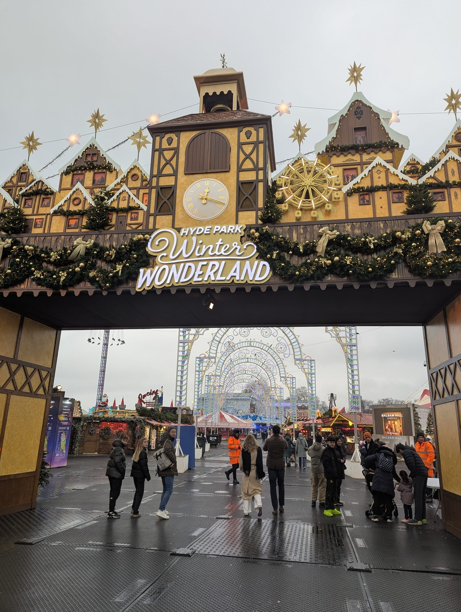
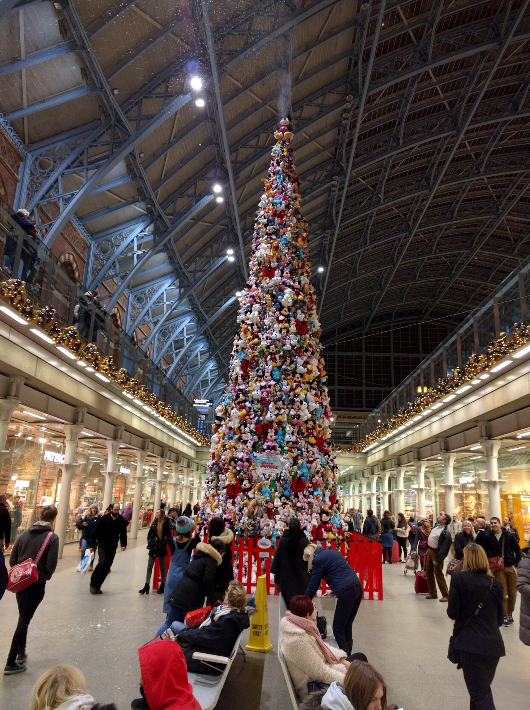
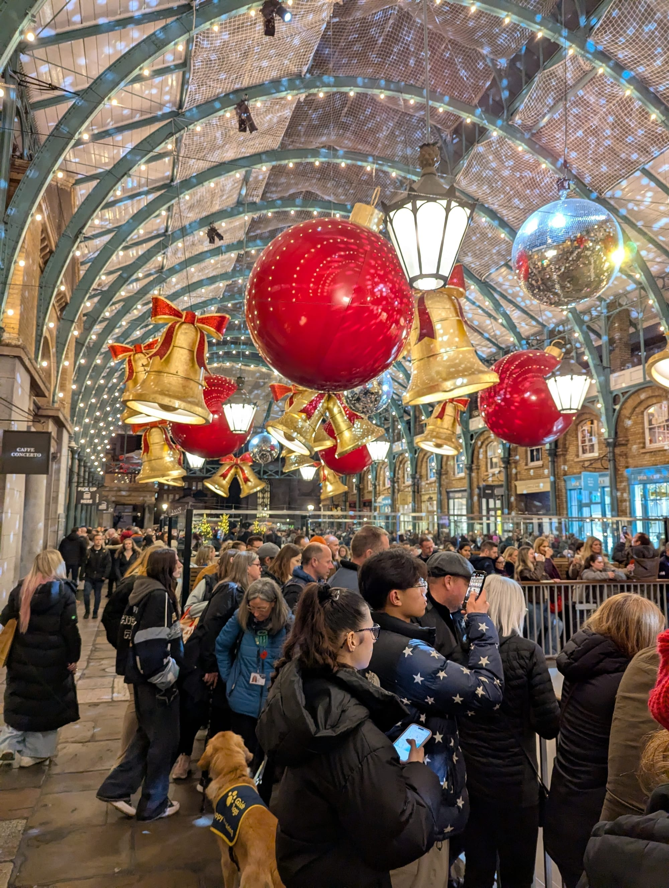
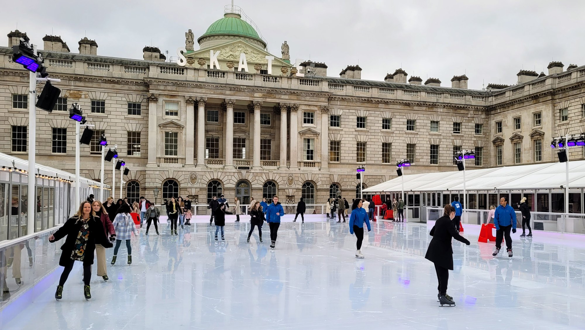
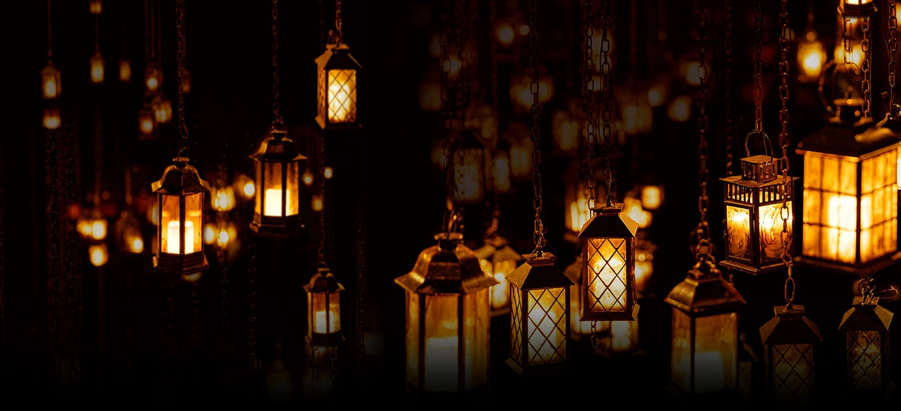
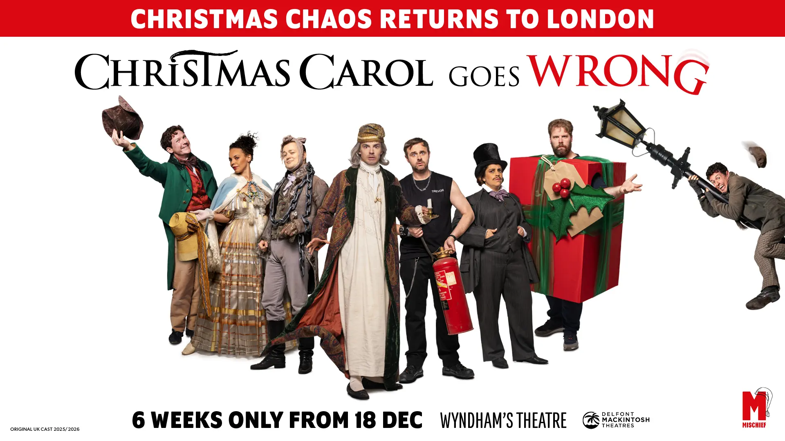
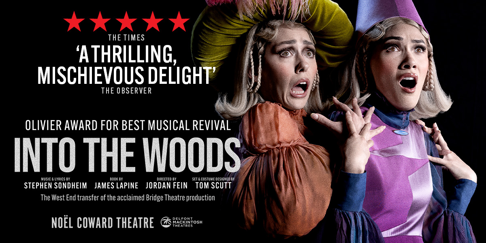
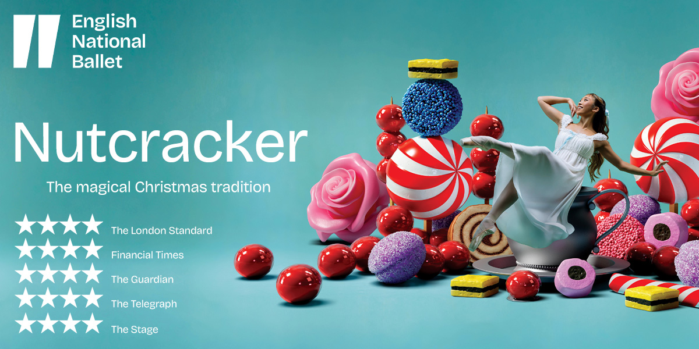

**Christmas in London runs from mid-November to the first week of January.** The markets and the lights are free to look at; the rides and the skating are not. Hyde Park Winter Wonderland is not a free-to-wander street market: it needs a timed ticket to enter.

---

> 🧭 **Plan the rest of it:** [Hyde Park Winter Wonderland](/articles/hyde-park-winter-wonderland/) · [Christmas lights walk](/articles/christmas-lights-walk-london/) · [Christmas Day restaurants](/articles/christmas-day-restaurants-london/) · [New Year's Eve](/articles/new-years-eve-london/) · [Things to do in London in November](/articles/things-to-do-in-london-in-november/) · [Things to do in London in December](/articles/things-to-do-in-london-in-december/)

## Hyde Park Winter Wonderland

**19 November 2026 – 3 January 2027**, open every day except Christmas Day, closing at 10pm with last entry at 9.30pm.

**Entry is not free**: everybody in your group needs a timed ticket, even to look at the market. In advance that is **£1 off-peak** (Monday to Thursday through November), **£5.50 standard** or **£8.25 peak**, and more on the door. Spend £25 online in one transaction on rides or attractions and entry becomes free.

Inside, **Santa's Grotto, the Christmas Market, the light arches and every band and DJ are free**. Everything else is not: the ice rink is £12.65–£19.25, the Giant Wheel £8.80–£12.10, the new Gandeys K-Pop Dragon Circus £13.75–£19.80 (Gandeys replaces Zippos as the resident circus in 2026). Every fairground ride is charged separately on top.

The quietest and cheapest visit is the same visit: a Monday to Thursday daytime in late November, when entry is £1 and the attraction prices drop with it.

> 🎡 **[The full Winter Wonderland guide](/articles/hyde-park-winter-wonderland/)** — every published price, all four gates, the free live music, the Bavarian Hall's 18+ evening rule, and what is new for 2026.

---

## Christmas markets

**Leicester Square's** chalets ring an ice rink and open on **31 October 2026**, running to 3 January; **Kingston's** run **12 November 2026 to 3 January 2027**, in the Ancient Market Place. In the centre, the **Southbank Centre Winter Market** (**2 November** to 3 January) is the food one and is cash-free, **Winter by the River** at London Bridge City opens on **10 November**, and **Trafalgar Square's** chalets sit under the Norway spruce (lit **3 December**). **Borough Market** opens every day from **30 November** and closes **25 to 27 December**. Almost all are free to walk into: Winter Wonderland's market needs an entry ticket from £1, and the Chelsea Physic Garden fair is £8 to £10.

> 🎄 **[Every Christmas market in London, with dates and hours →](/articles/christmas-markets-london/)** — the central markets, Kingston, Greenwich, Wimbledon and Battersea, and the maker fairs at the British Library, King's Cross and Chelsea Physic Garden.

**St Pancras International's** concourse has a charity Christmas tree built each year from a different donated material — past years have used everything from champagne bottles to, as pictured, thousands of soft toys. It's free to see and next door to King's Cross, near Canopy Market and the Crafty Fox maker market in Granary Square.

*The Apple Market, Covent Garden.*

---

## Christmas lights: where to see them

The 2026 switch-ons run from **Wednesday 4 November** (Carnaby Street) and **Thursday 5 November** (Regent Street, closed to traffic from 5pm to 9pm) to **Thursday 12 November** (Bond Street and Covent Garden). Oxford Street has not published its date, and the lights stay up until around Twelfth Night in early January. To see them in one evening on foot, follow our [Christmas lights walk](/articles/christmas-lights-walk-london/): ten stops from Selfridges to Trafalgar Square, with each street's 2026 switch-on date.

| Street | Known for |
| --- | --- |
| **Oxford Street** | "Sky Full of Stars" — over 5,000 illuminated stars the length of the street in 2025; traffic-free from Orchard Street to Great Portland Street from 26 October 2026 |
| **Regent Street** | The "Spirit(s) of Christmas" — illuminated angel figures |
| **Carnaby Street** | A completely different sculptural light installation each year |
| **Bond Street & South Molton Street** | Tens of thousands of LEDs on a different theme annually; South Molton Street's own blue-lit arches |
| **Covent Garden & Seven Dials** | The Piazza tree plus Seven Dials' light "canopies" radiating from the sundial monument |
| **Marylebone High Street** | "Merry Marylebone" — an afternoon street festival with a ferris wheel and live music |
| **Chelsea** | King's Road part-pedestrianised for a festival day; Sloane Street's lights run the length of the boulevard |
| **Canary Wharf** | No switch-on ceremony — the whole estate becomes a themed winter village from October (its ice rink is taking a break for 2026) |

**Trafalgar Square's tree is the one fixed date**: the lighting ceremony is **Thursday 3 December 2026**. It's a Norway spruce from the City of Oslo, dressed only in vertical strings of white lights, not baubles.

TfL periodically closes Oxford Circus station's entrances when crowds build on Saturday evenings in December; Bond Street and Tottenham Court Road are the backups.

---

## Ticketed light trails

These are paid, walk-through experiences.

**Christmas at Kew** runs **13 November 2026 – 3 January 2027**: a 3km illuminated trail through Kew Gardens taking upwards of two hours. Adult tickets from **£29.50 off-peak, £37 peak**; a Kew Gardens day visit is a separate ticket, an extra £12. Book through [kew.org](https://www.kew.org/kew-gardens/whats-on/christmas).

**[Hampton Court Palace](/articles/hampton-court-palace-guide/)** runs two separate things in 2026: **The Winter Palace**, a new indoor immersive walkthrough included in standard palace admission (£33–£36 adult), running **28 November 2026 – 3 January 2027**; and a **separate ice rink**, **20 November 2026 – 3 January 2027**, priced separately: £19.50 adult off-peak, £21.50 peak, family £59.50–£65.50 (see our [ice skating guide](/articles/ice-skating-london/)).

**Chelsea Winter Village & Illuminations**, at the Royal Hospital Chelsea, is an outdoor light trail — 1.5km, 45–75 minutes — running **25 November – 28 December 2026**. Adult tickets from £19 off-peak, rising to £30.95 at peak times.

**What has gone:** Kenwood House's Neverland trail on Hampstead Heath has been **cancelled for 2026** after weak ticket sales.

---

Powered by <a target="_blank" rel="sponsored" href="https://www.getyourguide.com/london-l57/">GetYourGuide</a>

## Ice rinks and Santa's grottos

**Six outdoor rinks are confirmed for 2026-27:** **Skate Leicester Square** (31 October 2026 – 3 January 2027; from £10 plus a £3 transaction fee), **Somerset House** (11 November 2026 – 10 January 2027; adults £13–£28.50, children £11–£15, plus a £1.50 fee per ticket), **Hampton Court Palace** (20 November – 3 January; adults £19.50 off-peak, £21.50 peak), **Glide at Battersea Power Station** (6 November – 3 January), **the Queen's House** in Greenwich (18 November – 3 January) and the rink inside Winter Wonderland. **Alexandra Palace** has a year-round indoor rink, from £11.75. Dates, prices and children's rules for every rink are in our [London ice skating guide](/articles/ice-skating-london/).

*The rink at Somerset House.*

**Book Somerset House early:** prices vary through the run and the lowest go to early bookers. **Not running in 2026:** the **Natural History Museum's** rink has closed for good, **Canary Wharf's** is taking a break for the season, and there is no **Tower of London** rink.

For grottos, **Fortnum & Mason's** "Storytelling with Father Christmas" and **Hamleys'** Regent Street grotto are both expected back but are not on sale yet — 2025 prices were roughly £36–£45 and from £65 for a group of three, respectively. **Harrods'** famous grotto has been discontinued with no plans to reopen. **Selfridges** doesn't run a formal grotto — Santa and his elves roam the shop floor for free instead. Outside the centre, **[Chessington World of Adventures](/articles/chessington-world-of-adventures-day-trip/)**, in Zone 6, puts Father Christmas's grotto in a Christmas Village on selected dates from 21 November to 24 December 2026, with park entry from £32; [theme parks near London](/articles/theme-parks-near-london/) has the other parks' Christmas dates.

---

## Seeing the lights from a bus

Oxford Street, Regent Street and Knightsbridge carry the best lights and the most crowded December pavements. There are two ways to see them.

### The cheap way: on foot

**Oxford Street between Orchard Street and Great Portland Street has been closed to all traffic, buses included, since 26 October 2026**, so its lights are now a free walk of just under a kilometre, from Selfridges to Oxford Circus. Carry on down Regent Street and you have the two biggest displays for nothing.

### The tour: a decorated vintage Routemaster

**Christmas Bus Tour** runs an open-top 1960s Routemaster, decked out, with live commentary — **75 minutes**, departing from **8 Northumberland Avenue, WC2N 5BY**, beside Trafalgar Square. Typical departures are **4.10pm, 6.15pm and 7.45pm**, with more on busier dates. The route takes in Oxford Street, Regent Street, Knightsbridge and a pass by Winter Wonderland. **A top open-deck seat is guaranteed on every booking.**

**All ages, and under-5s go free** on an adult's lap with no ticket needed.

> ⚠️ **Two things to check before you book.** The bus is a genuine 1960s Routemaster, which means **there is no space to store a wheelchair or a pushchair**, and the operator asks you to phone before booking. And it is **open-top in December**: dress for 75 minutes in the cold.

**B Bakery's afternoon tea bus** also runs seasonal versions from Victoria — that one feeds you, takes 90 minutes and costs more. It is covered in our [afternoon tea guide](/articles/best-afternoon-tea-london/).

---

## Christmas theatre

For every panto, Nutcracker and children's show with dates, prices and age guidance, see [Christmas shows and pantomimes in London](/articles/christmas-shows-london/).

### A Christmas Carol, The Old Vic

**10 November 2026 – 9 January 2027**, previews to 23 November. Jack Thorne's adaptation, directed by Matthew Warchus, now in its tenth season. The auditorium is reconfigured in the round and the show comes out into it — mince pies included.

*The Old Vic's staging, in the round.*

Expect handbells and carols sung by the cast. **Two hours with an interval; the recommended age is eight and over.** Book on [Ticketmaster](https://www.ticketmaster.co.uk/a-christmas-carol-tickets/artist/890378).

### Christmas Carol Goes Wrong, Wyndham's Theatre

**18 December 2026 – 23 January 2027, from £15.** Mischief — the company behind *The Play That Goes Wrong* — doing the same story as a disaster: the Cornley crew feuding over who plays Scrooge while the set comes apart around them.

Book on [Ticketmaster](https://www.ticketmaster.co.uk/christmas-carol-goes-wrong-london-18-12-2026/event/Zor9uZKbZL4ZefkGjZd). It runs into late January, so tickets are easier to find if you leave it late.

### Into the Woods, Noël Coward Theatre

**22 September 2026 – 9 January 2027.** Sondheim and Lapine's fairy-tale collision — Cinderella, Rapunzel, Jack and a baker's wife all wanting something — transferred to the West End after a sell-out run at the Bridge and won the Olivier for Best Musical Revival on the way.

The second act takes the happy endings apart, so it suits adults and older children, not a family with small ones. It runs to 9 January if December is already booked.

### The Great Christmas Feast, The Lost Estate

**A Christmas Carol as an immersive Victorian dinner.** The Lost Estate in West Kensington stages it around the moment Dickens first read the story aloud, with live music, theatre performed around the tables and a full feast.

It runs from **6 November to 31 December 2026** at 7-9 Beaumont Avenue, W14 9LP, two minutes from West Kensington. Every ticket includes the three-course feast: **Classic Dining from £150**, **Private Dining from £195** and **VIP Dining from £235**, with previews from 6 to 12 November from £136, plus a £4.85 booking fee.

> ⚠️ **The final 2026 tickets go to subscribers first.** The company releases them to its [presale list](https://christmasfeast.thelostestate.com/) before the general sale.

### Scrooge: Cirque Extravaganza, ExCeL London

**23, 24, 27 and 28 December 2026.** A Christmas Carol told by aerialists, acrobats, a trampoline wall and fire breathers in the ICC Auditorium at ExCeL, billed by the organiser as a family show. Every performance draws one seat number, and the holder wins £1,000 cash on stage. It warns of water effects, loud noises, strobe lights and pyrotechnics. Seats are sold in bands: Christmas Eve's Band A is £124.99 and Band B £94.99, each £25 cheaper per ticket for four or more. [Dates and tickets](https://scroogecirque.com/london).

### Cirque Alice, Royal Festival Hall

**12 December 2026 – 3 January 2027.** An acrobatic *Alice in Wonderland* from the creators of *Circus 1903*, in its European premiere, with aerialists, contortionists and puppetry set to reworked classical hits. A two-hour show the producers describe as suitable for all ages, with on-stage seating sold as well. [Dates and tickets](https://www.southbankcentre.co.uk/whats-on/cirque-alice/).

### Cinderella, Matthew Bourne's New Adventures, Sadler's Wells

**1 December 2026 – 17 January 2027, from £15 plus a £4 fee.** The 30th-anniversary revival of Bourne's *Cinderella*, set in the Blitz, with a wartime romance between Cinderella and an RAF pilot. **2 hours 20 minutes with two intervals, recommended for ages eight and over.** [Dates and tickets](https://www.sadlerswells.com/whats-on/matthew-bournes-new-adventures-cinderella/).

### Sophie's Surprise Christmas Party, Underbelly Boulevard Soho

**13 November 2026 – 10 January 2027, from £30 including the fee.** Circus and comedy at a party where one audience member is picked each night to be Sophie, the guest of honour. **Age 16 and over**, 1 hour 30 minutes including an interval. [Dates and tickets](https://underbellyboulevard.com/tickets/sophies-surprise-christmas-party/).

**[More immersive nights out →](/articles/immersive-experiences-london/)** · **[The cabaret guide →](/articles/best-cabaret-london/)**

---

Powered by <a target="_blank" rel="sponsored" href="https://www.getyourguide.com/london-l57/">GetYourGuide</a>

## Christmas for children

These shows are built for children, and they book earlier than anything else in this guide. Grottos and ice rinks are further up the page.

### Wundrful World of Christmas, ExCeL London

**13 November – 24 December 2026, on selected days.** A timed walk-through for **three to eight-year-olds** and their adults, in Immerse LDN on ExCeL's waterfront, three minutes' walk from Custom House (Elizabeth line and DLR). Children ride a lift to the North Pole, cross an Enchanted Forest, sort toys in the Elves' Workshop, meet Mrs Claus in her kitchen and then Santa, with a photo taken at the end, and every child gets a small gift. It takes about 50 minutes, and the Elves' Playground afterwards (light installations, gentle fairground rides, food stalls) adds at least another 30.

**Adults £29.90 off-peak and £34.90 at peak; children £24.90 and £29.90.** A family pass for four or five (no more than two adults) is £24.90 a head off-peak and £29.90 at peak. Every child needs a ticket, babies included, though under-12-month tickets are free. Rides, food and Santa photo prints cost extra, the venue takes cards only, and pushchairs are left outside the walk-through. [Dates and tickets](https://wundr.seetickets.com/timeslot/wundrful-world-of-christmas).

### Pinocchio, Shakespeare's Globe

**28 November 2026 – 3 January 2027.** A musical staged in the Globe Theatre itself, for **ages five and over**, running 2 hours 10 minutes with a 20-minute interval. Seats are £28 to £88 including a £3 per-order fee, standing is £10 or £5, and under-16s pay half price for seats. [Dates and tickets](https://www.shakespearesglobe.com/whats-on/pinocchio/).

### The Snowman, Peacock Theatre

**21 November 2026 – 3 January 2027, from £18** plus a £4 transaction fee. **1 hour 30 including a 20-minute interval.**

It has run for 32 years and **in 2026 it is a new production** — a world premiere staged by Sadler's Wells with Birmingham Rep, with new puppets and Howard Blake's score, 'Walking in the Air' included. Book on [Ticketmaster](https://www.ticketmaster.co.uk/the-snowman-tickets/artist/1408779).

### Nutcracker, English National Ballet, London Coliseum

**17 December 2026 – 10 January 2027.** Over a hundred dancers and musicians, with the ENB Philharmonic playing Tchaikovsky live. Book on [Ticketmaster](https://www.ticketmaster.co.uk/the-nutcracker-english-national-ballet-tickets/artist/1632757).

**The Royal Ballet's Nutcracker at Covent Garden** runs every Christmas too and is more expensive. Either works from about five upwards; both sell out early, so book when the dates open.

### Pantomime

**Two pantomimes**: **Hackney Empire's** *Jack and the Beanstalk* (21 November – 31 December 2026), directed by and starring Olivier winner Clive Rowe, **£10–£48**; and the **London Palladium's** *Cinderella* (5 December 2026 – 10 January 2027), with Dawn French and Jennifer Saunders reuniting as the Ugly Sisters for the first time in 17 years.

### For the under-fives

**The Gruffalo** and its stablemates — *The Gruffalo's Child*, *Room on the Broom*, *The Smeds and The Smoos* — are made by Tall Stories, a London company, and at least one of them is usually playing somewhere in the city over Christmas. **The Gruffalo runs 55 minutes with no interval and is aimed at three and over.** Venues and dates change every year, so check the company's own listings. Two are on in the West End in 2026-27: [Room on the Broom](https://thelyrictheatre.co.uk/tickets/room-on-the-broom-live-on-stage/) at the Lyric Theatre (27 November 2026 – 3 January 2027, from £10, ages three and over, 60 minutes) and [Peppa Pig's Big Family Show!](https://trh.co.uk/whatson/peppa-pigs-big-family-show/) at the Theatre Royal Haymarket (4 December 2026 – 3 January 2027, from £10, about 1 hour 20 minutes).

> ⚠️ **Children's shows sell out first.** The Snowman, both Nutcrackers and the Palladium panto are usually gone for the good December dates by early autumn. If you are reading this in November, look at early January — the runs continue past Christmas and the seats are easier and cheaper.

---

## Carols

### The big one: the Royal Albert Hall

**Carols at the Royal Albert Hall**: the **Royal Choral Society** sings it with the **Royal Philharmonic Orchestra** — full orchestra, soloists, an audience of five thousand joining in, and a run of performances across the last two weekends before Christmas, including Christmas Eve.

It is a concert, not a service, and secular in feel. **Tickets go on sale in the spring and the Christmas Eve performances go first.**

### Churches worth the trip

**St Martin-in-the-Fields**, on the corner of Trafalgar Square, runs a long season of carols by candlelight, the one to pick if you want a church rather than a concert hall. **St Paul's Cathedral** and **Westminster Abbey** both hold carol services, under the dome and in the nave respectively, and both are heavily oversubscribed. **Southwark Cathedral** is the quieter, easier alternative on the south bank, and **Union Chapel** in Islington does the least formal version of all, in a Victorian octagon with the pews still in.

> ⚠️ **Cathedral carol services are free but not open-door.** St Paul's and Westminster Abbey release seats by ballot or advance booking, and the queue for any unallocated space forms long before the doors do. Check each cathedral's own site from about October.

### Carols for nothing

**Trafalgar Square** has **carols under the tree most evenings from the day it is lit until Christmas Eve, sung by a different choir each night and free to stand and listen to**. Most are collecting for a charity, so bring change.

**The other free option is a parish church.** Most London churches hold a carol service in the fortnight before Christmas with no ticket and a collection at the end. Look at what is on near where you are staying.

**In the shopping streets**, carol singers turn up through December at **Covent Garden**, **Leadenhall Market**, **Burlington Arcade** and the **Southbank Centre's** winter market, unscheduled and unticketed.

### Carols in the concert halls

**The Barbican Hall runs three evenings in Raymond Gubbay's Christmas season.** A **Christmas Carol Singalong** on Saturday 19 December 2026 (about two hours, from £27.50), **Christmas with King's College Choir** on Monday 21 December at 7.30pm (from £27.50) and **Candlelit Carols** with the Mozart Festival Orchestra on Tuesday 22 December at 7.30pm (from £27). Book the [Singalong](https://www.barbican.org.uk/whats-on/2026/event/christmas-carol-singalong), [King's College Choir](https://www.barbican.org.uk/whats-on/2026/event/christmas-with-kings-college-choir) or [Candlelit Carols](https://www.barbican.org.uk/whats-on/2026/event/candlelit-carols).

**Handel's Messiah has two London dates in the first half of December**: the English Chamber Orchestra at [Cadogan Hall](https://cadoganhall.com/whats-on/handels-messiah/) on Sunday 6 December at 6pm (from £19.50, ages seven and over), and Bach Collegium Japan at the [Barbican](https://www.barbican.org.uk/whats-on/2026/event/bach-collegium-japan-handels-messiah) on Tuesday 15 December at 7pm (from £24). **The Sixteen sing A Ceremony of Carols** at [Cadogan Hall](https://cadoganhall.com/whats-on/choral-at-cadogan-2026-27-the-sixteen-a-ceremony-of-carols-1/) on 16 and 17 December at 7.30pm, from £26.50. All prices include the booking fee. Our [Christmas shows guide](/articles/christmas-shows-london/#christmas-concerts-and-carols) has the full list.

### More carol concerts to book

Beyond the free ones above, several concert halls run ticketed carol and candlelight evenings through December.

---

Powered by <a target="_blank" rel="sponsored" href="https://www.getyourguide.com/london-l57/">GetYourGuide</a>

## Afternoon tea at Christmas

Hotels run festive tea menus, usually from early November to the first week of January — chestnut, clementine, spiced pear, a mince pie in place of a scone. **The prices go up with it**, so a festive sitting costs more than the same tea in February.

**Claridge's** festive menu runs from early November to 3 January at **£120 on weekdays and £130 at weekends**, in the Art Deco Foyer.

**The Winter Garden at The Landmark** is a glass atrium eight storeys high with full-grown palms, decorated for the season, with a pianist and a harpist.

**Fortnum & Mason's** Diamond Jubilee Salon is four floors above the food hall, so tea and Christmas shopping are the same trip.

**The Ritz** has five sittings a day and an enforced dress code, in the Palm Court. Book months out for December.

> ⚠️ **Festive menus are priced and dated separately from the standard tea**, and the good rooms sell December out by early autumn. Check the hotel's own site, not a listings page, and confirm which menu your booking is for.

**[The full afternoon tea guide, with every price →](/articles/best-afternoon-tea-london/)**

---

## Eating out on Christmas Day itself

Almost nothing opens on 25 December, no transport runs, and what does open is a fixed menu paid for in advance. Book early.

**[Christmas dinner in London, and what it costs →](/articles/christmas-day-restaurants-london/)**

---

## Good to know

**TfL runs no services at all on Christmas Day** — no Tube, buses, Overground, DLR, Elizabeth line, trams or river boats. Black cabs, private hire, Santander Cycles and rental e-scooters are the only options moving. **Boxing Day is reduced, not closed** — Tube and buses typically run to a Sunday timetable from around 7am, with the Elizabeth line historically closed altogether. Check [tfl.gov.uk/christmas-travel](https://tfl.gov.uk/christmas-travel) nearer the date for the exact 2026 detail.

**National Rail has its own Christmas 2026 closures.** London Paddington is closed to Great Western trains until Monday 4 January, with no Elizabeth line or Heathrow Express trains to or from Heathrow from Sunday 27 to Wednesday 30 December, and the Great Eastern Main Line is closed for 10 days from Christmas Day, with no Greater Anglia or Elizabeth line trains through Forest Gate until the early hours of 4 January ([National Rail](https://www.nationalrail.co.uk/dolphinjunction/), [Network Rail](https://www.networkrailmediacentre.co.uk/news/most-of-britains-railway-open-for-christmas-with-passengers-advised-to-plan-ahead-around-engineering-work)). Our [December guide](/articles/things-to-do-in-london-in-december/) has the detail.

**Deciding whether December is worth it against the rest of the year?** [Best Time to Visit London](/articles/best-time-to-visit-london/) sets its weather, crowds and cost against every other month.

---

