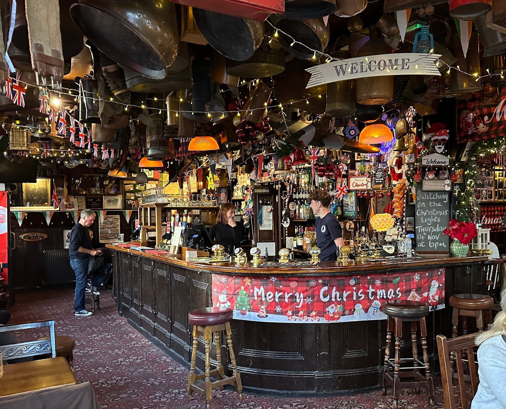
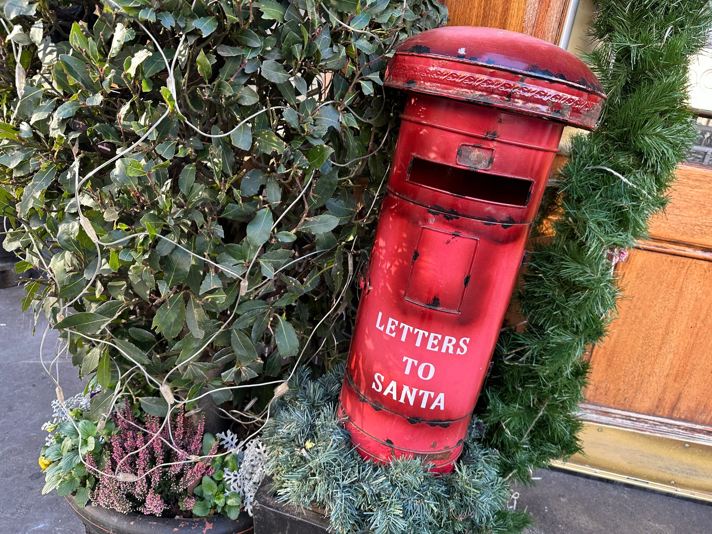
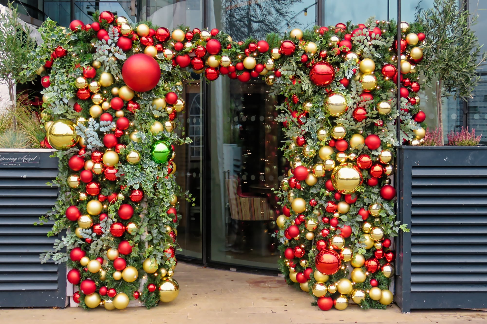
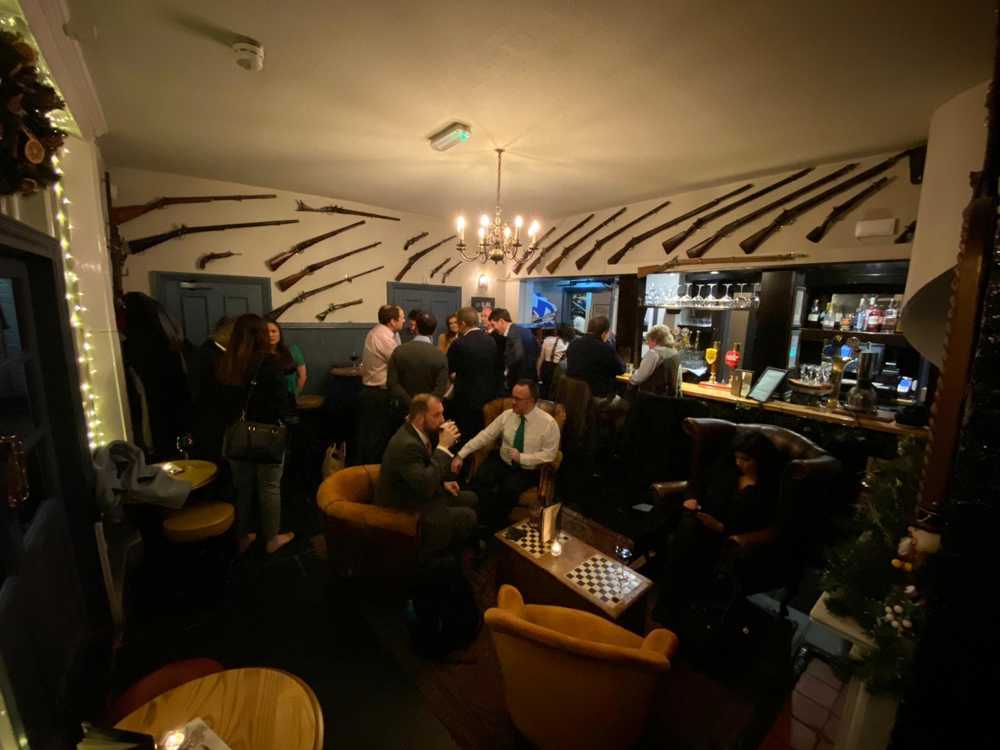
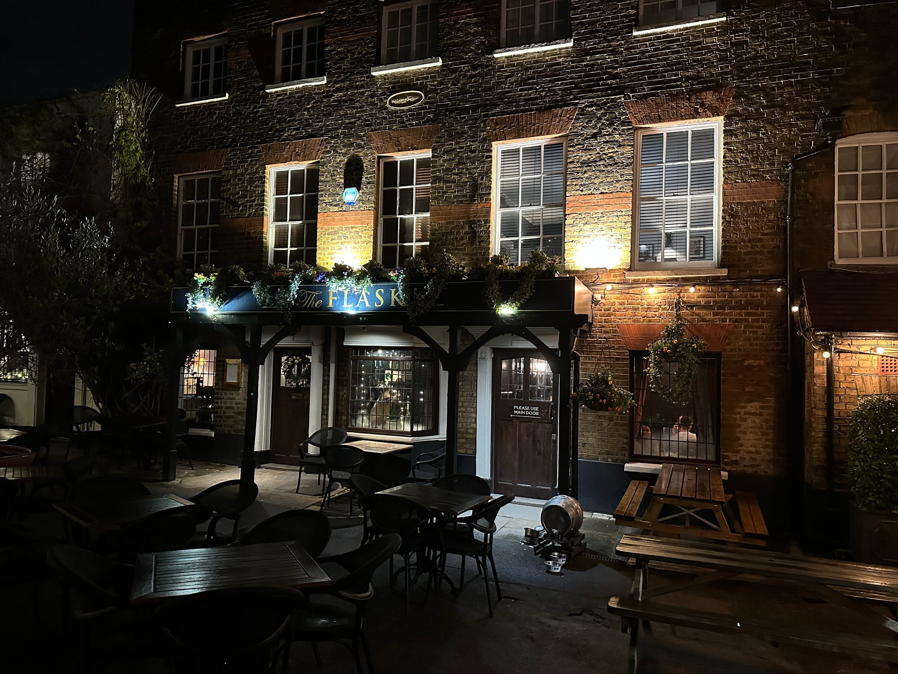
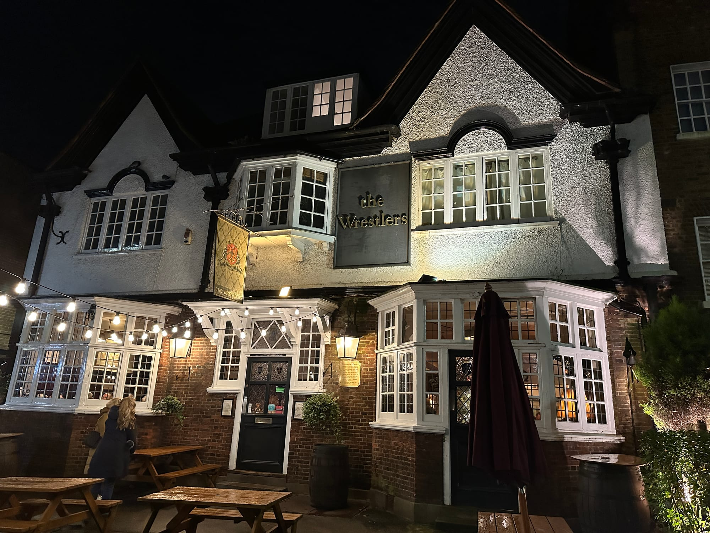
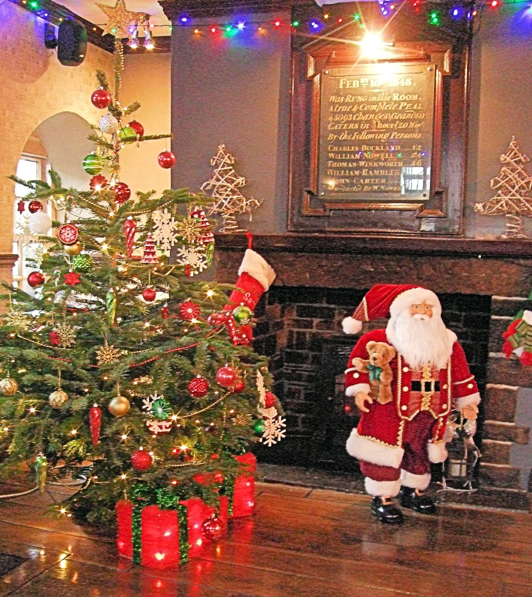
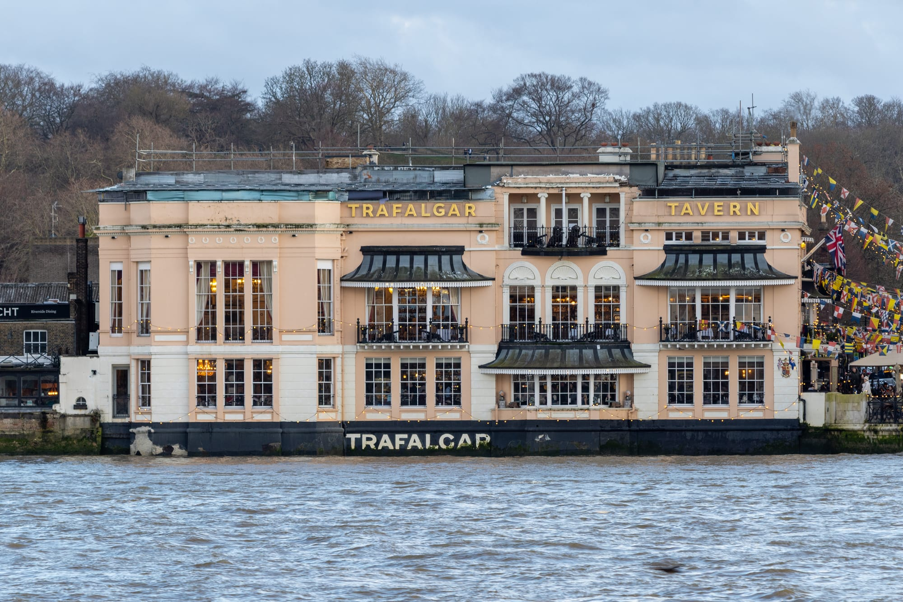

> 💡 **The Short Version:** For decorations, go to [the Churchill Arms](#the-churchill-arms-kensington) in Kensington, its front covered in Christmas trees and lights since 12 November 2026; it takes no bookings over Christmas. In the West End, [the Salisbury](#the-salisbury-covent-garden) and [Mr Fogg's Tavern](#mr-foggs-tavern-covent-garden) are both dressed for December, and [the George](#the-george-southwark) in Southwark puts a tree in London's last galleried coaching-inn yard. For a fire and an old room, head for Hampstead and Highgate: [the Holly Bush](#the-holly-bush), [the Spaniards Inn](#the-spaniards-inn), [the Flask](#the-flask) and [the Wrestlers](#the-wrestlers). Christmas Day lunch in these pubs runs from **£76.95 to £225 a head** and must be booked.

*Prices, menus and opening times are each pub's own for Christmas 2026, as at 19 November 2026.*

## Where they are

| Pub | Area | Christmas 2026 |
| --- | --- | --- |
| **[Churchill Arms](#the-churchill-arms-kensington)** | Kensington | No bookings over Christmas |
| **[Salisbury](#the-salisbury-covent-garden)** | Covent Garden | Set menus from £26.45, £5 deposit |
| **[Mr Fogg's Tavern](#mr-foggs-tavern-covent-garden)** | Covent Garden | Keeps tables for walk-ins |
| **[The George](#the-george-southwark)** | Southwark | £76.95, £10 deposit |
| **[Horniman at Hays](#the-horniman-at-hays-london-bridge)** | London Bridge | Opens 9am daily |
| **[Oyster Shed](#the-oyster-shed-city-of-london)** | City, by the river | £90, 11am to 5pm |
| **[Ye Olde Cheshire Cheese](#ye-olde-cheshire-cheese-fleet-street)** | Fleet Street | Walk-in, cash preferred |
| **[Cadogan Arms](#the-cadogan-arms-chelsea)** | Chelsea | £205 or £225, by email |
| **[The Mayflower](#the-mayflower-rotherhithe)** | Rotherhithe | Bookable inside; jetty walk-in |
| **[The Gun](#the-gun-docklands)** | Docklands | £150 |
| **[Holly Bush](#the-holly-bush)** | Hampstead | £150 |
| **[Spaniards Inn](#the-spaniards-inn)** | Hampstead Heath | Open every day; book Sundays |
| **[The Flask](#the-flask)** | Highgate | £120 |
| **[The Wrestlers](#the-wrestlers)** | Highgate | Festive bookings by enquiry form |
| **[White Cross](#the-white-cross)** | Richmond | £95, 11am to 6pm |
| **[Lass O' Richmond Hill](#the-lass-o-richmond-hill)** | Richmond | £100 |
| **[London Apprentice](#the-london-apprentice-isleworth)** | Isleworth | £81.95, £10 deposit |
| **[Trafalgar Tavern](#the-trafalgar-tavern)** | Greenwich | £125 |
| **[Royal Forest](#the-royal-forest-chingford)** | Chingford, Epping Forest | £115, £75 deposit |

---

## The decorated pubs

These are the pubs that dress the building itself: trees on the façade, garlands over the bar, a switch-on night.

### The Churchill Arms, Kensington

*119 Kensington Church Street, W8 7LN · Notting Hill Gate*

**In December the front disappears under dozens of Christmas trees and tens of thousands of lights**, on the same façade that carries hanging baskets in summer. The 2026 lights went on at **6pm on 12 November**. Inside, the ceiling is hung with copper pots, tankards and wartime memorabilia.

*The bar at the Churchill Arms in November. Photo: [Matt Brown](https://commons.wikimedia.org/wiki/File:Inside_the_Churchill_Arms_2024-11-13.jpg), [CC BY 2.0](https://creativecommons.org/licenses/by/2.0/), via Wikimedia Commons.*

**Order the Thai food.** The pub has run a Thai kitchen since 1989; pad Thai and the curries are £14, roast duck curry £16, and the restaurant adds 12.5% service.

**No bookings over Christmas.** The pub's [Christmas page](https://www.churchillarmskensington.co.uk/christmas) says bar tables are first come, first served and the restaurant is walk-in only. The crowd on the pavement is there all evening; for a photograph of the front without it, go in daylight early in the day. The [Kensington guide](/articles/kensington-area-guide/) and the [Notting Hill guide](/articles/notting-hill-area-guide/) cover the streets around it.

*The Letters to Santa postbox by the Churchill Arms' door. Photo: [Matt Brown](https://commons.wikimedia.org/wiki/File:Letters_to_Santa_Churchill_Arms_2024-11-13.jpg), [CC BY 2.0](https://creativecommons.org/licenses/by/2.0/), via Wikimedia Commons.*

### The Salisbury, Covent Garden

*90 St Martin's Lane, WC2N 4AP · Leicester Square*

**A pub of 1899 with etched mirrors, a horseshoe-shaped bar and art nouveau lamps**, two minutes from Leicester Square station. Greene King, which runs it, switched on its Christmas lights on **14 November 2026**, and St Martin's Lane outside has its own string of street lights for December.

**Order the Festive Fayre set menu**: two courses £26.45, three £31.45, with a £5 deposit. Its [Christmas page](https://www.greeneking.co.uk/pubs/greater-london/salisbury/christmas) has the menus and the Christmas Day booking. Our [most beautiful pubs guide](/articles/most-beautiful-pubs-london/) has more on the interior.

### Mr Fogg's Tavern, Covent Garden

*58 St Martin's Lane, WC2N 4EA · Leicester Square*

**A Victorian-themed pub with walls and ceilings crowded with memorabilia**, which in December adds wreaths, garlands and baubles inside and pine boughs and lights round the door. The Christmas list runs to festive punches and mulled wine, and the pub holds a **cockney singalong at the piano** every Monday from 7pm to 9pm until 21 December.

**It keeps some tables for walk-ins**; to be sure of one in December, [book on SevenRooms](https://www.sevenrooms.com/explore/mrfoggscollection/reservations/create/search?venues=mrfoggstavern). It is the last stop on our [Christmas walk from London Bridge](/articles/christmas-walk-london/), five minutes from the Salisbury.

### The George, Southwark

*75–77 Borough High Street, SE1 1NH · London Bridge or Borough*

**London's last galleried coaching inn**, rebuilt after the Southwark fire of 1676 and owned by the National Trust. For Christmas a tree goes up in the cobbled yard under the galleries; Greene King launched its decorations on 14 November 2026 with choirs and snow machines.

**Christmas Day is £76.95 for three courses**, £37.95 for children, with a £10 deposit each. The Festive Fayre menu is £26.45 or £31.45 for two or three courses. The yard is walk-in only; tables inside can be booked. Menus are on [the George's Christmas page](https://www.greeneking.co.uk/pubs/greater-london/george-southwark/christmas); the inn is stop 2 on our [Bankside and Borough walk](/articles/bankside-borough-walk/).

### The Horniman at Hays, London Bridge

*Hay's Galleria, Tooley Street · London Bridge*

**A Nicholson's pub inside Hay's Galleria, hung with baubles, garlands and lights for December**, on the site of a tea dealer's warehouse, with a central staircase, marble counters and an antique wall clock. Winter by the River, the Christmas market at London Bridge City, sets up its stalls outside.

**It opens at 9am every day**, two hours before the market, which makes it the breakfast stop on the [Christmas walk](/articles/christmas-walk-london/). It takes [bookings](https://www.nicholsonspubs.co.uk/restaurants/london/thehornimanathayslondonbridge/bookings).

### The Oyster Shed, City of London

*1 Angel Lane, EC4R 3AB, on Hanseatic Walk · Monument*

**A Young's pub on the Thames between London Bridge and Cannon Street**, looking across to the Shard, with a dog-friendly garden. In November 2025 its door was framed by an arch of red and gold baubles.

*The bauble arch over the Oyster Shed's door. Photo: [Acabashi](https://commons.wikimedia.org/wiki/File:The_Oyster_Shed_Hanseatic_Walk_festive_Christmas_archway_entrance_River_Thames_City_of_London_England.jpg), [CC BY-SA 4.0](https://creativecommons.org/licenses/by-sa/4.0/), via Wikimedia Commons.*

**Christmas Day is £90 a head, 11am to 5pm**; the three-course Christmas Feast is £62. On Christmas Eve and Boxing Day it also closes at 5pm. Details are on [its Christmas page](https://www.oystershed.co.uk/christmas).

---

## Fires and old rooms in central London

### Ye Olde Cheshire Cheese, Fleet Street

*145 Fleet Street, EC4A 2BU · Blackfriars or City Thameslink*

**Rebuilt in 1667 after the Great Fire, with an open fire lit in winter.** It is a warren of dark panelled rooms and cellars down an alley off Fleet Street, with sawdust on some floors.

**Order the chophouse food**: steak and kidney pudding, pies, a Sunday roast. It is a Samuel Smith's pub: cheap drink, **cash preferred, no music and no phones**. Walk-in; when the front bar is full there is usually a room free in the cellars. Its history is in our [historic pubs guide](/articles/historic-pubs-dining-rooms-london/).

### The Cadogan Arms, Chelsea

*298 King's Road, SW3 5UG · Sloane Square, then a bus*

**A King's Road pub on a site that has held an inn since the 1600s**, with wood panelling, chandeliers and velvet armchairs by the fireplace. A table for ten sits by that fire, and the festive menus run from 16 November.

**Christmas Day is the most expensive in this guide**: £205 or £225 a head, served family style to share, with turkey crown, confit turkey leg and striploin of beef and a glass of fizz on arrival. Christmas Day tables are by email request only, through [its festive page](https://thecadoganarms.london/festive/). See the [Chelsea guide](/articles/chelsea-area-guide/) for the rest of the King's Road.

### The Mayflower, Rotherhithe

*117 Rotherhithe Street, SE16 4NF · Rotherhithe Overground*

**A riverside pub with an open fire, low beams and a candlelit upstairs restaurant**, beside the steps where the Pilgrims' ship sailed in 1620; the mooring point is visible at low tide. It holds candlelit evenings on Sundays.

**It takes bookings for the ground floor and the upstairs restaurant; the jetty over the Thames is walk-in only.** Christmas menus are on [the pub's site](https://www.mayflowerpub.co.uk/).

### The Gun, Docklands

*27 Coldharbour, E14 9NS · Canary Wharf*

**A Grade II-listed riverside pub with a fire, a terrace on the Thames and a back room hung with old muskets.** The view across the river is the O2.

*The gun room at The Gun, Coldharbour. Photo: [Mikethet](https://commons.wikimedia.org/wiki/File:Gun_Room_at_The_Gun.jpg), [CC BY-SA 4.0](https://creativecommons.org/licenses/by-sa/4.0/), via Wikimedia Commons.*

**The Christmas menu is £67 for three courses**; Christmas Day is £150 a head with a glass of English sparkling wine and canapés. Menus are on [its Christmas page](https://www.thegundocklands.com/christmas). It is in the [Canary Wharf guide](/articles/canary-wharf-area-guide/).

---

## Hampstead and Highgate

Four old pubs with fires, two in Hampstead and two in Highgate, on either side of Hampstead Heath. Our [Hampstead Heath and Primrose Hill walk](/articles/hampstead-heath-primrose-hill-walk/) and the [Hampstead guide](/articles/hampstead-area-guide/) cover the Heath between them.

### The Holly Bush

*22 Hollymount, NW3 6SG · Hampstead*

**Up a cobbled lane off Heath Street, with dark wood panelling, booths and two wood and coal fires**, and the day's weather chalked on a blackboard. A Fuller's pub.

**The Christmas menu is £62 for three courses** (beetroot-cured salmon, then turkey or venison); Christmas Day is **£150 a head**, starting with a glass of Laurent-Perrier and canapés. It takes table bookings online, and the menus are on [its Christmas page](https://www.hollybushhampstead.co.uk/christmas); book ahead for a December weekend.

### The Spaniards Inn

*Spaniards Road, NW3 7JJ · Hampstead, then a 25-minute walk or a bus*

**A brick and weatherboarded inn on the northern edge of the Heath that claims 1585**, with the old toll house opposite still narrowing the road to one lane. Wood-panelled rooms upstairs and a log fire.

**Order the Sunday roast, and book for it.** It is open every day: from noon on Monday, 10am Tuesday to Saturday and 11.30am on Sunday. The [Spaniards' own site](https://www.thespaniardshampstead.co.uk/) has its Christmas menus.

### The Flask

*77 Highgate West Hill, N6 6BU · Highgate or Archway*

**A 17th-century Highgate pub with its fireplaces and candles lit in the colder months**, at the top of Highgate West Hill.

*The Flask on a December evening. Photo: [Matt Brown](https://commons.wikimedia.org/wiki/File:The_Flask,_Highgate_2023-12-14.jpg), [CC BY 2.0](https://creativecommons.org/licenses/by/2.0/), via Wikimedia Commons.*

**The Christmas menu is £45.95 for two courses or £49.95 for three**, with a Christmas G&T for £7.50; Christmas Day is **£120** with a glass of English sparkling wine. A table request goes in as an enquiry and is confirmed by the pub, not instantly. See [its Christmas page](https://www.theflaskhighgate.com/christmas).

### The Wrestlers

*98 North Road, N6 4AA · Highgate, a 10-minute walk*

**On this site since 1547, by its own account, with its original fireplace, stained glass and wooden furniture**, and run by the same owners since 1997. It is two minutes from Highgate village and a few minutes' walk from the Flask.

*The Wrestlers on North Road. Photo: [Matt Brown](https://commons.wikimedia.org/wiki/File:The_Wrestlers,_Highgate_2023-12-14.jpg), [CC BY 2.0](https://creativecommons.org/licenses/by/2.0/), via Wikimedia Commons.*

**Order the Sunday roast** or a burger. Festive bookings go through the [enquiry form on its site](https://thewrestlershighgate.com/book-a-table/).

---

## Richmond and Isleworth

### The White Cross

*Riverside, off Water Lane, TW9 1TH · Richmond*

**A Young's pub on the Richmond riverside, rebuilt in 1780, with a coal fire**, where the Thames comes over the road at the highest tides; there are tide tables on the wall and wellingtons by the door.

**Mulled red wine is £9.** The Festive Feast is three courses for £42; Christmas Day is **£95 a head**, with a main of turkey, gammon and duck breast, and the pub is open 11am to 6pm that day. Menus are on [its Christmas page](https://www.thewhitecrossrichmond.com/christmas); check the tide table before you plan to leave.

### The Lass O' Richmond Hill

*8 Queens Road, TW10 6JJ · Richmond, then a 20-minute walk uphill*

**A Young's pub at the top of Richmond Hill with roaring fires**, a few minutes from the gates of Richmond Park, so it is the warm-up after a walk to see the deer.

**Mulled red wine is £10.** The festive menu is three courses for £50, and Christmas Day is **£100 a head**. Menus are on [its Christmas page](https://www.lassorichmondhill.co.uk/christmas). Our [Richmond guide](/articles/richmond-area-guide/) and [Richmond Park deer guide](/articles/richmond-park-deer/) cover the walk.

### The London Apprentice, Isleworth

*62 Church Street, TW7 6BG · Isleworth, or a walk through Syon Park*

**Built by the Isleworth Brewery in 1731, on a bend of the Thames**, a Grade II-listed Georgian pub with a Riverview Room looking onto the water.

*Christmas by the fireplace at the London Apprentice. Photo: [Jim Linwood](https://commons.wikimedia.org/wiki/File:Christmas_In_The_London_Apprentice_Pub_In_Isleworth_-_London.jpg), [CC BY 2.0](https://creativecommons.org/licenses/by/2.0/), via Wikimedia Commons.*

**Christmas Day is £81.95 for three courses**, £38.95 for children, with a £10 deposit each. Turkey comes with pigs in blankets, a Yorkshire pudding and cauliflower cheese. The menu is on [its Christmas Day page](https://www.greeneking.co.uk/pubs/middlesex/london-apprentice/christmas/christmas-day). It is a short walk from Syon Park, which faces [Kew Gardens](/articles/kew-gardens-guide/) across the Thames.

---

## Greenwich

### The Trafalgar Tavern

*Park Row, SE10 9NW · Cutty Sark DLR*

**Opened in 1837 on the river beside the Old Royal Naval College**, closed in 1915 and reopened in 1965, when craftsmen from Pinewood Studios fitted out its rooms. The walls are hung with naval paintings and artefacts, and the windows look straight onto the Thames.

*The Trafalgar Tavern from the Thames. Photo: [The wub](https://commons.wikimedia.org/wiki/File:Trafalgar_Tavern,_Greenwich_2026-01-24.jpg), [CC BY-SA 4.0](https://creativecommons.org/licenses/by-sa/4.0/), via Wikimedia Commons.*

**The festive menu is £42 for two courses or £50 for three, Monday to Saturday only**; the Nile restaurant's festive menu is not served on Sundays. Christmas Day is **£125 a head**, with free-range turkey or 30-day rib of beef. Menus are on [its Christmas page](https://www.trafalgartavern.co.uk/christmas-festive-dining-in-greenwich/). Greenwich Market, dressed for December, is five minutes inland; the [Greenwich guide](/articles/greenwich-area-guide/) has the rest.

---

## Chingford and Epping Forest

### The Royal Forest, Chingford

*4 Rangers Road, E4 7QH · Chingford*

**Opened in 1880 as the Forest Hotel and renamed after a visit from Queen Victoria**, it stands on the edge of Epping Forest, a few minutes from Queen Elizabeth's 16th-century Hunting Lodge. Heartwood Inns reopened it in December 2024 with a library, a forest room looking over the trees, and bedrooms.

**The Christmas party menu runs from 26 November to 24 December**: £34 for two courses, £43.50 for three. Christmas Day is five courses for **£115**, with a Buck's Fizz, served 12pm to 8.30pm; it needs a **£75 deposit a head and a pre-order by 1 December**. Menus are on [its Christmas page](https://royalforesteppingforest.com/christmas/). Chingford station is about a 15-minute walk.

---

## When to go

- **From mid-November.** The Churchill Arms lit up on 12 November 2026; the Salisbury and the George on 14 November.
- **Early in the day for the Churchill Arms.** It takes no bookings over Christmas, so tables go to whoever is there first.
- **Book the fireside pubs for December weekends.** The Holly Bush, the Flask, the White Cross and the Lass all take table bookings for their Christmas menus.
- **Christmas Day means a booked lunch.** Every pub in this guide that publishes a Christmas Day menu sells it as a set menu, from £76.95 at the George to £225 at the Cadogan Arms, and most take a deposit. For restaurants instead, see [Christmas Day restaurants in London](/articles/christmas-day-restaurants-london/).

## Make a day of it

- **[Christmas in London](/articles/christmas-in-london/)** — the markets, lights, ice rinks, shows and carols.
- **[Christmas markets in London](/articles/christmas-markets-london/)** — every market's 2026 dates and hours, including Greenwich and Kingston.
- **[The Christmas walk](/articles/christmas-walk-london/)** — London Bridge to Covent Garden through the markets, starting at the Horniman and ending at Mr Fogg's.
- **[The Christmas lights walk](/articles/christmas-lights-walk-london/)** — Oxford Street to Trafalgar Square after dark, a few minutes from the Salisbury.
- **[The most beautiful pubs in London](/articles/most-beautiful-pubs-london/)** — the gin palaces and the flower-covered fronts, all year.
- **[Historic pubs and dining rooms](/articles/historic-pubs-dining-rooms-london/)** — the coaching inns, chophouses and riverside taverns behind several of these.
