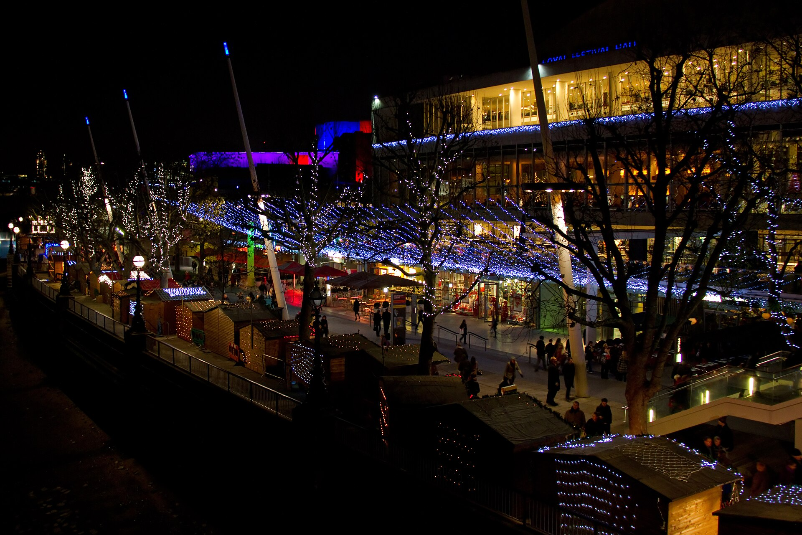

**Four of central London's Christmas markets are a walk apart, from London Bridge along the river to Leicester Square**: Winter by the River, the Southbank Centre's chalets, Trafalgar Square and Leicester Square. Borough Market, Southwark Cathedral, the Globe and St Martin-in-the-Fields are on the same line, and so are two pubs that dress up for December.

This is the daytime companion to our [Christmas lights walk](/articles/christmas-lights-walk-london/), which covers Oxford Street, Regent Street, Carnaby and Bond Street after dark. This one starts at 11am by the river and reaches Trafalgar Square as the light goes.

It is **about 5.5km and 75 minutes of walking**. With lunch, the markets and a drink, it takes most of a day.

> 💡 **The Short Version:** Walk it **between Thursday 3 December**, when the Trafalgar Square tree is lit, **and Wednesday 23 December**. Start at **Hay's Galleria at 11am**, eat at **Borough Market** by 1pm, reach the **Southbank Centre Winter Market** mid-afternoon (**cash-free**) and cross the river at dusk, about 3.45pm. Before **30 November**, Borough Market is **shut on Mondays**. For the evening, book **[Carols by Candlelight](https://www.stmartin-in-the-fields.org/whats-on/carols-by-candlelight/) at St Martin-in-the-Fields** (from £10, 7.30pm on 1, 6, 12, 13 and 16 December), four minutes from the last stop. Every market on the route is shut on **Christmas Day**.

## The route

  

    Map of the walk, numbered in walking order
  

  

    
Loading the map…

  

  

    <i class="route-map-marker" aria-hidden="true">1</i> On the route, in walking order
  

  <noscript>
    
The map needs JavaScript. Every stop below is numbered in walking order with its nearest station.

  </noscript>

**[Open the whole route in Google Maps →](https://www.google.com/maps/dir/?api=1&origin=51.505724,-0.083706&destination=51.510979,-0.126837&waypoints=51.506129,-0.089625%7C51.505526,-0.090438%7C51.508121,-0.097186%7C51.5059,-0.1192%7C51.50845,-0.12845%7C51.508828,-0.126677%7C51.509965,-0.130262%7C51.511979,-0.122741&travelmode=walking)** — all ten stops in walking order, set to walking directions.

| # | Stop | Cost | Open |
| --- | --- | --- | --- |
| **1** | Winter by the River | Free | 10 Nov – 3 Jan, 11am–10pm; closed Christmas Day |
| **2** | Southwark Cathedral | Free | Mon–Sat 9am–6pm, Sun 8.30am–5pm |
| **3** | Borough Market | Free | **Closed Mondays until 30 November**; daily from then, 10am–5pm (Sat 9am, Sun to 4pm) |
| **4** | Shakespeare's Globe | Pinocchio from £5 | 28 Nov – 3 Jan |
| **5** | Southbank Centre Winter Market | Free; cash-free | To 2 Jan; stalls 11am–10pm, bars to 11pm |
| **6** | Trafalgar Square | Free | Tree lit **Thu 3 December** |
| **7** | St Martin-in-the-Fields | Concerts from £10 | Carol concerts from 1 to 23 December |
| **8** | Leicester Square | Free; skating from £10 | 31 Oct – 3 Jan; closed Christmas Day |
| **9** | Covent Garden | Free | Lights on since 12 November |
| **10** | Mr Fogg's Tavern | Free to walk in | From noon daily (11am Fri and Sat) |

---

## 1. Winter by the River and Hay's Galleria

From London Bridge station, walk down to the river through **Hay's Galleria**, the old Hay's Wharf dock, roofed over in glass and facing the Thames.

**[Winter by the River](https://www.londonbridgecity.co.uk/events/2026/november/winter-by-the-river-2026)** sets out rows of market stalls along the London Bridge City riverside: crafts, gifts, food and "gifts for good" from social enterprises. It has been open since Tuesday 10 November and runs to **Sunday 3 January 2027**, **11am to 10pm** daily, closing at 5pm on Christmas Eve and 3 January and at 9pm on New Year's Eve, and is **closed on Christmas Day**. It is free to walk through. Two pop-up bars come with it: **The Clubhouse**, two storeys with a heated rooftop under a canopy and a balcony over the river, and a glass-walled curling venue on London Bridge City Pier, with six lanes round a central bar; the curling is paid.

**[The Horniman at Hays](https://www.nicholsonspubs.co.uk/restaurants/london/thehornimanathayslondonbridge)** is the Nicholson's pub inside the Galleria, built on the site of a tea dealer's warehouse, with a central staircase, marble counters and an antique wall clock. It is hung with baubles, garlands and lights for December, and it opens at **9am every day**, two hours before the stalls: a breakfast stop if you arrive early. It takes [bookings](https://www.nicholsonspubs.co.uk/restaurants/london/thehornimanathayslondonbridge/bookings).

Walk west along the river path, under London Bridge, to the cathedral. About seven minutes.

## 2. Southwark Cathedral

A thousand years of building beside the market, and **free to walk in**: Monday to Saturday 9am to 6pm, Sunday 8.30am to 5pm. Services restrict where you can go, so on Sundays come between 12.30pm and 3pm.

**Its Christmas programme** is on the [cathedral's Advent and Christmas page](https://cathedral.southwark.anglican.org/visiting/advent-and-christmas/). The ones a visitor can book:

- **Handel's Messiah**, sung by the Cathedral Choir: **Sunday 13 December**, 6pm to 8.30pm, tickets **from £10**.
- **The Southwark Cathedral Christmas Concert**, festive music and readings with guests: **Friday 18 December**, 7.30pm to 9pm, **from £25**.
- **Community Carols and Sing In**: **Thursday 17 December**, 12.45pm to 1.45pm, free with a ticket. It falls in the middle of this walk's day.

The cathedral's own carol services on 20 and 21 December are sold out. The crib service on Christmas Eve at 4pm needs no ticket.

Borough Market is across Cathedral Street.

## 3. Borough Market

**Cheesemongers, butchers, bakers and hot-food stalls under a Victorian iron roof**, and this walk's lunch stop. Its [festive hours](https://boroughmarket.org.uk/events/bank-holiday-opening-times/):

- **Seven days a week from Monday 30 November**: Monday to Friday 10am to 5pm, Saturday 9am to 5pm, Sunday 10am to 4pm.
- **Wednesday 23 December** to 6pm; **Christmas Eve** 8am to 3pm; **closed 25, 26 and 27 December**; **31 December** 10am to 3pm; **closed New Year's Day**.

> ⚠️ **Before 30 November, Borough Market is closed on Mondays.** On a Monday walk in November, eat at the Southbank Centre's market instead.

Saturday from 11am to 2pm is the crush. The stall-by-stall detail is in our [best London markets](/articles/best-london-markets/) guide.

Go north up Cathedral Street to the Golden Hinde, then west along Clink Street past the ruined Winchester Palace to the river at Bankside.

## 4. Bankside and Shakespeare's Globe

About ten minutes from the market. **The Globe stages a Christmas show in its open-air theatre**: **[Pinocchio](https://www.shakespearesglobe.com/whats-on/pinocchio/)**, a musical by Charlie Josephine and Jim Fortune, returning from its 2025 premiere, runs **28 November 2026 to 3 January 2027** for ages five and up. It lasts 2 hours 10 minutes with an interval. **Seats in the galleries are £29 to £89**, including a £3 order fee and a £2 restoration levy; **standing in the yard is £10 or £5**, and under-16s get half-price seats. The theatre is open to the sky, so dress for the weather.

Tate Modern is next door and free. From here the river path runs west under Blackfriars and Waterloo bridges to the Southbank Centre, about 1.8km and 25 minutes, past the OXO Tower and the National Theatre.

Powered by <a target="_blank" rel="sponsored" href="https://www.getyourguide.com/london-l57/">GetYourGuide</a>

## 5. The Southbank Centre Winter Market

*The Southbank Centre's market, in a previous year. Photo: Tony Hisgett, [CC BY 2.0](https://creativecommons.org/licenses/by/2.0/), via [Wikimedia Commons](https://commons.wikimedia.org/wiki/File:Southbank_Christmas_Market_(6481403701).jpg).*

**Alpine-style chalets on the Queen's Walk, under Hungerford Bridge**, with street food, bars and craft stalls. It is the food stop if you skipped Borough.

- **Dates:** to **Saturday 2 January 2027**, closed on **Christmas Day, New Year's Eve and New Year's Day** ([Southbank Centre](https://www.southbankcentre.co.uk/whats-on/winter-market/)).
- **Hours:** stalls 11am to 10pm, bars 11am to 11pm.
- **Payment:** **cash-free**. Bring a card or phone.

The stall list, and when it is quietest, are in our [Christmas markets guide](/articles/christmas-markets-london/#southbank-centre-winter-market).

Cross the river on the **Golden Jubilee footbridge**, the walkway alongside Hungerford railway bridge, and go up Villiers Street or Craven Street to Trafalgar Square. About eleven minutes. Time it for dusk: sunset is 3.55pm on 3 December and 3.52pm in mid-December.

## 6. Trafalgar Square

**The tree is lit on Thursday 3 December 2026.** It is a Norway spruce sent from Oslo, dressed only in vertical strings of white lights. From the lighting until Christmas Eve, charity choirs sing carols under it on most evenings, free to stand and listen. A single row of market chalets stands on the North Terrace in front of the National Gallery, opening in November and trading into early January.

This is where our [Christmas lights walk](/articles/christmas-lights-walk-london/#10-trafalgar-square) ends. Walk it another evening, or start it from here in reverse.

> ⚠️ **Before 3 December there is no tree to see.** The chalets and St Martin's are still worth the stop.

## 7. St Martin-in-the-Fields

The church on the north-east corner of the square holds **candlelit carol concerts through December**, sung by the church's choir, St Martin's Voices, the evening ones with St Martin's Strings. All are on the [Christmas concerts page](https://www.stmartin-in-the-fields.org/christmas-concerts-and-services/); the three that fit a day on this route:

| Concert | Length | Tickets | Dates |
| --- | --- | --- | --- |
| **[Carols by Candlelight](https://www.stmartin-in-the-fields.org/whats-on/carols-by-candlelight/)** | 2 hours with an interval | £10 to £39.50 | 7.30pm on Tue 1, Sun 6, Sat 12, Sun 13 and Wed 16 December |
| **[A Trafalgar Square Christmas](https://www.stmartin-in-the-fields.org/whats-on/a-trafalgar-square-christmas/)** | 2 hours | £10 to £39.50 | 7.30pm on Thu 3 December, the night the tree is lit |
| **[Festive Family Carols](https://www.stmartin-in-the-fields.org/whats-on/festive-family-carols/)** | 1 hour, no interval | £10, £19 or £27.50 | Sat 5 Dec at 11am and 1pm; Sat 19 Dec at 11am and 1pm; Sun 20 Dec at 2pm; Mon 21, Tue 22 and Wed 23 Dec at 11am. Jingle Bells and Rudolph alongside the carols |

The evening concerts are the reason to end the walk near here: finish at the pub at stop 10 and walk back for 7.30pm.

**Two free things at the church:** the **SoLo Craft Fair**'s Christmas market on **Saturday 21, Sunday 22, Saturday 28 and Sunday 29 November**, 11am to 5pm, and the **Blessing of the Crib** in Trafalgar Square on **Sunday 6 December at 5pm**.

## 8. Leicester Square

Five minutes west, past the National Portrait Gallery and up Charing Cross Road.

**Chalets in the gardens around Skate Leicester Square**, Underbelly's ice rink, from **31 October 2026 to 3 January 2027**, every day except Christmas Day. The square's **star-shaped lights** are on until 6 January. The market is free. [Skating sessions](https://skateleicestersquare.co.uk/tickets/ice-skating/) last 45 minutes and **start at £10**; under-3s are not allowed on the ice, and children under 12 must skate with an adult. Some tickets are kept back for walk-ins each day, and the box office takes cards only.

It is enclosed and crowded in the evenings, which is why this walk passes through in the late afternoon. The rink's hours by date are in our [ice skating guide](/articles/ice-skating-london/#leicester-square).

## 9. Covent Garden

From Leicester Square, take Cranbourn Street across St Martin's Lane into Long Acre, then turn right down James Street into the Piazza. About nine minutes.

**A 50ft tree on the West Piazza** beside St Paul's Church, and **gold bells, mirror balls and baubles** hung inside the Market Building, lit since Thursday 12 November. There is no chalet market: the Apple Market and Jubilee Market Hall trade as they do all year. Every Thursday from 12 November is a Festive Thursday, with late-night shopping and performances, which also makes it the most crowded night.

Our [Christmas lights walk](/articles/christmas-lights-walk-london/#9-covent-garden-the-tree-and-the-market-building) covers the Piazza after dark and the view over it from the Royal Opera House terrace bar.

Leave by King Street and New Row to St Martin's Lane. About five minutes.

## 10. Mr Fogg's Tavern

**[Mr Fogg's Tavern](https://www.mr-foggs.com/mr-foggs-tavern/)**, at 58 St Martin's Lane, is a Victorian-themed pub with walls and ceilings crowded with memorabilia, and in December it adds wreaths, garlands and baubles, with pine boughs and lights round the door. The Christmas menu runs to festive punches and mulled wine; lunch is served daily from noon to 4pm and Sunday roasts from noon to 6.30pm.

- **Hours:** Monday noon to 11.30pm, Tuesday to Thursday noon to 1am, Friday and Saturday 11am to 1am, Sunday noon to 11pm.
- **Cockney singalong:** at the piano every **Monday from 7pm to 9pm until 21 December**, walk-ins and indoor table bookings only.
- **Tables:** it keeps some for walk-ins; to be sure of one in December, [book on SevenRooms](https://www.sevenrooms.com/explore/mrfoggscollection/reservations/create/search?venues=mrfoggstavern).

St Martin-in-the-Fields is four minutes south down St Martin's Lane, and Leicester Square station two minutes west.

---

## Where to eat

- **The Horniman at Hays** (££), stop one: breakfast from 9am, before the stalls open.
- **Borough Market** (£–££), stop three: the hot-food stalls and the Borough Market Kitchen seating at the back.
- **The Southbank Centre Winter Market** (£), stop five: street food from the chalets, card only.

For a sit-down dinner after the walk, see [where to eat in Covent Garden](/articles/covent-garden-area-guide/#where-to-eat-and-drink); for the river end, the [South Bank guide](/articles/south-bank-area-guide/).

## The best day to go

**The window is 3 to 23 December.** Before 3 December the Trafalgar Square tree is not lit, the Globe's Pinocchio starts on 28 November and St Martin's carol concerts from 1 December. From Christmas Eve, hours shorten and closures start.

| Day | What to expect |
| --- | --- |
| **Monday** | Borough Market **closed until 30 November**, open from then. Mr Fogg's piano singalong from 7pm until 21 December |
| **Tuesday to Thursday** | Weekday lunchtimes leave room at the Southbank market's tables. Thursday is Festive Thursday in Covent Garden, the busiest night there |
| **Friday** | Borough is well stocked and calm in the morning; the Southbank market is at its fullest in the evening |
| **Saturday** | Borough opens at 9am, and 11am to 2pm is the crush. Evening carol concerts at St Martin's on 12 December |
| **Sunday** | Borough closes at 4pm, so eat there first. Southwark Cathedral is clearest of services from 12.30pm to 3pm |

**The case for a midweek day.** A Tuesday or Wednesday in mid-December has every stop open and the fewest people at each. **Wednesday 16 December** ends with Carols by Candlelight at St Martin's, and **Thursday 17 December** has the free Community Carols at Southwark Cathedral at 12.45pm: see the cathedral and Borough first, then go back for them.

**Christmas week:**

- **Wednesday 23 December:** Borough Market stays open to 6pm. The last Festive Family Carols at St Martin's are at 11am.
- **Christmas Eve:** Borough Market 8am to 3pm, Winter by the River to 5pm. Start early.
- **Christmas Day:** every market on the route is closed, and there is no Tube and no bus.
- **26 and 27 December:** Borough Market is closed. Winter by the River, the Southbank market and Leicester Square are open.
- **31 December and 1 January:** the Southbank market is closed both days; Borough is open to 3pm on the 31st and closed on the 1st.
- **The last days:** the Southbank market closes on Saturday 2 January, Winter by the River, Leicester Square and Pinocchio on Sunday 3 January.

## Getting there and back

**Start:** London Bridge (Northern and Jubilee lines, National Rail). Hay's Galleria is three minutes north of the station, by the river. **Finish:** Leicester Square station (Northern and Piccadilly) is two minutes from Mr Fogg's; Charing Cross is five.

**To cut it short:** Southwark (Jubilee) or Blackfriars after the Globe, Waterloo or Embankment after the Southbank market. Avoid **Covent Garden station**: it has no escalators, only lifts and a 193-step spiral staircase.

The route is flat. The one climb is the stairs up to the Golden Jubilee footbridge.

Powered by <a target="_blank" rel="sponsored" href="https://www.getyourguide.com/london-l57/">GetYourGuide</a>

## Carry on walking

- **[The Christmas lights walk](/articles/christmas-lights-walk-london/)** — Oxford Street, Bond Street, the Regent Street angels, Carnaby, Seven Dials and the Covent Garden tree, after dark, ending at Trafalgar Square. Walk it on another evening, or in reverse from stop 6.
- **[Covent Garden: Leicester Square to Somerset House](/articles/covent-garden-walk/)** — starts at Leicester Square, stop 8 of this walk, and takes in Seven Dials, Neal's Yard and the Opera House.
- **[Westminster](/articles/westminster-walk/)** — ends at Trafalgar Square; walk it in reverse down Whitehall to Parliament.
- **[Soho and Chinatown](/articles/soho-chinatown-walk/)** — ends on Lisle Street in Chinatown, two minutes from Leicester Square.
- **[Bankside and Borough](/articles/bankside-borough-walk/)** — starts at London Bridge station, where this one does, and takes the inland streets behind stops 2 to 4: the coaching-inn yards, the George, Cross Bones and the Clink.
- **[The South Bank: Westminster to Tower Bridge](/articles/south-bank-walk/)** — the same riverside in daylight, with the landmarks rather than the markets.

## What to do with the rest of the day

- **[Christmas markets in London](/articles/christmas-markets-london/)** — every market's 2026 dates and hours, including Hyde Park Winter Wonderland and King's Cross.
- **[Christmas in London](/articles/christmas-in-london/)** — the ice rinks, light trails, shows and carol services across the city.
- **[Christmas shows in London](/articles/christmas-shows-london/)** — pantomimes and Christmas plays in the West End, around the second half of this walk.
- **[Ice skating in London](/articles/ice-skating-london/)** — Somerset House, ten minutes east of Covent Garden along the Strand, has a rink and a 40ft tree in its courtyard.
- **[Things to do in London in December](/articles/things-to-do-in-london-in-december/)** — the tree lighting, carols, pantos and the Christmas Day closures.
- **[The most beautiful pubs in London](/articles/most-beautiful-pubs-london/)** — including the Churchill Arms in Kensington, with its front covered in Christmas trees.
- **[Where to stay in Covent Garden](/articles/where-to-stay-covent-garden/)** or **[on the South Bank](/articles/where-to-stay-south-bank/)** — to be a few minutes from one end of the walk or the other.
