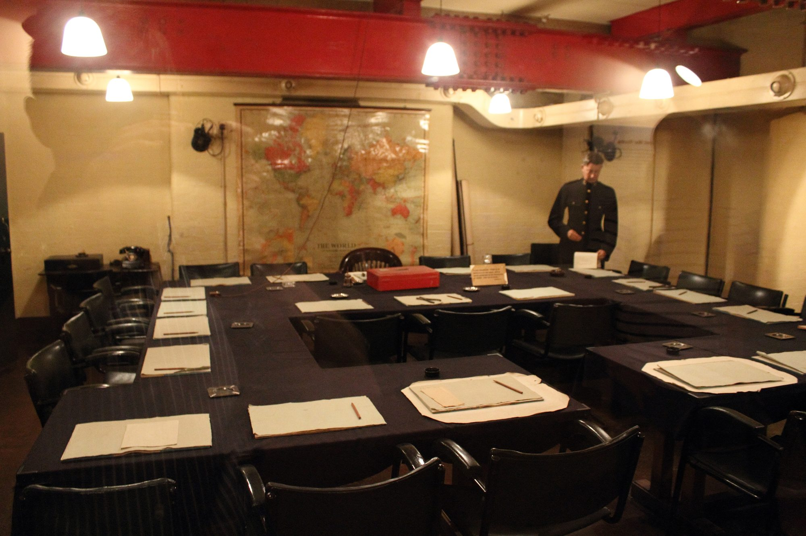
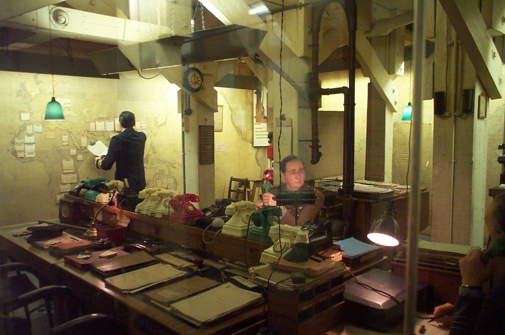
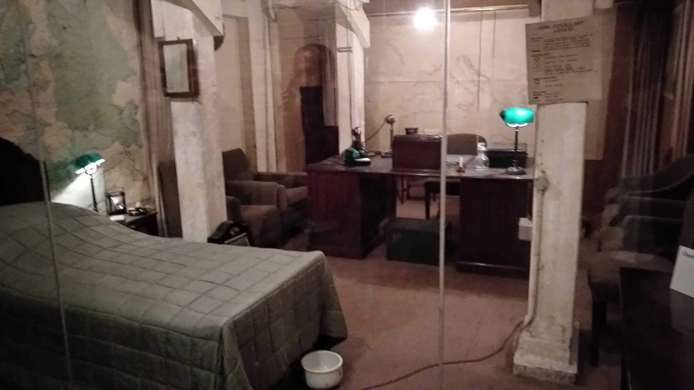
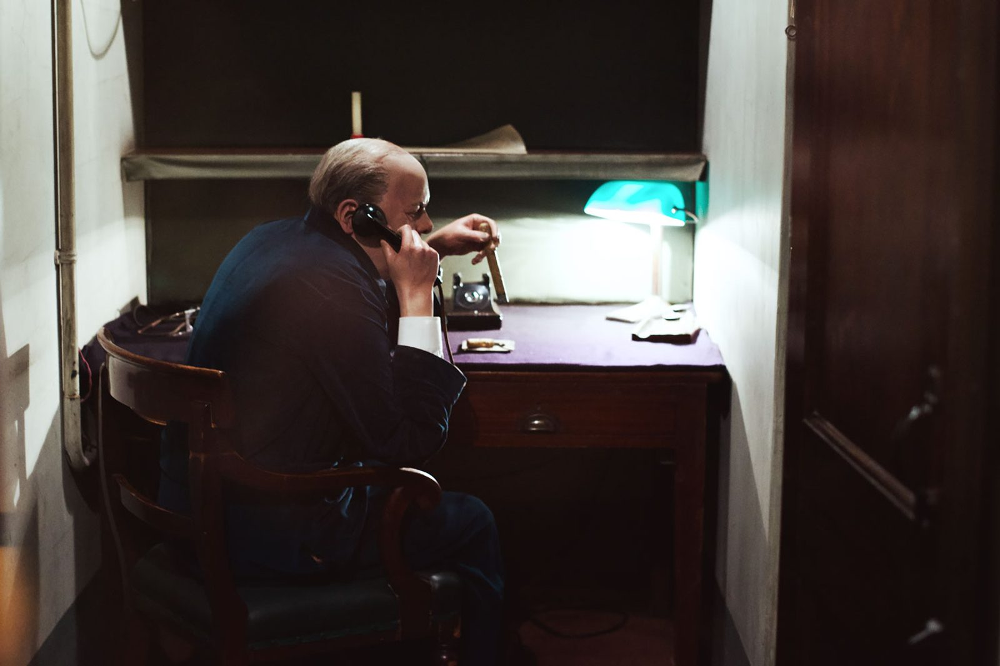
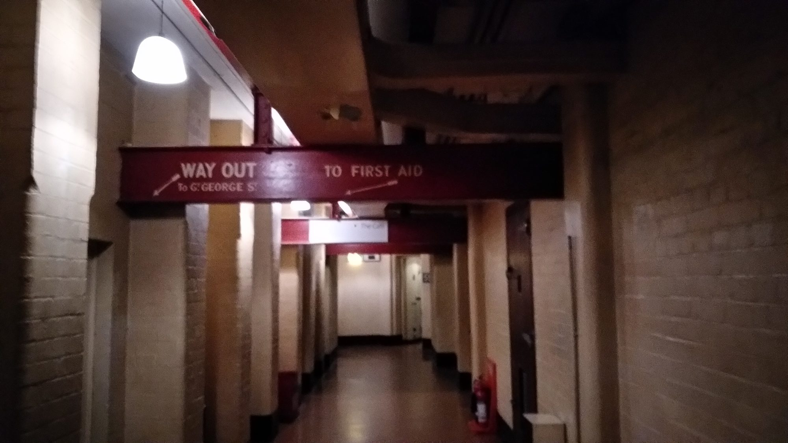

The Cabinet War Rooms, Winston Churchill's underground headquarters, sit 15 steps below Whitehall behind steel doors and a concrete slab up to three metres thick, added in December 1940.

They are largely original. The Map Room was locked on 16 August 1945 and the complex left untouched for decades. Pins still mark convoy positions on the Atlantic wall charts, and pencil stubs sit beside blotters in the Cabinet Room.

> 💡 **The Short Version:** Book a timed-entry slot online before you go — walk-up tickets are not guaranteed. **Adults pay £34, children (5–15) £17, concessions £30.60**, and under-5s and carers go free, one flat price with no donation add-on; **IWM members go free**. Every ticket already includes the **official audio guide**, so skip any third-party "exclusive audio tour". Churchill War Rooms is **not on The London Pass** or Go City. Allow **at least two hours** for the historic rooms and the Churchill Museum.

---

## Tickets and prices

The Churchill War Rooms is run by the **Imperial War Museums (IWM)**. Admission is by timed entry slot, from 9.30am with last entry at 5pm; the museum closes at 6pm.

| Ticket type | Price | Notes |
| --- | ---: | --- |
| Adult (16–64) | £34 | Includes the audio guide. |
| Child (5–15) | £17 | Must be accompanied by an adult. |
| Child (under 5) | Free | Still needs a ticket for headcount. |
| Concession (65+ / student / disabled) | £30.60 | Valid ID required on entry. |
| Carer | Free | One carer per disabled visitor. |
| IWM member | Free | Membership starts at £60 a year; members don't need to pre-book. |
| The London Pass / Go City | Not included | Buy a Churchill War Rooms ticket separately. |

*Prices are IWM's standard admission rates for 2 September 2026 to 31 March 2027.*

### Booking a timed slot

Book directly through IWM, or through GetYourGuide, which sells the same timed-entry admission. Check dates on the calendar below or book a <a href="https://www.getyourguide.com/activity/-t926494?partner_id=WWP7I0R&amp;cmp=churchill-war-rooms-guide" target="_blank" rel="sponsored nofollow noopener" data-affiliate="gyg">Churchill War Rooms ticket on GetYourGuide</a>.

Powered by <a target="_blank" rel="sponsored" href="https://www.getyourguide.com/london-l57/">GetYourGuide</a>

---

## The audio guide is free with admission

Every standard ticket includes IWM's handheld audio guide, in thirteen languages: English, French, Spanish, German, Italian, Hebrew, Russian, Dutch, Polish, Portuguese, Mandarin, Swedish and Ukrainian. It also has a British Sign Language tour option with English captions, and an audio-described version.

Some resale platforms and tour operators sell "Churchill War Rooms with exclusive audio tour" packages, or bundle a Westminster walking tour with admission. The audio handset is the same one every ticket holder gets. For a guided walk of Westminster, book one separately or follow our free [Westminster walking tour](/articles/westminster-walk/), then buy your War Rooms admission on its own.

---

## Inside the bunker: the Cabinet Room, Map Room and Churchill Museum

The site has two connected parts: the preserved **Cabinet War Rooms** and the interactive **Churchill Museum**.

*The Cabinet War Room.*

### 1. The Cabinet Room
Directly past the entrance checkpoint, the Cabinet Room is a hollow square of tables around Churchill's wooden armchair. Ministers sat facing each other on padded armchairs, with the Chiefs of Staff opposite Churchill.

Scratches on the chair arms came from his fingernails and ring during tense briefings. A red ministerial dispatch box sits on the table before him, alongside original inkwells, blotting paper and ashtrays. The War Cabinet met here 115 times between the rooms becoming fully operational on 27 August 1939 and the Map Room going dark on 16 August 1945, most often during the Blitz and the later German V-weapon offensive.

*The Map Room.*

### 2. The Map Room
The Map Room was staffed around the clock by officers of the Royal Navy, British Army and Royal Air Force.

Key details to examine:
- **The Global Convoy Map:** The map on the main wall tracks merchant shipping convoys and U-boat concentrations across the North Atlantic, with pinholes marking daily movements.
- **The Colour-Coded Telephones:** On the central desk divider sits a row of rotary telephones. The green handset connected directly to No. 10 Downing Street; the red phone linked directly to the War Office, Admiralty, and Air Ministry; and the white handsets routed through military command switchboards.
- **The External Weather Indicator:** A small wooden board shows the weather outside ("Sunny", "Rain", "Fog") for staff who spent long hours below ground without daylight.

*Churchill's underground bedroom.*

### 3. Churchill's bedroom and desk (Room 64)
Room 64 was Churchill's underground bedroom and study. It contains a single bed with a plain quilt, a chamber pot, an executive writing desk, and a large map of the United Kingdom marked with coastal defence sectors.

He slept here only three times during the war, preferring his bed at 10 Downing Street or the reinforced No. 10 Annex on the ground floor of the Treasury building. He used the desk constantly, for afternoon naps, private briefings and wartime speeches. On it sits the BBC microphone from which he delivered four nationwide radio addresses.

*The Transatlantic Telephone Room.*

### 4. The Transatlantic Telephone Room (Room 60)
Room 60 is a cupboard made to look like a toilet, for Churchill's use only. Its existence was kept secret even from most of the people who worked in the bunker.

Inside sat a secure telephone extension to President Franklin D. Roosevelt in the White House, encrypted using **SIGSALY**, originally codenamed "Project X", a voice-scrambling system built by Bell Telephone Laboratories. The main terminal serving Britain sat in the sub-sub-basement of Selfridges on Oxford Street from July 1943, with extensions to the US Embassy, Number 10 Downing Street and this cupboard. Churchill and Roosevelt first spoke over the link in April 1944.

### 5. The Churchill Museum
The **Churchill Museum** opened in 2005 and covers roughly half the site. It occupies a wide central hall rather than the narrow corridors of the bunker, and its centrepiece is an interactive digital timeline of Churchill's 90-year life.

Exhibits include:
- The velvet "siren suits" Churchill designed for quick dressing during night raids.
- Original wartime correspondence with Franklin D. Roosevelt and Joseph Stalin.
- Personal painting supplies and original oil landscapes created during his later years.

---

Powered by <a target="_blank" rel="sponsored" href="https://www.getyourguide.com/london-l57/">GetYourGuide</a>

## When to visit, and how long to allow

IWM says the quietest time is the afternoon, after 3pm, though school and tour groups can fill the site at any time of day. The route runs one way through the bunker rooms first, then ends in the Churchill Museum. Allow at least two hours with the audio guide.

---

## Practical information and getting there

- **Where:** Clive Steps, King Charles Street, SW1A 2AQ.
- **Open:** 9.30am to 6pm daily, last entry 5pm.
- **Closed:** 24, 25 and 26 December.
- **Luggage:** no cloakroom, lockers or pram parking, and suitcases, wheeled luggage and large holdalls are not admitted. The nearest suitcase storage is Charing Cross station.
- **Audio guide:** included in admission.

### Getting there by public transport
- **Underground:**
  - **Westminster station** (Jubilee, District, Circle lines) is a 6-minute walk (0.3 miles) west along Great George Street and Horse Guards Road.
  - **St James's Park station** (District, Circle lines) is a 7-minute walk (0.35 miles) north-east via Dartmouth Street and Birdcage Walk.
- **Rail:** Charing Cross and Victoria are the nearest National Rail stations.
- **Buses:** Routes 3, 11, 12, 24, 87, 88, 159 and 453 serve the area.
- **On foot:** The entrance is halfway down Clive Steps, which connect the west end of King Charles Street to Horse Guards Road on the edge of St James's Park.

### Accessibility
- Churchill War Rooms is wheelchair accessible, with two pinch points on the route: the narrowest point is 68cm wide and the tightest corner turns 90 degrees. A lift carries visitors between street level and the bunker. Staff cannot push a visitor's wheelchair, so wheelchair users need to be self-propelled or supported by someone in their party.
- IWM lends manual wheelchairs free of charge, but they must be booked in advance on its wheelchair reservation page — they are not available on arrival.
- The audio guide carries an audio-described version and a British Sign Language tour option with English captions; large-print transcripts are available at the audio guide desk.

---

Powered by <a target="_blank" rel="sponsored" href="https://www.getyourguide.com/london-l57/">GetYourGuide</a>

## Continue planning your London trip

- 🏛️ **[Westminster Area Guide](/articles/westminster-area-guide/)** — Westminster Abbey, the Houses of Parliament, and historic pubs in SW1.
- 🚶 **[Westminster Walking Tour](/articles/westminster-walk/)** — step-by-step 4km route connecting the War Rooms with St James's Park and Whitehall.
- 🖼️ **[Best Museums in London](/articles/best-museums-london/)** — 17 compared, most of them free.
- 🎟️ **[The London Pass Guide](/articles/london-pass-guide/)** — which London attractions are included and how to calculate whether the pass pays off.
- 💷 **[London on a Budget](/articles/london-on-a-budget/)** — money-saving booking rules and free museums across Central London.
- 🚇 **[Getting Around London: Transport Guide](/articles/getting-around-london-transport-guide/)** — Tube fares, contactless payments, and bus navigation.
- ♿ **[Step-Free London](/articles/step-free-london/)** — the lift into the bunker, the 68cm pinch point, and step-free routes across the city.
