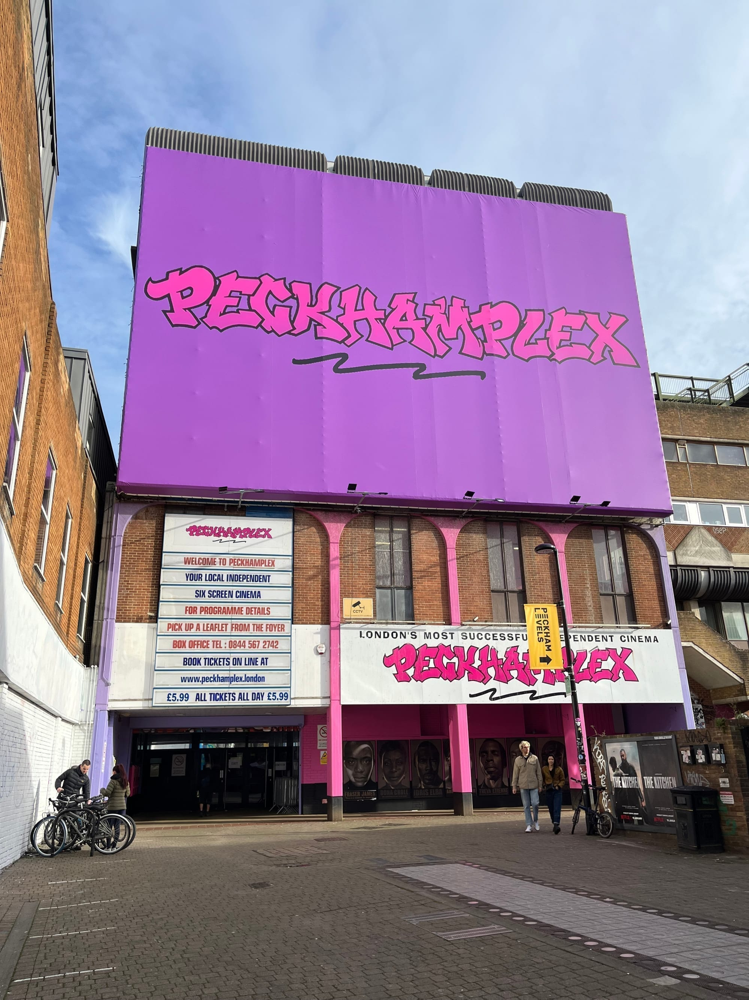

The same film, on the same evening, costs **£4.99 in Mile End and over £25 in Notting Hill**. This guide covers the chain subscriptions, the memberships worth having, the deals that come through your phone network or insurer, and the independents that undercut them.

> 💡 **The Short Version:** Three things are free. **Meerkat Movies** now gives 2-for-1 cinema every Tuesday or Wednesday with **no purchase required** — just the Compare the Market app. If you are **16 to 25**, the under-25 schemes at **BFI (£4)**, **Picturehouse (£6.99)** and **Curzon** are free to join and beat every paid membership here. And the **CEA Card** costs £6.50 once and gets a disabled cinemagoer's companion in free. Beyond that: **under two films a month**, buy singles at **Genesis (£4.99 Mon–Wed)** or **Peckhamplex (£6.99)**. **Two or more**, a subscription wins. And **£15 at the Prince Charles** pays for itself in five visits.

---

## Start here: the free ones

### Meerkat Movies — 2-for-1, no purchase needed

**You no longer need to buy insurance to get it.** Download the Compare the Market app, sign in, and a **2-for-1 cinema code** appears in the Rewards section.

- A **new code every week**, valid **Tuesdays or Wednesdays**
- Codes refresh every Thursday for the following week
- Two standard tickets, cheapest one free
- Redeemable online or at the box office
- Confirmed running **until 19 July 2027**

Participating cinemas are listed in the app.

### The CEA Card — £6.50, free companion ticket

The **CEA Card** is run by the UK Cinema Association and lets a disabled cardholder bring someone with them **free of charge** when buying a full-price ticket. It costs **£6.50** to apply and is accepted at participating cinemas across the country. Eligibility covers people who face barriers requiring assistance at the cinema, including sight or hearing loss, limited mobility and neurodivergence.

---

## If you are under 25, read this first

**The under-25 schemes are free to join, and none of the paid memberships here beats them on price.**

| Scheme | Cost to join | What you pay |
| --- | --- | --- |
| **BFI 25 & Under** | Free, ages 16–25 | **£4** at BFI Southbank any time, or **£6** at BFI festivals including the London Film Festival |
| **Picturehouse U25** | Free, ages 16–25 | **£6.99** all day Monday to Thursday |
| **Curzon Under 25** | Free | Discounted tickets all week |
| **ODEON myLIMITLESS Plus** | Student rate | **£15.99/month** — 20% off the usual price, verified through Student Beans |

BFI at £4 has no day-of-week restriction and a full repertory programme. Picturehouse U25 at £6.99 covers Monday to Thursday.

---

## The cheapest tickets in London

| Cinema | Price | Conditions |
| --- | --- | --- |
| **Genesis**, Mile End | **£4.99** | Monday to Wednesday — adults, children, students and over-60s alike |
| **Genesis**, Mile End | £7.75 | Thursday |
| **Peckhamplex**, Peckham | **£6.99** + 60p booking fee | Any day, any time |
| **Prince Charles**, Leicester Square | £8 member / £11 non-member | Weekday matinee |
| **Genesis**, Mile End | £12 | Friday to Sunday |
| **Vue** | from £2.49 | Booked online, varies by site and screening |

Genesis charges the same £4.99 to every category from Monday to Wednesday, with no cheaper concession. Friday to Sunday it is £12.

*Peckhamplex, Peckham.*

---

Powered by <a target="_blank" rel="sponsored" href="https://www.getyourguide.com/london-l57/">GetYourGuide</a>

## Unlimited subscriptions compared

Monthly passes for people who go often. The break-even is roughly **two films a month** for all of them.

| Scheme | Cost | Minimum term | What you get |
| --- | --- | --- | --- |
| **Cineworld Unlimited** | £12.99–£22.99/month | 3 months | Unlimited films. Four price groups by cinema — Group 4 at £22.99 is the only one covering all sites |
| **ODEON myLIMITLESS** | £16.99/month | 3 months | Unlimited standard 2D. Luxe cinemas cost £3 extra per visit, £5 at Islington |
| **ODEON myLIMITLESS Plus** | £19.99/month | 3 months | Adds Luxe access, iSense, 3D and premium recliner seats at no extra charge |
| **Curzon Cult** | £25/month or £285/year | — | Curzon's own wording is "7 free tickets a week", in cinemas or on Curzon Home Cinema |
| **Everyman Everywhere** | £59/month or £680/year | — | "Unlimited film for a year", two tickets per show |

**Cineworld prices by group of cinemas.** The £12.99 headline covers selected cinemas only; the tiers rise through £17.99 and £19.99 to £22.99, and only the top tier includes all cinemas. Check which group your local sits in, as West End sites sit at the expensive end. IMAX, 4DX and ScreenX cost extra at every tier.

**ODEON** at £16.99 charges £3 per visit at its Luxe cinemas, so a West End regular should compare myLIMITLESS Plus at £19.99. Both tiers cap you at four tickets per booking, with bookings at least 90 minutes apart, and exclude event cinema, premieres and festivals.

**Curzon Cult at £25 a month** also covers Curzon Home Cinema, so it doubles as a streaming subscription.

---

## Annual memberships compared

You pay once a year for a bundle of free tickets plus a standing discount. They suit regular rather than frequent viewers.

| Membership | Cost | Free tickets | Notable extras |
| --- | --- | --- | --- |
| **Prince Charles Cinema** | **£15/year**, or **£60 for life** | — | At least £2.50 off every ticket, £8 weekday matinees, regular £1 member screenings |
| **BFI** | £44/year (direct debit, paper-free) | 2 | Up to £2.50 off, priority festival booking |
| **Curzon Classic** | from £55/year | 5 | Usable in cinemas or on Home Cinema |
| **Picturehouse Weekday Saver** | £69.90/year or £6.99/month | Included | Monday to Thursday, all cinemas except Picturehouse Central |
| **Everyman** | £95/year | 6 | **Bring a guest free Monday to Thursday** |
| **Picturehouse Classic** | £99.90/year or £9.99/month | Included | Every day, all cinemas except Central |
| **Picturehouse Premium West End** | £159.90/year or £15.99/month | Included | Every day, includes Central and its Members' Bar |
| **Everyicon** | £350/year or £31/month | 24 | Guest free Monday to Thursday |

**The Prince Charles** costs £15 a year against a saving of £2.50–£3 on every ticket: members pay £8 for a weekday matinee where non-members pay £11, and £11.50 in the evening against £14.50. Five or six visits cover the fee, before you count the regular **£1 member screenings**. The **£60 lifetime** option pays back in roughly twenty visits.

**Everyman's £95** buys six tickets, and the free guest Monday to Thursday (bank and public holidays excluded, and offered for a limited time) halves the price of a visit on those days.

**Picturehouse Central** in the West End is excluded from the Weekday Saver and Classic plans. If it is the one you would use, you need Premium West End at £159.90 a year. Monthly plans have a three-month minimum.

---

## Deals through other companies

| Provider | Offer | Where |
| --- | --- | --- |
| **Compare the Market** | 2-for-1, Tuesdays or Wednesdays, **no purchase needed** | Participating cinemas, listed in app |
| **O2 Priority** | **Two tickets for £9, or four for £18**, any day — plus 20% off food and drink | Any UK Vue |
| **Sky Cinema** | **Two free tickets every month** | Vue |
| **Vitality** | A free ticket, valid any day | Vue, for health and life insurance customers |
| **Student Beans** | 20% off ODEON myLIMITLESS Plus, taking it to £15.99/month | ODEON |

**O2 Priority:** four tickets for £18 is £4.50 each, any day of the week.

**Sky Cinema's two free Vue tickets a month** are one trip for two, twelve times a year, or 24 separate films.

---

## So which one is actually best?

**A few times a year.** Do not buy anything. Set up **Meerkat Movies** for free 2-for-1 on Tuesdays and Wednesdays, and use **Genesis (£4.99 Mon–Wed)** or **Peckhamplex (£6.99)** for single tickets. If you are on O2, **four Vue tickets for £18** covers a group outing better than anything else here.

**Once a month.** Still not a subscription. Buy a **Prince Charles membership at £15** if you are ever in the West End, because it repays in five visits and includes the £1 screenings. Otherwise keep using the free schemes.

**Two or more films a month.** Now a subscription wins. **ODEON myLIMITLESS Plus at £19.99** has no group system and no per-visit surcharges. **Cineworld** is cheaper if your local sits in a low group and dearer if it does not. Both lock you in for three months.

**Two or more a month, and you care what is showing.** **Curzon Cult at £25** covers art-house, foreign-language and independent film at Curzon, plus Curzon Home Cinema, for barely more than a multiplex pass.

**You are 16 to 25.** **BFI at £4** and **Picturehouse U25 at £6.99** beat every subscription here on price, with no commitment. You would need to see five or six films a month before a paid unlimited card made more sense.

**You go with someone who needs support.** Get the **CEA Card at £6.50** first.

---

Powered by <a target="_blank" rel="sponsored" href="https://www.getyourguide.com/london-l57/">GetYourGuide</a>

## Continue planning your London trip

- 🎬 **[London's Best Independent Cinemas](/articles/best-cinemas-london/)**
- 🎞️ **[BFI London Film Festival: Dates and Tickets](/articles/london-film-festival/)**
- 💷 **[London on a Budget](/articles/london-on-a-budget/)**
- 🎪 **[Free Things to Do in London](/free/)**

---

*Cinema prices change; check the operator before committing to anything with a minimum term.*
