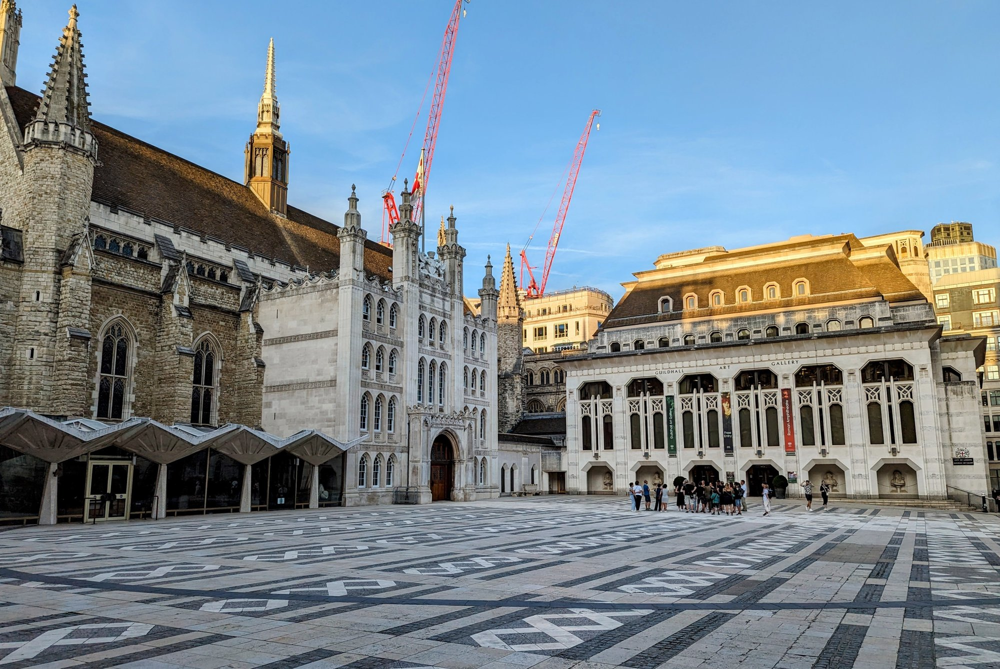
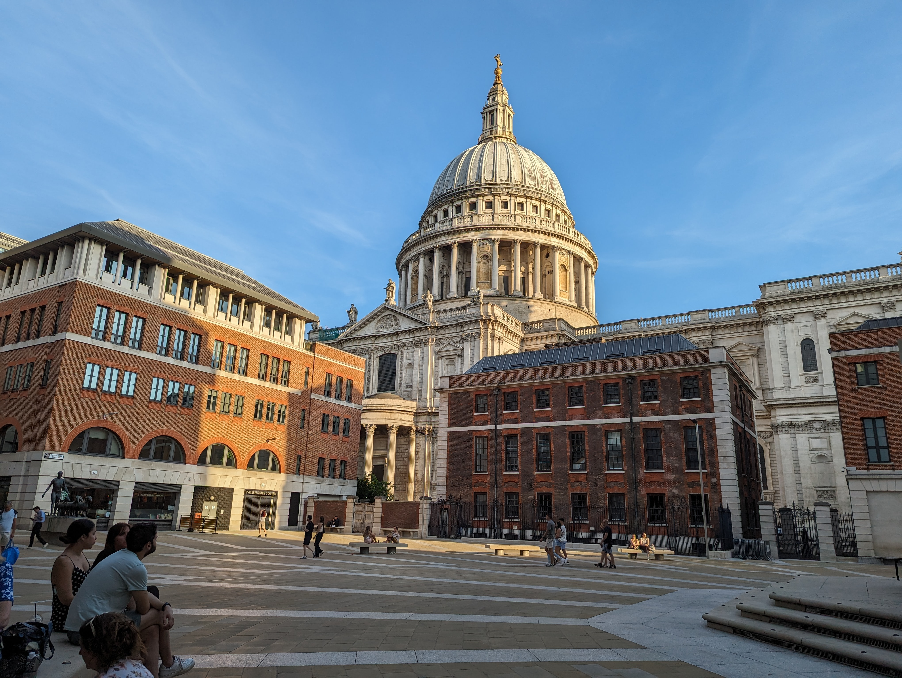
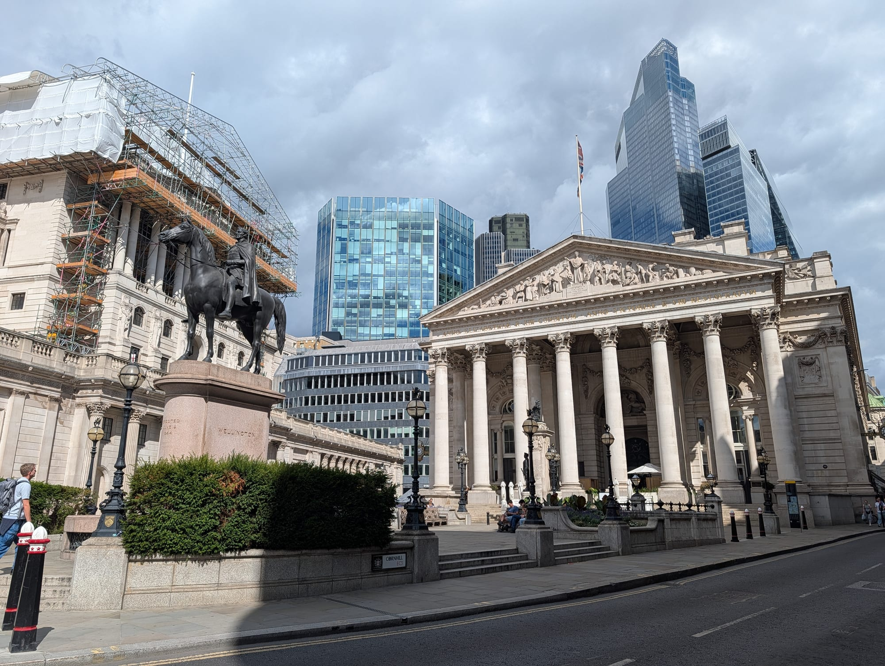
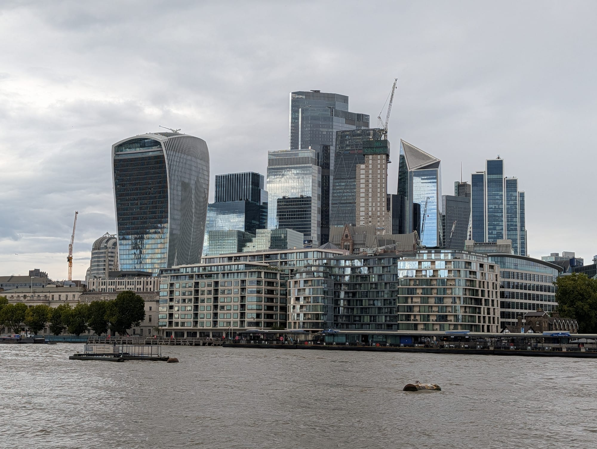
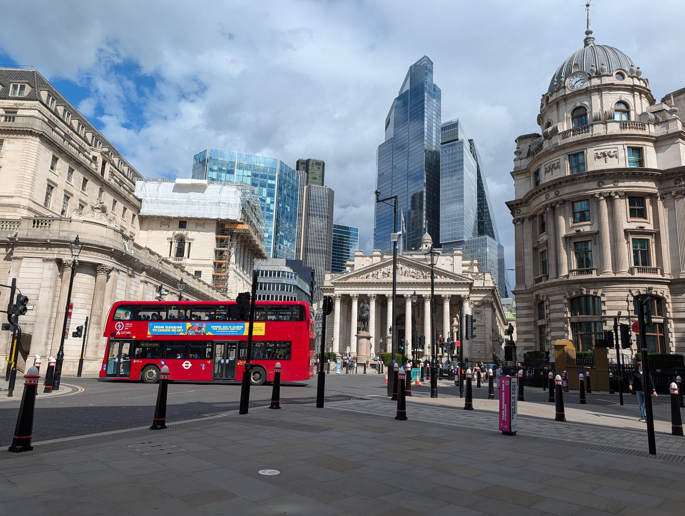
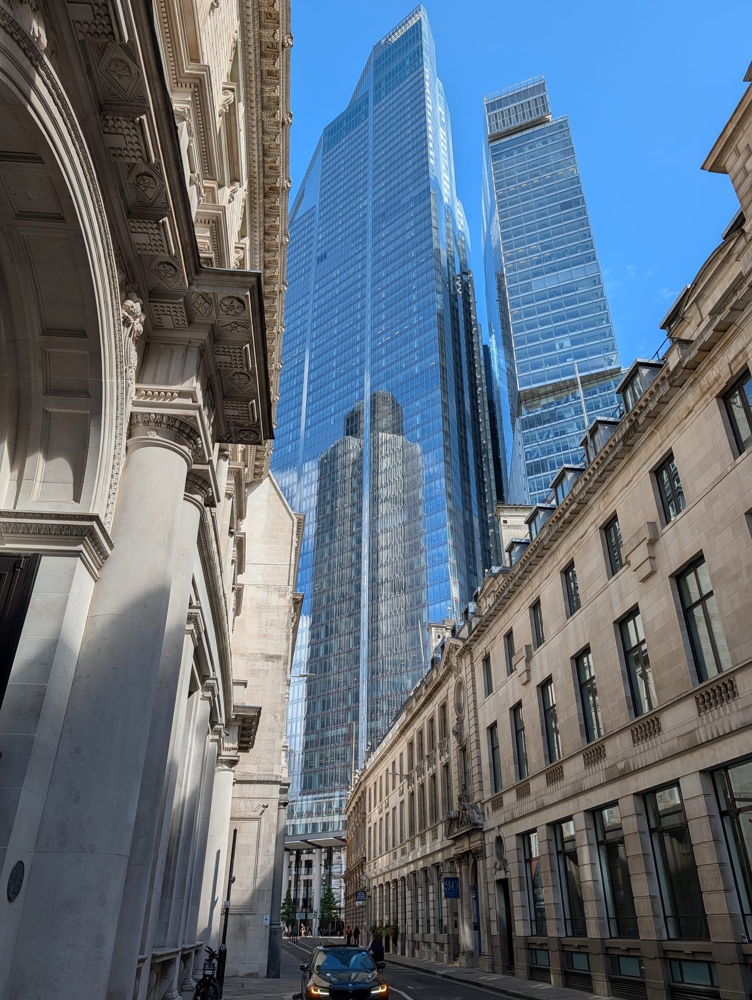
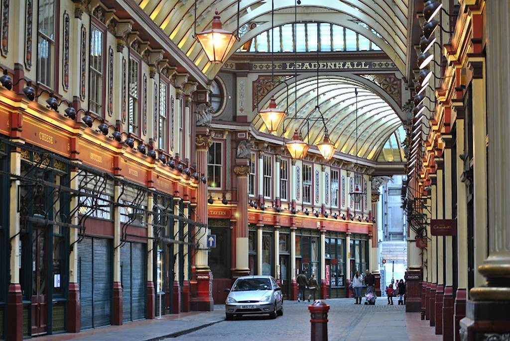

The City of London is the original city: a square mile on the Roman street plan, still a separate authority with its own Lord Mayor and police force.

Roughly half a million people work here and only about eight thousand live here, so it is a crush on a weekday and almost silent on a Sunday morning.

The City of London has its own share of the commemorative plaques marking where notable people lived or worked - see them on our [interactive map](/plaques/?area=city-of-london).

## Why visit — and who should skip it

**Come here if** you want a Wren cathedral, a Norman keep, fragments of Roman wall and glass towers built over all of it, plus three free viewpoints.

**Skip it if** you want to eat or drink casually at the weekend: much of the City closes with the offices. Come on a weekday for open pubs, or at the weekend for empty streets, and bring a plan for lunch.

## Top sights and activities

1. **St Paul's Cathedral** — Wren's 1710 dome, and the 528-step climb to the Golden Gallery via the Whispering Gallery. Sightseeing is ticketed; **Evensong is free** and lets you sit in the quire.
2. **Tower of London** — A Norman fortress begun in 1066, the Crown Jewels, the Yeoman Warders and the ravens. Book ahead and arrive at opening.
3. **Tower Bridge** — The 1894 bascule bridge beside the Tower, and the one many visitors mistake for London Bridge. **Walking across it is free.** The ticketed Exhibition adds the high-level walkways, the glass floor over the road and the Victorian engine rooms.
4. **Horizon 22** — Level 58 of 22 Bishopsgate, about ten metres above The Shard's gallery. Free; book a slot online.
5. **[Sky Garden](/articles/sky-garden-guide/)** — The planted terrace at the top of 20 Fenchurch Street, the "Walkie-Talkie". Free with booking.
6. **Leadenhall Market** — A painted Victorian arcade of 1881, where Hagrid walks Harry to the Leaky Cauldron in the first Harry Potter film. Best on a weekday when the traders are open.
7. **The Roman remains** — The London Wall at Tower Hill and Noble Street, the Temple of Mithras rebuilt in situ beneath Bloomberg's building (free, booked), and the amphitheatre under the Guildhall Art Gallery.
8. **The Wren churches** — Around 50 were built after the Great Fire; roughly half survive. St Stephen Walbrook and St Mary-le-Bow are free to enter.

*Guildhall Yard.*

*St Paul's, over Paternoster Square.*

*Bank junction.*

*The City's tower cluster, from the south bank.*

## Key streets and micro-districts

### St Paul's and Paternoster Square

The cathedral, the square behind it, and One New Change, the shopping centre opposite, which has a free roof terrace.

**St Paul's is £27 for an adult**, which includes the floor, the crypt and all three dome galleries. The climb to the Golden Gallery is **528 steps with no lift at any point** — 257 to the Whispering Gallery, 376 to the Stone, 528 to the top — and the cathedral itself advises against it for anyone with mobility difficulties. **Monday to Saturday only** for sightseeing; services are free to attend.

**The roof terrace at One New Change is free**, needs no ticket and gives you the dome at close range from directly opposite.

**Paternoster Square** behind the cathedral is a modern pedestrian square with the Temple Bar gateway on one corner, Wren's 1670s arch, returned to London in 2004. **Sweetings at 39 Queen Victoria Street** is the Victorian fish restaurant nearby — lunch only, weekdays only, no bookings.

### Bank and the Royal Exchange

*The Royal Exchange at Bank.*

Seven roads meet at this junction, with the **Bank of England**, the **Royal Exchange** and **Mansion House** on three corners.

**The Royal Exchange is open and free to walk into** — Victorian courtyard, mosaic floor, now luxury shops around a central bar.

**The Bank of England Museum is free**, entered from Bartholomew Lane round the side, and it lets you lift a real gold bar. **Open weekdays only, 10am to 5pm** (last entry 4.30pm), and closed at weekends and bank holidays.

**Royal Exchange Buildings**, the alley behind, is where the snowy kiss at the end of *Bridget Jones's Diary* was filmed. **Bloomberg Arcade** two minutes south has the modern eating, including **Brigadiers** for Indian barbecue, and the **London Mithraeum** beneath it — a reconstructed Roman temple, free, but pre-booked.

### Leadenhall and the tower cluster

**Leadenhall Market** stands among the Gherkin, the Cheesegrater and the Scalpel, all within two streets.

**The market is free, roofed and open to walk through**, so it doubles as shelter in the rain. In the first Harry Potter film it played **the streets leading to the Leaky Cauldron**, and the blue door used as the pub's entrance is now Two Eyes Coffee House on Bull's Head Passage. It is the first stop on our [Harry Potter filming locations walk](/articles/harry-potter-filming-locations-walk/).

**It keeps City hours.** The shops and bars trade Monday to Friday and it is close to dead on a Sunday. Come on a weekday; it fills around six in the evening.

**Three free viewpoints are within five minutes.** **Horizon 22** on level 58 needs a timed ticket and is fully enclosed. **The Lookout at 8 Bishopsgate** is also free and runs to 9pm on Mondays and Fridays. **[Sky Garden](/articles/sky-garden-guide/)** is free with a ticket released three weeks ahead. If you miss the release, the door sells an early-morning ticket with a hot drink for £11.50.

For eating up high, **Duck & Waffle at 110 Bishopsgate is open 24 hours**.

*Old and new, on Leadenhall Street.*

### Tower Hill and the riverside

The **Tower of London**, a stretch of the **Roman city wall** beside Tower Hill station (free and unfenced), and the approach to Tower Bridge.

**Most of the view is free.** The moat, the wharf and the riverside pavement cost nothing, and the **upstream pavement on Tower Bridge** is the officially designated viewpoint: the Tower, St Paul's, The Monument and HMS Belfast in one sweep.

**The Tower Bridge Exhibition is £18** for an adult, open daily 9.30am to 6pm with last entry at 5pm. It buys you the glass floors 43.5 metres up and the Victorian engine rooms, and there is **lift access to both**. Residents of the City, Southwark or Tower Hamlets pay **£1** with proof.

**Bridge lift times are published** at towerbridge.org.uk/bridge-lifts and updated daily, so you can watch it open for free.

This is the one part of the City that is busy at weekends.

### Smithfield and Barbican

The north-west edge of the City. **Smithfield** has been a livestock and meat market for over eight hundred years, and its Victorian market buildings become the new **London Museum**, free to enter, on 28 November 2026.

**Come for St Bartholomew the Great.** Founded in 1123, it has a Norman interior that has stood in for St Paul's in *Sherlock Holmes* and appeared in *Four Weddings* and *Shakespeare in Love*. There is a small admission charge for sightseers and none for worship, and it closes to visitors during services.

**The Barbican** is next door: a brutalist estate of concrete towers, raised walkways and a lake, with an arts centre at its heart. **The Curve gallery is free** and the main Art Gallery is ticketed. The entrance is hard to find: **follow the yellow line painted on the pavement** from Barbican station. For the programme, the booking fee and where to eat before a show, see [what's on at the Barbican](/articles/barbican-centre-guide/).

**Ye Olde Cheshire Cheese** on Fleet Street, rebuilt in 1667 after the Great Fire, is ten minutes west, a warren of dark rooms.

*Leadenhall Market.*

## Go deeper

- **[The best views in London](/articles/best-views-london/)** — Horizon 22, the Lookout and Sky Garden are all in the Square Mile, all free, and all need booking on different timetables.
- **[Sky Garden guide](/articles/sky-garden-guide/)** — the Monday ticket release, the restaurant and walk-in routes in, and the terrace hours.

## Where to eat and drink

| Spot | Style | Price | Why go |
| --- | --- | --- | --- |
| **Leadenhall Market** | Pubs and cafes | ££ | Under the painted arcade; City hours, so best on a weekday |
| **St. JOHN Smithfield** | British nose-to-tail | £££ | Bone marrow and eccles cakes |
| **Ye Olde Cheshire Cheese** | Historic pub | ££ | Rebuilt 1667, off Fleet Street, a warren of dark rooms |
| **The Blackfriar** | Art nouveau pub | ££ | 1905 interior by Blackfriars station |
| **One New Change** | Food court | ££ | Reliable at weekends when everything else is shut |
| **Borough Market** | Food market | £ | Ten minutes over London Bridge when the City closes |

Los Mochis cooks Mexican-Japanese food nine floors above Broadgate Circle, with a rooftop terrace, and SUSHISAMBA's Japanese, Brazilian and Peruvian menu is on the 38th floor of Heron Tower. Both are in our [fusion restaurants guide](/articles/best-fusion-restaurants-london/).

## Getting there

**By Tube.** Four useful stations. **St Paul's** (Central) for the cathedral, **Bank** (Central, Northern, Waterloo & City, DLR) for the middle, **Liverpool Street** (Elizabeth line and four others) for the north-east, **Tower Hill** (District, Circle) for the Tower.

**Best exit.** At Bank, use **Exit 9** for the Royal Exchange and the Bank of England — the station is a warren with a dozen exits and it is easy to surface facing the wrong way.

**On foot.** Five minutes over the Millennium Bridge to Tate Modern, fifteen north to Shoreditch. The DLR from Bank or Tower Gateway reaches Canary Wharf in about fifteen minutes.

## How long to spend, and when to go

| If you have | Do this |
| --- | --- |
| **Two hours** | St Paul's exterior, Leadenhall Market and the tower cluster |
| **Half a day** | Add the Tower of London, or St Paul's dome climb |
| **A full day** | Both, plus a free viewpoint and the Roman remains |

**Best time:** Weekday mornings for atmosphere and open pubs. Early Sunday morning for photography with empty streets.

**Book ahead:** Tower of London, Horizon 22, Sky Garden, The Lookout and the Temple of Mithras all need booking.

Comparing neighbourhoods? [Best areas to visit in London](/articles/best-areas-to-visit-london/) sets them side by side by what each is best for, how long it takes and the best day to go.

Powered by <a target="_blank" rel="sponsored" href="https://www.getyourguide.com/london-l57/">GetYourGuide</a>

## Walking routes

**[A Walk Around the City of London: Bank to Tower Bridge →](/articles/city-of-london-walk/)**

**Eleven numbered stops** over about 3km and two to three hours, with a map, a Google Maps walking link and a day-by-day breakdown of what is open. It starts at the Bank junction rather than St Paul's, goes inside the Royal Exchange, and takes in **St Dunstan-in-the-East**, the church bombed in 1941 and left as a ruin with a garden planted inside it.

### The short version, if you only have three hours

1. **Start:** St Paul's station. **St Paul's Cathedral** and Paternoster Square.
2. **One New Change:** The free roof terrace for the close view of the dome.
3. **Bank:** East along Cheapside past **St Mary-le-Bow** to the **Royal Exchange**.
4. **Leadenhall Market:** South-east under the painted arcade.
5. **Tower Hill:** Down to the **Roman wall** and the **Tower of London**.
6. **Finish:** **Tower Bridge**, or north to Shoreditch for the evening.

Powered by <a target="_blank" rel="sponsored" href="https://www.getyourguide.com/london-l57/">GetYourGuide</a>

## Common mistakes to avoid

1. **Coming at the weekend without a food plan.** One New Change and Borough Market are the fallbacks.
2. **Paying to enter St Paul's just to see inside.** Evensong is free daily and you sit in the quire.
3. **Surfacing at the wrong Bank exit.** A dozen exits across a large junction; check which one you want first.
4. **Walking to Canary Wharf.** It is much further than it looks. Take the DLR from Bank.

## Where to stay

Transport links are good, and the area is quiet at night.

- **Liverpool Street and Aldgate** — The main hotel cluster, walkable to Shoreditch for the evening.
- **Barbican and Smithfield** — Quieter, near the arts centre, good for Farringdon and the Elizabeth line.
- **Tower Hill** — Convenient for the Tower and the river, and connected to the South Bank on foot.

Our [City of London hotel guide](/articles/where-to-stay-city-of-london/) compares the hotels and the weekend rates.
