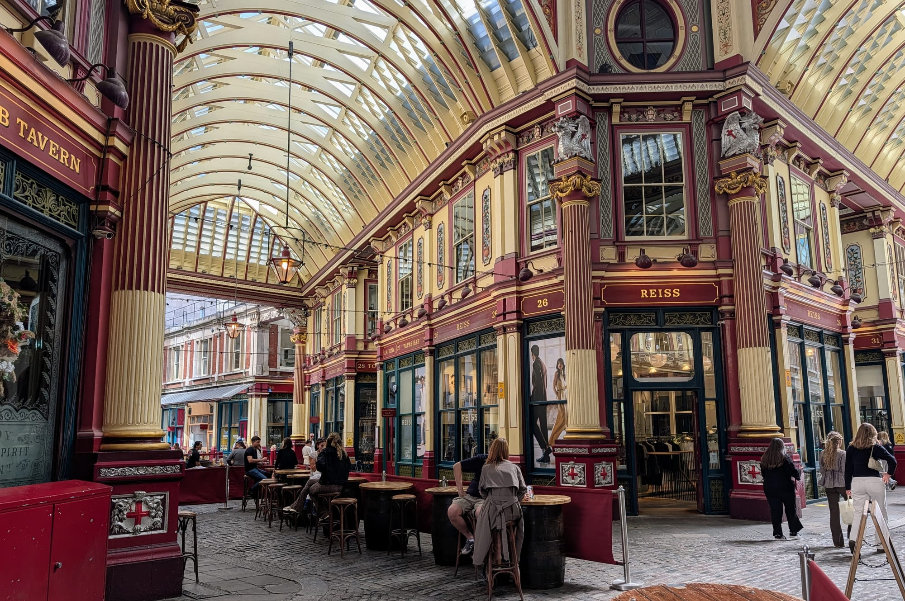
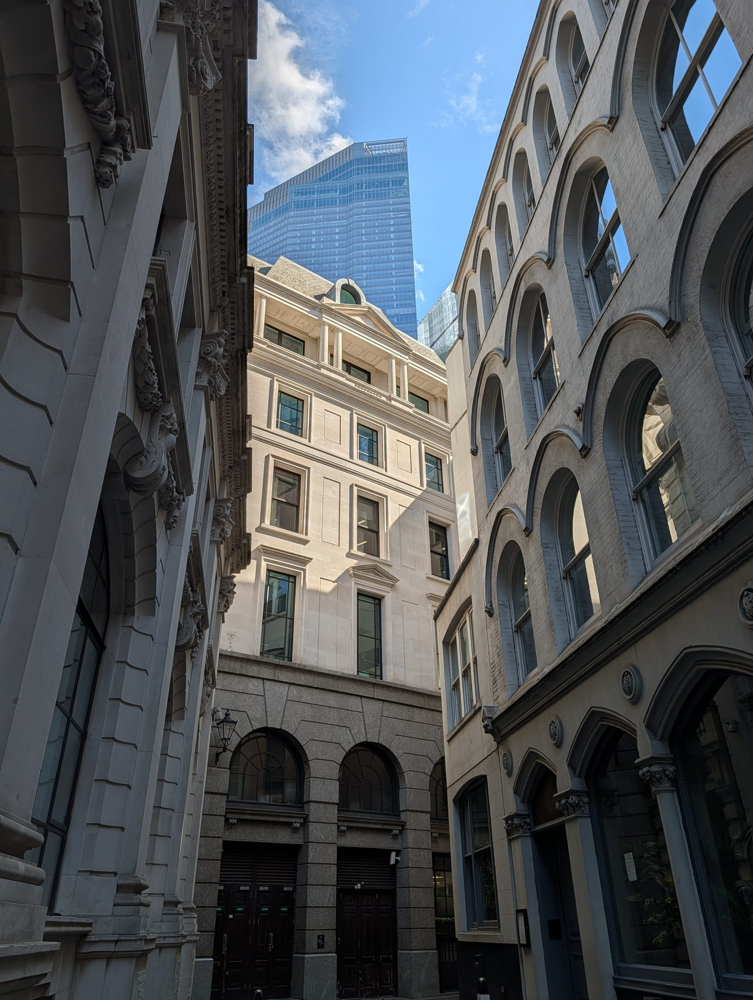
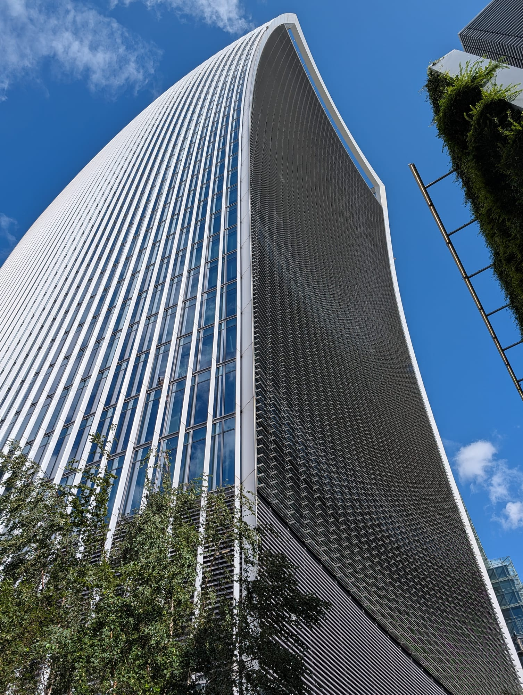
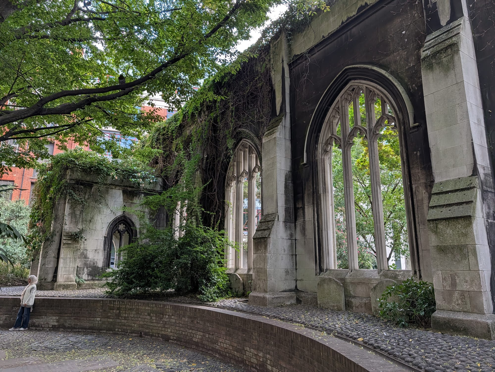
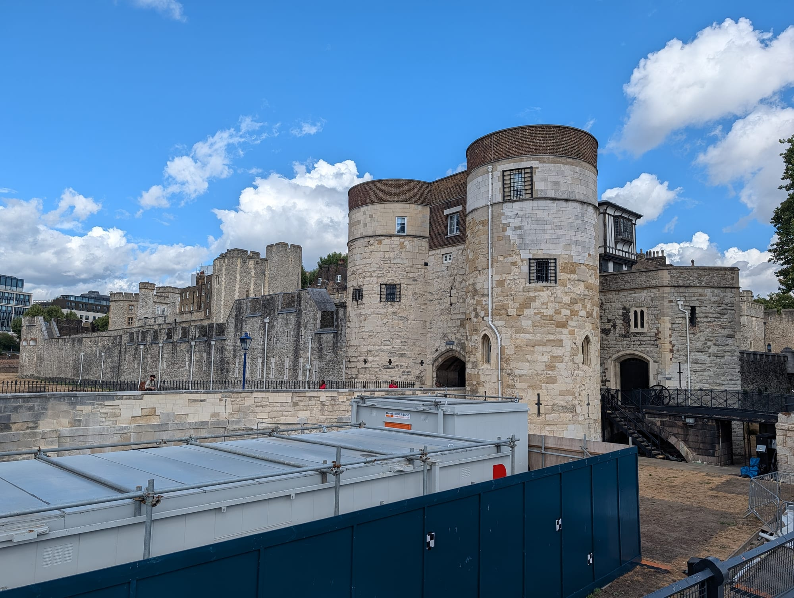
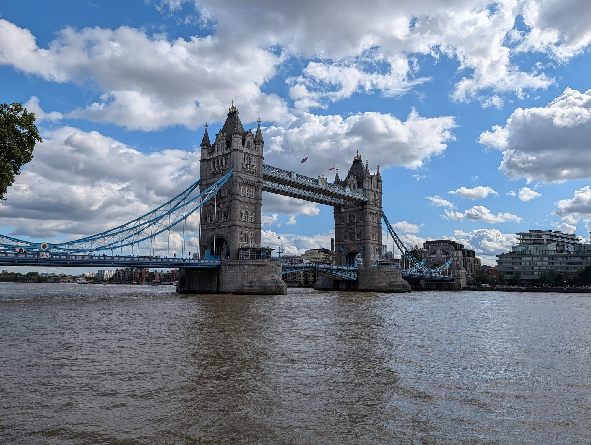
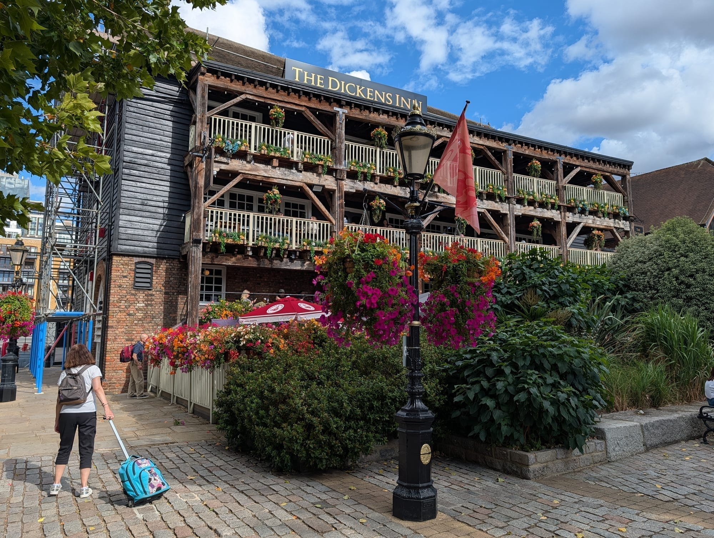
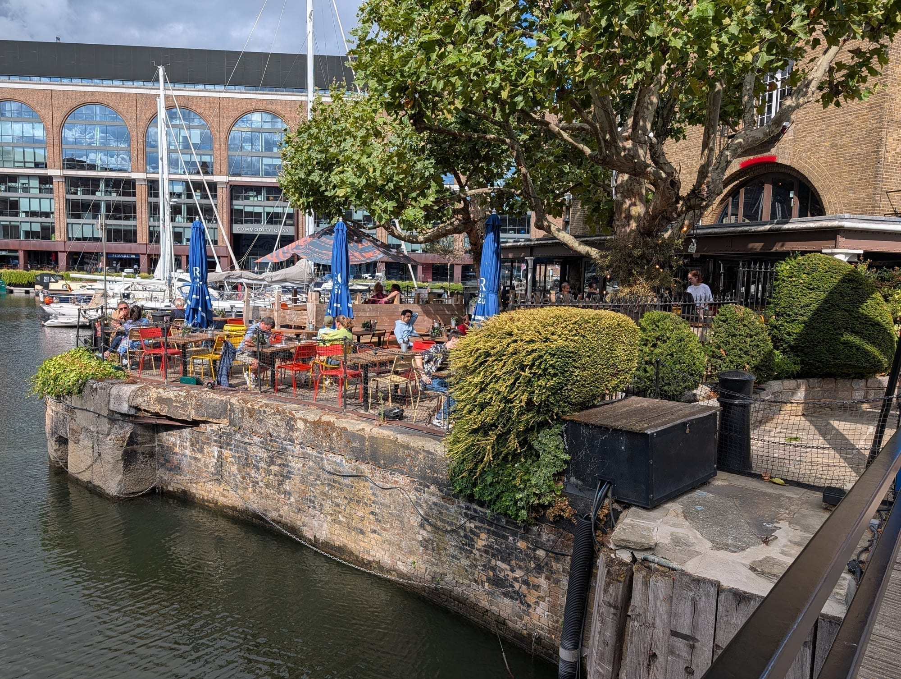

Most people see the City of London backwards: out at Tower Hill, the Tower, a photograph of Tower Bridge, and gone.

**This walk runs the other way.** It starts at Bank, the junction the whole City was laid out around, and works east and south through the market, the tower cluster, a free view from the 58th floor and a bombed church left as a ruin and planted as a garden. The Tower and Tower Bridge come at the end.

It is about **3km and takes two to three hours** with stops. All of it is free except the Tower of London and the Monument.

For St Paul's, Smithfield, the Roman remains and where to stay, see the [City of London area guide](/articles/city-of-london-area-guide/).

> 💡 **The Short Version:** Go on a **weekday**, ideally Tuesday to Thursday. Start at **Bank** — go inside the **Royal Exchange**, which is free — and finish at **Tower Bridge**. The unmissable stop is **St Dunstan-in-the-East**, a bombed church turned garden, and it is free. For the view, book **Horizon 22** — free, level 58 — or walk into **The Garden at 120** with no booking at all. Eat at **Leadenhall Market** in the middle or **St Katharine Docks** at the end.

## The route

  

    Map of the walk, numbered in walking order
  

  

    
Loading the map…

  

  

    <i class="route-map-marker" aria-hidden="true">1</i> On the route, in walking order
    <i class="route-map-marker route-map-marker--alt" aria-hidden="true">5</i> Alternatives — pick one
  

  <noscript>
    
The map needs JavaScript. Every stop below is numbered in walking order with its nearest station.

  </noscript>

**[Open the whole route in Google Maps →](https://www.google.com/maps/dir/?api=1&origin=51.51343,-0.086975&destination=51.506541,-0.07165&waypoints=51.514467,-0.087621%7C51.512728,-0.083395%7C51.512965,-0.082407%7C51.514478,-0.082973%7C51.510946,-0.086449%7C51.509678,-0.082496%7C51.509394,-0.079301%7C51.508217,-0.076188%7C51.505517,-0.075366&travelmode=walking)** — all eleven stops in walking order, set to walking directions, which is the version to put on your phone.

| # | Stop | Cost | Open |
| --- | --- | --- | --- |
| **1** | Bank junction & Royal Exchange | Free | Streets always; interior weekdays |
| **2** | Bank of England Museum | Free | **Weekdays only** |
| **3** | Leadenhall Market | Free | Lanes always; traders weekdays |
| **4** | The tower cluster | Free | Always |
| **5** | A view from the top | Free | Varies — see below |
| **6** | The Monument | Ticket | Daily |
| **7** | St Dunstan-in-the-East | Free | Daylight hours |
| **8** | All Hallows by the Tower | Free | Seven days |
| **9** | Tower of London | **Ticket** | Daily from 9am, 10am Sun–Mon |
| **10** | Tower Bridge | Free to cross | Always |
| **11** | St Katharine Docks | Free | Seven days |

---

## 1. Bank junction

*Bank junction.*

**Seven streets meet here and no two of them agree on a right angle.** Stand with your back to Bank station's Royal Exchange exit and you have the **Royal Exchange** portico in front of you, the windowless wall of the **Bank of England** to the left, and **Mansion House**, where the Lord Mayor lives, to the right.

**Go inside the Royal Exchange.** Most people photograph the portico and walk on, but the interior is the best free thing at this end of the walk. It was founded by the merchant **Sir Thomas Gresham** and opened by **Elizabeth I in 1571** as London's first purpose-built centre of commerce. It burned down in the Great Fire, was rebuilt, and burned again; the building in front of you is the **third**, by Sir William Tite, opened by Queen Victoria in 1844.

It is now a **covered courtyard of shops and restaurants under a glass roof**, ringed by two storeys of colonnade, with a bar in the middle of the floor. **Walking in costs nothing** and takes two minutes. The shops and the bar keep their own hours and are mostly a weekday trade.

> ⚠️ **Bank station has a dozen exits** spread across a very large junction. Follow signs for the Royal Exchange.

## 2. The Bank of England Museum

Round the corner on **Bartholomew Lane**, and the strongest argument for walking this route on a weekday.

It is **free** and **open Monday to Friday only, 10am to 5pm, last entry 4.30pm**. The gold bar you can try to lift is the exhibit everyone remembers. It closes at weekends and on bank holidays, stays open late until 8pm on the third Thursday of the month, and closes at 3pm on Friday 27 November.

## 3. Leadenhall Market

*Leadenhall Market.*

**A covered Victorian market in maroon and green ironwork**, built by Horace Jones in 1881 on a site that has been a market since the fourteenth century. It takes about four minutes to see.

The lanes are **public and open around the clock**. The shops, pubs and restaurants inside keep their own hours and most are a **weekday business**, so a Sunday visit gets you the architecture and a closed shutter. It is the place to time this walk around lunch: see Where to eat below.

Powered by <a target="_blank" rel="sponsored" href="https://www.getyourguide.com/london-l57/">GetYourGuide</a>

## 4. The tower cluster

*A City alley, glass tower above.*

Step out of the market's east exit and the towers are directly overhead: **two hundred metres of looking up**.

The **Lloyd's building** is the one to stand under. Richard Rogers put the lifts, stairs, ducts and lavatory pods on the outside so the floors inside could be cleared and rearranged. It was Grade I listed in 2011, at twenty-five years old, the youngest building ever to get that protection.

Around it: **30 St Mary Axe** (the Gherkin), **122 Leadenhall** (the Cheesegrater, sloped to keep St Paul's in view from Fleet Street), **52 Lime Street** (the Scalpel) and **22 Bishopsgate**, the tallest and the one you are about to go up.

## 5. A view from the top

Three free options within five minutes of each other. **You would only do one.**

**Horizon 22** — level 58 of 22 Bishopsgate, which it bills as **London's highest free viewing platform**. Free, but you need a booked ticket. Open weekdays 10am–6pm, Saturday 10am–5pm and Sunday 10am–4pm. This is the one for height.

**[Sky Garden](/articles/sky-garden-guide/)** — the glasshouse on top of 20 Fenchurch Street, the Walkie-Talkie. Also free and ticketed, and the tickets **go weeks in advance**. Booking a table at one of its restaurants or bars gets you access even when the free tickets have gone.

**The Garden at 120** — a rooftop garden on the 15th floor of 120 Fenchurch Street, and **the only one of the three with no booking**. You walk in and take the lift. It is lower than the other two, and you are looking at the Walkie-Talkie rather than from it. Open daily from 10am, until 6.30pm from 1 October to 31 March (9pm in summer), and **5pm at weekends all year**. It is **closed on bank holidays**.

> 💡 **If you have not booked anything, go to the Garden at 120.**

*20 Fenchurch Street, the Walkie-Talkie.*

## 6. The Monument

**Wren's column to the Great Fire**, 202 feet tall and set 202 feet from the Pudding Lane bakery where the fire started in 1666.

**311 steps** up a spiral staircase to a caged viewing platform. Tickets (adult £7.00) are bought at the Monument on the day. It is open **daily, 9.30am to 1pm and 2pm to 6pm**, with last entry at 12.30pm and 5.30pm, and closed 24–26 December. On term-time Monday to Thursday mornings between 10am and 11.30am school groups can block regular admission. A **joint ticket with Tower Bridge** is valid for seven days and one visit to each, which is worth it if you intend to do the Tower Bridge walkways later.

## 7. St Dunstan-in-the-East

**A church turned into a garden, and free.**

A Wren church, bombed in the Blitz in 1941 and never rebuilt. The City made the tower, outer walls and empty window tracery into a public garden in the 1960s: climbing plants grow up through the window openings, a fountain stands where the nave was, and there is sky where the roof should be.

It is small, on a slope off St Dunstan's Hill, and quiet.

*St Dunstan-in-the-East.*

> ⚠️ **Come early.** Early morning is when you get it to yourself; on a warm weekday lunchtime it is full of office workers.

## 8. All Hallows by the Tower

The **oldest church in the City**, founded in 675, two hundred metres from the Tower.

Two things are worth going in for, both free. A **Roman tessellated pavement in the crypt**, in place since the second century and found during repairs after wartime bombing. And its history: Samuel Pepys climbed its tower to watch the Great Fire spread, and William Penn was baptised here.

Open **Monday to Friday 8am to 5pm, Saturday 10am to 5pm and Sunday 12.30pm to 5pm**, the one church on this route that opens seven days.

Powered by <a target="_blank" rel="sponsored" href="https://www.getyourguide.com/london-l57/">GetYourGuide</a>

## 9. The Tower of London

The one paid ticket on the route, and a **half-day in its own right**. Our [Tower of London guide](/articles/tower-of-london-guide/) has the prices, the quieter afternoon slots and the Opening Ceremony ticket that reaches the Crown Jewels before other visitors.

**Book ahead and go at opening**: the Crown Jewels queue is shortest in the first hour. Opening is **9am Tuesday to Saturday but 10am on Sunday and Monday**, and closing is 5.30pm in summer, 4.30pm in winter. On a Tuesday-to-Thursday walk you can be inside before the coaches arrive. If you are skipping it, the outer walls, the wharf and Tower Hill are free to walk, and the **Roman city wall** stands in the gardens by Tower Hill station.

*The Tower's west entrance.*

## 10. Tower Bridge

**Crossing it costs nothing.** The road and pavements are a public highway.

What is ticketed is the **high-level walkways**, the two upper spans with a glass floor section, and the Victorian **engine rooms** that powered the bascules. That is the joint ticket with the Monument, if you bought it earlier.

Walk out to the middle and look back: the tower cluster you were standing under an hour ago, in one frame.

## 11. St Katharine Docks

Five minutes east of the bridge on the north bank, and the place to finish.

A former dock basin turned marina: **yachts, a lock, and restaurants and pubs around the water**. It is also **open at weekends**, which most of this walk is not, so on a Sunday this is where the day recovers.

*The Dickens Inn, St Katharine Docks.*

---

## Where to eat

The day decides between two options.

**Leadenhall Market — the middle of the walk.** Pubs and restaurants under the painted ironwork, including the **Lamb Tavern**, there since 1780. It lands at roughly the halfway point, which makes it the lunch stop. It is a weekday trade, and at weekends a good number of the businesses do not open.

**St Katharine Docks — the end of the walk.** Restaurants, pubs and cafés around the marina, open seven days. Less atmospheric than Leadenhall and more reliable on a Saturday or Sunday.

*St Katharine Docks.*

**Across the bridge**, Butler's Wharf on the south bank has a run of riverside restaurants facing Tower Bridge.

**Three more on the route itself**, all up a tower or on a roof:

- **SushiSamba** (££££) — Japanese, Brazilian and Peruvian on the 38th and 39th floors of the Heron Tower, with what it calls the highest outdoor dining terraces in Europe. Two minutes from stop 5. Book the **Heron Tower** one; there is a second in Covent Garden.
- **Duck & Waffle** (£££) — the 40th floor of the same tower, **open 24 hours**, so the one address in the Square Mile with no weekend problem.
- **Coq d'Argent** (££££) — rooftop French with terraces on top of No.1 Poultry, looking down on the Bank of England. Right at stop 1, so it works at the start.

For the rest of the City's eating, see the [area guide](/articles/city-of-london-area-guide/#where-to-eat-and-drink).

## The best day to go

**Tuesday, Wednesday or Thursday.** Almost everything on this route is calibrated to office hours.

| Day | What you get |
| --- | --- |
| **Tue–Thu** | Everything open. The best day, and the only way to see the Bank of England Museum |
| **Monday** | Same as above, but some restaurants take Monday off |
| **Friday** | Fine until about 5pm, when the pubs fill and stay full |
| **Saturday** | Museum shut, Leadenhall thin, rooftops on shorter hours. Streets pleasantly empty |
| **Sunday** | Emptiest, quietest, best for photographs. Museum shut, shops shut. See below |

**What closes at the weekend:** the Bank of England Museum, a good share of Leadenhall Market's traders, the Royal Exchange's **shops**, and the City's sandwich-and-coffee trade. The **Garden at 120 shuts at 5pm at weekends** all year and closes on bank holidays.

**What does not care what day it is:** the Bank junction, Leadenhall's lanes, the tower cluster, St Dunstan-in-the-East, All Hallows, the Tower, Tower Bridge and St Katharine Docks. That is a good walk on a Sunday, just not a good lunch.

**Sunday is the day for quiet.** Half a million people work in the Square Mile and about eight thousand live there, so on a Sunday morning the medieval alleys, the bombed church and the Roman crypt are close to empty. You lose the **Bank of England Museum**. **Leadenhall's lanes never lock**, so you still walk the arcade, past shuttered units. The **Royal Exchange still opens**: its shops are weekday-only, but several cafés and bars in the courtyard trade Saturday and Sunday. Eat at St Katharine Docks and the day works.

**On time of day:** start at 10am and you clear the museum, reach Leadenhall around noon and hit St Dunstan before the lunch crowd. Start at 9am on a Sunday and the streets are yours.

Powered by <a target="_blank" rel="sponsored" href="https://www.getyourguide.com/london-l57/">GetYourGuide</a>

## Getting there and back

**Start:** Bank (Central, Northern, Waterloo & City, DLR). **Finish:** Tower Hill (District, Circle) or Tower Gateway (DLR), both a few minutes from St Katharine Docks.

The route is **step-free on pavements throughout** and never more than five minutes from a station, so it is easy to cut short. The one climb is the Monument's 311 steps, which is optional. Walked the other way, Tower Bridge to Bank, it ends at a road junction.

## Carry on walking

- **[Wapping to Canary Wharf](/articles/wapping-canary-wharf-walk/)** — starts at St Katharine Docks, exactly where this one ends.
- **[South Bank: Westminster to Tower Bridge](/articles/south-bank-walk/)** — across Tower Bridge on the south bank.
- **[Shoreditch and Spitalfields](/articles/shoreditch-spitalfields-walk/)** — Spitalfields is a short walk north of Bank, where this one starts.
- **[Bankside and Borough](/articles/bankside-borough-walk/)** — finishes at St Paul's over the Millennium Bridge, ten minutes west of Bank along Cheapside, so walk it first and start this one after.
- **[The Harry Potter filming locations walk](/articles/harry-potter-filming-locations-walk/)** — starts at Leadenhall Market, stop 3 here, and runs to Westminster by way of the Leaky Cauldron door, the Millennium Bridge and Gringotts.

## What to do with the rest of the day

- **[The City of London area guide](/articles/city-of-london-area-guide/)** — St Paul's, Smithfield, the Roman amphitheatre under the Guildhall, and where to stay.
- **[Sky Garden guide](/articles/sky-garden-guide/)** — how to get a free ticket for the glasshouse on the Walkie-Talkie, and the ways in without one.
- **[Free things to do in London](/free/)** — nine of these eleven stops cost nothing.
- **[London's best markets](/articles/best-london-markets/)** — where Leadenhall sits among them, and which days the others run.
- **[Thames walks](/articles/london-walks-along-the-thames/)** — pick up the river path at Tower Bridge and keep going.
- **[The best areas to visit in London](/articles/best-areas-to-visit-london/)** — the neighbourhoods compared by what each is best for, how long it takes and the best day to go.
