This guide covers the older, narrower list of British dishes a visitor has usually heard named but never seen — a Scotch egg, a Cornish pasty, a plate of pie and mash — with a place in London to try each one.

> 💡 **The Short Version:** For pie, mash and green parsley liquor, go to **[M Manze](https://www.manze.co.uk/)** on Tower Bridge Road, at the same address since 1902; it closes at 5.45pm Monday to Thursday and 3.45pm on Sundays. Buy a pork pie from **[Mrs King's Pork Pies](https://boroughmarket.org.uk/traders/mrs-kings-pork-pies/)** at Borough Market and a sausage roll or steak bake from any **[Greggs](https://www.greggs.co.uk/)**. Four more dishes sit a short walk apart around Covent Garden and the Strand: steak and kidney pudding at **[Rules](https://rules.co.uk/)**, a lamb-and-beef shepherd's pie at **[The Ivy](https://ivycollection.com/restaurants-near-me/the-ivy-london/the-ivy-west-street-covent-garden/)**, Welsh rarebit at the **[J Sheekey](https://j-sheekey.co.uk/)** bar for about £5, and spotted dick at **[Simpson's-in-the-Strand](https://www.simpsonsinthestrand.co.uk/)**.

> 🍽️ **At a glance.** Afternoon tea, the full English, the Sunday roast and fish and chips are explained here and linked to their own guides. The rest are covered in full: pie and mash, pork pies, sausage rolls, steak bakes and pasties, the Scotch egg, bangers and mash, steak and kidney pudding, shepherd's and cottage pie, Welsh rarebit, sticky toffee pudding, treacle tart, and spotted dick with sherry trifle.

---

## The four everyone asks about first

### Afternoon tea

Tiered stands of finger sandwiches, warm scones with clotted cream and jam, then pastries, over a pot of tea. The ritual is usually traced to the Duchess of Bedford in the 1840s. **The Langham** in Marylebone says it was the first hotel in the world to serve it, when it opened in 1865. Prices run from under £30 to well over £100 a head at the grand hotels. The full **[afternoon tea guide](/articles/best-afternoon-tea-london/)** compares them.

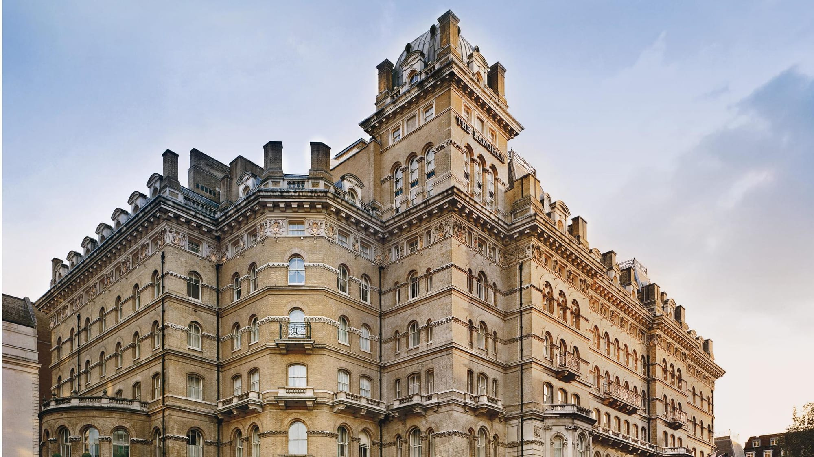

*The Langham, Marylebone.*

### The full English breakfast

Eggs, bacon, sausage, baked beans, a grilled tomato and mushroom, and toast or fried bread, sometimes with black pudding or a hash brown, usually just called a "fry-up." The same plate is a full Scottish, Welsh or Irish across the borders, with local swaps. London does it from a cheap caff to a Michelin-starred kitchen; the **[breakfast and brunch guide](/articles/best-breakfast-brunch-london/)** covers both, plus where to get one at three in the morning.

### The Sunday roast

A joint of meat — beef classically, but lamb, pork or chicken too — roasted and carved at the table, with a Yorkshire pudding, roast potatoes, vegetables and gravy. It is served on Sundays, in pubs as often as restaurants, and the good ones sell out. The **[Sunday roast guide](/articles/best-sunday-roast-london/)** ranks pubs by how many independent sources name each.

### Fish and chips

Battered cod or haddock, deep-fried and served with thick-cut chips, traditionally wrapped in paper, with mushy peas or curry sauce on the side. A "chippy" is the shop; some fry in beef dripping, others in vegetable oil. The **[fish and chips guide](/articles/best-fish-and-chips-london/)** ranks them by how many independent sources name each, from the Bloomsbury shop that still uses dripping to the one that fries in matzo meal instead of batter.

---

Powered by <a target="_blank" rel="sponsored" href="https://www.getyourguide.com/london-l57/">GetYourGuide</a>

## Pies, pastries and the things you eat with your hands

### Pie and mash

Minced beef in a pastry pie, mashed potato, and a ladle of "liquor", a bright green parsley sauce, not a drink, traditionally made with the water eels were stewed in. It is London's own fast food, from the docks and the East End, and jellied eels usually sit on the same counter. **[M Manze](https://www.manze.co.uk/)**, at 87 Tower Bridge Road in Bermondsey, has traded since 1902; it opens 10.30am to 5.45pm Monday to Thursday, until 6.45pm on Friday and 7.45pm on Saturday, and 11am to 3.45pm on Sunday. **[Goddards at Greenwich](https://goddardsatgreenwich.co.uk/)**, at 22 King William Walk, has traded since 1890 and opens daily from 10am to 7.30pm (8pm on Friday and Saturday).

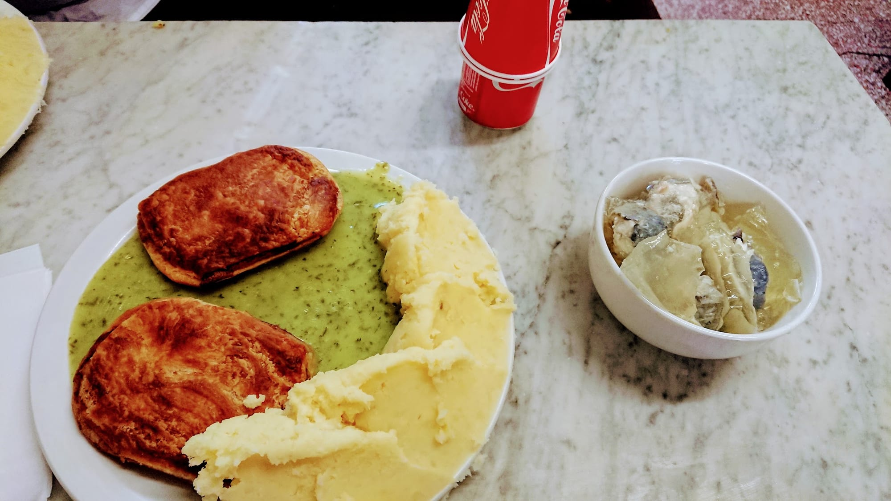

*Pie, mash and liquor at M Manze.*

### Pork pies

Cold hand-raised pork in a firm, free-standing pastry shell with a layer of savoury jelly between the meat and the crust, eaten cold. The style is Melton Mowbray's, a Leicestershire pork pie with protected geographical status since 2009, and **[Mrs King's Pork Pies](https://boroughmarket.org.uk/traders/mrs-kings-pork-pies/)** at Borough Market trades under a family recipe dating to 1853. **[The Ginger Pig](https://thegingerpig.co.uk/our-shops/borough-market/)**, a butcher with a stall at Borough Market and a shop on Marylebone's Moxon Street, makes its own pork and sage version.

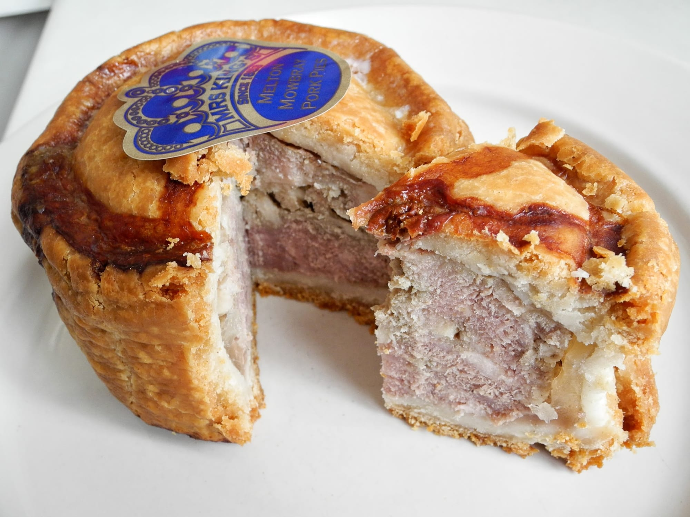

*A hand-raised pork pie.*

### Sausage rolls, steak bakes and pasties

A sausage roll is sausage meat in puff pastry; a steak bake has diced beef in gravy instead; a Cornish pasty is a D-shaped, crimped parcel of beef, potato, swede and onion, packed by Cornish miners' wives as a hot lunch. The crimped edge was originally a handle, held with dirty hands and thrown away. All three are sold hot on every London high street, and **[Greggs](https://www.greggs.co.uk/)** sells all three. For the Cornish pasty, **[West Cornwall Pasty Co.](https://westcornwallpasty.co.uk/stores/)** has counters inside Victoria, Liverpool Street, King's Cross, Waterloo and St Pancras stations.

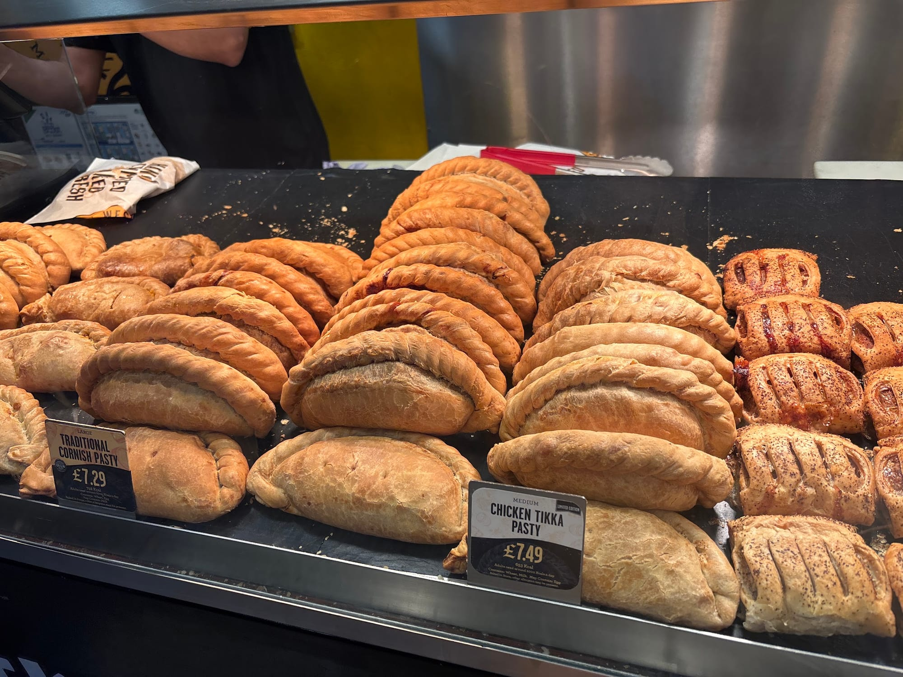

*A Cornish pasty's crimped edge.*

### The Scotch egg

A boiled egg wrapped in sausage meat, coated in breadcrumbs and fried: cold it is picnic food, hot with a soft yolk it is a different dish. **[Fortnum & Mason](https://www.fortnumandmason.com/food-hall/fresh-food/pies-scotch-eggs)** says it invented the Scotch egg in 1738 for the mail coaches leaving Piccadilly, and sells a "Traditional Scotch Egg" in its food hall. The claim is disputed: a Yorkshire version sold by a Whitby fishmonger and Mughal spiced eggs are the alternatives. For the dressed-up version, **[the Harwood Arms in Fulham](/articles/best-sunday-roast-london/)**, covered in our Sunday roast guide, makes its Scotch egg with venison from the owners' own stalking.

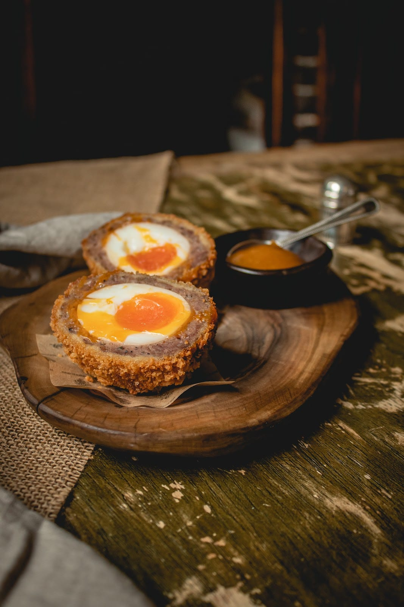

*A Scotch egg, served hot.*

### Bangers and mash

Sausages and mashed potato under onion gravy, on most London pub menus. "Banger" is usually traced to the world wars, when sausages were bulked out with water and spat in the pan. **[Mother Mash](https://www.thisissoho.co.uk/brands/mother-mash/)** on Ganton Street in Soho is a restaurant built around the combination, with a choice of British sausages, several mashes and gravies.

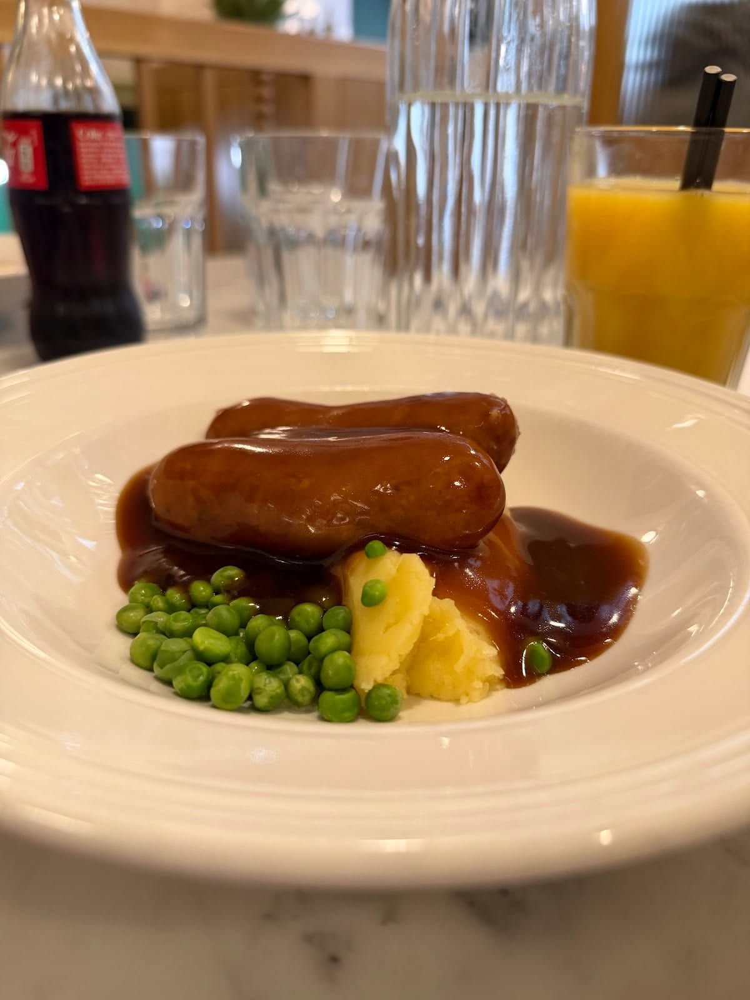

*Bangers and mash at Mother Mash.*

### Steak and kidney pudding

Steak and kidney in gravy, sealed inside a suet crust and steamed in a basin for hours rather than baked, so the pastry is soft. **[Rules](https://rules.co.uk/)** on Maiden Lane, open since 1798 and London's oldest restaurant by its own account, keeps it on the menu alongside a steak and kidney pie, made with beef from the restaurant's own Pennines estate.

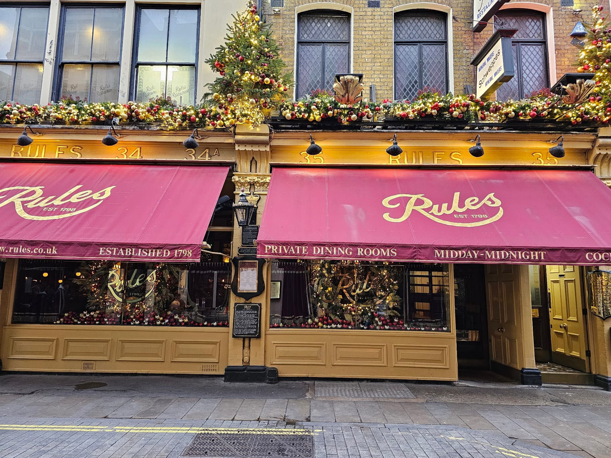

*Rules, on Maiden Lane.*

### Shepherd's pie and cottage pie

Minced meat under a layer of mashed potato, baked until the top browns. Shepherd's pie is made with lamb, cottage pie with beef. **[The Ivy](https://ivycollection.com/restaurants-near-me/the-ivy-london/the-ivy-west-street-covent-garden/)** on West Street in Covent Garden, the original since 1917, serves a version made from equal parts lamb and beef mince, in a disc on a pool of gravy.

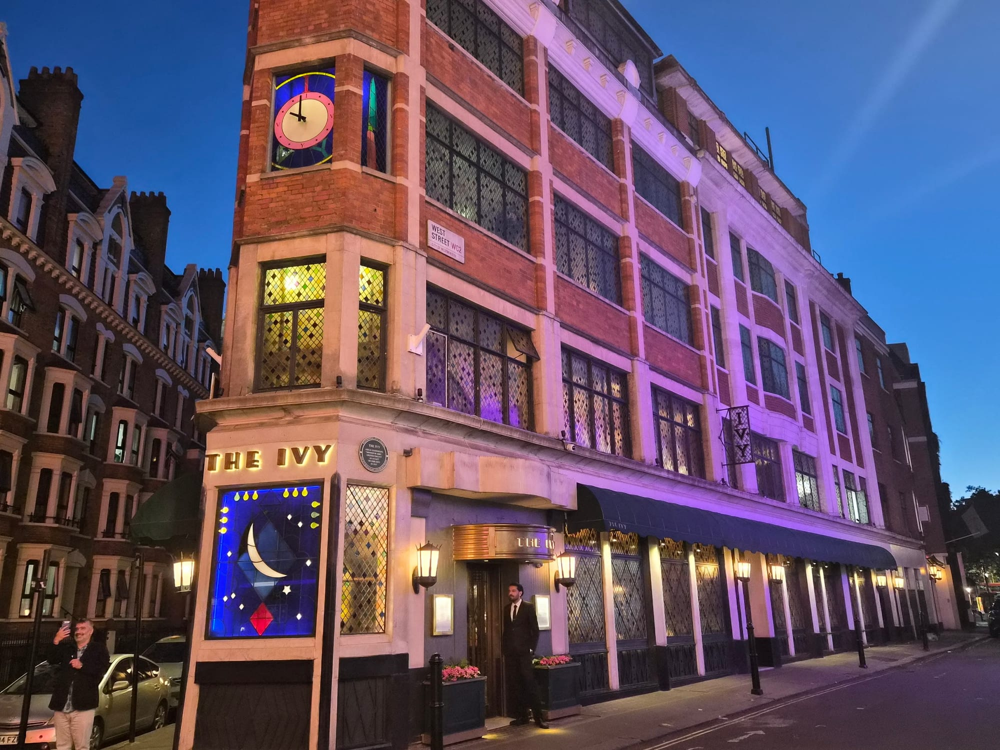

*The Ivy, West Street.*

### Welsh rarebit

A thick, savoury sauce of melted cheddar, egg yolk, mustard and usually beer, grilled onto bread until it browns, not a slice of cheese under the grill. **[J Sheekey](https://j-sheekey.co.uk/)** in Covent Garden, named by nine independent sources in our **[seafood guide](/articles/best-seafood-restaurants-london/)**, more than any other restaurant, makes its version with cheddar, egg yolk, Worcestershire sauce, mustard, Guinness and double cream, and sells it at the bar for about £5.

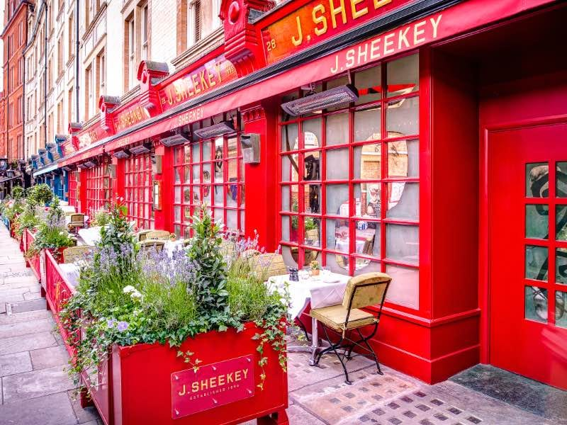

*J Sheekey, Covent Garden.*

---

## Puddings

"Pudding" in British usage means dessert in general. These are the four to know by name.

### Sticky toffee pudding

A date sponge soaked in hot toffee sauce, served with cream or custard, usually placed at a Lake District hotel in the 1970s. **Rules** keeps a sticky toffee pudding and a golden syrup sponge on the menu.

### Treacle tart

Shortcrust pastry filled with golden syrup, breadcrumbs and lemon juice and baked until set — golden syrup, not treacle proper. **[St. JOHN](https://stjohnrestaurant.com/)** in Smithfield, Fergus Henderson's nose-to-tail restaurant, open since 1994 and Michelin-starred since 2009, is known for its version, and for the bone marrow below.

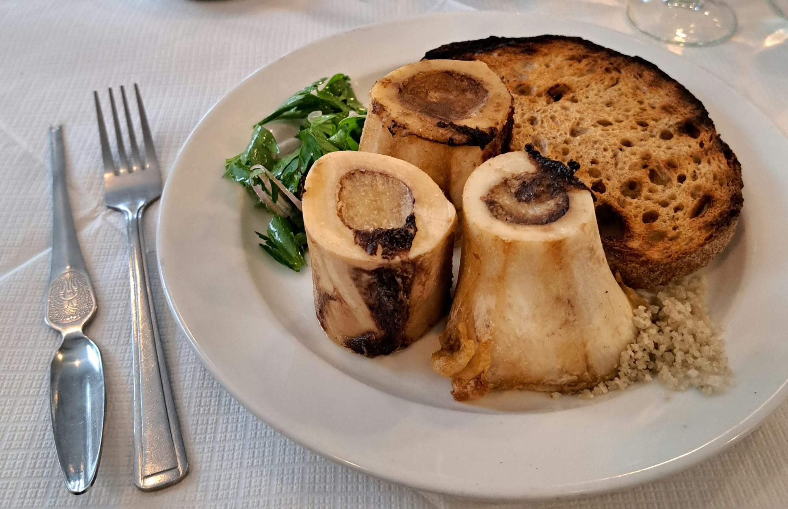

*Bone marrow at St. JOHN.*

### Spotted dick and sherry trifle

Spotted dick is a suet sponge studded with dried fruit, steamed and served with custard; sherry trifle is layers of sponge soaked in sherry, fruit, custard and cream, built in a glass bowl so the layers show. **[Simpson's-in-the-Strand](https://www.simpsonsinthestrand.co.uk/)**, open since 1828 and at 100 Strand since 1904, carves its meat from silver trolleys at the table and serves spotted dick with vanilla custard.

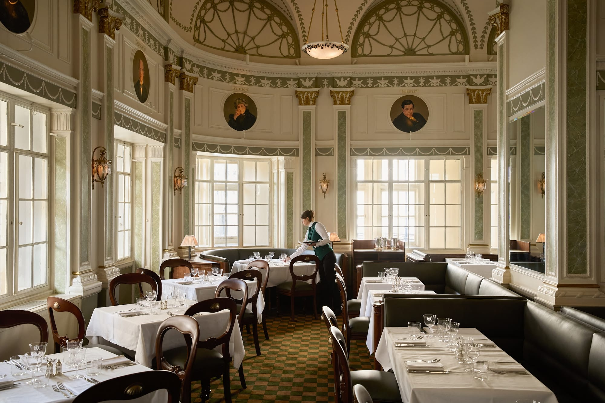

*Simpson's-in-the-Strand.*

---

Powered by <a target="_blank" rel="sponsored" href="https://www.getyourguide.com/london-l57/">GetYourGuide</a>

## What to know

* **Rules, The Ivy, J Sheekey and Simpson's-in-the-Strand** are all around Covent Garden and the Strand, so one afternoon can cover steak and kidney pudding, shepherd's pie, Welsh rarebit and spotted dick on foot.
* **Pie and mash shops close early.** M Manze shuts at 5.45pm Monday to Thursday and Goddards at 7.30pm.
* **"Liquor" is a sauce, not a drink**, and "pudding" means dessert in general — both catch visitors out on a menu.
* **Greggs, Wetherspoons and museum cafés are the cheap versions of most of this.** For a full English or a Sunday roast at a lower price, see our **[Wetherspoons guide](/articles/best-wetherspoons-pubs-london/)**; several branches open for breakfast from 7 or 8am.
* **A gastropub often covers several dishes on one menu**: a pie, a Sunday roast and a steamed pudding.
* **Several of London's oldest pubs serve a pie or pudding** — see our **[historic pubs and dining rooms guide](/articles/historic-pubs-dining-rooms-london/)**.

---

## Continue planning your London trip

- 🫖 **[The Best Afternoon Tea in London](/articles/best-afternoon-tea-london/)**
- 🍳 **[The Best Breakfast and Brunch in London](/articles/best-breakfast-brunch-london/)**
- 🥩 **[The Best Sunday Roast in London](/articles/best-sunday-roast-london/)**
- 🐟 **[The Best Fish and Chips in London](/articles/best-fish-and-chips-london/)**
- 🍺 **[The Best Wetherspoons in London](/articles/best-wetherspoons-pubs-london/)**
- 🍽️ **[Eat in London: Restaurants, Food Markets & Quick Food Hub](/articles/eat-in-london-guide/)**
