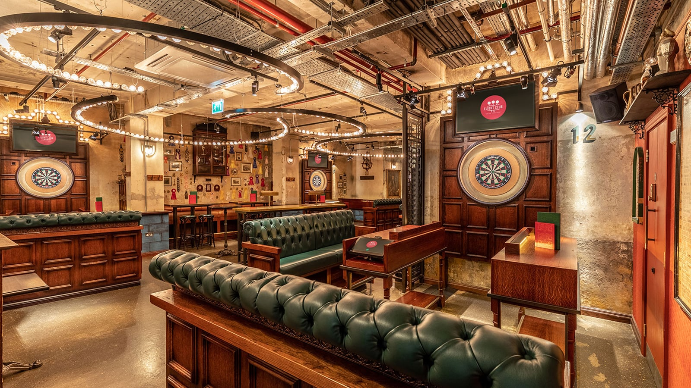
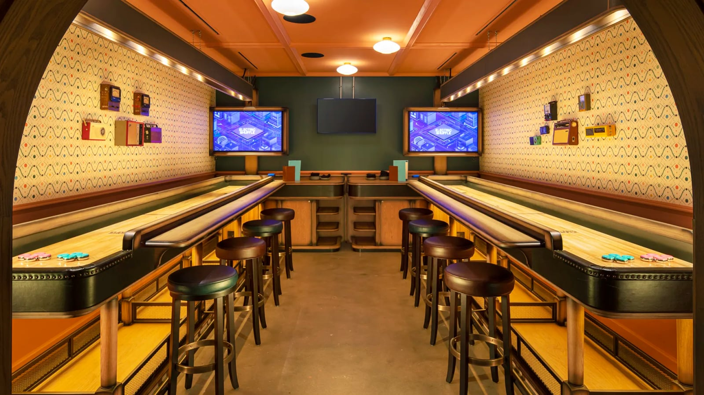

> 💡 **The Short Version:** **Mission: Breakout** is an escape room inside a real abandoned Tube station. **Bounce** is £6 a head. **Fairgame** is 18+ at every hour it opens. **Flight Club** will not take a booking of fewer than six after 4pm on a Friday. **THE CUBE** costs up to £57.69 a head and pairs you with strangers. **Junkyard Golf, Swingers City, Bounce Old Street and Bounce Farringdon have all closed.**

> 📘 **How we choose these (editorial note).**
> No paid placements. These are drawn from a wide spread of sources rather than any single list - the food and travel press, the big listings sites, independent blogs and specialists, video, and what Londoners recommend themselves - and cross-referenced against each other. Age policies are the venues' own and count for more here than usual - several are family-friendly by day and over-18 after 5, 6 or 7pm. Check before booking with children.

## Where they are

| If you are near… | What to play |
| --- | --- |
| **The City & Liverpool Street** | Fairgame City, Moonshine Saloon, Boom Battle Bar, Race Across The World |
| **Covent Garden & Leicester Square** | Bunga 90, Bat & Ball, Rocket Room |
| **Canary Wharf** | THE CUBE, Fairgame |
| **King's Cross & Bloomsbury** | Electric Shuffle, Flight Club, Bloomsbury Lanes, free table tennis |
| **Camden** | Mission: Breakout, Eclipso |
| **Shoreditch & Islington** | Flight Club |
| **Battersea & south** | Bounce, Gravity MAX Wandsworth, Boom Battle Bar |
| **Bethnal Green** | The Murdér Express |
| **Finsbury Park** | Rowans |

---

## In extraordinary buildings

### Mission: Breakout, Camden

*141–145 Kentish Town Road, NW1 8PB · escape room · from £28 a player*

An escape room built inside **South Kentish Town, an Underground station closed since 1924**.

Three games run in the station: Codebreakers, The Lost Passenger and UNDER-GROUND 2099. Each lasts **60 minutes** and takes **three to six players**. Rooms are private, so you are never mixed in with strangers. All three can run at once, which caps a single visit at **eighteen people**.

**Prices start at £28 a player**, open Monday to Sunday, 10am to 11pm, including bank holidays. Minimum age is nine and under-15s need an adult with them. Friday nights from 7pm are Fright Night sessions with extra scares, and those are **over-18s only**.

### The Murdér Express, Bethnal Green

*Arch 63, 63 Pedley Street, E1 5BW · immersive dinner · from £88*

A **1937 dining car built inside a railway arch**, with three courses and a murder to solve between them. The current show is Part Deux: Jewel of the Empire, with a menu by Lunar (two AA rosettes, listed in the Michelin Guide).

The show runs **two hours from the moment the doors open**, and the carriage is cleared within fifteen minutes of the train "arriving back". Actors work the carriage and you are expected to play along.

**Group size changes the price.** General admission is £88 plus a £4.90 fee, minimum two tickets. The Group Carriage is £66.25 a head for four and **£60 a head for six**, wine included and seats together — so arriving as a six costs a third less each than arriving as a pair. Under-5s are refused entry; 5- to 14-year-olds only at shows finishing by 8pm.

### Bunga 90, Covent Garden

*167 Drury Lane, WC2B 5PG · 1990s karaoke bar · walk-ins most days*

It replaced the old Bunga Bunga cabaret in September 2025 with a **1990s world**, entered through a Blockbuster-style video shop. Playable Mortal Kombat, Street Fighter and Tekken 2 cabinets sit around the room, and there is a Jurassic Park pinball table.

The bookable game is karaoke: **three private soundproofed rooms on 90-minute slots**, seven days a week. There is also karaoke on the bar and in the loos, unbooked and included, which is the cheaper way in.

**Walk-ins are welcome daily except Saturdays before 4pm.** **Groups of 21 or more** cannot book online and have to ring the venue to reserve a standing drinks area.

---

## From the television

### THE CUBE, Canary Wharf

*14 Charter Street, E14 5GZ · from £48.65 a head · 9+*

**Twenty-one glass cubes across three floors**, playing seven games from the show against a running score. Beat 10,000 points and you have beaten the Cube.

**It is played in fours, in a 2v2 format**: book two tickets and you are paired with another pair on arrival. Adults pay from £48.65 on Tuesday, Wednesday and Friday, £57.69 on Thursday and Saturday and £55.06 on Sunday, with 9- to 17-year-olds from £34.06. Closed Mondays.

A session runs **90 minutes to two hours**, longer when busy. Minimum age is nine and under-16s must be supervised. The venue is cashless, refunds are not given but bookings can be rescheduled, and walk-in tickets exist but are never guaranteed.

### Race Across The World: The Experience

*City of London · £35 an adult · teams of 2 to 8*

A foot race across the Square Mile run over WhatsApp, licensed from the series and operated by CityDays. You get clues, a virtual budget to spend on shortcuts, and three checkpoints with physical puzzles waiting at them. **No public transport is allowed**: the whole thing is on foot.

**Teams are two to eight people and play privately**, at £35 an adult (£70 for a pair, £280 for eight), with children aged 10 to 15 at £30, under-10s free alongside a paying adult, and **no booking fee**. Allow **two to three hours and about five kilometres of walking**. Tickets are released in batches rather than sold continuously.

---

Powered by <a target="_blank" rel="sponsored" href="https://www.getyourguide.com/london-l57/">GetYourGuide</a>

## Darts, golf and the rest

### Flight Club

*Bloomsbury, Islington, Shoreditch and Victoria · darts · from £10 a head*

Social darts, with seven multiplayer games, automatic scoring, food and drink brought to the oche, and a camera that emails you the highlights the next day.

**The booking rules.** Sessions are **fixed at 90 minutes and cannot be extended**. There is a **minimum group size** to book after 4pm: four people on Monday and Tuesday, **six from Wednesday to Friday and all day Saturday**, and six every day through December. A couple cannot book a Friday night.

Play starts at **£10 a head**. Groups over 12 get two oches, over 24 get three, and 37-plus goes to the events team. Family Sessions run Sunday to Friday until 4.30pm for ages 12 and up, but the venues are **strictly 18+ after 5pm Sunday to Friday and all day Saturday**. Bloomsbury has restricted wheelchair access.

*A darts bay at Flight Club.*

### Electric Shuffle

*King's Cross, London Bridge and Canary Wharf · shuffleboard · from £10 a head*

Shuffleboard with table service, four games and a board that scores itself. It is easy to pick up cold, so it suits a group with mixed skill.

**Pricing is banded by day rather than by hour.** Off-peak, Sunday to Tuesday, is **from £10 a head**; standard, Wednesday to Saturday, is **from £13**. Weekend bottomless brunch is £38 a head for two hours of sourdough pizza and Prosecco or beer with an hour of shuffleboard and a DJ attached.

**Groups of 2 to 32 can book online**, and 33 to 400 go through the events team for semi-private space or full hire. That takes smaller groups than Flight Club's six-person Friday minimum. The booking form is set to 18-plus; Family Sessions take ages 12 and up, Sunday to Friday until 4.30pm.

*Shuffleboard lanes at Electric Shuffle.*

### Swingers West End

*15 John Prince's Street, W1G 0AB · crazy golf · from £12 a head*

The only Swingers left, now the City site has closed. Crazy golf courses, street food from Pizza Pilgrims, Patty & Bun, Breddos Tacos and Crosstown, a carnival games hall alongside, and a terrace with a retractable roof.

**A round of nine holes takes 30 to 40 minutes at peak.** Your booking is a slot, not a start time: you are allocated a tee-off on arrival, and arriving early gets you a better choice.

**From £12 a head before 5pm and £16 after**, with online booking for up to 24 people and larger groups through the events team. **Tickets are released two months ahead** and evening slots do sell out, so this is one to book early. Online tickets are non-refundable, though the reception team can move a booking more than 48 hours out.

**Over-18s from 6pm daily** on Challenge 25, with last family entry at 5pm and children able to play from age seven. You can also come for the street food and cocktails with **no entry fee at all**. The course is wheelchair accessible on request.

### Rocket Room, Leicester Square

*2nd floor, Market Place, 20–21 Leicester Square, WC2H 7JX · axes and darts · from £8 a head*

Four games, **axe throwing, interactive darts, shuffleboard and beer pong**, in a bar-led space on the second floor of the Market Place food hall, so the food is whatever the hall is cooking.

**Axes are £12 per person per hour, £8 off-peak.** Darts are £10 and £8. Shuffleboard is £20 an hour for the board, £18 off-peak. Beer pong is a flat £30 an hour, peak or not.

**Axe throwing is 18-plus at all times**; everything else takes under-18s accompanied by an adult, under Challenge 25. **Closed-toe shoes are compulsory** for axes, and tracksuits, gym wear and sandals are refused at the door. Private hire runs to 120 guests. Cancellations inside seven days are not refunded.

### Bat & Ball, Covent Garden and Stratford

*50 Earlham Street, WC2H 9LJ · everything, plus live sport · walk-ins welcome*

A sports bar with games: **27 HD screens showing up to three matches at once**, alongside interactive darts, pool, ping pong, shuffleboard, mini golf, beer and prosecco pong, and karaoke.

**Walk-ins are welcome**; booking is recommended rather than required.

**Peak is from 5pm Wednesday to Friday and all day at weekends.** Under-18s are welcome until 7pm with a parent or guardian, and **it is 18-plus after 7pm** on physical government-approved ID. A **dress code applies from 7pm**: no tracksuit bottoms, sports shorts or gym wear, no hats, no work boots. Dogs are welcome until 8pm. Private spaces carry a minimum spend, not a hire fee.

### Bounce, Battersea Power Station

*Level 1, Turbine Hall B, 342 Circus Road South, SW11 8DD · ping pong · from £6 a head*

**£6 a head**, and now the only Bounce in London: Old Street closed after ten years and Farringdon in June 2026.

Ping pong with a bar round it, plus **Ping Pong X**, an AI-enabled, projection-mapped table running five interactive games with self-scoring, from £8 a head. Beer pong runs alongside. **The minimum group size is two.**

Bottomless brunch is **£30 a head** for 90 minutes of endless pizza with Prosecco or beer and a live DJ, Saturdays and Sundays. Group packages including activity, food and drink start at **£20 a head with a minimum of six**.

Battersea Power Station is on the Northern line extension.

### Fairgame, Canary Wharf and the City

*25–35 Fisherman's Walk, E14 4DH, and 1 New Change, EC4M 9AF · fairground games · 18+ always*

Fairground games wired for scoring (Down-the-Clown, skeeball, water guns), with an RFID card that tallies everything as you go round.

**Fairgame is 18-plus at every hour it opens**, on Challenge 25, and it requires **physical photo ID rather than a picture of one**.

**Canary Wharf is nine games in 75 minutes: £15 a head off-peak for unlimited play, or £19 at prime time.** The City site is bigger — **12 games in 90 minutes, £22 off-peak and £25 prime**. There is **no minimum group size at all**; one person can play alone against the room. Groups of 16-plus must book through the events team and **pre-purchase food and drink**. Cashless throughout, and cancellations inside 24 hours are not refunded.

### Gravity MAX, Wandsworth

*Southside, Wandsworth High Street, SW18 4TF · everything at once · MAX3 pass £28.50*

Under one roof: indoor karting, ten-pin bowling, AR digital darts, urban street golf, shuffleboard, batting cages, beer pong, Hologate VR, Sandbox VR, Immersive Gamebox and a Pixel Hyperfloor.

**Buy the MAX3 pass at £28.50 for three activities** rather than paying for each one, because the individual rates add up fast: karting is £15.25 a head, bowling £10.99, AR darts £11.25, urban street golf £12.25, the Hyperfloor £11.50, and shuffleboard £23.25 for 30 minutes of exclusive use on a board. Sandbox VR starts at £25. Online booking fees are extra on all of it, and the Wednesday Play Pass is £16.95.

Open **11am to 10pm Monday to Thursday, to 11pm on Friday and Saturday**, and from 10am at weekends.

### Boom Battle Bar

*Oxford Street, Liverpool Street, Ealing and Wandsworth · bundles from £27.50*

A chain with four London sites: augmented-reality axe throwing and darts, American pool, beer and prosecco pong, crazier golf, shuffleboard and BOOM BOX karaoke booths.

The Oxford Street room, opposite the Tottenham Court Road Elizabeth line entrance, runs **to 1am on both Friday and Saturday**, with Liverpool Street open to midnight, and **walk-ins are welcome** with booking only recommended.

**Strictly 18-plus after 7pm** at both central sites, under-18s welcome before that with an adult, and **axe throwing is 18-plus at every hour**. Bundles including game time, food and drink start at **£27.50 a head**. **Online booking stops at 12 people** and anything larger goes through the venue. Cancel inside 24 hours, or arrive more than 15 minutes late, and you are charged £10 a head.

---

Powered by <a target="_blank" rel="sponsored" href="https://www.getyourguide.com/london-l57/">GetYourGuide</a>

## Immersive and VR

### Eclipso, Camden

*213–219 Camden High Street, NW1 7BT · free-roaming VR · from £19*

Free-roaming VR: you walk through the space wearing the headset rather than sitting in a chair.

Three experiences run in rotation. **Colosseum: The Legendary Arena** is 35 minutes from £19, following a ten-year-old Roman boy through first-century Rome. **Space Explorers: The ISS Experience** is 40 minutes from £25, built from 360-degree footage actually filmed aboard the International Space Station — you walk the modules, not watch them. **Titanic: Echoes from the Past** is 30 minutes from £19.

**All three are ages 8 and up.** It is a basement reached by **two flights of stairs and is not wheelchair accessible**. It holds up to 180 people, so it is usually possible to book on the day.

### Moonshine Saloon, City of London

*28–30 Houndsditch, EC3A 7DB · immersive cocktails · 18+ · from £38*

A Prohibition saloon where you are cast as an outlaw and the barkeeps mix cocktails in front of you as part of the story. Actors work the room, there are cards and dice, and everyone is given period western dress to blend in.

**You bring your own spirit.** The venue asks for a 35cl bottle between two guests or 70cl between four, new, unopened and sealed. Every mixer, bitter, syrup, liqueur, juice and garnish is included in the ticket, and the bar turns your bottle into **three to four rounds** across the session. Bring wine or beer instead and they will serve that.

**Bookings last 1 hour 45 minutes** and admission closes 15 minutes after your start time. Tickets are £38 plus a £3.04 fee for the Rookie, £48 for the Bandit, £54.50 for the Outlaw. **Strictly 18-plus with ID.** There is **no minimum or maximum table size**, and groups over 30 must book through the group bookings page.

---

## The traditional versions, which are much cheaper

### Bloomsbury Lanes

*Bedford Way, WC1H 9EU · bowling, karaoke and darts · from £45 a lane*

A basement bowling alley with an American diner, karaoke rooms and a bar.

**Lanes are booked by the hour, not by the head.** One lane takes up to six players and costs **£45 an hour Sunday to Tuesday until 5pm**, £55 an hour after 5pm on those days, and £65 an hour Wednesday to Saturday. Six people splitting an off-peak lane pay £7.50 each.

Karaoke rooms hold 8 to 30 people and run **£60 to £120 an hour, half price on Mondays, Tuesdays and Sundays**. The darts oche is £30 an hour and takes six solo players or twelve in pairs, on a real board with real darts, not a screen.

**Walk-ins are £10 a person a game, but lanes are not held for them.** Students pay £6.50 a game Monday to Friday until 5pm, booked in advance by email with a student ID. Arrive 15 to 20 minutes early, and note there are no bumpers on the lanes.

### Rowans, Finsbury Park

*10 Stroud Green Road, N4 2DF · bowling, pool and karaoke · over-21s only after 7pm at weekends*

Bowling, **14 electronic pool tables**, karaoke and a dance floor.

Bowling is **£8.60 a game per person Monday to Thursday daytime**, rising to £10.80 in the evening on Friday and Saturday, with the £1 shoe hire included. On top of that sits an **admission fee** — £1 during the day and on Sunday to Thursday evenings, **£5 after 7pm on Friday and Saturday**. Children aged 12 and under get 50p off the game rate.

**Age rules are strict.** Under-18s must leave by 10pm Sunday to Thursday and **by 7.30pm on Friday and Saturday**, and after 7pm on those two nights **only over-21s are admitted, with photo ID**. Under-12s are never admitted without an adult.

Open until 12.30am Sunday to Thursday and **2.30am on Friday and Saturday**.

### Tenpin, outer London

*Acton, Bexleyheath, Croydon, Feltham and Kingston · bowling from £9.95*

Five sites around the edge of London, each pairing lanes with some combination of karaoke rooms, laser tag, escape rooms, pool, table tennis and an arcade.

**A game booked online is £9.95.** **Tenpin Tuesday is 50% off bowling**, Friday Frenzy is 20% off up to three games, and there are meal deals from £10 for two games and food.

Karaoke is **£25 for a 30-minute room taking up to ten people**. Laser tag is £36 for 30 minutes, and a bowling party is £13.99 a child.

Acton opens **10am to 1am Monday to Thursday and to 2am on Friday and Saturday**, from 9am at weekends. A game takes roughly ten minutes a player.

### Free table tennis: King's Cross and Merchant Square

*Granary Square and Paddington Basin · free · no booking*

Two central London estates keep table tennis tables that cost nothing and take no booking.

**King's Cross** has a table in **The Crossing**, the public hall of the Granary Building, with bats and balls from the PlayMade PlayPod in the UAL atrium. There are more tables on the **viaduct level outside UNIQLO in Coal Drops Yard**, where you collect the bats from the shop itself. No booking — turn up and play.

**Merchant Square in Paddington** has **three outdoor tables beside the canal next to Waterside House**, free to use all year round with no booking required, and free racket and ball hire from the PlayMade box at the East Plaza Steps.

---

## Closed, moved or dark — and worth saying so

* **Junkyard Golf Club London** — **closed.** It was at 91 Brick Lane in the Old Truman Brewery. Leeds, Liverpool, Manchester, Newcastle and Oxford continue.
* **Swingers City** — **closed on 22 March 2025**. **Swingers West End is now the only UK site**.
* **Bounce Old Street** — **closed**, with visitors pointed to Battersea. **Bounce Farringdon**, at 121 Holborn, **closed on Saturday 13 June 2026**.
* **Illusionaries**, Canary Wharf — both exhibitions, Latent Spaces and Entheon, **have ended** and nothing is on sale.

---

Powered by <a target="_blank" rel="sponsored" href="https://www.getyourguide.com/london-l57/">GetYourGuide</a>

## What it costs

Most venues charge per lane, per oche or per time band rather than a flat per-head figure.

* **The spread is £6 to £57.69 a head for the game alone.** Bounce is £6, Rocket Room off-peak is £8, Flight Club and Electric Shuffle are £10, Fairgame Canary Wharf is £15, Swingers is £12 to £16, and THE CUBE is £48.65 to £57.69.
* **Book the earliest slot.** Almost every venue here is cheaper before 5pm on a weekday: Electric Shuffle drops from £13 to £10, Rocket Room from £12 to £8, Fairgame City from £25 to £22, Swingers from £16 to £12.
* **Group rates beat individual rates, sharply.** The Murdér Express falls from £88 a head to £60 if you book as a six. Bloomsbury Lanes charges £45 for a lane of six off-peak, which is £7.50 each. Gravity's MAX3 pass is £28.50 for three activities that would cost £37.49 as karting, bowling and darts bought individually.
* **Drinks are on top** at most venues here.
* **The free options are real.** King's Cross and Merchant Square both run free table tennis with no booking, and Swingers, Bat & Ball and Boom Battle Bar all let you in for food and drinks with no entry fee if you skip the game.

> **Keep it to one activity.** Most sessions run 60 to 90 minutes, so treat one as the first act of an evening.

---

## What to know

* **Check the group minimum before the price.** Flight Club will not take fewer than six after 4pm from Wednesday to Saturday. Bounce, Electric Shuffle and Fairgame will take two, and Fairgame will take one.
* **Check the group maximum too.** Online booking caps at 12 at Boom Battle Bar, 24 at Swingers, 32 at Electric Shuffle and 36 at Flight Club. Above those numbers you are dealing with an events team, a quote and usually a pre-order.
* **The age cut-off is a different hour at every venue.** Flight Club is 18+ from 5pm, Swingers from 6pm, Bat & Ball and Boom Battle Bar from 7pm. Fairgame is 18+ all day. Rowans is **over-21s only** after 7pm on Friday and Saturday. Eclipso takes children from 8 and Mission: Breakout from 9.
* **Walk-ins work at a handful of places and nowhere else.** Bat & Ball, Boom Battle Bar and Bunga 90 welcome them; Bloomsbury Lanes has a walk-in rate but will not hold a lane. Everywhere else, assume you need a booking Thursday to Saturday.
* **Sessions are shorter than an evening.** Ninety minutes at Flight Club, 75 at Fairgame Canary Wharf, 60 at Mission: Breakout, 30 to 40 minutes for nine holes at Swingers. Plan dinner separately.
* **Axe throwing is 18+ everywhere, even where the venue is not.** Rocket Room and Boom Battle Bar both apply it at all hours, and both require closed-toe shoes.

---

## Continue planning your London trip

- 🎪 **[Free Things to Do in London](/free/)**
- 🎤 **[The Best Karaoke in London](/articles/best-karaoke-london/)** — private rooms, KTV and free pub nights, with room sizes and prices
- 🎵 **[The Best Live Music Venues in London](/articles/best-live-music-venues-london/)**
- 🍸 **[The Best Cocktail Bars in London](/articles/best-cocktail-bars-london/)**
- 🎬 **[London's Best Independent Cinemas](/articles/best-cinemas-london/)**
- 🏙️ **[Canary Wharf Area Guide](/articles/canary-wharf-area-guide/)**
- 🎨 **[Shoreditch Area Guide](/articles/shoreditch-area-guide/)**

---

*This guide is independent and contains no paid placements.*
