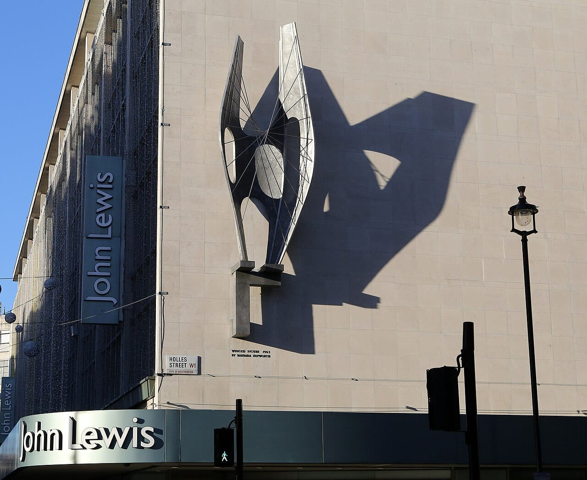
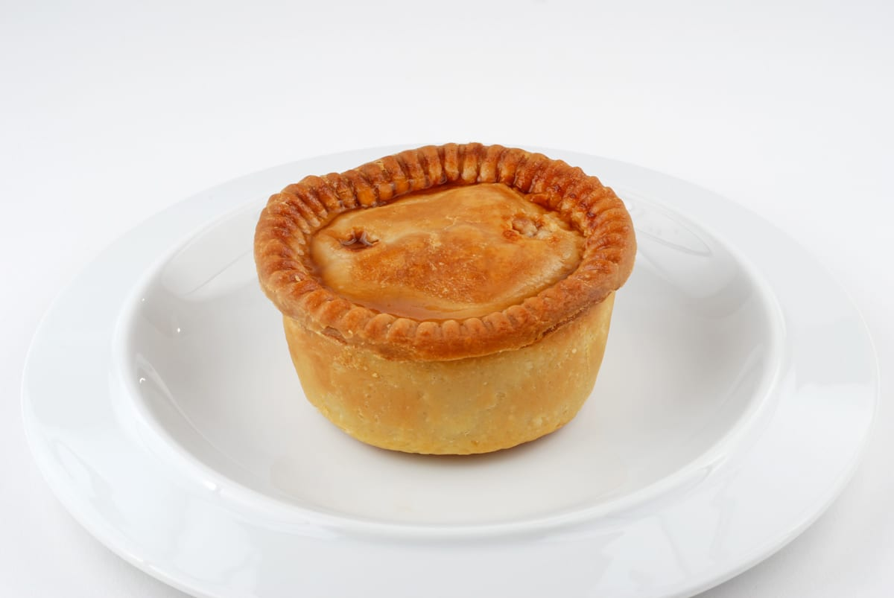
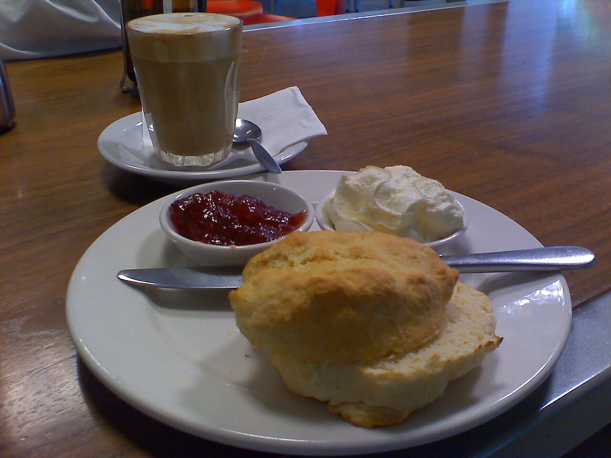

**You can book a London cookery class by the evening, the afternoon or the day, and most end with you eating what you made.** They come from cookery schools with their own kitchens and from smaller studios, and the choice is mostly what you want to cook and whether you want a meal out of it.

> 💡 **The Short Version:** For pasta, **Jamie Oliver Cookery School** has a 2-hour **Pasta Master** at **£75** in Islington or on Oxford Street, and **La Cucina Caldesi** runs a full-day pasta workshop in Marylebone for **£180** with lunch and wine. For an evening with the drink included, **Food at 52** in Clerkenwell is **£145** for about three and a half hours with free-flowing wine, and **Pasta Evangelists** on GetYourGuide is **£50** with unlimited Prosecco. For the cheapest booking, the **scone workshop** near Camden Market is **£29** for an hour. For something British, make **pork pies** (**£60**, 3 hours). To learn a skill in a day, **Leiths** teaches pasta, pastry, fish or knife skills from 10am to 2.30pm for **£210**.

> 📘 **Booking and prices.** We earn a commission if you book through our GetYourGuide links; the price is the same either way. Where a school sells its own classes, we link to its page. No operator paid to be included. Prices are the adult price for one place and move with the class.

## The pick for each reader

| Best for | Class | From | Length | What you cook |
|---|---|---|---|---|
| Cheapest | Scone workshop, Camden | £29 | 1 hour | Traditional scones, eaten warm with jam and cream |
| Pasta with a meal | Jamie Oliver, Pasta Master | £75 | 2 hours | Tagliatelle, farfalle and vermicelli with three sauces |
| Pasta all day | La Cucina Caldesi, 1 Day Pasta Workshop | £180 | 10am to 4pm | Long, coloured, shaped and stuffed pasta, plus gnocchi |
| An evening with wine | Food at 52 | £145 | about 3½ hours | One cuisine, such as an Indian street feast |
| Pasta with Prosecco | Pasta Evangelists | £50 | 2 hours | Fresh pasta, with unlimited Prosecco and antipasti |
| A British classic | Pork pie class | £60 | 3 hours | Pastry, filling and assembled pork pies |
| A skill in a day | Leiths masterclass | £210 | 10am to 2.30pm | Pasta, pastry, bakery, fish or knife skills |

## Cookery schools

### Jamie Oliver Cookery School — Islington and Oxford Street

*Pasta Master £75 · 2 hours · 18+ · <a href="https://jamieolivercookeryschool.com/cooking-classes/pasta-master/" target="_blank" rel="noopener">Book on the school's site</a>*

In the **Pasta Master** you make pasta dough from scratch, roll it with a pasta machine and cut it into tagliatelle, farfalle and vermicelli. You then learn three simple sauces and cook a creamy mushroom one, and sit down at the chef's table to eat the pasta with a rocket and radicchio salad. A glass of bubbles on arrival, or tea or coffee before noon, is included, and you can buy other drinks. You work in pairs. The class takes over-18s, and 15 to 17-year-olds can come with an adult who is also taking part. It is not suitable for gluten-free diets.

The school has two London kitchens. **Islington** is at 160 Holloway Road, N7 8DD, inside Jamie Oliver's head office, for up to 18 people; Holloway Road station is the closest. **Oxford Street** is on the third floor of John Lewis, with two classrooms and a communal dining area for groups of up to 48. For less time, the **Hand-Shaped Fresh Pasta** class is £60 for 1½ hours, cooking and dining included. For more, **The Complete Guide to Pasta** is £190 for 5 hours. You get a full refund or a free reschedule with at least 7 days' notice.

*John Lewis on Oxford Street, home to one of the school's two kitchens. Photo: [Martin Addison](https://commons.wikimedia.org/wiki/File:John_Lewis,_Oxford_Street_-_geograph.org.uk_-_3793086.jpg), [CC BY-SA 2.0](https://creativecommons.org/licenses/by-sa/2.0/).*

### La Cucina Caldesi — Marylebone

*1 Day Pasta Workshop £180 · 10am to 4pm · <a href="https://www.caldesi.com/caldesi-italian-restaurants-and-cookery-schools/la-cucina-caldesi-italian-cookery-school/" target="_blank" rel="noopener">See classes on the school's site</a>*

**4 Cross Keys Close, W1U 2DG**, about 400 metres from Bond Street station. Over six hours you make long, coloured, shaped and stuffed pasta, learn sauces to go with them and make soft gnocchi. The sample menu, which changes with the season, includes a lasagne, a mushroom and mascarpone pasta roll, large spinach and ricotta ravioli and cacio e pepe bucatini. You make lunch together and eat it with wine, and there is plenty to take home, including the school's oven-baked pasta. The price includes coffee and a croissant on arrival, two drinks with the meal, an apron to keep and a recipe pack emailed afterwards.

For an evening, the **Make Ravioli like my Nonna** class is £85 for two hours: you make tagliatelle and spinach and ricotta ravioli, then sit down and eat them with wine. Our [Marylebone area guide](/articles/marylebone-area-guide/) covers the neighbourhood.

### Food at 52 — Clerkenwell

*Cookery classes £145 · about 3½ hours · <a href="https://www.foodat52.co.uk/products/indian-street-feast-cookery-class-new" target="_blank" rel="noopener">Book the Indian Street Feast</a>*

**96 Central Street, EC1V 8AJ**, a 10-minute walk from Old Street. You cook in a group and then eat what you have made, with red or white wine and soft drinks included in the price. The **Indian Street Feast** menu is pani puri with a chickpea stuffing and herb water, handmade chapatis, saag paneer, curry leaf chicken or cauliflower and cumin pilau rice. Its dates fall on Fridays and Saturdays. The Indian, French, Vietnamese, Mexican and fish and seafood classes start at £145. The **Authentic Italian Pasta Masterclass** comes in two lengths, £115 for 2½ hours or £175 for 5 hours, and finishes with a chocolate torta. The school describes the feel as a dinner party rather than a classroom.

### Leiths Culinary Masterclasses — Wendell Road, W12

*£210 including VAT · 10am to 2.30pm · <a href="https://leiths.com/culinary-masterclasses/culinary-masterclass-pasta-skills/" target="_blank" rel="noopener">Book on Leiths' site</a>*

**16–20 Wendell Road, W12 9RT.** Stamford Brook is a 15-minute walk and Goldhawk Road 20 minutes. Leiths teaches professional cooks, and its one-day masterclasses use the same techniques for home cooks. The masterclasses are **Pasta Skills** (dough, rolling, filling and sauces), **Pastry Skills** (sablé pastry and puff pastry), **Bakery Skills** (pastry and cakes), **Fish Skills** and **Knife Skills** (jointing poultry and filleting fish). Classes run in small groups with the ingredients weighed out for you. The class starts at 10am, cooking ends about 1.45pm, and you eat lunch with the others. The day ends at 2.30pm. The washing-up is done for you. Booking two places on one masterclass takes 20% off.

## Smaller studios

### Cook and Craft Collective — Islington

*Pork pie £60 · 3 hours · small group · 4.9 from 18 reviews · <a href="https://www.getyourguide.com/activity/-t608869?partner_id=WWP7I0R&amp;cmp=cookery-classes-london" target="_blank" rel="sponsored nofollow noopener" data-affiliate="gyg">Book on GetYourGuide</a> or <a href="https://cookandcraftcollective.com/products/byob-pork-pie-workshop" target="_blank" rel="noopener">on the studio's site</a>*

**Tradestars Islington, 4–10 North Road, N7 9EY**, 400 metres from Caledonian Road station. JoJo or her team show you how to make the pastry, choose your fillings and assemble **pork pies**, and you eat a warm one from the oven with a drink of your choice. You bring your own bottle, or soft drinks.

*A pork pie. Photo: [Palladian](https://commons.wikimedia.org/wiki/File:Pork_pie_on_plate.jpg), [CC BY-SA 4.0](https://creativecommons.org/licenses/by-sa/4.0/).*

The studio's **pizza class** is £45 for 2½ hours, rated 4.3 from 32 reviews on <a href="https://www.getyourguide.com/activity/-t608210?partner_id=WWP7I0R&amp;cmp=cookery-classes-london" target="_blank" rel="sponsored nofollow noopener" data-affiliate="gyg">GetYourGuide</a>. The dough is pre-prepared, so you go straight to toppings and baking, and you take home a batch of dough. On its own site it also runs a [macaron class](https://cookandcraftcollective.com/products/in-person-french-macaron-making-workshop) at £60 for 2½ hours, a [scone class](https://cookandcraftcollective.com/products/byob-lets-make-scones-over-18s) at £60 and [chocolate truffles](https://cookandcraftcollective.com/products/chocolate-truffle-making) at £45 for 2½ hours.

## On GetYourGuide

### Scone Workshop and Afternoon Tea — near Camden Market

*£29 · 1 hour · 4.9 from 1,236 reviews · <a href="https://www.getyourguide.com/activity/-t826151?partner_id=WWP7I0R&amp;cmp=cookery-classes-london" target="_blank" rel="sponsored nofollow noopener" data-affiliate="gyg">Book on GetYourGuide</a>*

You bake **traditional British scones** a short walk from Camden Market, with a cup of English tea while you work, and eat them warm from the oven with jam and cream. It is the cheapest class on this page and by far the most reviewed. Our [Camden area guide](/articles/camden-area-guide/) has what to do afterwards.

*A scone with jam and cream. Photo: [Alpha](https://commons.wikimedia.org/wiki/File:Scone_Jam_Cream_Tea.jpg), [CC BY-SA 2.0](https://creativecommons.org/licenses/by-sa/2.0/).*

### Pasta-Making Classes with Unlimited Prosecco and Antipasti

*£50 · 2 hours · 4.9 from 40 reviews · <a href="https://www.getyourguide.com/activity/-t1198349?partner_id=WWP7I0R&amp;cmp=cookery-classes-london" target="_blank" rel="sponsored nofollow noopener" data-affiliate="gyg">Book on GetYourGuide</a>*

Two hours making fresh pasta in a **Pasta Evangelists restaurant**, with unlimited Prosecco or soft drinks and antipasti. It is the cheapest of the pasta classes here.

### Indian Cooking Masterclass with Food Shop Visit

*£89 · 2½ hours · small group · 5.0 from 6 reviews · <a href="https://www.getyourguide.com/activity/-t1044904?partner_id=WWP7I0R&amp;cmp=cookery-classes-london" target="_blank" rel="sponsored nofollow noopener" data-affiliate="gyg">Book on GetYourGuide</a>*

You cook authentic Indian dishes with a professional chef, and the class includes a visit to a local Indian food shop and blending spices, then you eat the meal together. For a ready-made meal afterwards, see our [best Indian restaurants in London](/articles/best-indian-restaurants-london/).

Powered by <a target="_blank" rel="sponsored" href="https://www.getyourguide.com/london-l57/">GetYourGuide</a>

## Doing it yourself

If you would rather eat than cook, or want a drink class instead:

* **Pasta and Italian:** [the best Italian restaurants in London](/articles/best-italian-restaurants-london/).
* **Afternoon tea:** [the best afternoon tea in London](/articles/best-afternoon-tea-london/).
* **Markets and street food:** [the best London markets](/articles/best-london-markets/) and [the best street food in London](/articles/best-street-food-london/).
* **Walks that taste things:** [food tours in London](/articles/london-food-tours/).
* **Make a bottle of gin instead:** [gin distillery tours in London](/articles/gin-distillery-tours-london/).
