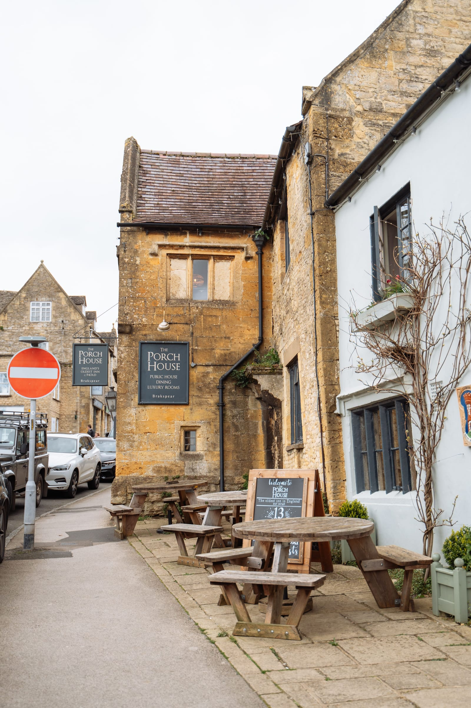
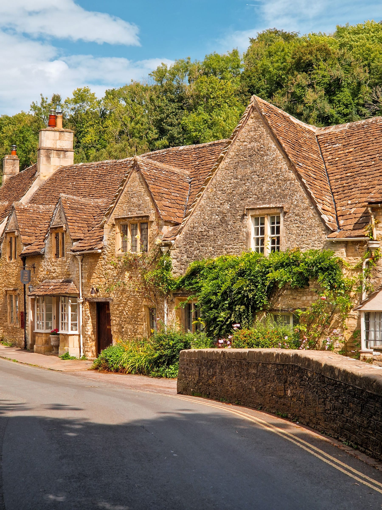
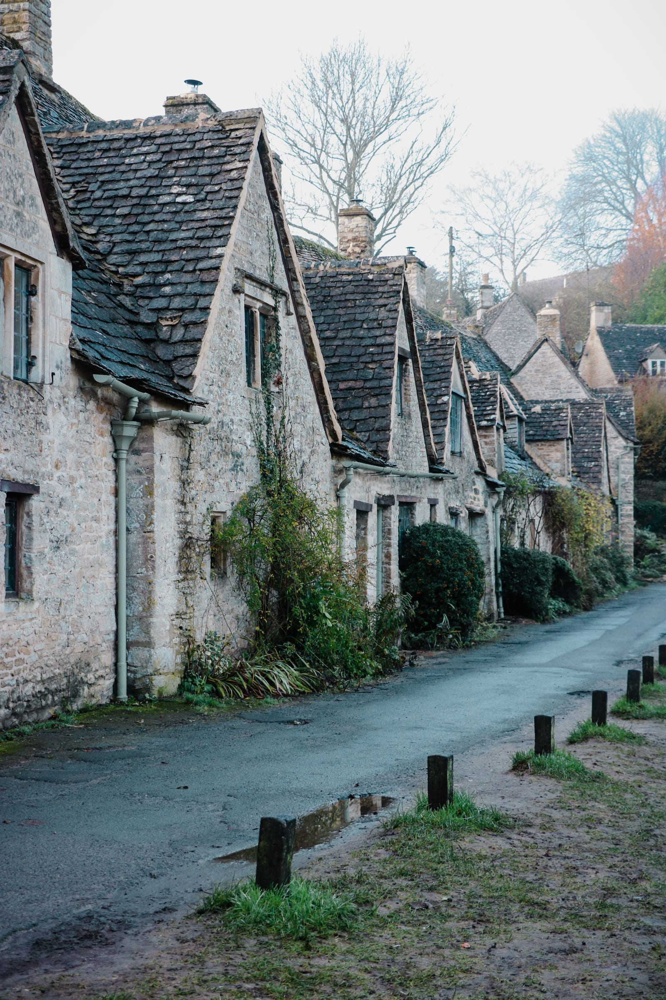
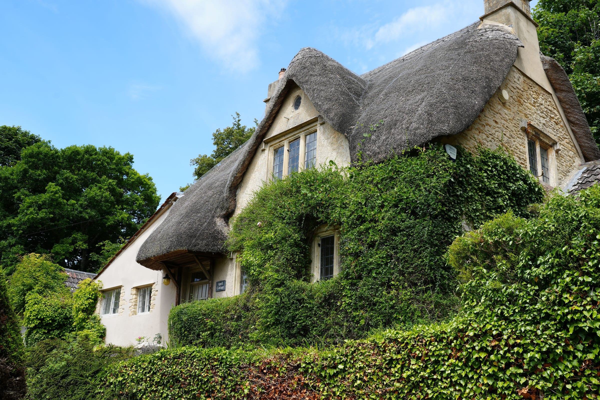
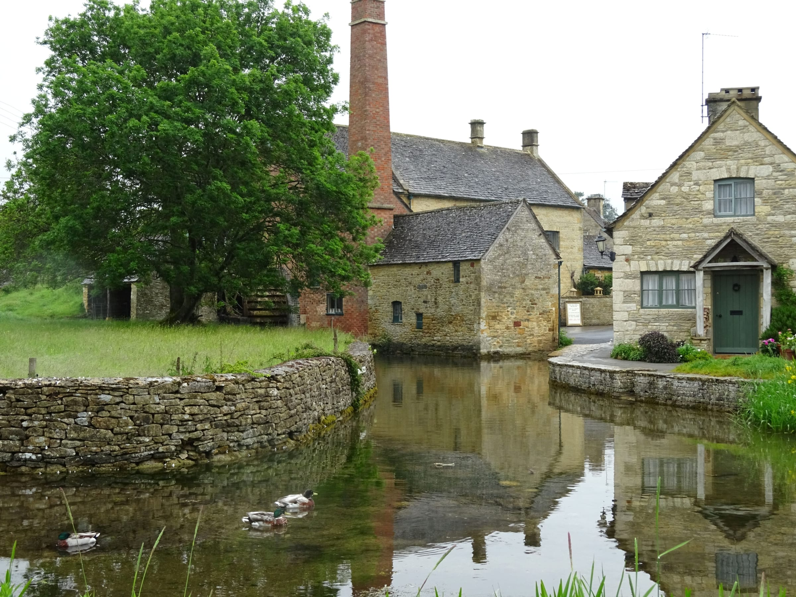

**The Cotswolds is a range of hills across several counties**, with no railway between the villages and a bus network that largely stops on Sundays. Most people book a coach tour or hire a car. One train-and-bus day works, and it runs through Moreton-in-Marsh.

> 💡 **The Short Version:** **Paddington to Moreton-in-Marsh, 1h25, £54.00 off-peak return** — and a single is £53.00, so always buy the return. The **Pulhams 801** leaves the station for **Stow in 20 minutes and Bourton in 40**, hourly, **including Sundays**. The **855 to Bibury runs Monday to Saturday and not at all on Sunday**; nor does the **606** to Broadway or the Stagecoach **1/2/3** to Chipping Campden. A **£8.50 day ticket** on the bus covers the lot. Driving is **2h14 and 88 miles** to Bourton, where 10 hours' parking is **£10.60** — against **free** at Stow Fosseway and **free** at Burford. **Bibury has no car park.** Nothing in the Cotswolds needs a ticket, so the paid attractions are all optional. **Or skip the buses** — the <a href="https://www.getyourguide.com/activity/-t215430?partner_id=WWP7I0R&amp;cmp=cotswolds-day-trip" target="_blank" rel="sponsored nofollow noopener" data-affiliate="gyg">£89 small-group tour</a> covers Burford, Bibury, Bourton and Stow in 9½ hours from South Kensington.

> ⚠️ **Great Western trains cannot run to or from Paddington from Sunday 27 December 2026 to Sunday 3 January 2027, or on Saturday 28 and Sunday 29 November, for the Dolphin Junction upgrade.** Most long-distance trains start and finish at Reading, and on 28 and 29 November Chiltern Railways trains run between Marylebone and Oxford and Banbury; check the Christmas dates before you book ([National Rail](https://www.nationalrail.co.uk/dolphinjunction/), [Network Rail](https://www.networkrailmediacentre.co.uk/news/most-of-britains-railway-open-for-christmas-with-passengers-advised-to-plan-ahead-around-engineering-work)).

**Book a tour direct:**

- **£89** — <a href="https://www.getyourguide.com/activity/-t215430?partner_id=WWP7I0R&amp;cmp=cotswolds-day-trip" target="_blank" rel="sponsored nofollow noopener" data-affiliate="gyg">Cotswolds Small-Group Tour</a>, Burford, Bibury, Bourton and Stow — the classic four villages, 4.8 from 5,186 reviews
- **£74** — <a href="https://www.getyourguide.com/activity/-t795342?partner_id=WWP7I0R&amp;cmp=cotswolds-day-trip" target="_blank" rel="sponsored nofollow noopener" data-affiliate="gyg">Cotswolds Villages Group Tour</a> — the cheapest coach, Burford, Bibury and Bourton
- **£89** — <a href="https://www.getyourguide.com/activity/-t927065?partner_id=WWP7I0R&amp;cmp=cotswolds-day-trip" target="_blank" rel="sponsored nofollow noopener" data-affiliate="gyg">7 Unmissable Cotswolds Stops</a> — the widest line-up, including Chipping Campden and Snowshill

Powered by <a target="_blank" rel="sponsored" href="https://www.getyourguide.com/london-l57/">GetYourGuide</a>

Sixteen tours are compared further down by villages visited, time in each, group size and departure point.

## First, which Cotswolds

The northern Cotswolds — Moreton-in-Marsh, Stow, Bourton, Broadway, Chipping Campden — is one cluster, and the Cotswold Line from Paddington runs along its eastern edge. The southern Cotswolds — Bibury, Cirencester, Burford, Castle Combe — is a different cluster reached from a different set of stations, and Castle Combe is so far south it is a Bath trip, not a Cotswolds one. See [Bath from London](/articles/bath-day-trip/) for that end.

**Choose one cluster. Doing both in a day is a coach tour's job.**

## By train

All six run from Paddington. Returns were quoted for a Tuesday mid-morning departure; the cheap fare disappears on afternoon departures from about 15:20.

| Station | Fastest | Off-peak return | What it actually puts you near |
| --- | --- | --- | --- |
| **Moreton-in-Marsh** | **1h 25m** direct | **£54.00** | The town, on the platform. **The 801 bus to Stow (20 min) and Bourton (40 min)**, plus the Stagecoach 1/2/3 to Broadway and Chipping Campden |
| Kingham | **1h 17m** direct | **£46.80** | Nothing. 4 miles from Stow, 5 from Bourton, **no useful bus** |
| Charlbury | 1h 08m direct | **£45.70** | Charlbury itself — Market Street is 0.3 miles, nine minutes on foot |
| Kemble | 1h 09m direct | £63.20 | **Cirencester**, 12 minutes on the Stagecoach 882 — five or six journeys a day, Mon–Sat |
| Stroud | 1h 25m direct | £63.20 | Stroud: a working Five Valleys market town, not a postcard village |
| Cheltenham Spa | 1h 59m direct | £70.90 | **Royal Well bus station**, where the 801, 606 and X52 all start — 1.1 miles and 25 minutes on foot from the platform |

> ⚠️ **Buy the return, always.** A single to Moreton-in-Marsh is **£53.00** against a £54.00 off-peak return, and there is no Advance fare on this line.

**Sunday is cheaper and slower.** A Sunday return is still £54.00 but a Sunday single drops to £35.50, trains leave Paddington hourly at :44 and take 1h39, and the last one back leaves Moreton at **21:46**, in at 23:40. On a weekday the last is **23:31**, arriving 01:16.

**Kingham** is eight minutes quicker and £7.20 cheaper than Moreton, and 5 miles from Bourton against Moreton's 8, but there is no bus, so use it only if you have booked a taxi.

## The buses

*Stow-on-the-Wold. Photo: Daria Agafonova, Pexels.*

One route does almost all the work, and three of the five stop on Sundays.

| Route | Frequency | Sunday | Where it goes |
| --- | --- | --- | --- |
| **801** | **Hourly** | **Yes, hourly 07:45–18:45 from Moreton** | Cheltenham – Bourton – **Stow** – **Moreton station** – Chipping Norton |
| **855** | Hourly-ish, Mon–Sat | **None** | Bourton – Northleach – **Bibury** – Cirencester |
| **606** | 6 journeys a day, Mon–Sat | **None** | Chipping Campden – **Broadway** – Winchcombe – Cheltenham |
| **1 / 2 / 3** (Stagecoach) | 3–6 journeys a day, Mon–Sat | **None** | Stratford – Broadway – **Chipping Campden** – Moreton station |
| **X52** | Every 2 hours | Yes, 5 journeys | Oxford – Witney – **Burford** – Northleach – Cheltenham |

The **801** calls at Moreton-in-Marsh Railway Station, and on a weekday leaves at 09:45, 10:45, 11:45, 12:45, 13:45, then 15:05, 15:55, 16:55 and on into the evening. Stow-on-the-Wold Library is 20 minutes; Bourton is 40. Coming back, the last bus from Bourton that reaches Moreton station is **21:15 on a weekday and 17:15 on a Sunday** — the later Sunday journeys terminate before Moreton.

**The 855 is the only bus to Bibury**, 32 minutes from Bourton, and it does not run on Sundays in either direction.

**Broadway and Chipping Campden are reachable from Moreton station** on Stagecoach service 1/2/3 — 28 minutes to Broadway on three journeys a day, about six a day to Chipping Campden — Monday to Saturday only, per Warwickshire County Council's own timetable listing.

**The X52** starts in [Oxford](/articles/oxford-day-trip/) and runs through Witney to Burford, Northleach and Cheltenham every two hours, with five journeys on a Sunday, which makes Burford the one southern village you can reach on a Sunday without a car. Oxford is 55 minutes from Paddington by train, and a coach runs back to London from there through the night.

> 💡 **Get the day ticket.** Every Pulhams single is capped at **£3** and a return at **£6**, and a **CotswoldZone day ticket is £8.00 in the Pulhams app or £8.50 on the bus**, £6.50 for 18s and under, £22 for a group of up to five on the bus. Two hops pay for it.

Powered by <a target="_blank" rel="sponsored" href="https://www.getyourguide.com/london-l57/">GetYourGuide</a>

## The coach tours, compared

To see Bibury **and** Bourton **and** Broadway in one day you need a vehicle, and hiring one for a day out of London rarely beats a seat on a tour. Every village on these itineraries is free to walk round, so **entry tickets only matter on the tours that add Blenheim Palace, the Roman Baths or Stonehenge**.

The tours differ in village line-up, time on the ground in each village, group size and starting point in London.

| Tour | Villages, and time on the ground | Group | Hours | From | Entry included |
| --- | --- | --- | --- | --- | --- |
| <a href="https://www.getyourguide.com/activity/-t215430?partner_id=WWP7I0R&amp;cmp=cotswolds-day-trip" target="_blank" rel="sponsored nofollow noopener" data-affiliate="gyg">Cotswolds Small-Group Tour</a> **4.8 (5,186)** | Burford, Bibury, **Bourton**, **Stow** — free time at each | **Max 16** | 9½ | **£89** | Nothing needs one |
| <a href="https://www.getyourguide.com/activity/-t795342?partner_id=WWP7I0R&amp;cmp=cotswolds-day-trip" target="_blank" rel="sponsored nofollow noopener" data-affiliate="gyg">Cotswolds Villages Group Tour</a> 4.3 (932) | Burford 1h, Bibury 1h, **Bourton 2h20** | Full coach | 10 | **£74** | Nothing needs one |
| <a href="https://www.getyourguide.com/activity/-t1124804?partner_id=WWP7I0R&amp;cmp=cotswolds-day-trip" target="_blank" rel="sponsored nofollow noopener" data-affiliate="gyg">Cotswolds Villages by Minibus</a> 4.6 (46) | **Burford 1h15, Bibury 1h15, Bourton 2h** | Minibus | 10 | £75 | Nothing needs one |
| <a href="https://www.getyourguide.com/activity/-t70046?partner_id=WWP7I0R&amp;cmp=cotswolds-day-trip" target="_blank" rel="sponsored nofollow noopener" data-affiliate="gyg">Full-Day Guided Tour of the Cotswolds</a> 4.5 (327) | Burford and Stow, then Bibury and Bourton "as time permits" | Coach or minibus | 10 | £81 | Nothing needs one |
| <a href="https://www.getyourguide.com/activity/-t221805?partner_id=WWP7I0R&amp;cmp=cotswolds-day-trip" target="_blank" rel="sponsored nofollow noopener" data-affiliate="gyg">Cotswolds Villages Small Group</a> 4.5 (283) | Burford 45m, **Bourton 2h with a guided walk**, Bibury 30m | Minibus | 9 | £89 | Nothing needs one |
| <a href="https://www.getyourguide.com/activity/-t927065?partner_id=WWP7I0R&amp;cmp=cotswolds-day-trip" target="_blank" rel="sponsored nofollow noopener" data-affiliate="gyg">7 Unmissable Cotswolds Stops</a> **4.8 (712)** | **Chipping Campden 50m**, Stow 30m, Bourton 1h, Bibury 25m, Snowshill 20m, Broadway Tower and Cotswold Lavender 10m each | 16-seat | 10 | £89 | Nothing needs one |
| <a href="https://www.getyourguide.com/activity/-t365450?partner_id=WWP7I0R&amp;cmp=cotswolds-day-trip" target="_blank" rel="sponsored nofollow noopener" data-affiliate="gyg">Small Group Cotswolds Villages Tour</a> 4.3 (915) | Bourton 1h30, Bibury 1h, **Burford 2h** | Minibus, headsets | 10 | £96.75 | Nothing needs one |
| <a href="https://www.getyourguide.com/activity/-t1301?partner_id=WWP7I0R&amp;cmp=cotswolds-day-trip" target="_blank" rel="sponsored nofollow noopener" data-affiliate="gyg">Cotswolds Tour with Optional Lunch</a> 4.6 (1,682) | Burford 1h30, Bibury 1h15, **Stow 2h** | Coach | 11 | £99 | Lunch only if you pay for it |
| <a href="https://www.getyourguide.com/activity/-t439237?partner_id=WWP7I0R&amp;cmp=cotswolds-day-trip" target="_blank" rel="sponsored nofollow noopener" data-affiliate="gyg">Cotswolds with Bourton-on-the-Water</a> 4.5 (212) | Bibury, Bourton, **Broadway Tower**, Stow | Small group | 10 | £95 | **Broadway Tower, £14 at the gate** |
| <a href="https://www.getyourguide.com/activity/-t60796?partner_id=WWP7I0R&amp;cmp=cotswolds-day-trip" target="_blank" rel="sponsored nofollow noopener" data-affiliate="gyg">Cotswolds and Oxford</a> 4.6 (4,442) | Burford 30m, Bourton 1h, **Oxford 2h30** | **Up to 53** | 10½ | £79 | Nothing — no Oxford college either |
| <a href="https://www.getyourguide.com/activity/-t595854?partner_id=WWP7I0R&amp;cmp=cotswolds-day-trip" target="_blank" rel="sponsored nofollow noopener" data-affiliate="gyg">Top 7 Cotswolds plus Stratford</a> **4.8 (410)** | **Stratford 1h**, Chipping Campden 50m, Bourton 1h, Stow 30m, Bibury 25m, Snowshill 20m, Dover's Hill 15m | 16-seat | 10½ | £89 | Nothing needs one |
| <a href="https://www.getyourguide.com/activity/-t2259?partner_id=WWP7I0R&amp;cmp=cotswolds-day-trip" target="_blank" rel="sponsored nofollow noopener" data-affiliate="gyg">The Cotswolds and Blenheim Palace</a> 4.4 (853) | **Blenheim 2h**, Stow 1h15, one more village 45m, Bampton | Coach | 10 | £79 | **Blenheim "if option selected"** |
| <a href="https://www.getyourguide.com/activity/-t876613?partner_id=WWP7I0R&amp;cmp=cotswolds-day-trip" target="_blank" rel="sponsored nofollow noopener" data-affiliate="gyg">Stonehenge and Cotswolds Minibus</a> 4.7 (115) | **Bourton 1h30**, plus a guided Cotswolds drive | Minibus | 10 | £85 | **Stonehenge, early access, £27.20 at the gate** |
| <a href="https://www.getyourguide.com/activity/-t593863?partner_id=WWP7I0R&amp;cmp=cotswolds-day-trip" target="_blank" rel="sponsored nofollow noopener" data-affiliate="gyg">Bath and the Cotswolds</a> 4.0 (71) | Bourton, plus a guided walking tour of **Bath** | Coach | 12 | £119 | **Roman Baths, £23.50 at the gate** |
| <a href="https://www.getyourguide.com/activity/-t602620?partner_id=WWP7I0R&amp;cmp=cotswolds-day-trip" target="_blank" rel="sponsored nofollow noopener" data-affiliate="gyg">Stonehenge, Bath and Cotswolds small group</a> **4.9 (167)** | Cotswolds drive, **Bath** with a Royal Crescent photo stop, Stonehenge | Mercedes minibus | 11 | £154 | None — **Stonehenge ticket £24.65–£29.32 extra**, paid to the guide |
| <a href="https://www.getyourguide.com/activity/-t123059?partner_id=WWP7I0R&amp;cmp=cotswolds-day-trip" target="_blank" rel="sponsored nofollow noopener" data-affiliate="gyg">Downton Abbey and Highclere Castle</a> **4.8 (522)** | Cogges Manor Farm, Shilton, **Bampton**, **Highclere Castle** | Small group | 11 | £229 | **Highclere, Cogges and Bampton Library, all three** |

> ⚠️ **The one entry trap in the set.** The £79 **Cotswolds and Blenheim Palace** tour lists "Blenheim Palace entry (**if option selected**)" in its inclusions, and sells a "Flexi Day-Tour without Entrance Tickets" alongside the ticketed one. Book the wrong box and you spend two hours in the grounds without the state rooms; the ticket is **£31** at the door. The tour **does not** visit Highclere Castle.

**For the classic four villages, book the <a href="https://www.getyourguide.com/activity/-t215430?partner_id=WWP7I0R&amp;cmp=cotswolds-day-trip" target="_blank" rel="sponsored nofollow noopener" data-affiliate="gyg">Cotswolds Small-Group Tour at £89</a>.** Burford, Bibury, Bourton and Stow, a hard cap of 16 passengers, and 4.8 from 5,186 reviews. It leaves from the Urban Baristas coffee shop by **South Kensington** at 08:25 and is back in 9½ hours. No children under seven.

**For the cheapest credible coach, the <a href="https://www.getyourguide.com/activity/-t795342?partner_id=WWP7I0R&amp;cmp=cotswolds-day-trip" target="_blank" rel="sponsored nofollow noopener" data-affiliate="gyg">Cotswolds Villages Group Tour at £74</a>** — Burford, Bibury and Bourton with **4 hours 20 minutes out of the vehicle**, from **Paddington, Eastbourne Terrace, Stop E**. It is a full-size coach rated 4.3, against 4.8 for the £89 tour. The <a href="https://www.getyourguide.com/activity/-t1124804?partner_id=WWP7I0R&amp;cmp=cotswolds-day-trip" target="_blank" rel="sponsored nofollow noopener" data-affiliate="gyg">minibus version at £75</a> from **Euston** gives the same three villages with longer stops in Burford and Bibury, on 46 reviews, not 932.

**For the widest line-up, the <a href="https://www.getyourguide.com/activity/-t927065?partner_id=WWP7I0R&amp;cmp=cotswolds-day-trip" target="_blank" rel="sponsored nofollow noopener" data-affiliate="gyg">7 Unmissable Cotswolds Stops at £89</a>** in a 16-seat minibus from Paddington, 4.8 from 712 reviews. It is the only tour here that reaches **Chipping Campden and Snowshill**, and it pays for that with ten-minute stops at Broadway Tower and the lavender farm. Seven stops in ten hours means four of them last 25 minutes or less. Its sibling swaps the lavender for **<a href="https://www.getyourguide.com/activity/-t595854?partner_id=WWP7I0R&amp;cmp=cotswolds-day-trip" target="_blank" rel="sponsored nofollow noopener" data-affiliate="gyg">an hour in Stratford-upon-Avon</a>** at the same price, and will pick you up at **Moreton-in-Marsh** if you have already taken the train out.

**For a Cotswolds day that also takes in Bath**, the <a href="https://www.getyourguide.com/activity/-t593863?partner_id=WWP7I0R&amp;cmp=cotswolds-day-trip" target="_blank" rel="sponsored nofollow noopener" data-affiliate="gyg">£119 Bath and the Cotswolds tour</a> is the one whose inclusions carry **Roman Baths entry with no conditions attached** — £23.50 of the price, and a 12-hour day from Victoria for one village and one city. Two cheaper-looking £102 versions of the same trip print the Roman Baths in the title and "only if purchased" in the inclusions; both have no reviews at all. If Stonehenge is the bolt-on you want, the <a href="https://www.getyourguide.com/activity/-t876613?partner_id=WWP7I0R&amp;cmp=cotswolds-day-trip" target="_blank" rel="sponsored nofollow noopener" data-affiliate="gyg">£85 Stonehenge and Cotswolds minibus</a> includes early access to the stones and 90 minutes in Bourton; the better-rated <a href="https://www.getyourguide.com/activity/-t602620?partner_id=WWP7I0R&amp;cmp=cotswolds-day-trip" target="_blank" rel="sponsored nofollow noopener" data-affiliate="gyg">£154 small group</a> adds Bath but leaves the Stonehenge ticket out, as the price table on the page states.

**For Blenheim Palace, the <a href="https://www.getyourguide.com/activity/-t2259?partner_id=WWP7I0R&amp;cmp=cotswolds-day-trip" target="_blank" rel="sponsored nofollow noopener" data-affiliate="gyg">£79 Cotswolds and Blenheim tour</a> — on the option that includes the ticket.** Two hours at the palace, 75 minutes in Stow and the Downton Abbey village of Bampton thrown in, from Victoria Coach Station. For Downton proper, only the <a href="https://www.getyourguide.com/activity/-t123059?partner_id=WWP7I0R&amp;cmp=cotswolds-day-trip" target="_blank" rel="sponsored nofollow noopener" data-affiliate="gyg">£229 Highclere Castle tour</a> gets you inside the house, and its price carries all three admissions — Highclere, Cogges Manor Farm and Bampton Library — with no option boxes.

**Skip the Oxford combination if you mainly want the Cotswolds.** The <a href="https://www.getyourguide.com/activity/-t60796?partner_id=WWP7I0R&amp;cmp=cotswolds-day-trip" target="_blank" rel="sponsored nofollow noopener" data-affiliate="gyg">£79 Cotswolds and Oxford day trip</a> carries **up to 53 passengers** and gives you 30 minutes in Burford and an hour in Bourton, with 2h30 in Oxford and no college entry included. Oxford is 55 minutes from Paddington on your own.

**If you only want Bourton, Stow and the Slaughters, you don't need a tour.** Moreton-in-Marsh and the 801 cost **£54 plus £8.50** and run on Sundays, less than any coach seat here. The tours earn their money once **Bibury, Burford or Broadway** joins the list, because no bus links those to each other.

Powered by <a target="_blank" rel="sponsored" href="https://www.getyourguide.com/london-l57/">GetYourGuide</a>

## Driving, and where you can put the car

| From Charing Cross | Time | Distance | Route |
| --- | --- | --- | --- |
| **Bourton-on-the-Water** | **2h 14m** | 88 miles | M40 and A40 |
| Bibury | 2h 08m | 84 miles | M40 and A40 |
| Broadway | 2h 28m | 98 miles | M40 and A44 |
| Castle Combe | 2h 12m | 102 miles | M4 |

| Car park | 10 hours |
| --- | --- |
| **Stow-on-the-Wold, Fosseway** GL54 1BX, 98 spaces | **Free** |
| **Burford, Guildenford** OX18 4SE | **Free** — West Oxfordshire says plainly that parking is free in all its car parks |
| **Moreton-in-Marsh, Old Market Way** GL56 0JY, 40 spaces | **£3.40** |
| Chipping Campden, Market Square, 32 spaces | £2.00 for two hours; first 20 minutes free |
| **Bourton-on-the-Water, Rissington Road** GL54 2BN, 192 spaces | **£10.60** |
| Stow-on-the-Wold, Maugersbury Road | £10.60 |

Bourton charges from **10:00 to 20:00, seven days a week**. Stow's free Fosseway car park is a five-minute walk from the square. For hire cars, fuel, insurance excess and the rest of it, see [car hire and driving in the UK](/articles/car-hire-driving-uk/).

> ⚠️ **Bibury has no car park.** Gloucestershire County Council provides a handful of free roadside bays opposite the Trout Farm and along the main road, sat nav **GL7 5NP**, and the National Trust's own page warns they get busy. The Trout Farm charges **£10** for its own. **Arlington Row is closed to visitor vehicles** — in the National Trust's words, *"vehicular access is restricted to residents because of the steep and narrow access road and the lack of turning or parking space."* The cottages are private homes; there is no public access to them or their gardens.

Castle Combe is the same story in Wiltshire: a pay-and-display car park up in Upper Castle Combe and, in the parish council's words, *"enforcement officers regularly patrol to monitor and deter illegal parking in the village."*

## What is actually in each village

*Castle Combe. Photo: Adrian Limani, Pexels.*

- **Bourton-on-the-Water** — the River Windrush running down the middle of the green under low stone footbridges, and three paid attractions on one street.
- **Stow-on-the-Wold** — a proper market square at the top of the hill where the Fosse Way crosses, antique shops, and St Edward's Church with its famous yew-flanked north door. Free parking and an 801 stop.
- **Lower Slaughter** — the Old Mill on the River Eye and a lane of stone cottages with no through traffic. **Bourton to Lower Slaughter to Upper Slaughter is 2.6 miles and about 58 minutes on foot, mostly flat**.
- **Bibury** — Arlington Row, built around 1380 as a monastic wool store and converted into weavers' cottages in the 17th century, plus the Rack Isle water meadow and the Trout Farm.
- **Broadway** — a wide green High Street of honey-coloured stone, with Broadway Tower on the escarpment a mile above it and Snowshill Manor signed from the village.
- **Chipping Campden** — the Market Hall on the High Street, built in 1627 by Sir Baptist Hicks, Grade I listed and handed to the National Trust in the 1940s; free to walk through. It is also the northern end of the **Cotswold Way**, 102 miles to Bath.
- **Burford** — one long High Street dropping to a bridge over the Windrush, free parking, and the X52 to [Oxford](/articles/oxford-day-trip/) or Cheltenham if you are doing this without a car.
- **Cirencester** — the Roman town of Corinium, with the Corinium Museum, St John Baptist church and the Abbey Grounds. The hub of the 855 and the 882, so the natural base for the southern villages.
- **Castle Combe** — 12 miles from Bath on the far southern edge. Treat it as a Bath day.

*Arlington Row, Bibury. Photo: Mahmure Koseoglu, Pexels.*

## The paid attractions, and what they cost

*Photo: Merve Orhan, Pexels.*

| | Adult | Child | Notes |
| --- | --- | --- | --- |
| **The Model Village**, Bourton | **£4.95** | £4.00 (3–13) | 10:00–17:30 in summer, **10:00–15:30 in winter**. Card only, no booking, closes for snow |
| **Birdland**, Bourton | £14.95 gate / **£13.95 online** | £11.50 / £10.50 (3–15) | 10:00–17:00, last entry 16:00. £1.50 booking fee online |
| **Cotswold Motoring Museum**, Bourton | £9.95 | £6.95 (5–16) | 10:00–18:00, last admission 17:15. Family £27.00 |
| **Broadway Tower** | **£14.00** | £6.00 (11–16), £3.00 (6–10) | Grounds only **£4.00**. Bunker tour £12.00, combined £20.00. **Parking £3/£6 extra** |
| **Snowshill Manor** (NT) | **£18.00** | £9.00 (5–17) | £13.00 from 2 November. Garden 11:00–16:30; manor from 11:30, last admission 14:30 to 1 November and 13:30 from 7 to 29 November. Free parking 500 yards away |
| **Hidcote** (NT) | **£20.00** | £10.00 (5–17) | £12.00 from 2 November, £11.00 from 1 January. Garden 10:00–17:00 |
| **Sudeley Castle**, Winchcombe | **£24.00** | £10.50 (3–15) | **Daily 14 March to 1 November only.** Last admission 15:00 |
| **Bibury Trout Farm** | £9.50 | £8.00 (3–15) | 09:00–17:30, last entry 16:45. **Car park £10** |
| **Corinium Museum**, Cirencester | £8.70 | £4.00 (5–16) | Mon–Sat 10:00–16:00, **Sunday 14:00–16:00 only** |
| **Batsford Arboretum** | £10.90 | £3.15 (4–16) | **1.9 miles, 44 minutes on foot from Moreton station** |

National Trust prices are the without-Gift-Aid ones. Snowshill and Hidcote are free to members; nothing else here is.

## The one-day pairings that work

*Lower Slaughter. Photo: Michelle Chadwick, Pexels.*

**Without a car, from Moreton-in-Marsh.** Take the 10:53 out of Paddington, or the 10:44 on a Sunday. The 801 to Bourton, the flat walk up to Lower and Upper Slaughter and back — 2.6 miles each way, no bus serves the Slaughters — then the 801 on to Stow for the square and an early dinner, and the 801 again to the station. All of it runs on a Sunday, but it ends earlier: be on the **17:15 out of Bourton or the 17:33 out of Stow**, because the later Sunday buses stop short of Moreton.

**With a car, in the north.** Broadway and Chipping Campden, twenty minutes apart, with either Snowshill Manor or Hidcote between them and Broadway Tower for the view.

**With a car, in the south.** Bibury first thing before the bays fill, Burford for lunch and free parking, Cirencester if you still have light.

**Do not attempt** Bourton and Bibury and Broadway in one self-driven day. That is a 10-hour coach itinerary with a professional driver, and you will spend it in the car.

Powered by <a target="_blank" rel="sponsored" href="https://www.getyourguide.com/london-l57/">GetYourGuide</a>

## When to go, and when not to

**Not a summer weekend in Bourton.** Its parish council said in September 2025 that visitor numbers had *"placed significant pressure not only on the village centre but also on surrounding residential and commercial areas"*. An experimental traffic order restricting coaches on Meadow Way has run since August 2025. Go on a weekday, or go early.

**Winter closes a specific list.** Sudeley Castle shuts entirely from 2 November to 13 March. Snowshill Manor's season ends on 29 November, with last admission to the manor at 13:30 from 7 November. The Model Village switches to 10:00–15:30 and shuts in snow. Hidcote, Birdland, the Motoring Museum and Broadway Tower stay open, at winter prices where there are any; from November to March the Broadway Tower museum opens 10:30–16:00 on weekdays and 10:00–16:30 at weekends.

## What people get wrong

- **Going to Bibury on a Sunday without a car.** The 855 does not run.
- **Assuming Bourton's car park stops charging at six** like most of them. It runs to 20:00, seven days a week.
- **Paying £10.60 at Stow's Maugersbury Road** when the Fosseway car park is free and five minutes away.
- **Trying to link Castle Combe with Bourton.** They are 50 miles and two counties apart.
- **Booking the £79 Blenheim tour on the option without the palace ticket.** Entry reads "if option selected" and is £31 at the door.

## Continue planning your day out

- 🗺️ **[Day trips from London](/articles/day-trips-from-london/)** — what the others cost, how long they take, and which days they are shut.
- ♨️ **[Bath from London](/articles/bath-day-trip/)** — the southern end of the Cotswold Way, and the right trip for Castle Combe.
- 🪨 **[Stonehenge from London](/articles/stonehenge-day-trip/)** — the other one the coach tours bundle with the Cotswolds.
- 🏖️ **[Brighton and the Seven Sisters](/articles/brighton-seven-sisters-day-trip/)** — another day trip where the last leg is a bus.
- 🚗 **[Car hire and driving in the UK](/articles/car-hire-driving-uk/)** — what hiring actually costs before you commit to the drive.
