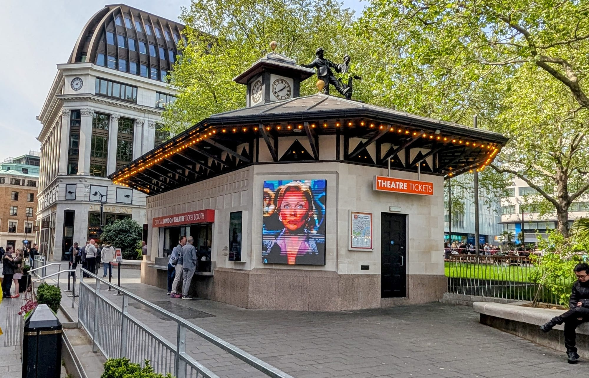
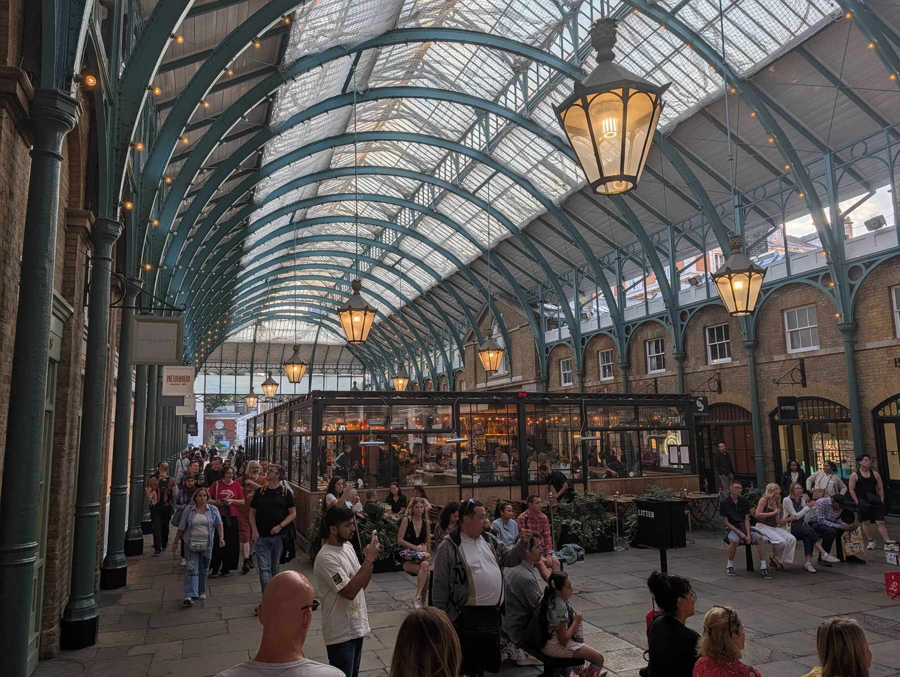
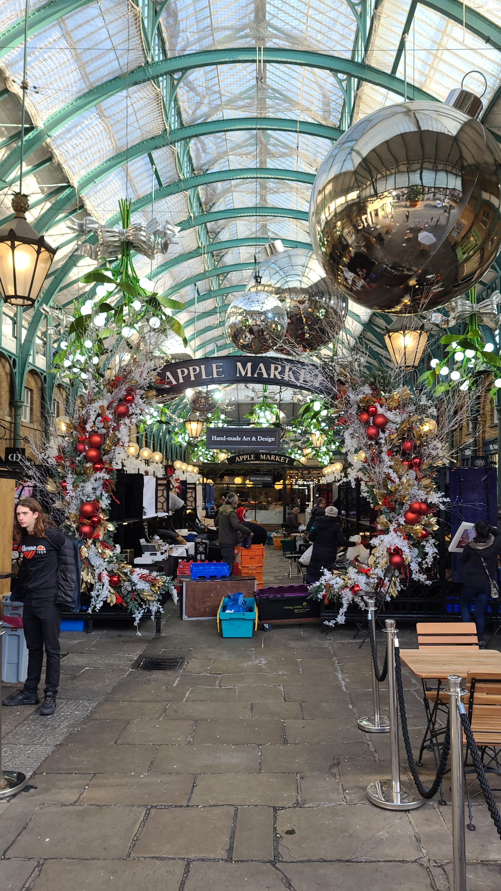
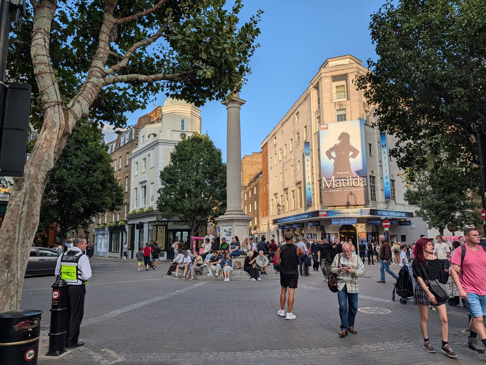
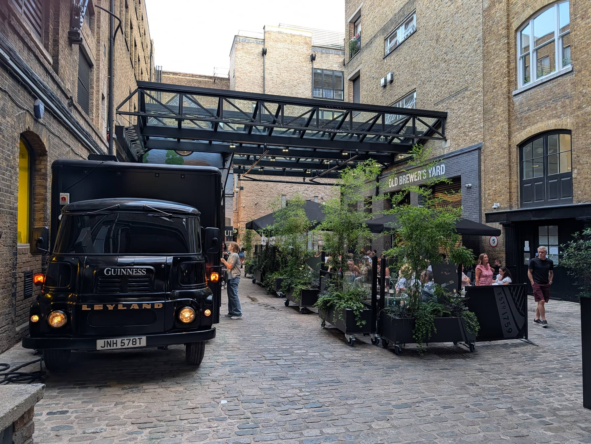
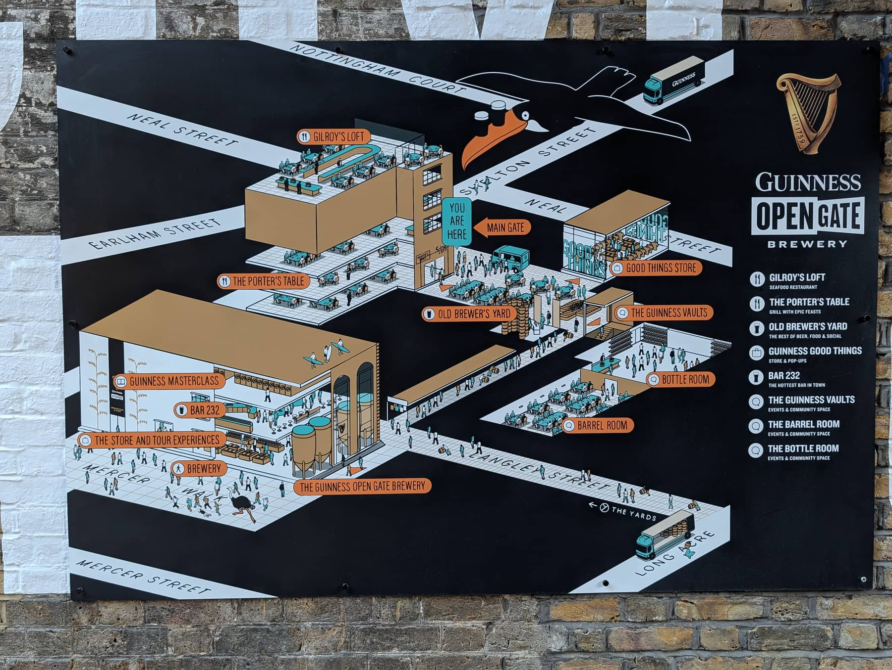
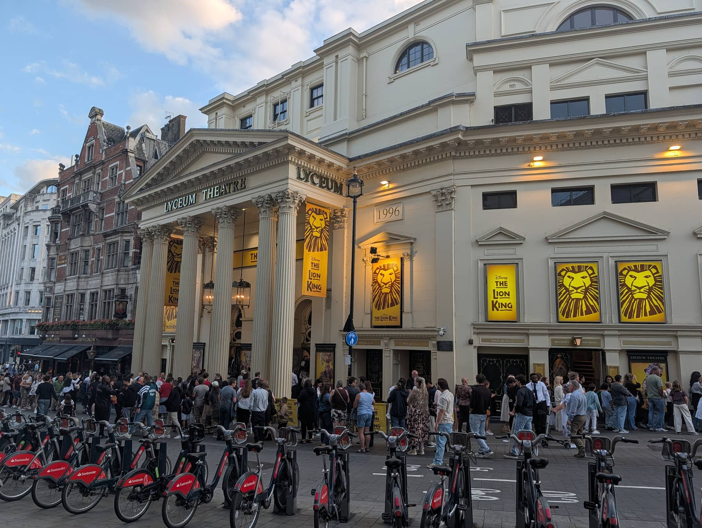

Covent Garden is a former fruit and vegetable market turned pedestrian district, with a cobbled Piazza, glass-roofed market halls and a theatre on almost every corner. Our [London theatre guide](/articles/london-theatre-guide/) explains how the West End, off-West End and fringe differ, and covers curtain times and getting home.

Soho is eight minutes west and the [British Museum](/articles/british-museum-guide/) twelve minutes north.

Covent Garden has its own share of the commemorative plaques marking where notable people lived or worked - see them on our [interactive map](/plaques/?area=covent-garden).

## Why visit — and who should skip it

**Come here if** you want theatre, street performance and browsing in a compact area you can cover on foot. Performers inside the market halls audition for their pitch. Seven Dials and Neal's Yard are just north.

**Skip it if** you dislike crowds. It is busy nearly all the time, and on Saturday afternoons the Piazza is close to impassable. Come on a weekday morning before 11am for the architecture without the crush.

## Top sights and activities

1. **Covent Garden Piazza and the Apple Market** — The cobbled square and its covered market halls, with craft and antique stalls that change by day: antiques on Monday, crafts and general goods the rest of the week.
2. **The street performers** — Three licensed pitches. The West Piazza in front of St Paul's Church takes the big circle acts, the lower courtyard has classical musicians, and the North Hall runs smaller sets.
3. **Seven Dials and Neal's Yard** — Seven cobbled streets meeting at a sundial monument. The alley off Short's Gardens opens into Neal's Yard, a small courtyard of painted facades and organic cafes.
4. **The Royal Opera House** — Worth entering even without a ticket: the Paul Hamlyn Hall and the terrace bar are open to the public during the day, with a view over the Piazza.
5. **London Transport Museum** — Real Tube carriages, old buses and the original poster archive; a good one for children.
6. **St Paul's Church (the Actors' Church)** — The portico where Eliza Doolittle is introduced in *Pygmalion*. The garden behind it is a quiet place to sit.
7. **Neal Street and Monmouth Street** — The main independent shopping streets, running north from the Piazza to Seven Dials.
8. **The TKTS booth, Leicester Square** — A five-minute walk south. The only ticket booth in the square actually run by the theatre industry, in the clocktower building on the south side, selling mostly same-day tickets at a discount since 1980. Ignore the lookalike shops nearby trading on the same name. A gated-off section of the square usually means a film premiere that evening; [how to see the stars](/articles/film-premieres-london/) covers the free fan-pen places.

*The TKTS booth, Leicester Square.*

## Key streets and micro-districts

*Covent Garden Market's cast-iron hall.*

### The Piazza and market halls

Charles Fowler's 1828 market hall with its later glass roofs, split into the **Apple Market** for craft stalls and the **Jubilee Market** for the cheaper end.

**The street performers are licensed**, and the two pitches inside the Market Building — the North Hall and the lower courtyard — are **auditioned by the estate four times a year**. The lower courtyard is reserved for opera singers and classically trained musicians. The West Piazza and James Street are licensed by Westminster City Council and are not part of that audition. **Free to watch; they pass a hat.**

**St Paul's Church to the west is the Actors' Church**, free to enter, lined with memorials to actors, and its portico is where Eliza Doolittle sells flowers at the start of *Pygmalion*. The churchyard behind it is a walled garden.

**Bar Cicoria at the Royal Ballet and Opera**, on the north-east corner, is a free viewpoint: a covered, heated fifth-floor terrace looking down onto the market roof, taking **walk-ins as well as bookings, with no ticket required**. Open daily from midday, closing at 11pm Monday to Saturday and 9pm on Sunday when there is no evening performance.

Go before ten in the morning or after eight in the evening if you want to move.

*The Piazza at dusk.*

*The Apple Market dressed for Christmas.*

Covent Garden has no chalet market of its own, but Leicester Square's and Trafalgar Square's are both within ten minutes' walk; dates and hours are in our [London Christmas markets guide](/articles/christmas-markets-london/).

The 2026 switch-on is Thursday 12 November. Our [Christmas lights walk](/articles/christmas-lights-walk-london/) takes in the Piazza tree, Seven Dials and Floral Street after dark, on the way from Oxford Street to Trafalgar Square. Somerset House's ice rink, 8 minutes away on the Strand, runs from 11 November 2026 to 10 January 2027; see our [London ice skating guide](/articles/ice-skating-london/).

### Seven Dials

Seven short streets radiating from a sundial pillar, each with its own character — independent fashion on Monmouth Street, coffee and shoes on Earlham Street, and two West End theatres on the junction itself.

**The pillar has six dials, not seven**, because only six streets were planned when it was laid out in the 1690s. The present pillar dates from 1989.

**Seven Dials Market fills Thomas Neal's Warehouse**, a former fruit-market store; its two halls are still called **Banana Warehouse and Cucumber Alley**. Free to walk into, around twenty traders, open daily and later than most of Covent Garden.

**It is three minutes north of the Piazza and much calmer.** Covent Garden and Leicester Square stations are each about four minutes.

*The Seven Dials sundial pillar.*

*Seven Dials Market.*

### Old Brewer's Yard

A courtyard off Mercer Walk, opened in December 2025. Bars, two restaurants and shops around a cobbled yard, with a working **Open Gate Brewery** on the site.

**The courtyard is free to walk into and the bar needs no ticket** — only the brewery tours upstairs do.

**It runs further back than the entrance suggests.** From Mercer Walk it reads as a single small yard; the brewery and the larger rooms are behind.

*Old Brewer's Yard.*

*The Open Gate Brewery's site map.*

### Neal's Yard

*Neal's Yard.*

A small courtyard reached down narrow alleys off Short's Gardens and Monmouth Street, easy to walk past. Painted buildings in yellow, blue and pink, cafe tables filling the middle, and the original **Neal's Yard Remedies** shop that the chain is named after.

**It is tiny and busy at lunchtime in summer**; come in the early morning to have it empty.

**Neal's Yard Dairy is round the corner on Short's Gardens**, not in the yard itself, and it is the better stop: a cheesemonger specialising in British farmhouse cheese, where you can taste before you buy.

**Monmouth Coffee** on the same corner has been roasting since 1978 and usually has a queue.

### Floral Street and Long Acre

The two main east–west shopping streets, running parallel from the Piazza towards Leicester Square and Holborn. **Long Acre is the wider, chainier one**; Floral Street behind it is narrow, pedestrian in stretches and has the more interesting shops.

**The Bridge of Aspiration crosses Floral Street** — a twisting glass and aluminium footbridge of 2003 linking the Royal Ballet School to the Opera House, so dancers cross above the street between class and stage. It is free to look at.

**Stanfords on Mercer Walk**, just off Long Acre, has been selling maps and travel books since 1853.

These are working shopping streets, so they keep retail hours and go quiet by seven.

### Bow Street and Drury Lane

*The Lyceum, Wellington Street.*
The theatre spine of Covent Garden, and several of the West End's biggest houses are within five minutes of the Piazza.

**Theatre Royal Drury Lane** has stood on its site since 1663, and the current building dates from 1812. It reopened in 2021 after a restoration, and **daytime tours run when the schedule allows**; they cover the front-of-house rooms and need no ticket to a show.

**The Lyceum on Wellington Street** has held *The Lion King* since 1999. **Bow Street** has the Royal Opera House stage door and the former magistrates' court where the Bow Street Runners were founded — now a hotel with a small police museum.

TKTS in Leicester Square, five minutes west, sells same-day discounted tickets; the touts and ticket shops along the way do not.

## Where to eat and drink

| Spot | Style | Price | Why go |
| --- | --- | --- | --- |
| **Seven Dials Market** | Food hall | £ | Two floors of vendors in a former banana warehouse; no booking needed |
| **Dishoom Covent Garden** | Bombay-inspired Indian | ££ | Bacon naan rolls and black daal; expect a wait without a booking |
| **Bancone** | Handmade pasta | ££ | Watch the pasta being rolled at the counter |
| **The Lamb & Flag** | Historic pub | £ | 17th-century pub on Rose Street, once frequented by Dickens |
| **Rules** | Traditional British | £££ | Open since 1798 |
| **Monmouth Coffee** | Coffee | £ | The original Monmouth Street shop; queues out the door at weekends |

For dinner with a show, Oriole, Louie and Sarastro all have live music at the table. [Dinner and a Show in London](/articles/dinner-and-a-show-london/) says which nights and what it adds to the bill.

Bunga 90 on Drury Lane has three private karaoke rooms and karaoke at the bar, open until 3am on Fridays and Saturdays. It is in our [karaoke guide](/articles/best-karaoke-london/).

Fatt Pundit on Maiden Lane cooks Kolkata's Indo-Chinese food, and SUSHISAMBA has a site on top of the Market Building. Both are in our [fusion restaurants guide](/articles/best-fusion-restaurants-london/).

Archive & Myth is reached through the Magic Mike Live entrance of the Hippodrome Casino on Cranbourn Street, and Blind Spot is the hotel bar St Martins Lane calls "a secret bar". [The Best Speakeasy Bars in London](/articles/best-speakeasy-bars-london/) has the directions.

## Getting there

**By Tube.** **Do not use Covent Garden station**: it has no escalators, just lifts and a 193-step spiral staircase, and it queues badly. Use **Leicester Square** (Piccadilly, Northern) or **Holborn** (Central, Piccadilly) instead; both are about five minutes' walk.

**Best exit.** From Leicester Square, take Exit 1 and walk east along Cranbourn Street. From Holborn, exit onto Kingsway and walk south down Great Queen Street.

**On foot.** Eight minutes to Soho, twelve to the British Museum, fifteen over Waterloo Bridge to the South Bank. See the [London Tube and Rail Lines Guide](/articles/london-tube-and-rail-lines-guide/) for which line serves what.

## How long to spend, and when to go

| If you have | Do this |
| --- | --- |
| **One hour** | The Piazza, a street performance and the Apple Market |
| **Half a day** | Add Seven Dials, Neal's Yard and lunch at Seven Dials Market |
| **A full day** | Add the London Transport Museum and an evening show |

**Best time:** Weekday mornings before 11am for the market halls without the crush. Performers start around 10am and run until early evening.

**Avoid:** Saturday afternoons, when the Piazza is at its worst. Matinee days (usually Wednesday and Saturday) also put heavy pressure on restaurants from midday.

Comparing neighbourhoods? [Best areas to visit in London](/articles/best-areas-to-visit-london/) sets them side by side by what each is best for, how long it takes and the best day to go.

Powered by <a target="_blank" rel="sponsored" href="https://www.getyourguide.com/london-l57/">GetYourGuide</a>

## Walking routes

**[A Walk Around Covent Garden: Leicester Square to Somerset House →](/articles/covent-garden-walk/)**

**Eleven numbered stops** over about 2km and two hours, with a map, a Google Maps walking link and a day-by-day breakdown of what each market hall sells. It goes north into Seven Dials before the crowds arrive, takes in **Cecil Court**, the Victorian bookselling alley ninety seconds off the route, and explains why **Monday is the day to come**: both the Apple Market and Jubilee Market switch to antiques.

Harry Potter fans can cross the area on the [Harry Potter filming locations walk](/articles/harry-potter-filming-locations-walk/), which passes Australia House on the Strand, whose banking hall played Gringotts, on its way from Leadenhall Market to Soho.

### The short version, if you only have two hours

1. **Start:** Leicester Square station, Exit 1. Walk east along Cranbourn Street.
2. **The Piazza:** Arrive at **Covent Garden Market**. Watch a performance in the West Piazza.
3. **Royal Opera House:** Walk to the north-east corner and go up to the terrace bar for the view.
4. **Neal Street:** North past the independent shops to **Seven Dials**.
5. **Neal's Yard:** The alley off **Short's Gardens** — look for the small blue sign.
6. **Finish:** **Seven Dials Market** for lunch, or continue west into Soho.

Powered by <a target="_blank" rel="sponsored" href="https://www.getyourguide.com/london-l57/">GetYourGuide</a>

## Common mistakes to avoid

1. **Using Covent Garden station.** Lifts and stairs only, and long queues at peak. Leicester Square or Holborn are faster.
2. **Not booking pre-theatre dinner.** Restaurants fill completely between 17:00 and 19:30. Book ahead and state your curtain time.
3. **Buying theatre tickets from lookalike booths.** The official TKTS booth is in Leicester Square. Check for day seats direct from the theatre first.
4. **Eating on the Piazza itself.** Restaurants there charge a premium for the location. Walk two minutes to Seven Dials or Monmouth Street.
5. **Taking a taxi within the West End.** Traffic is slow enough that walking is usually faster.

## Where to stay

Central, well connected and expensive. Good if you are here for theatre and want to walk home after a show.

- **Covent Garden and Seven Dials** — Boutique hotels in converted townhouses. Quiet at night once the market closes.
- **Holborn** — Five minutes east, noticeably better value, and on the Central line.
- **The Strand and Aldwych** — Larger classic hotels facing the river, with easy access to the [South Bank](/articles/where-to-stay-south-bank/).

Our [Covent Garden hotel guide](/articles/where-to-stay-covent-garden/) compares the hotels, and the [Soho and West End guide](/articles/where-to-stay-soho-west-end/) the streets just west.
