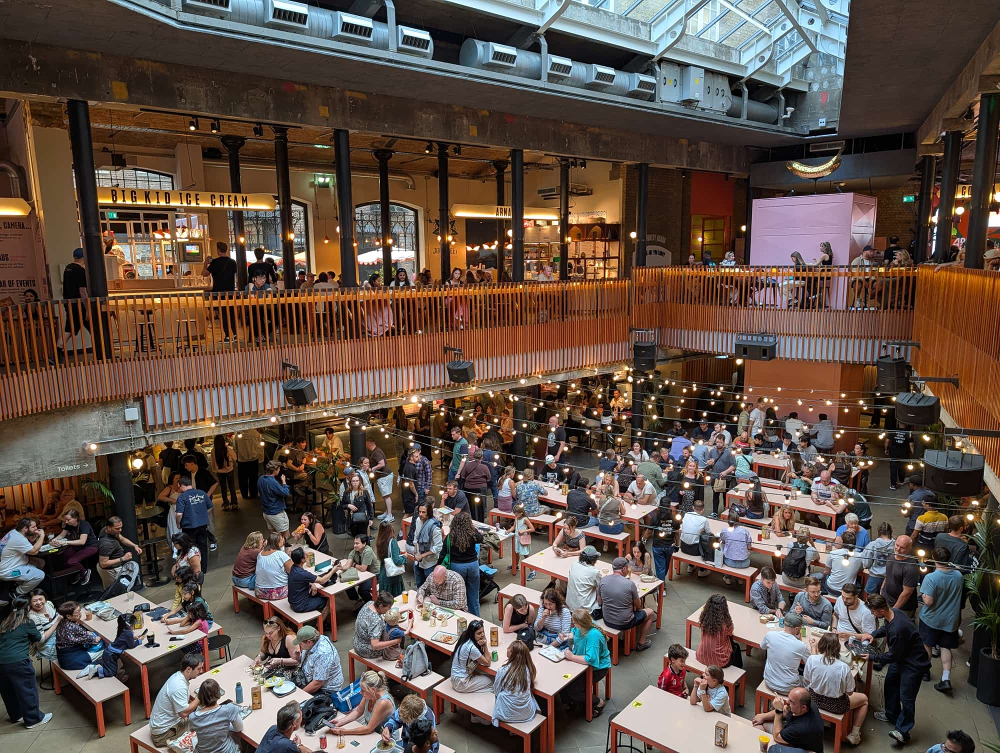
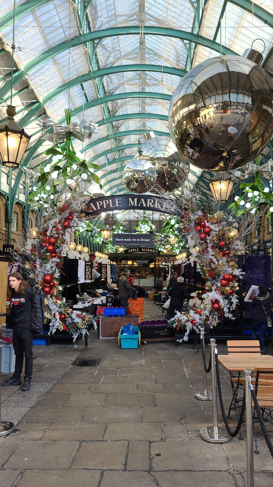
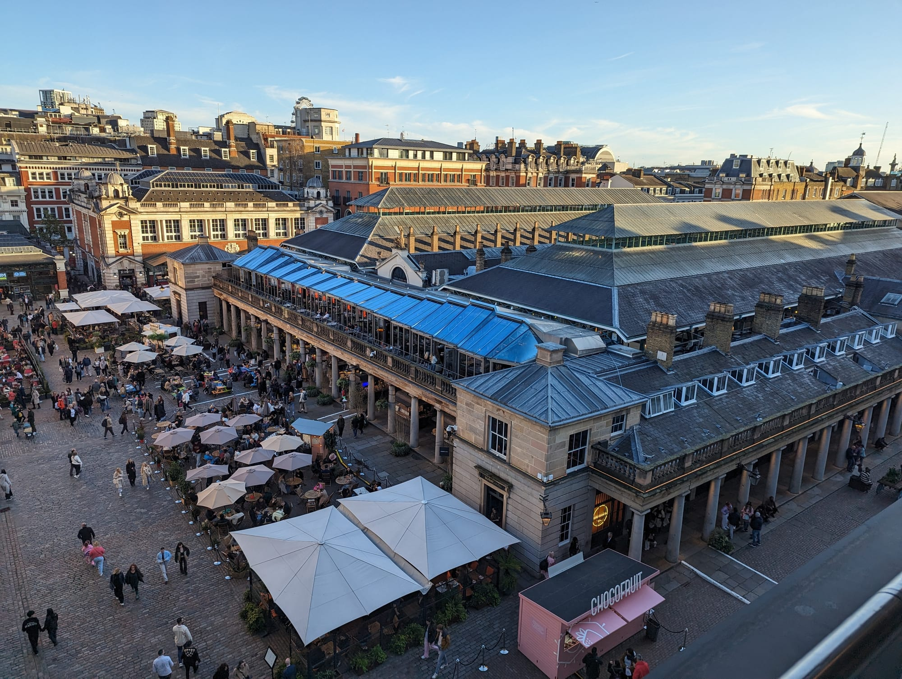
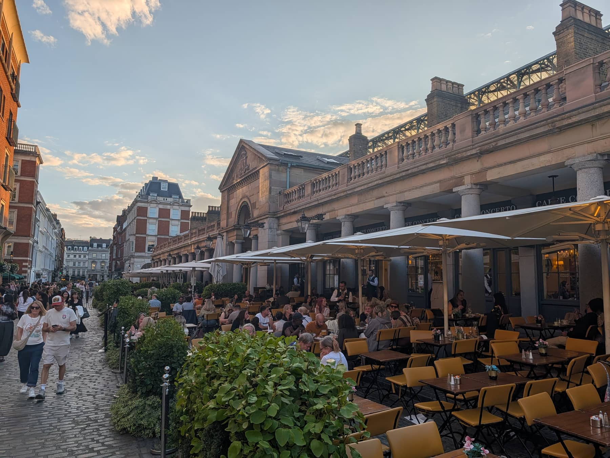

This walk starts at Leicester Square, goes north into Seven Dials and Neal's Yard while they are quiet, comes down into the Piazza in the middle, and finishes at Somerset House, six minutes from the market hall.

It is about **2km and takes around two hours** with stops. Everything on it is free except the London Transport Museum, which you can skip. For the theatres, where to eat before a show and where to stay, see the [Covent Garden area guide](/articles/covent-garden-area-guide/).

> 💡 **The Short Version:** Start at **Leicester Square**, not Covent Garden station — 193 steps and no escalators. Go **north first**: Seven Dials and Neal's Yard are quiet early and fill up later. **Monday is antiques day** in both market halls. The free view is **Bar Cicoria**, on the fifth floor of the Royal Opera House, no ticket and no booking. **Cecil Court**, a street of old bookshops, is ninety seconds off the route.

## The route

  

    Map of the walk, numbered in walking order
  

  

    
Loading the map…

  

  

    <i class="route-map-marker" aria-hidden="true">1</i> On the route, in walking order
    <i class="route-map-marker route-map-marker--alt" aria-hidden="true">+</i> Optional detour
  

  <noscript>
    
The map needs JavaScript. Every stop below is numbered in walking order with its nearest station.

  </noscript>

**[Open the whole route in Google Maps →](https://www.google.com/maps/dir/?api=1&origin=51.510105,-0.12991&destination=51.511695,-0.117442&waypoints=51.510727,-0.127657%7C51.513754,-0.126905%7C51.514427,-0.126389%7C51.514115,-0.12581%7C51.513006,-0.125355%7C51.511556,-0.123715%7C51.511991,-0.123069%7C51.512873,-0.122564%7C51.511984,-0.121227&travelmode=walking)** — all eleven stops in walking order, set to walking directions.

| # | Stop | Cost | Open |
| --- | --- | --- | --- |
| **1** | Leicester Square & the Ticket Booth | Free to see | Booth Mon–Sat 10.30am–6pm |
| **2** | Cecil Court | Free | Street always; dealers vary |
| **3** | Seven Dials | Free | Always |
| **4** | Neal's Yard | Free | Always |
| **5** | Seven Dials Market | Free to enter | **Noon on Mon & Tue** |
| **6** | Long Acre and Mercer Walk | Free | Shop hours |
| **7** | St Paul's, the Actors' Church | Free | **Weekdays 9am–5.30pm** |
| **8** | The Piazza and the Apple Market | Free | Daily 10am–6pm; **antiques Mondays** |
| **9** | Royal Opera House | Free to enter | Daily from noon |
| **10** | London Transport Museum | **Ticket** | Daily 10am–6pm |
| **11** | Somerset House | Free | Seven days, 8am–11pm |
| **+** | The Lamb & Flag, Drury Lane | Free to look | See below |

---

## 1. Leicester Square and the Ticket Booth

*The Clocktower building, Leicester Square.*

**Start here rather than at Covent Garden station.** Covent Garden has no escalators, just lifts and a 193-step spiral staircase, and the estate advises using Leicester Square at peak times.

The **Official London Theatre Ticket Booth**, formerly TKTS, is in the **Clocktower building on the south side of the square**, opposite the Radisson Blu Edwardian Hampshire. It is the **only booth here run by the Society of London Theatre**, a not-for-profit; every other booth nearby advertising "theatre tickets" is a private reseller.

It opens **Monday to Saturday 10.30am to 6pm and Sunday 11am to 4pm**, with longer summer hours in late July and August. It sells same-day seats at the prices on its website, with a physical ticket. New on-the-day tickets go online at **12.01am each morning**.

> ⚠️ **There are no concession rates.** Students, children and seniors pay what everybody else pays, so do not queue expecting a discount on top of the discount.

## 2. Cecil Court

Ninety seconds east of the square.

**A short pedestrian street of Victorian shopfronts, almost all of them selling old books, prints, maps, coins, medals and antiquities.** It was the **first London address of Mozart and his family**, and in the early years of cinema it was known as **'Flicker Alley'** for the film trade based here.

The dealers include **Goldsboro Books**, **Marchpane**, **Watkins Books**, **Travis & Emery** for sheet music, **Tenderbooks**, **Sotheran's** and the **London Medal Company**. Browsing costs nothing.

The street is a public passage you can walk at any hour. The shops keep their own hours, so check before making a special trip for one.

## 3. Seven Dials

*The Seven Dials sundial pillar.*

Seven short streets meeting at a stone pillar, laid out by **Thomas Neale in the early 1690s**. The **Sundial Pillar** was cut in **1693–4**, and it carries **six dial faces, not seven**; the seventh style is the column itself.

Ninety stores and more than fifty cafés, bars and restaurants sit in the streets around it now, and it is **calmer than the Piazza three minutes south**, which is why this route does it first.

## 4. Neal's Yard

*Neal's Yard.*

**A single courtyard about twenty metres across, painted yellow, blue and pink, reached down passageways off Monmouth Street and Short's Gardens narrow enough to miss.** The Neal's Yard Remedies chain is named after it.

**Early morning is the only time you will have it to yourself**, and it is when the light reaches the painted walls. By lunchtime in summer there is a queue.

Two things immediately outside it:

- **Neal's Yard Dairy**, 17 Short's Gardens — a proper cheesemonger, hand-cutting British and Irish farmhouse cheese, and they will let you taste before you buy. **Monday to Wednesday 11am–6pm, Thursday to Saturday 10.30am–6.30pm, Sunday 11am–5pm.**
- **Monmouth Coffee**, 27 Monmouth Street — the original shop, roasting here since **1978**, with a queue. **Monday to Saturday 8am to 7pm, closed Sunday, card only.**

> ⚠️ **Monmouth is shut on Sundays.** It is the one address on this route that closes on the day most people walk it.

Powered by <a target="_blank" rel="sponsored" href="https://www.getyourguide.com/london-l57/">GetYourGuide</a>

## 5. Seven Dials Market

*Seven Dials Market.*

**Twenty-one street food traders and two bars in a former warehouse on Earlham Street**, run by KERB, and the lunch stop on this route.

It is **free to walk into**, mainly walk-in for tables, and it takes bookings only for groups of four or more. The outdoor tables are first-come and uncovered, and they stop at 10pm.

**Opening hours:**

| Day | Open |
| --- | --- |
| **Monday & Tuesday** | **12pm – 10pm** |
| Wednesday to Saturday | 11am – 11pm |
| Sunday | 11am – 9pm |

An early Monday walk arrives before it opens. Traders include **Bleecker**, **Bad Boy Pizza Society** and **Pick & Cheese**, which runs its cheese along a conveyor belt.

It has **full step-free access, a lift and wheelchair-accessible toilets**, and a free water refill station.

## 6. Long Acre and Mercer Walk

*Old Brewer's Yard, Mercer Walk.*

Walk south and you hit **Long Acre**, the wide shopping street running east towards Holborn. Covent Garden station sits on the corner of it and James Street; don't use it.

Turn off Long Acre into **Mercer Walk**, thirty seconds down, which holds two stops.

**Stanfords**, at number 7, has sold maps and travel books since **1853**. Open **Monday to Friday 9am–7pm, Saturday 10am–7pm, Sunday noon–6pm**.

Behind it at **1 Mercer Walk** is the **Guinness Open Gate Brewery**, a working micro-brewery with a cobbled courtyard called **Old Brewer's Yard** at the front, two restaurants above (Gilroy's Loft for seafood, The Porter's Table for a British grill) and pies baked on site. **The brewery tours are booked and ticketed**; the yard and the bars are separate. It is two minutes from Seven Dials and four from the Piazza, and a quieter place near the market to sit down on a Saturday.

> 💡 **This is the last easy exit before the crowds.** From here the walk is inside the busiest few hundred square metres in central London, so have a calm drink here first.

## 7. St Paul's, the Actors' Church

Come down Garrick Street and Bedford Street and enter the church from the west, through the garden, rather than from the Piazza portico.

**Inigo Jones built it and it has stood here since 1633.** It is **free to enter**, and the walls are lined with memorials to actors, which is where the nickname comes from.

The **churchyard behind it is a walled garden** and the quietest place in Covent Garden.

The portico facing the Piazza is where **Eliza Doolittle sells flowers at the start of *Pygmalion***.

> ⚠️ **This is the one weekday stop on the route.** The church is usually open for visiting **9am to 5.30pm on weekdays**, and it closes without much notice for weddings, memorials, its ticketed summer Theatre in the Garden season, and maintenance. If you plan to attend, phone the office on **020 7836 5221** before you set out. Services run Wednesday at 1.10pm and Sunday at 11am, and you are welcome at both.

There is a printed self-guided tour inside. The toilets on either side of the portico cost 50p.

## 8. The Piazza and the Apple Market

*The Apple Market, dressed for Christmas.*

Come back round to the front of the church and you are standing in the **West Piazza**, where the big circle acts work. Then go east into the market building itself.

**The Piazza and the Market Building are public space and free at any hour**, day or night. The shops inside generally run **10am to 8pm Monday to Saturday and about 11am to 6pm on Sunday**.

Three separate markets run within a hundred metres of each other — two inside the Market Building, and Jubilee in its own hall on the south side of the Piazza — and they do not behave the same way:

| Market | Monday | Rest of the week |
| --- | --- | --- |
| **Apple Market** | **Antiques and collectables** | Handmade craft — jewellery, prints, watercolours. Daily 10am–6pm |
| **Jubilee Market** | **Antiques, 5am–5pm** | General market Tue–Fri 10.30am–7pm; arts and crafts Sat–Sun 10am–6pm |
| **East Colonnade** | Open | Same seven days, 10.30am–7pm. Soap, jewellery, sweets, a magician's stall |

Both big halls switch to antiques and collectables on Monday, and Jubilee opens at five in the morning to do it.

**On the performers.** The pitches **inside** the Market Building, in the **North Hall** at the north-east corner and the **South Hall** in the lower courtyard (reserved for opera singers and classically trained musicians), are auditioned by the estate four times a year. The **West Piazza, James Street and the space outside the Transport Museum are managed by Westminster City Council** and are not auditioned. Wind and brass instruments, electric guitars, drums, accordions, bagpipes and didgeridoos are banned from the indoor pitches.

> 💡 **Getting in with a wheelchair or a pushchair:** the smoothest way into the Market Building is from **Russell Street**, where there are ramps, or the bottom of **James Street**. The cobbles elsewhere are a listed feature.

Powered by <a target="_blank" rel="sponsored" href="https://www.getyourguide.com/london-l57/">GetYourGuide</a>

## 9. The Royal Opera House

*The Piazza, from the Opera House terrace.*

**The building is open to anyone, seven days a week, from 12 noon,** with no ticket needed. It closes after the evening performance, or at 11pm Monday to Saturday and 9pm on Sunday when there is no show.

Go up to **Bar Cicoria on level five**, a covered, heated terrace looking down onto the market roof you were standing under ten minutes ago. It serves cicchetti-style small plates and drinks and takes **walk-ins as well as reservations**. Open **daily from midday: to 11pm Monday to Saturday, to 9.15pm on Sunday**.

Practical notes: it is **cashless**, so bring a card; **bags are checked on the way in**, so pack light; there are free water stations on every level. Step-free entry is through the power-assisted doors on **Bow Street** or from the **Piazza**.

## 10. London Transport Museum

The one paid ticket on the route, and the only stop here that will take you an hour, not ten minutes.

Real Tube carriages, old buses and the original poster archive.

**Open every day, 10am to 6pm, last entry 5.15pm**, 362 days a year. The shop runs to 6.15pm, the café to 5pm.

> ⚠️ **The ticket is not a day ticket.** An adult pays **£27** and gets an **Annual Pass** — unlimited visits for twelve months. **Children and under-18s go free.** Concessions are **£25**, local residents **£21.60**, and Universal or Pension Credit holders **£5**. There is also an **Off Peak Annual Pass at £22.50** which only admits you on weekdays after 2pm in term time and the summer holidays. Whichever you buy, you also need a **free timed entry ticket** for the day itself, and you can only hold one at a time.

The museum recommends the **afternoon** for a quieter visit, roughly when this walk reaches it.

## 11. Somerset House

Down Southampton Street or Wellington Street to the Strand, five minutes.

**Somerset House is open to everyone, seven days a week, from 8am to 11pm**, and the courtyard behind the Strand front costs nothing to walk into. It is the largest open space on this route.

The **Courtauld Gallery**, a separate institution inside the building, opens **10am to 6pm**. The **New Wing** keeps the same 8am to 11pm hours as the rest of the site.

It is also the handover point to another walk. **Waterloo Bridge is immediately east**, and crossing it puts you on the [South Bank route](/articles/south-bank-walk/) at roughly its halfway mark.

---

## The detours: Rose Street and Drury Lane

**The Lamb & Flag, 33 Rose Street.** A Fuller's pub down an alley off Garrick Street, between stops 6 and 7. Open **Monday to Saturday 11am to 11pm and Sunday noon to 10.30pm**, with food from noon to 9.30pm on weekdays and Saturdays, and to 8.30pm on Sundays. Real fire, families welcome, assistance dogs welcome.

**Theatre Royal Drury Lane**, five minutes east of the Piazza on Catherine Street. Its owners describe it as **the world's oldest theatre site in continuous use, open since 1663**. The Regency **Grand Saloon** does afternoon tea and the **Cecil Beaton Bar** does cocktails. **Guided tours** are the way to see the front-of-house rooms without a ticket to a show.

## Where to eat

**Seven Dials Market at stop five** has twenty-one traders, no booking needed for a table of two or three, and full step-free access with a lift. On Monday and Tuesday it does not open until noon.

If that does not work:

- **The Lamb & Flag** (£) on Rose Street — open seven days, food until 9.30pm most nights.
- **Old Brewer's Yard** (££) at stop six — pies and beer in a courtyard.
- **Rules**, 35 Maiden Lane (£££) — open since **1798** and billed as London's oldest restaurant, serving classic British cooking, three minutes south of the Piazza. Book it.
- **Monmouth Coffee** (£) at stop four — Monday to Saturday only.

*The Piazza's restaurant terraces, at dusk.*

**Avoid eating on the Piazza itself**, where you pay a location premium. Seven Dials, Monmouth Street and Maiden Lane are all inside four minutes.

The [area guide](/articles/covent-garden-area-guide/#where-to-eat-and-drink) covers pre-theatre bookings and the places that fill from 5pm.

## The best day to go

**Monday.** The Piazza never closes, the market halls run seven days, the Opera House opens daily, the Transport Museum is open 362 days a year and Somerset House is open 8am to 11pm every day. What changes is **what the markets are selling**.

| Day | What you get |
| --- | --- |
| **Monday** | **Antiques day.** Apple Market switches to antiques and collectables; Jubilee runs its antiques market from 5am. Seven Dials Market not until noon |
| **Tue–Thu** | Handmade craft in the Apple Market, general market in Jubilee, the calmest crowds of the week |
| **Friday** | The same, and Seven Dials Market runs to 11pm |
| **Saturday** | Arts and crafts in Jubilee. The Piazza is at its worst from about noon. Matinee day, so restaurants go early |
| **Sunday** | Markets open, shops open later at about 11am, **Monmouth Coffee shut**, Seven Dials Market closes at 9pm |

On a Monday, plan lunch late or eat at the Lamb & Flag, as Seven Dials Market opens at noon. **St Paul's Church** is the one weekday-only stop, with visiting hours of 9am to 5.30pm and nothing for the weekend.

**On time of day:** start at 10am and you get Seven Dials and Neal's Yard before the coach parties, reach the Piazza as the performers start and arrive at the Transport Museum in the afternoon, when it is quieter. At 9am on a Sunday Neal's Yard is empty.

Powered by <a target="_blank" rel="sponsored" href="https://www.getyourguide.com/london-l57/">GetYourGuide</a>

## Getting there and back

**Start:** Leicester Square (Piccadilly, Northern). Come out onto Charing Cross Road, head east along Cranbourn Street, and the Ticket Booth is on the south side of the square by the park. **Finish:** Embankment (Circle, District, Bakerloo, Northern) or Charing Cross, both a few minutes west along the Strand from Somerset House. Temple is a similar walk east.

**Do not use Covent Garden station**, which has no escalators. Holborn is a ten-minute walk, Tottenham Court Road on the Elizabeth line fifteen, and Embankment ten.

The route is **flat and short**, and no point on it is more than about six minutes from a station, so you can cut it anywhere. Walked in reverse it puts the crowded half first, which is the wrong way round in a district that fills up as the day goes on.

## Carry on walking

- **[Westminster](/articles/westminster-walk/)** — Trafalgar Square is on it, at the bottom of Covent Garden.
- **[South Bank: Westminster to Tower Bridge](/articles/south-bank-walk/)** — over Waterloo Bridge from the Strand.
- **[Fitzrovia to Mayfair](/articles/fitzrovia-mayfair-walk/)** — Fitzrovia starts just north of Seven Dials.
- **[Soho and Chinatown](/articles/soho-chinatown-walk/)** — ends on Lisle Street, two minutes from the ticket booth, so walk it first and start this one after lunch in Chinatown.
- **[The Harry Potter filming locations walk](/articles/harry-potter-filming-locations-walk/)** — its second half starts at Australia House, a few minutes east of Somerset House along the Strand.
- **[The Christmas lights walk](/articles/christmas-lights-walk-london/)** — the after-dark route from Oxford Street through Seven Dials and the Piazza to Trafalgar Square, November to early January.

## What to do with the rest of the day

- **[Where to stay in Covent Garden](/articles/where-to-stay-covent-garden/)** — if you want to be inside this route, not travelling to it.

- **[The Covent Garden area guide](/articles/covent-garden-area-guide/)** — the theatres, pre-theatre dinner, where to stay and the mistakes to avoid.
- **[The South Bank walk](/articles/south-bank-walk/)** — cross Waterloo Bridge from Somerset House and pick it up at the halfway point.
- **[The London theatre guide](/articles/london-theatre-guide/)** — how the West End, off-West End and fringe differ, and how day seats actually work.
- **[London's best markets](/articles/best-london-markets/)** — where the Apple Market and Jubilee sit among them, and which days the others run.
- **[Free things to do in London](/free/)** — ten of these eleven stops cost nothing.
- **[The best areas to visit in London](/articles/best-areas-to-visit-london/)** — the neighbourhoods compared by what each is best for, how long it takes and the best day to go.
