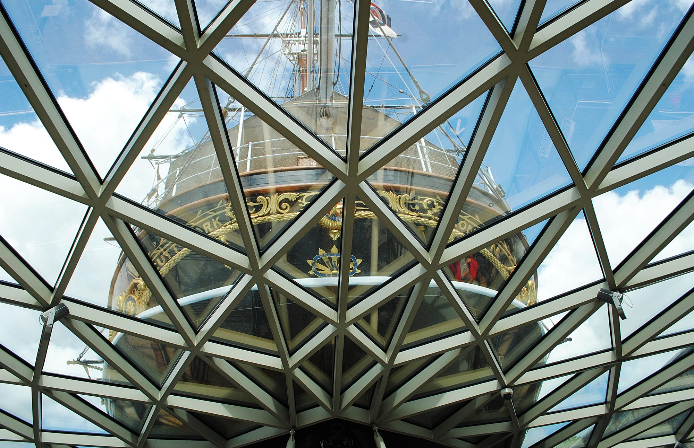
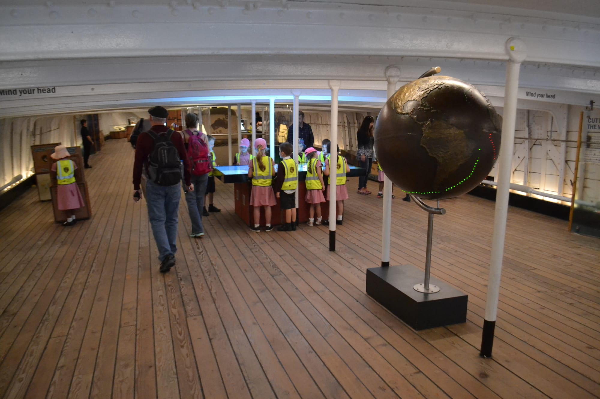
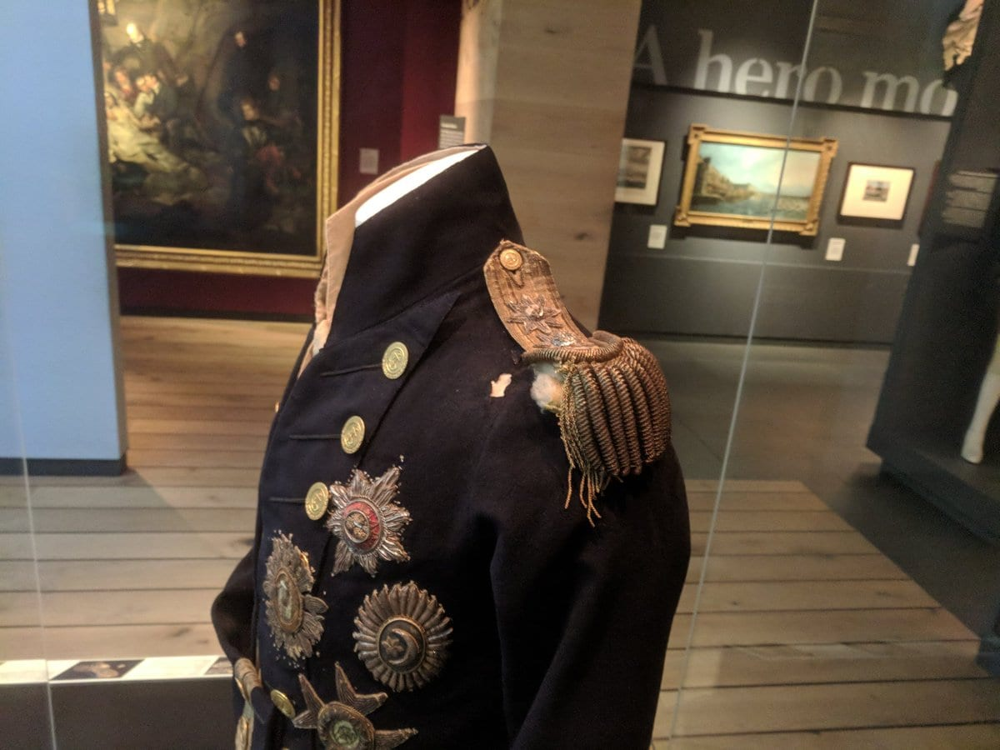
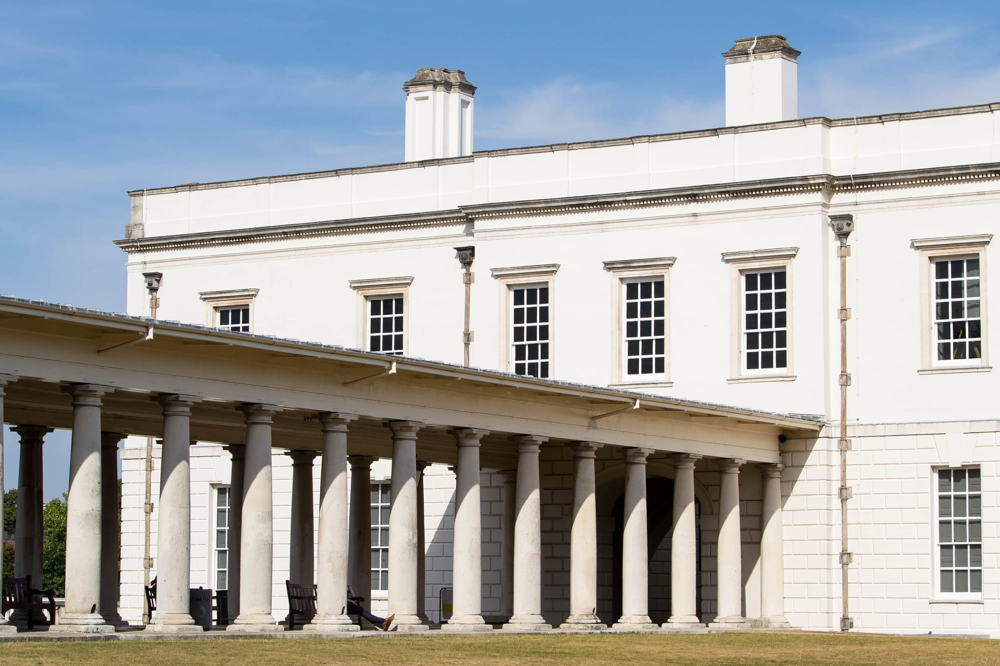
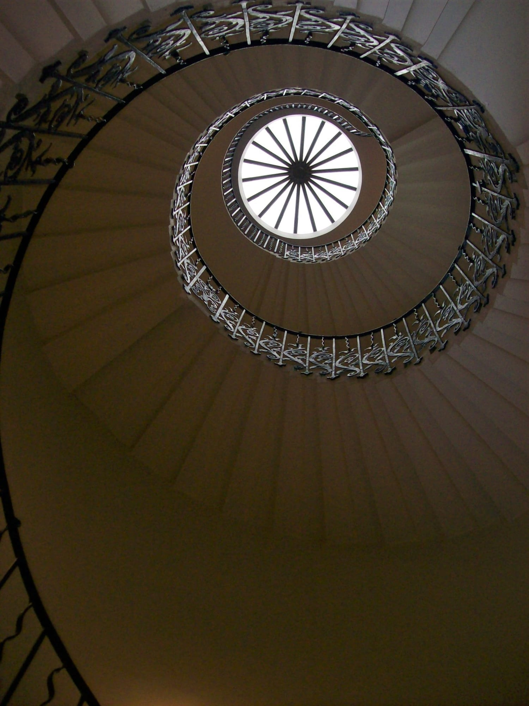

> 💡 **The Short Version:**
> - **Cutty Sark:** adults **£22**, students **£16.50**, children aged 4 to 15 **£11**, under-4s free. It is the only paid site here besides special exhibitions.
> - **Free:** the **National Maritime Museum** and the **Queen's House** are free to enter. Book a free timed ticket only if you want guaranteed entry.
> - **Royal Observatory:** closed since 2 November 2026 for refurbishment. The Meridian Courtyard is due to reopen in summer 2027.
> - **Hours:** all three open daily **10am to 5pm**, last entry 4.15pm, closed **24, 25 and 26 December**.
> - **Cheaper:** National Rail 2FOR1 covers Cutty Sark if you travel by train; £3 tickets for benefit claimants; 10% off with a Max Card.
> - **Winter 2026/27:** Santa's Grotto and an open-air ice rink at the Queen's House, a sea shanty festival on Saturday 21 November.

*Prices, hours and dates are from Royal Museums Greenwich's own pages, as of 15 November 2026.*

---

Cutty Sark is a tea clipper built in Dumbarton in 1869, lifted into a glass-skirted dry berth beside the Thames in Greenwich so that visitors can walk beneath the copper-clad hull. Two free museums stand a five-minute walk away: the National Maritime Museum and, behind it, the Queen's House. Royal Museums Greenwich (RMG) runs all three, plus the Royal Observatory on the hill.

---

## Cutty Sark tickets and prices

| Ticket | Price | Notes |
| :--- | :--- | :--- |
| **Adult** | **£22** | |
| **Student** | **£16.50** | Valid student ID |
| **Child (4 to 15)** | **£11** | Under-4s are free |
| **Member** | **Free** | No booking needed |
| **Carer** | **Free** | A person accompanying a disabled visitor; choose it online with any paid ticket |
| **Benefit claimants** | **£3** | Universal Credit, Working Tax Credit, Child Tax Credit, Pension Credit, Employment and Support Allowance, Income Support or Jobseeker's Allowance |

RMG recommends booking online to guarantee entry. You choose a date and entry time and the tickets arrive by email. Tickets are also sold on the day, subject to availability. The ticket includes a free audio guide, which you play on your phone through the Smartify app, so bring headphones.

**Opening hours:** daily 10am to 5pm, last entry 4.15pm, except 24, 25 and 26 December.

Current dates and entry times:

Powered by <a target="_blank" rel="sponsored" href="https://www.getyourguide.com/london-l57/">GetYourGuide</a>

> ⚠️ **The Royal Observatory is shut.** It was open until 2 November 2026 and is temporarily closed while First Light, a refurbishment of the whole site, runs to spring 2028. RMG says the Meridian Courtyard reopens in summer 2027, with tickets on sale from January. Until then, don't plan a Greenwich day around the Prime Meridian line or the Observatory's planetarium; the National Maritime Museum has the astronomers (see below).

### Discounts

- **National Rail 2FOR1:** Cutty Sark is one of the attractions in the scheme when you travel to London by train. Download the voucher from [Days Out Guide's Cutty Sark page](https://www.daysoutguide.co.uk/cutty-sark); our [National Rail 2FOR1 guide](/articles/national-rail-2for1-london-attractions/) has the validity rules.
- **Art Pass, Museums Association, English Heritage:** all three memberships get a reduced Cutty Sark ticket. RMG's ticket page says the National Art Pass gives half-price admission to its sites and temporary exhibitions.
- **Max Card:** 10% off, applied through the link on RMG's Cutty Sark page.
- **London Pass:** Cutty Sark is a £22 attraction, which rarely tips a sightseeing pass into profit. The [London Pass guide](/articles/london-pass-guide/) does the arithmetic.
- **Membership:** an individual Royal Museums Greenwich Membership is £48 by Direct Debit or £58 as a one-off payment; a family Membership is from £56 or £66. It gives free unlimited entry to Cutty Sark and to exhibitions at the National Maritime Museum. Family Members also get Ahoy! free.

### Combination tickets since the Observatory closed

RMG's Day Pass paired Cutty Sark with the Royal Observatory. With the Observatory shut, buy Cutty Sark on its own. What else you can book with it:

- **Cutty Sark Afternoon Tea:** served under the hull on Fridays, Saturdays and Sundays at 12pm and 3pm. Every booking includes entry to the ship, so you can explore before or after. A vegan menu needs 72 hours' notice.
- **Astronomers Take Over:** a ticketed experience at the National Maritime Museum, covered below. It is booked separately.
- **GetYourGuide:** an <a href="https://www.getyourguide.com/activity/-t98235?partner_id=WWP7I0R&amp;cmp=cutty-sark-national-maritime-museum-guide" target="_blank" rel="sponsored nofollow noopener" data-affiliate="gyg">entrance ticket to Cutty Sark on GetYourGuide</a> is the alternative if you would rather book through them.

---

## What you see on Cutty Sark

The route starts in the Lower Hold, climbs by stairs or lift to the 'Tween Deck, then to the Main Deck. A small bridge leads from there to the dry berth below, where you stand under the hull.

*The stern, through the glass skirt around the hull. Photo: [Mark from Brighton](https://commons.wikimedia.org/wiki/File:Hull_of_the_Cutty_Sark_(18992362758).jpg), [CC BY 2.0](https://creativecommons.org/licenses/by/2.0/).*

- **Under the hull.** The dry berth is the one part everyone remembers: the ship hovers above you and you can reach up and touch the copper sheathing, which kept barnacles and molluscs out of the timbers. A display here, *Black and Asian seafarers in the age of Cutty Sark*, covers sailors from around the world who served on the clipper and on other British naval and merchant ships.
- **The holds.** Tea chests are stacked in the Lower Hold, and the 'Tween Deck shows how many wool bales the ship carried on one voyage. RMG counts it as enough for more than 1.2 million jumpers.
- **The Main Deck.** The ship had 32 sails and 11 miles of rigging, and its main mast stands 152 feet (47 metres) tall. The deck gives views of Canary Wharf and the Thames. The ship's wheel is here, restored for the opening in 1957.
- **The cabins.** The captain's cabin and the sailors' cabins show what the crew ate and slept in.
- **The figureheads.** The Long John Silver collection in the dry berth is described by RMG as the world's largest collection of Merchant Navy figureheads. The ship's own figurehead is Nannie, the witch from Robert Burns's poem *Tam O'Shanter*, in a short ('cutty') sark, or nightdress. The figurehead on the ship now is a new commission.

*An exhibition deck below the Main Deck. Photo: [Daniel from Glasgow, United Kingdom](https://commons.wikimedia.org/wiki/File:Inside_the_Cutty_Sark_(27912586157).jpg), [CC BY 2.0](https://creativecommons.org/licenses/by/2.0/).*

The ship was built to carry tea from China as fast as possible and made eight voyages there, but never won the tea race. It collected its last Chinese tea cargo in 1877, then switched to Australian wool. In 1883 to 1884 it took 83 days from Newcastle, New South Wales, to London, which RMG says beat every ship sailing at about the same time by 25 days to over a month. A top speed of 17 knots (20mph) is RMG's figure for the ship.

**Talks and characters.** Volunteer explainers are aboard through the week. Costumed characters, among them Captain Woodget and the ship's cook, roam on weekends in term time and during school holidays, with performances in the dry berth at 11.30am and 2.30pm. Daily talks and tours are listed on RMG's site.

---

## The National Maritime Museum

The museum is free and does not need booking. RMG describes it as the largest museum of its kind in the world. Its gallery guide gives a self-guided route of **1 to 2 hours** through the free galleries, starting in Ocean Court and ending in Atlantic Worlds. The stops, as RMG lists them:

1. **Ocean Court:** the central space, with a lighthouse light visible from 17 miles away, the stern of a ship that fought at Trafalgar, and the Ocean Map, a map of the world's water rather than its land.
2. **Maritime London:** 300 years of the Thames as a working port.
3. **Sea Things:** odd and poignant objects, from a coat hook made from an albatross beak to a pocket watch that belonged to a *Titanic* victim.
4. **Pacific Encounters:** includes a Fijian *drua* canoe.
5. **Polar Worlds:** Arctic and Antarctic exploration.
6. **Tudor and Stuart Seafarers.**
7. **Nelson, Navy, Nation:** the coat Nelson wore when he was fatally wounded at Trafalgar, with the bullet hole in the fabric.
8. **Forgotten Fighters.**
9. **Traders.**
10. **Atlantic Worlds.**

*Nelson's uniform coat. Photo: [Charles Lovett](https://commons.wikimedia.org/wiki/File:Horatio_Nelson%27s_uniform_coat,_left_view.jpg), [CC BY-SA 4.0](https://creativecommons.org/licenses/by-sa/4.0/).*

**Audio guides.** Two are free, the 'Classic' and 'Freedom Fighters' tours; a Treasures tour costs £5. Guided Treasures Tours run daily at 12pm and 2pm for £7.50 adults, £5.50 students and £3.75 children.

### Exhibitions and experiences on now

| What | When | Price |
| :--- | :--- | :--- |
| **Windrush Food Culture** | Daily until 3 January 2027 | Free |
| **ZWO Astronomy Photographer of the Year 18** | Open daily; opened 18 September 2026 | Adult £12, child £6, student £9; free for Members |
| **Astronomers Take Over** | Dates and times vary; 10am to 5pm | Experience plus planetarium £18 adult, £16 child; experience only £8 |
| **Unboxing the Universe** (science theatre show) | Saturday 12 and Sunday 13 December | £8 |

Astronomers Take Over is where the Royal Observatory's astronomers now work. It is aimed at ages 4 to 104: you can try landing a Mars rover, use a starlight splitter and walk through a "galaxy box". RMG says the planetarium element is an alternative while the Peter Harrison Planetarium is closed for refurbishment.

### Ahoy! children's gallery

Ahoy! is a play gallery for ages 0 to 7, with sensory areas for babies and toddlers and role play for older children. The booking rules:

- **Slots:** 45 minutes. You can leave and re-enter within your slot but must be out at the end.
- **Price:** free on weekdays in term time; **£5 per child** at weekends, school holidays and bank holidays. One adult per child is free; additional adults pay £5 at those times. Under-six-months are free, and Family Members go free all year, but still need to book.
- **Book ahead:** you can book at the desk on the day, subject to availability, but RMG says to book online. Some term-time weekday slots are held for school groups.
- **Prams:** not allowed in. A buggy park sits beside the gallery, with lockers and a cloakroom at the Parkside entrance.
- **Older children:** over-7s can visit, with a ticket.

The Cove, an outdoor playground with a pirate ship, a kraken and a giant shark ('Cutty Shark'), is free and open daily from 10am to 4.30pm. Since 4 November, entry has been by the stairs from the Shake Bar terrace because of maintenance work.

---

## The Queen's House

The Queen's House is free, a two-minute walk behind the museum, and well worth the detour for the building alone. Anne of Denmark, wife of James I, commissioned it in 1616 from Inigo Jones. RMG calls it the first fully classical building in the country.

*The Queen's House and its colonnade. Photo: [MrsEllacott](https://commons.wikimedia.org/wiki/File:Queen%27s_House_004.jpg), [CC BY-SA 4.0](https://creativecommons.org/licenses/by-sa/4.0/).*

- **The Tulip Stairs.** RMG says this was the first unsupported spiral staircase in Britain. Look at the ironwork on the balustrade for the flower pattern that gives it its name.
- **The Armada Portrait.** Elizabeth I's portrait for the failed Spanish invasion of 1588 hangs permanently in the Queen's Presence Chamber, on the site of Greenwich Palace, where she was born.
- **Turner's *The Battle of Trafalgar*.** The painting, over three metres wide and two high, was installed in the house in October 2025.
- **The collection.** More than 450 artworks are on display, including works by Turner, Canaletto, Gainsborough and L.S. Lowry.

*Looking up the Tulip Stairs. Photo: [Poliphilo](https://commons.wikimedia.org/wiki/File:Tulip_staircase,_Queen%27s_House,_Greenwich_1.jpg), [CC0 1.0](https://creativecommons.org/publicdomain/zero/1.0/).*

Some rooms close for private events or conservation. RMG keeps a list on its [Queen's House closures page](https://www.rmg.co.uk/queens-house/plan-your-visit/house-closures).

---

## How long to allow

RMG's own family itinerary spends 10am to noon on Cutty Sark, then has lunch at the National Maritime Museum. The museum's gallery route takes 1 to 2 hours. A full day covers the ship, the museum, the Queen's House and a meal. Last entry on the ship is 4.15pm, so do it first if you are short of time.

---

## Winter 2026/27 events

All dates and prices are as published by RMG:

- **Cutty Sark Sea Shanty Festival:** Saturday 21 November, 10am to 6pm. Free with a Cutty Sark ticket; book a 10am or 2pm ticket to catch one half of the programme. It marks the ship's 157th birthday.
- **Sea shanty singers on board:** the first weekend of every month, included in a ship ticket (5 and 6 December; 2 and 3 January).
- **Shipkeeping Wednesdays:** the second Wednesday of each month, 11am to 3pm, drop-in and free with a ship ticket (9 December; 13 January).
- **Santa's Grotto at the Queen's House:** Saturday 14 November to Thursday 24 December. £30 per person, £27 for Family Members, plus a £3 booking fee per transaction; under-1s free. It is a Snow Queen storytelling route ending with Father Christmas. The entrance is from Romney Road, not King William Walk.
- **Queen's House Ice Rink:** 18 November to 3 January, 10am to 9pm, run by Tamarisk Events. Book through RMG's ice rink page; our [ice skating guide](/articles/ice-skating-london/) compares it with the other rinks.
- **Queen's House concerts:** Trinity Laban's Aúrion on Thursday 26 November, 7.30pm (adult £16); the Hithertones' Christmas concert on Saturday 12 December at 6pm and 7.30pm (adult £18, child £8).
- **Chuck Ragan on Cutty Sark:** Tuesday 26 January 2027, 7pm to 10pm, £30 adults.

---

## With children

- **On the ship:** characters on weekends and in school holidays, play boxes (activity kits) around the ship, a selfie spot on the Main Deck and a hull they can touch. *Ship Mates* sessions for under-5s are sensory-friendly.
- **At the museum:** Ahoy! for under-7s, the Cove playground and weekend crafts. Space Craft is free on Saturdays and Sundays, 1.45pm to 4.45pm.
- **A family Membership:** from £56 by Direct Debit, with free year-round entry to the ship and Ahoy!.

Our [London with children](/articles/london-with-children/) guide puts Greenwich into a wider family plan.

---

## Food and drink

- **Cutty Sark Café:** on the lower ground deck under the hull; sandwiches, cakes, cream teas and children's dishes. Ticket holders only.
- **Parkside Café:** at the museum, open daily 9.30am to 5pm, open to everyone with no ticket needed, with views over Greenwich Park. From Monday to Friday, any main course plus a drink is £18 and a child's main plus a drink is £10.
- **Parkside Shake Bar:** open daily 11am to 5pm, with ice cream, milkshakes and hot chocolates, next to the Cove.
- **Ocean Court Café:** first floor of the museum, open daily 10am to 5pm, with coffee, sandwiches, flatbreads and cream teas, beside the Ocean Map.

For food outside the museums, see the [Greenwich area guide](/articles/greenwich-area-guide/).

---

## Accessibility

- **Cutty Sark:** the route has lifts to each deck, and there are 12 steps between the Lower Hold and the 'Tween Deck and 12 more up to the Main Deck. The Lower Hold is dimly lit and its narrowest point is 80cm. Only one wheelchair user is allowed on each deck at a time, for evacuation safety. Free wheelchair loans need booking ahead on +44 (0)20 8312 6608.
- **Sensory:** ear defenders on request at the ticket desk, a Sensory Map on arrival, and captions on every audio-visual display. Hearing loops are at the admissions and shop desks but not inside the ship.
- **Museum and Queen's House:** the Queen's House has lift access to every floor and a ramp from the Great Hall to the Orangery. The National Maritime Museum is a registered dementia-friendly site. Wheelchairs can be borrowed free at all three if reserved, but not taken outside.
- **Parking:** five accessible bays in the museum's Park Row car park, pre-booked with RMG.

Our [step-free London](/articles/step-free-london/) guide covers the stations.

---

## Getting there

- **DLR:** Cutty Sark for Maritime Greenwich is two minutes' walk from the ship and seven from the museum. It connects with the Tube at Bank, Canary Wharf and Stratford, and starts at Tower Gateway.
- **National Rail:** Greenwich station is closest to the ship; Maze Hill is closer to the museum and the Queen's House. Direct trains run from London Cannon Street and London Bridge, about 8 minutes from London Bridge.
- **Jubilee line:** North Greenwich, then a bus of about 25 minutes through the town centre and past the museum. This is the station for the O2, not for the ship.
- **Boat:** Uber Boat by Thames Clippers runs every 20 minutes, 20 minutes from Tower Pier, 25 from London Bridge Pier and 45 from London Eye Pier. Greenwich Pier is beside Cutty Sark. Our [London river boats guide](/articles/how-to-use-london-river-boats/) and [Thames river cruises guide](/articles/thames-river-cruises-london/) cover tickets.
- **Foot tunnel:** the Greenwich Foot Tunnel from Island Gardens comes up outside Cutty Sark. Our [Canary Wharf to Greenwich walk](/articles/canary-wharf-greenwich-walk/) does the route.
- **Car:** the museum's car park on Park Row (SE10 9NG) opens weekends, bank holidays and school holidays, from £14 a day, £9 for Members, with limited spaces on weekdays. Online sales close at 9am on the day. Only cars are allowed.

Staying overnight? [ibis London Greenwich](hotelscom:179227) is a few minutes from the park gates; the [where to stay in Greenwich](/articles/where-to-stay-greenwich/) guide has the rest.

---

## Continue planning your London trip

- 🏛️ **[Greenwich Area Guide](/articles/greenwich-area-guide/)**: the market, the Painted Hall, the park and what to do while the Observatory is closed.
- 🚶 **[Canary Wharf to Greenwich Walk](/articles/canary-wharf-greenwich-walk/)**: under the river by the foot tunnel, ending at Cutty Sark.
- 🛏️ **[Where to Stay in Greenwich](/articles/where-to-stay-greenwich/)**: hotels by the DLR and the park.
- 🚤 **[How to Use London River Boats](/articles/how-to-use-london-river-boats/)**: Uber Boat tickets and timings to Greenwich Pier.
- 🎟️ **[National Rail 2FOR1](/articles/national-rail-2for1-london-attractions/)**: the train-ticket discount that covers Cutty Sark.
- 👨‍👩‍👧 **[London with Children](/articles/london-with-children/)**: where Greenwich fits in a family trip.
- 🏛️ **[Best Museums in London](/articles/best-museums-london/)**: more free museums.
- ⛸️ **[Ice Skating in London](/articles/ice-skating-london/)**: the Queen's House rink against the rest.
- 🎄 **[Christmas in London](/articles/christmas-in-london/)**: the festive programme across the city.
