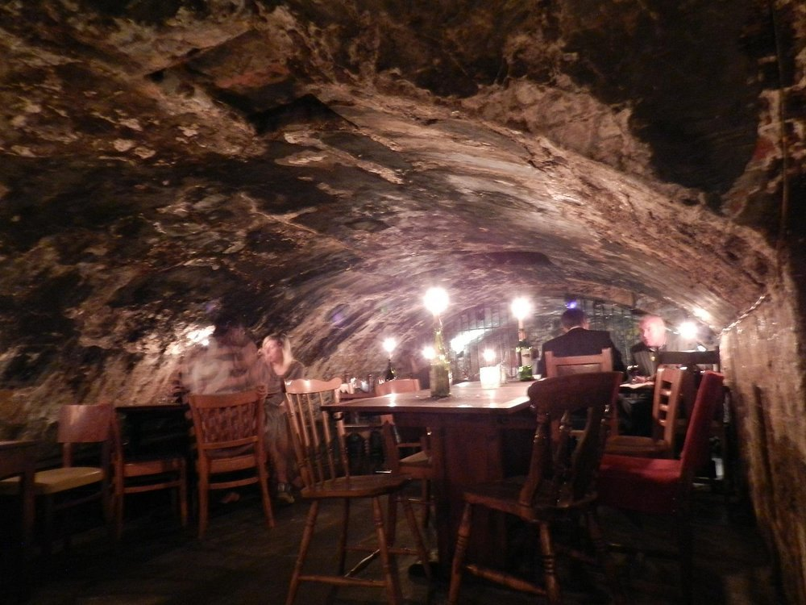
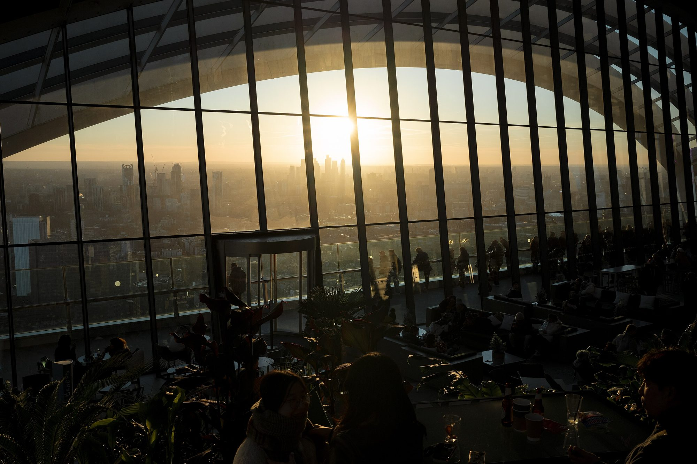
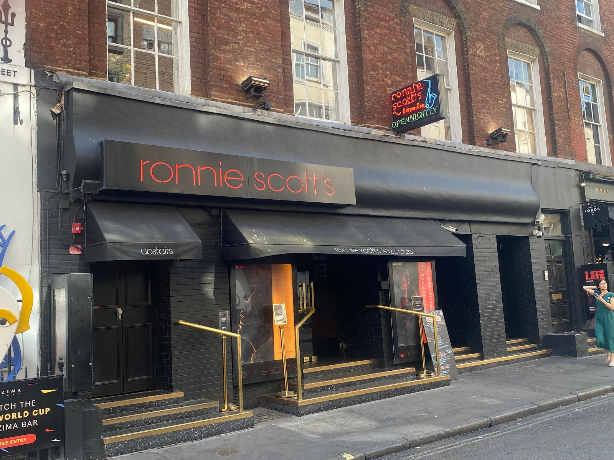

> 💡 **The Short Version:**
> - **First date:** a cocktail at [Bar Américain](#bar-américain-soho), then [live blues at Ain't Nothin' But](#aint-nothin-but-soho), free before 9pm on Wednesdays and Thursdays. That is the [three-hour Soho evening](#a-first-date-evening-in-soho-about-100-for-two) below.
> - **Free:** [Sky Garden](#sky-garden-city-of-london) with a timed ticket, or the [National Gallery on a Friday](#national-gallery-friday-lates-trafalgar-square), open until 9pm.
> - **Dinner:** [Bouchon Racine](#bouchon-racine-farringdon) in Farringdon, first on Time Out's 2026 list of romantic restaurants and named by the Infatuation and SquareMeal too.
> - **Rainy night:** an armchair, sofa or double bed at the [Electric Cinema](#electric-cinema-portobello-road).
> - **Special occasion:** the [London Eye's private Cupid's Pod](#the-london-eyes-cupids-pod), or [Clos Maggiore's conservatory](#clos-maggiore-covent-garden), booked by name.

*Prices, hours and dates are each operator's own, as of autumn 2026.*

## Pick by the kind of date

| You want | Go to | The one thing to know |
| --- | --- | --- |
| **An easy first drink** | Bar Américain, Gordon's Wine Bar | Gordon's takes no reservations |
| **Something to talk about** | National Gallery Friday Lates | Free; open until 9pm on Fridays |
| **A game to play** | Swingers West End crazy golf | Over-18s only from 6pm |
| **Dinner somewhere candlelit** | Bouchon Racine, Andrew Edmunds, Noble Rot | Bouchon Racine is closed on Sundays and Mondays |
| **A view** | Sky Garden, Horizon 22, the London Eye at dusk | Sky Garden tickets come out on Mondays |
| **Music** | Ronnie Scott's, Ain't Nothin' But | Ain't Nothin' But takes no bookings |
| **No money** | Parliament Hill, Columbia Road, Angel Comedy | Columbia Road trades on Sundays only |

## First dates

A first date wants a seat, a short commitment and an easy way to stay for another round.

### Bar Américain, Soho

*20 Sherwood Street, W1F 7ED · two minutes from Piccadilly Circus · cocktails £15.75 to £17.50*

A cocktail bar below street level in Brasserie Zédel, hung with Paul Colin's 1927 lithographs of Josephine Baker. The winter 2026 menu follows an ocean liner from Prohibition-era New York to Paris. Time Out's list of bars for a date (March 2026) and the Infatuation's first-date bars both include it. **A few tables can be [booked](https://www.sevenrooms.com/explore/baramericainlondon/reservations/create/search/), and the bar always keeps room for walk-ins.** Dinner is in the same building, which is how the [first-date itinerary](#a-first-date-evening-in-soho-about-100-for-two) below begins.

### Gordon's Wine Bar, Embankment

*47 Villiers Street, WC2N 6NE · between Charing Cross and Embankment · no reservations*

*The cellar at Gordon's.*

A vaulted cellar lit by candles in bottles, open since 1890, with sherry and port poured from the barrel and a cheese list of more than fifteen. **It takes no reservations**: turn up early and speak to the staff, because the cellar fills from about six. The terrace on Watergate Walk runs all year under heated awnings. Our [wine bars guide](/articles/best-wine-bars-london/) has the rest.

### National Gallery Friday Lates, Trafalgar Square

*Trafalgar Square, WC2N 5DN · Fridays until 9pm · free*

**Every Friday the gallery stays open until 9pm**, with short talks in the rooms, life drawing and drinks at Bar Giorgio in the Sainsbury Wing. Entry is free; a free [timed ticket](https://www.nationalgallery.org.uk/visiting/plan-your-visit) gets you in faster. Our [National Gallery guide](/articles/national-gallery-guide/) has the rooms to head for, and the [things to do alone guide](/articles/things-to-do-alone-london/) has the other museum lates.

The ticketed exhibition **[Renoir and Love](https://www.nationalgallery.org.uk/exhibitions/renoir-and-love)**, about couples, friends and families in Renoir's paintings, is **pay what you wish, from £1, every Friday evening to 15 January 2027**; at other times it is £20 to £25. {until=2027-01-15}

### Swingers West End, Oxford Circus

*15 John Prince's Street, W1G 0AB · crazy golf · £16 a head after 5pm*

Nine holes of indoor crazy golf with street food and a cocktail bar, which gives a nervous date something to do. A round takes 30 to 40 minutes at peak. **Over-18s only from 6pm**, and **tickets are released two months ahead**, with evening slots selling out. Our [competitive socialising guide](/articles/competitive-socialising-london/) covers the darts, shuffleboard and escape rooms; note that Flight Club takes no booking of fewer than six after 4pm on a Friday.

### A walk with a pub at the end: Hampstead Heath

*Hampstead · free · The Flask, 14 Flask Walk*

Walk from Hampstead village across the Heath to **Parliament Hill**, whose view of St Paul's and the City is protected by law, then back to **The Flask**, a Young's pub in a Grade II listed building, open 11am to 11pm Monday to Saturday and noon to 10.30pm on Sunday. The full ten-stop route, with what is open on which day, is our [Hampstead Heath to Primrose Hill walk](/articles/hampstead-heath-primrose-hill-walk/). In winter, aim to be past Parliament Hill before dusk.

### Borough Market, Southwark

*Next to London Bridge station · closed on Mondays*

First on Time Out's 2026 list of date spots: grazing from stall to stall keeps a first date moving, and you pay as you go. Our [markets guide](/articles/best-london-markets/) has every market's trading days.

### Columbia Road Flower Market, Bethnal Green

*Columbia Road, E2 · Sundays from 8am to about 3pm*

A flower market on Sunday mornings and an ordinary street the rest of the week, with more than 60 shops, cafés and galleries along it. Go early: it trades on Sundays only.

## Romantic restaurants

These are the restaurants named on at least two of three lists: [Time Out's most romantic restaurants](https://www.timeout.com/london/restaurants/romantic-restaurants-in-london) (October 2026), the [Infatuation's most romantic restaurants](https://www.theinfatuation.com/london/guides/best-romantic-restaurants-in-london) and [SquareMeal's romantic restaurants](https://www.squaremeal.co.uk/restaurants/best-for/romantic-restaurants-london_9856) (June 2026), plus Clos Maggiore, which SquareMeal names and our own [special occasion guide](/articles/special-occasion-restaurants-london/) covers in full.

### Bouchon Racine, Farringdon

*£££ · upstairs at the Three Compasses, 66 Cowcross Street, EC1M 6BP · Tuesday to Saturday*

French bistro cooking from Henry Harris on the top floor of a 300-year-old pub, with candles on every table. **Time Out puts it first** on its 2026 list and suggests asking for the semi-private balcony, strung with fairy lights over Turnmill Street; the Infatuation and SquareMeal list it too. The chalkboard menu leans on dishes like tête de veau and snails; SquareMeal's advice for a less adventurous date is steak, red wine and a cheese course. Open Tuesday to Saturday, noon to 3pm and 6pm to 10pm. [Book through the restaurant's site](https://www.bouchonracine.com/) or on 020 7253 3368.

### Andrew Edmunds, Soho

*£££ · 46 Lexington Street, W1F 0LP · six minutes from Piccadilly Circus*

A candlelit dining room in an 18th-century Georgian townhouse, open since 1985, with candles pressed into wine bottles, church-pew seating and closely set tables. The menu is handwritten daily and the wine list is priced close to retail. Named by Time Out and the Infatuation, which suggests the lamb with borlotti beans when it is on. Lunch is Monday to Friday, dinner Monday to Saturday from 5.30pm to 10.30pm, and there is a pre-theatre menu. [Book online](https://www.andrewedmunds.com/book-online).

### Noble Rot, Bloomsbury

*£££ · 51 Lamb's Conduit Street, WC1N 3NB*

A wine bar and restaurant with wooden interiors and a chalkboard menu, and a wine list the Infatuation calls London's best. All three lists name it. SquareMeal recommends it for a first date because you can have a glass and small plates in the bar without committing to dinner; the Infatuation's advice is to ask for a window seat in the wine bar, and it mentions the comté tart. [Reserve on Noble Rot's site](https://noblerot.co.uk/restaurant/lambs-conduit).

### Casse-Croûte, Bermondsey

*££ · 109 Bermondsey Street, SE1 3XB · bookings by phone*

A small French bistro with red-and-white checked tablecloths and a blackboard menu that changes every day. Time Out lists it, and the Infatuation names it on both its romantic and date-night lists; its pudding is the mille-feuille. **There is no online booking**: walk in, or ring **020 7407 2140**. Lunch is from noon every day, dinner from 6pm Monday to Saturday, so it is closed on Sunday evenings.

### Sessions Arts Club, Clerkenwell

*£££ · Old Sessions House, 22 Clerkenwell Green, EC1R 0NA · over-18s only*

A restaurant in the old judges' dining room of a Grade II* listed courthouse, with distressed walls, high ceilings and candles everywhere, plus terraces with fireplaces and a rooftop bar. Time Out and SquareMeal both list it. **Over-18s only**, because of the listed building. Dinner is Monday to Saturday, 5.30pm to 10pm, with lunch Tuesday to Saturday and on Sunday. [Book a table](https://www.sevenrooms.com/explore/sessionsartsclub/reservations/create/search/landing).

### Clos Maggiore, Covent Garden

*£££ · 33 King Street, WC2E 8JD · two minutes from Covent Garden*

Provençal and Tuscan cooking in a conservatory with blossom across the ceiling, fairy lights and an open fire; in summer it opens to the air. The restaurant has several rooms, so **ask for the conservatory by name when you book**. On the November 2026 menu, mains run from £32 to £55 and the five-course tasting menu is £89. [Book through Clos Maggiore](https://www.closmaggiore.com/reservations).

**From 1 to 30 December 2026** an early-evening menu, 4.30pm to 5.45pm, is £37.50 for two courses or £44.50 for three, each with a glass of fizz. {until=2026-12-30}

### Chez Bruce, Wandsworth Common

*££££ · 2 Bellevue Road, SW17 7EG · on Wandsworth Common*

White tablecloths and French cooking by the Common, on both of the Infatuation's lists: romantic restaurants and date-night restaurants. The standard three-course lunch is £68.50 before service. **On Sunday evenings corkage is free**, for one bottle per person and up to four a table: tell the reservations team when you book. [Book a table](https://www.chezbruce.co.uk/booking/).

For a view with dinner, our [rooftop and riverside restaurants guide](/articles/best-rooftop-restaurants-london/) has Duck & Waffle on the 40th floor of 110 Bishopsgate, open 24 hours, and Aqua Shard on level 31 of the Shard. The [French restaurants guide](/articles/best-french-restaurants-london/) has more bistros in the same vein as Bouchon Racine and Casse-Croûte.

## Views and evenings out

### Sky Garden, City of London

*Free with a ticket · level 35, 20 Fenchurch Street, EC3M 8AF · weekends until 9pm*

*Late afternoon at Sky Garden. Photo: [Andrei Nicolae](https://commons.wikimedia.org/wiki/File:20_Fenchurch_Street_Sky_Garden,_Golden_hour_2025-01-03.jpg), [CC BY 2.0](https://creativecommons.org/licenses/by/2.0/).*

Planted terraces under a glass roof on top of the Walkie-Talkie, with the Shard across the river. **Free tickets come out every Monday morning, three weeks ahead**, for one-hour slots. It is open 10am to 6pm on weekdays and 11am to 9pm at weekends, so from mid-March to late October a free sunset means a weekend ticket; the open-air terrace closes at 6pm every day. A table at Darwin Brasserie gets you in when the free tickets have gone. Our [Sky Garden guide](/articles/sky-garden-guide/) has the booking rules.

### Horizon 22, City of London

*Free with a booked ticket · level 58, 22 Bishopsgate*

Higher than Sky Garden, and free. Our [best views guide](/articles/best-views-london/) has the opening hours and the rest of the viewpoints, ticketed and free.

### The Garden at 120, City of London

*Free · no booking · 120 Fenchurch Street*

An open-air roof garden fifteen storeys up that needs no ticket at all, so it suits a date arranged on the day. It closes in high wind and ice.

### Sabine, St Paul's

*Seventh floor, Leonardo Royal, Carter Lane · 21 and over after 4pm*

A rooftop bar facing the dome of St Paul's under retractable heated roofs, so it stays open in winter. **Bookings from 4pm carry a £50-a-head minimum spend** for two hours, which walk-ins avoid. Closed on Sundays until 1 March 2027.

### Radio Rooftop, Strand

*Tenth floor, ME London · 21 and over from 5pm*

The roof of the ME London hotel on the corner of the Strand and Aldwych, with heated outdoor patios, open every day. **Sportswear is turned away.** The [rooftop bars guide](/articles/best-rooftop-bars-london/) has which roofs are shut until spring 2027.

### The London Eye at dusk

*South Bank · from £29 online · book a slot 30 minutes before sunset*

A slot half an hour before sunset boards in daylight, reaches the top at dusk and comes down as Parliament lights up. Standard tickets are **from £29 online** and £39 at the gate. The **[Champagne Experience](https://ticketing.londoneye.com/en/tickets/london-eye-champagne-experience)** adds a glass of Moët in the Eye Lounge before boarding, a second on the flight and Fast Track boarding, for **£49 a person** on November 2026 dates. Our [London Eye guide](/articles/london-eye-guide/) has the queue times and the rescheduling rules.

### A dinner cruise on the Thames

*Westminster Pier · 7.45pm · three hours · smart casual*

**City Cruises' [dinner sailing](https://www.cityexperiences.com/london/city-cruises/london-dinner-cruise-river-thames/)** serves three British courses with a live singer and dancing, at **£99 to £137** a head on autumn 2026 dates. **Window tables seat two and sell out first.** GetYourGuide sells the same kind of evening as a <a href="https://www.getyourguide.com/activity/-t5275?partner_id=WWP7I0R&amp;cmp=date-ideas-london" target="_blank" rel="sponsored nofollow noopener" data-affiliate="gyg">three-hour dinner cruise with live performance and dancing</a>. For the river without dinner, the Uber Boat from Westminster to Greenwich is £12.40 by contactless; our [Thames river cruises guide](/articles/thames-river-cruises-london/) compares them all.

### The South Bank at night

*Free · Westminster Bridge to Tower Bridge*

The riverside path from the London Eye to Tower Bridge is flat, lit and lined with bars, and the middle of **Waterloo Bridge** gives you Westminster upstream and St Paul's downstream from one spot. Our [South Bank walk](/articles/south-bank-walk/) numbers the stops.

## Theatre, comedy, music and film

### A West End show

*TKTS online or at the Leicester Square booth · midweek over Saturday*

A play or musical gives a date a fixed start and something to talk about over dinner afterwards. Book through **TKTS**, go midweek rather than on a Saturday, and think about where the two of you sit: our [London theatre guide](/articles/london-theatre-guide/) covers all three. London Theatre Geek's [date night shows](https://londontheatregeek.com/features/date-night-shows-in-london) sorts the running shows into funny, romantic, short enough for dinner after and small theatres, with where to sit as a pair and the best current deal for two.

### Ronnie Scott's, Soho

*47 Frith Street, W1D 4HT · main shows £40 to £65 · Late Late Show £12*

*Ronnie Scott's on Frith Street.*

Jazz club on Frith Street since 1965, seated at tables with food and drink served through the set. Two main shows run every evening, usually **£40 to £65**. The **Late Late Show** starts at **11.15pm Wednesday to Saturday for £12**, in the same room. Upstairs at Ronnie's, a 140-seat room above the club, is about £20 to £30. [Find a show](https://www.ronniescotts.co.uk/find-a-show), and see our [live music guide](/articles/best-live-music-venues-london/) for the Jazz Cafe and the 606 Club.

### Ain't Nothin' But, Soho

*20 Kingly Street, W1B 5PZ · live blues every night · over-18s*

A blues bar on Kingly Street, one street west of Carnaby Street, with live music every night since 1993: an acoustic set from about 6.30pm on weekdays, then bands and jam sessions into the night. **Entry is free until 9pm on Wednesdays and Thursdays and until 8.30pm on Fridays and Saturdays**, with a cover charge after that. **It takes no bookings**, and a queue can form at peak times.

### The Comedy Store, Leicester Square

*1a Oxendon Street, SW1Y 4EE · three minutes from Piccadilly Circus*

The club Don Ward opened in 1979. On **Sundays at 7.30pm** the **Comedy Store Players** improvise here, as they have since 1985; it is improv rather than stand-up. Our [comedy clubs guide](/articles/best-comedy-clubs-london/) has the rest.

### Angel Comedy, Islington

*The Camden Head, near Angel · free every night*

**Free stand-up every night of the week**, in a pub near Angel. The Friday shows, at 7.15pm and 9.15pm, are the polished bills; other nights are where new material gets tested.

### Electric Cinema, Portobello Road

*191 Portobello Road, W11 2ED · armchairs from £15 · beds and sofas for two*

Opened in 1911, with **98 leather armchairs**, sofas across the back row and **double beds in the front row**, a lamp on each table and a full bar. Armchairs are £25 on Friday evenings and at weekends, £20 on weekday evenings and £15 before 5pm on weekdays; the beds (£30 to £40) and sofas (£40 to £50) are sold for two. It sells out days ahead; **Electric White City**, at BBC Television Centre, has the same seats and is easier to get into. Our [cinemas guide](/articles/best-cinemas-london/) has the rest.

## Cheap and free dates

- **Galleries:** the national museums are free, and the [National Gallery](#national-gallery-friday-lates-trafalgar-square) is open until 9pm on Fridays.
- **The Barbican Conservatory** is free with a timed ticket on selected days from **28 November 2026 to 3 January 2027**: plants under glass in the middle of the Barbican estate. {until=2027-01-03}
- **Viewpoints:** [Sky Garden](#sky-garden-city-of-london), Horizon 22 and The Garden at 120 are free; Parliament Hill and Primrose Hill cost nothing at any hour, although Primrose Hill is locked overnight on summer weekends.
- **Live music and comedy:** [Ain't Nothin' But](#aint-nothin-but-soho) before its cover charge starts, and Angel Comedy every night.
- **Columbia Road** on a Sunday morning, for flowers you can carry home.

Our [free things to do](/free/) page has the full list.

### Deals that make dinner cheaper

Offers as at November 2026, with each operator's conditions:

| Deal | Where | Conditions |
| --- | --- | --- |
| **£5 corkage** | Hawksmoor | Mondays; bring any bottle; book a table |
| **2-for-1 orange wine** | The Hoxton, Holborn | Wednesdays from 6pm, in the hotel lobby, with popcorn |
| **2-for-1 mains** | The Waterway, Little Venice | Sunday evenings with the free Winter Club card; to 31 March 2027, not in December {until=2027-03-31} |
| **£29.50 for three courses and a drink** | Manzi's, Soho | Evening theatre menu, daily, with a glass of wine, a beer or a soft drink |
| **£19.50 for two courses** | Blanchette, Soho | Lunch and pre-theatre, Monday to Saturday; a card is needed to book and no-shows are charged £50 a head |
| **A free bottle of wine** | Brasserie Blanc, including the Southbank | Steak Night: order two steaks; Wednesdays on the Southbank, Fridays at Chancery Lane and Threadneedle Street |

Our [2-for-1 deals](/articles/two-for-one-deals-london/), [happy hour](/articles/happy-hour-london/) and [set lunch and pre-theatre](/articles/restaurant-deals-london/) guides have every current offer.

## Special occasions and proposals

### The London Eye's Cupid's Pod

*South Bank · a private capsule for two · £750 a pod on November 2026 dates*

A capsule to yourselves for a **30-minute rotation**, for two adults aged 18 and over. After booking, a London Eye executive contacts you to add a host, Champagne, flowers, truffles or a photographer. You cannot bring your own food or drink, and the pod cannot be decorated. The Eye says most Cupid's Pods are booked for proposals. [Book the Cupid's Pod](https://ticketing.londoneye.com/en/tickets/london-eye-cupids-pod).

### The Ritz Restaurant, Piccadilly

*££££ · 150 Piccadilly, W1J 9BR · two Michelin stars · jacket and tie*

A dining room of chandeliers, mirrors, pink marble and gilt, holding two Michelin stars and the National Restaurant Awards' Restaurant of the Year title for 2025. The Epicurean tasting menu is **£273 for five courses or £293 for seven**, ordered before 8.45pm. **There is live music on Friday and Saturday evenings**, with a £58-a-head entertainment charge on the à la carte. **Men must wear a jacket and tie, and jeans and sportswear are refused** for anyone. [The Ritz Restaurant](https://www.theritzlondon.com/dine-with-us/the-ritz-restaurant/).

The cheaper way into the same building is **afternoon tea in the Palm Court**, at **£95 a head**, with sittings at 11.30am, 1.30pm, 3.30pm, 5.30pm and 7.30pm and the same dress code; weekend sittings book months ahead. Our [afternoon tea guide](/articles/best-afternoon-tea-london/) compares it with Claridge's, the Langham and the rest.

### A booked room or table

For a proposal over dinner, book the room rather than the restaurant: **Clos Maggiore's conservatory** ([above](#clos-maggiore-covent-garden)) by name, or a **window table at Duck & Waffle**, which takes reservations two months ahead. Our [special occasion restaurants guide](/articles/special-occasion-restaurants-london/) has all six of London's three-Michelin-star restaurants and how far ahead each one books.

## Seasonal dates

### Winter

- **Skating at Somerset House**, in the courtyard under a 40ft tree, runs **to 10 January 2027**, at £13 to £28.50 plus a £1.50 fee; Skate Lates bring DJs on selected evenings. Our [ice skating guide](/articles/ice-skating-london/) has the other five outdoor rinks. {until=2027-01-10}
- **The Christmas lights**: start at Selfridges at about 4.30pm and walk Oxford Street, Regent Street and Carnaby Street to Covent Garden. Trafalgar Square's tree is lit on **Thursday 3 December 2026**. The route is our [Christmas lights walk](/articles/christmas-lights-walk-london/). {until=2027-01-04}
- **Christmas at Kew**, an evening light trail through the gardens, runs on selected dates **to 3 January 2027**, 4.20pm to 10pm, with tickets from £25.50; see [Kew's dates](https://www.kew.org/kew-gardens/whats-on/christmas) and our [Kew Gardens guide](/articles/kew-gardens-guide/). {until=2027-01-03}
- **Columbia Road's late openings**: the shops open from 5pm to 9pm with mulled wine on **Wednesday 25 November and 2, 9 and 16 December 2026**. {until=2026-12-16}
- **Christmas films on a roof, with dinner**: JOIA at Battersea Power Station every night to 24 December, and Kitchen at Holmes in Marylebone from 26 November to 20 December, both from £75 a head; see our [outdoor cinema guide](/articles/outdoor-cinema-london/). {until=2026-12-24}
- **Christmas markets and mulled wine**: our [Christmas markets guide](/articles/christmas-markets-london/) has where and when each market runs.
- **Valentine's Day 2027** is a Sunday; our [Valentine's Day guide](/articles/valentines-day-london/) has when each restaurant opens its bookings.

### Summer

- **Rooftops reopen**: Frank's Cafe in Peckham, the Queen Elizabeth Hall Roof Garden and the other summer-only roofs in our [rooftop bars guide](/articles/best-rooftop-bars-london/) are shut until spring 2027.
- **Hampstead Heath**: Parliament Hill for the view, and the Mixed Pond, open to everyone from April to October for £5 a swim.
- **Regent's Park Open Air Theatre** plays only in summer. Its 2027 season had not been announced on 24 November 2026; [the theatre's what's on page](https://openairtheatre.com/whats-on) will list it.
- **Outdoor film**: Everyman's free Screen on the Canal at King's Cross runs from late June to mid-August, watched from the steps above the Regent's Canal, and Rooftop Cinema Club, deckchairs and headphones from £14, is adults only after 5pm. Details are in the [outdoor cinema guide](/articles/outdoor-cinema-london/).
- **Parks**: picnics on Primrose Hill or by the Serpentine; our [parks and gardens guide](/articles/best-parks-gardens-london/) has the rest.

## Two itineraries

### A first-date evening in Soho: about £100 for two

**Best on a Wednesday or Thursday**, when the blues bar is free until 9pm. Everything is within a ten-minute walk of Piccadilly Circus.

| Time | Where | What it costs |
| --- | --- | --- |
| **6.30pm** | **[Bar Américain](#bar-américain-soho)**, 20 Sherwood Street, W1F 7ED. One cocktail each. | £15.75 to £17.50 a cocktail |
| **7.30pm** | **Brasserie Zédel**, in the same building: the prix-fixe menu, with steak haché and peppercorn sauce among the mains, and a glass of house wine; the house band plays every day at no extra charge. [Book a table](https://www.brasseriezedel.com/reservations/). | £16.95 for two courses, £19.95 for three; house wine from £9.50 a glass; 15% discretionary service |
| **8.45pm** | Walk about six minutes across Regent Street to Kingly Street. | Free |
| **Before 9pm** | **[Ain't Nothin' But](#aint-nothin-but-soho)**, 20 Kingly Street, W1B 5PZ. Live blues until late. | Free entry before 9pm on Wednesday and Thursday |

Two cocktails, two three-course prix-fixe dinners, two glasses of wine and the service charge come to about **£100 for two**. If it is going well, Ronnie Scott's Late Late Show is at 11.15pm, ten minutes' walk east on Frith Street, for £12 each.

### A special day by the river: Saturday

A day from the City to Soho, almost all on foot. Book three things ahead: the Sky Garden ticket (released on the Monday three weeks before), the London Eye slot and dinner.

| Time | Where | What it costs |
| --- | --- | --- |
| **11am** | **[Sky Garden](#sky-garden-city-of-london)**, 20 Fenchurch Street, EC3M 8AF, for your one-hour slot. | Free with a ticket |
| **12.15pm** | Walk over London Bridge to **Borough Market** (about 15 minutes) and eat from the stalls. | Pay as you go |
| **2pm** | Walk west along the river past Tate Modern, Shakespeare's Globe and the book market under Waterloo Bridge to the London Eye, about 3km and 45 minutes. The [South Bank walk](/articles/south-bank-walk/) has the stops. | Free |
| **30 minutes before sunset** | **[The London Eye](#the-london-eye-at-dusk)**, with the Champagne Experience. | £49 a person on November 2026 dates; standard from £29 |
| **Dinner** | Cross the Golden Jubilee Bridges and walk up to **[Clos Maggiore](#clos-maggiore-covent-garden)**, 33 King Street, WC2E 8JD, about 20 minutes. The conservatory, booked by name. | Mains £32 to £55; tasting menu £89 |
| **11.15pm** | **[Ronnie Scott's](#ronnie-scotts-soho)** Late Late Show, 47 Frith Street, W1D 4HT, about 12 minutes' walk. | £12 each |

From November to mid-January the sun sets before 4.30pm, so swap the order: the Eye straight after Borough Market, then the river walk in the dark, with the South Bank lit.

## Continue planning your London trip

- 🎭 **[Dinner and a show](/articles/dinner-and-a-show-london/)** — jazz suppers, cabaret dinners and restaurants with live music
- 🏨 **[The best areas to stay in London](/articles/best-areas-to-stay-in-london/)** — for a weekend away
- 🍸 **[The best cocktail bars](/articles/best-cocktail-bars-london/)** and **[speakeasy bars](/articles/best-speakeasy-bars-london/)** — for the drink before or after
- 🌧️ **[London in the rain](/articles/london-in-the-rain/)** — indoor plans when the weather turns
- 💷 **[London on a budget](/articles/london-on-a-budget/)** — what the rest of a trip costs
