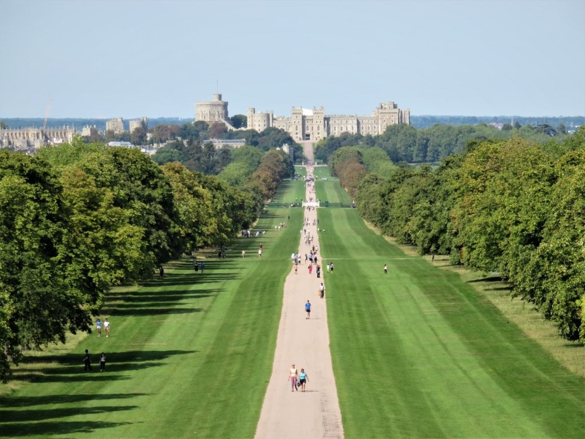
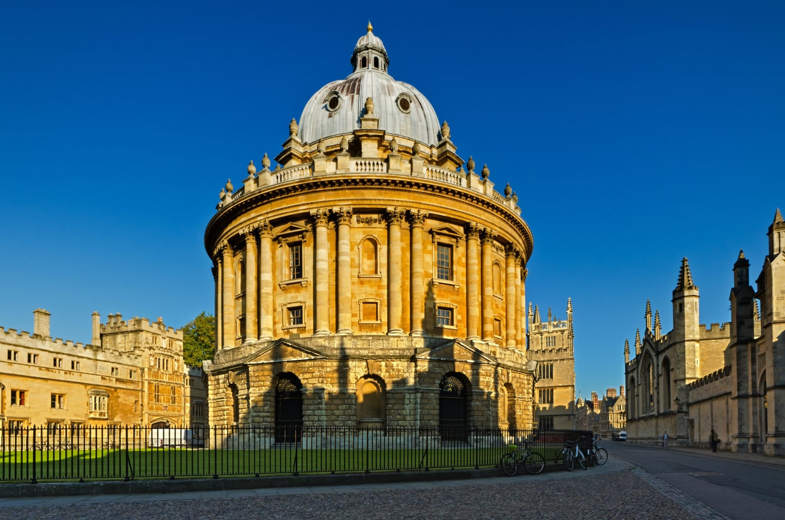

The good day trips from London are about an hour away, and the money is in the entry ticket rather than the train. Each section gives the journey cost, the entry price and the days the doors are shut.

> 💡 **The Short Version:** **Windsor** is the shortest and cheapest journey, and its castle is **closed on Tuesdays and Wednesdays**. **Oxford** is cheapest by coach, **Cambridge** by advance single. The **Harry Potter Studio Tour** must be booked weeks ahead and sells nothing on the door. **Contactless works to Windsor and Watford, but Oyster does not** — and neither works to Oxford or Cambridge. **Bath** is 1h15 from Paddington and cheapest with advance tickets. **Stonehenge** and **the Cotswolds** are the two where a coach tour beats the train. **Or book a tour** — <a href="https://www.getyourguide.com/activity/-t219849?partner_id=WWP7I0R&amp;cmp=day-trips-from-london" target="_blank" rel="sponsored nofollow noopener" data-affiliate="gyg">guided day trips from £66</a> cover the transport and the ticket in one booking.

> ⚠️ **Paddington is closed to Great Western trains from Sunday 27 December 2026 to Sunday 3 January 2027, which cuts the Windsor, Oxford, Bath and Cotswolds trains, and the same applies on Saturday 28 and Sunday 29 November.** The detail for each is on its guide, and on [National Rail](https://www.nationalrail.co.uk/dolphinjunction/), [Network Rail](https://www.networkrailmediacentre.co.uk/news/most-of-britains-railway-open-for-christmas-with-passengers-advised-to-plan-ahead-around-engineering-work).

## The day trips, compared

| Destination | From | Journey | Return fare | The main ticket |
| --- | --- | --- | --- | --- |
| **[Windsor](/articles/windsor-day-trip/)** | Paddington via Slough | **28–38 min** | £7.90 off-peak each way | Castle **£32** advance, closed Tue and Wed |
| **[Oxford](/articles/oxford-day-trip/)** | Paddington or Marylebone | About 1 hour | Off-peak return £37.70; coach £28 | Colleges charge separately; museums free |
| **[Cambridge](/articles/cambridge-day-trip/)** | King's Cross | **49 min** fast | Advance from £15.20 single | King's College **£15.75** booked early, punting from £28.50 |
| **[Harry Potter Studio Tour](/articles/harry-potter-studio-tour/)** | Euston to Watford Junction | 18–21 min, then a free bus | £7.20 off-peak each way | **£58.50**, pre-booked only |
| **[Bath](/articles/bath-day-trip/)** | Paddington | **1h15** direct | £47.60 return booked ahead, £75.90 walk-up | Roman Baths **£26.50** weekdays, £29 weekends |
| **[Canterbury and Dover](/articles/canterbury-dover-day-trip/)** | St Pancras high-speed | **54–58 min** to Canterbury, 1h06 to Dover | Super Off-Peak singles from £43 | Cathedral **£18–£19.50**; Dover Castle from £24.65 |
| **[Brighton and the Seven Sisters](/articles/brighton-seven-sisters-day-trip/)** | Victoria or London Bridge | **58 min** direct to Brighton | Advance singles from £8 one way | Royal Pavilion **£21.50**; Seven Sisters bus £3 flat fare |
| **[Stonehenge](/articles/stonehenge-day-trip/)** | Waterloo to Salisbury, then a bus | About 3 hours each way | Advance from £16.40 single, bus £20.50 | Entry **£27.20–£32.30** booked ahead; tours from £66 with entry |
| **[The Cotswolds](/articles/cotswolds-day-trip/)** | Paddington to Moreton-in-Marsh | **1h25**, then the 801 bus | £54 off-peak return | Villages are free; tours from £89 |

**The pattern:** the train is the small number. Windsor Castle costs four times the fare to get there, and the Studio Tour costs eight times it. The exceptions are Stonehenge and the Cotswolds, where getting there is the hard part and the tour pays for the transport. Book the attraction first and fit the train around it.

Powered by <a target="_blank" rel="sponsored" href="https://www.getyourguide.com/london-l57/">GetYourGuide</a>

## Day tours from London, by destination

Some of these places are easy by train. Others — Stonehenge, the Cotswolds, Highclere — have no useful station, and a coach tour is the only sensible way to do them in a day. The cheapest credible tour prices:

| Where | Price | Worth it because |
| --- | --- | --- |
| <a href="https://www.getyourguide.com/activity/-t219849?partner_id=WWP7I0R&amp;cmp=day-trips-from-london" target="_blank" rel="sponsored nofollow noopener" data-affiliate="gyg">Stonehenge, with entry</a> | **£66** | There is no direct train, and the bus from Salisbury eats the day |
| <a href="https://www.getyourguide.com/activity/-t215430?partner_id=WWP7I0R&amp;cmp=day-trips-from-london" target="_blank" rel="sponsored nofollow noopener" data-affiliate="gyg">The Cotswolds</a> | **£89** | No village-to-village transport at all |
| <a href="https://www.getyourguide.com/activity/-t71088?partner_id=WWP7I0R&amp;cmp=day-trips-from-london" target="_blank" rel="sponsored nofollow noopener" data-affiliate="gyg">Windsor, with castle entry</a> | £80 | Cheap by train instead, if you only want the castle |
| <a href="https://www.getyourguide.com/activity/-t391446?partner_id=WWP7I0R&amp;cmp=day-trips-from-london" target="_blank" rel="sponsored nofollow noopener" data-affiliate="gyg">Canterbury and the White Cliffs</a> | £79 | Two places, one coach |
| <a href="https://www.getyourguide.com/activity/-t2259?partner_id=WWP7I0R&amp;cmp=day-trips-from-london" target="_blank" rel="sponsored nofollow noopener" data-affiliate="gyg">Blenheim Palace and the Cotswolds</a> | £79 | Awkward pairing by train |
| <a href="https://www.getyourguide.com/activity/-t965?partner_id=WWP7I0R&amp;cmp=day-trips-from-london" target="_blank" rel="sponsored nofollow noopener" data-affiliate="gyg">Oxford, Stratford and Warwick Castle</a> | £79 | Three stops no train links |
| <a href="https://www.getyourguide.com/activity/-t645578?partner_id=WWP7I0R&amp;cmp=day-trips-from-london" target="_blank" rel="sponsored nofollow noopener" data-affiliate="gyg">LEGOLAND Windsor, with entry</a> | £85 | Saves the Windsor shuttle |
| <a href="https://www.getyourguide.com/activity/-t388125?partner_id=WWP7I0R&amp;cmp=day-trips-from-london" target="_blank" rel="sponsored nofollow noopener" data-affiliate="gyg">Hampton Court with Windsor Castle</a> | £89 | Both palaces in a day |
| <a href="https://www.getyourguide.com/activity/-t1309?partner_id=WWP7I0R&amp;cmp=day-trips-from-london" target="_blank" rel="sponsored nofollow noopener" data-affiliate="gyg">Leeds Castle, Canterbury and Dover</a> | £105 | Leeds Castle has no station |
| <a href="https://www.getyourguide.com/activity/-t122247?partner_id=WWP7I0R&amp;cmp=day-trips-from-london" target="_blank" rel="sponsored nofollow noopener" data-affiliate="gyg">Brighton and the Seven Sisters</a> | £109 | The cliffs are the bit buses do badly |
| <a href="https://www.getyourguide.com/activity/-t123059?partner_id=WWP7I0R&amp;cmp=day-trips-from-london" target="_blank" rel="sponsored nofollow noopener" data-affiliate="gyg">Highclere Castle (Downton Abbey)</a> | £229 | Opens to visitors on limited dates |
| <a href="https://www.getyourguide.com/activity/-t11108?partner_id=WWP7I0R&amp;cmp=day-trips-from-london" target="_blank" rel="sponsored nofollow noopener" data-affiliate="gyg">Paris, by Eurostar</a> | £254 | A long but real day |
| <a href="https://www.getyourguide.com/activity/-t2275?partner_id=WWP7I0R&amp;cmp=day-trips-from-london" target="_blank" rel="sponsored nofollow noopener" data-affiliate="gyg">Edinburgh</a> | £239 | Realistically an overnight sold as a day |

> ⚠️ **Check what the price includes before you book.** On a lot of coach tours the attraction named in the title is an optional extra, so entry is charged on top. Read the includes list rather than the title.

Powered by <a target="_blank" rel="sponsored" href="https://www.getyourguide.com/london-l57/">GetYourGuide</a>

## Windsor

Paddington via Slough takes under 40 minutes; Waterloo runs direct but takes nearly an hour. **Contactless works, Oyster does not.**

Windsor Castle is **£32 booked ahead, £36 on the day**, with no family ticket, and it is **closed every Tuesday and Wednesday**. The Changing of the Guard is Thursdays and Saturdays. Eton, the Long Walk and the Great Park are free, and Legoland is ten minutes away if the castle is not the point.

→ **[The full Windsor guide](/articles/windsor-day-trip/)**

*The Long Walk, with Windsor Castle at the far end.*

## Oxford

Two ways in: Paddington, or Marylebone on Chiltern. The **Oxford Tube coach runs through the night** and is cheaper than either.

Some colleges charge, some are free, and several close to visitors during exams — including Christ Church, whose staircase and hall are the Harry Potter draw. The Ashmolean, the Pitt Rivers and the Natural History Museum are free, and the covered market costs nothing to wander.

→ **[The full Oxford guide](/articles/oxford-day-trip/)**

*The Radcliffe Camera, Oxford.*

## Cambridge

**49 minutes from King's Cross** on the fast train, or slower and cheaper from Liverpool Street. Neither Oyster nor contactless works, and the walk-up return can be £48 on a morning fast train, so book ahead: advance singles start at **£15.20**.

King's College is **£15.75** booked early and £17 otherwise, St John's £17 (open to paying visitors only from 5 December to 18 January), Queens' £5, and Trinity does not let the public into its courts. Punting is **£28.50 an hour for a whole self-hire punt**, from £41 if someone else does the punting. Touting on the street is a criminal offence in Cambridge, so book at a licensed station.

→ **[The full Cambridge guide](/articles/cambridge-day-trip/)**

## The Harry Potter Studio Tour

**Nothing is sold on the door.** It is £58.50 an adult and £47 a child on 2026 dates, and it closes 9 to 13 November while the sets are redressed.

Euston to Watford Junction is 18 minutes, and **the shuttle bus from there is free with your ticket**.

→ **[The full Studio Tour guide](/articles/harry-potter-studio-tour/)**

## Bath

**1h15 direct from Paddington**, and much cheaper booked ahead: £47.60 return in advance singles against £75.90 walk-up. The Roman Baths are **£26.50 on weekdays and £29 at weekends**, Thermae Bath Spa's rooftop pool is £44 for two hours on weekdays, and Pulteney Bridge and the Royal Crescent are free.

Most coach tours pair Bath with Stonehenge and give you two or three hours in the city, and Roman Baths entry is often an optional extra.

→ **[The full Bath guide](/articles/bath-day-trip/)**

## Brighton and the Seven Sisters

**58 minutes direct from Victoria or London Bridge**, with Advance singles from £8 one way — but the Seven Sisters chalk cliffs and Birling Gap are a separate leg again, by bus from Brighton or a second train to Seaford. **Neither Oyster nor contactless works this far out.**

The Royal Pavilion is £21.50, Brighton Pier charges £1 admission from March to October, and the Seven Sisters bus is a flat £3 fare. The cliff edge is unfenced and erodes up to a metre a year, so the walking route needs care.

→ **[The full Brighton and the Seven Sisters guide](/articles/brighton-seven-sisters-day-trip/)**

## Stonehenge

By public transport it is Waterloo to Salisbury, then a bus that runs **five times a day in winter**, about three hours each way and roughly £80 all in. Tours start at **£66 with entry included**.

Entry is **£27.20 to £32.30** booked ahead, 15% less than at the gate. And you can see the stones free from the National Trust land around them, a mile and a half's walk from Amesbury.

→ **[The full Stonehenge guide](/articles/stonehenge-day-trip/)**

## The Cotswolds

Not one place, and that is the problem. **Moreton-in-Marsh is the only station with a useful bus**, the 801 to Stow and Bourton-on-the-Water, and it is the only route that runs on Sundays. Bibury and Broadway have no Sunday bus.

Nothing in the villages needs a ticket, so a small-group tour from about **£89** mostly pays for transport between them.

→ **[The full Cotswolds guide](/articles/cotswolds-day-trip/)**

## Where else is worth the train

More worth the day:

- **Coast:** [Brighton and the Seven Sisters](/articles/brighton-seven-sisters-day-trip/); beyond that, Whitstable for oysters, Margate for Dreamland and the Turner, Broadstairs, Hastings, and Eastbourne itself.
- **Cities and towns:** [Canterbury and Dover](/articles/canterbury-dover-day-trip/) together on the high-speed line, Winchester, Rye, St Albans and Rochester.
- **Castles and houses:** [Leeds Castle](/articles/canterbury-dover-day-trip/#leeds-castle--why-the-coach-is-the-practical-way-in) (no useful station, so it is covered with the Canterbury and Dover trip), plus Hever, Arundel, Warwick, Blenheim Palace, Hatfield House and Highclere, better known as Downton Abbey.
- **Countryside:** the Chilterns, Box Hill and the South Downs — the places where [hiring a car](/articles/car-hire-driving-uk/) helps.
- **Theme parks:** [theme parks near London](/articles/theme-parks-near-london/) compares them all. [Thorpe Park](/articles/thorpe-park-day-trip/) is the thrill park, Waterloo to Staines and a bus; [Chessington](/articles/chessington-world-of-adventures-day-trip/) is in Zone 6, with a zoo in the ticket; [LEGOLAND Windsor](/articles/legoland-windsor-day-trip/) is ten minutes from [Windsor](/articles/windsor-day-trip/) and a day of its own, not an afternoon after the castle; and [Paultons Park](/articles/paultons-park-day-trip/), home of Peppa Pig World, is a train to Southampton and a bus. Alton Towers needs a night away.
- **Abroad:** [Paris by Eurostar](/articles/paris-day-trip/), which is from 2h16 direct; the guide covers the fares, the border checks and how many hours you get in the city. [Disneyland Paris](/articles/disneyland-paris-from-london/) is a Eurostar day too, by way of Gare du Nord and the RER, at about seven hours in the park. [Brussels](/articles/brussels-day-trip/) is the shortest Eurostar run, at about two hours. [Bruges](/articles/bruges-day-trip/) takes longer, a Eurostar to Brussels plus a separate Belgian train, with the canals and the Belfry at the end. [Amsterdam](/articles/amsterdam-from-london/) is about four hours each way direct, which makes it a demanding day trip and a better one- or two-night stay.
- **Scotland:** [Edinburgh](/articles/edinburgh-day-trip/) is 4h08 on LNER's fastest trains, though most take nearer 4h30. The round trip alone runs to 8 or 9 hours, so the guide recommends a night in the Old Town and covers the Caledonian Sleeper.

Powered by <a target="_blank" rel="sponsored" href="https://www.getyourguide.com/london-l57/">GetYourGuide</a>

## Making the day work

- **Buy advance singles for Oxford and Cambridge**, where walk-up fares are two to three times the price. Windsor and Watford are cheap enough to turn up and go.
- **Travel out after 09:30 on weekdays** for off-peak fares, which on most of these routes also means a seat.
- **Check the last train before you commit to dinner.** Last trains are earlier than London habits assume, particularly on Sundays, when engineering work can close a branch line.
- **[National Rail 2FOR1](/articles/national-rail-2for1-london-attractions/)** covers some attractions, including things in Cambridge, but not Windsor Castle or the colleges. It needs a paper ticket, not contactless.

## Continue planning your London trip

- 🚗 **[Hiring a car and driving in the UK](/articles/car-hire-driving-uk/)** — licence rules, the real costs, and the charges that catch visitors out.
- 🚇 **[London transport costs and fares](/articles/london-public-transport-costs-and-fares/)** — how contactless and capping work before you leave town.
- 🎢 **[Theme parks near London](/articles/theme-parks-near-london/)** — Thorpe Park, Chessington, LEGOLAND, Paultons and the seaside parks, compared on price, train and season.
- 🎟️ **[National Rail 2FOR1](/articles/national-rail-2for1-london-attractions/)** — the rules, and the attractions it actually covers.
- 🎪 **[London music festivals 2027](/articles/london-music-festivals-2027/)** — Reading, Boomtown, Cambridge Folk and the other festivals within about 90 minutes by train.
- 🗺️ **[London itinerary planner](/articles/london-itineraries-by-days-and-interests/)** — how many days you need, and where a day trip fits.
- 🇫🇷 **[Paris by Eurostar](/articles/paris-day-trip/)** — the one day trip here that crosses a border, and what that adds to check-in.
- 🎢 **[Disneyland Paris from London](/articles/disneyland-paris-from-london/)** — the two Eurostar routes to the gates, what each costs, and when a night beats a day.
- 🇧🇪 **[Brussels by Eurostar](/articles/brussels-day-trip/)** — a shorter train than Paris, the Grand-Place, and the Atomium detour question.
- 🍫 **[Bruges from London](/articles/bruges-day-trip/)** — the Eurostar to Brussels, the separate Belgian train onward, and the Belfry and canals waiting at the other end.
