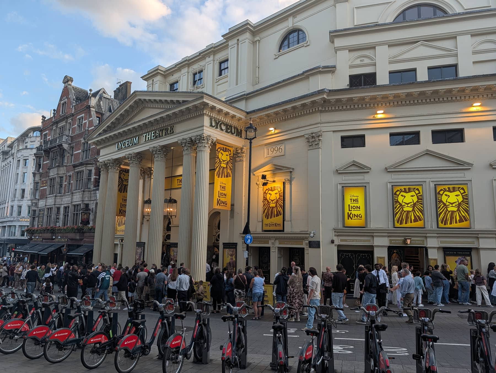

**The Lion King has played the Lyceum since 1999, and seats start at £38, or £29.50 if you book on a Monday for that week.** Around it, London has a Secret Cinema staging of *Pirates of the Caribbean*, a Pixar walk-through at Wembley, Disney On Ice twice in a season, two Disney Stores and a Greenwich college where Jack Sparrow was filmed.

> 💡 **The Short Version:** **The Lion King from £38, booking to 25 July 2027, no under-3s.** **Magical Mondays: £29.50 seats for the same week, released at noon every Monday.** **Secret Cinema's Pirates of the Caribbean runs 16 February to 6 June 2027, from £49, no under-7s.** **Mundo Pixar at Wembley Park ends on 3 January 2027.** **The Disney Store on Oxford Street is open until 10pm.** **The official Disney afternoon tea, on Park Lane, turns Frozen from 26 November.** **Hercules has closed.** The Old Royal Naval College grounds, where *On Stranger Tides* and *Cruella* were filmed, are free.

> ⚠️ **Official, licensed and Disney-adjacent are three different things.** Disney produces The Lion King, runs the Disney Stores and puts its name to the Park Lane afternoon tea. Disney On Ice (made by Feld Entertainment), Secret Cinema and Mundo Pixar are licensed, and all three are sold on Disney's own ticket site. The filming locations, the Peter Pan statue and Winnie at the zoo are places with a story attached and nothing Disney on site. We say which is which.

## What it all costs

| What | Cost per adult | Status |
| --- | --- | --- |
| Disney Store, Oxford Street | £0 to browse | Official |
| Old Royal Naval College grounds | £0 | Filming location |
| Peter Pan statue, Kensington Gardens | £0 | Story location |
| Old Royal Naval College film tour | £25 | Filming location |
| The Lion King, Magical Mondays | £29.50 | Official |
| High School Musical, Wembley Park | from £35 | Official |
| The Lion King, standard booking | from £38 | Official |
| Mundo Pixar, Wembley Park | from about £26 | Licensed |
| Secret Cinema: Pirates of the Caribbean | from £49 | Licensed |
| Disney On Ice, The O2 | from £57 | Licensed |
| Disney Princess Afternoon Tea, Park Lane | £70 (£45 child) | Official |

## The Lion King, Lyceum Theatre

*From £38 · 2 hours 30 minutes with an interval · ages 6+, no under-3s · booking to 25 July 2027 · 21 Wellington Street, WC2E 7RQ, Covent Garden or Charing Cross*

*The Lyceum Theatre, Wellington Street.*

Julie Taymor's staging opens with the animals coming down the aisles at head height, close enough for a child in an aisle seat to touch. It plays Tuesday to Saturday at 7.30pm, with 2.30pm matinees on Wednesday, Saturday and Sunday; there is no Monday show.

**Every child needs a full-price seat of their own**, nobody under three is admitted, and under-16s must sit beside an adult.

**What seats cost.** Mid-range seats run about £63 to £83 on off-peak dates and £88 to £123 at peak, so moving a date saves more than moving a row. Groups of nine or more pay from £40 a head, and groups of 20 or more from £35. [Prices and seat advice on London Theatre Geek](https://www.londontheatregeek.co.uk/shows/disneys-the-lion-king).

**Magical Mondays.** Every Monday at noon, a set number of seats for that week's performances go on sale at £29.50, two per person per performance, on [Disney's own day-seat page](https://www.disneytickets.co.uk/disney-day-seats-tickets). You need a MyDisney account, the seat is allocated for you, and the tickets cannot be exchanged or refunded.

[Book The Lion King](https://www.disneytickets.co.uk/the-lion-king-musical-tickets).

## The other Disney stage shows

### High School Musical, Troubadour Wembley Park Theatre

*From £35 · about 2 hours · ages 6+ · until 3 January 2027 · 3 Fulton Road, HA9 0SP, Wembley Park*

The Disney Channel film on stage, a short walk from Wembley Park station. Mid-range seats are £79 to £95.50 off-peak and £99.50 to £119.50 at peak; £35 standing tickets are the cheapest way in. It shares Fulton Road with Mundo Pixar, so the two make one Wembley afternoon and evening. [Book High School Musical](https://www.disneytickets.co.uk/high-school-musical-tickets).

### The Greatest Showman, Theatre Royal Drury Lane

*Previews from 14 April 2027 · on sale to 2 October 2027 · ages 6+, no under-4s · Catherine Street, WC2B 5JF, Covent Garden*

The stage version of the 20th Century Studios film, sold through Disney's own box office. From 6 May 2027 it plays Monday to Saturday at 7pm, with 2pm matinees on Wednesday and Saturday. It takes over the theatre that *Hercules* played until 5 September 2026. [Book The Greatest Showman](https://www.disneytickets.co.uk/the-greatest-showman-musical-tickets).

### Disney Princess – The Concert, Royal Festival Hall

*28–30 March 2027 · about 1 hour 45 minutes · Southbank Centre, SE1 8XX, Waterloo*

Broadway and West End singers perform the songs of Disney's princesses. Most performances are at 7pm, with 2pm matinees. [Tickets](https://www.disneytickets.co.uk/disney-princess-the-concert-tickets).

### The Muppet Christmas Carol in Concert, Eventim Apollo

*Saturday 28 November 2026, 3pm only · Hammersmith, W6 9QH*

The 1992 film shown with its score played live. It is the only London date. [Tickets](https://www.disneytickets.co.uk/muppet-christmas-carol-tickets).

For everything else on in the West End, see [the London theatre guide](/articles/london-theatre-guide/) and [the best Christmas shows](/articles/christmas-shows-london/).

## Secret Cinema: Disney's Pirates of the Caribbean, Greenwich Peninsula

*From £49 · about 2 hours 30 minutes · 16 February to 6 June 2027 · 49 Olympian Way, SE10 0NA, five minutes' walk from North Greenwich*

*The Curse of the Black Pearl* staged around you with actors, stunts, a live band and projection mapping, with food and drink to buy throughout. Dress as a pirate, smuggler or member of high society. Standing General Admission lets you roam; Roam and Return gives you a seat to come back to, and both start at £49.

**Check the age rule before you book a family.** Thursday, Friday and Saturday evenings are recommended for 18+ and admit no one under 16. The other performances are recommended for 12+ and admit no one under 7. Shows run at 7.30pm Tuesday to Saturday, 2.30pm Saturday, and 12.30pm and 5.30pm Sunday.

[Book Pirates of the Caribbean](https://piratesofthecaribbeanimmersive.com/tickets/). More shows like it are in [the immersive experiences guide](/articles/immersive-experiences-london/).

## Mundo Pixar Experience, Wembley Park

*From about £26 adult, £20 child · 45 to 55 minutes · all ages, under-2s £2 · until 3 January 2027 · Fulton Road, HA9 0TF, five minutes from Wembley Park station*

Fourteen life-size sets from the Pixar films across 3,500 square metres, among them Andy's room from *Toy Story*, the *Monsters, Inc.* scream floor and Riley's mind from *Inside Out*, plus a *Toy Story 3* room built only for the London run. It is licensed by Disney and Pixar and run by Golden Peak.

**Prices move with the date.** [Wembley Park](https://wembleypark.com/attractions/mundo-pixar-exhibition-london/) quotes £26 for an adult and £20 for a child on a November weekday morning, against £38 and £26 on Christmas Eve. **Buggies cannot go in**, and bags bigger than A4 go in the cloakroom at £3 each. [Tickets](https://www.disneytickets.co.uk/mundo-pixar-experience-tickets).

## Disney On Ice

### Discover the Magic, The O2

*From £57 · 24 December 2026 – 3 January 2027 · about 2 hours with an interval · ages 2+ · North Greenwich*

An ice show built around the search for Tinker Bell, with scenes from *Coco*, *Moana*, *Beauty and the Beast* and *Frozen*. Under-14s must come with an adult. Shows start at 1pm and 4.30pm on Christmas Eve, and at 2.30pm and 6.30pm on most days after, with a 10.30am show on Sunday 27 December; doors open an hour before. Seats start at £57 on [London Theatre's listing](https://www.londontheatre.co.uk/show/48538-disney-on-ice-london). [The O2's event page](https://www.theo2.co.uk/events/detail/disney-on-ice-presents-discover-the-magic).

### Road Trip Adventures, OVO Arena Wembley

*18–21 March 2027 · Wembley Park*

The spring show, with a different set of films. [Dates and tickets](https://www.disneytickets.co.uk/disney-on-ice-road-trip-adventures-tickets).

## The Disney Stores

**[Disney Store, 350-352 Oxford Street](https://stores.disneystore.co.uk/london/london/D350/)**, W1C 1JH, near Bond Street station. Open **9am to 10pm Monday to Saturday and 12pm to 6pm on Sunday**, so it suits an evening after a matinee.

**Disney Store at Selfridges**, lower ground floor, 400 Oxford Street, W1A 1AB, a few minutes' walk west.

The rest of the street is in [the Oxford Street guide](/articles/oxford-street-guide/).

## The Disney Princess Afternoon Tea, Park Corner Brasserie

*£70 adult, £45 child · daily 12.30pm to 7pm · London Hilton on Park Lane, 22 Park Lane, W1K 1BE, Hyde Park Corner*

Disney's official afternoon tea, served in the Hilton's brasserie on Park Lane. Its menu changes by chapter, each a page of a "Royal Recipe Book": the princesses, then Moana in the summer, Disney's villains this autumn, and **a Frozen chapter, A Royal Winter Awaits, from 26 November 2026**. The sandwiches are moulded into shapes from the films.

**Cancel 24 hours ahead or pay £40 a head.** Card details are taken at booking. [Book the Disney afternoon tea](https://www.sevenrooms.com/experiences/parkcornerbrasserie/disney-princess-afternoon-tea---a-royal-winter-awaits-5163334897614848), or see [the brasserie's page](https://www.parkcornerbrasserie.com/whats-on/disney-frozen-afternoon-tea/). Every other tea worth booking is in [the best afternoon tea in London](/articles/best-afternoon-tea-london/).

## Filming and story locations you can visit

### Old Royal Naval College, Greenwich

*Grounds free · film tour £25 adult, £10 child, £52.50 family of four · SE10 9NN, Cutty Sark DLR*

*The Painted Hall, Old Royal Naval College.*

In *Pirates of the Caribbean: On Stranger Tides* (2011), Jack Sparrow is questioned by George II in the college's Upper Hall and escapes by carriage along College Way. In *Cruella* (2021), King William Lawn and College Way stand in for Regent's Park. [The college lists both](https://ornc.org/films-tv-productions/). Its **Spies, Sleuths and Superheroes** film tour runs on Sundays at 11.30am and takes 1 hour 15 minutes. [Book the film tour](https://ornc.org/whats-on/film-tour-spies/).

The Uber Boat by Thames Clippers links Greenwich pier with North Greenwich, for the Secret Cinema venue, so the two make one day. See [the Greenwich area guide](/articles/greenwich-area-guide/).

### Peter Pan statue and the Diana Memorial Playground, Kensington Gardens

*Free · Lancaster Gate or Queensway*

The bronze of Peter Pan beside the Long Water was paid for by J. M. Barrie, sculpted by George Frampton and unveiled on 30 April 1912. It is Barrie's Peter, not Disney's. [The Royal Parks has the story](https://www.royalparks.org.uk/read-watch-listen/shrine-youth-peter-pan-statue-kensington-gardens). Across the gardens, the [Diana Memorial Playground](https://www.royalparks.org.uk/visit/parks/kensington-gardens/diana-memorial-playground) is built around the Peter Pan stories.

### Winnie the bear, London Zoo

*Zoo ticket needed · Regent's Park, NW1 4RY, Camden Town*

Winnie was a black bear brought to London by Lieutenant Harry Colebourn of Winnipeg and left at the zoo when his regiment went to France. A. A. Milne and his son Christopher Robin visited her often, and Milne named Winnie-the-Pooh after her. The zoo has two sculptures of her; the bronze of Winnie with Colebourn stands next to ZSL's War Memorial, just outside Butterfly Paradise. [The zoo tells her story](https://londonzoo.org/zoo-stories/history-of-london-zoo/sculptures). Tickets and the rest of the day are in [the London Zoo guide](/articles/london-zoo-guide/).

### St Paul's Cathedral and *Mary Poppins*

The Bird Woman in *Mary Poppins* (1964) feeds the pigeons on the steps of St Paul's, but the film was shot entirely at Disney's studio in Burbank. The steps are free; going inside costs £27 for an adult. More screen locations across the city are in [London filming locations](/articles/london-filming-locations/).

## Marvel and Star Wars with an orchestra

Disney's own box office also sells two big-screen concerts. **[Marvel Studios' Infinity Saga Concert Experience](https://www.disneytickets.co.uk/marvel-studios-infinity-saga-concert-experience-tickets)** plays the Eventim Apollo on Thursday 11 February 2027 at 7.30pm, with no under-8s. The **[Star Wars Weekender](https://www.disneytickets.co.uk/star-wars-weekender-concert-tickets)** at the Royal Albert Hall, 29 April to 2 May 2027, is six film screenings with the score played live.

## Disneyland Paris from London

There is no direct train. Eurostar sells London to Disneyland Paris as one ticket via Lille, changing at Lille Europe onto a TGV to Marne-la-Vallée Chessy at the park gates. Times, costs and whether a day trip works are in [Disneyland Paris from London](/articles/disneyland-paris-from-london/).

## Two Disney days

### A family day in the West End

Morning in Kensington Gardens at the Peter Pan statue and the Diana Memorial Playground. Central line from Lancaster Gate to Bond Street for the Disney Store. The Lion King matinee at 2.30pm on a Wednesday, Saturday or Sunday, which leaves an evening free. For more with children, see [London with children](/articles/london-with-children/).

### A Greenwich day, February to June 2027

The Old Royal Naval College in the morning, with the film tour if it is a Sunday. Lunch in Greenwich, then the boat to North Greenwich for Secret Cinema's Pirates of the Caribbean, checking the age rule for the performance you pick.

## Continue planning your London trip

- 🎭 **[London Theatre Guide](/articles/london-theatre-guide/)**
- 🎄 **[The Best Christmas Shows in London](/articles/christmas-shows-london/)**
- 🕶️ **[Immersive Experiences in London](/articles/immersive-experiences-london/)**
- 👨‍👩‍👧 **[London with Children](/articles/london-with-children/)**
- 🏰 **[Disneyland Paris from London](/articles/disneyland-paris-from-london/)**
- ⚡ **[Harry Potter in London](/articles/harry-potter-london/)**
- 🎬 **[London Filming Locations](/articles/london-filming-locations/)**
- 🛍️ **[Oxford Street Guide](/articles/oxford-street-guide/)**
- ⚓ **[Greenwich Area Guide](/articles/greenwich-area-guide/)**
- 🏟️ **[The O2 Travel Guide](/articles/the-o2-travel-guide/)**
