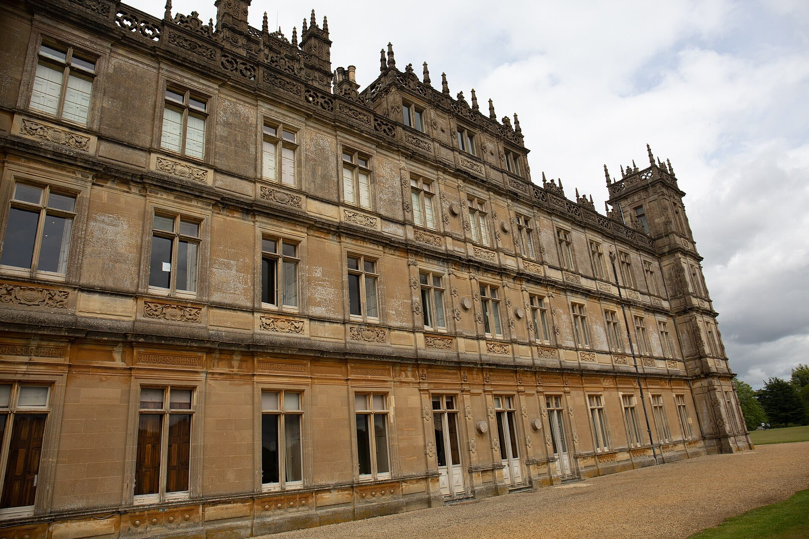
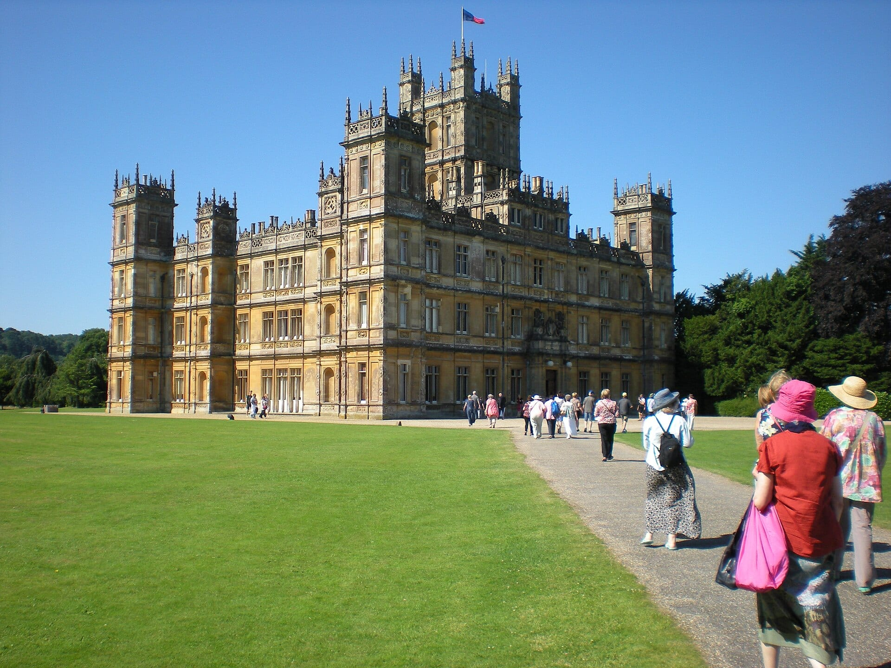
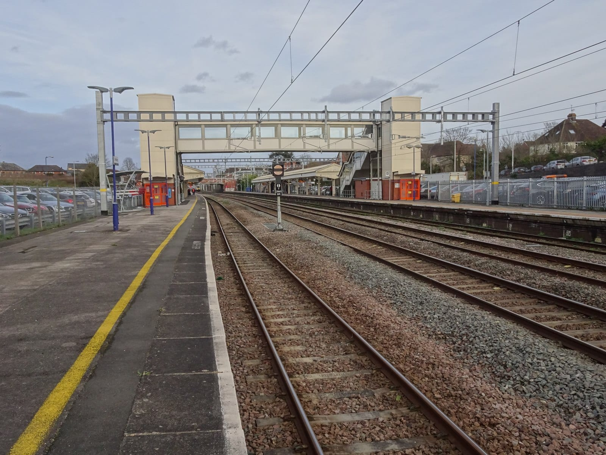
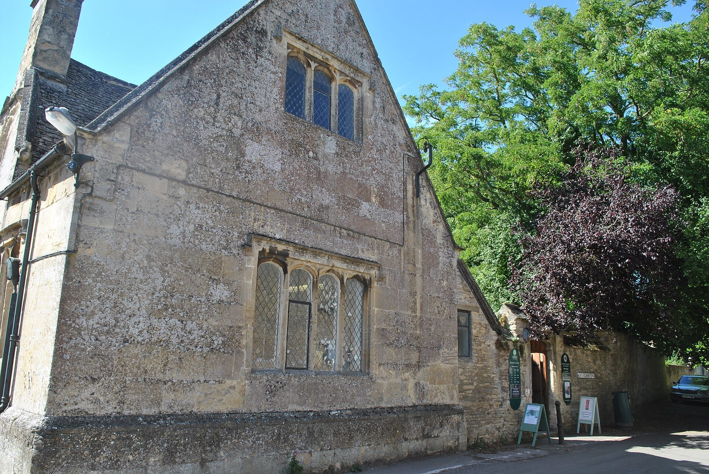

**Highclere Castle, the house that plays Downton Abbey, is open to the public on set dates only, and every ticket is pre-booked.** In 2027 that means the spring and summer windows below, at £32 for an adult, with guided tours on other dates. It is 53 miles from Paddington, 15 minutes by taxi from Newbury station.

> 💡 **The Short Version:** **Book a coach tour instead** if you want it done in a day without a taxi booking: the **Downton Abbey Tour with Highclere, Bampton & Oxford** is **£155** (10 hours, 4.7 from 675 reviews), and the small-group **Downton Abbey, Cotswolds and Highclere Castle** tour is **£209** (11 hours, 4.8 from 542). A tour saves the train, the taxi and the date puzzle. **On your own**, take the train from **Paddington to Newbury** (39 to 49 minutes) and a **pre-booked taxi** of about 15 minutes, with a **Castle, Exhibition and Gardens ticket at £32** for a date in the opening windows.

> ⚠️ **Highclere is shut to ordinary visitors for most of the year.** In 2027 the public opening runs on 27 to 31 March, 3 to 7 April, 29 April to 5 May, 29 May to 3 June and from 11 July to 2 September, and the Castle says its tickets are non-refundable and cannot be moved to another date. Check the date before you book a train.

## When Highclere is open, and what it costs

Highclere sells tickets on [its own ticket shop](https://highclerecastleshop.co.uk/categories/admission-tickets) and says they must be pre-booked in all cases. The dates on sale now:

| Dates | What |
|---|---|
| November 2026 | Christmas tours and afternoon teas, £140 for an adult |
| 3 to 6 December 2026, and Tuesday 8 December | Christmas tours and carols on 3 to 6 December; Christmas tours on 8 December |
| January and February 2027 | Wintertime guided tours; a "Downton Abbey to Tutankhamun" tour; Valentine's tours on 13 and 14 February |
| March 2027 | Springtime guided tours, £145 for an adult |
| 27 to 31 March, 3 to 7 April, 29 April to 5 May, 29 May to 3 June 2027 | Spring public opening |
| 11 July to 2 September 2027 | Summer public opening, Sunday to Thursday, closed Fridays and Saturdays |

**Public-opening prices for 2027:**

| Ticket | Castle, Egyptian Exhibition and Gardens | Castle and Gardens |
|---|---|---|
| Adult | £32 | £25 |
| Child, 4 to 16 | £17.50 | £15 |
| Family, 2 adults and 2 children | £87 | £70 |
| Over 65, student or disabled | £30 | £23 |
| Carer of a paying disabled visitor | Free | Free |

Children under 4 are free. **Admission windows:** morning 10:00 to 12:30, midday 12:30 to 14:30 and afternoon 14:00 to 16:00, with last entry to the Castle at 15:30. The gardens, tearooms and gift shop close at 17:00 and the park gates at 17:30. The Castle tour is self-guided, with guides in the rooms.

*The front of Highclere Castle. Photo: [Balon Greyjoy](https://commons.wikimedia.org/wiki/File:Highclere_-_Highclere_Castle_-_20200726143730.jpg), [CC BY-SA 4.0](https://creativecommons.org/licenses/by-sa/4.0/).*

## Book a coach tour instead

Coach tours leave London for the days Highclere is open, and they cover the castle ticket, the road and the dates in one booking. For 2027 Highclere allows each company one group booking, of 35 to 53 adults. All prices and ratings are from GetYourGuide.

| Tour | Price | Length | Rating | What the listing says |
|---|---|---|---|---|
| <a href="https://www.getyourguide.com/activity/-t76972?partner_id=WWP7I0R&amp;cmp=downton-abbey-highclere-castle-day-trip" target="_blank" rel="sponsored nofollow noopener" data-affiliate="gyg">Downton Abbey Tour with Highclere, Bampton & Oxford</a> | £155 | 10 hours | 4.7 from 675 | A tour of Highclere with the rooms seen in the series, Bampton village, a walk round Oxford and a copy of Lady Carnarvon's book |
| <a href="https://www.getyourguide.com/activity/-t123059?partner_id=WWP7I0R&amp;cmp=downton-abbey-highclere-castle-day-trip" target="_blank" rel="sponsored nofollow noopener" data-affiliate="gyg">Downton Abbey, Cotswolds and Highclere Castle</a> | £209 | 11 hours | 4.8 from 542 | Small group; Cogges Manor Farm, Bampton Library and Highclere Castle |
| <a href="https://www.getyourguide.com/activity/-t61489?partner_id=WWP7I0R&amp;cmp=downton-abbey-highclere-castle-day-trip" target="_blank" rel="sponsored nofollow noopener" data-affiliate="gyg">Downton Abbey Filming Locations and Highclere Castle</a> | £179 | Full day | 4.7 from 87 | Admission to Highclere and Yew Tree Farm, Downton village and church, on a large coach with an expert guide |
| <a href="https://www.getyourguide.com/activity/-t75718?partner_id=WWP7I0R&amp;cmp=downton-abbey-highclere-castle-day-trip" target="_blank" rel="sponsored nofollow noopener" data-affiliate="gyg">Downton Abbey and Village Coach Tour</a> | £160 | 9 hours | 4.7 from 270 | Behind-the-scenes clips on the bus on the way to the Crawley family home |
| <a href="https://www.getyourguide.com/activity/-t58561?partner_id=WWP7I0R&amp;cmp=downton-abbey-highclere-castle-day-trip" target="_blank" rel="sponsored nofollow noopener" data-affiliate="gyg">Downton Abbey and Village Small Group Tour</a> | £185 | 9 hours | 4.8 from 333 | A small-group day to Downton village and Downton Abbey |

**The Bampton and Oxford combination is the cheapest tour here that states a Castle tour**, at £155. It adds a walk round Oxford, so it is a longer day and a shorter one at Highclere. **The Cotswolds tour costs £54 more** and swaps Oxford for Cogges Manor Farm in a small group. Private day tours cost £865 to £950 on the same platform.

Powered by <a target="_blank" rel="sponsored" href="https://www.getyourguide.com/london-l57/">GetYourGuide</a>

*Visitors approaching Highclere Castle. Photo: [Vintage Fan 5678](https://commons.wikimedia.org/wiki/File:Downton_Abbey_AKA_Highclere_Castle_in_2016.jpg), [CC0](https://creativecommons.org/publicdomain/zero/1.0/).*

## By train to Newbury, then a taxi

**From London Paddington, take the Great Western train to Newbury.** Newbury station is 53 miles from Paddington, and Trainline gives the fastest train as 39 minutes and the average as 49, with Advance fares from £14. Highclere's own guidance is a taxi of about 15 minutes from the station, with fares that rise on Sundays and bank holidays.

*Newbury station. Photo: [Nigel Thompson](https://commons.wikimedia.org/wiki/File:Newbury_railway_station,_Berkshire,_2019_-_geograph.org.uk_-_6088250.jpg), [CC BY-SA 2.0](https://creativecommons.org/licenses/by-sa/2.0/).*

- **Taxis wait outside Newbury station, but not at the Castle.** Book the return by phone before you go in. Highclere names three Newbury firms and says it takes no commission: Cabco on 01635 33333, Go Green Taxis on 01635 800 990 and Ave Cabs on 01635 31212.
- **The alternatives are Andover and Whitchurch**, both on the Waterloo line: about 20 minutes and 10 minutes by taxi. Whitchurch taxis are dearer, and there are not always taxis at the station, so pre-book.
- **Don't use sat nav close to the Castle.** Highclere says it leads to the wrong entrance. Follow the brown tourist signs, or use the postcode RG20 9LE.
- **Large bags and backpacks are not allowed in the grounds.** There is a small storage area at Visitors Reception for those who arrive by taxi.

## What you see at Highclere

You tour the main state rooms that appear in *Downton Abbey*, some of the bedrooms, then go down to the cellars and the old staff quarters, where the **Egyptian Exhibition** marks the 5th Earl of Carnarvon's discovery of Tutankhamun's tomb. Highclere puts the building at between 250 and 300 rooms. Photography is not allowed inside.

The **gardens and parkland** are open on any ticket. They include the Monk's Garden, the Secret Garden, the White Border, the Wood of Goodwill and the Wild Flower Meadow, and Highclere points out the spots seen in the series, such as Lady Mary's bench and the Secret Garden. The parkland was designed by Capability Brown in 1771, with follies that include the Temple of Diana. The woodland walks are rough grass paths.

**Eating.** The tearooms open from 9:30 for coffee and pastries, with sandwiches, salads, scones and hot takeaway food through the day. There is no vegan menu, and Highclere can't guarantee dairy-free or nut-free. Picnics are not allowed in the gardens, but you can eat one in the car park.

**Dogs** are not allowed on the grounds apart from guide dogs, though they are welcome on the public footpaths that cross the estate, on leads.

## Bampton: the village in the series

Two of the tours above stop in **Bampton** in Oxfordshire, which the GetYourGuide listings give as the village used in the television series. The Cotswolds tour names **Bampton Library**, a former grammar school on Church View, and **Cogges Manor Farm**. Bampton is a short stop on a coach tour, and not a reason to go on your own.

*Bampton Library on Church View. Photo: [Seth Whales](https://commons.wikimedia.org/wiki/File:The_Library-Bampton.JPG), [CC BY-SA 4.0](https://creativecommons.org/licenses/by-sa/4.0/).*

## What people get wrong

- **Turning up on a day the Castle is closed.** Between the windows above there is no walk-in visiting, and tickets are non-refundable.
- **Expecting to take photographs inside.** None are allowed, and drones and smart glasses are banned on the estate.
- **Not booking the taxi back.** None waits at the Castle.
- **Bringing a dog or a picnic.** Neither is allowed in the grounds.

Powered by <a target="_blank" rel="sponsored" href="https://www.getyourguide.com/london-l57/">GetYourGuide</a>

## Continue planning your day out

- 🐑 **[The Cotswolds from London](/articles/cotswolds-day-trip/)** — the villages a train and a bus can reach, and the tours that include them.
- 🎓 **[Oxford from London](/articles/oxford-day-trip/)** — the city the Bampton tour walks through, done by train.
- 🏰 **[Windsor from London](/articles/windsor-day-trip/)** — the other royal castle in a day.
- 🗺️ **[Day trips from London](/articles/day-trips-from-london/)** — what the others cost, how long they take, and which days they are shut.

