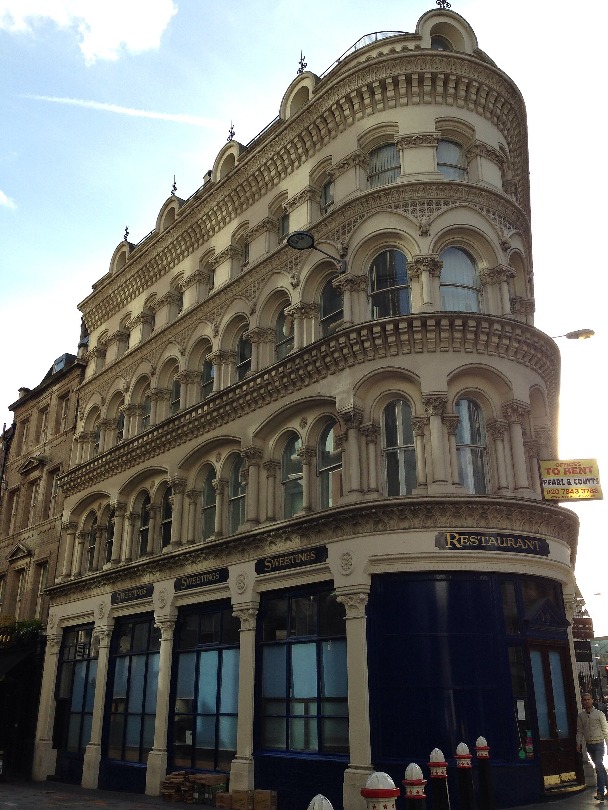
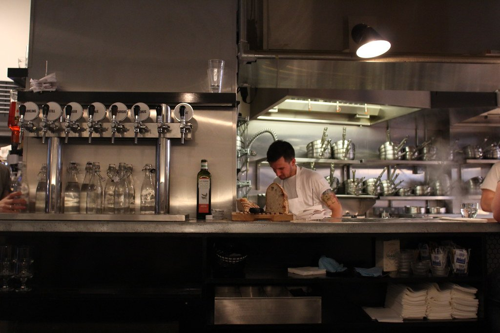
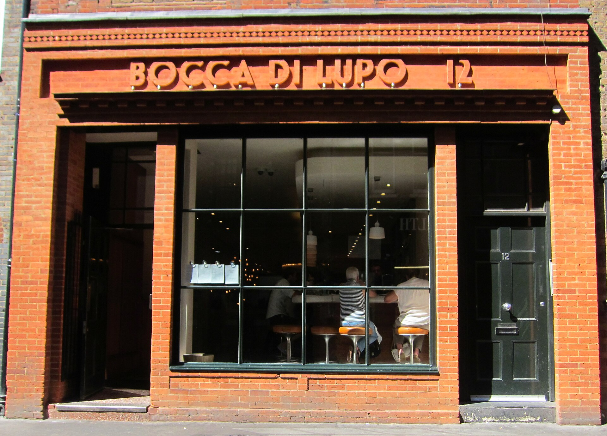
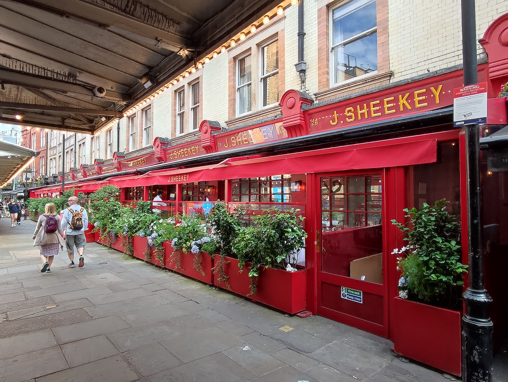
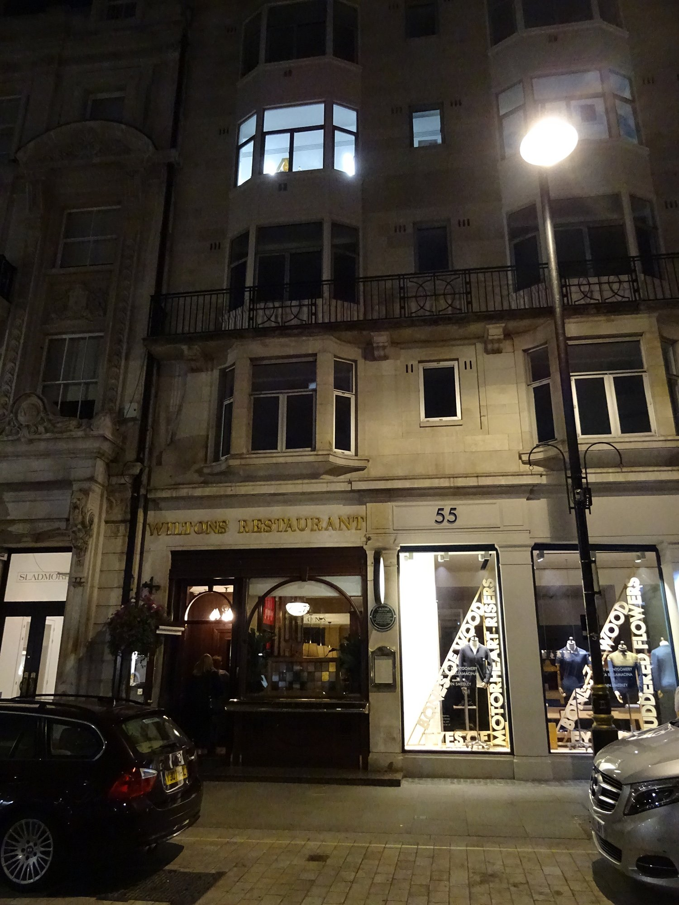

> 💡 **The Short Version:** London's counters are the easy way to eat as one: you sit facing the kitchen and nobody is left with an empty chair opposite. **Walk in** at [Barrafina on Dean Street](#barrafina-dean-street), [Kiln](#kiln-soho), [Monohon](#monohon-ramen-old-street) or [Sweetings](#sweetings-the-city) (lunch only). **Book for one** at [Impala](#impala-soho), which seats tables of 1 to 6 at dinner. **Phone or walk in** at [Bocca di Lupo](#bocca-di-lupo-soho), whose online counter booking starts at two. **Queue** at [Padella in Borough](#padella-borough-market), and **go early** anywhere with a counter, because those seats go first.

*Hours, booking rules and prices are each restaurant's own as at 19 November 2026.*

## Where to sit, by how you get in

| How you get in | Restaurants |
| --- | --- |
| **Walk-in only** | Barrafina (Dean Street), Kiln (counter), Monohon, Sweetings |
| **Queue or virtual queue** | Padella (Borough Market) |
| **Seats held back for walk-ins** | Singburi, The Palomar, Bocca di Lupo |
| **Book for one online** | Impala |
| **Book through OpenTable or SevenRooms** | J Sheekey, Ukiyo Handroll Bar, Wiltons |

Most are named by Hot Dinners, The Infatuation or both for their counters, and the entries say which.

## Walk in and take a stool

### Barrafina, Dean Street

*26-27 Dean Street, Soho, W1D 3LL · walk-in only*

**Barrafina's Soho restaurant takes no bookings.** Seats go first-come, first-served, and while you wait you can have drinks and small plates at the standing bar or on the heated terrace, which is also first-come. It opens Sunday and Monday 12 to 3pm and 5 to 10pm, and Tuesday to Saturday 12 to 3pm and 5 to 11pm. Hot Dinners says all the Barrafina restaurants are built around the counter, and The Infatuation's Soho counter guide lists this one.

Order from the specials board: the barely-set tortilla, prawns, razor clams and the jamón carved to order, all cooked in front of you. The other Barrafinas, at Adelaide Street, Drury Lane, Coal Drops Yard and Borough Yards, take bookings. The restaurant's own [Dean Street page](https://www.barrafina.com/restaurants/dean-street) has the details, and the rest of the group is in our [Spanish restaurants guide](/articles/best-spanish-restaurants-london/#barrafina).

### Kiln, Soho

*58 Brewer Street, W1F 9TL · counter is walk-in*

Hot Dinners says the draw at this Thai grill is the **ground-floor counter that runs the length of the room**, rather than the tables downstairs. The Infatuation says a single seat at the bar is much easier to get than a table in the queue, and calls it the best place to be anyway.

Order the clay-pot glass noodles and the short rib curry; the portions suit one. **The counter is walk-in only and the wait is real. Tables can be booked.** Lunch is cheaper than dinner for the same counter. Kiln's full entry is in our [Thai restaurants guide](/articles/best-thai-restaurants-london/#kiln-soho).

### Monohon Ramen, Old Street

*102 Old Street, EC1V 9AY · walk-in only*

A ramen shop that makes its noodles in the kitchen every day. **The counter seats nine in a row**, with a single table for four or five. That suits one diner: no reservations are taken, and the whole party has to be there before anyone is seated.

Order the Shouyu Tonkotsu (£15.50, £16.50 large), soy seasoning in creamy pork soup with pork belly, or the brothless Abura Soba at £16. It opens Monday to Friday 12 to 2.15pm and 5 to 9.30pm, Saturday 5 to 9.30pm and Sunday 5 to 9pm, and is closed on bank holidays. More ramen counters are in our [ramen guide](/articles/best-ramen-london/#monohon-ramen).

### Sweetings, the City

*39 Queen Victoria Street, EC4N 4SF · weekday lunch only*

A City fish restaurant that has traded at this address since 1889. Diners sit on stools at long marble counters, and the waiters serve from behind them. The Infatuation lists it among London's places to eat alone.

*Sweetings, Queen Victoria Street. Photo: [Gareth E. Kegg](https://commons.wikimedia.org/wiki/File:Sweetings,_Queen_Victoria_Street.jpg), [CC BY-SA 4.0](https://creativecommons.org/licenses/by-sa/4.0/), via Wikimedia Commons.*

Order the fish pie, native oysters and a Black Velvet, which is champagne and Guinness. **It serves lunch only, from 11.30am to 3pm Monday to Friday, and takes no reservations**, so arrive before noon. The [seafood restaurants guide](/articles/best-seafood-restaurants-london/#sweetings-city-of-london) has the rest.

### Singburi, Shoreditch

*Unit 7, Montacute Yards, Shoreditch High Street, E1 6HU · walk-ins · closed Mondays*

A Thai restaurant that moved from Leytonstone to a railway arch in Shoreditch in 2025, and holds a Bib Gourmand for 2026. Hot Dinners says to take a stool at the counter and watch the chefs, and The Infatuation lists it for eating alone.

Order the tiger prawn and cucumber curry, the raw beef larb or the smoked pork belly nam tok. **It takes walk-ins, and it shuts on Mondays.** Legado, next door, has a 16-seat chef's counter too. More Thai in our [guide](/articles/best-thai-restaurants-london/#singburi-shoreditch).

## Queue, or have a seat held back

### Padella, Borough Market

*6 Southwark Street, SE1 1TQ · virtual queue*

A pasta bar where the cooks roll and shape the pasta at the counter. **Borough Market takes no reservations: scan the QR code at the door or use the Dojo app to join the virtual queue**, then wait elsewhere until it calls you. Padella's Soho and Shoreditch restaurants take reservations, so a booking for one is possible there.

*The counter at Padella, Borough Market. Photo: [Bex.Walton](https://www.flickr.com/photos/7831824@N04/28035454561), [CC BY 2.0](https://creativecommons.org/licenses/by/2.0/).*

Order the pici cacio e pepe (£13.50) or the pappardelle with beef shin ragu (£16.50), both on Padella's [menu](https://www.padella.co/) on 19 November 2026. Its single plates start at £9.50. Hot Dinners says the counter seats are the sought-after ones at all its restaurants. Borough Market's own queue is in our [Italian restaurants guide](/articles/best-italian-restaurants-london/#padella-borough).

### The Palomar, Soho

*34 Rupert Street, W1D 6DN · seats held for walk-ins*

A Middle Eastern-influenced restaurant with an open kitchen and a Bib Gourmand since 2014. Hot Dinners says the counter is the place to be, and The Infatuation lists it in its Soho counter guide.

Order the kubaneh, a pull-apart Yemeni bread served with tahini and grated tomato. **The restaurant keeps tables for walk-ins.** If nothing is free, it says to wait with a drink and a snack, or at its sister pub The Blue Posts. Reservations open up to a month ahead for groups of up to six. More in our [Middle Eastern restaurants guide](/articles/best-middle-eastern-restaurants-london/).

### Bocca di Lupo, Soho

*12 Archer Street, W1D 7BB · counter booking starts at two online*

An Italian restaurant with a menu of regional dishes that it updates twice a day. Hot Dinners says the seats up at the pass are the best in the house, and The Infatuation lists the counter in its Soho guide.

*Bocca di Lupo, Archer Street. Photo: [Andrew Davidson](https://commons.wikimedia.org/wiki/File:Bocca_Di_Lupo.JPG), [CC BY-SA 4.0](https://creativecommons.org/licenses/by-sa/4.0/), via Wikimedia Commons.*

Order a mix of small plates and ask which region each dish comes from. **The restaurant says online booking for the chef's counter is for two, and that it keeps a number of seats free for walk-ins**, so for one, ring or turn up. It opens Monday to Saturday 12 to 3pm and 5 to 11pm, with the bar open until midnight, and on Sunday 12 to 3.30pm and 5 to 9.30pm. From 9.30pm, any wine up to £300 is available by the glass. Closed 24 to 26 December. More in our [Italian restaurants guide](/articles/best-italian-restaurants-london/#bocca-di-lupo-soho).

## Book for one

### Impala, Soho

*13-14 Dean Street, W1D 3RS · tables for one at dinner and lunch*

The Infatuation names it for solo diners, with two long counters, one at the bar and one by the bread oven and grill. Hot Dinners rates the seats beside the kitchen. The chef, Meedu Saad, previously cooked at Kiln.

Order the flatbread from the oven and the beef short rib. **The restaurant's own booking page seats tables of 1 to 6 at dinner and 1 to 8 at lunch, up to 56 days ahead, and says walk-ins are welcome.** The Infatuation says it has had success walking in alone or as a pair to the bar and kitchen counter, and says lunch is the easier time. Lunch is daily 12 to 2.30pm. Dinner is Monday to Saturday 5 to 10.30pm and Sunday 5 to 9pm. Book at [impalasoho.com](https://impalasoho.com).

### Ukiyo Handroll Bar, Covent Garden

*8 Slingsby Place, WC2E 9AB · counter only, book through OpenTable*

A counter-only restaurant for temaki, hand-rolled seaweed cones filled with fish and rice. The chefs work in front of you, and The Infatuation lists it among its places for dining solo.

Order the set menu of handrolls. **Book through OpenTable, or message the restaurant on WhatsApp**, both linked from [ukiyohandrollbar.com](https://www.ukiyohandrollbar.com). It is open Monday to Saturday 12 to 10pm and Sunday 12 to 9pm.

### J Sheekey, Covent Garden

*28-32 St Martin's Court, WC2N 4AL · book through OpenTable*

A fish restaurant with a central crustacea bar, in a warren of small rooms off St Martin's Court. Hot Dinners says its preferred seat is a stool at the smaller counter in the main restaurant.

*J Sheekey, St Martin's Court. Photo: [Ewan Munro](https://commons.wikimedia.org/wiki/File:J._Sheekey,_Covent_Garden,_2025-07-30.jpg), [CC BY-SA 4.0](https://creativecommons.org/licenses/by-sa/4.0/), via Wikimedia Commons.*

Order half a dozen oysters and the fish pie. **Book through OpenTable, linked from [j-sheekey.co.uk](https://www.j-sheekey.co.uk/), and ask for the counter when you book.** It opens Monday to Saturday 12 to 11pm, with the last seating at 10.45pm, and Sunday 12 to 9pm, last seating 8.45pm. More in our [seafood restaurants guide](/articles/best-seafood-restaurants-london/#j-sheekey-covent-garden).

### Wiltons Oyster Bar, St James's

*55 Jermyn Street, SW1Y 6LX · book through SevenRooms*

A restaurant that began as a shellfish stall in 1742. Its oyster bar has eight seats at the marble counter and ten more at tables opposite, where oysters are shucked and smoked salmon sliced to order. Hot Dinners says to perch at the bar for half a dozen natives and a glass of champagne.

*Wiltons, Jermyn Street. Photo: [Spudgun67](https://commons.wikimedia.org/w/index.php?curid=72552746), [CC BY-SA 4.0](https://creativecommons.org/licenses/by-sa/4.0/), via Wikimedia Commons.*

**It books through SevenRooms. For a single seat at the bar, ring 020 7629 9955.** It serves lunch Monday to Friday, to 2.30pm last seating, dinner Monday to Saturday, to 9.45pm last seating, and is closed on Sundays and bank holidays. Men are asked not to wear short-sleeved shirts, shorts, open-toed shoes, sportswear or hooded tops. [wiltons.co.uk](https://wiltons.co.uk/).

## How solo bookings work

- **Pick one on the booking page.** Impala states its tables start at one. If a booking page starts at two, as Bocca di Lupo's counter does, ring.
- **Counters are first-come.** At the walk-in counters, join the queue when the doors open, or between services.
- **Lunch is the easier time.** Kiln's counter is cheaper at lunch, Impala's lunch is the easier booking, and Sweetings only serves lunch.

## Keep going

If you would like a [cheap bowl](/articles/cheap-eats-london/) or a [late table](/articles/late-night-eating-london/), those guides cover them. For wine with one plate, see [London wine bars](/articles/best-wine-bars-london/), and for the area, our [Soho guide](/articles/soho-area-guide/).
