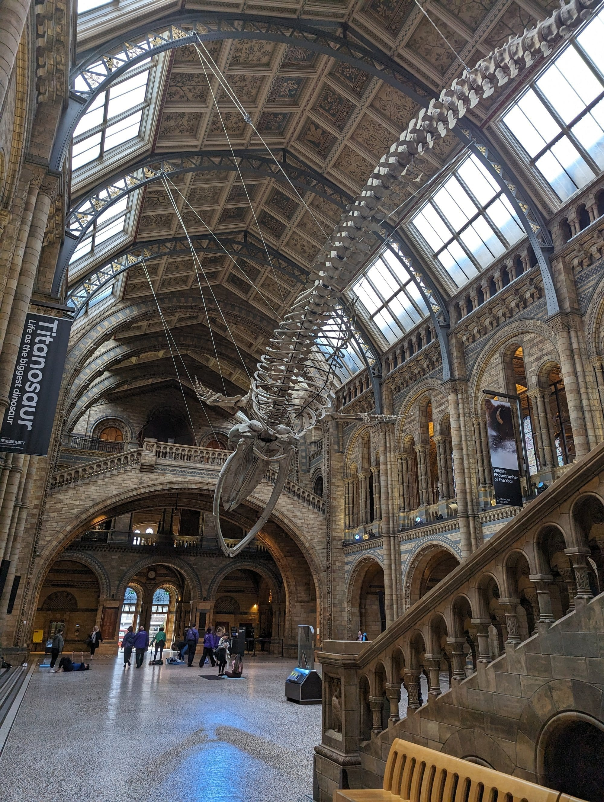

Half term puts most of London's state-school children on holiday in the same week, and it lands in 2027 alongside Chinatown's Lunar New Year celebrations, two England rugby internationals and a Tube strike. The free museums are the obvious answer, and the queue is the price.

> 💡 **The Short Version:** **February half term is Monday 15 to Friday 19 February 2027** for most London state schools. **Book the free entry ticket** for the Natural History Museum and the Science Museum, which can queue in school holidays. The **Harry Potter studio tour** sells out its school-holiday dates first, so book it now. The Southbank Centre's **Imagine** festival for under-12s runs every February half term, much of it free. **RMT Tube drivers strike from noon on Wednesday 17 February.** **Under-11s travel free** with a paying adult, and a **National Rail ticket gets a second person into the Tower of London or Kew free** with [2FOR1](/articles/national-rail-2for1-london-attractions/).

## The dates

**Camden, Lambeth, Lewisham and Royal Greenwich all set half term for Monday 15 to Friday 19 February 2027**, with school back on Monday 22 February. Most London state schools follow the same week. Academies, free schools and independent schools set their own, and some take a different week or add a training day, so check with the school before you book. The councils' calendars are on [Camden's](https://www.camden.gov.uk/term-dates), [Lambeth's](https://www.lambeth.gov.uk/schools-education/school-term-holiday-dates/school-term-dates-2026-2027), [Lewisham's](https://lewisham.gov.uk/myservices/education/schools/school-term-dates) and [Royal Greenwich's](https://www.royalgreenwich.gov.uk/schools-and-education/school-term-dates/term-dates-2026-2027) sites.

| Date | What happens |
| --- | --- |
| Sat 13 to Sun 21 Feb | The nine days most families have off |
| Sun 14 Feb | Valentine's Day; England v France at Twickenham, 3.10pm |
| Wed 17 Feb | RMT Tube strike from noon to noon on Thursday 18 February |
| Sat 20 Feb | England v Italy at Twickenham, 4.40pm; Chinatown's New Year celebrations end that day |
| Sun 21 Feb | Light and Magic closes at Tate Modern |

> ⚠️ **The Tube drivers' strike starts at noon on Wednesday 17 February**, in the middle of half term, and runs for 24 hours ([RMT](https://www.rmt.org.uk/news/tube-drivers-to-take-eight-days-of-strike-action-over-attacks/)). Put a walkable or bus-friendly day there, such as South Kensington's museums if you are staying nearby, and check TfL Go.

## What gets busy, and what to book

### Natural History Museum

**Free, but book the free entry ticket.** The museum says you may have to queue at weekends and in school holidays, and ticket holders and Members skip the queue. It opens daily 10am to 5.50pm, last entry 5.30pm. **Wildlife Photographer of the Year** is the paid exhibition running through half term: children aged 4 to 17 are £8.50 to £10.50, adults £17 to £21, and the peak price applies at weekends in school holidays. Our [Natural History Museum guide](/articles/natural-history-museum-guide/) has the entrances, a route that starts with the dinosaurs and where to eat.

### Science Museum

**Free, with a free timed ticket; Wonderlab is the paid part.** The museum opens daily 10am to 6pm. Wonderlab, the hands-on gallery with live science shows, needs its own ticket booked before you arrive: day-pass prices vary, so booking ahead is cheaper, and children aged 3 and under go free. [Wonderlab tickets](https://www.sciencemuseum.org.uk/see-and-do/wonderlab). **Becoming America: How Science Shaped a Nation** runs to 25 April.

*Hope, the blue whale skeleton in Hintze Hall at the Natural History Museum.*

### Harry Potter studio tour

**Saturdays and school holidays sell out first**, and late-afternoon slots are the ones left when a date is nearly full; there is no time limit once you are in. Adult tickets for 2027 dates are £61. **Hogwarts House Spirit** runs from 23 January to 19 April 2027, so it covers half term, at no extra cost. The train from Euston to Watford Junction takes 18 to 21 minutes, then a free shuttle bus. Our [Harry Potter studio tour guide](/articles/harry-potter-studio-tour/) has the prices, the food and the packages.

### The Bayeux Tapestry

**Sold out.** Every ticket to 31 March has gone, so it is not a half-term option. Rooms 6b, 7 and 8 of the British Museum are also closed from 8 to 19 February. The rest of the museum is free; see our [British Museum guide](/articles/british-museum-guide/). Our [Bayeux Tapestry guide](/articles/bayeux-tapestry-british-museum/) has the April to July release and the free online version of the cloth.

## What's on for children

### Imagine at the Southbank Centre

**The Southbank Centre's festival for children aged 0 to 11 and their adults runs every February half term**, with performances, music, stories, comedy, dancing and workshops, and much of it is free. The [Southbank Centre](https://www.southbankcentre.co.uk/whats-on/festivals-series/imagine-childrens-festival) says it returns in February 2027; ticketed shows go on sale through its listings.

### Lunar New Year in Chinatown

**Chinatown London's Chinese New Year celebrations run from 6 to 20 February 2027**, so the lanterns are still up in half term. The [Chinese New Year guide](/articles/chinese-new-year-london/) has the details.

### Museums built for children

- **Young V&A**, Bethnal Green: free, no booking, three galleries with nearly everything meant to be handled, from a sensory area for babies to design benches for teenagers.
- **London Transport Museum**, Covent Garden: under-18s go free, but still need a booked ticket, and you can climb into most of the buses and trains.
- **The Postal Museum and Mail Rail**: a 15-minute ride through the Post Office's own tunnels, adults £20.50, children £11. The queue for the train reaches 45 minutes in school holidays.

All three, and the city farms, are in our [London with children guide](/articles/london-with-children/).

### Family shows in half term

Children's theatre, comedy and one-off shows from 13 to 21 February.

## If it rains

The free museums are the default, which is why they queue. Other indoor options:

- **Babylon Park** in Camden: three indoor levels with a rollercoaster in the basement, which needs a height of 105cm.
- **Indoor ice rinks**: the outdoor Christmas rinks have closed, but Alexandra Palace's rink is open all year at £11.75 off-peak with skates, and under-8s must be accompanied on the ice. Queens in Bayswater and Lee Valley Ice Centre are the others; see the [ice skating guide](/articles/ice-skating-london/).
- **Covered neighbourhoods**: Battersea Power Station, the Barbican and King's Cross let you move between places without going outside.

Our [London in the rain guide](/articles/london-in-the-rain/) maps the areas that stay dry.

Powered by <a target="_blank" rel="sponsored" href="https://www.getyourguide.com/london-l57/">GetYourGuide</a>

## Spending less

**Travel.** Under-11s travel free on buses and trams at any time, and on the Tube, DLR and Elizabeth line with a fare-paying adult. Children aged 11 to 15 pay half the adult fare for up to 14 days once TfL staff add the **Young Visitor discount** to an Oyster card; the child has to be there. Our [transport costs guide](/articles/london-public-transport-costs-and-fares/) has the fares and caps.

**2FOR1 with a train ticket.** Two people arriving on National Rail tickets get a second entry free at the Tower of London, Kew Gardens, Westminster Abbey and more than a hundred other attractions, with an eVoucher. Oyster and contactless journeys don't count, and with an adult and a child ticket it is the cheaper one that comes off. The rules are in our [2FOR1 guide](/articles/national-rail-2for1-london-attractions/).

**Kids eat free.** Several chains run kids-eat-free only in school holidays, and the offers appear a week or two before half term. Bella Italia's runs every day in school holidays, but its terms exclude ten of its eleven London restaurants. Morrisons Café runs every day, and Premier Inn feeds two under-16s free at breakfast. Every current deal is in our [kids eat free guide](/articles/kids-eat-free-london/).

**Free days.** All eight city farms, the national museums and Young V&A are free, and the [best museums guide](/articles/best-museums-london/) lists the rest.

## Where to stay

Connecting rooms sell out first at the hotels that offer them, so book early for half term. Three options from our [best family hotels guide](/articles/best-family-hotels-london/):

- **The Ampersand Hotel**, South Kensington: a Science Family Suite themed on the museum next door, three minutes from the Natural History Museum. [Hotels.com](hotel:the-ampersand-hotel)
- **London Marriott Hotel County Hall**, South Bank: family rooms with two double beds beside the London Eye, and a 25-metre pool free to guests, where under-16s swim with an adult. [Hotels.com](hotel:marriott-county-hall)
- **The Drey**, Earl's Court: bunk-bed rooms for four and six, two stops from South Kensington. It has no restaurant, so plan breakfast elsewhere. [Hotels.com](hotelscom:3807684064)

## More for February

Everything else on in the month, from the Six Nations to London Fashion Week and the exhibitions opening, is in [things to do in London in February](/articles/things-to-do-in-london-in-february/). Our [Valentine's Day guide](/articles/valentines-day-london/) covers the Sunday before half term.

*Updated 14 November 2026.*
