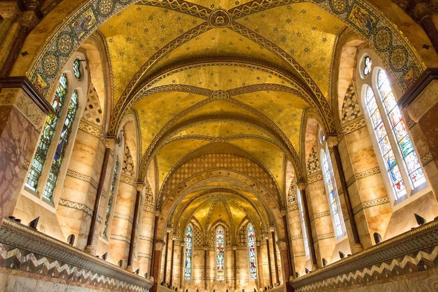
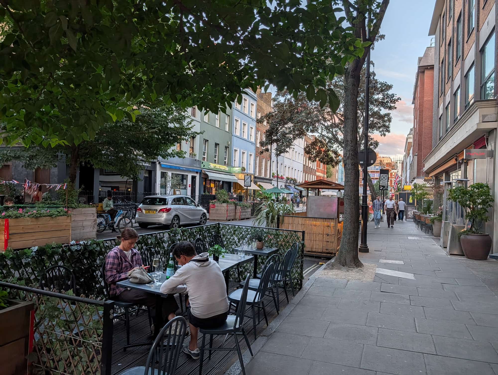
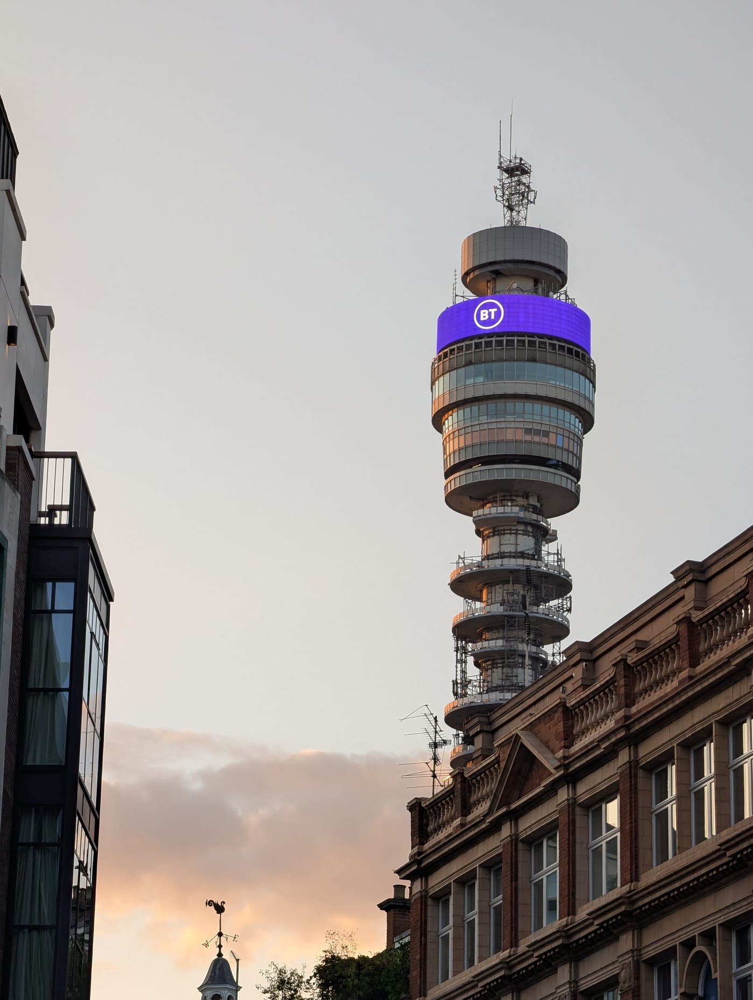
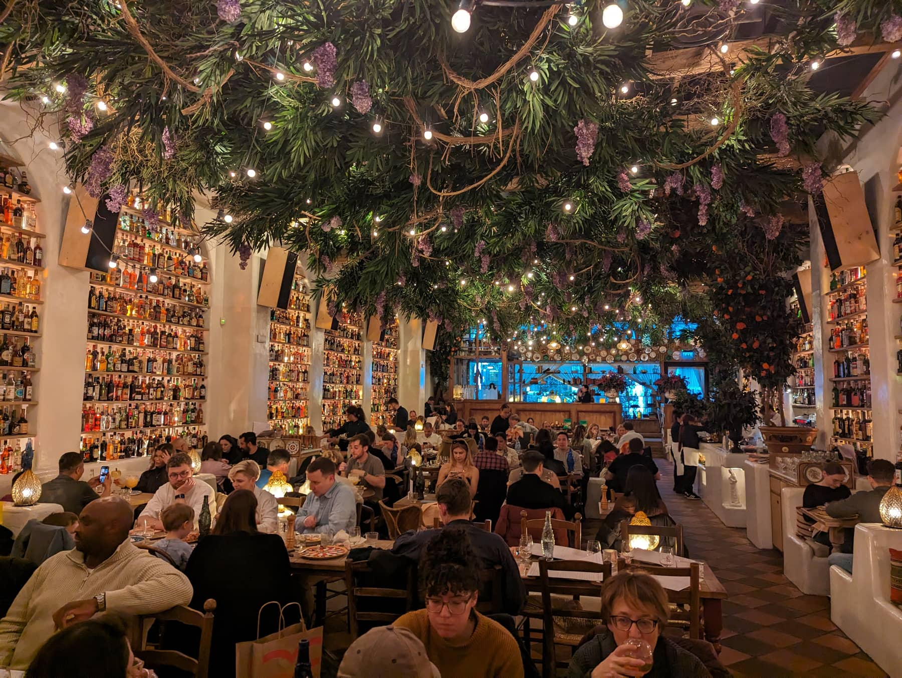

Fitzrovia has no headline sight. People come for dinner: Charlotte Street and Goodge Street hold restaurants of a dozen cuisines, and unlike Soho you can usually get a table.

The area is a rough square between [Oxford Street](/articles/shopping-in-london/#oxford-street-and-the-big-three) and Euston Road, crossed constantly by people going somewhere else. Above street level it is Georgian terraces and the BT Tower.

Fitzrovia has its own share of the commemorative plaques marking where notable people lived or worked - see them on our [interactive map](/plaques/?area=fitzrovia).

## Why visit — and who should skip it

**Come here if** you want dinner. The restaurants cover many cuisines, and unlike Soho you can usually get a table.

**Skip it if** you are on a three-day trip and want sights. Walk through it on your way between Oxford Street and the [British Museum](/articles/british-museum-guide/), note where you would like to eat, and come back in the evening.

## Top sights and activities

1. **Charlotte Street** — The restaurant street, with pavement tables in summer.
2. **The BT Tower** — The tallest building in the UK from 1964 to 1980, and still the thing you navigate by. Closed to the public since 1971; sold in 2024 to MCR Hotels, who plan to turn it into a hotel.
3. **Fitzroy Square** — A Georgian square with Robert Adam frontages on two sides.
4. **The Fitzroy Tavern** — The pub that gave the area its name. George Orwell and Dylan Thomas drank here.
5. **The Fitzrovia Chapel** — The surviving chapel of the Middlesex Hospital, which was demolished around it. A plain brick exterior on Pearson Square hides a ceiling of gold mosaic. Free, no booking. Open most Mondays to Wednesdays, 11am to 5pm, and at least one Sunday a month, noon to 5pm; daily during exhibitions, including *Middlesex Hospital Blues* from 16 October to 18 November 2026.

*The Fitzrovia Chapel's interior. Photo: [The wub](https://commons.wikimedia.org/w/index.php?curid=44693137), [CC BY-SA 4.0](https://creativecommons.org/licenses/by-sa/4.0/).*
6. **All Saints, Margaret Street** — A Victorian Gothic church by William Butterfield with a heavily decorated interior. Small, free, and easy to walk straight past.
7. **Goodge Street** — The other eating street, and the more casual of the two.
8. **The Wellcome Collection** — On Euston Road at the Bloomsbury edge. Free, and a ten-minute walk.

## Key streets and micro-districts

### Charlotte Street

*Charlotte Street, in the evening.*

The spine of the area and its main restaurant street, with pavement seating in summer. The [Charlotte Street Hotel](hotel:charlotte-street-hotel) is at the southern end.

**Book for the evening.** Restaurants fill from about 7pm. The outside tables in summer are rarely bookable and go first come, first served.

### Goodge Street
Running east to west across the middle of Fitzrovia, **the lunch street, not the dinner one**: counters, cafés, sandwich places and takeaway, serving the offices around it.

It is busy between noon and 2pm and noticeably quiet in the evening, when Charlotte Street one block west is full.

**Goodge Street station is on the Northern line**, the natural way in and out of the area on foot.

### Fitzroy Square and the north

*The BT Tower, from street level.*

Quiet, almost entirely residential Georgian streets between the square and Euston Road. Robert Adam designed the east and south sides of **Fitzroy Square** in Portland stone; the central garden is private. Virginia Woolf, George Bernard Shaw and Ford Madox Brown all lived on the square.

**A five-minute detour, and free.** The square is pedestrianised, one of the few quiet places within a few minutes of Oxford Street.

### Rathbone Place and Newman Street

*Colville Place.*

The southern edge, running down to Oxford Street, **where the newer openings land**. It is a working stretch of offices, hotels and restaurants that change faster than elsewhere in Fitzrovia.

**Tottenham Court Road station is at the bottom**, the fastest approach from the Elizabeth line.

### Great Titchfield Street
The western side, running towards Great Portland Street, **the coffee end of the neighbourhood**, including Kaffeine. Small independent shops fill the rest, and the rag-trade wholesalers that once occupied the whole street still hold some of it.

**Weekday hours.** Much of this street is closed at weekends, so come on a weekday morning.

Powered by <a target="_blank" rel="sponsored" href="https://www.getyourguide.com/london-l57/">GetYourGuide</a>

## Where to eat and drink

A selection; the [full restaurant list](/articles/eat-in-london-guide/) has more.

| Spot | Style | Price | Why go |
| --- | --- | --- | --- |
| **Kitchen Table** | Tasting menu | ££££ | Two Michelin stars at a horseshoe counter; no menu given out in advance |
| **Chishuru** | West African | ££££ | Michelin-starred West African cooking on a fixed menu |
| **Akoko** | West African | ££££ | Michelin star; Nigeria, Ghana and Senegal over a grill and clay oven |
| **Roka** | Robatayaki | ££££ | The robata grill in the middle of the room |
| **Hakkasan** | Cantonese | ££££ | Basement dining room on Hanway Place |
| **Berners Tavern** | Modern British | ££££ | An Edwardian ballroom hung floor to ceiling with pictures |
| **Sushi Atelier** | Sushi counter | £££ | Omakase at the counter |
| **Khao So-i** | Northern Thai | £££ | Built around the coconut curry noodle it is named after |
| **Cometa** | Mexican seafood | £££ | Tostadas, ceviche and aguachile, not a meat-led menu |
| **Motorino** | London-Italian | £££ | Luke Ahearne and Stevie Parle's modern Italian restaurant |
| **Rovi** | Vegetable-led | £££ | The Ottolenghi group's fermentation-and-fire room |
| **Salt Yard** | Spanish-Italian tapas | £££ | Courgette flowers with goat's cheese and honey |
| **Meraki** | Modern Greek | £££ | From the Roka and Zuma group |
| **Plaza Khao Gaeng** | Thai curry shop | ££ | Curries over rice from a counter display, inside Arcade |
| **Circolo Popolare** | Sicilian | ££ | Thousands of bottles on the walls; book weeks out |
| **The Life Goddess** | Greek deli | ££ | You can buy the cheese you just ate |
| **PaStation** | Fresh pasta | £ | Made in front of you, eaten standing up |
| **Shree Krishna Vada Pav** | Mumbai street food | £ | Vada pav for the price of a coffee |
| **Kaffeine** | Coffee | £ | Australian-run, with a food counter beside the espresso bar |
| **The Attendant** | Coffee | £ | Inside a restored Victorian public lavatory; the urinals are the counter |

Meraki and The Life Goddess are both in our [Greek restaurants guide](/articles/best-greek-restaurants-london/).

*Circolo Popolare, on Rathbone Place.*

## Walking routes

**[A Walk from Fitzrovia to Mayfair →](/articles/fitzrovia-mayfair-walk/)**

Our full route starts at **Fitzroy Square** and runs south through All Saints, Savile Row and the arcades to Green Park: **eleven numbered stops**, 5.6km, with a map, a Google Maps walking link and what is open on which day.

### The short version, if you only have two hours

1. **Start:** Goodge Street station. South down Charlotte Street.
2. **Charlotte Street:** The full run, past the restaurants, to the Charlotte Street Hotel.
3. **Percy Street and Rathbone Place:** East towards Tottenham Court Road.
4. **The Fitzrovia Chapel:** West along Mortimer Street to Pearson Square for the gold ceiling. Open most Mondays to Wednesdays and one Sunday a month; check the What's On page first.
5. **All Saints, Margaret Street:** South for the Butterfield interior.
6. **Fitzroy Square:** North for the Georgian frontages and the quiet.
7. **The Fitzroy Tavern:** Back down Charlotte Street for a drink where the name came from.
8. **Finish:** Dinner anywhere in the table above.

Powered by <a target="_blank" rel="sponsored" href="https://www.getyourguide.com/london-l57/">GetYourGuide</a>

Comparing neighbourhoods? [Best areas to visit in London](/articles/best-areas-to-visit-london/) sets them side by side by what each is best for, how long it takes and the best day to go.

## Common mistakes to avoid

1. **Trying Soho first on a Friday.** Fitzrovia is eight minutes north and tables are easier to get.
2. **Assuming you can go up the BT Tower.** It has been closed to the public since 1971.
3. **Booking nothing.** Kitchen Table, Chishuru and Akoko need weeks or months, not an evening.
4. **Missing All Saints.** It is thirty seconds off Oxford Street.
5. **Turning up at the Fitzrovia Chapel on a weekend.** Outside exhibitions it is open Monday to Wednesday plus one Sunday a month, so the two days most visitors have free are the two it is most likely to be shut. Check the What's On page first.

## Where to stay

Central, and quiet at night on the residential streets.

- **Charlotte Street and Percy Street** — Boutique hotels in the middle of the restaurants.
- **Great Portland Street** — Larger hotels on the western edge, close to Regent's Park.
- **Tottenham Court Road** — Better connected, with the Elizabeth line.
