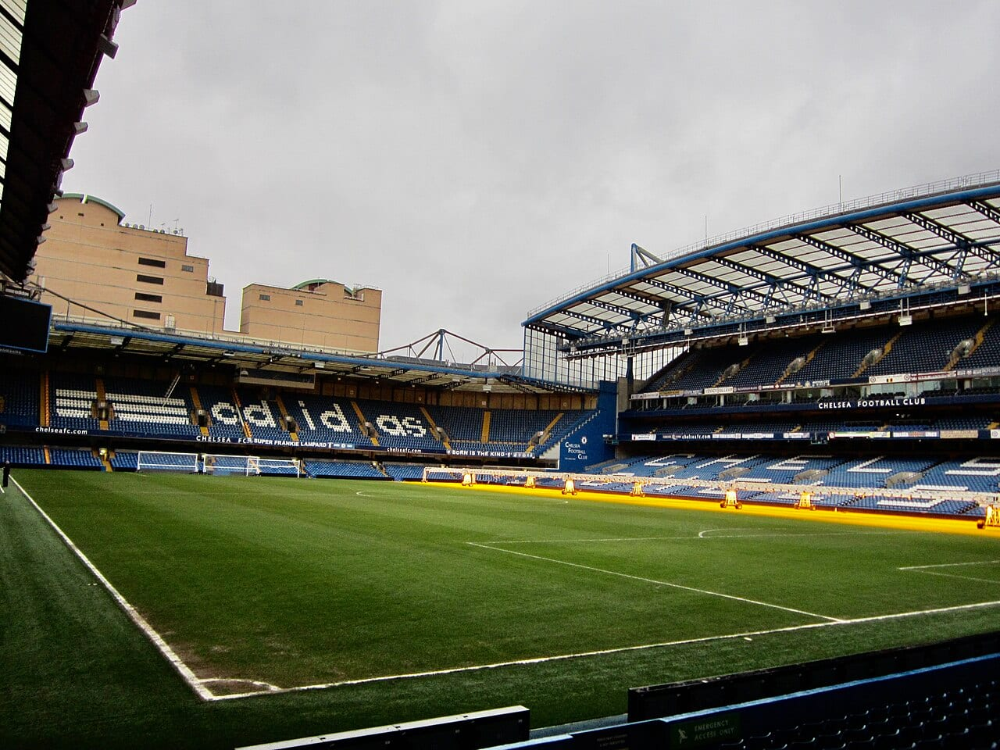
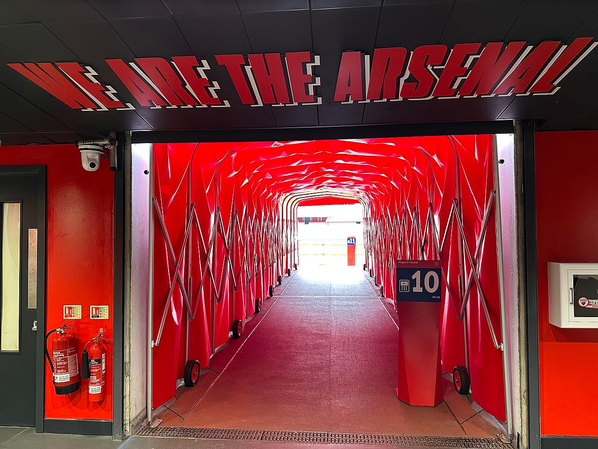
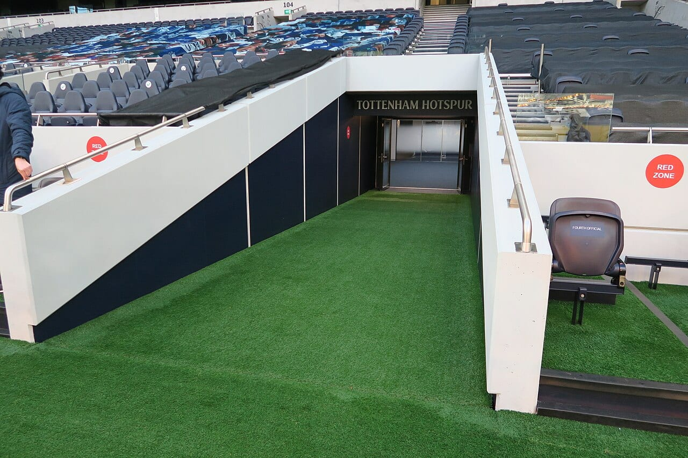
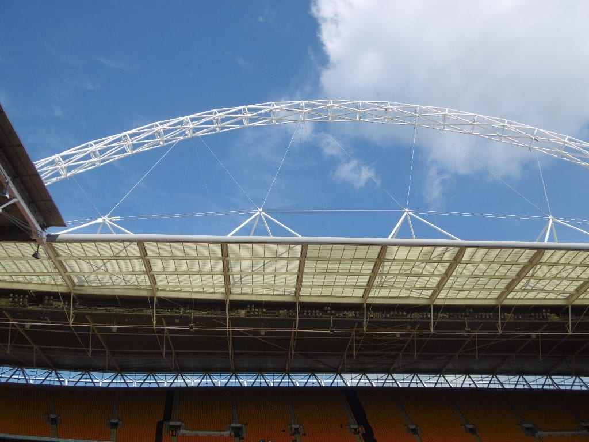

**Chelsea, Arsenal, Tottenham, West Ham at London Stadium, Wembley and Fulham all run stadium tours.** You walk the tunnel, sit in the dressing room and the dugout and come out pitchside. Each club sells its own tickets, and the main difference between them is what happens on a match day.

> 💡 **The Short Version:** For a tour that includes a club museum, take **Chelsea** (**£34**, 60 minutes, guided) or **Arsenal** (**£34**, self-guided with a handset). For the cheapest, **London Stadium**, West Ham's home, is **£22** for 60 to 75 minutes. For the national stadium, **Wembley** is **£28** for a 90-minute guided tour. **Tottenham** starts at **£25** and lets kids go free with a paying adult. **Fulham's** Craven Cottage tour is **£30** for 75 minutes on GetYourGuide. Book ahead: Chelsea and London Stadium charge more on the day, and Tottenham's standard tour does not run on a fixture day.

> 📘 **Booking and prices.** We earn a commission if you book through our GetYourGuide links; the price is the same either way. Where a club sells its own tickets, we link to its page. No club paid to be included. Prices are the adult price for the standard tour, booked in advance, and move with the date.

## The pick for each reader

| Best for | Tour | Adult from | Length | On match days |
|---|---|---|---|---|
| A museum as well | Chelsea, Stadium Tour and Museum | £34 | 60 minutes | Tours are listed date by date |
| A self-paced tour | Arsenal, Stadium Tour | £34 | Self-guided | Early closures, or guided tours only before kick-off |
| The cheapest | West Ham, London Stadium Tour | £22 | 60 to 75 minutes | Tours run on days without events |
| Families | Tottenham Hotspur Stadium Tour | £25 | About 1½ hours | Standard tour does not run; a Matchday Tour does |
| The national stadium | Wembley Stadium Tour | £28 | 90 minutes | Times are listed date by date |
| A smaller ground | Fulham, Craven Cottage | £30 | 75 minutes | Check dates when booking |

## Chelsea — Stamford Bridge

*Adult £34 · child (5 to 15) £24 · concession £29 · family of four £99 · 60 minutes · <a href="https://tours.chelseafc.com/booking/stadium-tours.htm" target="_blank" rel="noopener">Book on the club's site</a>*

**Stamford Bridge, SW6 1HS.** Fulham Broadway is the nearest station, 400 metres away. A live guide takes you through the dressing rooms, the press room, the players' tunnel and pitchside, and the **Chelsea FC Museum** is included, either before or after the tour. Each guest gets a free Chelsea lanyard, and a photo with the Club World Cup and the club's trophies is on sale separately. The club recommends the tour for all ages, and under-5s are free. Booking in advance saves £2 against the £38 walk-up adult price.

*The pitch at Stamford Bridge. Photo: [Ank kumar](https://commons.wikimedia.org/wiki/File:Chelsea_Football_Club,_Stamford_Bridge_08.jpg), [CC BY-SA 4.0](https://creativecommons.org/licenses/by-sa/4.0/).*

Tours are booked by date and time slot, with the first slots at 10am. There is a longer **Classic Tour** at £49 on the club's site, and the stadium tour is also on <a href="https://www.getyourguide.com/activity/-t52605?partner_id=WWP7I0R&amp;cmp=football-stadium-tours-london" target="_blank" rel="sponsored nofollow noopener" data-affiliate="gyg">GetYourGuide</a> at £34, rated 4.8 from 5,478 reviews. Our [Chelsea area guide](/articles/chelsea-area-guide/) covers the neighbourhood.

## Arsenal — Emirates Stadium

*Adult £34 · child (4 to 15) £24 · concession £29 · under 4 free · self-guided · <a href="https://arsenaldirect.arsenal.com/tour/emirates-stadium-tour" target="_blank" rel="noopener">Book on Arsenal's site</a>*

**Emirates Stadium, N5.** Arsenal station is 300 metres away. You carry a handset that plays the tour in your choice of seven languages, including British Sign Language, and walk through the Directors Box, the Diamond Club, the players' entrance, the home and away dressing rooms, the players' tunnel, the pitchside and home dugout, the touchline, the flash interview rooms, the press conference room and the media lounge. Entry to the Arsenal Museum is free with your ticket, and you get free earphones. Official souvenir photos cost extra. Arsenal members get 10% off.

*The players' tunnel at Emirates Stadium. Photo: [Matt Brown](https://commons.wikimedia.org/wiki/File:Players%27_tunnel_at_Emirates_Stadium_2024-04-26.jpg), [CC BY 2.0](https://creativecommons.org/licenses/by/2.0/).*

The tour runs Monday to Friday 10am to 5pm (last entry 4pm), Saturday 9.30am to 6pm (last entry 5pm) and Sunday 10am to 4pm (last entry 3pm). Match days change it. Arsenal's opening-hours page lists each date, and recent entries show tours closing early, guided tours only before kick-off, and all tours closed on some days with a fixture. For a guide, the **Legend Tour** is £55 and is on <a href="https://www.getyourguide.com/activity/-t1143153?partner_id=WWP7I0R&amp;cmp=football-stadium-tours-london" target="_blank" rel="sponsored nofollow noopener" data-affiliate="gyg">GetYourGuide</a> at 1½ hours, rated 4.5 from 88 reviews, with the Directors Box, the Diamond Club, the Manager's Office and a signed photo of your legend. The standard tour is also on <a href="https://www.getyourguide.com/activity/-t45135?partner_id=WWP7I0R&amp;cmp=football-stadium-tours-london" target="_blank" rel="sponsored nofollow noopener" data-affiliate="gyg">GetYourGuide</a> at £36 with an audio guide, rated 4.6 from 6,515 reviews. See our [Islington area guide](/articles/islington-area-guide/) for the surrounding streets.

## Tottenham — Tottenham Hotspur Stadium

*Adult from £25 · kids go free with a paying adult · 15% off in advance · <a href="https://www.tottenhamhotspurstadium.com/attractions/stadium-tour/" target="_blank" rel="noopener">Book on the stadium's site</a>*

**Tottenham Hotspur Stadium, N17.** White Hart Lane station is the closest, 350 metres away, and the stadium says four train stations are nearby. Its tour page picks out four facts: it is the only stadium in Europe purpose-built for NFL, the concourse is made of aggregate from the old White Hart Lane, the South Stand is the largest single-tier stand in the UK with 17,500 seats, and there are 1,800 TV screens. <a href="https://www.getyourguide.com/activity/-t387627?partner_id=WWP7I0R&amp;cmp=football-stadium-tours-london" target="_blank" rel="sponsored nofollow noopener" data-affiliate="gyg">On GetYourGuide</a> the tour is £31 for 1½ hours, from the changing rooms to the managerial dugout, rated 4.7 from 1,808 reviews.

*The players' tunnel at Tottenham Hotspur Stadium. Photo: [Hzh](https://commons.wikimedia.org/wiki/File:Players%27_tunnel_at_Tottenham_Hotspur_Stadium_-_view_from_pitchside.jpg), [CC BY-SA 4.0](https://creativecommons.org/licenses/by-sa/4.0/).*

**On match days** the regular tour does not run, whether the fixture is football or NFL, and the stadium sells a separate **Matchday Tour** from £50. It runs in the hours before kick-off and takes you into the home changing room, the tunnel and the media mixed zone, with a seat in the manager's chair in the dugout, a pitchside photo with the match ball and a free programme. For a head for heights, the stadium's glass **Dare Skywalk** walkway, 46.8 metres above the pitch, is also on <a href="https://www.getyourguide.com/activity/-t391199?partner_id=WWP7I0R&amp;cmp=football-stadium-tours-london" target="_blank" rel="sponsored nofollow noopener" data-affiliate="gyg">GetYourGuide</a> at £37, rated 4.7 from 400 reviews. Our [Tottenham Hotspur Stadium guide](/articles/tottenham-hotspur-stadium-travel-guide/) covers getting there.

## West Ham — London Stadium

*Adult £22 online (£24 on the day) · child £14 online (£15 on the day) · 60 to 75 minutes · <a href="https://stadiumtourbookings.london-stadium.com/home.htm" target="_blank" rel="noopener">Book on the stadium's site</a>*

**London Stadium, Queen Elizabeth Olympic Park, E20.** The stadium recommends Stratford, a 15-minute walk, as the gateway; Pudding Mill Lane on the DLR is 10 minutes and Hackney Wick 15. The guided tour goes to the West Ham United dressing room, the players' tunnel and the pitchside areas, with panoramic views, and the stadium suggests leaving up to 1½ hours to include the coffee shop and the store. Under-5s are free, children under 16 must be with an adult, and students and concessions get a discount.

Weekday departures are at 11am, 1pm and 3pm, and weekends run hourly from 10am to 3pm, though holidays, events and other bookings change this. Availability is shown about eight weeks ahead, and summer events and building works can leave dates unavailable. The stadium asks you to check its closures page before you travel. A **Matchday Tour** is sold separately. The tour is also on <a href="https://www.getyourguide.com/activity/-t79506?partner_id=WWP7I0R&amp;cmp=football-stadium-tours-london" target="_blank" rel="sponsored nofollow noopener" data-affiliate="gyg">GetYourGuide</a> at £27 for 75 minutes, rated 4.5 from 274 reviews. See our [London Stadium guide](/articles/london-stadium-travel-guide/) and the [Stratford area guide](/articles/stratford-area-guide/).

Powered by <a target="_blank" rel="sponsored" href="https://www.getyourguide.com/london-l57/">GetYourGuide</a>

## Wembley Stadium

*Adult £28 · child £19 · about 90 minutes · <a href="https://bookings.wembleytours.com/stadiumtours/booking/wembley-guided-stadium-tours.htm" target="_blank" rel="noopener">Book on the stadium's site</a>*

Wembley Park (Jubilee and Metropolitan lines) and Wembley Stadium (Chiltern Railways) stations are each about 8 minutes' walk away, and Wembley Central is about 20. A host takes you through the press conference room, which the stadium calls Europe's largest, the dressing rooms, where you find the shirt of your favourite England player, and the players' tunnel, before you walk out pitchside. You explore the first two sections at your own pace, and the guided part lasts about 90 minutes, so the stadium suggests allowing 2 hours. Arrive 15 minutes early.

*The arch above Wembley Stadium. Photo: [Richard Webb](https://commons.wikimedia.org/wiki/File:The_Arch,_Wembley_Stadium_-_geograph.org.uk_-_4963979.jpg), [CC BY-SA 2.0](https://creativecommons.org/licenses/by-sa/2.0/).*

Wembley has a 100% bag search, no cloakroom and no large bags or suitcases. The tour is fully accessible, with alternative routes where needed. The booking page lists times date by date, and not every date has tours, so check the day you want before you travel. Tours can reach full capacity. The stadium tour is also on <a href="https://www.getyourguide.com/activity/-t12486?partner_id=WWP7I0R&amp;cmp=football-stadium-tours-london" target="_blank" rel="sponsored nofollow noopener" data-affiliate="gyg">GetYourGuide</a> at £25, rated 4.7 from 3,965 reviews. Our [Wembley Stadium guide](/articles/wembley-stadium-arena-guide/) covers getting there and where to stay.

## Fulham — Craven Cottage

*£30 · 75 minutes · 4.9 from 297 reviews · <a href="https://www.getyourguide.com/activity/-t409415?partner_id=WWP7I0R&amp;cmp=football-stadium-tours-london" target="_blank" rel="sponsored nofollow noopener" data-affiliate="gyg">Book on GetYourGuide</a>*

A guided tour of the club's history at Craven Cottage, which GetYourGuide describes as London's original football club. Putney Bridge is the nearest station, about a kilometre away. GetYourGuide describes the tour as a trip through the club's history at Craven Cottage.

## Doing it yourself

If you would rather see a game than the empty ground, or want to base yourself near a stadium:

* **A match:** [how to get Premier League tickets in London](/articles/premier-league-tickets-london/).
* **Near the grounds:** [where to stay near Wembley Stadium](/articles/where-to-stay-near-wembley-stadium/).
* **Other sport:** [Twickenham Stadium](/articles/twickenham-stadium-travel-guide/) has its own travel guide.
* **More tours:** [food tours in London](/articles/london-food-tours/) and [the best walking tours in London](/articles/best-walking-tours-london/).
