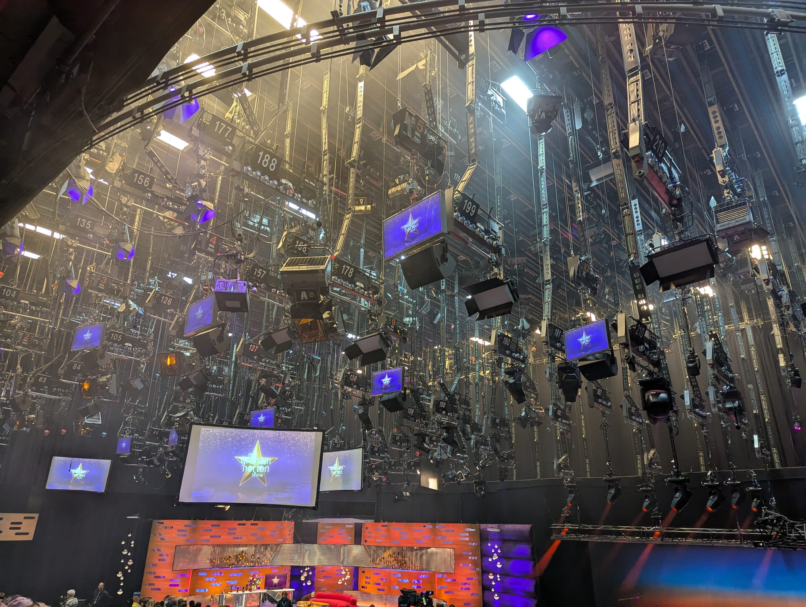

**Television and radio audiences in London are free**, with no booking fee. The BBC calls itself the largest provider of free television and radio tickets in the UK.

But **a ticket does not get you in.** Agencies deliberately issue more tickets than there are seats, because a proportion of people who claim a free ticket never turn up.

> 💡 **The Short Version:** Tickets are free from **five agencies** — the BBC, SRO Audiences, Applause Store, Lost in TV and Standing Room Only. They are **over-issued on purpose**, so entry is first come, first served and **a ticket is a place in a queue**. Wristbands are numbered in arrival order, so **arriving early is the whole game**. Expect **three to four hours** for a half-hour show, **18+** at most studios, **photo ID**, and **no food, drink or large bags** past security.

---

## The five places tickets come from

There is no single box office. Each production hires an audience agency, so the show you want dictates the site you use.

| Agency | Books for | How it releases |
| --- | --- | --- |
| **[BBC Shows and Tours](https://www.bbc.co.uk/showsandtours/)** | All BBC television and radio | Random draw for big shows, first-come for smaller ones |
| **[SRO Audiences](https://www.sroaudiences.com/)** | Chat shows and panel shows, incl. Graham Norton | Application form, tickets emailed |
| **[Applause Store](https://www.applausestore.com/)** | ITV entertainment, premieres, red carpets | Booking now / register interest |
| **[Lost in TV](https://lostintv.com/)** | ITV, Channel 4, Sky, plus casting calls | Direct booking, optional paid membership |
| **[Standing Room Only](https://standingroomonly.tv/)** | Audience and casting work | Free membership, then invitations |

The BBC runs a **random draw** for anything popular, Strictly Come Dancing included, so being quick does not help. **Standing Room Only** is an audience *and casting* company; some of its work is paid, and it operates well beyond London. **SRO Audiences and Standing Room Only are not the same organisation**, despite the shared initials: for a London chat show, use sroaudiences.com.

---

## What is actually recording

The line-up turns over constantly. The BBC takes audiences for **Strictly Come Dancing** (Elstree and Blackpool, random draw) and for radio recordings such as **The News Quiz**, **The Today Debate** from the Radio Theatre, **The Kitchen Cabinet** and **BBC Singers** concerts. Lost in TV lists ITV quiz and entertainment recordings, including **Who Wants to Be a Millionaire?** and **Millionaire Hot Seat** with Jeremy Clarkson at MediaCity.

**Radio is easier to get into.** Panel shows, comedy pilots and Radio 4 recordings are easier than a Saturday-night entertainment format, take an hour rather than four, and are often in the BBC Radio Theatre at Broadcasting House rather than a studio at Elstree.

**Awards nights are a separate route.** The free fan-pen places at the BAFTAs and the Olivier Awards, and the seats at the National Television Awards, are in our [award ceremonies guide](/articles/award-ceremonies-london/), with a page each for the [National Television Awards](/articles/national-television-awards-tickets/) and the [Oliviers](/articles/olivier-awards-tickets/).

**Television Centre in White City** is on the Tube. **Elstree, Pinewood and MediaCity in Salford are not**: a Strictly ticket is a day out of London, and a Millionaire Hot Seat ticket is a trip to Manchester.

This page covers studio audiences. For watching a shoot on the street, see [can you watch filming in London](/articles/london-filming-locations/#can-you-watch-filming-in-london).

---

Powered by <a target="_blank" rel="sponsored" href="https://www.getyourguide.com/london-l57/">GetYourGuide</a>

## The over-issue, and what it means for you

**SRO's own ticket says it in capitals:** they over-issue regular tickets by a percentage to compensate for the inevitable no-shows, the over-issue is calculated from how many tickets were actually used at recent recordings of that show, and *"sometimes we don't manage to squeeze everyone in."*

A night at the Graham Norton recording runs like this:

- **Wristbands are numbered in arrival order.** Not booking order, not application order — the order you physically turn up.
- **Priority ticket holders have until 5.30pm** to check in; **production guests until 6.20pm**. Their unclaimed places are only released after those times.
- **Regular ticket holders are admitted in wristband order**, first come first served, until the studio is full.
- **Doors at 6pm. No admittance after 6.15pm.**

*Inside the Graham Norton Show studio.*

So the queue forms long before the stated check-in time, and the people at the front are the ones who get in. SRO tells you at check-in whether you are safely in or in what its own ticket calls the **"fingers crossed" part of the line**.

> ⚠️ **Do not build an occasion around it.** SRO does not recommend using tickets as the focus of a birthday or anniversary: the birthday person queues like everyone else.

**If you do not get in**, SRO rescans your ticket and issues **priority tickets to a future show of your choice**, subject to availability. You have to **leave your details at the event** to get that.

---

## What gets you turned away

**Photo ID.** Ticket holders and guests may both be asked. **Copies and photographs of ID are not accepted** — a picture of your passport on your phone is not ID. Driving licence, passport or Freedom Pass are the recommended forms.

**Age.** Public tickets for the Graham Norton recording were **18 and over**, checked on ID; production guests are the only exception. Limits are set per show.

**Food and drink.** No snacks, no food, no drinks past security. You may bring a **non-glass, non-metal** bottle, but **it will be emptied at the security desk** — you refill it from a water cooler inside. Eat before you join the queue.

**Bags.** At that show there was **no cloakroom at all**. Anything that will not fit under your seat is at security's discretion to store or refuse. Travelling to a recording with luggage is a bad plan.

**Phones** go in, but must be **switched off before filming begins**.

**Clothes.** The dress code is about how you look on camera, not smartness: **avoid floral patterns, black and prominent brand names**; block colours are preferred. Brand-heavy clothing is not permitted.

---

## Getting the evening right

**Arrive earlier than feels necessary.** The stated check-in time is when staff start working down a line that already exists.

**Dress for two temperatures.** You wait outside — at Television Centre, under a group of trees on Wood Lane opposite the Tube station — and the studio may be a completely different climate. Layers, and an umbrella.

**Sort the toilet before you queue in earnest.** Facilities in the waiting area may be portaloos, and leaving the line costs you your place unless you time it around check-in.

**You can leave after checking in.** Once you have your wristband you may go — for food, or a sit down — as long as you are back through security before your number is called.

**Arrive together.** Members of a party who turn up separately **cannot join each other in the queue** or collect wristbands for one another. If you want to sit together, either arrive as a group or wait until the last of your wristband numbers is called.

**Expect three to four hours** for a half-hour programme. Audiences typically watch **one episode**; retakes, resets and technical stops fill the rest.

*Waiting for the recording to start.*

**You may well be on television.** Cameras face the audience, and some shows deliberately show or talk to them.

---

*The studio lighting rig.*

## The bits that are a treat

**You see how it is made**: the floor manager warming up the room, the retakes, the pieces that never air.

**Some shows invite you into the programme.** Graham Norton's production emails ticket holders a few days beforehand asking whether anyone wants to do the red chair, which is an open invitation to be in the show, not just at it.

**Perks.** SRO negotiates discounts near Television Centre — The Broadcaster, right by the studio, takes **20% off your food bill** on the day you attend if you show your ticket.

---

Powered by <a target="_blank" rel="sponsored" href="https://www.getyourguide.com/london-l57/">GetYourGuide</a>

## Is it worth it?

**Yes for radio.** An hour, a central venue, a low-key queue, and often a show you already listen to.

**Yes for television, if you accept the cost.** You are trading three or four hours, much of it standing, for something you cannot otherwise buy. Treat it as the day's plan.

**No, if you need certainty.** A ticket is not a seat.

---

## Continue planning your London trip

- 💷 **[London on a Budget](/articles/london-on-a-budget/)** — the free museums, viewpoints and set pieces, and where the money actually goes
- 🎭 **[The Best Immersive Experiences in London](/articles/immersive-experiences-london/)** — what is still open
- 🎤 **[The Best Comedy Clubs in London](/articles/best-comedy-clubs-london/)** — where the panel show regulars work the rest of the week
- 🎩 **[The Best Cabaret in London](/articles/best-cabaret-london/)** — the other end of the live-audience business
