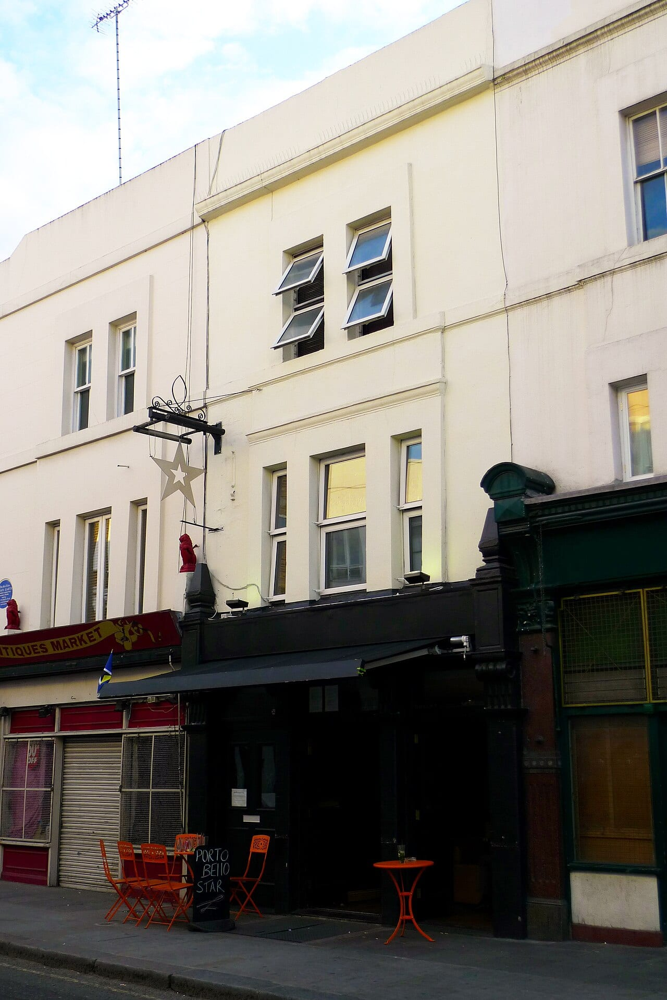
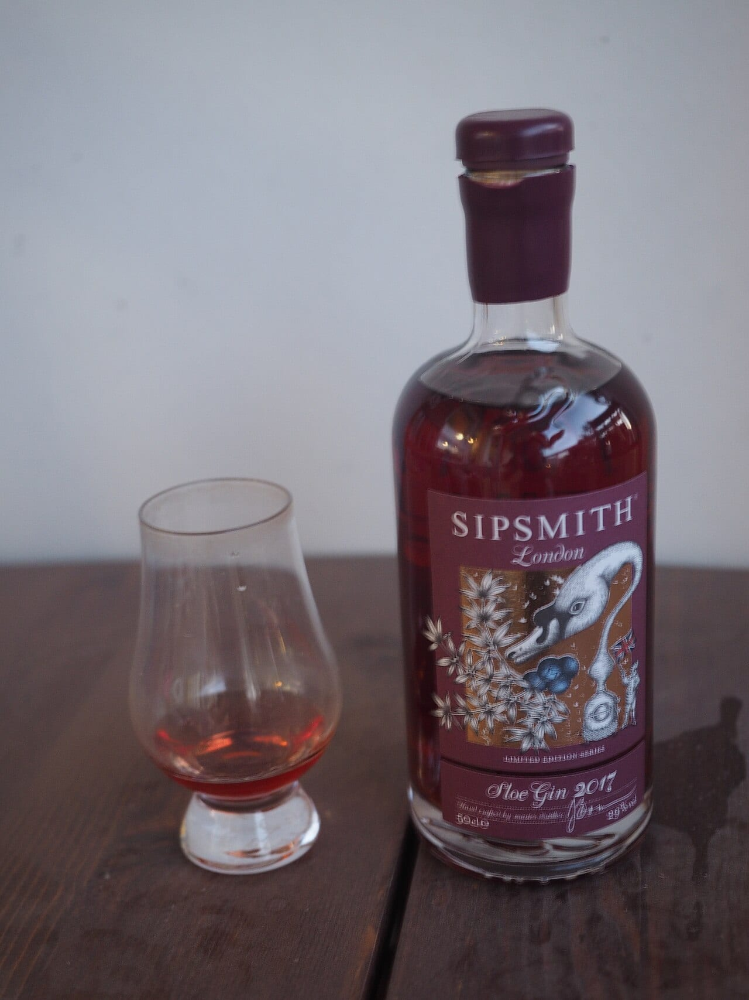
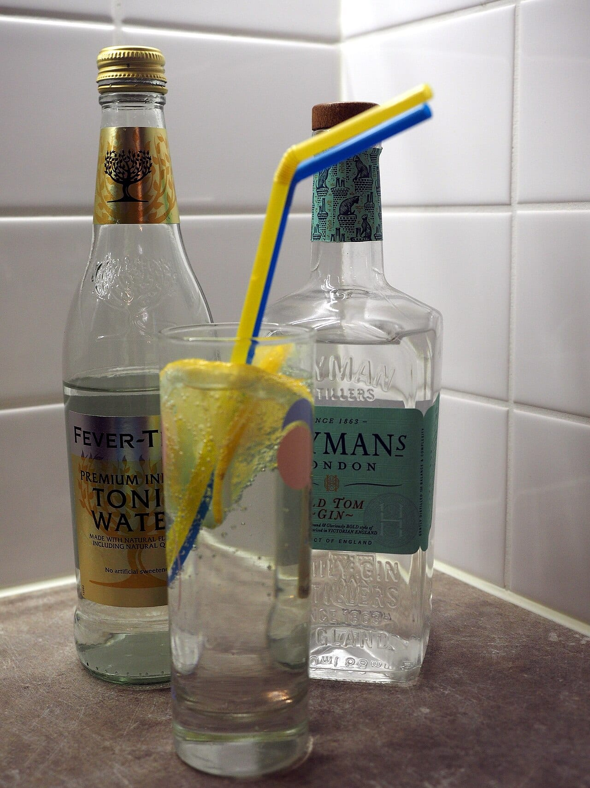

**You can book a gin tasting, a distillery tour or a class where you blend your own bottle at London distilleries.** Each runs by appointment, and every one below has a booking page that takes you straight to dates and prices.

> 💡 **The Short Version:** To make something to take home, book **The Ginstitute** on Portobello Road (**£120**, about three hours, a 70cl bottle of your own blend) or the cheaper **Make Your Own Gin Workshop** on GetYourGuide (**£68**, 2½ hours). For a first distillery tour, **Hayman's** in Balham is **£25** for about 75 minutes and three gins, and **Sipsmith** in Chiswick is **£30** on GetYourGuide. If you only have half an hour in Notting Hill, the **Portobello Road Gin tasting** is **£29**. For whisky instead, **Bimber** in Park Royal is **£40**. The Ginstitute, Hayman's and East London Liquor Company are all **18 and over**.

> 📘 **Booking and prices.** We earn a commission if you book through our GetYourGuide links; the price is the same either way. Direct bookings link straight to the distillery's own page. No operator paid to be included. Prices are the adult price for the standard ticket and move with the date.

## The pick for each reader

| Best for | Where | Area | From | Length | What you get |
|---|---|---|---|---|---|
| Making your own gin | The Ginstitute | Notting Hill | £120 | about 3 hours | A 70cl bottle of your own blend, cocktails on the way |
| A cheaper make-your-own | Make Your Own Gin Workshop | GetYourGuide | £68 | 2½ hours | Your own recipe, labelled and sealed, plus a gin cocktail |
| A proper distillery tour | Hayman's | Balham | £25 | about 75 minutes | A welcome G&T, the botanicals, three gins |
| A weeknight tour of the stills | Sipsmith | Chiswick | £30 | 1½ hours | The copper stills, four gins, a gift bag |
| Half an hour spare | Portobello Road Gin | Notting Hill | £29 | about 30 minutes | A G&T, four gins and a Martini |
| Whisky | Bimber | Park Royal | £40 | 2 hours | A whisky cocktail, the working distillery, single malts |

## Make your own gin

### The Ginstitute — Portobello Road, Notting Hill

*£120 · about 3 hours · 18+ · <a href="https://portobelloroaddistillery.com/products/the-ginstitute-experience" target="_blank" rel="noopener">Book on the distillery's site</a>*

**171 Portobello Road, W11 2DY.** The nearest stations are Notting Hill Gate and Ladbroke Grove. You meet at the bar of the Portobello Star pub and are sent on to the session. Over about three hours an instructor takes you through the history of gin, from the Dutch origins and the Gin Craze to the modern revival, and explains how it is made at the copper pot stills. You then smell and taste a range of pure botanical distillates, choose your favourites and blend your own recipe. You leave with a full 70cl bottle of it, and your recipe is kept on file so you can order more later. There are cocktails along the way, and a last drink, usually a Martini, at the end. The Ginstitute says more than 130,000 people have made their own gin there since 2011.

*The Portobello Star at 171 Portobello Road, where Ginstitute sessions start. Photo: [Ewan-M](https://commons.wikimedia.org/wiki/File:Portobello_Star,_Portobello_Road,_W11.jpg), [CC BY-SA 2.0](https://creativecommons.org/licenses/by-sa/2.0/).*

No food is provided, so eat first. The distillery asks you to arrive at least 10 minutes early so your party sits together, and it lets you rebook if you give 48 hours' notice. The Ginstitute is also on <a href="https://www.getyourguide.com/activity/-t1484294?partner_id=WWP7I0R&amp;cmp=gin-distillery-tours-london" target="_blank" rel="sponsored nofollow noopener" data-affiliate="gyg">GetYourGuide</a> at £125, in a three-hour tour that adds time in the Portobello Road market first.

### Make Your Own Gin Workshop with a Take-Home Bottle

*£68 · 2½ hours · 5.0 from 22 reviews · <a href="https://www.getyourguide.com/activity/-t928650?partner_id=WWP7I0R&amp;cmp=gin-distillery-tours-london" target="_blank" rel="sponsored nofollow noopener" data-affiliate="gyg">Book on GetYourGuide</a>*

You smell and taste botanical distillates, write your own gin recipe, then craft, label and seal a bottle to take home, and drink a gin cocktail while you are there. There is a private option for groups, free cancellation and wheelchair access.

## Distillery tours and tastings

### Sipsmith — Chiswick

*£30 · 1½ hours · 5.0 from 18 reviews · weeknights only · <a href="https://www.getyourguide.com/activity/-t1107345?partner_id=WWP7I0R&amp;cmp=gin-distillery-tours-london" target="_blank" rel="sponsored nofollow noopener" data-affiliate="gyg">Book on GetYourGuide</a> or <a href="https://sipsmith.com/distillery-tours/" target="_blank" rel="noopener">on Sipsmith's site</a>*

**83 Cranbrook Road, Chiswick, W4 2LJ.** Turnham Green is the nearest station, 600 metres away. You see the copper stills, hear the history of gin and taste four gins, then take home a gift bag with two samples. There is a gin shop on site. Sipsmith's distillery stands on a residential road, so tours run on weeknights only and it takes no walk-ins. It says tours are often full a few months ahead, and it asks for as much notice as possible if you cannot come.

*A bottle of Sipsmith sloe gin. Photo: [JIP](https://commons.wikimedia.org/wiki/File:Sipsmith_Sloe_Gin.jpg), [CC BY-SA 4.0](https://creativecommons.org/licenses/by-sa/4.0/).*

### Hayman's — Balham

*£25 · about 75 minutes · up to 20 people · 18+ · <a href="https://www.haymansgin.com/product/distillery-tours/" target="_blank" rel="noopener">Book on the distillery's site</a>*

**8a Weir Road, Balham.** It is a 12-minute walk from Balham station or 15 minutes from Clapham South. The Hayman family says it has made gin in London for five generations, and the tour starts with a welcome G&T or a seasonal cocktail. You then handle the botanicals, hear how the two-day distillation works and taste three gins in a tutored tasting. You get 15% off a 70cl bottle in the distillery shop on the day. Hayman's own booking page shows 5.0 from 103 ratings.

Dates are released about every six weeks, so a date you want may not be on sale yet. You can change or cancel up to 10 days before; inside that window the tour is not refundable. Hayman's may reschedule a tour if fewer than six people have booked. It serves no food, and under-18s, including babies, are not allowed in. For a longer evening, its Cocktail Masterclass is £40 and its Martini Masterclass is £45.

*Hayman's Old Tom gin with tonic. Photo: [JIP](https://commons.wikimedia.org/wiki/File:Home-made_gin%26tonic_from_Haymans_Old_Tom_Gin_and_Fever-Tree_Premium_Indian_Tonic_Water.jpg), [CC BY-SA 4.0](https://creativecommons.org/licenses/by-sa/4.0/).*

### Portobello Road Gin tasting — Notting Hill

*£29 · about 30 minutes · <a href="https://portobelloroaddistillery.com/products/the-gin-tasting" target="_blank" rel="noopener">Book on the distillery's site</a>*

A welcome gin and tonic, a flight of at least four gins from the range, and a Martini to finish, at the home of Portobello Road Gin in Notting Hill. The gins vary by day, from London Dry to more adventurous styles. It is a short stop, so it fits around a walk along Portobello Road. Our [Notting Hill area guide](/articles/notting-hill-area-guide/) and the [colourful houses walk](/articles/notting-hill-colourful-houses/) cover the rest of the street. The tasting is also on <a href="https://www.getyourguide.com/activity/-t1507211?partner_id=WWP7I0R&amp;cmp=gin-distillery-tours-london" target="_blank" rel="sponsored nofollow noopener" data-affiliate="gyg">GetYourGuide</a>.

### Gin Tasting and Masterclass

*£26 · 1 hour · 4.7 from 11 reviews · <a href="https://www.getyourguide.com/activity/-t928581?partner_id=WWP7I0R&amp;cmp=gin-distillery-tours-london" target="_blank" rel="sponsored nofollow noopener" data-affiliate="gyg">Book on GetYourGuide</a>*

The history of gin and a tasting of four award-winning gins, with a welcome G&T. There is a private option for groups and free cancellation.

Powered by <a target="_blank" rel="sponsored" href="https://www.getyourguide.com/london-l57/">GetYourGuide</a>

## East London and whisky

### East London Liquor Company — Hackney

*Negroni Builder £65 · East End Blender £75 · 18+ · <a href="https://eastlondonliquorcompany.com/pages/east-london-liquor-experiences" target="_blank" rel="noopener">Book on the distillery's site</a>*

**382 Mentmore Terrace, E8 3PH.** The Lab is under a railway arch, 2 minutes' walk from London Fields Overground. These are drinks classes in the producer's own space rather than distillery tours. In the **Negroni Builder** you taste four very different takes on the negroni and stir down a full glass of your favourite, with a welcome drink and something to take away. In the **East End Blender** you taste a mix of released and possibly unreleased whiskies, blend your own and take home a 300ml bottle. You can move a booking up to 7 days ahead, and the Lab says late arrivals may miss part of the session.

### Bimber — Park Royal

*£40 · 2 hours · Thursday and Friday at 6pm, Saturday at 12 and 2.30pm · <a href="https://www.bimberdistillery.co.uk/bookings-checkout/whisky-connoisseur-experience/book" target="_blank" rel="noopener">Book on the distillery's site</a>*

**56 Sunbeam Road, NW10 6JQ.** North Acton is the nearest station, 400 metres away. Bimber makes single malt whisky in London with traditional methods, and the tour covers the process from mashing and fermenting to distilling and maturation. You get a welcome whisky cocktail and a selection of its single malts, and £5 off anything you buy during the visit. The distillery and bar have flat access with no stairs. Bimber is also on <a href="https://www.getyourguide.com/activity/-t1289766?partner_id=WWP7I0R&amp;cmp=gin-distillery-tours-london" target="_blank" rel="sponsored nofollow noopener" data-affiliate="gyg">GetYourGuide</a> at the same price.

## Doing it yourself

To drink gin rather than make it, or to find another kind of class:

* **Cocktails:** [the best cocktail bars in London](/articles/best-cocktail-bars-london/) and [the best speakeasy bars](/articles/best-speakeasy-bars-london/).
* **Other tastings and walks:** [food tours in London](/articles/london-food-tours/) includes more distillery and brewery tastings.
* **A class that is not about drink:** [cookery classes in London](/articles/cookery-classes-london/) covers pasta, pies and scones.
* **Gifts:** [London gifts and souvenirs](/articles/london-gifts-souvenirs/).
