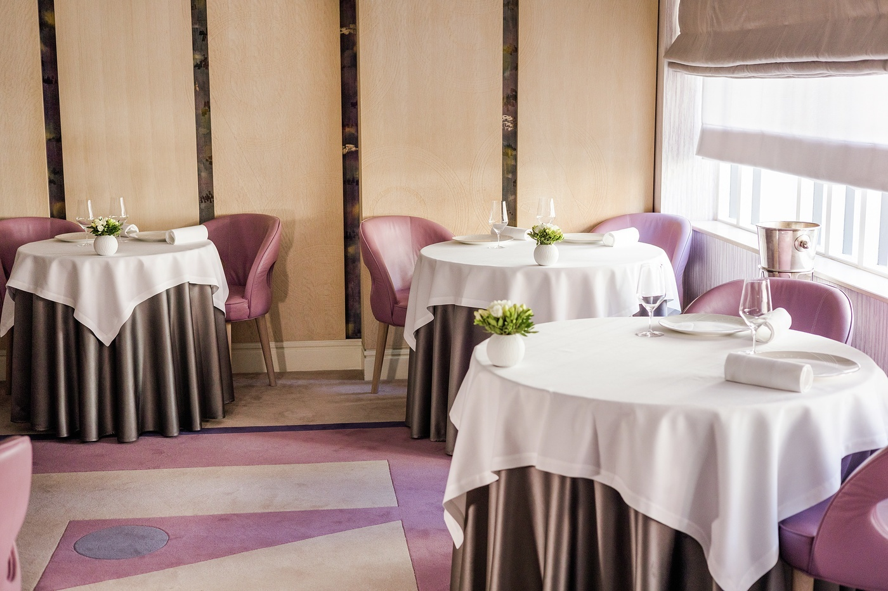
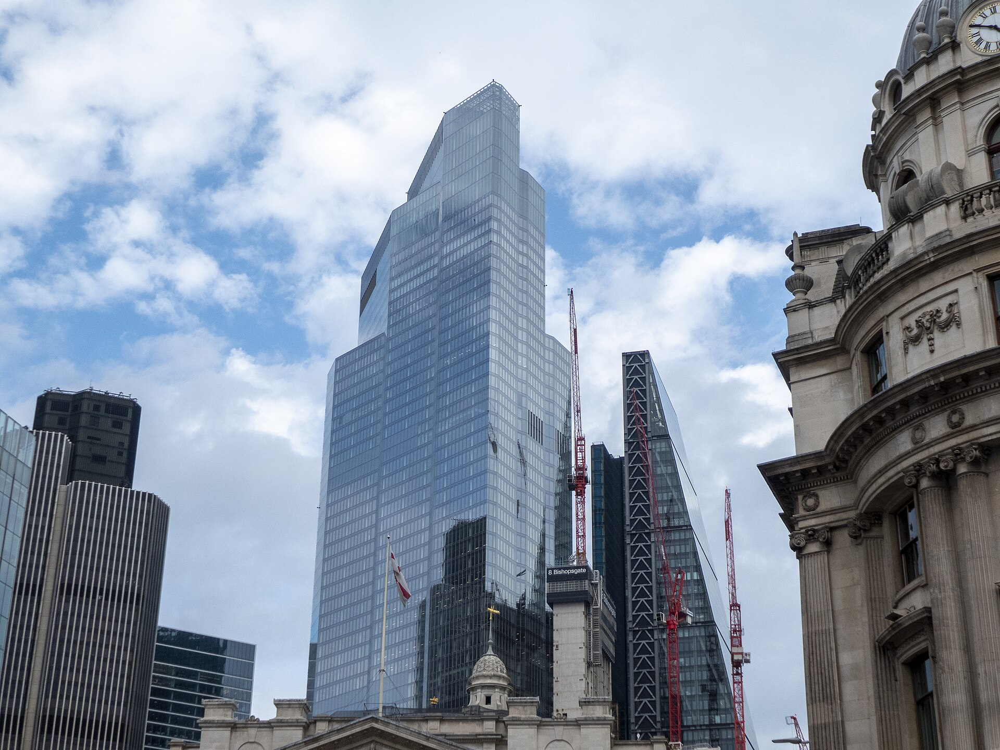
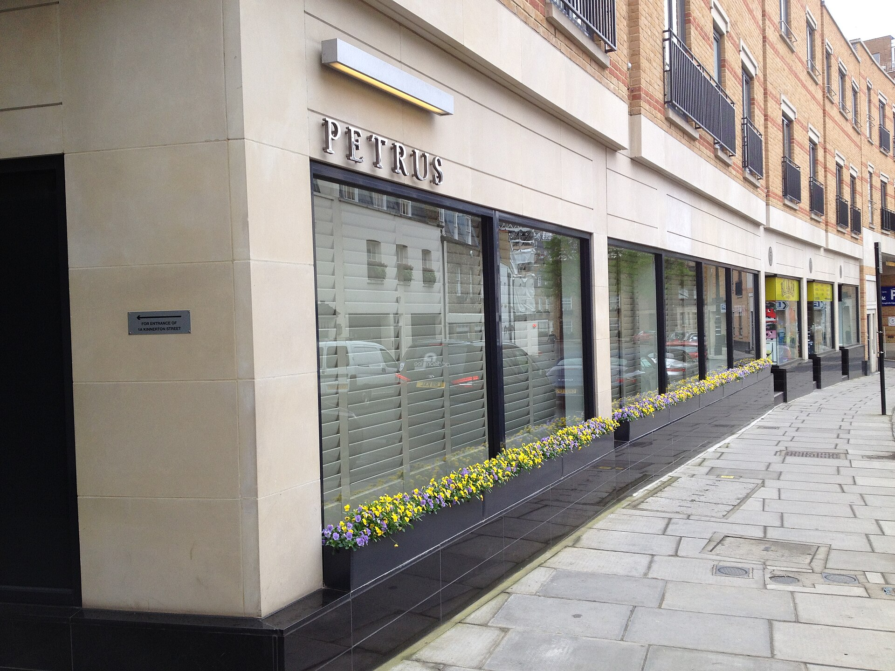
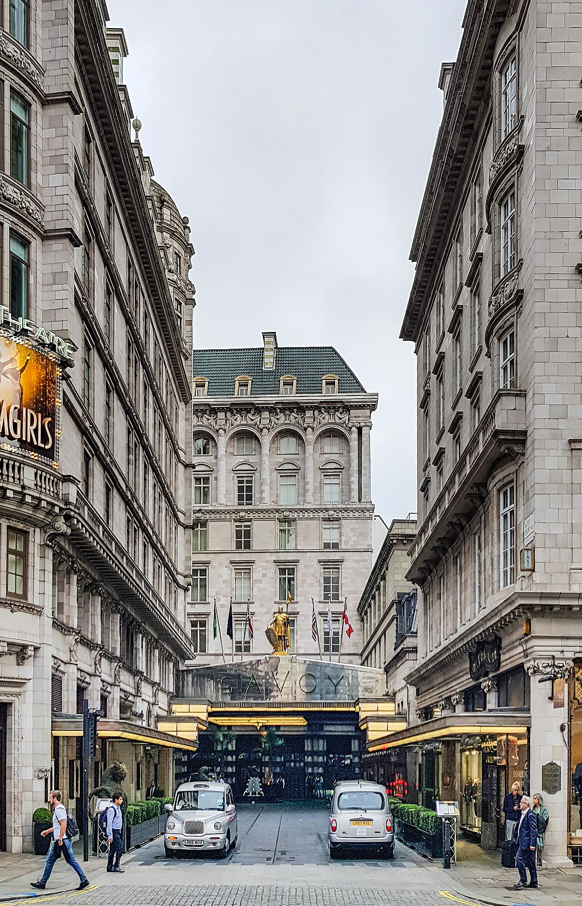
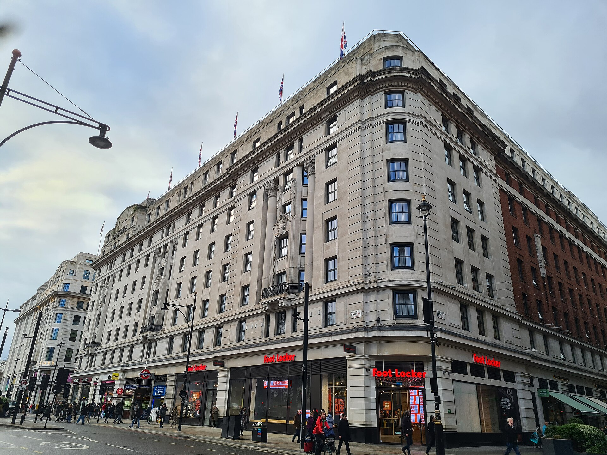
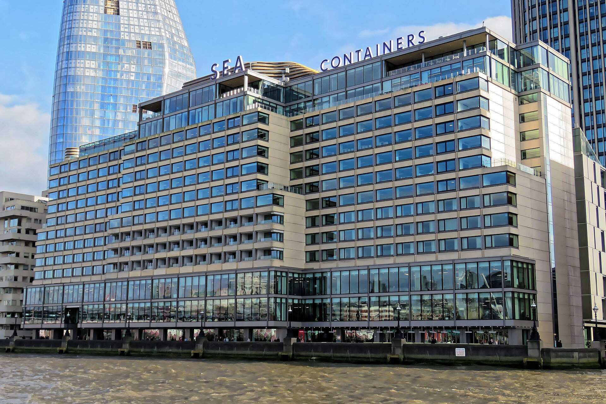
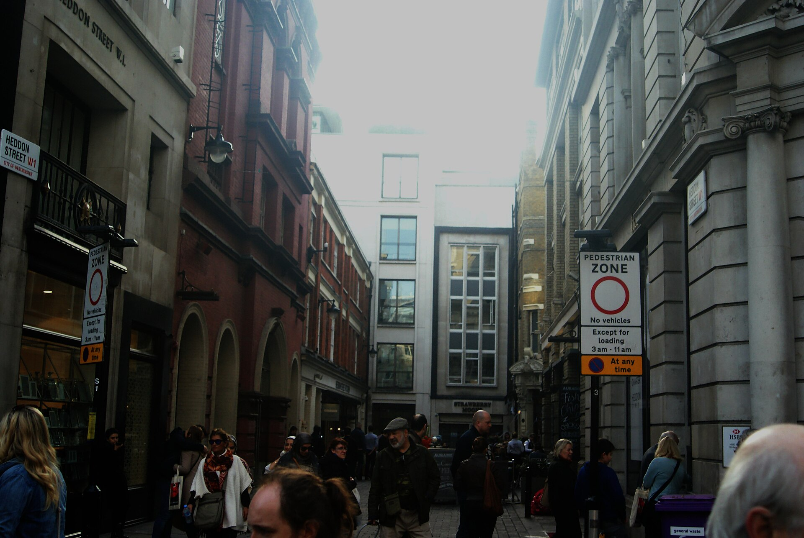

**Gordon Ramsay's name is over the door of restaurants that cost £20 and restaurants that cost £250.** The group lists restaurants across London, from a 12-seat counter near the top of a City skyscraper to a pizza place that serves slices until you stop eating. This guide ranks them by how many independent sources recommend each one, and tells you what to order, what the room is like and the one fact that decides the visit.

Bread Street Kitchen in Southwark has closed and is not included.

> 💡 **The Short Version:** **Restaurant Gordon Ramsay High** at 22 Bishopsgate is named by more sources than any other Ramsay restaurant in London, and took its first Michelin star in 2026. **Restaurant Gordon Ramsay** in Chelsea is the only three-star. **Savoy Grill** and **Lucky Cat at 22 Bishopsgate** come next on the count. For less money: **Pétrus** lunch is £65, **Lucky Cat Mayfair** has a £35 express lunch, **Street Pizza** is £20 bottomless and **Street Burger** is £17.50 with fries.

> 📊 **The evidence behind this guide.**
> **27 independent sources carrying 52 citations** across **13 named restaurants**. **11 restaurants are named by two or more independent sources.**
> **Built on:** the Michelin Guide and the Good Food Guide; reviews and lists from Time Out, The Infatuation, Country & Town House, City AM, The London Economic and others; and two YouTube creators.
> *Evidence built 22 November 2026 · [How we rank →](/how-we-rank/)*

## Booking at a glance

* **Small rooms with a fixed start:** Restaurant Gordon Ramsay High has 12 seats and starts at 7pm, Tuesday to Saturday. Restaurant 1890 has ten tables. Hell's Kitchen's Chef's Table takes up to 36 guests.
* **Closed days:** Restaurant Gordon Ramsay is open Tuesday to Saturday. Pétrus is closed Monday and Sunday.
* **Walk-in:** Street Pizza says there is no need to book. The HDN bar at Heddon Street Kitchen is walk-in only, Wednesday to Saturday from 5pm.
* **Every other restaurant here** takes bookings through the group's website.

## Where they are

| If you are near… | Where to eat |
| --- | --- |
| **Chelsea** | Restaurant Gordon Ramsay |
| **Knightsbridge** | Pétrus |
| **Covent Garden (the Strand)** | Savoy Grill, Restaurant 1890, The River Restaurant |
| **Mayfair** | Lucky Cat Mayfair, Gordon Ramsay Bar & Grill, Heddon Street Kitchen |
| **Marble Arch** | Hell's Kitchen |
| **The City** | Restaurant Gordon Ramsay High, Lucky Cat 22 Bishopsgate, Bread Street Kitchen 22 Bishopsgate, Bread Street Kitchen St Paul's, Bread Street Kitchen The City, Street Pizza St Paul's |
| **Farringdon and Soho** | Street Burger Farringdon, Street Burger Charing Cross Road |
| **South Bank** | Gordon Ramsay at Sea Containers |
| **Battersea** | Bread Street Kitchen Battersea, Street Pizza Battersea |
| **East London** | Bread Street Kitchen Limehouse, Bread Street Kitchen Stratford, Pizza East (Shoreditch, Stratford) |
| **Greenwich** | Street Burger at The O2 |
| **Heathrow** | Plane Food (Terminal 5) |

**Price guide:** **£** under £20 · **££** £20–£50 · **£££** £50–£100 · **££££** £100+, food only.

---

## The Michelin-starred four

Michelin gives three stars to Chelsea and one each to High, Pétrus and 1890. Time Out's ratings do not follow the stars: it gives 1890 five out of five, Pétrus and the Chelsea flagship four, and High three. High has the most sources behind it and the sharpest split: the Financial Times headed its March 2026 review "£776 of meh".

### Restaurant Gordon Ramsay, Chelsea

*££££ · 68 Royal Hospital Road, SW3 4HP · Three Michelin stars, 2026 guide · Cited by 5 sources · [book a table](https://www.gordonramsayrestaurants.com/restaurant-gordon-ramsay/book-a-table/)*

The flagship opened in 1998 and has held three stars since 2001. Order the lobster, langoustine and salmon ravioli, which the Good Food Guide says has been on the menu since the first day; the 100-day aged Cumbrian Blue Grey sirloin was "perfectly medium-rare" on its visit.

*The dining room on Royal Hospital Road.*

The room is small and quiet, with cream walls, a low ceiling and pink upholstered chairs; The Infatuation compares it to the inside of a suede driving shoe. **Lunch is £125 for three courses against £190 à la carte and £225 for the Prestige menu**, on menus dated October 2026. It opens Tuesday to Saturday, lunch from noon and dinner from 6pm, takes card payments only, and Chef de Cuisine Kim Ratcharoen runs the kitchen.

### Restaurant Gordon Ramsay High, 22 Bishopsgate

*££££ · Floor 60, 22 Bishopsgate, EC2N 4BQ · One Michelin star, 2026 guide · Cited by 9 sources · [book a table](https://www.opentable.co.uk/r/restaurant-gordon-ramsay-high-reservations-london?restref=364593&lang=en-GB)*

**Named by more sources than any other Ramsay restaurant in London**, and new in the 2026 Michelin guide. There are 12 seats at a counter that faces the window, and one menu: a Carte Blanche of around ten courses at £250 a head, cooked by Chef James Goodyear's team. Reviewers describe lobster ravioli with yuzu, Devon duck with morels, scallops in a chamomile velouté and an oyster ice cream.

*22 Bishopsgate, the tower that holds High, Lucky Cat and Bread Street Kitchen. Photo: [sebastiandoe5](https://commons.wikimedia.org/wiki/File:22_Bishopsgate_From_Bank.jpg), [CC BY-SA 2.0](https://creativecommons.org/licenses/by-sa/2.0/).*

**Every sitting starts at 7pm, Tuesday to Saturday.** Time Out, which gave it three out of five, calls the whole thing "a numbers game"; ShortList thought it "seriously worth it". Our [best rooftop restaurants](/articles/best-rooftop-restaurants-london/) guide covers the other starred rooms with a view.

### Pétrus by Gordon Ramsay, Knightsbridge

*££££ · 1 Kinnerton Street, SW1X 8EA · One Michelin star, 2026 guide · Cited by 5 sources · [book a table](https://www.gordonramsayrestaurants.com/petrus/book-a-table/)*

Wine drives the room: it is named after the Pomerol estate and built around a circular wine store, in pearlescent pink and dusky grey. From the à la carte, order the lobster raviolo, the Aynhoe Park deer or the 100-day aged Blue Grey beef; **three courses are £125, the Prestige menu £155 and the Discovery menu £195.**

*The Kinnerton Street frontage. Photo: [miyagawa](https://commons.wikimedia.org/wiki/File:Petrus_restaurant_london.jpg), [CC BY-SA 3.0](https://creativecommons.org/licenses/by-sa/3.0/).*

The cheapest way in is the **£65 set lunch, Tuesday to Friday, pre-booked only.** It is closed Monday and Sunday, and its dress code says smart trainers are fine. Country & Town House called the atmosphere "surprisingly relaxed".

### Restaurant 1890 by Gordon Ramsay, The Savoy

*££££ · The Savoy, Strand, WC2R 0EU · One Michelin star, 2026 guide · Cited by 3 sources · [book a table](https://www.gordonramsayrestaurants.com/restaurant-1890/book-a-table/)*

Ten tables beside the Savoy's American Bar, named for the year Escoffier joined the hotel. The current menu opens with a Cornish brown crab with kiwi, almond and Meyer lemon, then an Orkney scallop à la cardinal and Suffolk Texel lamb à la Bretonne, with a £30 supplement for the crab course.

*The Savoy's entrance court, which leads to Restaurant 1890, Savoy Grill and The River Restaurant. Photo: CVB, edited by Cart, [CC BY-SA 4.0](https://creativecommons.org/licenses/by-sa/4.0/), via [Wikimedia Commons](https://commons.wikimedia.org/wiki/File:H%C3%B4tel_Savoy_The_Strand_Londres_-_edited.jpg).*

**Four courses are £105 and six are £160;** lunch is £95 and runs on Saturday only, 12:30pm to 1:30pm. Dinner is Tuesday to Saturday from 6:30pm. Time Out gives it five out of five, the top mark of the four.

---

## Also strongly backed

### Savoy Grill, The Savoy

*££££ · The Savoy, Strand, WC2R 0EU · Listed in the Michelin Guide, 2026 · Cited by 6 sources · [book a table](https://www.gordonramsayrestaurants.com/savoy-grill/book-a-table-2/)*

The Savoy's grill room opened in 1904, and Ramsay's name has been over the door for about a quarter of a century. Order the **Arnold Bennett soufflé** (smoked haddock and Montgomery cheddar sauce, £24) or the **Beef Wellington** (£66, with truffle and red wine jus); the charcoal grill carries a côte de bœuf for two at £150. Michelin calls the décor "elegant and opulent in equal measure".

**Open from noon to midnight on Friday and Saturday, with last bookings an hour before closing.** The dress code asks guests to avoid shorts, tracksuits, hoodies and hats. A pre-theatre menu runs Monday to Friday, noon to 5:45pm, at £62 for two courses and £68 for three in its November 2026 festive form. Time Out gave it four out of five in 2023.

### Lucky Cat at 22 Bishopsgate, The City

*£££ · Floor 60, 22 Bishopsgate, EC2N 4AJ · Cited by 6 sources · [book a table](https://www.gordonramsayrestaurants.com/lucky-cat-bishopsgate/book-a-table/)*

Asian-inspired plates and a raw bar with 360-degree views, on the same top floor of 22 Bishopsgate as High. Reviewers single out the Iberico pork chop ("a showstopper", Luxury London), padron peppers with a basil dip and a nori martini finished with soy sauce. Elite Traveler calls it the playful cousin of High, best as a social evening rather than a purist's one.

It is a bar as much as a restaurant: **open until 3am Thursday to Saturday and until 1am Monday to Wednesday**, and until 2am every night from 16 November to 30 December. Smart shorts, jeans and trainers are fine; flip flops, tracksuits, hoodies and hats are not.

### Bread Street Kitchen 22 Bishopsgate, The City

*£££ · Floor 59, 22 Bishopsgate, EC2N 4AJ · Cited by 4 sources · [book a table](https://www.gordonramsayrestaurants.com/bread-street-kitchen/bishopsgate/book-a-table/)*

The brasserie one floor below Lucky Cat, open for breakfast from 6:30am on weekdays, with a full English at £19. Order the 28oz Duroc pork chop at £70 (Foodepedia: "the best pork I've eaten outside of Spain") or the wagyu picanha that City AM found "straightforwardly but brilliantly cooked".

**It stays open until 3am on Thursday and Friday** and to 1am Monday to Wednesday; Sunday it closes at 11pm. From 16 November to 30 December it closes at 2am. The Beef Wellington is also a £115-a-head group menu.

---

## Named by three sources

### Lucky Cat Mayfair

*£££ · 10 Grosvenor Square, W1K 6JP · Cited by 3 sources · [book a table](https://www.gordonramsayrestaurants.com/lucky-cat/book-a-table/)*

The original, opened in 2019 and reviewed harshly at the time. Time Out's three-star review says "the food is excellent"; Country & Town House later titled its review "remains top of its game". The menu is meant to be shared: sushi and sashimi, bao, Gordon's fried chicken with hot Korean miso, robata-grilled meat and fish.

**Lunch Monday to Friday is two courses for £35 or three for £40, from noon to 6pm.** The three tasting menus (£85, £100 and £130) must be ordered by the whole table, and a 15% service charge is added. It closes at 11pm Monday to Wednesday, midnight Thursday to Saturday and 10:30pm on Sunday.

### The River Restaurant, The Savoy

*£££ · The Savoy, Strand, WC2R 0EU · Cited by 3 sources · [book a table](https://www.gordonramsayrestaurants.com/river-restaurant/book-a-table/)*

The Savoy's all-day seafood room, with a raw bar of oysters and caviar at its centre. The London Economic called it "one of the quietly great hotel restaurants", singling out devilled crab on sourdough crumpets (£25) and fish and chips at £29.50. A **salmon Wellington for two is £70**, and there is a Sunday roast beef.

**Breakfast runs from 7am (7:30am at weekends); the kitchen then serves from noon to midnight,** to 11pm on Sunday. Last bookings are taken an hour before closing. Our [seafood restaurants](/articles/best-seafood-restaurants-london/) guide covers the other raw bars.

### Hell's Kitchen, Marble Arch

*£££ · The Cumberland, Marble Arch, W1H 7DL · Cited by 3 sources · [book a table](https://hells-kitchen.thecumberland.com/book-a-table/)*

The first Hell's Kitchen in the UK, in the Cumberland Hotel, opened in April 2026 and styled on the TV show. MyLondon expected a gimmick and came away won over by the Beef Wellington; the Express praised the scallops and described the Idiot Sandwich, a short rib with spiced tomato chutney. The Standard's David Ellis gave it one star and a headline comparing it to TGI Fridays, so the sources split.

*The Cumberland Hotel at Marble Arch, where Hell's Kitchen is downstairs. Photo: [Barabbas1312](https://commons.wikimedia.org/wiki/File:Cumberland_Hotel,_Oxford_Street.jpg), [CC BY-SA 4.0](https://creativecommons.org/licenses/by-sa/4.0/).*

**The Chef's Table is a six-course menu at £135 a head for up to 36 guests, who share the table;** a wine-pairing upgrade is listed at £220 a head. The courses run from seared scallops and lobster risotto to the Beef Wellington.

### Bread Street Kitchen Limehouse

*££ · 44 Narrow Street, E14 8DP · Cited by 3 sources · [book a table](https://www.gordonramsayrestaurants.com/bread-street-kitchen/on-the-river/book-a-table-2/)*

The riverside branch, in the old Narrow building by Limehouse Basin. SquareMeal, The Sauce and Hot Dinners each list it in a round-up of riverside restaurants. Order the **Beef Wellington for two at £130**, with mash and red wine jus (allow 45 minutes), or the steak and ale pie at £21.

**It closes at 9pm Monday to Wednesday, 10pm Thursday to Saturday and 8pm on Sunday.** Our [Wapping to Canary Wharf walk](/articles/wapping-canary-wharf-walk/) passes the door.

---

## Named by one source or none

Each of these is recommended by one source at most.

### Gordon Ramsay at Sea Containers, South Bank (new in 2026)

*£££ · 20 Upper Ground, SE1 9PD · Cited by 1 source · [restaurant site](https://gordonramsayseacontainers.com/)*

Open since September 2026 in the Sea Containers hotel, with a terrace on the Thames. The menu covers oysters, Cornish crab tagliolini, whole native lobster, Beef Wellington and Gordon Ramsay fish and chips, and **a Sunday roast is from £34**. It appears on one new-restaurants list; The Times headed its October 2026 review "a proper kitchen nightmare".

*Sea Containers on the South Bank. Photo: [Acabashi](https://commons.wikimedia.org/wiki/File:Sea_Containers_building_(Sea_Containers_House).jpg), [CC BY-SA 4.0](https://creativecommons.org/licenses/by-sa/4.0/).*

### Heddon Street Kitchen, Mayfair

*££ · 3-9 Heddon Street, W1B 4BE · [book a table](https://www.gordonramsayrestaurants.com/heddon-street-kitchen/book-a-table/)*

A two-floor brasserie off Regent Street with an outdoor terrace, open seven days. **The Beef Wellington Experience is £95 a head for two or more**, with a welcome drink, a starter, the Wellington for two and a dessert platter. The HDN bar downstairs is walk-in only, Wednesday to Saturday from 5pm to 2am.

*Heddon Street, off Regent Street. Photo: [Robert Lamb](https://commons.wikimedia.org/wiki/File:View_down_Heddon_Street_from_Regent_Street_-_geograph.org.uk_-_4723782.jpg), [CC BY-SA 2.0](https://creativecommons.org/licenses/by-sa/2.0/).*

### Gordon Ramsay Bar & Grill, Mayfair

*£££ · 10-13 Grosvenor Square, W1K 6JP · [book a table](https://www.gordonramsayrestaurants.com/gordon-ramsay-bar-grill/mayfair/book-a-table/)*

An all-day American-style grill next door to Lucky Cat, open from 7am. The menu runs from salads and burgers to prime rare-breed steaks and market fish. **Gordon's Cuts is a £135-a-head sharing feast for four or more**, with a spread of starters, steaks to share and desserts; a Beef Wellington for two is £130. It closes at 10pm Sunday to Thursday and 10:30pm Friday and Saturday.

### Bread Street Kitchen: St Paul's, The City, Battersea and Stratford

Four more branches of the all-day brasserie. The group's **Beef Wellington for two is £130** at The City; the Sunday roast board for two or more is £35 a head at St Paul's on its November 2026 menu.

* **[St Paul's](https://www.gordonramsayrestaurants.com/bread-street-kitchen/st-pauls/book-a-table/)**, 10 Bread Street, EC4M 9AJ — the original branch, opened in 2011, with Street Pizza on the ground floor. Open from 7:30am Monday to Friday; closes 9:30pm Monday to Wednesday, 10pm Thursday and Friday, and 8pm on Sunday.
* **[The City](https://www.gordonramsayrestaurants.com/bread-street-kitchen/the-city-south-place/book-a-table/)**, South Place, EC2M 7EB — open from 7:30am, closing at 10:30pm Tuesday to Thursday and 10pm on Friday.
* **[Battersea](https://www.gordonramsayrestaurants.com/bread-street-kitchen/battersea/book-a-table/)**, first floor of the Turbine Hall, Battersea Power Station, SW11 8DD — open 11:30am to 9:30pm Monday to Wednesday and to 10pm Thursday to Saturday.
* **[Stratford](https://www.gordonramsayrestaurants.com/bread-street-kitchen/stratford/book-a-table/)**, 9 Endeavour Square, E20 1JN — two floors and a rooftop, closing at 10:30pm on Saturday and 8pm on Sunday.

---

## The cheapest way to eat Ramsay

| Where | What you get | Price | The deciding fact |
| --- | --- | --- | --- |
| **Street Burger** (Charing Cross Road, Farringdon, The O2) | A burger and fries | From £17.50 | £20 at The O2 |
| **Street Pizza** (St Paul's, Battersea) | Bottomless pizza | £20, every day | No need to book; 90 minutes of bottomless Prosecco is £24 extra |
| **Lucky Cat Mayfair** | Express lunch, two or three courses | £35 or £40 | Monday to Friday, noon to 6pm |
| **Pétrus** | Set lunch | £65 | Tuesday to Friday, pre-booked only |
| **Restaurant 1890** | Lunch | £95 | Saturday only, 12:30pm to 1:30pm |
| **Savoy Grill** | Pre-theatre menu, November 2026 festive version | £62 for two courses, £68 for three | Monday to Friday, noon to 5:45pm |
| **Restaurant Gordon Ramsay** | Set lunch | £125, against £190 à la carte | Lunch from noon; card payments only |
| **Bread Street Kitchen The City or Limehouse** | Beef Wellington for two | £130 | Allow 45 minutes for the kitchen |

### Street Pizza, St Paul's and Battersea

*£ · One New Change, 10 Bread Street, EC4M 9AJ; Arch 759, Arches Lane, Circus West Village, Battersea, SW11 8AB*

**£20 buys bottomless pizza all day, every day**, and the group says "just turn up (no need to book)". Order the Idiot Pizza (beef short rib, mozzarella, red onion and mushroom), the Gordon's Wellington pizza (mushroom duxelles, truffle béchamel, prosciutto and bresaola) or the classic margherita; wings are £1 each in a minimum order of three. St Paul's opens 11:30am to 9:30pm Monday to Wednesday and closes at 8pm on Sunday.

### Street Burger, Charing Cross Road, Farringdon and The O2

*£ · 24-28 Charing Cross Road, WC2H 0HX; 26 Cowcross Street, EC1M 6DQ; Entertainment District, Peninsula Square, SE10 0DX · Cited by 1 source*

MyLondon reviewed the burger meal in January 2022 and said it "puts the expensive Harrods one to shame" at £16 then. **The £17.50 burger-and-fries combo is £20 at The O2.** Farringdon is a minute from the station; the Charing Cross Road branch has no wheelchair-accessible toilet. The O2 closes at 10pm Monday to Wednesday and 11pm Thursday to Saturday.

### Plane Food, Heathrow Terminal 5

*££ · Terminal 5, Wellington Road, Heathrow · [book a table](https://www.gordonramsayrestaurants.com/plane-food/book-a-table/)*

On the departures side, open 5am to 9:30pm every day. The all-day menu covers an English breakfast at £19, a Next Level Burger at £18.75, pizzas and sushi. Our [Heathrow layover](/articles/heathrow-layover-london/) guide covers longer stopovers.

### Pizza East, Shoreditch and Stratford

*££ · Tea Building, 56 Shoreditch High Street, E1 6JJ; 9 Endeavour Square, Stratford, E20 1JN*

The group lists two Pizza East restaurants: wood-fired pizzas and lasagne in the Tea Building at Shoreditch, and a Stratford branch beside Queen Elizabeth Olympic Park that says it is open seven days a week.

---

## Booking tips

* **Book High by day and time, not by table.** It has one 7pm start, Tuesday to Saturday, and 12 seats.
* **Know which room you are booking.** Lucky Cat and Restaurant Gordon Ramsay High share the 60th floor of 22 Bishopsgate, and Bread Street Kitchen is one floor below; Lucky Cat Mayfair and Lucky Cat 22 Bishopsgate are separate restaurants.
* **Check the festive hours.** At 22 Bishopsgate the opening hours change from 16 November to 30 December.
* **At the Savoy, three restaurants share one door.** Restaurant 1890, Savoy Grill and The River Restaurant each have their own booking page.
* **Book through the restaurant's own page.** Michelin's entries for the starred restaurants say each one manages its own bookings.

## Next

* [Special-occasion restaurants](/articles/special-occasion-restaurants-london/): the other three-star rooms and where to propose.
* [Best rooftop restaurants](/articles/best-rooftop-restaurants-london/): High and the other starred tables with a view.
* [Best seafood restaurants](/articles/best-seafood-restaurants-london/) and [best steak restaurants](/articles/best-steak-restaurants-london/): the River Restaurant's and the Bar & Grill's peers.
* [Eat in London](/articles/eat-in-london-guide/): every food guide in one place.
