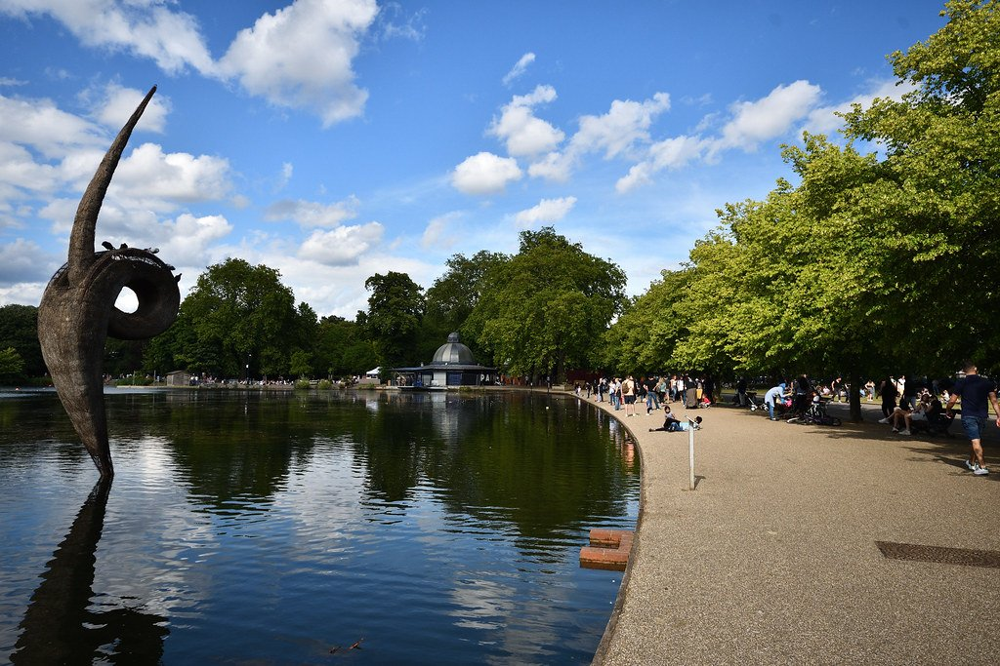
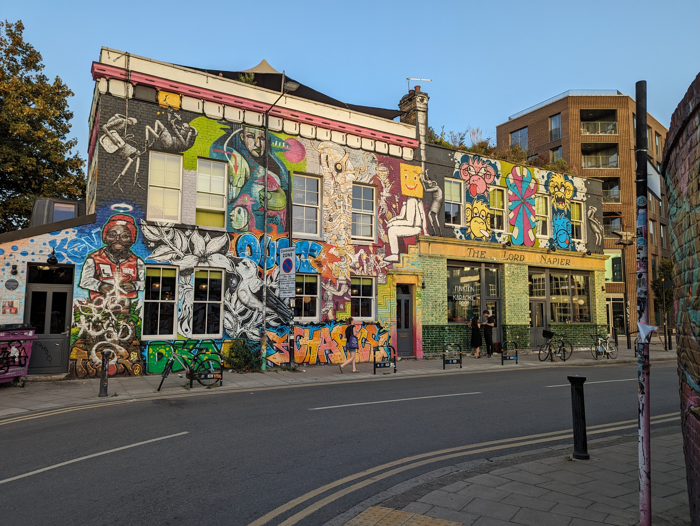

Hackney has no Underground station, no major museum and no monument. It has three parks, two canals, a 50-metre outdoor pool and a Saturday food market.

This is residential London, and it rewards a Saturday, not a sightseeing itinerary.

Hackney has its own share of the commemorative plaques marking where notable people lived or worked - see them on our [interactive map](/plaques/?area=hackney).

## Why visit — and who should skip it

**Come here if** it is Saturday and you like food. Broadway Market, London Fields and the canal make a half day, fifteen minutes from Liverpool Street on the Overground.

**Skip it if** you are on a short trip, or it is a Tuesday. There is nothing to tick off here, and midweek Hackney is a place where people live.

## Top sights and activities

1. **Broadway Market** — Saturdays 09:00 to 17:00, with a smaller market on Sundays 10:00 to 16:00. A single street of food and produce traders between London Fields and the canal. Go before 11:00.
2. **London Fields Lido** — A heated 50-metre outdoor pool, open all year including winter. Book a session; it fills fast in summer.
3. **London Fields** — The park itself, with a cricket pitch and barbecues permitted in designated areas.
4. **Victoria Park** — 213 acres east of the canal, opened in 1845 as London's first public park. Boating lake, deer enclosure and a canal-side pub.
5. **Regent's Canal towpath** — Runs west to Islington and King's Cross, east to Hackney Wick and the Olympic Park. Flat and traffic-free throughout.
6. **Hackney Wick** — Converted warehouses, artists' studios and canal-side breweries opposite the Olympic Park.
7. **Hackney Empire** — A restored 1901 music hall on Mare Street, still programming comedy, pantomime and variety.

*Victoria Park's boating lake. Photo: [martin_vmorris](https://www.flickr.com/photos/24108242@N05/50050092236), [CC BY-SA 2.0](https://creativecommons.org/licenses/by-sa/2.0/).*

## Key streets and micro-districts

### Broadway Market and London Fields
The centre of visitor Hackney, and **a Saturday proposition**: the full market runs on Saturday, a smaller one on Sunday, and the street is much quieter the other five days.

**London Fields** sits behind it, with the **lido** at its western edge. **Netil Market** just off the top of Broadway Market is smaller, roofed and open more days.

**Come on a Saturday for the market and expect crowds**, or midweek for the park and the lido without them. London Fields station is on the Overground, two minutes away.

### Mare Street and Hackney Central
The everyday high street: chain shops and a shopping centre.

The **Hackney Empire** is a 1901 Frank Matcham music hall, still programming comedy, panto and touring work. The **Picturehouse** next door is a cinema.

**Hackney Central is the Overground station for all of this**, and it connects to Hackney Downs by a signed two-minute walk. The two lines go different ways.

### Victoria Park and the canal
East: London's first public park, opened in 1845, with two lakes, a Chinese pagoda and a playground.

The **Hertford Union Canal** runs along its southern edge with a towpath and a run of canal-side pubs, and joins the Regent's Canal at the western end, which makes this the link between Hackney and the Olympic Park on foot.

**Free and open daily.** It is a fifteen-minute walk from Hackney Central, or come along the towpath from Broadway Market.

In late August the park hosts **All Points East**. Dates, age limits and getting home are in our [London music festivals guide](/articles/london-music-festivals-2027/).

### Hackney Wick
Further east where the canals meet, once home to a large number of artists' studios. Much of it is now redeveloped, though the warehouses, the painted walls and the breweries remain.

*The Lord Napier Star, Hackney Wick.*

It is for drinking and daytime wandering: taprooms, canal-side terraces and street art that changes constantly.

**Footbridges cross straight into the Olympic Park.** Hackney Wick station is on the Overground, and the area is at its best on a summer afternoon.

### Clapton and the marshes
North, and the least visited part of the borough. **Hackney Marshes** has 88 full-size football pitches, and is wide, flat and empty outside the Sunday morning matches.

The **River Lea navigation** runs along the eastern edge with a towpath, narrowboats and the Lea Valley beyond.

**Free and always open.** Come on a Sunday morning for the football, or any weekday for space.

## Go deeper

- **[The best canal walks in London](/articles/best-canal-walks-london/)** — the Regent's Canal through Hackney and Victoria Park, and where to join it.
- **[The best street food in London](/articles/best-street-food-london/)** — which of the east London markets and yards trade on which days.

## Where to eat and drink

| Spot | Style | Price | Why go |
| --- | --- | --- | --- |
| **Broadway Market stalls** | Food market | £ | Saturdays, and a smaller market on Sundays; oysters, salt beef, cheese and produce |
| **Netil Market** | Food yard | £ | Just off Broadway Market, with a rooftop bar above |
| **Pophams** | Bakery | £ | Bostock and pastries; queues at weekends |
| **Mangal 2** | Turkish ocakbasi | ££ | Dalston end; charcoal grill |
| **The Pembury Tavern** | Pub | ££ | Large, family-friendly, near Hackney Central |
| **Crate Brewery** | Brewery and pizza | ££ | Canal-side at Hackney Wick, with tables on the water |

The Black Eel on Kingsland High Street has a leopard-carpeted karaoke room for 25 at the top of the building, and The Star by Hackney Downs has one for 15; both are in our [karaoke guide](/articles/best-karaoke-london/).

Angelina on Dalston Lane cooks a Japanese-Italian set menu, and Cálong on Stoke Newington Church Street holds a Bib Gourmand for Korean-European cooking. Both are in our [fusion restaurants guide](/articles/best-fusion-restaurants-london/).

## Getting there

**By Overground.** There is no Tube in Hackney. The **London Overground** is the way in: **London Fields** for Broadway Market, **Hackney Central** for Mare Street, **Hackney Wick** for the warehouses and the Olympic Park. A few minutes from Liverpool Street or Highbury & Islington.

**Best exit.** From London Fields station, turn left and walk south: Broadway Market is five minutes down the far side of the park.

**By canal.** The Regent's Canal towpath runs west to King's Cross in about 35 minutes and east to the Olympic Park in 20.

**By bus.** The 55 and 388 run from central London and are useful in the evening when the Overground thins out.

Powered by <a target="_blank" rel="sponsored" href="https://www.getyourguide.com/london-l57/">GetYourGuide</a>

## How long to spend, and when to go

| If you have | Do this |
| --- | --- |
| **Two hours** | Broadway Market and London Fields |
| **Half a day** | Add the canal walk east to Victoria Park |
| **A full day** | Continue to Hackney Wick and the Olympic Park |

**Best time:** Saturday morning, before 11:00.

**Combine it:** Columbia Road Flower Market is Sunday morning and twenty minutes south-west — an easy weekend pairing with Shoreditch.

Comparing neighbourhoods? [Best areas to visit in London](/articles/best-areas-to-visit-london/) sets them side by side by what each is best for, how long it takes and the best day to go.

## Suggested half-day route

1. **Start:** London Fields Overground. Walk south through **London Fields** past the lido.
2. **Broadway Market:** The full length of the street, then **Netil Market** just off it.
3. **The canal:** Join the **Regent's Canal** at the bottom of Broadway Market and head east.
4. **Victoria Park:** Through the park to the boating lake.
5. **Finish:** East along the Hertford Union to **Hackney Wick** and a canal-side brewery.

Powered by <a target="_blank" rel="sponsored" href="https://www.getyourguide.com/london-l57/">GetYourGuide</a>

## Common mistakes to avoid

1. **Coming for Broadway Market on the wrong day.** Saturday is the full market and Sunday a smaller one; the rest of the week it is an ordinary street.
2. **Looking for a Tube station.** There isn't one. Hackney is Overground and buses.
3. **Turning up at the lido without booking.** Sessions sell out in summer.
4. **Arriving at the market after midday.** It is shoulder to shoulder by then.
5. **Expecting sights.** There is no museum or monument.
6. **Missing Victoria Park.** It is fifteen minutes east of Broadway Market.

## Where to stay

Cheaper than most of London and local, with Overground-only transport.

- **London Fields and Broadway Market** — Small guesthouses and rentals, walkable to everything here.
- **Hackney Wick** — Warehouse conversions near the Olympic Park.
- **Shoreditch** — Twenty minutes south-west, with better transport and more hotels.
