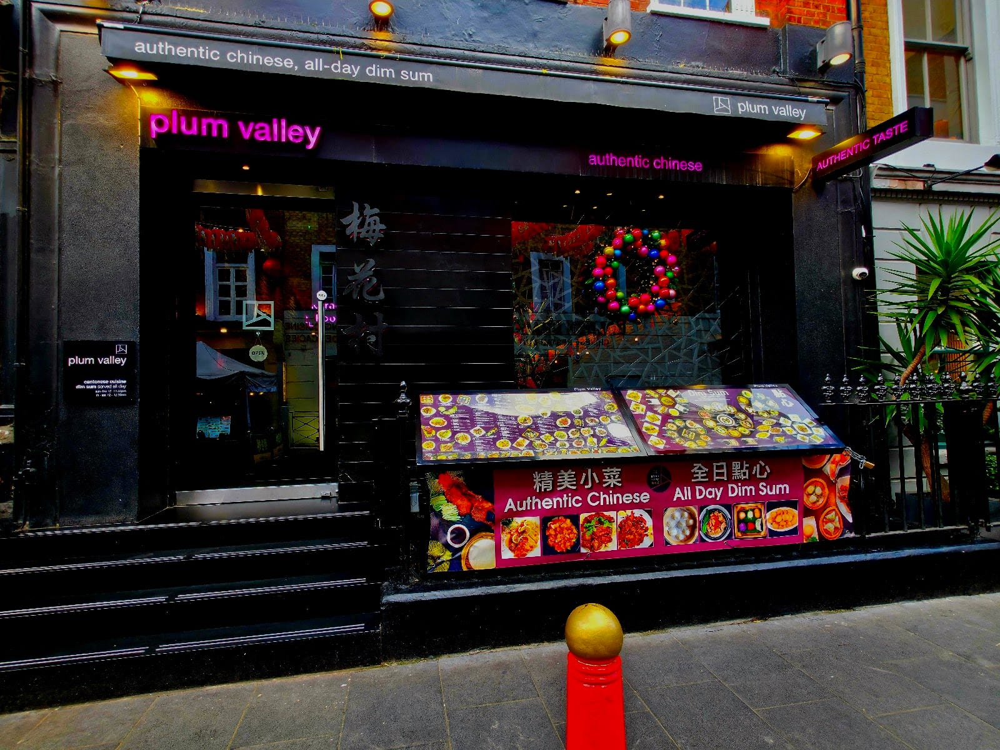
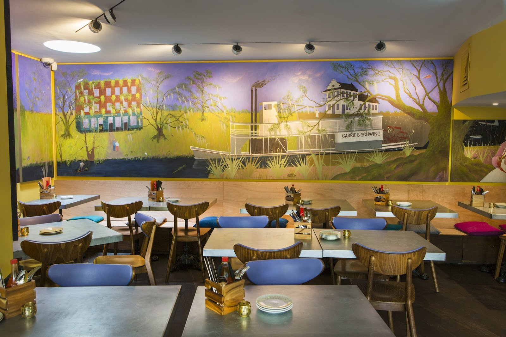
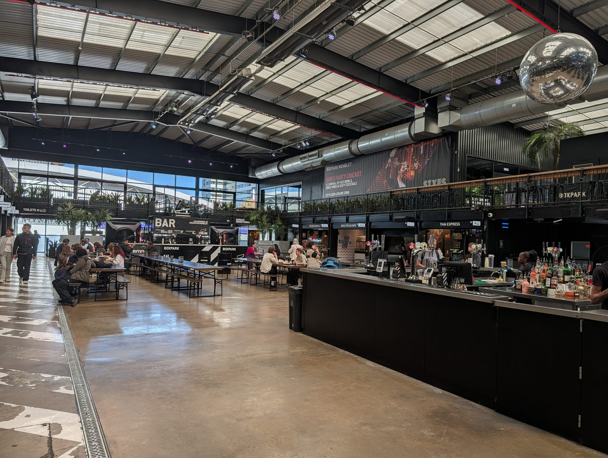
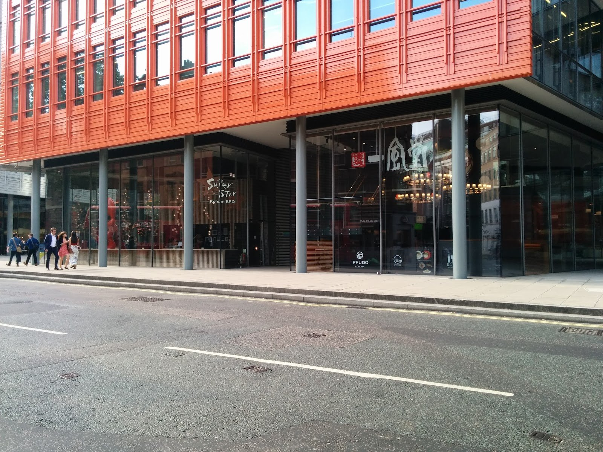
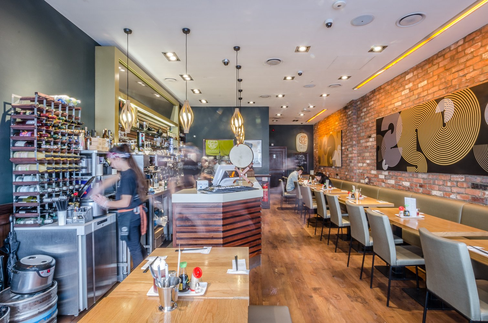
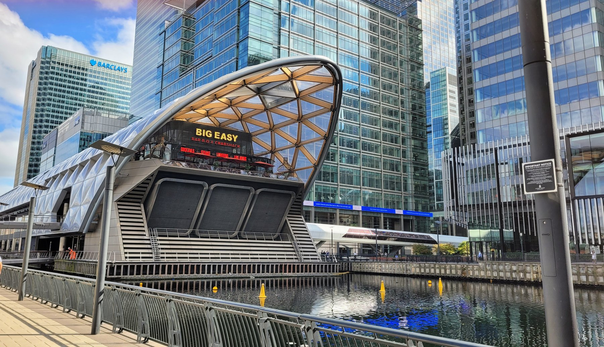
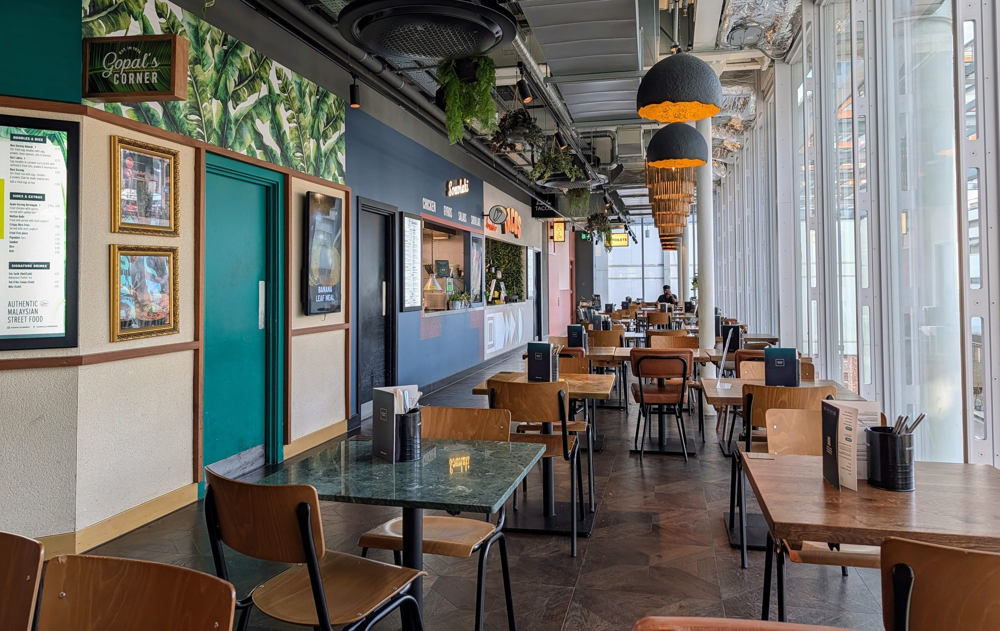

London happy hours mostly run from 3pm to 7pm on weekdays. Every entry below sets out when the deal runs, what it is and what it costs, then anything that catches people out, such as an app, a bar-only rule or days it is off.

> 💡 **The Short Version:** **Manzi's** in Soho runs daily from 3pm to 7pm and all day Sunday, with oysters at £2 each and martinis at £10. **Plaquemine Lock** in Islington has oysters at £1. **Ippudo** runs the longest weekday window, 2pm to 7pm. **Market Halls** sells £5 pints from 8pm and **Dishoom** sells £5 cocktails after 9.30pm until 30 November 2026. **Ping Pong** puts dim sum into the deal. **Las Iguanas** and **Frankie & Benny's** run their cocktail offers all day.

> ⚠️ **Most of these stop at Friday.** The [weekend table](#happy-hours-at-the-weekend) lists the ones that run on Saturday and Sunday.

For deals that are about eating rather than drinking, see [restaurant deals](/articles/restaurant-deals-london/); for a drinks-and-food package at weekends, see [bottomless brunch](/articles/bottomless-brunch-london/); and for everything else, the [food deals hub](/articles/food-deals-london/).

---

## Every happy hour at a glance

| Where | When | Deal |
| --- | --- | --- |
| **Manzi's**, Soho | Daily 3–7pm, all day Sunday | Oysters £2 each or six for £9; martinis and long drinks £10 |
| **Sucre**, Soho | Sunday to Thursday 3–7pm | Tequila and mezcal cocktails £8 |
| **Plum Valley**, Chinatown | Monday to Thursday 2–6pm | Second cocktail half price |
| **Nightjar**, Shoreditch | Sunday to Thursday 6–8pm | Selected cocktails £9 |
| **Kricket**, Shoreditch | Daily 4–6pm | A snack and a drink for £10 |
| **The Lexington**, Angel | Monday to Friday 4–7pm, pizzas from 5pm | Pizza and a pint £12; pints from £4; two spritzes £13 |
| **Plaquemine Lock**, Angel | Tuesday to Friday 4–5.45pm; Saturday and Sunday 11am–noon | Oysters £1 each, plus cheaper Southern snacks, cocktails, beer and mimosas |
| **Fogo de Chão**, Bishopsgate | Daily 3–7pm | Beers £6.50; wine £8.50; cocktails £11; bar plates £8, burgers £10 |
| **Shiro**, Broadgate Circle | Monday to Saturday 3–7pm | 2-for-1 house wine, Prosecco and Asahi |
| **Seabird**, Southwark | Daily 3–6pm | Oyster happy hour |
| **The Walrus**, Waterloo | Thursday to Saturday 5–9pm | Selected cocktails £6.50; four shooters £12 |
| **Bread Street Kitchen**, Battersea | Sunday to Friday 3–6pm | Selected Negronis, Margaritas, house wine and beers |
| **Sticks'n'Sushi**, Battersea | Monday to Friday 3–6pm | 2-for-1 cocktails |
| **Purezza**, Camden | Monday to Friday until 7pm | Two cocktails £18; two alcohol-free spritzes £14 |
| **Escocesa**, Stoke Newington | Monday to Friday before 7pm; all day Sunday | Oysters half price |
| **Hera**, Stratford | Monday to Friday 4–7pm | Drinks from £6; cocktails and spritzes from £8 |
| **Rick Stein, Barnes**, Barnes | Daily 4–6pm | Oysters £2 |
| **BOXPARK Wembley**, Wembley | Monday to Friday 5–8pm | Happy hour drinks at the bars |
| **Ippudo**, All branches | Monday to Friday 2–7pm | A happy hour menu of drinks and dishes |
| **Ping Pong**, Four central branches | Monday to Friday 3–6pm | Half price on over thirty drinks and dim sum |
| **Shoryu Ramen**, All branches | Monday to Thursday 3–6pm | Two cocktails or two pints for £12 |
| **Hakata Ramen + Bar**, All branches | Monday to Friday 5–7pm; Saturday and Sunday 4–6pm | Two of the same cocktail £14; sake flight £12 |
| **Patty & Bun**, All branches | Monday to Friday 4–7pm | Two cocktails £14; cans of beer £4 |
| **Big Easy**, London branches | Monday to Friday 4–6pm | 2-for-1 cocktails |
| **Megan's**, All branches | Daily 5–7pm | Every cocktail £8 |
| **Market Halls**, Four halls | Daily 3–5pm (spritz) and from 8pm (pints) | Two spritzes £20; selected draught pints £5 |
| **Dishoom**, All branches | Nightly after 9.30pm, until 30 November 2026 | Dishoom Margarita, Chai Caffè Martini or Sober Negroni £5 |
| **Hard Rock Cafe**, London | 4–7pm | Happy hour at the bar |
| **Las Iguanas**, All branches | Daily, all day | Two classic cocktails from £13 |
| **Frankie & Benny's**, All branches | Daily, all day | Two cocktails £12 |
| **Turtle Bay**, All branches | Daily, all day | 2-for-1 cocktails |
| **TGI Fridays**, All branches | Daily, all day | 2-for-1 cocktails and mocktails |

---

## Soho and the West End

### [Manzi's](https://manzis.co.uk/happy-hour/)

- **When:** Daily 3–7pm, all day Sunday
- **Deal:** Oysters £2 each or six for £9; martinis and long drinks £10
- **Where:** Soho · Tottenham Court Road

Served on the terrace, at the bar and in the restaurant, so you don't need a bar stool.

### [Sucre](https://sucrerestaurant.com/whats-on/)

- **When:** Sunday to Thursday 3–7pm
- **Deal:** Tequila and mezcal cocktails £8
- **Where:** Soho · Oxford Circus

Agave Hour, in a South American restaurant with small plates alongside.

*The dining room at Sucre in Soho.*

### [Plum Valley](https://plumvalley.co.uk/promotions/)

- **When:** Monday to Thursday 2–6pm
- **Deal:** Second cocktail half price
- **Where:** Chinatown · Leicester Square

A Chinese restaurant on Gerrard Street. It starts at 2pm, earlier than most.

*Plum Valley on Gerrard Street.*

---

## Shoreditch

### [Nightjar](https://www.barnightjar.com/special-offers)

- **When:** Sunday to Thursday 6–8pm
- **Deal:** Selected cocktails £9
- **Where:** Shoreditch · Old Street

A cocktail bar, so the deal is drinks only. The selection changes every month.

### [Kricket](https://kricketrestaurants.com/discover/)

- **When:** Daily 4–6pm
- **Deal:** A snack and a drink for £10
- **Where:** Shoreditch · Shoreditch High Street

At the Shoreditch restaurant only.

*Small plates at Kricket.*

---

## Islington

### [The Lexington](https://thelexington.co.uk/)

- **When:** Monday to Friday 4–7pm, pizzas from 5pm
- **Deal:** Pizza and a pint £12; pints from £4; two spritzes £13
- **Where:** Islington · Angel

A pub with a music venue upstairs. The pints are house lager or cider.

### [Plaquemine Lock](https://plaqlock.com/)

- **When:** Tuesday to Friday 4–5.45pm; Saturday and Sunday 11am–noon
- **Deal:** Oysters £1 each, plus cheaper Southern snacks, cocktails, beer and mimosas
- **Where:** Islington · Angel

A Louisiana restaurant beside the Regent's Canal. Closed on Mondays except bank holidays.

*Inside Plaquemine Lock in Islington.*

---

## The City

### [Fogo de Chão](https://fogodechao.uk/location/london-bishopsgate/)

- **When:** Daily 3–7pm
- **Deal:** Beers £6.50; wine £8.50; cocktails £11; bar plates £8, burgers £10
- **Where:** Bishopsgate · Liverpool Street

A Brazilian steakhouse. The drinks prices apply in the bar and the restaurant; the food is served in the bar only.

### [Shiro](https://shirosushi.co.uk/events/say-hello-to-shiro-hour/)

- **When:** Monday to Saturday 3–7pm
- **Deal:** 2-for-1 house wine, Prosecco and Asahi
- **Where:** Broadgate Circle · Liverpool Street

A sushi restaurant. On Mondays every maki dish is 2-for-1 as well, at lunch and dinner.

---

## South Bank and Waterloo

### [Seabird](https://seabirdlondon.com/)

- **When:** Daily 3–6pm
- **Deal:** Oyster happy hour
- **Where:** South Bank · Southwark

A seafood restaurant with a raw bar.

*The raw bar and dining room at Seabird.*

### [The Walrus](https://www.thewalrusbarandhostel.co.uk/barpage1)

- **When:** Thursday to Saturday 5–9pm
- **Deal:** Selected cocktails £6.50; four shooters £12
- **Where:** Waterloo · Lambeth North

The bar of a hostel on Westminster Bridge Road, and one of the few deals that runs on a Friday and Saturday night.

---

## Battersea

### [Bread Street Kitchen](https://www.gordonramsayrestaurants.com/bread-street-kitchen/battersea/whats-on/)

- **When:** Sunday to Friday 3–6pm
- **Deal:** Selected Negronis, Margaritas, house wine and beers
- **Where:** Battersea · Battersea Power Station

It runs on Sunday but not on Saturday.

### [Sticks'n'Sushi](https://www.sticksnsushi.com/gb/en/restaurants/battersea/)

- **When:** Monday to Friday 3–6pm
- **Deal:** 2-for-1 cocktails
- **Where:** Battersea · Battersea Power Station

Called Ni-bai, at the Battersea restaurant only.

---

## Camden, Stoke Newington, Stratford, Barnes and Wembley

### [Purezza](https://purezza.co.uk/current-offers/)

- **When:** Monday to Friday until 7pm
- **Deal:** Two cocktails £18; two alcohol-free spritzes £14
- **Where:** Camden Town · Camden Town

The alcohol-free price makes it the one for a table where some aren't drinking.

*Pizzas at Purezza.*

### [Escocesa](https://www.escocesa.co.uk/menus)

- **When:** Monday to Friday before 7pm; all day Sunday
- **Deal:** Oysters half price
- **Where:** Stoke Newington · Stoke Newington

Not on Mother's Day, Father's Day or bank holidays.

### [Hera](https://herarestaurant.co.uk/whats-on/)

- **When:** Monday to Friday 4–7pm
- **Deal:** Drinks from £6; cocktails and spritzes from £8
- **Where:** Stratford · Stratford

Mahou, Prosecco, house spirits and wine, or an Aperol or Hugo spritz, on the terrace and at the bar of a Greek restaurant, with mezze to go with them.

### [Rick Stein, Barnes](https://rickstein.com/restaurants/rick-stein-barnes/)

- **When:** Daily 4–6pm
- **Deal:** Oysters £2
- **Where:** Barnes · Barnes Bridge

The Oyster Happy Hour and Aperitivo, every afternoon.

### [BOXPARK Wembley](https://www.boxpark.co.uk/venues/wembley)

- **When:** Monday to Friday 5–8pm
- **Deal:** Happy hour drinks at the bars
- **Where:** Wembley · Wembley Park

A food hall by the stadium. It is off during Fanparks, arena dates and televised England games, so not on an event day.

*The bar inside BOXPARK Wembley.*

---

## Chains and multi-site venues

These run at every London branch unless noted.

### [Ippudo](https://www.ippudo.co.uk/news/happy-hour/)

- **When:** Monday to Friday 2–7pm
- **Deal:** A happy hour menu of drinks and dishes
- **Where:** All London branches

Five hours a day, the longest weekday window on this page.

*Ippudo at Central St Giles.*

### [Ping Pong](https://www.pingpongdimsum.com/happy-hour/)

- **When:** Monday to Friday 3–6pm
- **Deal:** Half price on over thirty drinks and dim sum
- **Where:** Four central London restaurants

Ask for it before you order. Wine by the bottle only, and not on bank holidays.

### [Shoryu Ramen](https://www.shoryuramen.com/deals)

- **When:** Monday to Thursday 3–6pm
- **Deal:** Two cocktails or two pints for £12
- **Where:** All London restaurants

Two of the same drink. Regular beer only, not frozen, and not with percentage discounts.

*Inside Shoryu Ramen.*

### [Hakata Ramen + Bar](https://www.hakata.co.uk/november-happy-hour)

- **When:** Monday to Friday 5–7pm; Saturday and Sunday 4–6pm
- **Deal:** Two of the same cocktail £14; sake flight £12
- **Where:** All branches

Listed as the November 2026 happy hour. The Japanese flight is £12.25.

*Hakata Ramen + Bar on Bermondsey Street.*

### [Patty & Bun](https://www.pattyandbun.co.uk/offers)

- **When:** Monday to Friday 4–7pm
- **Deal:** Two cocktails £14; cans of beer £4
- **Where:** All branches

In a burger restaurant.

*A cheeseburger and chips at Patty & Bun.*

### [Big Easy](https://www.bigeasy.co.uk/menus/2-for-1)

- **When:** Monday to Friday 4–6pm
- **Deal:** 2-for-1 cocktails
- **Where:** London branches

No substitutions, and off on match days at Westfield Stratford.

*Big Easy at Crossrail Place, Canary Wharf.*

### [Megan's](https://megans.co.uk/offers/)

- **When:** Daily 5–7pm
- **Deal:** Every cocktail £8
- **Where:** All branches

Seven days a week.

### [Market Halls](https://markethalls.co.uk/happy-hour-london-market-halls/)

- **When:** Daily 3–5pm (spritz) and from 8pm (pints)
- **Deal:** Two spritzes £20; selected draught pints £5
- **Where:** Paddington, Oxford Street, Victoria and Canary Wharf

You need the Hall Pass app to unlock either. The £5 pints are at Paddington, Oxford Street and Canary Wharf, and neither runs on bank holidays.

*Market Halls Paddington.*

### [Dishoom](https://www.dishoom.com/menu/lunch-set-menu/)

- **When:** Nightly after 9.30pm, until 30 November 2026
- **Deal:** Dishoom Margarita, Chai Caffè Martini or Sober Negroni £5
- **Where:** All branches

The late one: nothing else on this page starts after 8pm.

### [Hard Rock Cafe](https://cafe.hardrock.com/london/)

- **When:** 4–7pm
- **Deal:** Happy hour at the bar
- **Where:** London

At the bar only, so take a stool rather than a table.

### [Las Iguanas](https://www.iguanas.co.uk/offers)

- **When:** Daily, all day
- **Deal:** Two classic cocktails from £13
- **Where:** All branches

*A Las Iguanas restaurant.*

### [Frankie & Benny's](https://www.frankieandbennys.com/offers)

- **When:** Daily, all day
- **Deal:** Two cocktails £12
- **Where:** All branches

### [Turtle Bay](https://turtlebay.co.uk/)

- **When:** Daily, all day
- **Deal:** 2-for-1 cocktails
- **Where:** All branches

### [TGI Fridays](https://www.tgifridays.co.uk/)

- **When:** Daily, all day
- **Deal:** 2-for-1 cocktails and mocktails
- **Where:** All branches

The mocktails are in the deal, so it covers non-drinkers too.

---

## Happy hours at the weekend

These run on Saturday or Sunday.

| Day | Where | Times |
| --- | --- | --- |
| Saturday and Sunday | Manzi's, Soho | 3–7pm (all day Sunday) |
| Saturday and Sunday | Fogo de Chão, Bishopsgate | 3–7pm |
| Saturday and Sunday | Seabird, South Bank | 3–6pm |
| Saturday and Sunday | Rick Stein, Barnes | 4–6pm |
| Saturday and Sunday | Kricket, Shoreditch | 4–6pm |
| Saturday and Sunday | Hakata | 4–6pm |
| Saturday and Sunday | Megan's | 5–7pm |
| Saturday and Sunday | Market Halls (spritz) | 3–5pm |
| Saturday and Sunday | Plaquemine Lock, Islington | 11am–noon |
| Saturday | Shiro, Broadgate Circle | 3–7pm |
| Saturday | The Walrus, Waterloo | 5–9pm |
| Sunday | Sucre, Soho | 3–7pm |
| Sunday | Bread Street Kitchen, Battersea | 3–6pm |
| Sunday | Nightjar, Shoreditch | 6–8pm |
| Sunday | Escocesa, Stoke Newington | all day |

*Times and prices as listed by each venue, November 2026.*
