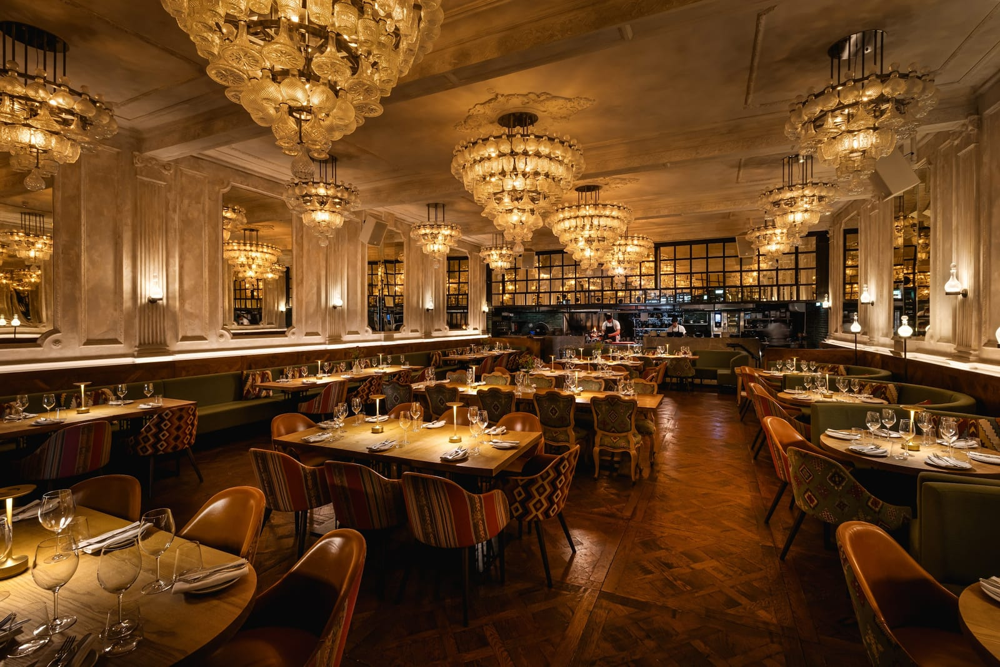
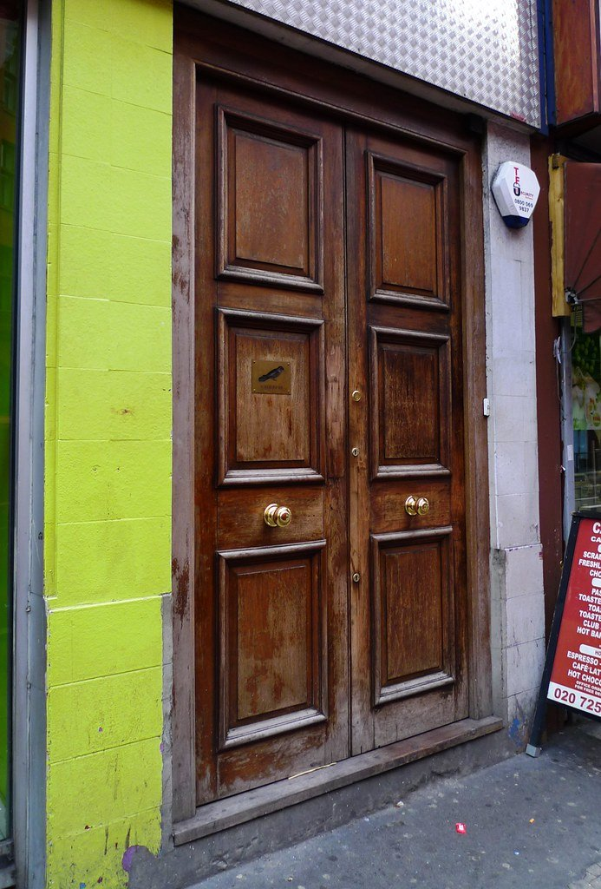
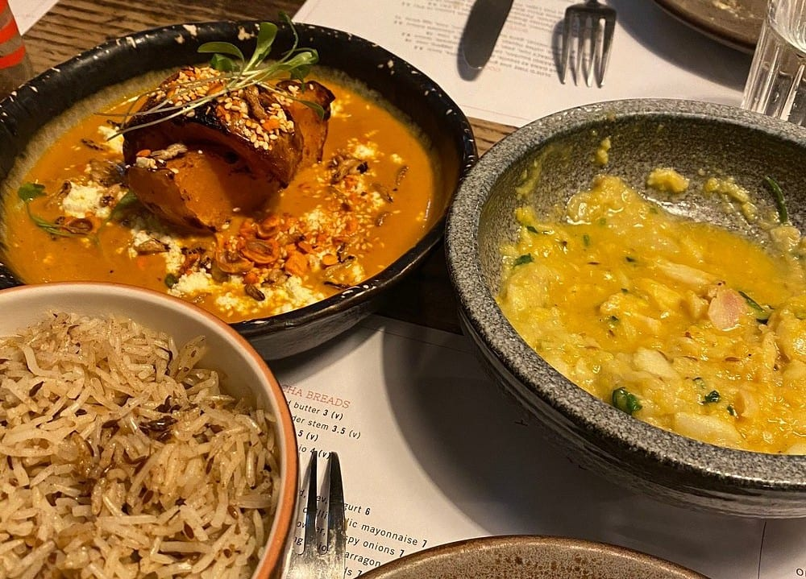
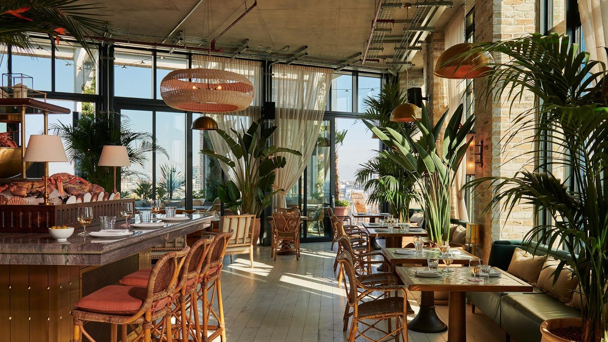
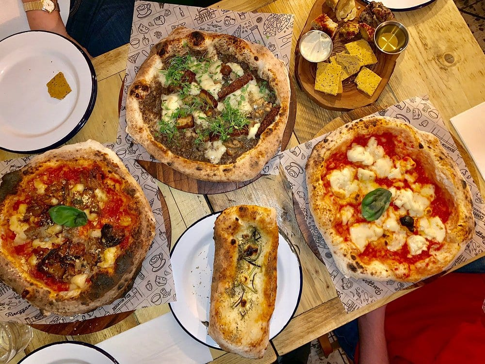
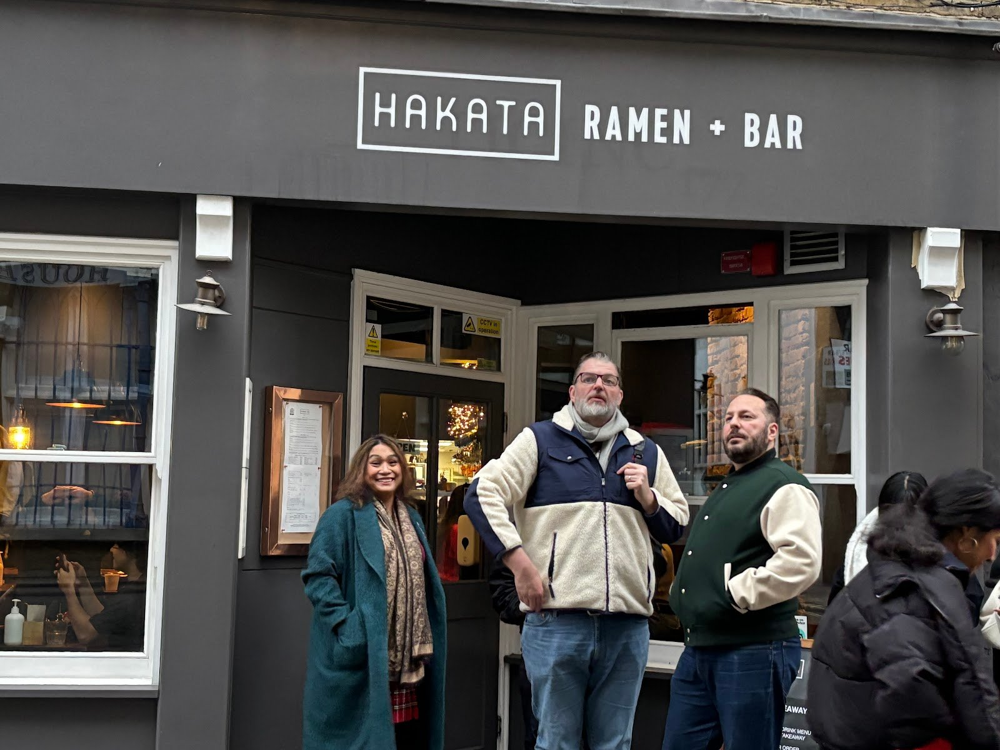
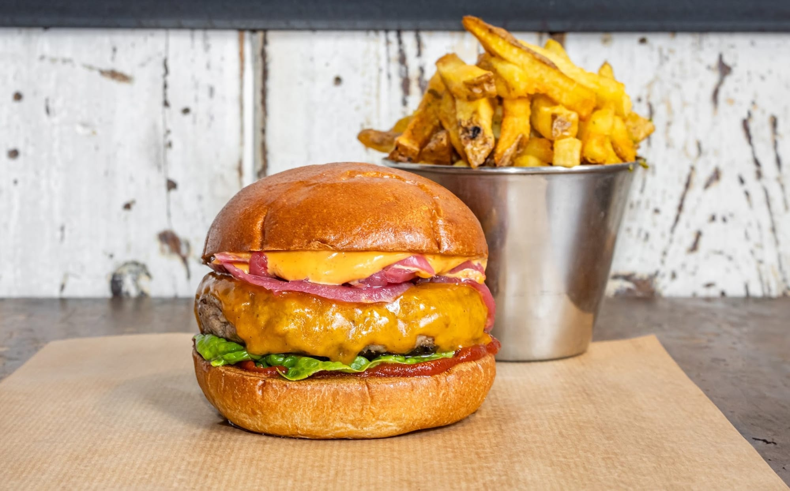
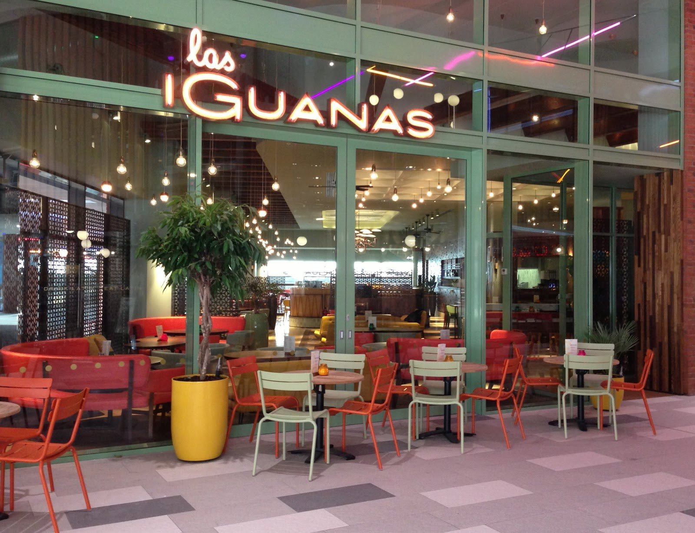

London happy hours run from 3pm to 7pm on most weekdays, and the best of them put food on the table as well as drinks on the bar. Each entry below gives the days, the times and the price, and says whether you need an app or a seat at the bar.

> 💡 **The Short Version:** **Manzi's** in Soho has the most flexible window, 3pm to 7pm daily and all day Sunday, with oysters at £2 each and martinis at £10. **Ippudo** runs the longest weekday window, 2pm to 7pm. **Market Halls** sells £5 pints from 8pm and **Dishoom** sells £5 cocktails after 9.30pm until 30 November 2026. **Ping Pong** puts dim sum into the deal. **Las Iguanas** and **Frankie & Benny's** run their cocktail offers all day.

> ⚠️ **Most of these stop at Friday.** Weekday-only deals are the rule; the weekend table near the end lists the ones that run on Saturday and Sunday.

For deals that are about eating rather than drinking, see [restaurant deals](/articles/restaurant-deals-london/); for a drinks-and-food package at weekends, see [bottomless brunch](/articles/bottomless-brunch-london/); and for everything else, the [food deals hub](/articles/food-deals-london/).

---

## Soho and the West End

### [Manzi's](https://manzis.co.uk/happy-hour/)

*Soho · Tottenham Court Road · daily 3–7pm, all day Sunday · oysters £2 each or six for £9, martinis £10*

Oysters are £2 each or six for £9, and there are long drinks and martinis at £10. It is served on the terrace, at the bar and in the restaurant, so you do not need a bar stool to get it.

### [Sucre](https://sucrerestaurant.com/whats-on/)

*Soho · Oxford Circus · Sunday to Thursday 3–7pm · £8 cocktails*

Agave Hour is £8 tequila and mezcal cocktails in a South American restaurant, with small plates alongside. It stops at Thursday.

*The dining room at Sucre in Soho.*

### [Plum Valley](https://plumvalley.co.uk/promotions/)

*Chinatown · Leicester Square · Monday to Thursday 2–6pm · second cocktail half price*

Buy one cocktail and the second is half price, in a Chinese restaurant in Chinatown. The window starts at 2pm, earlier than most, and ends at Thursday.

*Plum Valley on Gerrard Street.*

---

## Shoreditch

### [Nightjar](https://www.barnightjar.com/special-offers)

*Shoreditch · Old Street · Sunday to Thursday 6–8pm · £9 cocktails*

A selection of cocktails is £9 each before 8pm, and the selection changes every month. It is a cocktail bar rather than a restaurant, so the deal is drinks only.

*The door to Nightjar on City Road.*

### [Kricket](https://kricketrestaurants.com/discover/)

*Shoreditch · Shoreditch High Street · daily 4–6pm · £10 for a snack and a drink*

A snack and a drink for £10, at the Shoreditch restaurant only. It is one of the few deals here that pairs one plate with one glass for a fixed price.

*Small plates at Kricket.*

---

## Islington

### [The Lexington](https://thelexington.co.uk/)

*Islington · Angel · Monday to Friday 4–7pm · pizza and a pint £12, pints from £4*

Pizza and a pint of house lager or cider for £12, pints from £4 and two spritzes for £13, in a pub with a music venue upstairs. The drinks start at 4pm; the pizzas from 5pm.

### [Plaquemine Lock](https://plaqlock.com/)

*Islington · Angel · Tuesday to Friday 4–5.45pm, Saturday and Sunday 11am–noon · oysters £1 each*

Oysters are £1 each, with Southern snacks, cocktails, beer and mimosas, in a Louisiana restaurant beside the Regent's Canal. It is closed on Mondays except bank holidays.

*Inside Plaquemine Lock in Islington.*

---

## The City

### [Fogo de Chão](https://fogodechao.uk/location/london-bishopsgate/)

*Bishopsgate · Liverpool Street · daily 3–7pm · beers £6.50, wine £8.50, cocktails £11*

Beers at £6.50, South American wines at £8.50 and cocktails at £11, in the bar and the restaurant of a Brazilian steakhouse. The bar menu, small plates at £8 and burgers at £10, is served in the bar only.

### [Shiro](https://shirosushi.co.uk/events/say-hello-to-shiro-hour/)

*Broadgate Circle · Liverpool Street · Monday to Saturday 3–7pm · 2-for-1 wine, Prosecco and Asahi*

House red, white and rosé, Prosecco and Asahi are two-for-one in a sushi restaurant on Broadgate Circle. On Mondays every maki dish is two-for-one as well, at lunch and dinner.

---

## South Bank and Waterloo

### [Seabird](https://seabirdlondon.com/)

*South Bank · Southwark · daily 3–6pm · oysters*

The Oyster Happy Hour runs every day at Seabird in Southwark.

*The raw bar and dining room at Seabird.*

### [The Walrus](https://www.thewalrusbarandhostel.co.uk/barpage1)

*Waterloo · Lambeth North · Thursday to Saturday 5–9pm · cocktails £6.50, four shooters £12*

Selected cocktails at £6.50 and four shooters for £12, in the bar of a hostel on Westminster Bridge Road. It runs at the end of the week, when most deals on this page have stopped.

---

## Battersea

### [Bread Street Kitchen](https://www.gordonramsayrestaurants.com/bread-street-kitchen/battersea/whats-on/)

*Battersea · Battersea Power Station · Sunday to Friday 3–6pm*

A selected drinks menu of Negronis, Margaritas, house wine and beers. It is the one happy hour here that runs on Sunday and not on Saturday.

### [Sticks'n'Sushi](https://www.sticksnsushi.com/gb/en/restaurants/battersea/)

*Battersea · Battersea Power Station · Monday to Friday 3–6pm · 2-for-1 cocktails*

Ni-bai is two-for-one cocktails, at the Battersea restaurant, over three hours on weekday afternoons.

---

## Camden, Stoke Newington, Stratford, Barnes and Wembley

### [Purezza](https://purezza.co.uk/current-offers/)

*Camden Town · Camden Town · Monday to Friday, until 7pm · 2 cocktails £18, 2 alcohol-free spritz £14*

Two cocktails are £18, or two alcohol-free spritz £14, at every Purezza restaurant on weekdays. The alcohol-free option makes this the one to pick for a table where some are not drinking.

*Pizzas at Purezza.*

### [Escocesa](https://www.escocesa.co.uk/menus)

*Stoke Newington · Stoke Newington · Monday to Friday before 7pm, all day Sunday · half-price oysters*

Oysters are half price. It does not apply on Mother's Day, Father's Day or bank holidays.

### [Hera](https://herarestaurant.co.uk/whats-on/)

*Stratford · Stratford · Monday to Friday 4–7pm · drinks from £6, cocktails and spritzes from £8*

Mahou, Prosecco, house spirits and house wine from £6, or a classic cocktail, Aperol Spritz or Hugo Spritz from £8, on the terrace and at the bar of a Greek restaurant, with mezze to go with them.

### [Rick Stein, Barnes](https://rickstein.com/restaurants/rick-stein-barnes/)

*Barnes · Barnes Bridge · daily 4–6pm · £2 oysters*

The Oyster Happy Hour and Aperitivo gives £2 oysters every afternoon at the Barnes restaurant.

### [BOXPARK Wembley](https://www.boxpark.co.uk/venues/wembley)

*Wembley · Wembley Park · Monday to Friday 5–8pm*

A Special Happy Hour in a food hall by the stadium. It does not run during Fanparks, arena dates or televised England games, so on an event day it will not be on.

*The bar inside BOXPARK Wembley.*

---

## Chains and multi-site venues

These run at every London branch unless noted.

### [Ippudo](https://www.ippudo.co.uk/news/happy-hour/)

*All branches · Monday to Friday 2–7pm*

An exclusive happy hour menu in a ramen restaurant, running five hours a day, longer than any other weekday deal here.

*Ippudo at Central St Giles.*

### [Ping Pong](https://www.pingpongdimsum.com/happy-hour/)

*Four central London restaurants · Monday to Friday 3–6pm · half price*

Drinks and dim sum are half price on over thirty items marked as happy hour dishes. You have to ask for it before you order, wine only by the bottle, and it is off on bank holidays.

### [Shoryu Ramen](https://www.shoryuramen.com/deals)

*All London restaurants · Monday to Thursday 3–6pm · £12 for two*

Two cocktails or two pints of beer for £12, with two of the same drink. Regular beer only, not frozen, and it cannot be combined with percentage discounts.

*Inside Shoryu Ramen.*

### [Hakata Ramen + Bar](https://www.hakata.co.uk/november-happy-hour)

*All branches · Monday to Friday 5–7pm, Saturday and Sunday 4–6pm · any 2 of the same cocktail £14*

Two of the same cocktail are £14, and a KANPAI sake flight is £12 (a Japanese flight is £12.25). It is listed as the November 2026 happy hour.

*Hakata Ramen + Bar on Bermondsey Street.*

### [Patty & Bun](https://www.pattyandbun.co.uk/offers)

*All branches · Monday to Friday 4–7pm · 2 cocktails £14, cans £4*

Two cocktails for £14 and canned beers at £4, in a burger restaurant.

*A cheeseburger and chips at Patty & Bun.*

### [Big Easy](https://www.bigeasy.co.uk/menus/2-for-1)

*London branches · Monday to Friday 4–6pm · 2-for-1 cocktails*

Cocktails are two-for-one. There are no substitutions, and it is off on match days at Westfield Stratford.

*Big Easy at Crossrail Place, Canary Wharf.*

### [Megan's](https://megans.co.uk/offers/)

*All branches · daily 5–7pm · £8 cocktails*

Every cocktail on the menu is £8 for two hours each evening, seven days a week.

### [Market Halls](https://markethalls.co.uk/happy-hour-london-market-halls/)

*Paddington, Oxford Street, Victoria and Canary Wharf · daily 3–5pm and from 8pm · 2 spritz £20, £5 pints*

Two selected spritz for £20 from 3pm to 5pm, and £5 pints of selected draught beer from 8pm at Paddington, Oxford Street and Canary Wharf. You need the Hall Pass app to unlock either, and neither runs on bank holidays.

*Market Halls Paddington.*

### [Dishoom](https://www.dishoom.com/menu/lunch-set-menu/)

*All branches · nightly after 9.30pm until 30 November 2026 · £5 a drink*

The Dishoom Margarita, Chai Caffè Martini or Sober Negroni for £5 each. It is the late one: nothing else on this page starts after 8pm.

### [Hard Rock Cafe](https://cafe.hardrock.com/london/)

*London · 4–7pm*

Happy hour at the bar, so take a stool rather than a table.

### [Las Iguanas](https://www.iguanas.co.uk/offers)

*All branches · daily, all day · 2 classic cocktails from £13*

Two classic cocktails from £13, available all day, every day.

*A Las Iguanas restaurant.*

### [Frankie & Benny's](https://www.frankieandbennys.com/offers)

*All branches · daily, all day · 2 cocktails £12*

Two cocktails for £12 at any time.

### [Turtle Bay](https://turtlebay.co.uk/)

*All branches · daily, all day · 2-for-1 cocktails*

Cocktails are two-for-one every day, with no time limit.

### [TGI Fridays](https://www.tgifridays.co.uk/)

*All branches · daily, all day · 2-for-1 cocktails and mocktails*

Cocktails and mocktails are two-for-one, which covers non-drinkers too.

---

## Happy hours at the weekend

Most deals above stop on Friday. These run on Saturday or Sunday.

| Day | Where | Times |
| --- | --- | --- |
| Saturday and Sunday | Manzi's, Soho | 3–7pm (all day Sunday) |
| Saturday and Sunday | Seabird, South Bank | 3–6pm |
| Saturday and Sunday | Rick Stein, Barnes | 4–6pm |
| Saturday and Sunday | Kricket, Shoreditch | 4–6pm |
| Saturday and Sunday | Hakata | 4–6pm |
| Saturday and Sunday | Megan's | 5–7pm |
| Saturday and Sunday | Market Halls (spritz) | 3–5pm |
| Saturday and Sunday | Fogo de Chão, Bishopsgate | 3–7pm |
| Saturday and Sunday | Plaquemine Lock, Islington | 11am–noon |
| Saturday | Shiro, Broadgate Circle | 3–7pm |
| Saturday | The Walrus, Waterloo | 5–9pm |
| Sunday | Sucre, Soho | 3–7pm |
| Sunday | Bread Street Kitchen, Battersea | 3–6pm |
| Sunday | Nightjar, Shoreditch | 6–8pm |
| Sunday | Escocesa, Stoke Newington | all day |

*Times and prices as listed by each venue, November 2026.*
