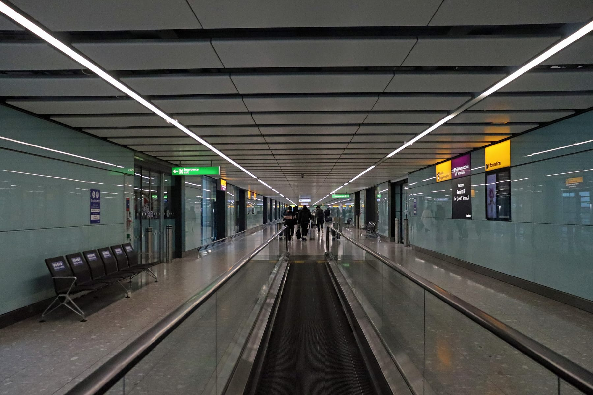
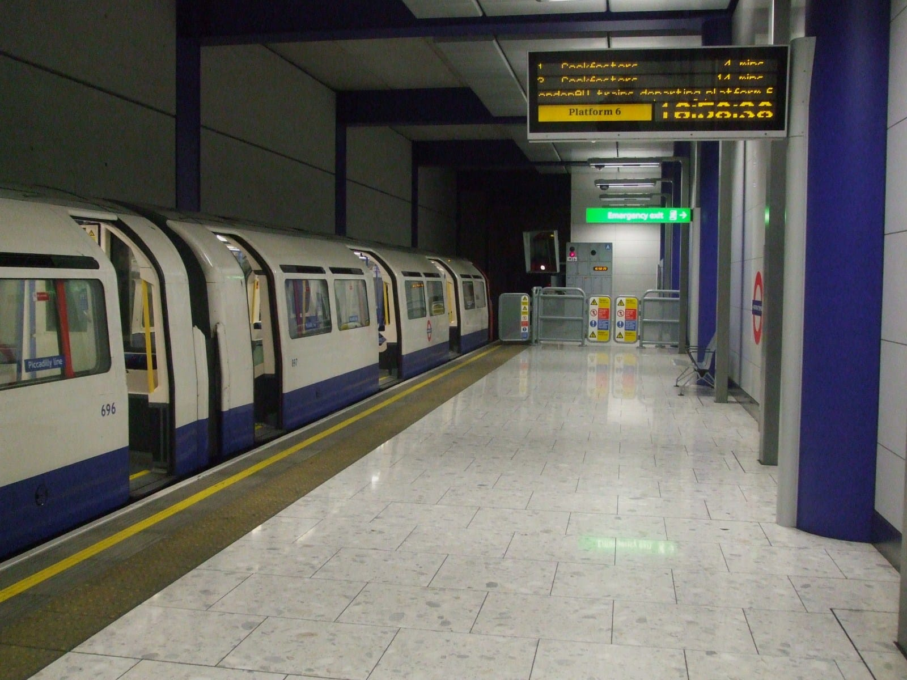
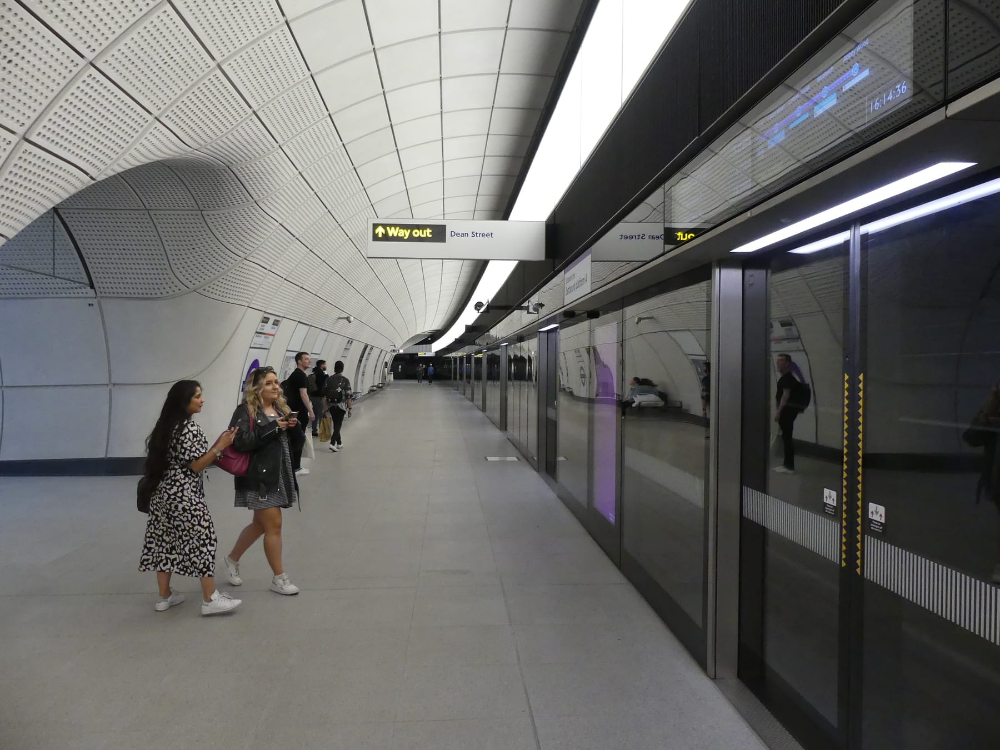
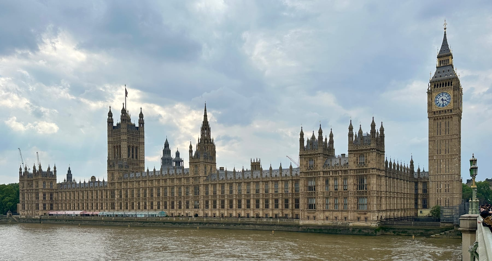

You can leave Heathrow on a layover if you are allowed into the UK: stepping out of the terminal means passing through UK border control, and a visa-free visitor now needs an **ETA** to do it. Whether it is worth doing is arithmetic. **Eight hours** is the shortest layover that leaves you more than a couple of hours in town.

> 💡 **The Short Version:** **Leaving the airport means border control**, which means a **£20 ETA** for visa-free visitors (apply on [GOV.UK](https://www.gov.uk/eta) before you fly; you cannot get one at Heathrow) or a **£74.50 Visitor in Transit visa** if your nationality needs a visa. Stay airside and most travellers need neither. Heathrow advises **three hours before an international departure**, so a layover has to cover that, an hour to clear arrivals and about **an hour and a half on trains**. **Six hours is not worth leaving for; eight gives you about two and a half hours in London, ten about four and a half, twelve about six and a half.** The **Elizabeth line** is the way in: **£15.50, 37 minutes to Tottenham Court Road**. A private six-hour layover tour needs about ten hours.

## Do you need an ETA or a visa to leave the airport?

The question is whether you pass through border control, not how long you stay. **Airside** means you change planes without entering the UK. **Landside** means you go through border control, even if you are back through the airport within hours.

| Your passport | Staying airside | Leaving Heathrow |
| --- | --- | --- |
| British or Irish | Nothing | Nothing |
| A visa-free nationality (the EU, US, Canada, Australia and others on GOV.UK's list) | Nothing | An ETA, £20 |
| A nationality that needs a visa | A Direct Airside Transit visa, £41.50, if your nationality requires one | A Visitor in Transit visa, £74.50, if you leave within 48 hours |

*Fees are from GOV.UK as of November 2026 and vary slightly by country of application.*

**An ETA or a UK visa replaces the transit visa**: GOV.UK says you do not need a transit visa if you hold a valid ETA, a Standard Visitor visa or a Marriage Visitor visa. A stay of more than 48 hours needs a Standard Visitor visa instead of the Visitor in Transit visa.

**Separate tickets put you landside whether you like it or not.** If your two flights are not on one booking, you collect your bags and check them in again for the second flight, and GOV.UK lists checking in luggage for a connecting flight as a reason to pass through border control. That needs an ETA or a visa even if you never leave the terminal.

[Check your own passport on GOV.UK](https://www.gov.uk/check-uk-visa) before you book, and read [who needs an ETA and how to apply](/articles/uk-eta-guide/) for the rest: each traveller needs their own, babies included.

## Clearing arrivals, and getting back in

*The arrivals corridor at Terminal 2. Photo: [Coolcaesar](https://commons.wikimedia.org/wiki/File:Arrival_Corridor_at_Heathrow_Terminal_2.jpg), [CC BY 4.0](https://creativecommons.org/licenses/by/4.0/).*

**Plan an hour from landing to the train, and more if several long-haul flights land together.** [Heathrow's immigration page](https://www.heathrow.com/arrivals/immigration-and-passports) carries the live wait. Eligible passport holders aged 10 and over can use the eGates, which Heathrow calls usually the quickest way in. Children aged 8 and 9 can use them from 8 July 2026 if they travel with an adult, are at least 120cm tall and hold an eligible biometric passport.

**Coming back, work from the airport's own advice.** Heathrow recommends arriving **three hours before an international flight and two hours before a flight within Europe or the UK**. That window covers check-in, bag drop and security, which you go through again. A layover is measured from landing to that point, not to your departure time.

## Getting into central London

Three trains serve the airport. Fares are walk-up singles.

| Route | Time | Fare | Where it goes |
| --- | --- | --- | --- |
| **Heathrow Express** | 15 min | £26; from £10 if booked in advance | Paddington only, from Terminals 2 and 3 and Terminal 5 |
| **Elizabeth line** | 28 to 42 min | £15.50 | Paddington 28, Bond Street 35, Tottenham Court Road 37, Farringdon 40, Liverpool Street 42 (times from Terminals 2 and 3) |
| **Piccadilly line** | 50 to 60 min | £4.00 off-peak, £5.90 peak | All terminals, direct to South Kensington, Green Park, Piccadilly Circus, Covent Garden and King's Cross |

Heathrow Express prices are from [heathrowexpress.com](https://www.heathrowexpress.com/tickets-and-offers). Children aged 15 and under travel free with a paying adult. The Express stops at Paddington and goes no further; it beats the Elizabeth line to Paddington by 13 minutes and costs £10.50 more. Tap in and out with the same contactless card or phone on the Elizabeth line and Piccadilly line; our [Oyster and contactless guide](/articles/oyster-card-guide-london/) covers the daily cap. [Every Heathrow option is compared in our Heathrow to London guide](/articles/heathrow-airport-to-london/).

*A Piccadilly line train at Terminal 5. Photo: [Sunil060902](https://commons.wikimedia.org/wiki/File:Heathrow_Terminal_5_platform_6_look_east_1973_stock.JPG), [CC BY-SA 3.0](https://creativecommons.org/licenses/by-sa/3.0/).*

**The Piccadilly line is the cheapest and the slowest.** It has no air-conditioning, little luggage space and stairs at several central stations, but it is the only line from Heathrow that reaches Piccadilly Circus and Covent Garden without a change.

**The Elizabeth line is the one to plan around.** It runs straight to the West End, the City and Canary Wharf and has step-free access at its central stations.

*The Elizabeth line platform at Tottenham Court Road. Photo: [Sunil060902](https://commons.wikimedia.org/wiki/File:Tottenham_Court_Road_stn_Elizabeth_Line_26th_May_2022_07.jpg), [CC BY-SA 4.0](https://creativecommons.org/licenses/by-sa/4.0/).*

> ⚠️ **Check the trains for your dates.** No Elizabeth line or Heathrow Express trains run to or from Heathrow on Saturday 28 and Sunday 29 November, or from Sunday 27 to Wednesday 30 December 2026; the Piccadilly line is then the only rail link. The [Heathrow to London guide](/articles/heathrow-airport-to-london/) carries the current closures.

## Leaving your bags

**Heathrow's left-luggage desks are run by Excess Baggage Company: £10 per item for up to 3 hours, £15 for 3 to 24 hours and £27.50 for 24 to 48 hours.** The desks are in check-in and arrivals areas, landside, so you reach them after border control; [our luggage storage guide](/articles/luggage-storage-london/) lists each terminal's desks and hours. Prices are on [Heathrow's luggage page](https://www.heathrow.com/at-the-airport/airport-services/left-luggage), and you can book online.

**Check where your suitcase is before you go.** On a single ticket, checked bags are usually sent to your final destination and you cannot reclaim them. Ask your airline at the start of the trip, and travel with hand luggage if they will not release them. Carrying a case across London is the main thing that wastes a layover.

## What each layover buys

Time in London is the layover minus **one hour** to clear arrivals, **an hour and a half** for the two train journeys including the walks at each end, and **three hours** at Heathrow before departure. For a flight within Europe or the UK, add an hour.

| Layover | Time in London | What fits |
| --- | --- | --- |
| **6 hours** | About 30 minutes | Stay at the airport |
| **8 hours** | About 2½ hours | One place beside the Elizabeth line |
| **10 hours** | About 4½ hours | One walk across the centre |
| **12 hours** | About 6½ hours | A landmark and a meal |
| **14 hours or more** | 8½ hours or more | A day, or a night if the flights allow |

**6 hours: stay put.** Half an hour in town costs £31 in Elizabeth line fares and puts a three-hour deadline on your return. Use the time at the airport.

**8 hours: one stop.** Take the Elizabeth line to **Tottenham Court Road** (37 minutes) and choose one thing within ten minutes' walk: the [British Museum](/articles/british-museum-guide/), or a loop through Soho ([our Soho and Chinatown walk](/articles/soho-chinatown-walk/)) for lunch. Allow a few minutes either side for the platforms.

**10 hours: Soho to Parliament on foot.** From Tottenham Court Road, walk through Soho to Leicester Square and Trafalgar Square, then down Whitehall to Westminster, about 35 minutes without stops. Our [Westminster walk](/articles/westminster-walk/) has the route. Come back on the Jubilee line from Westminster to Bond Street and join the Elizabeth line there.

*The Palace of Westminster from Westminster Bridge. Photo: [APK](https://commons.wikimedia.org/wiki/File:Palace_of_Westminster_and_Big_Ben_viewed_from_Westminster_Bridge.jpg), [CC BY 4.0](https://creativecommons.org/licenses/by/4.0/).*

**12 hours or more: the City and the river.** The Elizabeth line runs direct to **Liverpool Street** in 42 minutes. Walk or take the Circle line to Tower Hill for the [Tower of London](/articles/tower-of-london-guide/) and Tower Bridge, then follow the river west to Borough Market on our [Bankside and Borough walk](/articles/bankside-borough-walk/). Book timed tickets before you fly, because a queue eats the afternoon.

**Leave a margin.** The three hours is Heathrow's own advice, not padding, and a late train or a long immigration queue comes out of your sightseeing, not out of the buffer. Be on the return train at least ten minutes before you planned.

## Or let someone else watch the clock

A private layover tour does the planning for you, and suits a first visit with ten hours or more. The tours below run six hours and start at about £280 on GetYourGuide; the listings ask for your terminal and flight number so the guide can meet you.

Powered by <a target="_blank" rel="sponsored" href="https://www.getyourguide.com/london-l57/">GetYourGuide</a>

## Overnight layovers

**For an evening arrival and a morning flight, the airport hotels are the easy answer.** [Heathrow's own hotel page](https://www.heathrow.com/at-the-airport/lounges-hotels-spas) lists hotels within walking distance of arrivals.

**To spend the evening in town, work backwards from the flight.** For an 11am international departure you need to be at the airport by 8am, which means a train from Paddington by about 7.15am. Book somewhere on the Elizabeth line, such as Paddington, Bond Street or Farringdon. Our [Paddington area guide](/articles/paddington-area-guide/) and the [where to stay hub](/stay/) cover the options.

**For an early landing and a late flight, buy the gap.** A hotel day room sells a bed, a shower and a door that shuts, usually 9am to 5pm: ibis London Heathrow at about £50, Atrium Hotel Heathrow and Crowne Plaza Terminal 4 opening at 7am. [Our day rooms guide](/articles/day-rooms-london/) has the windows and prices, and the [Heathrow day-room table](/articles/day-rooms-london/#heathrow-and-gatwick-work-differently) lists the Heathrow hotels.

## When not to bother

**Under eight hours.** The three-hour check-in and two train journeys leave too little.

**If your bags are checked through and your airline will not release them.** You would sightsee in the clothes you flew in, with no luggage to leave.

**If you have no ETA or visa and no time to get one.** A decision on an ETA usually arrives within a day, but GOV.UK allows up to 3 working days, and there is no way to apply at the airport.

**On the closure dates above.** The Piccadilly line is then the only train, and it takes up to an hour each way.

**If you land at night.** Most of what you came to see is shut. Sleep, then use the morning.

Our [ETA guide](/articles/uk-eta-guide/) covers the permit, and the [Heathrow to London guide](/articles/heathrow-airport-to-london/) the transport in more detail. If London becomes the trip, not the gap, the [one-day itineraries by interest](/articles/one-day-london-itineraries-by-interest/) pick up where a layover leaves off.
